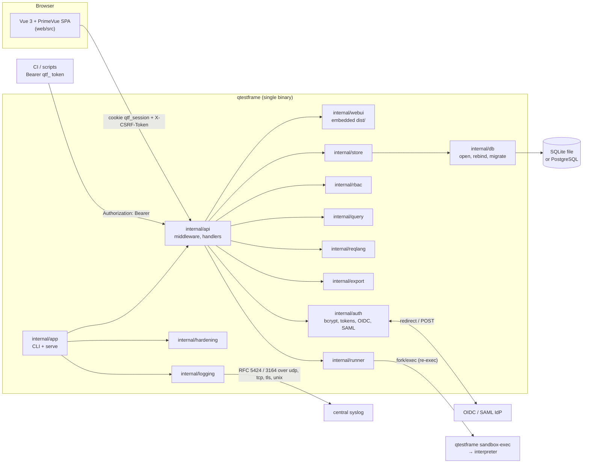
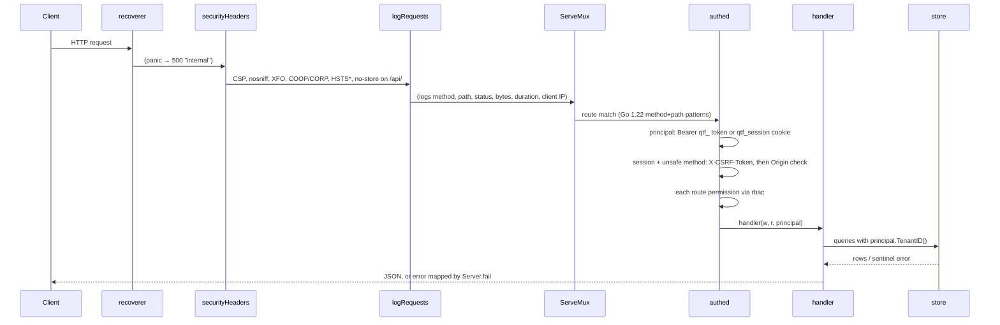
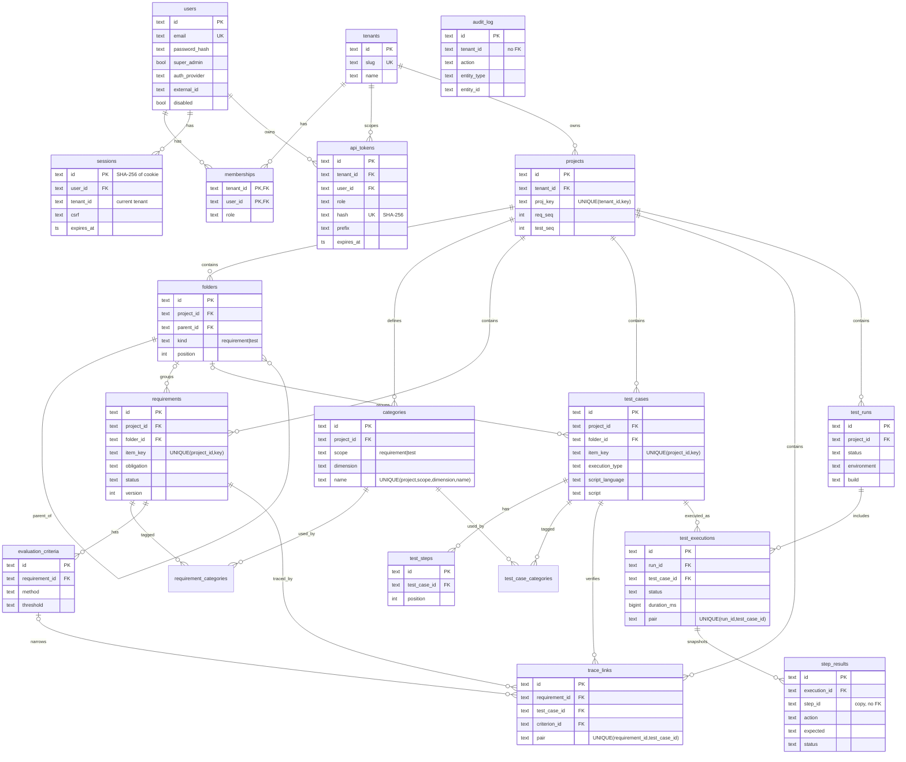
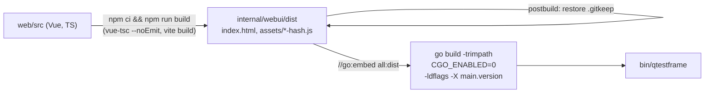

# Architecture

Qtestframe is one static Go binary (`cmd/qtestframe`) that contains the
REST API, the authentication flows, the administrative CLI, the script
runner's sandbox launcher and the compiled Vue single-page application.
It stores its data in SQLite (`modernc.org/sqlite`, pure Go) or in
PostgreSQL (`jackc/pgx/v5` through `database/sql`).

- [1. Components](#1-components)
- [2. Package map](#2-package-map)
- [3. Request lifecycle](#3-request-lifecycle)
- [4. Multi-tenancy model](#4-multi-tenancy-model)
- [5. Data model](#5-data-model)
- [6. Deployment topologies](#6-deployment-topologies)
- [7. Build pipeline](#7-build-pipeline)

The decisions behind this structure are recorded in [adr/](adr/).

## 1. Components



At start-up `qtestframe serve` (`cmdServe` in `internal/app/app.go`)
loads the configuration, builds the logger, opens the database and applies
migrations, bootstraps the first administrator if the database has no
users, creates the runner work directory, builds the HTTP server, opens the
listener (wrapped in TLS when a certificate is configured), and only then
applies in-process hardening (`hardening.Apply`), because Landlock and
seccomp must be installed after every start-up file has been opened. A
background goroutine purges expired sessions every hour. `SIGINT`/`SIGTERM`
trigger a graceful shutdown with a 15 s drain; `SIGHUP` reloads the TLS key
pair.

## 2. Package map

| Package | Responsibility |
|---|---|
| `cmd/qtestframe` | `main`: sets `app.Version` (from `-ldflags -X main.version`) and calls `app.Run`. |
| `internal/app` | Command line (`serve`, `migrate`, `user create`, `tenant create`, `member add`, `seed-demo`, `secrets`, `check-config`, `healthcheck`, `version`, `sandbox-exec`), first-start bootstrap, demo data (`seed.go`), TLS listener with SIGHUP certificate reload, mapping of configuration to hardening options. |
| `internal/api` | HTTP server: route table and middleware (`server.go`), principal resolution, CSRF/Origin check, sessions, local/OIDC/SAML login, JIT provisioning (`authn.go`), handlers for admin, projects, folders, categories, requirements, tests, links, runs, search and export, the query schemas and record builders used for filtering (`records.go`), error mapping, login rate limiter. |
| `internal/auth` | bcrypt password hashing and policy, random tokens, SHA-256 token hashing, `qtf_` API token format, HMAC-signed expiring state values (`Signer`), OIDC authorization-code flow with PKCE and nonce (`oidc.go`, `coreos/go-oidc`), SAML 2.0 service provider (`saml.go`, `crewjam/saml`), group-to-role mapping. |
| `internal/config` | YAML configuration with defaults, `QTF_*` environment overrides, secret files (resolved against `$CREDENTIALS_DIRECTORY`), validation. |
| `internal/db` | Opens SQLite (single connection, WAL, foreign keys, busy timeout) or PostgreSQL; `?` → `$n` placeholder rebinding; embedded, dialect-templated migrations (`migrations/*.sql`). |
| `internal/store` | Persistence of every entity; all tenant-owned lookups filter by `tenant_id`; key allocation, folder trees, moves across projects, category remapping, bulk updates, run/execution bookkeeping, last results and coverage computation. Encrypts and decrypts the stored secrets on their way into and out of the database (`secrets.go`). |
| `internal/secrets` | Envelope encryption of stored secrets: AES-256-GCM values (`enc:v1:…`, bound to table, column and row) under data-encryption keys that are wrapped by a key provider: `local` (key file / `QTF_SECRETS_KEY`), `tpm` (TPM 2.0 sealing, `go-tpm`) or `pkcs11` (HSM, build tag `pkcs11`). |
| `internal/model` | Domain types shared by store, API and export; JSON tags define the REST contract; enumerations (statuses, obligation levels, evaluation methods, ...). |
| `internal/rbac` | Permissions, built-in roles (`admin`, `manager`, `test_lead`, `tester`, `viewer`) with defaults, and `Set`: a tenant's roles after its changes and custom roles (ADR 0014). |
| `internal/mention`, `internal/tagsuggest` | @mention handles and the people directory; tag suggestions from title and description. |
| `internal/similarity` | Similar and conflicting requirements and tests, offline and in pure Go: Snowball stemmers for English and Swedish, stop words, domain synonyms and compound splitting, TF-IDF with character 4-grams and field weights (title > description > details), cosine similarity; conflict detection (opposite obligations via `internal/reqlang`, disjoint numeric thresholds with units, mutually exclusive values) with evidence; an optional OpenAI-compatible embeddings client. Used by the built-in checks `duplicate_suspect`, `potential_conflict`, `test_duplicate_suspect` (`internal/tracerules` similar.go) and `internal/api` similarity.go. |
| `internal/ai` | Optional AI assistance (off by default): providers for the Anthropic Messages API and OpenAI-compatible chat completions (streamed server-sent events, cancellation through the context, no tools), the embedded and versioned prompt templates in English and Swedish (item data JSON-escaped between `<item_data>` tags), the strict JSON answer schemas validated on the server with one retry. `internal/api` ai.go gathers the items, checks availability (system settings `ai`, tenant `ai_enabled`, `projects.ai_disabled`), the per-user rate limit, validates the answers against the embedded lists and the requirement checks, and writes an `ai.request` audit entry per call; nothing is saved by the feature endpoints. |
| `internal/customfield` | Custom field definitions and values (types, validation, defaults, text forms for exports and imports) and the built-in item templates per project type, in English and Swedish. |
| `internal/query` | Lexer, parser and evaluator of the filter/search language; matched-field and term extraction for highlighting. |
| `internal/verification` | Whether requirements are verified, and why: evidence per evaluation criterion (tests, test steps, verification records), plain links for compatibility or strict criterion coverage, the roll-up along `refines` (parent/child) with inconsistencies, and coverage per system element. Pure functions over data the store loads (`Store.ProjectVerification`, `Store.RequirementVerification`, `Store.IsVerified`). |
| `internal/reqlang` | RFC 2119 / RFC 8174 keyword detection, obligation level, requirement lint rules and score. |
| `internal/soa` | Statement of Applicability: the controls of a reference source (shipped lists in `data/*.yaml`, ISO/IEC 27001:2022 Annex A; otherwise the clause groups of the catalogue refs), joined with the project's applicability decisions and the implementation status derived from the requirements and their test results. |
| `internal/export` | Format-neutral `Dataset` rendered as CSV (ZIP for several sections), XLSX (`excelize`), PDF (`go-pdf/fpdf`) and DOCX (hand-written OOXML). |
| `internal/interop` | Exchange with other tools and with Excel: a field registry (built-in fields plus `Register`ed extensions such as custom fields), the round-trip workbook (write / read), the diff of a file against the stored items (new, changed, unchanged, conflict, error per cell) and the ReqIF mapping (object types to requirements or tests, attributes per kind, relation types to relations or trace links, hierarchy as folders or refines). The API applies a confirmed diff in one transaction through the regular create / PATCH handlers (`internal/api/exchange*.go`). |
| `internal/chat` | Chat notifications: renders events as Slack (Block Kit), Microsoft Teams (Adaptive Card, legacy MessageCard), Mattermost, Rocket.Chat, Google Chat (cardsV2), Matrix (`m.notice` with HTML) and Discord (embeds) messages within each tool's length limits, posts them without leaking the URL or token in errors, and groups and labels the events of the central registry (`model.WebhookEvents`). The API keeps the channels, the outbox with retries and backoff, digests and the delivery log (`internal/api/chat.go`, `internal/store/chat.go`). |
| `internal/oslc` | RDF/XML, Turtle and JSON-LD writers and readers (a subset for resource descriptions) and the `oslc.where` parser of the OSLC RM / QM 2.1 provider (`internal/api/oslc*.go`: discovery, query, creation factories, update with If-Match, delete, delegated dialogs). |
| `internal/live` | Live updates: the in-process hub that fans out change, notification and presence events to the open Server-Sent Events streams per tenant (non-blocking queues; a slow stream gets a `reset`), the replay buffer for `Last-Event-ID`, presence with a time to live, and the PostgreSQL bus (`LISTEN`/`NOTIFY` on a channel per database and schema) between instances; on SQLite in-process only. The events come from `Server.audit` (after the commit) and `Store.OnNotifications`; `internal/api/live.go` filters each event by the reader's project access and read permission before writing it. |
| `internal/runner` | Executes automated test scripts with timeout and output cap; optional re-exec through `qtestframe sandbox-exec` (rlimits, no_new_privs, Landlock, seccomp). |
| `internal/hardening` | In-process Linux hardening: `PR_SET_NO_NEW_PRIVS`, capability dropping, Landlock (`go-landlock`), seccomp deny-list (`go-seccomp-bpf`), rlimits; no-ops on other platforms. |
| `internal/logging` | `log/slog` setup (text or JSON) with fan-out to a syslog writer (RFC 5424 or RFC 3164; UDP, TCP, TLS, Unix; RFC 6587 octet counting on streams). |
| `internal/webui` | `//go:embed all:dist` of the compiled SPA; `FS()` returns `nil` if `index.html` is missing. |
| `internal/testutil` | Test database fixture (in-memory SQLite, or a PostgreSQL schema per test). |
| `web/` | Vue 3 + TypeScript + PrimeVue 4 client (Vite, Pinia, vue-router, Chart.js). Pure logic lives in `web/src/lib` and is unit tested. |

## 3. Request lifecycle

`Server.Handler()` (`internal/api/server.go`) wraps the route mux in three
middlewares; protected routes are additionally wrapped in `authed`.



1. **`recoverer`** turns a panic into `500 {"code":"internal"}` and logs the
   stack trace.
2. **`securityHeaders`** sets the CSP (`contentSecurityPolicy` constant),
   `X-Content-Type-Options`, `X-Frame-Options`, `Referrer-Policy`,
   `Permissions-Policy`, COOP/CORP, HSTS (only when `server.hsts` is true
   *and* the connection is TLS), and `Cache-Control: no-store` for `/api/`.
3. **`logRequests`** writes one slog record per request (except `/healthz`,
   `/readyz`) at INFO, or ERROR for status ≥ 500. The client IP is the TCP
   peer, or the last `X-Forwarded-For` entry if the peer is in
   `server.trusted_proxies`.
4. **mux**: public routes are `/healthz`, `/readyz`, `/api/v1/auth/{providers,login,logout}`
   and the OIDC/SAML endpoints. Every other `/api/v1` route goes through
   `authed`; unknown `/api/` paths get a JSON 404; everything else is served
   from the embedded SPA (`handleUI`) with fallback to `index.html`.
5. **`authed`** (`internal/api/authn.go`):
   * **Principal.** `Authorization: Bearer qtf_…` is hashed with SHA-256 and
     looked up in `api_tokens` (expired tokens are rejected, `last_used` is
     updated). The token's role is lowered to the user's current membership
     role if that is lower. Otherwise the `qtf_session` cookie is hashed and
     looked up in `sessions`; the session's current tenant and the user's
     membership role are attached (a super admin without membership gets
     `admin`). Disabled users are rejected. Failure → 401.
   * **CSRF.** For session principals and any method other than GET/HEAD:
     `X-CSRF-Token` must equal the session's CSRF token (constant-time
     compare), and `sameOrigin` must accept the `Origin` header (absent,
     equal to the request `Host`, or equal to the scheme+host of
     `server.base_url`). Failure → 403. Bearer requests are exempt.
   * **Permission.** Each permission passed in the route table is checked
     with `Principal.Can`. Super admins pass every check, but only when
     authenticated by session, not by token. Some handlers check further
     permissions themselves (folders and categories depend on the item kind;
     tenant and user administration require the super-admin flag).
6. **Handler** decodes JSON (body limit `MaxBodyBytes` = 8 MiB), calls the
   store with `p.TenantID()` and writes a JSON response. Mutations write an
   audit entry (`Server.audit`: `audit_log` row plus an `audit` slog record).
7. **Store** runs parameterised SQL through `conn`, which rebinds `?`
   placeholders for PostgreSQL. Driver errors are mapped to `ErrNotFound`
   (404), `ErrConflict` (409, also for unique violations) and `ErrInvalid`
   (400) by `Server.fail`; query parse errors become `400 invalid_query`
   with a `position`.

## 4. Multi-tenancy model

* **Shared schema.** All tenants live in the same tables. Every
  tenant-owned table carries a `tenant_id` column (`projects`, `folders`,
  `categories`, `requirements`, `test_cases`, `trace_links`, `test_runs`,
  `test_executions`, `api_tokens`, `audit_log`; `memberships` has it as part
  of its key). Child tables without their own `tenant_id`
  (`evaluation_criteria`, `test_steps`, `step_results`, the category
  assignment tables) are reached only through a parent that was loaded with
  a tenant predicate.
* **Identity is global, authority is per tenant.** A `users` row is global
  (unique e-mail). `memberships(tenant_id, user_id, role)` gives the user
  exactly one role per tenant. `users.super_admin` is a global flag.
* **Principal tenant.** The tenant of a request is never taken from the
  request URL or body. For sessions it is `sessions.tenant_id`, chosen at
  login (the `tenant` slug in the login body, the SSO `default_tenant`, or
  the first membership) and changed with `POST /api/v1/auth/switch-tenant`,
  which re-checks membership. For API tokens it is `api_tokens.tenant_id`.
* **Enforcement.** Handlers pass `p.TenantID()` to the store; store lookups
  by ID include `AND tenant_id = ?`, so an ID from another tenant yields
  404. Operations that span projects (moving items or folders, links,
  adding tests to runs) verify that both ends belong to the principal's
  tenant (and to the same project where required).
* **Deletion.** `DELETE /api/v1/tenants/{id}` (super admin) removes the
  tenant row; foreign keys cascade to memberships, tokens and projects (and
  from projects to everything inside). `audit_log` and `sessions` rows are
  deleted explicitly because they have no foreign key to `tenants`.

See [ADR 0005](adr/0005-shared-schema-multi-tenancy.md).

## 5. Data model

Generated from `internal/db/migrations/0001_init.sql`. `{{TS}}` is
`TIMESTAMP` (SQLite) or `TIMESTAMPTZ` (PostgreSQL), `{{BOOL}}` is `INTEGER`
or `BOOLEAN`. All IDs are UUID strings generated by the application.



(`proj_key`, `item_key` and `pair` stand for the `key` column and composite
unique constraints, which Mermaid cannot express directly.)

Notes:

* **Keys.** Projects have a key such as `DEMO` (`^[A-Z][A-Z0-9]{1,15}$`).
  Requirement and test keys are `<PROJECT>-REQ-<n>` and `<PROJECT>-TC-<n>`,
  allocated from `projects.req_seq`/`test_seq` with
  `UPDATE … RETURNING` inside the inserting transaction (`nextKey` in
  `internal/store/project.go`). Keys are never reused within a project.
* **Tags** are stored as a JSON array in a `TEXT` column.
* **Cascades.** Deleting a project cascades to everything in it; deleting a
  folder sets `folder_id` of items to `NULL` at the database level, but the
  store moves children and items to the parent folder (or deletes them with
  `?cascade=true`); deleting a criterion nulls `trace_links.criterion_id`.
* **Step snapshots.** `step_results` copies `action` and `expected` of each
  step when a test is added to a run, so later edits to the test do not
  change recorded executions.
* **Migrations** are tracked in `schema_migrations(version, name)`; each
  file is applied in one transaction and they are forward-only.

`0002_history_relations_baselines.sql` adds:

| Table / column | Purpose |
|---|---|
| `revisions(entity_type, entity_id, version, action, changed_fields, snapshot JSON, user_email)` | version history of requirements and tests |
| `requirement_relations(source_id, target_id, type)` | typed requirement-to-requirement links, `UNIQUE(source, target, type)` |
| `baselines(project_id, name)` + `baseline_items(entity_type, entity_id, key, title, version, snapshot)` | frozen project states |
| `comments(entity_type, entity_id, user_id, body)` | discussion threads |
| `test_steps.call_test_id` (FK, `ON DELETE SET NULL`) | shared steps |
| `test_executions.defects` (JSON array) | defect references |
| `test_cases.version` | test versioning |
| `projects.defect_url_template` | issue tracker links |
| `users.preferences` (JSON) | profile settings |
| `sessions.ip`, `user_agent`, `last_seen` | session list on the profile page |

`revisions` and `comments` reference items polymorphically (no foreign
key); the store deletes them together with their items, projects and
tenants (`deleteEntityData` in `internal/store/history.go`).

## 6. Deployment topologies

### Single node with SQLite (default)

```
clients ──HTTPS :8443──▶ qtestframe (systemd unit, hardened) ──▶ /var/lib/qtestframe/qtestframe.db (+ -wal, -shm)
```

* TLS is terminated by the binary (`server.tls_cert`/`tls_key`, TLS 1.2
  minimum, certificate reloaded on SIGHUP).
* SQLite is opened with **one connection** (`SetMaxOpenConns(1)`), WAL
  journal, `foreign_keys(1)` and `busy_timeout(5000)`; writes are therefore
  serialised in-process, which avoids `SQLITE_BUSY`. `max_open_conns` is
  ignored for SQLite.
* Deployment files: `deploy/systemd/`, `deploy/selinux/`, `deploy/apparmor/`,
  `deploy/nftables/`, `deploy/sysctl/`, installed by `scripts/install.sh`.

### High availability with PostgreSQL behind a reverse proxy

```
            ┌──▶ qtestframe #1 ─┐
LB / proxy ─┤                   ├──▶ PostgreSQL (primary + replicas)
 (TLS)      └──▶ qtestframe #2 ─┘
```

* All persistent state (sessions, tokens, data, audit) is in the database,
  so any node can serve any authenticated request.
* Set `server.base_url` to the public URL and `server.trusted_proxies` to the
  proxy addresses (client IPs for logs and the login rate limiter come from
  `X-Forwarded-For` only then).
* HSTS is emitted only on TLS connections that reach the binary; when the
  proxy terminates TLS, set HSTS at the proxy.
* **Per-process state** to account for:
  * The OIDC/SAML login state cookie is signed with a key generated at
    process start (`auth.NewSigner(nil)` in `api.New`). The login redirect
    and the IdP callback must reach the same process, so enable session
    affinity for `/api/v1/auth/` (or run SSO through one node). A restart
    during a login invalidates in-flight logins.
  * The login rate limiter is in memory per process, so the effective limit
    is `auth.login_max_attempts` (default 10) per window per node.
  * Each node runs its own hourly session purge (harmless) and its own
    script runner.
* `max_open_conns` (default 20) is the pool size per node.

### Container

`deploy/container/Containerfile` builds the SPA (Node 22), then a static
binary (`CGO_ENABLED=0`), and copies it into
`gcr.io/distroless/static-debian12:nonroot` (UID 65532). Defaults:
`QTF_DATABASE_DRIVER=sqlite`, `QTF_DATABASE_DSN=/var/lib/qtestframe/qtestframe.db`,
`QTF_SERVER_LISTEN=:8443`, JSON logs; `/var/lib/qtestframe` is a volume.
`deploy/container/compose.yaml` runs PostgreSQL 16 on an internal network, a
one-shot `migrate` service and the server with `read_only: true`,
`cap_drop: [ALL]`, `no-new-privileges` and the seccomp profile
`deploy/seccomp/qtestframe-seccomp.json`. For probes without a shell,
`qtestframe healthcheck` requests `/healthz` of the local listener.

Operational details: [operations.md](operations.md).

## 7. Build pipeline



* `make web` runs `npm ci` and `npm run build` in `web/`. Vite writes to
  `../internal/webui/dist` (`web/vite.config.ts`, `emptyOutDir: true`);
  `web/scripts/postbuild.mjs` recreates `dist/.gitkeep` so the embed
  directive always has a directory to embed.
* `make go` builds `bin/qtestframe` with `CGO_ENABLED=0 go build -trimpath
  -ldflags "-s -w -X main.version=$(VERSION)"`. `CGO_ENABLED=0` matters
  beyond portability: `syscall.AllThreadsSyscall`, used to apply
  capabilities and prctl to every OS thread, is unavailable in cgo builds.
* `make build` = `web` + `go`; `make release` cross-compiles
  linux/amd64, linux/arm64 and darwin/arm64 into `dist/`.
* A binary built without the SPA still works as API server; `/` then
  answers `404 web client not built (run "make web")`.
* Hashed files under `assets/` are served with `Cache-Control: public,
  max-age=31536000, immutable`, everything else with `no-cache`.
* For development, `scripts/dev.sh` runs the backend on `:8080` and Vite on
  `:5173` with a proxy for `/api`.
