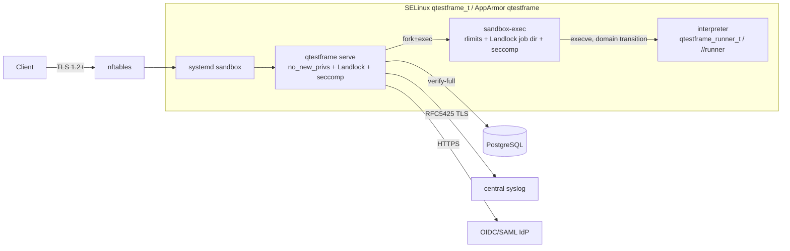

# Security

This document describes the security design of Qtestframe, the threat model
it is built against, and the operating-system hardening shipped in `deploy/`.
It is written for operators and security reviewers. For installation and
day-to-day operation see [operations.md](operations.md).

- [1. Scope and assets](#1-scope-and-assets)
- [2. Threat model (STRIDE)](#2-threat-model-stride)
- [3. Authentication](#3-authentication)
- [4. Authorization and tenant isolation](#4-authorization-and-tenant-isolation)
- [5. Web application protections](#5-web-application-protections)
- [6. TLS](#6-tls)
- [7. Secrets handling](#7-secrets-handling)
- [8. Audit log and central logging](#8-audit-log-and-central-logging)
- [9. Script runner sandbox](#9-script-runner-sandbox)
- [10. Operating-system hardening (defence in depth)](#10-operating-system-hardening-defence-in-depth)
- [11. Verifying the hardening](#11-verifying-the-hardening)
- [12. Hardening checklist](#12-hardening-checklist)
- [13. Reporting vulnerabilities](#13-reporting-vulnerabilities)

## 1. Scope and assets

Qtestframe is a multi-tenant requirements and test management server: a
single static Go binary (`CGO_ENABLED=0`) serving a REST API (`/api/v1`) and
an embedded single-page web UI, backed by SQLite (pure Go, `modernc.org/sqlite`)
or PostgreSQL.

| Asset | Why it matters |
|---|---|
| Requirements, test specifications, results, exports | confidential engineering data of each tenant; integrity matters for certification/compliance evidence |
| User accounts, password hashes, sessions, API tokens | account takeover → data access in every tenant the user belongs to |
| IdP client secrets, SAML SP key, DB credentials, TLS key | lateral movement / impersonation of the service |
| Audit trail | accountability, forensic evidence; must be tamper-evident (shipped off-host) |
| The host | the optional script runner executes user-supplied code |

**Trust boundaries**

```
 Browser / API client ──HTTPS──▶ qtestframe ──TLS──▶ PostgreSQL
        (untrusted)              │   │   └──TLS──▶ central syslog
                                 │   └──HTTPS──▶ OIDC / SAML IdP
                                 └──fork/exec──▶ sandboxed script runner (untrusted code)
```

Out of scope: compromise of the IdP, of the database server, or of a
super administrator account; physical access; denial of service by
volumetric network attacks (use upstream filtering).

## 2. Threat model (STRIDE)

| | Threat | Main mitigations |
|---|---|---|
| **S**poofing | credential stuffing / brute force on local login | bcrypt (cost 12), login rate limit of 10 attempts per 5 minutes per client IP + e-mail (HTTP 429), generic error messages, SSO preferred (local login can be disabled: `auth.local: false`) |
| | session hijacking | random 256-bit session tokens, only their SHA-256 hash stored server-side, cookie `qtf_session` `HttpOnly; Secure; SameSite=Lax`, absolute TTL (`auth.session_ttl`), new session at every login, revocation on logout and on admin password reset/disable, HSTS |
| | forged SSO responses | OIDC: authorization code + PKCE (S256), `state` and `nonce` kept in a signed, single-use, 10-minute cookie, ID token signature/issuer/audience/expiry checked against the discovered JWKS. SAML (crewjam/saml): signed response or signed assertions required, audience/destination/recipient/time window validated, `InResponseTo` must equal the AuthnRequest ID from the signed single-use state cookie (no assertion replay cache, see §3) |
| | TLS interception | TLS 1.2+ only, modern AEAD suites, HSTS; outbound connections verify certificates (`sslmode=verify-full` for PostgreSQL, CA pinning for syslog) |
| **T**ampering | CSRF | session-authenticated requests with any method other than GET/HEAD require `X-CSRF-Token` (per-session token, constant-time compare) and pass an Origin check (`sameOrigin`); plus `SameSite=Lax` cookies; bearer-token requests are exempt (no ambient credentials) |
| | SQL injection | parameterised queries only; the query language (`q=`) is parsed into an AST and evaluated in process against loaded records, never translated to SQL; unknown fields are rejected |
| | modification of evidence | audit log of changes (who, action, entity, short details, when), also emitted as log records that can be shipped to a central syslog server; requirements carry a version counter; run executions keep step snapshots |
| | binary/config tampering | binary and config owned by root and read-only for the service (`ProtectSystem=strict`, Landlock, SELinux/AppArmor) |
| **R**epudiation | users denying actions | audit log with tenant, user ID and e-mail, action, entity and timestamp; the request log line carries the client IP (from `X-Forwarded-For` only for `trusted_proxies`); both forwarded via RFC 5424 syslog, over TLS if configured |
| **I**nformation disclosure | cross-tenant data access (IDOR) | every query is scoped by `tenant_id` taken from the authenticated session/token, never from the request; object lookups by ID include the tenant predicate and return 404 (not 403) on mismatch |
| | XSS | Vue templates auto-escape; no `v-html` in the client; CSP `script-src 'self'` (no inline scripts, no `unsafe-eval`; `style-src` needs `'unsafe-inline'` for PrimeVue); `X-Content-Type-Options: nosniff`; exports served with `Content-Disposition: attachment` |
| | CSV/spreadsheet formula injection in exports | CSV cells starting with `=`, `+`, `-`, `@`, TAB or CR are prefixed with `'`; XLSX cells are written as string values, never formulas; PDF/DOCX are generated, not templated from user HTML |
| | secrets in logs | passwords, tokens, cookies and `Authorization` headers are not logged (failed logins log the e-mail and client IP); API tokens are stored as SHA-256 hashes and shown once |
| | verbose errors | error bodies `{"error","code"}`; unexpected errors return only "internal server error", details go to the server log (method, path, error) |
| **D**enial of service | resource exhaustion | read/write/idle timeouts, 1 MiB header and 8 MiB JSON body limit (1 MiB for SAML ACS), query limits (4096 bytes, 64 regexes, depth 128), RE2 regular expressions (linear time, no ReDoS), search `limit` ≤ 1000, DB connection pool cap, login rate limit; systemd `MemoryMax`, `TasksMax`, `LimitNOFILE` |
| | runaway test scripts | runner disabled by default; wall-clock timeout with process-group kill, rlimits (CPU, file size, open files, no core), output cap; process count bounded by systemd `TasksMax` |
| **E**levation of privilege | role escalation | RBAC checked server-side on every endpoint; API tokens cannot exceed the creator's role and are capped at the current membership role; tokens cannot create tokens and never carry super-admin rights; only super admins manage users/tenants; the last admin of a tenant cannot be demoted or removed |
| | RCE via script runner / parser bug | sandbox re-exec (no_new_privs + Landlock + seccomp + rlimits + dropped capabilities, optional socket deny), separate SELinux domain / AppArmor child profile without network, systemd sandbox, unprivileged user |
| | kernel exploitation | seccomp deny-list in-process and `SystemCallFilter=` in systemd, `RestrictNamespaces`, no capabilities but `CAP_NET_BIND_SERVICE`, `MemoryDenyWriteExecute` |

## 3. Authentication

### Local accounts

* Passwords are hashed with **bcrypt**, cost 12 (`auth.BcryptCost`).
  Existing hashes are not re-hashed when the cost changes. Policy
  (`auth.ValidatePassword`): 10 to 72 bytes (longer passwords are rejected
  rather than silently truncated by bcrypt), at least one letter and at
  least one non-letter.
* Login: `POST /api/v1/auth/login`. Unknown users, SSO-only users, wrong
  passwords and disabled users all get the same `401 invalid credentials`.
  For a missing hash a bcrypt comparison against a dummy hash is still
  performed. The dummy hash uses the configured bcrypt cost, so failed
  logins take the same time whether or not the account exists.
* **Rate limiting** (`rateLimiter` in `internal/api/server.go`): at most 10
  login attempts per 5-minute sliding window per key *client IP + normalised
  e-mail*; further attempts get **HTTP 429** `rate_limited`. A successful
  login resets the key. The limiter is in memory (per process, lost on
  restart). Failed logins are logged at WARN (`login failed`, e-mail,
  client IP). Behind a reverse proxy configure `server.trusted_proxies`,
  otherwise all clients share the proxy's address.
* Disable local login entirely when SSO is in place: `auth.local: false`
  (super admins can still be managed with the CLI on the host).
* First administrator: `qtestframe user create --email E --password-stdin
  --super-admin` (password from stdin, never from argv/ps) plus
  `qtestframe member add`, or the `bootstrap` section with
  `admin_password_file`, which creates a super admin and an admin
  membership in `bootstrap.tenant_slug` when the database has no users.

### Sessions

* Server-side sessions; the browser only holds the opaque cookie
  `qtf_session` (32 random bytes, `HttpOnly`, `Secure` unless
  `auth.cookie_secure: false`, `SameSite=Lax`, `Path=/`). The `sessions`
  table stores the SHA-256 hash of the cookie value as session ID, so a
  database leak does not reveal usable sessions.
* Absolute lifetime `auth.session_ttl` (default 12 h); expired sessions are
  rejected and deleted on access and purged hourly.
* A new session is created at every login. Switching tenants
  (`POST /auth/switch-tenant`, membership re-checked) updates the current
  tenant of the existing session; the session ID is not rotated.
* Revocation: logout deletes the session; a super admin disabling a user or
  setting a password via `PATCH /api/v1/users/{id}` deletes all sessions of
  that user. Changing one's own password (`POST /auth/password`) ends all
  other sessions of that user and keeps the current one.
* **CSRF** (`authed` in `internal/api/authn.go`): every request with a
  method other than GET/HEAD that is authenticated by the cookie must send
  `X-CSRF-Token` with the session's CSRF token (24 random bytes, returned as
  `csrf_token` by `/auth/login` and `/auth/me`; constant-time compare).
  In addition **`sameOrigin`** rejects the request if an `Origin` header is
  present and names neither the request `Host` nor the scheme+host of
  `server.base_url`. Requests without `Origin` (non-browser clients) pass
  this check. Failures return 403. Public endpoints (login, logout, SSO
  callbacks) are not CSRF-checked.
* **API tokens** (`Authorization: Bearer qtf_...`) for CI systems:
  `qtf_` + 32 random bytes (base64url); the prefix makes them recognisable
  to secret scanners. Only the SHA-256 hash and a 10-character display
  prefix are stored; the token is shown once. A token is bound to one
  tenant, carries a role that may not exceed the creator's role at creation,
  and on every request its role is **capped at the user's current
  membership role** (a demoted user's tokens are demoted too). Optional
  expiry (`expires_days`), `last_used` is recorded, revocable
  (`DELETE /tokens/{id}`). Tokens cannot create tokens, and a super admin's
  token has only the token's role.

### OpenID Connect

* Authorization code flow with **PKCE (S256)**, a random **state** (CSRF of
  the login itself) and **nonce** (ID token replay). State, nonce and PKCE
  verifier are kept in the cookie `qtf_login_state` (`HttpOnly`,
  `SameSite=Lax`, `Path=/api/v1/auth/`), HMAC-SHA256-signed with a key
  generated at process start, valid for 10 minutes and cleared when the
  callback reads it (single use).
* Provider metadata from `<issuer>/.well-known/openid-configuration`
  (`coreos/go-oidc`); the ID token signature is verified against the
  provider's JWKS, and issuer, audience (`client_id`) and expiry are
  validated by the library; the nonce is compared by Qtestframe.
* Redirect URI is fixed: `<base_url>/api/v1/auth/oidc/<name>/callback`.
  After login the browser is always redirected to `/` (no user-controlled
  redirect target); errors redirect to `/login?error=Sign-in failed`.
* The ID token must contain an e-mail claim (`email_claim`); if it contains
  `email_verified: false` the login is rejected (an absent
  `email_verified` claim is accepted).
* Just-in-time provisioning, see below.

### SAML 2.0

* SP-initiated login only (`crewjam/saml`): the AuthnRequest is sent with
  the HTTP-Redirect binding, the response is POSTed to
  `<base_url>/api/v1/auth/saml/<name>/acs`; SP metadata at
  `/api/v1/auth/saml/<name>/metadata`. AuthnRequests are not signed.
* Validation by `crewjam/saml` (`ServiceProvider.ParseResponse`): the
  response or every assertion must carry a valid XML signature from the IdP
  metadata certificate; destination, issuer, audience (SP entity ID),
  subject-confirmation recipient and the `NotBefore`/`NotOnOrAfter`
  validity window (with crewjam's clock-skew allowance, 180 s by default)
  are checked. Encrypted assertions are decrypted with the SP key when
  `sp_key_file` is configured. The ACS body is limited to 1 MiB.
* **Replay protection:** there is **no assertion replay cache**
  (crewjam's `ReplayCache` is not configured). Instead, the AuthnRequest ID
  is stored in the signed state cookie `qtf_login_state`
  (`SameSite=None; Secure`, because the ACS POST is cross-site; 10-minute
  expiry), and `ParseResponse` accepts only a response whose `InResponseTo`
  equals that ID. The cookie is cleared when the ACS reads it, so each
  AuthnRequest can complete at most one login in that browser;
  IdP-initiated (unsolicited) responses are rejected. A captured response
  could only be replayed together with the matching, still valid state
  cookie and within the assertion's validity window.
* The e-mail is taken from `email_attr` (or the NameID if it contains `@`);
  an assertion without e-mail is rejected.
* SP key pair: `scripts/certs/gen-saml-sp-cert.sh` (RSA 3072).

### Just-in-time provisioning (OIDC and SAML)

`provision` in `internal/api/authn.go`:

1. Find the user by (provider, subject). Otherwise find a user with the same
   e-mail: if it is a local account or already bound to this provider, it is
   **linked** (provider and subject stored, local password hash cleared); if
   it is bound to another provider the login fails. Otherwise create the
   user only if `auto_provision: true`.
2. Disabled users are rejected.
3. With `default_tenant` set, the role is the highest-ranked role that
   `role_mapping` assigns to one of the user's groups (`groups_claim` /
   `groups_attr`), else `default_role` (an invalid value falls back to
   `viewer`). A membership is created if missing and `auto_provision` is
   on; if `role_mapping` is configured, an existing membership is updated to
   the mapped role at every login (the IdP is authoritative).

Because accounts are linked by e-mail, only connect IdPs whose e-mail
addresses are verified and controlled by your organisation.

## 4. Authorization and tenant isolation

* Every user has exactly **one role per tenant**; a global **super admin**
  flag grants every permission in every tenant plus user/tenant management
  (for session logins only; API tokens are limited to their role). A super
  admin without membership in the current tenant acts as `admin` there.
* Roles and permissions (`internal/rbac/rbac.go`; defaults below, the
  tenant's effective matrix is served at `GET /api/v1/roles`):

| Permission | viewer | tester | test_lead | manager | admin |
|---|:-:|:-:|:-:|:-:|:-:|
| project/requirement/test/run read, member.read, export | ✔ | ✔ | ✔ | ✔ | ✔ |
| test.write, run.write, run.execute, token.manage | | ✔ | ✔ | ✔ | ✔ |
| script.execute, audit.read, settings.manage | | | ✔ | ✔ | ✔ |
| requirement.write, project.create, project.update | | | | ✔ | ✔ |
| project.delete, member.manage, role.manage, tenant.manage | | | | | ✔ |

* **Configurable roles** ([ADR 0014](adr/0014-tenant-configurable-roles.md)):
  holders of `role.manage` change the permissions of the built-in roles
  except `admin` and create custom roles. Escalation is prevented: a role
  or API token can only receive permissions the caller holds; `admin`
  always keeps every permission; API tokens get the intersection of their
  role and the user's current role on every request. Role changes are
  audited.
* Full matrix with the endpoints using each permission:
  [design.md §12](design.md#12-rbac-matrix). Guards: a tenant keeps at
  least one admin; a super admin cannot demote or disable themselves.
* **Tenant isolation**: the tenant is derived from the session's *current
  tenant* (switch with `POST /auth/switch-tenant`, membership re-checked) or
  from the API token, never from the request. Store entry points take the
  tenant ID explicitly and every lookup by ID includes
  `tenant_id = ?`, so a guessed ID from another tenant yields 404. Follow-up
  queries on child rows (criteria, steps, positions) run only after the
  parent was loaded with the tenant predicate. Operations spanning projects
  (moving items or folders to another project, links, adding tests to a run)
  verify that both ends belong to the principal's tenant.
* Authorization is enforced in the API layer (route permissions in
  `internal/api/server.go`, data-dependent checks in handlers) and tenant
  scoping in the store layer.

## 5. Web application protections

Response headers set on every response:

| Header | Value |
|---|---|
| `Content-Security-Policy` | `default-src 'self'; script-src 'self'; style-src 'self' 'unsafe-inline'; img-src 'self' data:; font-src 'self' data:; connect-src 'self'; frame-ancestors 'none'; base-uri 'self'; form-action 'self' https:; object-src 'none'` (constant `contentSecurityPolicy` in `internal/api/server.go`; `'unsafe-inline'` styles are needed because PrimeVue injects styles at runtime; `form-action https:` allows the SAML/OIDC redirects) |
| `Strict-Transport-Security` | `max-age=63072000; includeSubDomains`, only when `server.hsts: true` **and** the request arrived over TLS at the binary (set HSTS at a TLS-terminating proxy yourself) |
| `X-Content-Type-Options` | `nosniff` |
| `X-Frame-Options` | `DENY` (legacy companion of `frame-ancestors 'none'`) |
| `Referrer-Policy` | `strict-origin-when-cross-origin` |
| `Permissions-Policy` | `camera=(), microphone=(), geolocation=(), payment=()` |
| `Cross-Origin-Opener-Policy` | `same-origin` |
| `Cross-Origin-Resource-Policy` | `same-origin` |
| `Cache-Control` | `no-store` for `/api/*` responses |

Further measures:

* JSON bodies are limited to 8 MiB (`MaxBodyBytes`), headers to 1 MiB;
  bodies are decoded with `encoding/json` (unknown fields are ignored, the
  `Content-Type` header is not enforced). `ReadHeaderTimeout` 10 s,
  `IdleTimeout` 120 s, read/write timeouts from `server.read_timeout` /
  `write_timeout`.
* Query language and search use **RE2** (Go `regexp`): linear time, no
  catastrophic backtracking; expressions are limited to 4096 bytes, 64
  regexes/globs and nesting depth 128.
* **Export injection protection** (`internal/export`): CSV cells starting
  with `=`, `+`, `-`, `@`, TAB or CR are prefixed with `'`; XLSX cells are
  written as string values (never formulas); DOCX text is XML-escaped; PDF
  and DOCX are generated programmatically. The download file name is built
  from the project key and a timestamp only.
* Static UI assets are embedded in the binary (no file system path
  traversal surface); `assets/*` (hashed names) are served
  `Cache-Control: public, max-age=31536000, immutable`, other files
  `no-cache`.
* Panics are recovered and answered with a generic 500.

## 6. TLS

* Configured in `cmdServe` (`internal/app/app.go`) when `server.tls_cert`
  and `tls_key` are set: `MinVersion: TLS 1.2`; TLS 1.2 cipher suites
  limited to ECDHE + AEAD (`TLS_ECDHE_{ECDSA,RSA}_WITH_AES_256_GCM_SHA384`,
  `_CHACHA20_POLY1305`, `_AES_128_GCM_SHA256`); TLS 1.3 suites and curve
  preferences are Go's defaults; ALPN `h2`, `http/1.1`.
* The key pair is served through `GetCertificate` from an atomically
  swapped value and re-read on **SIGHUP** (`systemctl reload qtestframe`),
  so renewals do not drop connections; if the reload fails, the previous
  certificate stays in use and an error is logged. Without TLS, SIGHUP is
  ignored.
* Certificates: Let's Encrypt (`scripts/certs/letsencrypt.sh`), an internal
  CA (`gen-ca.sh` + `gen-server-cert.sh`), or self-signed for labs. Check with
  `scripts/certs/verify-cert.sh`. ECDSA P-256 is the default key type.
* Outbound: PostgreSQL with `sslmode=verify-full`, syslog over TLS with
  `ca_file` (and optional client certificate), IdP endpoints over HTTPS with
  the system trust store.
* Running behind a TLS-terminating reverse proxy is supported: listen on
  `127.0.0.1`, set `trusted_proxies`, keep `cookie_secure: true`, and let
  the proxy send `Strict-Transport-Security` (Qtestframe emits HSTS only on
  its own TLS connections).

## 7. Secrets handling

* Never write secrets inline in `config.yaml`. Use the secret-file options
  `database.dsn_file`, `auth.oidc[].client_secret_file` and
  `bootstrap.admin_password_file` (contents are trimmed), and key files
  (`server.tls_key`, SAML `sp_key_file`, syslog `key_file`).
* **systemd credentials** (recommended): `LoadCredential=name:/path` in a
  drop-in copies the secret to `/run/credentials/qtestframe.service/name`
  (ramfs, not swappable, only readable by the service). Relative paths of
  the three secret-file options are resolved against
  `$CREDENTIALS_DIRECTORY` (`readSecret` in `internal/config/config.go`), so
  `client_secret_file: oidc-corp` is enough; key file paths are used as
  given. The credentials directory is added to the Landlock read-only
  paths. With TPM2/host key: `systemd-creds encrypt` +
  `LoadCredentialEncrypted=`.
* File permissions: `/etc/qtestframe` `0750 root:qtestframe`, config `0640`,
  keys `0640 root:qtestframe` (or `0600` owned by the reader). The service
  cannot modify its own configuration or keys.
* Environment variables (`QTF_DATABASE_DSN`, `QTF_OIDC_<NAME>_CLIENT_SECRET`,
  `QTF_BOOTSTRAP_ADMIN_PASSWORD`) are supported for containers but are
  visible in `/proc/<pid>/environ` to the same user; prefer files/secrets.
* Secret files are read once at start-up, before Landlock is applied
  (SIGHUP re-reads only the TLS key pair); they are not logged. Core dumps
  are disabled (`LimitCORE=0`).

## 8. Audit log and central logging

* `Server.audit` writes an `audit_log` row (tenant, user ID, user e-mail,
  action, entity type, entity ID, short details, timestamp) and an INFO log
  record `audit` with the same fields. Audited actions: successful logins
  (`login`, with the method `local` or the provider), `password.change`,
  create/update/delete/move/bulk operations on projects, folders,
  categories, requirements, tests and links, run and execution changes
  (including CI imports and script runs), member and token changes, tenant
  and user administration, and exports. Old/new values, client IP, user
  agent and request IDs are not recorded in the audit entry; failed logins
  and logouts appear only in the server log (`login failed` at WARN).
  Readable per tenant with `audit.read` (`GET /api/v1/audit?limit=&q=`,
  newest first, default 500, maximum 5000).
* Logs are structured (`logging.format: json`) to stdout → journald.
* **Central syslog** (`logging.syslog`, `internal/logging`): every log
  record (including the `audit` records) is also sent as JSON in a syslog
  message, RFC 5424 (default) or RFC 3164, over `udp`, `tcp`, `tls`, `unix`
  or `unixgram`; stream transports use RFC 6587 octet counting. With `tls`
  (RFC 5425, port 6514) the server is verified against `ca_file` (or the
  system roots) with the host name from `address`, TLS 1.2 minimum, and an
  optional client certificate (`gen-client-cert.sh`) for mutual TLS.
  Delivery is best effort (one reconnect, no disk queue). Shipping the
  audit trail off-host makes it tamper-evident even if the host is
  compromised. Receiver configuration: see operations.md.

## 9. Script runner sandbox

Automated tests may carry a script (sh, bash, python, javascript) that the
server can execute. This is remote code execution by design, so it is
**disabled by default** (`runner.enabled: false`) and wrapped in several
independent layers when enabled:

1. **Permission**: only roles with `script.execute` (manager, admin).
2. **Re-exec** (`runner.sandbox: true`, the default; `internal/runner`):
   the server does not run the interpreter directly. It starts its own
   binary as `qtestframe sandbox-exec --workdir DIR --cpu N
   [--no-network] -- INTERPRETER SCRIPT` (new process group; environment
   only `PATH`, `HOME`/`TMPDIR` = job directory, `LANG`, `QTF_TEST_KEY`,
   `QTF_RUN_ID`, `QTF_RUN_NAME`, `QTF_ENVIRONMENT`, `QTF_BUILD`; stdin
   `/dev/null`). `sandbox-exec` (`SandboxExec`), before `execve` of the
   interpreter:
   * applies **rlimits** (`hardening.SetResourceLimits`): `RLIMIT_CPU` =
     timeout + 1 s, `RLIMIT_FSIZE` 64 MiB, `RLIMIT_NOFILE` 256,
     `RLIMIT_CORE` 0 (`RLIMIT_AS` unlimited; no `RLIMIT_NPROC`, the process
     count is bounded by systemd `TasksMax`);
   * sets `PR_SET_NO_NEW_PRIVS` (no setuid/file-capability elevation);
   * drops capabilities (bounding set if `CAP_SETPCAP` is held, all
     effective/permitted/inheritable capabilities, ambient set cleared);
   * applies a **Landlock** rule set: read-only `/etc`, `/usr`, `/lib`,
     `/lib64`, `/bin`, `/sbin`, `/opt` (plus `hardening.DefaultReadOnly`),
     execute from `/usr`, `/bin`, `/lib*`, `/opt`, read/write only the
     per-job directory below `runner.work_dir`. The domain stacks on the
     server's own Landlock domain. The database directory is not
     accessible, but **`/etc` (including `/etc/qtestframe`) is readable**:
     protect configuration and keys with file permissions and MAC;
   * installs the **seccomp** deny-list (`hardening.DeniedSyscalls`); with
     `runner.deny_network: true` (default `false`) also `socket`,
     `socketpair`, `connect`, `bind`, `listen`, `accept`, `accept4`.
   With `runner.sandbox: false` the interpreter is started directly (only
   the remaining layers apply).
3. **Timeout** (`runner.timeout`, default 60 s): the whole process group is
   killed with SIGKILL and the execution is marked failed; **output cap**
   (`runner.max_output_bytes`, default 1 MiB) truncates combined
   stdout/stderr.
4. **Scripts are data**: written to the job directory and passed as an
   argument to the interpreter; the directory is `noexec` for the service
   (`NoExecPaths=/`, `ExecPaths=/usr ...`).
5. **MAC**: SELinux transitions interpreters to `qtestframe_runner_t`
   (boolean `qtestframe_run_scripts`, default off; no network, writes only
   to `qtestframe_runner_rw_t`); AppArmor runs them in the
   `qtestframe//runner` child profile (no network, database denied).
6. **systemd**: everything above runs inside the service sandbox
   (unprivileged user, `ProtectSystem=strict`, `PrivateTmp`, syscall filter,
   no namespaces).

Node.js uses a JIT and needs writable+executable memory, which
`MemoryDenyWriteExecute=yes` forbids. Either configure the interpreter as a
wrapper running `node --jitless`, or relax it in a drop-in
(`MemoryDenyWriteExecute=no`) **and** enable `qtestframe_runner_execmem` on
SELinux. Prefer to leave JavaScript out of `runner.interpreters`.

Even with all layers, treat the runner as a privilege boundary that a
determined attacker with `script.execute` may eventually cross: run it only
for trusted teams, or on a dedicated instance.

## 10. Operating-system hardening (defence in depth)

```
┌──────────────────────────────────────────────────────────────────────┐
│ Host: nftables (deploy/nftables), sysctl hardening (deploy/sysctl)   │
│ ┌──────────────────────────────────────────────────────────────────┐ │
│ │ MAC: SELinux qtestframe_t  |  AppArmor profile "qtestframe"      │ │
│ │ ┌──────────────────────────────────────────────────────────────┐ │ │
│ │ │ systemd sandbox: user qtestframe, ProtectSystem=strict,      │ │ │
│ │ │ PrivateTmp/Devices/IPC, SystemCallFilter, RestrictNamespaces,│ │ │
│ │ │ CapabilityBoundingSet=CAP_NET_BIND_SERVICE, MDWE, IPAddress* │ │ │
│ │ │ ┌──────────────────────────────────────────────────────────┐ │ │ │
│ │ │ │ in-process: no_new_privs, Landlock, seccomp, cap drop    │ │ │ │
│ │ │ │   qtestframe serve  (Go, memory safe, RE2, param. SQL)   │ │ │ │
│ │ │ │ ┌──────────────────────────────────────────────────────┐ │ │ │ │
│ │ │ │ │ runner: sandbox-exec → rlimits, Landlock(job dir),   │ │ │ │ │
│ │ │ │ │ seccomp, no caps; qtestframe_runner_t / //runner     │ │ │ │ │
│ │ │ │ └──────────────────────────────────────────────────────┘ │ │ │ │
│ │ │ └──────────────────────────────────────────────────────────┘ │ │ │
│ │ └──────────────────────────────────────────────────────────────┘ │ │
│ └──────────────────────────────────────────────────────────────────┘ │
└──────────────────────────────────────────────────────────────────────┘
```



| Layer | File | Protects against |
|---|---|---|
| Firewall | `deploy/nftables/qtestframe.nft` | exposure of other services, outbound exfiltration (optional egress policy) |
| sysctl | `deploy/sysctl/99-qtestframe.conf` | kernel info leaks, unprivileged BPF/ptrace, network spoofing |
| systemd | `deploy/systemd/qtestframe.service` | a compromised process reading/writing the host, using privileged syscalls, namespaces, devices |
| SELinux | `deploy/selinux/` | file/network access outside policy even for root bugs; booleans for optional features |
| AppArmor | `deploy/apparmor/usr.bin.qtestframe` | same, on Debian/Ubuntu/SUSE |
| seccomp (container) | `deploy/seccomp/qtestframe-seccomp.json` | allow-list of about 210 syscalls (default action `SCMP_ACT_ERRNO`) for container deployments |
| Landlock / seccomp / caps (in-process) | Go `internal/hardening` | works on Linux even without systemd/MAC (containers, other init systems); Landlock needs Linux ≥ 5.13 with Landlock enabled, applied best effort up to ABI v5; seccomp deny-list `hardening.DeniedSyscalls` |

### systemd unit

`deploy/systemd/qtestframe.service` documents every directive inline. Key
points:

* `User=qtestframe`, `UMask=0077`, `StateDirectory`/`RuntimeDirectory`/
  `ConfigurationDirectory`/`LogsDirectory` (the only writable paths are
  `/var/lib/qtestframe`, `/run/qtestframe`, `/var/log/qtestframe` and a
  private `/tmp`).
* `ProtectSystem=strict`, `ProtectHome`, `PrivateTmp`, `PrivateDevices`,
  `PrivateIPC`, `ProtectKernel{Tunables,Modules,Logs}`, `ProtectClock`,
  `ProtectControlGroups`, `ProtectHostname`, `ProtectProc=invisible`,
  `ProcSubset=pid`, `NoExecPaths=/` + `ExecPaths=/usr ...`.
* `NoNewPrivileges`, `CapabilityBoundingSet=CAP_NET_BIND_SERVICE` (+ ambient,
  for `:443`), `RestrictSUIDSGID`, `RestrictNamespaces`, `RestrictRealtime`,
  `LockPersonality`, `MemoryDenyWriteExecute`, `RemoveIPC`,
  `KeyringMode=private`.
* `RestrictAddressFamilies=AF_INET AF_INET6 AF_UNIX`, optional
  `IPAddressDeny=`/`IPAddressAllow=` and `SocketBindAllow=`.
* `SystemCallArchitectures=native`, `SystemCallFilter=@system-service
  @sandbox ~@privileged @resources @mount @debug @cpu-emulation @obsolete
  @raw-io @reboot @swap @module @clock`, `SystemCallErrorNumber=EPERM`.
  `@system-service` contains `execve`/`clone` needed for the runner's
  re-exec; `@sandbox` (`landlock_*`, `seccomp`) is added explicitly because
  the in-process hardening needs it. `setrlimit` (in `@resources`) is
  denied; rlimits are set with `prlimit64`.
* `LimitNOFILE=65536`, `LimitCORE=0`, `TasksMax=512`, `MemoryMax=2G`.
* `ExecStartPre=qtestframe migrate`, `ExecReload=kill -HUP` (TLS reload),
  `Restart=on-failure`, `Type=exec`.

**Exposure score.** `systemd-analyze security qtestframe.service` should
report an exposure of roughly 1.x ("OK"); the exact value depends on the
systemd version. The remaining points are inherent to a network service and
accepted deliberately:

| Check | Why it stays |
|---|---|
| `PrivateNetwork=`, `RestrictAddressFamilies=~AF_INET/AF_INET6` | it is a network server |
| `RestrictAddressFamilies=~AF_UNIX` | `/dev/log`, PostgreSQL unix socket |
| `CapabilityBoundingSet=~CAP_NET_BIND_SERVICE`, `AmbientCapabilities=` | binding `:443`; can be removed (see strict drop-in) |
| `PrivateUsers=` | incompatible with binding privileged ports via capability; enable in the strict drop-in |
| `IPAddressDeny=` | site specific; examples in the unit |
| `RootDirectory=/RootImage=` | not needed for a static binary with this sandbox |
| `DeviceAllow=` (char-rtc:r) | implied by `ProtectClock=yes` |

**Strict variant** (listen on `:8443`, no capability at all) — drop-in
`/etc/systemd/system/qtestframe.service.d/strict.conf`:

```ini
[Service]
CapabilityBoundingSet=
AmbientCapabilities=
PrivateUsers=yes
# restrict peers (adjust):
IPAddressDeny=any
IPAddressAllow=localhost 10.0.0.0/8
SocketBindAllow=tcp:8443
SocketBindDeny=any
```

This lowers the score further (below 1, "SAFE"). Use nftables
(`redirect to :8443`) to publish port 443.

### SELinux

`deploy/selinux/qtestframe.{te,fc,if}` (refpolicy module, compiles with
`make -f /usr/share/selinux/devel/Makefile`). `build.sh --install` loads it,
labels `tcp/8443` as `qtestframe_port_t` (overriding `http_port_t` where the
base policy defines 8443) and relabels the files.

| Type | Path |
|---|---|
| `qtestframe_exec_t` | `/usr/bin/qtestframe` |
| `qtestframe_conf_t` | `/etc/qtestframe(/.*)?` |
| `qtestframe_cert_t` | `/etc/qtestframe/tls(/.*)?` |
| `qtestframe_var_lib_t` | `/var/lib/qtestframe(/.*)?` |
| `qtestframe_runner_rw_t` | `/var/lib/qtestframe/runner(/.*)?` |
| `qtestframe_var_run_t` | `/run/qtestframe(/.*)?` |
| `qtestframe_log_t` | `/var/log/qtestframe(/.*)?` |
| `qtestframe_port_t` | `tcp/8443` |

Booleans (all off by default):

| Boolean | Enables |
|---|---|
| `qtestframe_connect_postgresql` | TCP to `postgresql_port_t` and the local PostgreSQL socket |
| `qtestframe_remote_syslog` | TCP/UDP to `syslogd_port_t` / `syslog_tls_port_t` |
| `qtestframe_connect_http` | HTTPS to `http_port_t` (OIDC discovery, JWKS, token endpoint, SAML metadata URL) |
| `qtestframe_bind_http_port` | listening on 443 |
| `qtestframe_run_scripts` | executing interpreters with transition to `qtestframe_runner_t` (requires `nnp_transition`, granted) |
| `qtestframe_runner_execmem` | JIT interpreters in the runner domain |

Debug denials with `ausearch -m AVC -c qtestframe -ts recent` and
`audit2allow -a -M qtestframe-local` (review before loading!).

### AppArmor

`deploy/apparmor/usr.bin.qtestframe`: read-only config/certs/credentials,
read-write state/runtime, `capability net_bind_service` only, inet/inet6
stream+dgram and unix sockets, no raw/packet/netlink, no ptrace/mount.
Interpreters run in the `qtestframe//runner` child profile: no network, no
capabilities, `/etc/qtestframe` and the database denied, writes only in
`/var/lib/qtestframe/runner`. Local additions:
`/etc/apparmor.d/local/usr.bin.qtestframe`.

### Containers

`deploy/container/`: distroless static image, `USER 65532`, `read_only:
true`, `cap_drop: [ALL]`, `no-new-privileges`, custom seccomp allow-list
(`deploy/seccomp/qtestframe-seccomp.json`, default action `EPERM`, native
architectures only, `clone` without namespace flags, `clone3` → `ENOSYS`),
`tmpfs /tmp`, PostgreSQL on an internal network without egress. The
profile was validated by tracing a Go `net/http` TLS server (HTTPS, DNS,
syslog, file I/O, `os/exec`) with `strace -f -c`: every observed syscall is
allowed.

## 11. Verifying the hardening

```sh
# systemd exposure score and per-directive report
systemd-analyze security qtestframe.service

PID=$(systemctl show -p MainPID --value qtestframe)

# no_new_privs, seccomp mode (2 = filter), capabilities
grep -E 'NoNewPrivs|Seccomp|Seccomp_filters|Cap(Inh|Prm|Eff|Bnd|Amb)' /proc/$PID/status
#   NoNewPrivs: 1
#   Seccomp:    2
#   CapEff:     0000000000000400   (only cap_net_bind_service, bit 10)
capsh --decode=$(awk '/CapBnd/ {print $2}' /proc/$PID/status)

# user, cgroup limits, namespaces
ps -o user,pid,cmd -p $PID
systemctl show qtestframe -p MemoryMax -p TasksMax -p LimitNOFILE

# SELinux domain and file labels
ps -eZ | grep qtestframe            # system_u:system_r:qtestframe_t:s0
ls -Z /etc/qtestframe /var/lib/qtestframe
semanage port -l | grep qtestframe
getsebool -a | grep qtestframe

# AppArmor
aa-status | grep -A2 qtestframe
cat /proc/$PID/attr/current          # qtestframe (enforce)

# Landlock: is it supported/enabled by the kernel?
grep -w landlock /sys/kernel/security/lsm && dmesg | grep -i landlock
# ...and is it applied? There is no /proc interface for Landlock domains;
# the start-up log line lists applied and skipped protections:
journalctl -u qtestframe | grep -i hardening

# TLS configuration seen by clients
scripts/certs/verify-cert.sh --connect qtf.example.com:8443
openssl s_client -connect qtf.example.com:8443 -tls1_1 </dev/null   # must fail
curl -sI https://qtf.example.com:8443/ | grep -i -E 'strict-transport|content-security|x-content-type|referrer|permissions'
```

At start-up the service logs one INFO record `hardening` with
`applied=[no_new_privs capabilities landlock seccomp]` and
`skipped=[…]`, where each skipped entry carries the reason (for example
`landlock: …` on a kernel without Landlock). A skipped feature is not
fatal; only a failing `no_new_privs` aborts the start.

The runner can be tested end-to-end with a script that tries to escape:
writing outside the job directory, reading the database, or looping forever
must fail or be killed; opening a socket must fail with
`runner.deny_network: true` or under the SELinux/AppArmor runner policy;
reading `/etc/qtestframe/config.yaml` must be blocked by MAC and file
permissions (Landlock allows `/etc`); fork bombs are stopped by `TasksMax`.

## 12. Hardening checklist

- [ ] TLS certificate from a trusted CA; `hsts: true`; `cookie_secure: true`
- [ ] `base_url` set to the public HTTPS URL
- [ ] SSO configured; `auth.local: false` or strong passwords + few local accounts
- [ ] secrets via `*_file` / `LoadCredential=`, permissions `0640 root:qtestframe`
- [ ] PostgreSQL with `sslmode=verify-full`, least-privilege DB role
- [ ] `logging.syslog` to a central server over `tls`
- [ ] `runner.enabled: false` unless needed; if enabled, only trusted roles, SELinux/AppArmor enforced, `runner.deny_network: true` if scripts need no network
- [ ] SELinux module loaded (RHEL family) or AppArmor profile enforced (Debian family)
- [ ] `systemd-analyze security qtestframe` ≤ 2.0
- [ ] nftables policy; only 443/8443 public; SSH restricted
- [ ] backups encrypted and restore tested (operations.md)
- [ ] `trusted_proxies` set when behind a reverse proxy

## 13. Reporting vulnerabilities

Please report suspected vulnerabilities privately to the maintainers
(security contact of the repository) rather than opening a public issue.
Include version (`qtestframe version`), configuration excerpts without
secrets, and reproduction steps.
