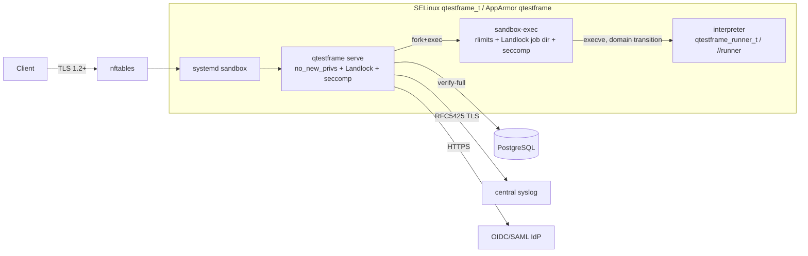

# Security

This document describes the security design of Qtestframe, the threat model
it is built against, and the operating-system hardening shipped in `deploy/`.
It is written for operators and security reviewers. For installation and
day-to-day operation see [operations.md](operations.md).

- [1. Scope and assets](#1-scope-and-assets)
- [2. Threat model (STRIDE)](#2-threat-model-stride)
- [3. Authentication](#3-authentication)
- [4. Authorization and tenant isolation](#4-authorization-and-tenant-isolation)
- [5. Web application protections](#5-web-application-protections)
- [6. TLS](#6-tls)
- [7. Secrets handling](#7-secrets-handling)
- [8. Audit log and central logging](#8-audit-log-and-central-logging)
- [9. Script runner sandbox](#9-script-runner-sandbox)
- [10. Operating-system hardening (defence in depth)](#10-operating-system-hardening-defence-in-depth)
- [11. Verifying the hardening](#11-verifying-the-hardening)
- [12. Hardening checklist](#12-hardening-checklist)
- [13. Reporting vulnerabilities](#13-reporting-vulnerabilities)

## 1. Scope and assets

Qtestframe is a multi-tenant requirements and test management server: a
single static Go binary (`CGO_ENABLED=0`) serving a REST API (`/api/v1`) and
an embedded single-page web UI, backed by SQLite (pure Go, `modernc.org/sqlite`)
or PostgreSQL.

| Asset | Why it matters |
|---|---|
| Requirements, test specifications, results, attachments | confidential engineering data of each tenant; integrity matters for certification/compliance evidence |
| User accounts, password hashes, sessions, API tokens | account takeover → data access in every tenant the user belongs to |
| IdP client secrets, SAML SP key, DB credentials, TLS key | lateral movement / impersonation of the service |
| Audit trail | accountability, forensic evidence; must be tamper-evident (shipped off-host) |
| The host | the optional script runner executes user-supplied code |

**Trust boundaries**

```
 Browser / API client ──HTTPS──▶ qtestframe ──TLS──▶ PostgreSQL
        (untrusted)              │   │   └──TLS──▶ central syslog
                                 │   └──HTTPS──▶ OIDC / SAML IdP
                                 └──fork/exec──▶ sandboxed script runner (untrusted code)
```

Out of scope: compromise of the IdP, of the database server, or of a
super administrator account; physical access; denial of service by
volumetric network attacks (use upstream filtering).

## 2. Threat model (STRIDE)

| | Threat | Main mitigations |
|---|---|---|
| **S**poofing | credential stuffing / brute force on local login | bcrypt (cost ≥ 12), per-IP and per-account login rate limiting with back-off, generic error messages, SSO preferred (local login can be disabled: `auth.local: false`) |
| | session hijacking | random 256-bit session IDs stored server-side, cookie `qtf_session` `HttpOnly; Secure; SameSite=Lax`, absolute TTL (`auth.session_ttl`), rotation on login and tenant switch, revocation on logout/password change, HSTS |
| | forged SSO responses | OIDC: authorization code + PKCE (S256), `state` and `nonce` bound to a short-lived cookie, ID token signature/issuer/audience/expiry checked against the discovered JWKS. SAML: signed assertions/responses required, audience/recipient/`InResponseTo`/time window validated, replay cache |
| | TLS interception | TLS 1.2+ only, modern AEAD suites, HSTS; outbound connections verify certificates (`sslmode=verify-full` for PostgreSQL, CA pinning for syslog) |
| **T**ampering | CSRF | session-authenticated state-changing requests require `X-CSRF-Token` (per-session token, constant-time compare) plus `SameSite` cookies and an Origin check against `server.base_url`; bearer-token requests are exempt (no ambient credentials) |
| | SQL injection | parameterised queries only; the query language (`q=`) is parsed into an AST and compiled to bound parameters, unknown fields are rejected |
| | modification of evidence | audit log of all changes (who/what/when/before→after), shipped to a central syslog server; results are versioned |
| | binary/config tampering | binary and config owned by root and read-only for the service (`ProtectSystem=strict`, Landlock, SELinux/AppArmor) |
| **R**epudiation | users denying actions | append-only audit log with user, tenant, source IP (from `trusted_proxies` only), user agent, request ID; forwarded via RFC 5424 syslog over TLS |
| **I**nformation disclosure | cross-tenant data access (IDOR) | every query is scoped by `tenant_id` taken from the authenticated session/token, never from the request; object lookups by ID include the tenant predicate and return 404 (not 403) on mismatch |
| | XSS | Vue templates auto-escape; no `v-html` with user data; strict CSP without `unsafe-inline`/`unsafe-eval`; `X-Content-Type-Options: nosniff`; attachments served with `Content-Disposition: attachment` |
| | CSV/spreadsheet formula injection in exports | cells starting with `=`, `+`, `-`, `@`, TAB or CR are prefixed with `'` in CSV/XLSX exports; PDF/DOCX are generated, not templated from user HTML |
| | secrets in logs | passwords, tokens, cookies and `Authorization` headers are never logged; API tokens are stored as SHA-256 hashes and shown once |
| | verbose errors | generic error bodies `{"error","code"}`; details only in the server log with a request ID |
| **D**enial of service | resource exhaustion | read/write timeouts, header/body size limits, pagination limits, RE2 regular expressions (linear time, no ReDoS), DB connection pool cap, login rate limits; systemd `MemoryMax`, `TasksMax`, `LimitNOFILE` |
| | runaway test scripts | runner disabled by default; wall-clock timeout, rlimits (CPU, address space, processes, file size, open files), output cap |
| **E**levation of privilege | role escalation | RBAC checked server-side on every endpoint; API tokens cannot exceed the creator's role; only super admins manage users/tenants; members cannot change their own role |
| | RCE via script runner / parser bug | sandbox re-exec (no_new_privs + Landlock + seccomp + rlimits + dropped capabilities), separate SELinux domain / AppArmor child profile without network, systemd sandbox, unprivileged user |
| | kernel exploitation | seccomp deny-list in-process and `SystemCallFilter=` in systemd, `RestrictNamespaces`, no capabilities but `CAP_NET_BIND_SERVICE`, `MemoryDenyWriteExecute` |

## 3. Authentication

### Local accounts

* Passwords are hashed with **bcrypt** (cost 12 or higher; hashes are
  upgraded transparently on login when the cost is raised). Minimum length
  is enforced; the maximum length is capped at 72 bytes (bcrypt limit) and
  rejected rather than silently truncated.
* Login: `POST /api/v1/auth/login`. Failures return the same message and
  comparable timing whether the user exists or not.
* **Rate limiting**: failed logins are throttled per source IP and per
  account (token bucket with exponential back-off); excess attempts get
  HTTP 429 and an audit/log entry. Behind a reverse proxy configure
  `server.trusted_proxies`, otherwise all clients share the proxy's address.
* Disable local login entirely when SSO is in place: `auth.local: false`
  (super admins can still be managed with the CLI on the host).
* First administrator: `qtestframe user create --email E --password-stdin
  --super-admin` (password from stdin, never from argv/ps) or the
  `bootstrap` section with `admin_password_file`.

### Sessions

* Server-side sessions; the browser only holds the opaque cookie
  `qtf_session` (`HttpOnly`, `Secure` unless `auth.cookie_secure: false`,
  `SameSite=Lax`, `Path=/`).
* Absolute lifetime `auth.session_ttl` (default 12 h); a new session ID is
  issued at login and on tenant switch; logout and password change revoke
  sessions server-side.
* **CSRF**: every state-changing request (POST/PUT/PATCH/DELETE) that is
  authenticated by the cookie must send `X-CSRF-Token` with the value
  returned as `csrf_token` by `/auth/login` or `/auth/me`.
* **API tokens** (`Authorization: Bearer qtf_...`) for CI systems: bound to
  one tenant, carry a role that cannot exceed the creator's role, optional
  expiry, stored hashed, revocable (`DELETE /tokens/{id}`).

### OpenID Connect

* Authorization code flow with **PKCE (S256)**, a random **state** (CSRF of
  the login itself) and **nonce** (ID token replay), both bound to a
  short-lived, HttpOnly cookie and single use.
* Provider metadata from `<issuer>/.well-known/openid-configuration`; ID token
  signature verified against the provider's JWKS (keys refreshed on unknown
  `kid`), `iss`, `aud`, `exp`, `iat`, `nonce` validated; `alg=none` and
  symmetric algorithms with public keys are rejected.
* Redirect URI is fixed: `<base_url>/api/v1/auth/oidc/<name>/callback`; no
  open redirects (post-login target restricted to same-origin paths).
* Optional just-in-time provisioning (`auto_provision`) into
  `default_tenant` with `default_role`, and group → role mapping
  (`groups_claim`, `role_mapping`). The email claim is only trusted when the
  IdP asserts `email_verified` (or the provider is configured as
  authoritative for its domain).

### SAML 2.0

* SP-initiated login with HTTP-POST binding to
  `<base_url>/api/v1/auth/saml/<name>/acs`; SP metadata at
  `/api/v1/auth/saml/<name>/metadata`.
* **Signed assertions (or a signed response) are mandatory**; signature
  validated against the IdP metadata certificate, XML signature wrapping
  defended by validating the signed element is the one consumed. Audience,
  `Recipient`, `Destination`, `InResponseTo`, `NotBefore`/`NotOnOrAfter`
  (small clock skew allowance) are checked; assertion IDs are cached to
  prevent replay. Encrypted assertions are supported with the SP key.
* SP key pair: `scripts/certs/gen-saml-sp-cert.sh` (RSA 3072).

## 4. Authorization and tenant isolation

* Every user has exactly **one role per tenant**; a global **super admin**
  flag grants every permission in every tenant plus user/tenant management.
* Roles and permissions (`internal/rbac/rbac.go`, served at `GET /api/v1/rbac`):

| Permission | viewer | tester | manager | admin |
|---|:-:|:-:|:-:|:-:|
| project/requirement/test/run read, member.read, export | ✔ | ✔ | ✔ | ✔ |
| test.write, run.write, run.execute, token.manage | | ✔ | ✔ | ✔ |
| requirement.write, project.create, project.update, script.execute, audit.read | | | ✔ | ✔ |
| project.delete, member.manage, tenant.manage | | | | ✔ |

* **Tenant isolation**: the tenant is derived from the session's *current
  tenant* (switch with `POST /auth/switch-tenant`, membership re-checked) or
  from the API token. Every repository/store query includes
  `tenant_id = $current` — including lookups by UUID, joins and search —
  so a guessed ID from another tenant yields 404. Cross-tenant operations
  (moving folders to another project) verify both ends belong to the same
  tenant.
* Authorization is enforced in the API layer for every endpoint and again
  in the store layer through the mandatory tenant predicate (defence in
  depth against a forgotten check).

## 5. Web application protections

Response headers set on every response:

| Header | Value |
|---|---|
| `Content-Security-Policy` | `default-src 'self'; script-src 'self'; style-src 'self'; img-src 'self' data:; font-src 'self'; connect-src 'self'; object-src 'none'; base-uri 'none'; form-action 'self' <IdP SAML/OIDC endpoints>; frame-ancestors 'none'` |
| `Strict-Transport-Security` | `max-age=63072000; includeSubDomains` (when `server.hsts: true` and TLS is on) |
| `X-Content-Type-Options` | `nosniff` |
| `X-Frame-Options` | `DENY` (legacy companion of `frame-ancestors 'none'`) |
| `Referrer-Policy` | `strict-origin-when-cross-origin` (`no-referrer` on auth endpoints) |
| `Permissions-Policy` | `camera=(), microphone=(), geolocation=(), payment=(), usb=(), interest-cohort=()` |
| `Cross-Origin-Opener-Policy` | `same-origin` |
| `Cross-Origin-Resource-Policy` | `same-origin` |
| `Cache-Control` | `no-store` for `/api/*` responses |

Further measures:

* JSON only (`Content-Type: application/json` required for bodies), body
  size limits, strict decoding (unknown fields rejected where sensible).
* Query language and search use **RE2** (Go `regexp`): linear time, no
  catastrophic backtracking.
* **Export injection protection**: CSV and XLSX exports neutralise formula
  injection (values starting with `=`, `+`, `-`, `@`, `\t`, `\r` are
  prefixed with `'`); file names in `Content-Disposition` are sanitised;
  DOCX/PDF are generated programmatically.
* Static UI assets are embedded in the binary (no file system path
  traversal surface), served with hashed file names and long cache times.

## 6. TLS

* Minimum **TLS 1.2**, TLS 1.3 preferred. TLS 1.2 suites limited to ECDHE +
  AEAD: `ECDHE-ECDSA/RSA-AES128-GCM-SHA256`, `-AES256-GCM-SHA384`,
  `-CHACHA20-POLY1305`. Curves X25519, P-256 (and the hybrid post-quantum
  X25519MLKEM768 when the Go runtime offers it).
* Certificate and key are re-read on **SIGHUP** (`systemctl reload
  qtestframe`), so renewals do not drop connections.
* Certificates: Let's Encrypt (`scripts/certs/letsencrypt.sh`), an internal
  CA (`gen-ca.sh` + `gen-server-cert.sh`), or self-signed for labs. Check with
  `scripts/certs/verify-cert.sh`. ECDSA P-256 is the default key type.
* Outbound: PostgreSQL with `sslmode=verify-full`, syslog over TLS with
  `ca_file` (and optional client certificate), IdP endpoints over HTTPS with
  the system trust store.
* Running behind a TLS-terminating reverse proxy is supported: listen on
  `127.0.0.1`, set `trusted_proxies`, keep `cookie_secure: true` and
  `hsts: true` (the proxy sets HTTPS for the browser).

## 7. Secrets handling

* Never write secrets inline in `config.yaml`. Use the `*_file` options
  (`database.dsn_file`, `auth.oidc[].client_secret_file`,
  `bootstrap.admin_password_file`, SAML `sp_key_file`, syslog `key_file`).
* **systemd credentials** (recommended): `LoadCredential=name:/path` in a
  drop-in copies the secret to `/run/credentials/qtestframe.service/name`
  (ramfs, not swappable, only readable by the service). Relative `*_file`
  paths are resolved against `$CREDENTIALS_DIRECTORY`, so
  `client_secret_file: oidc-corp` is enough. With TPM2/host key:
  `systemd-creds encrypt` + `LoadCredentialEncrypted=`.
* File permissions: `/etc/qtestframe` `0750 root:qtestframe`, config `0640`,
  keys `0640 root:qtestframe` (or `0600` owned by the reader). The service
  cannot modify its own configuration or keys.
* Environment variables (`QTF_OIDC_<NAME>_CLIENT_SECRET`,
  `QTF_BOOTSTRAP_ADMIN_PASSWORD`) are supported for containers but are
  visible in `/proc/<pid>/environ` to the same user; prefer files/secrets.
* Secrets are read once at start-up (before Landlock is applied) and on
  SIGHUP; they are never logged. Core dumps are disabled (`LimitCORE=0`).

## 8. Audit log and central logging

* The audit log records authentication events (login success/failure,
  logout, SSO provisioning, token use/creation/revocation), all
  create/update/delete operations with before/after values, role and
  membership changes, exports and script executions, each with timestamp,
  tenant, user, source IP, user agent and request ID. Readable per tenant
  with `audit.read` (`GET /api/v1/audit`).
* Logs are structured (`logging.format: json`) to stdout → journald.
* **Central syslog over TLS** (`logging.syslog`): RFC 5424 framing over TCP
  with TLS (RFC 5425, port 6514), server verified with `ca_file`, optional
  client certificate (`gen-client-cert.sh`) for mutual TLS. Shipping the
  audit trail off-host makes it tamper-evident even if the host is
  compromised. Receiver configuration: see operations.md.

## 9. Script runner sandbox

Automated tests may carry a script (sh, bash, python, javascript) that the
server can execute. This is remote code execution by design, so it is
**disabled by default** (`runner.enabled: false`) and wrapped in several
independent layers when enabled:

1. **Permission**: only roles with `script.execute` (manager, admin).
2. **Re-exec**: the server never runs the interpreter directly. It starts
   `/usr/bin/qtestframe sandbox-exec` as a child (new process group, empty
   environment except `PATH`, `HOME`/`TMPDIR` = job directory, stdin
   `/dev/null`), which, before `execve` of the interpreter:
   * sets `PR_SET_NO_NEW_PRIVS` (no setuid/file-capability elevation);
   * clears the ambient capability set and drops the bounding set (no
     capabilities survive the exec);
   * applies **rlimits** with `prlimit64`: `RLIMIT_CPU`, `RLIMIT_AS`,
     `RLIMIT_NPROC`, `RLIMIT_FSIZE`, `RLIMIT_NOFILE`, `RLIMIT_CORE=0`;
   * applies a **Landlock** rule set: read/execute only `/usr`, `/bin`,
     `/lib*`, `/etc` essentials; read/write only the per-job directory below
     `runner.work_dir` (the database and configuration are invisible);
   * installs a **seccomp** filter (the in-process deny-list plus network
     socket creation for the script).
3. **Timeout** (`runner.timeout`): the whole process group is killed;
   **output cap** (`runner.max_output_bytes`) truncates stdout/stderr.
4. **Scripts are data**: written to the job directory and passed as an
   argument to the interpreter; the directory is `noexec` for the service
   (`NoExecPaths=/`, `ExecPaths=/usr ...`).
5. **MAC**: SELinux transitions interpreters to `qtestframe_runner_t`
   (boolean `qtestframe_run_scripts`, default off; no network, writes only
   to `qtestframe_runner_rw_t`); AppArmor runs them in the
   `qtestframe//runner` child profile (no network, database denied).
6. **systemd**: everything above runs inside the service sandbox
   (unprivileged user, `ProtectSystem=strict`, `PrivateTmp`, syscall filter,
   no namespaces).

Node.js uses a JIT and needs writable+executable memory, which
`MemoryDenyWriteExecute=yes` forbids. Either configure the interpreter as a
wrapper running `node --jitless`, or relax it in a drop-in
(`MemoryDenyWriteExecute=no`) **and** enable `qtestframe_runner_execmem` on
SELinux. Prefer to leave JavaScript out of `runner.interpreters`.

Even with all layers, treat the runner as a privilege boundary that a
determined attacker with `script.execute` may eventually cross: run it only
for trusted teams, or on a dedicated instance.

## 10. Operating-system hardening (defence in depth)

```
┌──────────────────────────────────────────────────────────────────────┐
│ Host: nftables (deploy/nftables), sysctl hardening (deploy/sysctl)   │
│ ┌──────────────────────────────────────────────────────────────────┐ │
│ │ MAC: SELinux qtestframe_t  |  AppArmor profile "qtestframe"      │ │
│ │ ┌──────────────────────────────────────────────────────────────┐ │ │
│ │ │ systemd sandbox: user qtestframe, ProtectSystem=strict,      │ │ │
│ │ │ PrivateTmp/Devices/IPC, SystemCallFilter, RestrictNamespaces,│ │ │
│ │ │ CapabilityBoundingSet=CAP_NET_BIND_SERVICE, MDWE, IPAddress* │ │ │
│ │ │ ┌──────────────────────────────────────────────────────────┐ │ │ │
│ │ │ │ in-process: no_new_privs, Landlock, seccomp, cap drop    │ │ │ │
│ │ │ │   qtestframe serve  (Go, memory safe, RE2, param. SQL)   │ │ │ │
│ │ │ │ ┌──────────────────────────────────────────────────────┐ │ │ │ │
│ │ │ │ │ runner: sandbox-exec → rlimits, Landlock(job dir),   │ │ │ │ │
│ │ │ │ │ seccomp, no caps; qtestframe_runner_t / //runner     │ │ │ │ │
│ │ │ │ └──────────────────────────────────────────────────────┘ │ │ │ │
│ │ │ └──────────────────────────────────────────────────────────┘ │ │ │
│ │ └──────────────────────────────────────────────────────────────┘ │ │
│ └──────────────────────────────────────────────────────────────────┘ │
└──────────────────────────────────────────────────────────────────────┘
```



| Layer | File | Protects against |
|---|---|---|
| Firewall | `deploy/nftables/qtestframe.nft` | exposure of other services, outbound exfiltration (optional egress policy) |
| sysctl | `deploy/sysctl/99-qtestframe.conf` | kernel info leaks, unprivileged BPF/ptrace, network spoofing |
| systemd | `deploy/systemd/qtestframe.service` | a compromised process reading/writing the host, using privileged syscalls, namespaces, devices |
| SELinux | `deploy/selinux/` | file/network access outside policy even for root bugs; booleans for optional features |
| AppArmor | `deploy/apparmor/usr.bin.qtestframe` | same, on Debian/Ubuntu/SUSE |
| seccomp (container) | `deploy/seccomp/qtestframe-seccomp.json` | allow-list of ~200 syscalls for container deployments |
| Landlock / seccomp / caps (in-process) | Go `internal/hardening` | works on any Linux ≥ 5.13 even without systemd/MAC (containers, other init systems) |

### systemd unit

`deploy/systemd/qtestframe.service` documents every directive inline. Key
points:

* `User=qtestframe`, `UMask=0077`, `StateDirectory`/`RuntimeDirectory`/
  `ConfigurationDirectory`/`LogsDirectory` (the only writable paths are
  `/var/lib/qtestframe`, `/run/qtestframe`, `/var/log/qtestframe` and a
  private `/tmp`).
* `ProtectSystem=strict`, `ProtectHome`, `PrivateTmp`, `PrivateDevices`,
  `PrivateIPC`, `ProtectKernel{Tunables,Modules,Logs}`, `ProtectClock`,
  `ProtectControlGroups`, `ProtectHostname`, `ProtectProc=invisible`,
  `ProcSubset=pid`, `NoExecPaths=/` + `ExecPaths=/usr ...`.
* `NoNewPrivileges`, `CapabilityBoundingSet=CAP_NET_BIND_SERVICE` (+ ambient,
  for `:443`), `RestrictSUIDSGID`, `RestrictNamespaces`, `RestrictRealtime`,
  `LockPersonality`, `MemoryDenyWriteExecute`, `RemoveIPC`,
  `KeyringMode=private`.
* `RestrictAddressFamilies=AF_INET AF_INET6 AF_UNIX`, optional
  `IPAddressDeny=`/`IPAddressAllow=` and `SocketBindAllow=`.
* `SystemCallArchitectures=native`, `SystemCallFilter=@system-service
  @sandbox ~@privileged @resources @mount @debug @cpu-emulation @obsolete
  @raw-io @reboot @swap @module @clock`, `SystemCallErrorNumber=EPERM`.
  `@system-service` contains `execve`/`clone` needed for the runner's
  re-exec; `@sandbox` (`landlock_*`, `seccomp`) is added explicitly because
  the in-process hardening needs it. `setrlimit` (in `@resources`) is
  denied; rlimits are set with `prlimit64`.
* `LimitNOFILE=65536`, `LimitCORE=0`, `TasksMax=512`, `MemoryMax=2G`.
* `ExecStartPre=qtestframe migrate`, `ExecReload=kill -HUP` (TLS reload),
  `Restart=on-failure`, `Type=exec`.

**Exposure score.** `systemd-analyze security qtestframe.service` reports
**1.4 "OK"** (measured with systemd 255). The remaining points are inherent
to a network service and accepted deliberately:

| Check | Why it stays |
|---|---|
| `PrivateNetwork=`, `RestrictAddressFamilies=~AF_INET/AF_INET6` | it is a network server |
| `RestrictAddressFamilies=~AF_UNIX` | `/dev/log`, PostgreSQL unix socket |
| `CapabilityBoundingSet=~CAP_NET_BIND_SERVICE`, `AmbientCapabilities=` | binding `:443`; can be removed (see strict drop-in) |
| `PrivateUsers=` | incompatible with binding privileged ports via capability; enable in the strict drop-in |
| `IPAddressDeny=` | site specific; examples in the unit |
| `RootDirectory=/RootImage=` | not needed for a static binary with this sandbox |
| `DeviceAllow=` (char-rtc:r) | implied by `ProtectClock=yes` |

**Strict variant** (listen on `:8443`, no capability at all) — drop-in
`/etc/systemd/system/qtestframe.service.d/strict.conf`:

```ini
[Service]
CapabilityBoundingSet=
AmbientCapabilities=
PrivateUsers=yes
# restrict peers (adjust):
IPAddressDeny=any
IPAddressAllow=localhost 10.0.0.0/8
SocketBindAllow=tcp:8443
SocketBindDeny=any
```

This brings the score to 0.9 "SAFE". Use nftables (`redirect to :8443`) to
publish port 443.

### SELinux

`deploy/selinux/qtestframe.{te,fc,if}` (refpolicy module, compiles with
`make -f /usr/share/selinux/devel/Makefile`). `build.sh --install` loads it,
labels `tcp/8443` as `qtestframe_port_t` (overriding `http_port_t` where the
base policy defines 8443) and relabels the files.

| Type | Path |
|---|---|
| `qtestframe_exec_t` | `/usr/bin/qtestframe` |
| `qtestframe_conf_t` | `/etc/qtestframe(/.*)?` |
| `qtestframe_cert_t` | `/etc/qtestframe/tls(/.*)?` |
| `qtestframe_var_lib_t` | `/var/lib/qtestframe(/.*)?` |
| `qtestframe_runner_rw_t` | `/var/lib/qtestframe/runner(/.*)?` |
| `qtestframe_var_run_t` | `/run/qtestframe(/.*)?` |
| `qtestframe_log_t` | `/var/log/qtestframe(/.*)?` |
| `qtestframe_port_t` | `tcp/8443` |

Booleans (all off by default):

| Boolean | Enables |
|---|---|
| `qtestframe_connect_postgresql` | TCP to `postgresql_port_t` and the local PostgreSQL socket |
| `qtestframe_remote_syslog` | TCP/UDP to `syslogd_port_t` / `syslog_tls_port_t` |
| `qtestframe_connect_http` | HTTPS to `http_port_t` (OIDC discovery, JWKS, token endpoint, SAML metadata URL) |
| `qtestframe_bind_http_port` | listening on 443 |
| `qtestframe_run_scripts` | executing interpreters with transition to `qtestframe_runner_t` (requires `nnp_transition`, granted) |
| `qtestframe_runner_execmem` | JIT interpreters in the runner domain |

Debug denials with `ausearch -m AVC -c qtestframe -ts recent` and
`audit2allow -a -M qtestframe-local` (review before loading!).

### AppArmor

`deploy/apparmor/usr.bin.qtestframe`: read-only config/certs/credentials,
read-write state/runtime, `capability net_bind_service` only, inet/inet6
stream+dgram and unix sockets, no raw/packet/netlink, no ptrace/mount.
Interpreters run in the `qtestframe//runner` child profile: no network, no
capabilities, `/etc/qtestframe` and the database denied, writes only in
`/var/lib/qtestframe/runner`. Local additions:
`/etc/apparmor.d/local/usr.bin.qtestframe`.

### Containers

`deploy/container/`: distroless static image, `USER 65532`, `read_only:
true`, `cap_drop: [ALL]`, `no-new-privileges`, custom seccomp allow-list
(`deploy/seccomp/qtestframe-seccomp.json`, default action `EPERM`, native
architectures only, `clone` without namespace flags, `clone3` → `ENOSYS`),
`tmpfs /tmp`, PostgreSQL on an internal network without egress. The
profile was validated by tracing a Go `net/http` TLS server (HTTPS, DNS,
syslog, file I/O, `os/exec`) with `strace -f -c`: every observed syscall is
allowed.

## 11. Verifying the hardening

```sh
# systemd exposure score and per-directive report
systemd-analyze security qtestframe.service

PID=$(systemctl show -p MainPID --value qtestframe)

# no_new_privs, seccomp mode (2 = filter), capabilities
grep -E 'NoNewPrivs|Seccomp|Seccomp_filters|Cap(Inh|Prm|Eff|Bnd|Amb)' /proc/$PID/status
#   NoNewPrivs: 1
#   Seccomp:    2
#   CapEff:     0000000000000400   (only cap_net_bind_service, bit 10)
capsh --decode=$(awk '/CapBnd/ {print $2}' /proc/$PID/status)

# user, cgroup limits, namespaces
ps -o user,pid,cmd -p $PID
systemctl show qtestframe -p MemoryMax -p TasksMax -p LimitNOFILE

# SELinux domain and file labels
ps -eZ | grep qtestframe            # system_u:system_r:qtestframe_t:s0
ls -Z /etc/qtestframe /var/lib/qtestframe
semanage port -l | grep qtestframe
getsebool -a | grep qtestframe

# AppArmor
aa-status | grep -A2 qtestframe
cat /proc/$PID/attr/current          # qtestframe (enforce)

# Landlock: is it supported/enabled by the kernel?
grep -w landlock /sys/kernel/security/lsm && dmesg | grep -i landlock
# ...and is it applied? There is no /proc interface for Landlock domains;
# the start-up log reports the applied ABI and rules:
journalctl -u qtestframe | grep -i -E 'landlock|seccomp|hardening'

# TLS configuration seen by clients
scripts/certs/verify-cert.sh --connect qtf.example.com:8443
openssl s_client -connect qtf.example.com:8443 -tls1_1 </dev/null   # must fail
curl -sI https://qtf.example.com:8443/ | grep -i -E 'strict-transport|content-security|x-content-type|referrer|permissions'
```

The service logs at start-up which in-process protections were applied
(no_new_privs, Landlock ABI version, number of seccomp rules, remaining
capabilities); a missing feature (e.g. Landlock on an old kernel) is logged
as a warning, not an error.

The runner can be tested end-to-end with a script that tries to escape:
reading `/etc/qtestframe/config.yaml`, writing outside the job dir, opening
a socket, forking many processes, or looping forever must all fail or be
killed.

## 12. Hardening checklist

- [ ] TLS certificate from a trusted CA; `hsts: true`; `cookie_secure: true`
- [ ] `base_url` set to the public HTTPS URL
- [ ] SSO configured; `auth.local: false` or strong passwords + few local accounts
- [ ] secrets via `*_file` / `LoadCredential=`, permissions `0640 root:qtestframe`
- [ ] PostgreSQL with `sslmode=verify-full`, least-privilege DB role
- [ ] `logging.syslog` to a central server over `tls`
- [ ] `runner.enabled: false` unless needed; if enabled, only trusted roles, SELinux/AppArmor enforced
- [ ] SELinux module loaded (RHEL family) or AppArmor profile enforced (Debian family)
- [ ] `systemd-analyze security qtestframe` ≤ 2.0
- [ ] nftables policy; only 443/8443 public; SSH restricted
- [ ] backups encrypted and restore tested (operations.md)
- [ ] `trusted_proxies` set when behind a reverse proxy

## 13. Reporting vulnerabilities

Please report suspected vulnerabilities privately to the maintainers
(security contact of the repository) rather than opening a public issue.
Include version (`qtestframe version`), configuration excerpts without
secrets, and reproduction steps.
