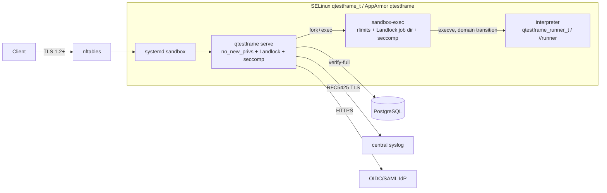

# Security

This document describes the security design of Qtestframe, the threat model
it is built against, and the operating-system hardening shipped in `deploy/`.
It is written for operators and security reviewers. For installation and
day-to-day operation see the [administrator guide](admin-guide/en/index.md)
and [operations.md](operations.md).

- [1. Scope and assets](#1-scope-and-assets)
- [2. Threat model (STRIDE)](#2-threat-model-stride)
- [3. Authentication](#3-authentication)
- [4. Authorization and tenant isolation](#4-authorization-and-tenant-isolation)
- [5. Web application protections](#5-web-application-protections)
- [6. TLS](#6-tls)
- [7. Secrets handling](#7-secrets-handling)
- [8. Audit log and central logging](#8-audit-log-and-central-logging)
- [9. Script runner sandbox](#9-script-runner-sandbox)
- [10. Operating-system hardening (defence in depth)](#10-operating-system-hardening-defence-in-depth)
- [11. Verifying the hardening](#11-verifying-the-hardening)
- [12. Hardening checklist](#12-hardening-checklist)
- [13. Reporting vulnerabilities](#13-reporting-vulnerabilities)

## 1. Scope and assets

Qtestframe is a multi-tenant requirements and test management server: a
single static Go binary (`CGO_ENABLED=0`) serving a REST API (`/api/v1`) and
an embedded single-page web UI, backed by SQLite (pure Go, `modernc.org/sqlite`)
or PostgreSQL.

| Asset | Why it matters |
|---|---|
| Requirements, test specifications, results, exports | confidential engineering data of each tenant; integrity matters for certification/compliance evidence |
| User accounts, password hashes, sessions, API tokens | account takeover → data access in every tenant the user belongs to |
| IdP client secrets, SAML SP key, DB credentials, TLS key | lateral movement / impersonation of the service |
| Audit trail | accountability, forensic evidence; must be tamper-evident (shipped off-host) |
| The host | the optional script runner executes user-supplied code |

**Trust boundaries**

```
 Browser / API client ──HTTPS──▶ qtestframe ──TLS──▶ PostgreSQL
        (untrusted)              │   │   └──TLS──▶ central syslog
                                 │   └──HTTPS──▶ OIDC / SAML IdP
                                 └──fork/exec──▶ sandboxed script runner (untrusted code)
```

Out of scope: compromise of the IdP, of the database server, or of a
super administrator account; physical access; denial of service by
volumetric network attacks (use upstream filtering).

## 2. Threat model (STRIDE)

| | Threat | Main mitigations |
|---|---|---|
| **S**poofing | credential stuffing / brute force on local login | bcrypt (cost 12), login rate limit per client IP + e-mail (default 10 attempts per 5 minutes, `auth.login_max_attempts` / `auth.login_lockout`; HTTP 429), generic error messages, SSO preferred (local login can be disabled: `auth.local: false`) |
| | session hijacking | random 256-bit session tokens, only their SHA-256 hash stored server-side, cookie `qtf_session` `HttpOnly; Secure; SameSite=Lax`, absolute TTL (`auth.session_ttl`), new session at every login, revocation on logout and on admin password reset/disable, HSTS |
| | forged SSO responses | OIDC: authorization code + PKCE (S256), `state` and `nonce` kept in a signed, single-use, 10-minute cookie, ID token signature/issuer/audience/expiry checked against the discovered JWKS. SAML (crewjam/saml): signed response or signed assertions required, audience/destination/recipient/time window validated, `InResponseTo` must equal the AuthnRequest ID from the signed single-use state cookie (no assertion replay cache, see §3) |
| | TLS interception | TLS 1.2+ only, modern AEAD suites, HSTS; outbound connections verify certificates (`sslmode=verify-full` for PostgreSQL, CA pinning for syslog) |
| **T**ampering | CSRF | session-authenticated requests with any method other than GET/HEAD require `X-CSRF-Token` (per-session token, constant-time compare) and pass an Origin check (`sameOrigin`); plus `SameSite=Lax` cookies; bearer-token requests are exempt (no ambient credentials) |
| | SQL injection | parameterised queries only; the query language (`q=`) is parsed into an AST and evaluated in process against loaded records, never translated to SQL; unknown fields are rejected |
| | modification of evidence | audit log of changes (who, action, entity, short details, when), also emitted as log records that can be shipped to a central syslog server; requirements carry a version counter; run executions keep step snapshots |
| | binary/config tampering | binary and config owned by root and read-only for the service (`ProtectSystem=strict`, Landlock, SELinux/AppArmor) |
| **R**epudiation | users denying actions | audit log with tenant, user ID and e-mail, action, entity and timestamp; the request log line carries the client IP (from `X-Forwarded-For` only for `trusted_proxies`); both forwarded via RFC 5424 syslog, over TLS if configured |
| **I**nformation disclosure | cross-tenant data access (IDOR) | every query is scoped by `tenant_id` taken from the authenticated session/token, never from the request; object lookups by ID include the tenant predicate and return 404 (not 403) on mismatch |
| | XSS | Vue templates auto-escape; `v-html` only for the built-in guides, whose Markdown is bundled at build time and sanitised with DOMPurify; CSP `script-src 'self'` (no inline scripts, no `unsafe-eval`; `style-src` needs `'unsafe-inline'` for PrimeVue); `X-Content-Type-Options: nosniff`; exports served with `Content-Disposition: attachment` |
| | CSV/spreadsheet formula injection in exports | CSV cells starting with `=`, `+`, `-`, `@`, TAB or CR are prefixed with `'`; XLSX cells are written as string values, never formulas; PDF/DOCX are generated, not templated from user HTML |
| | secrets in logs | passwords, tokens, cookies and `Authorization` headers are not logged (failed logins log the e-mail and client IP); API tokens are stored as SHA-256 hashes and shown once |
| | verbose errors | error bodies `{"error","code"}`; unexpected errors return only "internal server error", details go to the server log (method, path, error) |
| **D**enial of service | resource exhaustion | read/write/idle timeouts, 1 MiB header and 8 MiB JSON body limit (1 MiB for SAML ACS), query limits (4096 bytes, 64 regexes, depth 128), RE2 regular expressions (linear time, no ReDoS), search `limit` ≤ 1000, DB connection pool cap, login rate limit; systemd `MemoryMax`, `TasksMax`, `LimitNOFILE` |
| | runaway test scripts | runner disabled by default; wall-clock timeout with process-group kill, rlimits (CPU, file size, open files, no core), output cap; process count bounded by systemd `TasksMax` |
| **E**levation of privilege | role escalation | RBAC checked server-side on every endpoint; API tokens cannot exceed the creator's role and are capped at the current membership role; tokens cannot create tokens and never carry super-admin rights; only super admins manage users/tenants; the last admin of a tenant cannot be demoted or removed |
| | RCE via script runner / parser bug | sandbox re-exec (no_new_privs + Landlock + seccomp + rlimits + dropped capabilities, optional socket deny), separate SELinux domain / AppArmor child profile without network, systemd sandbox, unprivileged user; web tests (Playwright) keep re-exec, no_new_privs, Landlock and rlimits but have no seccomp filter and always network access (see §9) |
| | kernel exploitation | seccomp deny-list in-process and `SystemCallFilter=` in systemd, `RestrictNamespaces`, no capabilities but `CAP_NET_BIND_SERVICE`, `MemoryDenyWriteExecute` |

## 3. Authentication

### Local accounts

* Passwords are hashed with **bcrypt**, cost 12 (`auth.BcryptCost`).
  Existing hashes are not re-hashed when the cost changes. Policy
  (`auth.ValidatePasswordMin`): at least `auth.password_min_length` bytes
  (default 10, 8–72) and at most 72 (longer passwords are rejected rather
  than silently truncated by bcrypt), at least one letter and at least one
  non-letter. `qtestframe user create` and the bootstrap administrator are
  checked against the default of 10.
* Login: `POST /api/v1/auth/login`. Unknown users, SSO-only users, wrong
  passwords and disabled users all get the same `401 invalid credentials`.
  For a missing hash a bcrypt comparison against a dummy hash is still
  performed. The dummy hash uses the configured bcrypt cost, so failed
  logins take the same time whether or not the account exists.
* **Rate limiting** (`rateLimiter` in `internal/api/server.go`): at most
  `auth.login_max_attempts` login attempts (default 10) per
  `auth.login_lockout` sliding window (default 5 minutes) per key *client
  IP + normalised e-mail*; further attempts get **HTTP 429** `rate_limited`.
  Both can be changed at runtime in the system settings. A successful
  login (with multi-factor authentication: after the second factor) resets
  the key. The limiter is in memory (per process, lost on
  restart). Failed logins are logged at WARN (`login failed`, e-mail,
  client IP). Behind a reverse proxy configure `server.trusted_proxies`,
  otherwise all clients share the proxy's address.
* Disable local login entirely when SSO is in place: `auth.local: false`
  (super admins can still be managed with the CLI on the host).
* First administrator: `qtestframe user create --email E --password-stdin
  --super-admin` (password from stdin, never from argv/ps) plus
  `qtestframe member add`, or the `bootstrap` section with
  `admin_password_file`, which creates a super admin and an admin
  membership in `bootstrap.tenant_slug` when the database has no users.

### Sessions

* Server-side sessions; the browser only holds the opaque cookie
  `qtf_session` (32 random bytes, `HttpOnly`, `Secure` unless
  `auth.cookie_secure: false`, `SameSite=Lax`, `Path=/`). The `sessions`
  table stores the SHA-256 hash of the cookie value as session ID, so a
  database leak does not reveal usable sessions.
* Absolute lifetime `auth.session_ttl` (default 12 h); expired sessions are
  rejected and deleted on access and purged hourly.
* A new session is created at every login. Switching tenants
  (`POST /auth/switch-tenant`, membership re-checked) updates the current
  tenant of the existing session; the session ID is not rotated.
* Revocation: logout deletes the session; a super admin disabling a user or
  setting a password via `PATCH /api/v1/users/{id}` deletes all sessions of
  that user. Changing one's own password (`POST /auth/password`) ends all
  other sessions of that user and keeps the current one.
* **CSRF** (`authed` in `internal/api/authn.go`): every request with a
  method other than GET/HEAD that is authenticated by the cookie must send
  `X-CSRF-Token` with the session's CSRF token (24 random bytes, returned as
  `csrf_token` by `/auth/login` and `/auth/me`; constant-time compare).
  In addition **`sameOrigin`** rejects the request if an `Origin` header is
  present and names neither the request `Host` nor the scheme+host of
  `server.base_url`. Requests without `Origin` (non-browser clients) pass
  this check. Failures return 403. Public endpoints (login, logout, SSO
  callbacks) are not CSRF-checked.
* **API tokens** (`Authorization: Bearer qtf_...`) for CI systems:
  `qtf_` + 32 random bytes (base64url); the prefix makes them recognisable
  to secret scanners. Only the SHA-256 hash and a 10-character display
  prefix are stored; the token is shown once. A token is bound to one
  tenant, carries a role that may not exceed the creator's role at creation,
  and on every request its role is **capped at the user's current
  membership role** (a demoted user's tokens are demoted too). Optional
  expiry (`expires_days`), `last_used` is recorded, revocable
  (`DELETE /tokens/{id}`). Tokens cannot create tokens, and a super admin's
  token has only the token's role.

### Multi-factor authentication

Implemented in `internal/auth/totp.go` (algorithms), `internal/api/mfa.go`
(flows, policy, resets) and `internal/store/mfa.go` (migration
`0025_mfa.sql`).

* **Second factor: TOTP** (RFC 6238) with HMAC-SHA-1, 6 digits and 30 s
  steps — what every authenticator app supports — implemented with the Go
  standard library (`crypto/hmac`, `crypto/sha1`; verified against the RFC
  test vectors). Codes of the previous and next step are accepted (clock
  drift, ±30 s); all three candidates are compared in constant time.
  **Replay protection:** the step of the last accepted code is stored
  (`user_mfa.last_step`) and only later steps are accepted, with a
  conditional `UPDATE … WHERE last_step < ?`, so a code works exactly once
  even for two requests racing with the same code (this also means at most
  one sign-in per 30 s step).
* **Enrolment:** `POST /auth/mfa/totp` creates a random 160-bit secret
  (crypto/rand) and returns it **once**, as an `otpauth://` URI (rendered
  as a QR code in the browser with `qrcode-generator`; no third party sees
  it) and as a manual key. It becomes active only after
  `POST /auth/mfa/totp/confirm` with a valid code; until then it does not
  affect sign-in. The secret is never returned again (`GET /auth/mfa` shows
  only the state). MFA changes need a browser session; API tokens get 403.
* **TOTP secrets at rest:** the server must compute the codes, so a hash
  is not possible; the secret in `user_mfa.totp_secret` is **encrypted**
  with AES-256-GCM under the data-encryption key and bound to the user's
  row (see [Encryption of stored secrets](#encryption-of-stored-secrets)).
  *Earlier versions stored it in plain text; this no longer holds — values
  written by them are encrypted in place at the first start.* Whoever can
  read the database or a backup **and** has the key-encryption key (the
  key file, the TPM, the HSM) can still compute a user's codes, but still
  needs the password; after a suspected leak of both, reset the MFA of all
  users.
* **Recovery codes:** 10 codes of 12 characters from a 31-character
  alphabet without look-alikes (≈ 59 bits each), shown once, stored as
  SHA-256 hashes (`mfa_recovery_codes`), each usable once. New codes
  (`POST /auth/mfa/recovery-codes`) need a current code and invalidate all
  old ones. Using one is audited (`mfa.recovery_code_used`).
* **Sign-in with MFA:** after a correct password (`POST /auth/login`) a
  user with a confirmed second factor gets **no session**: the answer is
  `{"mfa_required": true, …}` and a pending sign-in is stored
  (`mfa_challenges`, keyed by the SHA-256 of the random token in the
  `qtf_mfa` cookie: `HttpOnly`, `SameSite=Lax`, `Path=/api/v1/auth/`,
  5 minutes). `POST /auth/mfa/verify` with a TOTP or recovery code then
  creates the session. Protections against guessing the 6-digit code:
  * every attempt counts against the existing sign-in rate limit of
    *client IP + e-mail* (by default 10 per 5 minutes; the limit is **not** reset by
    the correct password, only after the second factor);
  * a per-account limit of 10 attempts per 15 minutes, whatever the
    client address;
  * at most 5 wrong codes per pending sign-in, after which it is deleted
    and the password must be entered again;
  * wrong codes are recorded as failed sign-ins (method `mfa`) and logged
    at WARN (`second factor failed`), so they appear in the user's sign-in
    history and the "failed attempts since your last sign-in" notice.
  Logout deletes a pending sign-in. Successful sign-ins are audited with
  `mfa=totp`, `mfa=recovery-code` or `mfa=remembered-device`.
* **Remember this device** (optional, server policy `remember_days`,
  default 0 = off): after a correct code the browser gets a random token in
  the `qtf_mfa_device` cookie (`HttpOnly`, `SameSite=Lax`,
  `Path=/api/v1/auth/`); only its SHA-256 is stored
  (`mfa_trusted_devices`, with expiry, IP and user agent). It skips the
  second factor — never the password — for that user for the configured
  number of days (lowering the number also shortens devices remembered
  before). Users can forget their remembered devices; an administrator
  reset and turning MFA off forget them too. The tokens are revocable server-side,
  unlike a purely signed cookie.
* **Policy** (`mfa_policies`; Administration › Multi-factor
  authentication): `optional` (default), `all` or `roles`. The **server
  policy** (super administrators; scope `''`) applies to every user, with
  the roles counted in any tenant plus the pseudo-role `super_admin`; each
  **tenant policy** (`tenant.manage`) applies to the members of that
  tenant by their role there. Tenant policies can only add requirements.
  A **grace period** (`grace_days`) runs from when the policy started to
  require MFA for more people (`required_since`) or from the user's
  creation, whichever is later; during it users see a reminder, afterwards
  a sign-in without a second factor gets a session flagged
  `sessions.mfa_enrol_required`: every endpoint outside `/api/v1/auth/`
  answers **403 `mfa_enrolment_required`** until the user has confirmed an
  authenticator (the web client shows the set-up page). The policy is
  evaluated at sign-in (and for `/auth/me`), so a stricter policy reaches
  existing sessions at their next sign-in. Users cannot turn MFA off while
  a policy requires it (403 `mfa_required`).
* **Administrator reset** (lost phone and recovery codes):
  `POST /members/{uid}/mfa/reset` (`member.manage`; like a password reset,
  not for super administrators or users of other tenants) or
  `POST /users/{id}/mfa/reset` (super administrators). It deletes the
  authenticator, recovery codes, remembered devices and pending sign-ins,
  signs the user out everywhere, is audited (`member.reset_mfa` /
  `user.reset_mfa`) and the user is told by an in-app notification and an
  e-mail (when e-mail is configured); turning MFA off oneself also sends
  an e-mail. Nobody can reset their own MFA this way.
* **Single sign-on:** for OIDC the identity provider is responsible for
  MFA by default (`local_mfa: off`). With `local_mfa: unless_idp_mfa`
  Qtestframe's own second factor is asked for unless the ID token's `amr`
  claim contains `mfa` (or a value of `mfa_amr_values`) or its `acr` is
  one of `mfa_acr_values`; with `always` it is always asked for (when the
  user has enrolled, or must enrol under the policy). The callback then
  redirects to `/login?mfa=1` instead of `/`. The reported `amr`/`acr` are
  recorded in the audit entry of the sign-in. SAML sign-ins do not use the
  local second factor (configure MFA at the identity provider).
* **Not affected:** API tokens (a separate credential; protect them like
  passwords) and SCIM tokens. E-mail invitations start a session as
  before, flagged for enrolment if the policy requires MFA.
* **Not implemented yet:** WebAuthn / passkeys (as second factor or
  passwordless). It needs a WebAuthn library (e.g.
  `github.com/go-webauthn/webauthn`, not a dependency today), a configured
  relying-party ID and origin, and credential storage; the challenge and
  policy machinery above is designed to accept further factors.

### OpenID Connect

* Authorization code flow with **PKCE (S256)**, a random **state** (CSRF of
  the login itself) and **nonce** (ID token replay). State, nonce and PKCE
  verifier are kept in the cookie `qtf_login_state` (`HttpOnly`,
  `SameSite=Lax`, `Path=/api/v1/auth/`), HMAC-SHA256-signed with a key
  generated at process start, valid for 10 minutes and cleared when the
  callback reads it (single use).
* Provider metadata from `<issuer>/.well-known/openid-configuration`
  (`coreos/go-oidc`); the ID token signature is verified against the
  provider's JWKS, and issuer, audience (`client_id`) and expiry are
  validated by the library; the nonce is compared by Qtestframe.
* Redirect URI is fixed: `<base_url>/api/v1/auth/oidc/<name>/callback`.
  After login the browser is always redirected to `/` (no user-controlled
  redirect target); errors redirect to `/login?error=Sign-in failed`.
* The ID token must contain an e-mail claim (`email_claim`); if it contains
  `email_verified: false` the login is rejected (an absent
  `email_verified` claim is accepted).
* Just-in-time provisioning, see below.

### SAML 2.0

* SP-initiated login only (`crewjam/saml`): the AuthnRequest is sent with
  the HTTP-Redirect binding, the response is POSTed to
  `<base_url>/api/v1/auth/saml/<name>/acs`; SP metadata at
  `/api/v1/auth/saml/<name>/metadata`. AuthnRequests are not signed.
* Validation by `crewjam/saml` (`ServiceProvider.ParseResponse`): the
  response or every assertion must carry a valid XML signature from the IdP
  metadata certificate; destination, issuer, audience (SP entity ID),
  subject-confirmation recipient and the `NotBefore`/`NotOnOrAfter`
  validity window (with crewjam's clock-skew allowance, 180 s by default)
  are checked. Encrypted assertions are decrypted with the SP key when
  `sp_key_file` is configured. The ACS body is limited to 1 MiB.
* **Replay protection:** there is **no assertion replay cache**
  (crewjam's `ReplayCache` is not configured). Instead, the AuthnRequest ID
  is stored in the signed state cookie `qtf_login_state`
  (`SameSite=None; Secure`, because the ACS POST is cross-site; 10-minute
  expiry), and `ParseResponse` accepts only a response whose `InResponseTo`
  equals that ID. The cookie is cleared when the ACS reads it, so each
  AuthnRequest can complete at most one login in that browser;
  IdP-initiated (unsolicited) responses are rejected. A captured response
  could only be replayed together with the matching, still valid state
  cookie and within the assertion's validity window.
* The e-mail is taken from `email_attr` (or the NameID if it contains `@`);
  an assertion without e-mail is rejected.
* SP key pair: `scripts/certs/gen-saml-sp-cert.sh` (RSA 3072).

### Just-in-time provisioning (OIDC and SAML)

`provision` in `internal/api/authn.go`:

1. Find the user by (provider, subject). Otherwise find a user with the same
   e-mail: if it is a local account or already bound to this provider, it is
   **linked** (provider and subject stored, local password hash cleared); if
   it is bound to another provider the login fails. Otherwise create the
   user only if `auto_provision: true`.
2. Disabled users are rejected.
3. With `default_tenant` set, the roles are every role that
   `role_mapping` assigns to one of the user's groups (`groups_claim` /
   `groups_attr`; a user in several mapped groups holds several roles),
   else `default_role` (an invalid value falls back to `viewer`). A
   membership is created if missing and `auto_provision` is on; if
   `role_mapping` is configured, an existing membership is updated to the
   mapped roles at every login (the IdP is authoritative).

Because accounts are linked by e-mail, only connect IdPs whose e-mail
addresses are verified and controlled by your organisation.

A user provisioned by SCIM (below) is managed by SCIM in that tenant: the
OIDC/SAML login neither creates nor changes that membership, so
`role_mapping` cannot undo a SCIM deactivation.

### SCIM 2.0 provisioning

`internal/api/scim.go`, `/scim/v2` ([api.md](api.md#scim-20-provisioning)).

* **Token scope.** A SCIM token (`qtfscim_` + 256 random bits) is bound to
  one tenant and only authenticates `/scim/v2`; the SCIM endpoints accept
  nothing else (no session cookie, no API token), and the REST API rejects
  SCIM tokens because they lack the `qtf_` prefix and live in their own
  table (`scim_tokens`). Only tenant admins (`tenant.manage`) with a session
  create and revoke them; API tokens cannot. The token is shown once and
  stored as a SHA-256 hash; it can expire and is revoked at once.
* **What a token can do.** Whoever holds it controls the membership of the
  tenant, up to granting the admin role through a group mapped to admin.
  It cannot change super-admin status, read or change project data, set
  passwords, or affect other tenants: the e-mail and name of a user who also
  belongs to another tenant (or is a super admin) are not changed, and
  deactivation only removes the membership, sessions and API tokens in the
  token's tenant. The tenant always keeps one admin (409). Treat the token
  like an admin password and map only groups you control to privileged
  roles; unmapped groups grant nothing beyond the default role. A user in
  several mapped groups holds all their roles (the union of their
  permissions); the read-only `roles` attribute of a SCIM user shows them,
  and roles an identity provider pushes in it are ignored.
* **Linking.** Provisioned accounts have no password (`auth_provider`
  `scim`), so they can only sign in through OIDC/SAML, which links them by
  e-mail like any just-in-time account. Provision only addresses your
  organisation controls.
* **Rate limits and lockout.** 1200 requests per minute per token; 20
  failed SCIM authentications per 5 minutes per client address block that
  address (429). Failures are logged with the address.
* **Atomicity and audit.** Each writing request is one database
  transaction; every change is written to the audit log with the actor
  `SCIM: <token name>`, and token and mapping changes with the admin who
  made them.

## 4. Authorization and tenant isolation

* Every member holds **one or more roles per tenant** (`memberships.roles`,
  migration 0052); the effective permissions are the **union** of the
  permissions of the held roles, so several roles can only add rights,
  never take any away. Holding `admin` among one's roles makes a member an
  organisation administrator. The first role of the normalised set (admin
  first, then the built-in roles from most to least privileged, then custom
  roles alphabetically) is kept in `memberships.role` as the *primary* role
  for older clients, so a set holding admin always has admin as its primary
  role. A global **super admin** flag grants every permission in every
  tenant plus user/tenant management (for session logins only; API tokens
  are limited to their roles). A super admin without membership in the
  current tenant acts as `admin` there.
* Roles and permissions (`internal/rbac/rbac.go`; defaults below, the
  tenant's effective matrix is served at `GET /api/v1/roles`):

| Permission | viewer | reviewer | sme | tester | test_lead | manager | admin |
|---|:-:|:-:|:-:|:-:|:-:|:-:|:-:|
| project/requirement/test/run read, member.read, export | ✔ | ✔ | ✔ | ✔ | ✔ | ✔ | ✔ |
| test.review | | ✔ | | | ✔ | ✔ | ✔ |
| requirement.review | | ✔ | ✔ | | | ✔ | ✔ |
| comment.create | | ✔ | ✔ | ✔ | ✔ | ✔ | ✔ |
| requirement.write | | | ✔ | | | ✔ | ✔ |
| change.create | | | ✔ | | ✔ | ✔ | ✔ |
| change.approve | | | | | ✔ | ✔ | ✔ |
| test.write, run.write, run.execute, token.manage | | | | ✔ | ✔ | ✔ | ✔ |
| cycle.plan, script.execute, audit.read, settings.manage | | | | | ✔ | ✔ | ✔ |
| waiver.approve, project.create, project.update | | | | | | ✔ | ✔ |
| project.delete, member.manage, role.manage, tenant.manage | | | | | | | ✔ |

* **Subject matter expert (`sme`)** – a domain expert who takes part in
  writing the requirements of their field. It creates and edits
  requirements (`requirement.write`: the text, acceptance criteria,
  rationale, sources, relations, trace and item links and attachments),
  takes part in requirement reviews (`requirement.review`) and discussions
  (`comment.create`), and reads tests, runs, defects and risks for
  context. It deliberately has no `test.*` write or review rights, no run
  or cycle rights (`run.write`, `run.execute`, `cycle.plan`), no
  `waiver.approve` (accepting deviations is a management decision) and no
  `change.approve` (it proposes changes in change requests with
  `change.create`, the change control board decides them), no
  project, settings, member or role administration, and no API tokens
  (`token.manage`; give the tester role as well to someone who also
  automates). Evidence on executions is recorded by testers
  (`run.execute`); an SME attaches supporting documents to the
  requirements themselves. `requirement.write` plus `requirement.review`
  lets an SME approve requirements, also their own: where separation of
  duties matters, remove `requirement.review` from the role in the matrix
  or rely on review requests with several reviewers. Combined with other
  roles (e.g. `sme` + `tester`) a member holds the union of both.

* **Separation of duties:** approving requirements and marking tests
  ready (review decisions) need `requirement.review` / `test.review`, so
  authors without them cannot approve their own work; decisions are audited
  as `requirement.review` / `test.review`. The **trash** of deleted
  requirements and tests (30 days, `/trash/{id}/restore`) is tenant-scoped
  and restoring needs the kind's write permission plus the review
  permission for items that carry a decision; it holds copies of deleted
  attachments, so a deletion is not an erasure until the entry expires
  (or is removed with the project/tenant).

* **Configurable roles** ([ADR 0014](adr/0014-tenant-configurable-roles.md)):
  holders of `role.manage` change the permissions of the built-in roles
  except `admin` and create custom roles. Escalation is prevented: a role
  or API token can only receive permissions the caller holds; `admin`
  always keeps every permission; API tokens hold a set of roles too and get
  the intersection of the union of their roles' permissions and the union
  of the user's current roles' permissions on every request. Role changes
  are audited; a change of a member's roles is logged with the added and
  removed roles (`member.role`, `project.member.role`: `+sme −viewer →
  tester, sme`).
* Full matrix with the endpoints using each permission:
  [design.md §12](design.md#12-rbac-matrix). Guards: a tenant keeps at
  least one member holding the admin role (changing a set of roles is
  refused with 409 when it would drop admin from the last member holding
  it, also in bulk, by SCIM and on re-adding a member); a super admin
  cannot demote or disable themselves.
* **Tenant isolation**: the tenant is derived from the session's *current
  tenant* (switch with `POST /auth/switch-tenant`, membership re-checked) or
  from the API token, never from the request. Store entry points take the
  tenant ID explicitly and every lookup by ID includes
  `tenant_id = ?`, so a guessed ID from another tenant yields 404. Follow-up
  queries on child rows (criteria, steps, positions) run only after the
  parent was loaded with the tenant predicate. Operations spanning projects
  (moving items or folders to another project, links, adding tests to a run)
  verify that both ends belong to the principal's tenant.
* **Per-project access (project sharing)**: a project is organisation-wide
  (`access = organisation`, the default and the behaviour of earlier
  versions) or restricted (`access = restricted`). Project members are
  users or SCIM groups with one or more project roles (`project_members`,
  migrations 0024 and 0052). Effective permissions in a project:
  organisation administrators (and super admins) keep theirs; a project
  member gets the *project-scoped* permissions of the union of their
  project roles in place of the organisation roles' (`project.read/update/delete`,
  `requirement.*`, `waiver.approve`, `change.*`, `test.*`, `run.*`, `cycle.plan`,
  `script.execute`, `export`, `comment.create`), in both modes – a direct
  membership wins over group memberships, several groups give the union
  of their roles; others get their organisation roles in an
  organisation-wide project and **no access (404, indistinguishable from a
  missing project)** to a restricted one. Organisation-level permissions
  always come from the organisation roles, and an API token is capped by
  its own roles inside a project as well. Nobody can give or take a project
  role with project permissions they do not hold there (no escalation
  through sharing: a change checks every added and every removed role, a
  removal every role of the member); changes are audited.
* **Where it is enforced:** centrally, in `authed`
  (`internal/api/authn.go`, `access.go`): before the route permission is
  checked, the request's project is resolved – `{pid}`, or the project of
  the `{id}` resource from a table of resource → project queries
  (requirements, tests, runs, executions, step results, folders, categories,
  relations, baselines, links, item links, trash, releases, defects, risks,
  webhooks, trace rules, configurations, dependencies, report definitions
  and subscriptions, reviews, files, comments) – and the principal's
  permissions are replaced by those in the project, so every `p.Can` in the
  handlers is project-aware. A test walks every registered route
  (`TestProjectAccessRouteWalk`) and fails for an `{id}` resource missing
  from the table and for any route that does not answer 404/403 to a
  non-member, with a session and with an API token. Handlers that reach a
  second project (moves into another project, the catalogue's
  `project_id`) check it with `canIn`; lists across projects (projects,
  search, reviews, notifications) filter with `visibleProjects`;
  notifications, @mentions, report recipients and reviewers are limited to
  people who may see the project; scheduled reports run with the owner's
  current access to the project.
* What sharing does **not** hide: the organisation audit log (`audit.read`)
  records actions in every project, organisation-wide e-mail digests may
  list notifications created while the recipient still had access, and
  backups contain every project.
* Authorization is enforced in the API layer (route permissions in
  `internal/api/server.go`, the project scope in `access.go`,
  data-dependent checks in handlers) and tenant scoping in the store layer.
* **System settings** (Administration → System settings,
  `/api/v1/admin/settings*`, `internal/api/systemsettings.go`) change the
  whole installation (sign-in, SSO, logging, e-mail, runner), so only
  **super administrators signed in with a session** may read or change them;
  API tokens (even a super admin's) and tenant admins get 403, and no
  setting is tenant-scoped. The operator keeps control: settings set by a
  `QTF_*` environment variable or listed in `system_settings.locked` are
  read-only and their stored overrides are ignored, and settings that
  affect the process lock-down (runner, sandbox, file paths, TLS, cookies,
  HSTS, trusted proxies, the database) cannot be changed at runtime at all —
  the runner settings that can be changed apply only after a restart, when
  Landlock is set up again. Local sign-in cannot be turned off while no
  single sign-on provider is enabled. Every change is audited
  (`settings.update` with old → new values, secrets redacted) and the test
  buttons are audited too (`settings.test_*`). The "Test connection" (OIDC
  discovery), "Send test message" (syslog) and "Send test e-mail" buttons
  make the server connect to an address the super admin enters; they are
  limited to super admins for that reason (filter the server's egress if it
  can reach internal services).

### Autocomplete history (personal data)

Free-text fields suggest what the user typed in them before
(`internal/api/suggest.go`, `internal/suggest`, [api.md](api.md#autocomplete)).

* **What is stored.** Table `suggest_history` (migration 0029): per user,
  organisation, field key (for example `test.step.expected`) and project,
  each distinct value the user saved (trimmed, at most 1000 characters),
  with a use count and the time of the last use. At most 200 values per
  user, field and organisation are kept; the least recently used go. The
  web client records values only after a form was saved successfully, and
  only values that changed, never while typing. Nothing is recorded for
  passwords, tokens, secrets, e-mail addresses or invitation fields: only
  the field keys listed in `suggestFields` are accepted (400 otherwise).
* **Who sees it.** Only the user: every query filters by the caller's user
  id and organisation. A value saved in a project is suggested only while
  the user may still read that project with the field's read permission
  (restricted projects, project roles and API token caps included), so
  losing access to a project also hides what one typed there. Project
  values (the distinct sources and owners of a project) are suggested only
  to users who may read the project. Requests need read access to
  `project_id` (404 otherwise) and are limited to 300 a minute per user.
* **Turning it off.** The personal preference **Autocomplete suggestions**
  (`preferences.autocomplete`): *Off* shows no suggestions, makes no
  requests and records nothing; *Only values used in the project* records
  nothing either. The server enforces the preference as well.
* **Deleting it.** **Clear my autocomplete history** on the profile
  (`DELETE /api/v1/suggest/history`, audited as
  `profile.autocomplete_clear`) deletes the user's history in every
  organisation. Removing a member (also through SCIM) deletes their history
  in that organisation; deleting a user or an organisation deletes it
  through foreign keys. The table is deliberately **not part of a backup**
  (`store.notBackedUp`): it is a personal convenience, not project data, so
  a restore starts with empty histories.

## 5. Web application protections

Response headers set on every response:

| Header | Value |
|---|---|
| `Content-Security-Policy` | `default-src 'self'; script-src 'self'; style-src 'self' 'unsafe-inline'; img-src 'self' data: blob:; font-src 'self' data:; connect-src 'self'; frame-ancestors 'none'; base-uri 'self'; form-action 'self' https:; object-src 'none'` (constant `contentSecurityPolicy` in `internal/api/server.go`; `'unsafe-inline'` styles are needed because PrimeVue injects styles at runtime; `form-action https:` allows the SAML/OIDC redirects) |
| `Strict-Transport-Security` | `max-age=63072000; includeSubDomains`, only when `server.hsts: true` **and** the request arrived over TLS at the binary (set HSTS at a TLS-terminating proxy yourself) |
| `X-Content-Type-Options` | `nosniff` |
| `X-Frame-Options` | `DENY` (legacy companion of `frame-ancestors 'none'`) |
| `Referrer-Policy` | `strict-origin-when-cross-origin` |
| `Permissions-Policy` | `camera=(), microphone=(), geolocation=(), payment=()` |
| `Cross-Origin-Opener-Policy` | `same-origin` |
| `Cross-Origin-Resource-Policy` | `same-origin` |
| `Cache-Control` | `no-store` for `/api/*` responses |

Further measures:

* JSON bodies are limited to 8 MiB (`MaxBodyBytes`), headers to 1 MiB;
  bodies are decoded with `encoding/json` (unknown fields are ignored, the
  `Content-Type` header is not enforced). `ReadHeaderTimeout` 10 s,
  `IdleTimeout` 120 s, read/write timeouts from `server.read_timeout` /
  `write_timeout`.
* Query language and search use **RE2** (Go `regexp`): linear time, no
  catastrophic backtracking; expressions are limited to 4096 bytes, 64
  regexes/globs and nesting depth 128.
* **Export injection protection** (`internal/export`): CSV cells starting
  with `=`, `+`, `-`, `@`, TAB or CR are prefixed with `'`; XLSX cells are
  written as string values (never formulas); DOCX text is XML-escaped; PDF
  and DOCX are generated programmatically. The download file name is built
  from the project key and a timestamp only.
* Static UI assets are embedded in the binary (no file system path
  traversal surface); `assets/*` (hashed names) are served
  `Cache-Control: public, max-age=31536000, immutable`, other files
  `no-cache`.
* Panics are recovered and answered with a generic 500.

## 6. TLS

* Configured in `cmdServe` (`internal/app/app.go`) when `server.tls_cert`
  and `tls_key` are set: `MinVersion: TLS 1.2`; TLS 1.2 cipher suites
  limited to ECDHE + AEAD (`TLS_ECDHE_{ECDSA,RSA}_WITH_AES_256_GCM_SHA384`,
  `_CHACHA20_POLY1305`, `_AES_128_GCM_SHA256`); TLS 1.3 suites and curve
  preferences are Go's defaults; ALPN `h2`, `http/1.1`.
* The key pair is served through `GetCertificate` from an atomically
  swapped value and re-read on **SIGHUP** (`systemctl reload qtestframe`),
  so renewals do not drop connections; if the reload fails, the previous
  certificate stays in use and an error is logged. Without TLS, SIGHUP is
  ignored.
* Certificates: Let's Encrypt (`scripts/certs/letsencrypt.sh`), an internal
  CA (`gen-ca.sh` + `gen-server-cert.sh`), or self-signed for labs. Check with
  `scripts/certs/verify-cert.sh`. ECDSA P-256 is the default key type.
* Outbound: PostgreSQL with `sslmode=verify-full`, syslog over TLS with
  `ca_file` (and optional client certificate), IdP endpoints over HTTPS with
  the system trust store.
* Running behind a TLS-terminating reverse proxy is supported: listen on
  `127.0.0.1`, set `trusted_proxies`, keep `cookie_secure: true`, and let
  the proxy send `Strict-Transport-Security` (Qtestframe emits HSTS only on
  its own TLS connections).

## 7. Secrets handling

* Never write secrets inline in `config.yaml`. Use the secret-file options
  `database.dsn_file`, `auth.oidc[].client_secret_file`,
  `bootstrap.admin_password_file`, `email.password_file` and
  `secrets.pkcs11.pin_file` (contents are trimmed), and key files
  (`server.tls_key`, SAML `sp_key_file`, syslog `key_file`).
* **systemd credentials** (recommended): `LoadCredential=name:/path` in a
  drop-in copies the secret to `/run/credentials/qtestframe.service/name`
  (ramfs, not swappable, only readable by the service). Relative paths of
  these secret-file options are resolved against
  `$CREDENTIALS_DIRECTORY` (`readSecret` in `internal/config/config.go`), so
  `client_secret_file: oidc-corp` is enough; key file paths are used as
  given. The credentials directory is added to the Landlock read-only
  paths. With TPM2/host key: `systemd-creds encrypt` +
  `LoadCredentialEncrypted=`.
* File permissions: `/etc/qtestframe` `0750 root:qtestframe`, config `0640`,
  keys `0640 root:qtestframe` (or `0600` owned by the reader). The service
  cannot modify its own configuration or keys.
* Environment variables (`QTF_DATABASE_DSN`, `QTF_OIDC_<NAME>_CLIENT_SECRET`,
  `QTF_BOOTSTRAP_ADMIN_PASSWORD`) are supported for containers but are
  visible in `/proc/<pid>/environ` to the same user; prefer files/secrets.
* Secret files are read once at start-up, before Landlock is applied
  (SIGHUP re-reads only the TLS key pair); they are not logged. Core dumps
  are disabled (`LimitCORE=0`).
* **Secrets stored in the database.** Defect tracker tokens (Jira, GitHub, GitLab, Request Tracker), the tokens of the requirement import sources (Jira, Azure DevOps)
  and webhook signing secrets are stored per project in the database,
  **encrypted** (see below; earlier versions stored them in plain text,
  which no longer holds), so that the server can use them. The API never returns a tracker token
  (`has_token` only), and returns a webhook secret only once, when it is
  created or rotated. Use tracker tokens with the smallest scope that works
  (GitHub fine-grained token with Issues read/write on one repository; a
  GitLab project access token with the `api` scope and the Reporter role;
  a Jira user that can only create and browse issues in the project).
* **System settings secrets.** The SMTP password and OIDC client secrets
  entered in Administration → System settings are stored in the database
  (table `system_settings`) **encrypted**, like tracker tokens (earlier
  versions stored them in plain text; this no longer holds), so that the
  server can use them; they are **write-only** in the API (`has_secret`,
  `secret_source`), never logged, never in the audit log (only "set /
  changed / removed"), and redacted in the configuration export. Secrets of
  the configuration file or the environment are not copied into the
  database when providers are edited in the web client, and
  `QTF_OIDC_<NAME>_CLIENT_SECRET` / `QTF_EMAIL_PASSWORD` always win over a
  stored value. Backups contain the table, still encrypted (restore
  applies it at once); project archives do not. Operators who do not want secrets in the
  database lock the settings (`system_settings.locked: ["email.*",
  "auth.oidc"]`) and keep using `*_file` options.
* **Project archives** (*Save project*, `GET /projects/{pid}/archive`)
  contain all project data in plain form (texts, results, files, version
  history, user ids and e-mail addresses in *created by* and similar fields),
  but never webhook secrets, tracker tokens, password hashes, sessions, API
  or SCIM tokens, memberships, notifications or the audit log. Saving needs
  `project.update` and `export` (Manager and Admin by default); loading needs
  `project.create` and always creates a new project with new ids in the
  caller's organisation; rows of an archive that point outside it are left
  out, secrets are stripped again, and loaded webhooks are disabled.
  Treat saved archives like the project itself.
* **Outgoing requests.** Tracker calls and webhook deliveries go to URLs
  that project administrators (`project.update`) configure, from the
  server's network. Restrict who has that permission, and if the server
  can reach internal services, filter its egress (firewall or proxy).
  Webhook deliveries never follow redirects, send no credentials other
  than the HMAC signature (`X-Qtestframe-Signature: sha256=…`), and time
  out after 10 seconds. Receivers should verify the signature.
* **Electronic signatures.** Signing a baseline re-checks the user's
  password (or needs a single sign-on session under 15 minutes old);
  API tokens cannot sign. Each signature stores a SHA-256 fingerprint of
  the baseline content and is audited; signed baselines cannot be deleted.

### Encryption of stored secrets

Secrets the server has to read back (they cannot be hashed) are encrypted
before they are written to the database, in `internal/store/secrets.go`
with the primitives of `internal/secrets`:

| Secret | Where |
| --- | --- |
| TOTP secrets (authenticator apps) | `user_mfa.totp_secret` |
| Webhook signing secrets | `webhooks.secret` |
| Code webhook secret and CI posting token (GitLab project access token) | `code_settings.webhook_secret`, `code_settings.ci_token` |
| Defect tracker token (Jira, GitHub, GitLab) | `projects.defect_tracker` → `token` |
| Values of secret web test variables | `projects.web_tests` → `variables[].value` |
| SMTP password | `system_settings` `email.password` |
| OIDC client secrets | `system_settings` `auth.oidc` → `client_secret` |

Hashes stay hashes: passwords (bcrypt), API and SCIM tokens, sessions,
invitations, remembered devices and recovery codes (SHA-256) are one-way
and need no key. Secrets in the configuration file, `*_file` options and
`QTF_*` variables are not stored in the database at all.

**Envelope encryption.** A value is encrypted with AES-256-GCM (random
96-bit nonce) under a 256-bit *data-encryption key* (DEK) and stored as

    enc:v1:<dek id>:<base64url(nonce | ciphertext | tag)>

The associated data names the table, the column, the row id and, inside
JSON, the field (e.g. `webhooks.secret|<id>`,
`projects.web_tests.variables.PASSWORD.value|<project id>`) and the DEK id,
so a value copied into another row, another field or under another key id
does not decrypt. The DEKs are random, created by the server, and stored
in the table `secret_keys` (migration 0027) **only wrapped** by the
*key-encryption key* (KEK) of the configured key provider; the KEK never
enters the database. The unwrapped DEKs are kept in memory only.

**Key providers** (`secrets.provider` in the configuration file; the
system settings view shows the active one read-only, under Security):

* `local` (default, no configuration needed): the KEK is a 256-bit key in a
  key file, created with mode `0600` (directory `0700`) when missing, or
  given in `QTF_SECRETS_KEY` (base64 or hex; then no file is used). The
  default file is `qtestframe-secrets.key` next to a SQLite database, else
  in `$STATE_DIRECTORY`, `/var/lib/qtestframe` or the working directory;
  set `secrets.local.key_file` to keep it elsewhere (e.g. on another volume
  than the database, or in `/etc/qtestframe` owned by root). The DEK is
  wrapped with AES-256-GCM. This protects database dumps, backups and
  replicas that leave the server without the key file; it does not protect
  against someone who can read both the database and the key file.
* `tpm`: the DEK is **sealed to a TPM 2.0** (`/dev/tpmrm0`, or an emulator
  socket): a keyed-hash object under the storage root key (ECC P-256 SRK of
  the owner hierarchy, recreated from the TPM's seed), created and
  unsealed through a session salted to the SRK so the DEK never crosses
  the bus in clear. It can only be unsealed by the same TPM (until the
  owner hierarchy is cleared). With `secrets.tpm.pcrs` (e.g. `[7]`, the
  Secure Boot state) it is also bound to the PCR values at sealing time:
  a copied disk does not unseal on another machine, and a changed boot
  chain does not unseal either — re-wrap to `local` before a firmware or
  boot change that alters those PCRs, then back. Pure Go (go-tpm), so it
  is part of the static build. The service needs access to the device (the
  `tss` group; `PrivateDevices=no` with `DeviceAllow=/dev/tpmrm0 rw` in the
  unit); the device is added to the Landlock paths.
* `pkcs11`: the DEK is wrapped (CKM_AES_GCM) by an AES-256 key held in an
  **HSM** through PKCS#11 (`module`, `token_label` or `slot`, `key_label`;
  the PIN from `pin_file` or `QTF_SECRETS_PKCS11_PIN`, never in the YAML
  itself). `generate_key: true` creates a non-extractable key when there
  is none. PKCS#11 modules are C libraries, so this provider needs a
  binary built with cgo and `-tags pkcs11` (`make go-pkcs11`); the default
  static binary refuses the provider with that instruction.

**Upgrades and legacy values.** Values without the `enc:v1:` prefix are
plaintext written by an earlier version; they are read as they are (an
upgrade never locks anyone out) and encrypted in place at every start of
the server and by `qtestframe secrets migrate`. Upgrade all server
processes of a database together: an older version reads ciphertext as a
wrong secret. Before a downgrade, `qtestframe secrets decrypt --yes`
stores the secrets as plaintext again.

**Rotation.** `qtestframe secrets rotate` creates a new DEK, makes it the
active one and re-encrypts every value; other processes pick the new key
up when they meet a value encrypted with it. Old DEKs are kept (still
wrapped) until `secrets rotate --prune`, which deletes the ones no value
uses — run it with the other server processes stopped or restarted.
`qtestframe secrets rewrap --from-config OLD.yaml` re-wraps the DEKs with
the configured provider (a new local key, or moving from `local` to `tpm`
or `pkcs11`); the stored values are unchanged. `qtestframe secrets
status` shows the provider, the DEKs and how many values are encrypted.

**Failure modes.** If the KEK is not available (key file lost, other TPM,
HSM unreachable, PCRs changed), the server refuses to start with an error
that names the expected key; it never falls back to plaintext. A value that
does not decrypt (moved, damaged) is an error, not a wrong secret.
**Back up the key file** (or keep the HSM key, and for the TPM a re-wrap
to a recoverable key), **separately from the database backups**: a backup
contains the ciphertext and the wrapped DEKs, and is useless without the
KEK. A restore is refused when the server's key cannot unwrap the
backup's DEKs, so restoring into a server with another key cannot leave
undecryptable secrets behind.

## 8. Audit log and central logging

* `Server.audit` writes an `audit_log` row (tenant, user ID, user e-mail,
  action, entity type, entity ID, short details, timestamp) and an INFO log
  record `audit` with the tenant, user e-mail, action, entity type and
  entity ID (not the details). Audited actions: successful logins
  (`login`, with the method `local` or the provider), `password.change`,
  create/update/delete/move/bulk operations on projects, folders,
  categories, requirements, tests and links, run and execution changes
  (including CI imports and script runs), member and token changes, tenant
  and user administration, and exports. Old/new values, client IP, user
  agent and request IDs are not recorded in the audit entry; failed logins
  are not audited: they appear in the server log (`login failed` at WARN)
  and, for existing accounts, in the user's sign-in history (`login_events`,
  with client IP and user agent). Logouts are not audited either (only the
  request log shows them).
  Readable per tenant with `audit.read` (`GET /api/v1/audit?limit=&q=`,
  newest first, default 500, maximum 5000).
* Logs are structured (`logging.format: json`) to standard error → journald.
* **Central syslog** (`logging.syslog`, `internal/logging`): every log
  record (including the `audit` records) is also sent as JSON in a syslog
  message, RFC 5424 (default) or RFC 3164, over `udp`, `tcp`, `tls`, `unix`
  or `unixgram`; stream transports use RFC 6587 octet counting. With `tls`
  (RFC 5425, port 6514) the server is verified against `ca_file` (or the
  system roots) with the host name from `address`, TLS 1.2 minimum, and an
  optional client certificate (`gen-client-cert.sh`) for mutual TLS.
  Delivery is best effort (one reconnect, no disk queue). Shipping the
  audit trail off-host makes it tamper-evident even if the host is
  compromised. Receiver configuration: see operations.md.

## 9. Script runner sandbox

Automated tests may carry a script (sh, bash, python, javascript) that the
server can execute. This is remote code execution by design, so it is
**disabled by default** (`runner.enabled: false`) and wrapped in several
independent layers when enabled:

1. **Permission**: only roles with `script.execute` (by default test lead,
   manager and admin).
2. **Re-exec** (`runner.sandbox: true`, the default; `internal/runner`):
   the server does not run the interpreter directly. It starts its own
   binary as `qtestframe sandbox-exec --workdir DIR --cpu N
   [--no-network] -- INTERPRETER SCRIPT` (new process group; environment
   only `PATH`, `HOME`/`TMPDIR` = job directory, `LANG`, `QTF_TEST_KEY`,
   `QTF_RUN_ID`, `QTF_RUN_NAME`, `QTF_ENVIRONMENT`, `QTF_BUILD`; stdin
   `/dev/null`). `sandbox-exec` (`SandboxExec`), before `execve` of the
   interpreter:
   * applies **rlimits** (`hardening.SetResourceLimits`): `RLIMIT_CPU` =
     timeout + 1 s, `RLIMIT_FSIZE` 64 MiB, `RLIMIT_NOFILE` 256,
     `RLIMIT_CORE` 0 (`RLIMIT_AS` unlimited; no `RLIMIT_NPROC`, the process
     count is bounded by systemd `TasksMax`);
   * sets `PR_SET_NO_NEW_PRIVS` (no setuid/file-capability elevation);
   * drops capabilities (bounding set if `CAP_SETPCAP` is held, all
     effective/permitted/inheritable capabilities, ambient set cleared);
   * applies a **Landlock** rule set: read-only `/etc`, `/usr`, `/lib`,
     `/lib64`, `/bin`, `/sbin`, `/opt` (plus `hardening.DefaultReadOnly`),
     execute from `/usr`, `/bin`, `/lib*`, `/opt`, read/write only the
     per-job directory below `runner.work_dir`. The domain stacks on the
     server's own Landlock domain. The database directory is not
     accessible, but **`/etc` (including `/etc/qtestframe`) is readable**:
     protect configuration and keys with file permissions and MAC;
   * installs the **seccomp** deny-list (`hardening.DeniedSyscalls`); with
     `runner.deny_network: true` (default `false`) also `socket`,
     `socketpair`, `connect`, `bind`, `listen`, `accept`, `accept4`.
   With `runner.sandbox: false` the interpreter is started directly (only
   the remaining layers apply).
3. **Timeout** (`runner.timeout`, default 60 s): the whole process group is
   killed with SIGKILL and the execution is marked failed; **output cap**
   (`runner.max_output_bytes`, default 1 MiB) truncates combined
   stdout/stderr.
4. **Scripts are data**: written to the job directory and passed as an
   argument to the interpreter; the directory is `noexec` for the service
   (`NoExecPaths=/`, `ExecPaths=/usr ...`).
5. **MAC**: SELinux transitions interpreters to `qtestframe_runner_t`
   (boolean `qtestframe_run_scripts`, default off; no network, writes only
   to `qtestframe_runner_rw_t`); AppArmor runs them in the
   `qtestframe//runner` child profile (no network, database denied).
6. **systemd**: everything above runs inside the service sandbox
   (unprivileged user, `ProtectSystem=strict`, `PrivateTmp`, syscall filter,
   no namespaces).

Node.js uses a JIT and needs writable+executable memory, which
`MemoryDenyWriteExecute=yes` forbids. Either configure the interpreter as a
wrapper running `node --jitless`, or relax it in a drop-in
(`MemoryDenyWriteExecute=no`) **and** enable `qtestframe_runner_execmem` on
SELinux. Prefer to leave JavaScript out of `runner.interpreters`.

Even with all layers, treat the runner as a privilege boundary that a
determined attacker with `script.execute` may eventually cross: run it only
for trusted teams, or on a dedicated instance.

### Web tests (Playwright)

Web tests (script language `playwright`, `runner.web.enabled`, off by
default and requiring `runner.enabled`) run `playwright test` with Node.js
and a real browser. A browser needs many system calls, threads, shared
memory and the network, so they run with a **weaker sandbox**:

* the same re-exec (`qtestframe sandbox-exec --web`), new process group,
  `PR_SET_NO_NEW_PRIVS`, dropped capabilities and rlimits (`RLIMIT_CPU` =
  `runner.web.job_timeout` + 1 s, `RLIMIT_FSIZE` 1 GiB, `RLIMIT_NOFILE`
  8192, no core dumps);
* **Landlock**: read/execute `/etc`, `/usr`, `/lib*`, `/bin`, `/sbin`,
  `/opt`, `/proc`, `/sys` and the Playwright, browser and Node.js
  directories (`playwright_dir`, `browsers_path`, `node`,
  `executable_path`, absolute paths of `command`); write only the job
  directory, its short `TMPDIR` and `/dev/shm`. The database and uploads
  stay out of reach (and the server's own Landlock domain still applies);
* **no seccomp filter** and **network always allowed** —
  `runner.deny_network` does not apply: the browser must reach the system
  under test. A web test can therefore reach every host the server can
  reach, including internal services and cloud metadata endpoints. Restrict
  outgoing connections of the service with the firewall
  (`deploy/nftables`), egress policies or a dedicated host.

With `runner.sandbox: false` Node.js starts directly with the server's
privileges (only the server's own hardening applies). Either way **web
tests run with the privileges of the server's user**: only grant
`script.execute` (Test lead and Manager by default) to people you would let
run code on the server. The JIT of Node.js and the browsers needs
`MemoryDenyWriteExecute=no` in the systemd unit and, on SELinux, the
`qtestframe_runner_execmem` boolean; the browsers also need `/dev/shm` and
the font configuration.

**Test variables** (project settings, `PUT /projects/{pid}/web-tests`) are
passed to every automated script as `QTF_VAR_<NAME>`. Secret values are
write-only like defect-tracker tokens: stored in the database, encrypted
like the other stored secrets (section 7; earlier versions stored them in
plain text), never returned by
the API or shown in the UI, not written to the audit log (only variable
names are), and replaced by `***` in the stored output and failure
messages. Masking cannot reach into screenshots, traces or videos: a
page that displays a secret shows it there, and a script can always send a
secret elsewhere — secrets are protected from readers of the project, not
from authors of scripts.

**Evidence files** (screenshots, `trace.zip`, videos) are read only from
the job directory (paths outside it in the JSON report are ignored, symlinks
resolved), limited to `runner.web.max_evidence_mb` each, and stored as
attachments of the execution. A trace contains the pages, network requests
(including headers such as cookies) and console output of the test.

**Background jobs**: web tests never run inside a request; they are queued
(table `script_jobs`) and run by a small per-process worker pool
(`runner.web.max_parallel`, default 2), which bounds the load a user with
`script.execute` can cause. A job carries the identity of the user who
queued it (audit `execution.script` / `run.automated`).

## 10. Operating-system hardening (defence in depth)

```
┌──────────────────────────────────────────────────────────────────────┐
│ Host: nftables (deploy/nftables), sysctl hardening (deploy/sysctl)   │
│ ┌──────────────────────────────────────────────────────────────────┐ │
│ │ MAC: SELinux qtestframe_t  |  AppArmor profile "qtestframe"      │ │
│ │ ┌──────────────────────────────────────────────────────────────┐ │ │
│ │ │ systemd sandbox: user qtestframe, ProtectSystem=strict,      │ │ │
│ │ │ PrivateTmp/Devices/IPC, SystemCallFilter, RestrictNamespaces,│ │ │
│ │ │ CapabilityBoundingSet=CAP_NET_BIND_SERVICE, MDWE, IPAddress* │ │ │
│ │ │ ┌──────────────────────────────────────────────────────────┐ │ │ │
│ │ │ │ in-process: no_new_privs, Landlock, seccomp, cap drop    │ │ │ │
│ │ │ │   qtestframe serve  (Go, memory safe, RE2, param. SQL)   │ │ │ │
│ │ │ │ ┌──────────────────────────────────────────────────────┐ │ │ │ │
│ │ │ │ │ runner: sandbox-exec → rlimits, Landlock(job dir),   │ │ │ │ │
│ │ │ │ │ seccomp, no caps; qtestframe_runner_t / //runner     │ │ │ │ │
│ │ │ │ └──────────────────────────────────────────────────────┘ │ │ │ │
│ │ │ └──────────────────────────────────────────────────────────┘ │ │ │
│ │ └──────────────────────────────────────────────────────────────┘ │ │
│ └──────────────────────────────────────────────────────────────────┘ │
└──────────────────────────────────────────────────────────────────────┘
```



| Layer | File | Protects against |
|---|---|---|
| Firewall | `deploy/nftables/qtestframe.nft` | exposure of other services, outbound exfiltration (optional egress policy) |
| sysctl | `deploy/sysctl/99-qtestframe.conf` | kernel info leaks, unprivileged BPF/ptrace, network spoofing |
| systemd | `deploy/systemd/qtestframe.service` | a compromised process reading/writing the host, using privileged syscalls, namespaces, devices |
| SELinux | `deploy/selinux/` | file/network access outside policy even for root bugs; booleans for optional features |
| AppArmor | `deploy/apparmor/usr.bin.qtestframe` | same, on Debian/Ubuntu/SUSE |
| seccomp (container) | `deploy/seccomp/qtestframe-seccomp.json` | allow-list of about 210 syscalls (default action `SCMP_ACT_ERRNO`) for container deployments |
| Landlock / seccomp / caps (in-process) | Go `internal/hardening` | works on Linux even without systemd/MAC (containers, other init systems); Landlock needs Linux ≥ 5.13 with Landlock enabled, applied best effort up to ABI v5; seccomp deny-list `hardening.DeniedSyscalls` |

### systemd unit

`deploy/systemd/qtestframe.service` documents every directive inline. Key
points:

* `User=qtestframe`, `UMask=0077`, `StateDirectory`/`RuntimeDirectory`/
  `ConfigurationDirectory`/`LogsDirectory` (the only writable paths are
  `/var/lib/qtestframe`, `/run/qtestframe`, `/var/log/qtestframe` and a
  private `/tmp`).
* `ProtectSystem=strict`, `ProtectHome`, `PrivateTmp`, `PrivateDevices`,
  `PrivateIPC`, `ProtectKernel{Tunables,Modules,Logs}`, `ProtectClock`,
  `ProtectControlGroups`, `ProtectHostname`, `ProtectProc=invisible`,
  `ProcSubset=pid`, `NoExecPaths=/` + `ExecPaths=/usr ...`.
* `NoNewPrivileges`, `CapabilityBoundingSet=CAP_NET_BIND_SERVICE` (+ ambient,
  for `:443`), `RestrictSUIDSGID`, `RestrictNamespaces`, `RestrictRealtime`,
  `LockPersonality`, `MemoryDenyWriteExecute`, `RemoveIPC`,
  `KeyringMode=private`.
* `RestrictAddressFamilies=AF_INET AF_INET6 AF_UNIX`, optional
  `IPAddressDeny=`/`IPAddressAllow=` and `SocketBindAllow=`.
* `SystemCallArchitectures=native`, `SystemCallFilter=@system-service
  @sandbox ~@privileged @resources @mount @debug @cpu-emulation @obsolete
  @raw-io @reboot @swap @module @clock`, `SystemCallErrorNumber=EPERM`.
  `@system-service` contains `execve`/`clone` needed for the runner's
  re-exec; `@sandbox` (`landlock_*`, `seccomp`) is added explicitly because
  the in-process hardening needs it. `setrlimit` (in `@resources`) is
  denied; rlimits are set with `prlimit64`.
* `LimitNOFILE=65536`, `LimitCORE=0`, `TasksMax=512`, `MemoryMax=2G`.
* `ExecStartPre=qtestframe migrate`, `ExecReload=kill -HUP` (TLS reload),
  `Restart=on-failure`, `Type=exec`.

**Exposure score.** `systemd-analyze security qtestframe.service` should
report an exposure of roughly 1.x ("OK"); the exact value depends on the
systemd version. The remaining points are inherent to a network service and
accepted deliberately:

| Check | Why it stays |
|---|---|
| `PrivateNetwork=`, `RestrictAddressFamilies=~AF_INET/AF_INET6` | it is a network server |
| `RestrictAddressFamilies=~AF_UNIX` | `/dev/log`, PostgreSQL unix socket |
| `CapabilityBoundingSet=~CAP_NET_BIND_SERVICE`, `AmbientCapabilities=` | binding `:443`; can be removed (see strict drop-in) |
| `PrivateUsers=` | incompatible with binding privileged ports via capability; enable in the strict drop-in |
| `IPAddressDeny=` | site specific; examples in the unit |
| `RootDirectory=/RootImage=` | not needed for a static binary with this sandbox |
| `DeviceAllow=` (char-rtc:r) | implied by `ProtectClock=yes` |

**Strict variant** (listen on `:8443`, no capability at all) — drop-in
`/etc/systemd/system/qtestframe.service.d/strict.conf`:

```ini
[Service]
CapabilityBoundingSet=
AmbientCapabilities=
PrivateUsers=yes
# restrict peers (adjust):
IPAddressDeny=any
IPAddressAllow=localhost 10.0.0.0/8
SocketBindAllow=tcp:8443
SocketBindDeny=any
```

This lowers the score further (below 1, "SAFE"). Use nftables
(`redirect to :8443`) to publish port 443.

### SELinux

`deploy/selinux/qtestframe.{te,fc,if}` (refpolicy module, compiles with
`make -f /usr/share/selinux/devel/Makefile`). `build.sh --install` loads it,
labels `tcp/8443` as `qtestframe_port_t` (overriding `http_port_t` where the
base policy defines 8443) and relabels the files.

| Type | Path |
|---|---|
| `qtestframe_exec_t` | `/usr/bin/qtestframe` |
| `qtestframe_conf_t` | `/etc/qtestframe(/.*)?` |
| `qtestframe_cert_t` | `/etc/qtestframe/tls(/.*)?` |
| `qtestframe_var_lib_t` | `/var/lib/qtestframe(/.*)?` |
| `qtestframe_runner_rw_t` | `/var/lib/qtestframe/runner(/.*)?` |
| `qtestframe_var_run_t` | `/run/qtestframe(/.*)?` |
| `qtestframe_log_t` | `/var/log/qtestframe(/.*)?` |
| `qtestframe_port_t` | `tcp/8443` |

Booleans (all off by default):

| Boolean | Enables |
|---|---|
| `qtestframe_connect_postgresql` | TCP to `postgresql_port_t` and the local PostgreSQL socket |
| `qtestframe_remote_syslog` | TCP/UDP to `syslogd_port_t` / `syslog_tls_port_t` |
| `qtestframe_connect_http` | HTTPS to `http_port_t` (OIDC discovery, JWKS, token endpoint, SAML metadata URL) |
| `qtestframe_bind_http_port` | listening on 443 |
| `qtestframe_run_scripts` | executing interpreters with transition to `qtestframe_runner_t` (requires `nnp_transition`, granted) |
| `qtestframe_runner_execmem` | JIT interpreters in the runner domain |

Debug denials with `ausearch -m AVC -c qtestframe -ts recent` and
`audit2allow -a -M qtestframe-local` (review before loading!).

### AppArmor

`deploy/apparmor/usr.bin.qtestframe`: read-only config/certs/credentials,
read-write state/runtime, `capability net_bind_service` only, inet/inet6
stream+dgram and unix sockets, no raw/packet/netlink, no ptrace/mount.
Interpreters run in the `qtestframe//runner` child profile: no network, no
capabilities, `/etc/qtestframe` and the database denied, writes only in
`/var/lib/qtestframe/runner`. Local additions:
`/etc/apparmor.d/local/usr.bin.qtestframe`.

### Containers

`deploy/container/`: distroless static image, `USER 65532`, `read_only:
true`, `cap_drop: [ALL]`, `no-new-privileges`, custom seccomp allow-list
(`deploy/seccomp/qtestframe-seccomp.json`, default action `EPERM`, native
architectures only, `clone` without namespace flags, `clone3` → `ENOSYS`),
`tmpfs /tmp`, PostgreSQL on an internal network without egress. The
profile was validated by tracing a Go `net/http` TLS server (HTTPS, DNS,
syslog, file I/O, `os/exec`) with `strace -f -c`: every observed syscall is
allowed.

## 11. Verifying the hardening

```sh
# systemd exposure score and per-directive report
systemd-analyze security qtestframe.service

PID=$(systemctl show -p MainPID --value qtestframe)

# no_new_privs, seccomp mode (2 = filter), capabilities
grep -E 'NoNewPrivs|Seccomp|Seccomp_filters|Cap(Inh|Prm|Eff|Bnd|Amb)' /proc/$PID/status
#   NoNewPrivs: 1
#   Seccomp:    2
#   CapEff:     0000000000000400   (only cap_net_bind_service, bit 10)
capsh --decode=$(awk '/CapBnd/ {print $2}' /proc/$PID/status)

# user, cgroup limits, namespaces
ps -o user,pid,cmd -p $PID
systemctl show qtestframe -p MemoryMax -p TasksMax -p LimitNOFILE

# SELinux domain and file labels
ps -eZ | grep qtestframe            # system_u:system_r:qtestframe_t:s0
ls -Z /etc/qtestframe /var/lib/qtestframe
semanage port -l | grep qtestframe
getsebool -a | grep qtestframe

# AppArmor
aa-status | grep -A2 qtestframe
cat /proc/$PID/attr/current          # qtestframe (enforce)

# Landlock: is it supported/enabled by the kernel?
grep -w landlock /sys/kernel/security/lsm && dmesg | grep -i landlock
# ...and is it applied? There is no /proc interface for Landlock domains;
# the start-up log line lists applied and skipped protections:
journalctl -u qtestframe | grep -i hardening

# TLS configuration seen by clients
scripts/certs/verify-cert.sh --connect qtf.example.com:8443
openssl s_client -connect qtf.example.com:8443 -tls1_1 </dev/null   # must fail
curl -sI https://qtf.example.com:8443/ | grep -i -E 'strict-transport|content-security|x-content-type|referrer|permissions'
```

At start-up the service logs one INFO record `hardening` with
`applied=[no_new_privs capabilities landlock seccomp]` and
`skipped=[…]`, where each skipped entry carries the reason (for example
`landlock: …` on a kernel without Landlock). A skipped feature is not
fatal; only a failing `no_new_privs` aborts the start.

The runner can be tested end-to-end with a script that tries to escape:
writing outside the job directory, reading the database, or looping forever
must fail or be killed; opening a socket must fail with
`runner.deny_network: true` or under the SELinux/AppArmor runner policy;
reading `/etc/qtestframe/config.yaml` must be blocked by MAC and file
permissions (Landlock allows `/etc`); fork bombs are stopped by `TasksMax`.

## 12. Hardening checklist

- [ ] TLS certificate from a trusted CA; `hsts: true`; `cookie_secure: true`
- [ ] `base_url` set to the public HTTPS URL
- [ ] SSO configured; `auth.local: false` or strong passwords + few local accounts
- [ ] multi-factor authentication required at least for administrators (Administration › Multi-factor authentication, or MFA at the identity provider)
- [ ] secrets via `*_file` / `LoadCredential=`, permissions `0640 root:qtestframe`
- [ ] stored secrets: key file backed up separately from the database (or `secrets.provider: tpm` / `pkcs11`); `qtestframe secrets status` shows no plaintext
- [ ] PostgreSQL with `sslmode=verify-full`, least-privilege DB role
- [ ] `logging.syslog` to a central server over `tls`
- [ ] `runner.enabled: false` unless needed; if enabled, only trusted roles, SELinux/AppArmor enforced, `runner.deny_network: true` if scripts need no network
- [ ] SELinux module loaded (RHEL family) or AppArmor profile enforced (Debian family)
- [ ] `systemd-analyze security qtestframe` ≤ 2.0
- [ ] nftables policy; only 443/8443 public; SSH restricted
- [ ] backups encrypted and restore tested (operations.md)
- [ ] `trusted_proxies` set when behind a reverse proxy

## 13. Reporting vulnerabilities

Please report suspected vulnerabilities privately to the maintainers
(security contact of the repository) rather than opening a public issue.
Include version (`qtestframe version`), configuration excerpts without
secrets, and reproduction steps.
