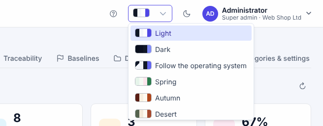
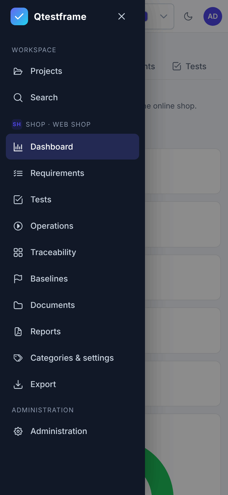
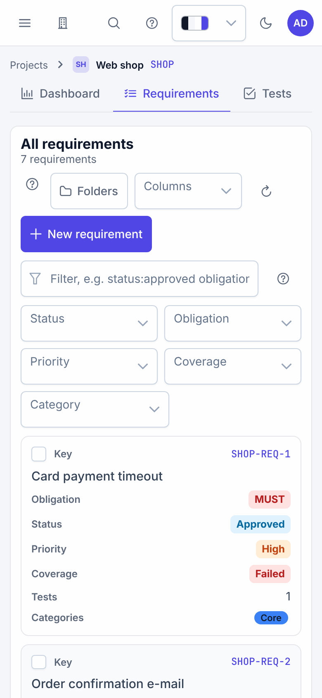

# Accessibility and languages

Qtestframe is designed to meet **WCAG 2.1 level AA**. It works with the keyboard alone, with screen readers, with browser zoom, on phones and tablets, in English and Swedish and in eleven colour themes.

## Keyboard

Everything can be done without a mouse.

| Key | Effect |
|---|---|
| <kbd>Tab</kbd> / <kbd>Shift</kbd>+<kbd>Tab</kbd> | Move to the next / previous control. The focused control has a clearly visible outline. |
| <kbd>Enter</kbd> / <kbd>Space</kbd> | Activate a button or link, tick a checkbox, toggle a cell in the traceability matrix. |
| <kbd>Esc</kbd> | Close a dialog, menu, drawer or the intro tour. Focus returns to where you were. |
| Arrow keys | Move within menus, lists, tabs, the folder tree and selection buttons. |
| <kbd>Ctrl</kbd>+<kbd>Enter</kbd> | Post a comment. |
| <kbd>Enter</kbd> in a filter field | Apply the query. |
| <kbd>?</kbd> | Open the user guide page for the current view (outside text fields). |

### Skip link

The first <kbd>Tab</kbd> on every page shows **Skip to main content**. Press <kbd>Enter</kbd> to jump past the sidebar and the top bar straight to the page content.

### Moving between pages

When you open another page, focus moves to its main heading and the page title is announced, so you know where you are without searching.

### Folder trees and tables

- In the folder tree, the arrow keys move between folders and open or close them. The **⋮** actions button of a folder offers everything that is otherwise done by dragging or right-clicking: new subfolder, rename, move, delete.
- Rows of the requirement and test tables open with <kbd>Enter</kbd> on the title. To move rows without dragging, select them and use **Move** in the bulk toolbar.

### Execution runner

The runner has single-key shortcuts (<kbd>P</kbd> pass, <kbd>F</kbd> fail, <kbd>B</kbd> blocked, <kbd>S</kbd> skip, <kbd>J</kbd>/<kbd>K</kbd> or arrows for next/previous step, <kbd>?</kbd> help). They only work while the focus is not in a text field, so typing an actual result never triggers them. See [Keyboard shortcuts](runs.md#keyboard-shortcuts).

## Screen readers

Qtestframe is built to be used with screen readers such as NVDA, JAWS, VoiceOver and TalkBack.

- Pages have **landmarks** (navigation, search, main) and a logical **heading structure**, so you can jump with your screen reader's heading and landmark commands.
- All buttons that only show an icon have a text label, for example *Delete SHOP-REQ-4* instead of just *bin*.
- **Status messages** (saved, deleted, failed) are announced politely; errors are announced immediately.
- Form fields have labels; required fields and errors are announced.
- In the language analysis, findings are announced with their severity (error, warning).
- On phones, tables become stacked cards; each value is read together with its column name.
- Screenshots in this guide have text alternatives that describe what they show.
- The **intro tour** is a modal dialog: its text is announced at each step, focus stays inside it, and <kbd>Esc</kbd> ends it.

## Themes

Pick a theme with the **Colour theme** picker in the top bar, or under **Profile → Preferences → Theme**. The choice is stored with your account and follows you to every device. The quick **Light mode / Dark mode** button next to it switches between the light and dark basic themes.

| Theme | Character |
|---|---|
| **Light** | the default: bright and neutral |
| **Dark** | dark surfaces, easier on the eyes in dim light |
| **Follow the operating system** | light or dark, as set on your computer or phone |
| **Spring**, **Autumn**, **Desert** | light themes with seasonal colours |
| **Camouflage**, **City camouflage**, **Navy**, **Green console** | dark themes |
| **Crazy** | a playful, colourful theme |

All themes meet the AA contrast requirements for text and controls. Qtestframe also respects your system's **reduced motion** setting.

## Languages

The user interface is available in **English** and **Swedish** (*Svenska*).

- Change it with **User menu → Language**, or under **Profile → Preferences → Language**. It applies immediately and is stored with your account.
- **Browser default** follows the language of your browser; if that is neither English nor Swedish, English is used.
- On the sign-in page, the language buttons apply before you sign in; after sign-in your preference wins.
- Dates and numbers follow the chosen language unless you set another **Date format** in your preferences.
- This user guide is available in both languages. If a page has not been translated yet, the English page is shown with a notice.
- Your data is not translated: requirements, tests and comments stay in the language they were written in. The RFC 2119 obligation levels (MUST, SHOULD, …) are always shown in English, also in the Swedish interface, where they are explained in Swedish (for example *MUST (SKA)*). The [language analysis](requirements.md#the-language-analysis) checks requirement texts written in either English or Swedish, with Swedish keywords such as *SKA* and *BÖR*.

## Phones and tablets

Qtestframe adapts to the screen size; nothing needs to be installed.

- **Below 1024 pixels** (tablets, small windows) the sidebar becomes a drawer. Open it with the menu button (☰) at the top left; it closes when you choose a page, tap outside it or press <kbd>Esc</kbd>.
- **Below 768 pixels** the search field becomes a magnifier button that opens a search dialog.
- **Below 640 pixels** (phones) tables turn into stacked cards, forms use a single column and editors open full-screen.
- The folder tree of the requirements and tests pages opens with the **Folders** button on narrow screens.
- The execution runner works well on a tablet next to the system under test.
- Large tables such as the traceability matrix scroll sideways inside their frame; the **List** view of the matrix is easier to use on a phone.

## Zoom and text size

When you zoom the browser, the layout reflows instead of scrolling sideways; at high zoom levels you get the tablet or phone layout described above. Text size settings of the browser or operating system are respected. **Compact tables** in your preferences show more rows if you prefer density over size.
