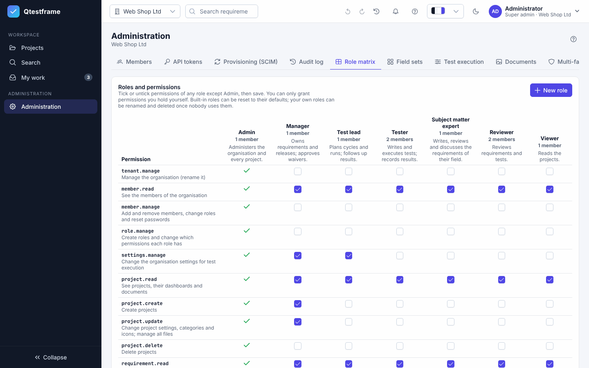

# Administration

**Administration** in the sidebar is shown to everyone who may see at least one of its sections. Which sections you see depends on your role:

| Section | Who sees it |
|---|---|
| **Members** | everyone (Viewer and up) can see the member list; **Admins** manage it |
| **Role matrix** (roles and permissions) | everyone |
| **API tokens** | Tester and up (your own tokens) |
| **Audit log** | Manager and up |
| **Organisations** | Super admins |
| **Users** | Super admins |
| **Backup** | Super admins |

## Organisations and roles

An **organisation** (tenant) is an isolated workspace: its projects, members, tokens and audit log are invisible to other organisations. A person has one user account for the whole installation and can be a **member** of several organisations, with **one role in each**.

### Roles and permissions

Every organisation starts with six built-in roles. By default each role in the table can do everything the role above it can, except **Reviewer**, which sits beside Tester:

| Role | Can additionally (default) |
|---|---|
| **Viewer** | read all projects, requirements, tests, runs, documents and the member list; search; export and generate reports |
| **Reviewer** | approve and reject requirements and mark tests ready (*requirement.review*, *test.review*), without editing their content |
| **Tester** | write and link tests, manage test folders and categories, create and edit runs, record results, import CI results, upload attachments to tests, runs and executions, create own API tokens |
| **Test lead** | mark tests ready (*test.review*), run automated scripts on the server, read the audit log, change the [test execution settings](#test-execution-settings) |
| **Manager** | approve and reject requirements (*requirement.review*), write requirements and requirement folders, create and edit projects and all categories, create baselines |
| **Admin** | everything: delete projects, manage members and roles, rename the organisation, reset members' passwords, delete any comment |
| **Super admin** | everything in every organisation; manage organisations and users; backup and restore |

The default matrix of permissions:

| Permission | Viewer | Reviewer | Tester | Test lead | Manager | Admin |
|---|:-:|:-:|:-:|:-:|:-:|:-:|
| `project.read`, `requirement.read`, `test.read`, `run.read`, `member.read`, `export` | ✔ | ✔ | ✔ | ✔ | ✔ | ✔ |
| `test.review` | | ✔ | | ✔ | ✔ | ✔ |
| `requirement.review` | | ✔ | | | ✔ | ✔ |
| `test.write`, `run.write`, `run.execute`, `token.manage` | | | ✔ | ✔ | ✔ | ✔ |
| `script.execute`, `audit.read`, `settings.manage` | | | | ✔ | ✔ | ✔ |
| `requirement.write`, `project.create`, `project.update` | | | | | ✔ | ✔ |
| `project.delete`, `member.manage`, `role.manage`, `tenant.manage` | | | | | | ✔ |

**Review decisions.** Setting a requirement to *Approved* or *Rejected* needs `requirement.review`; setting a test to *Ready* needs `test.review`. The same applies to bulk edits, to creating an item with that status and to restoring a version that has it. A reviewer without the write permission may change only the status; editing anything else still needs `requirement.write` or `test.write`. Each decision is recorded in the audit log as `requirement.review` or `test.review`. A copied requirement or test starts as *Draft*, so it is reviewed again.

### Change roles and create your own

*(Admin, or any role with `role.manage`)* **Administration → Role matrix** shows the matrix of the organisation. Tick or untick a permission of any role except **Admin**; the changed cells are highlighted and a bar tells you how many roles have unsaved changes. Select **Save** to apply them; members with that role get the new permissions at once. You can only grant permissions that you hold yourself.

- A built-in role whose permissions differ from the defaults is marked *changed*; its **Reset to default** button (↺) restores them.
- **New role** creates your own role: enter a **Display name** (for example *Auditor*), a **Technical name** (lower-case letters, digits and `_`, used in the API and in SSO group mappings) and optionally a description, and choose the role whose permissions it starts with. Then adjust the permissions in the matrix.
- Your own roles are marked *custom*. You can rename them (✎) and delete them (🗑) once no member or API token uses them.
- New roles can be chosen under **Members**, for API tokens and in the identity-provider group mapping.

**Admin** always has every permission, so an organisation cannot lock itself out.



Buttons for actions you may not perform are hidden. If you are missing a button described in this guide, check your role in the user menu.

## Members

**Administration → Members** lists the members of the current organisation with their role and since when they are members.


- **Add member** *(Admin)*: enter the **E-mail** and choose the **Role**. If the person already has an account, they are added with that role. If the e-mail is unknown, a local account is created; give a **Display name** and an **Initial password**, and tell the person to change it after the first sign-in.
- **Change a role** *(Admin)*: pick another role in the member's row. It applies immediately, also to the person's API tokens.
- **Remove** *(Admin)*: removes the membership; the account itself remains.
- An organisation must keep at least **one admin**: the last admin cannot be demoted or removed.

### Reset a password

*(Admin, for local accounts)*: select **Reset password** in the member's row. Qtestframe generates a **temporary password** and shows it **once**; copy it and give it to the person through a safe channel. The person is signed out everywhere and must choose a new password at the next sign-in.

Admins can only reset passwords of people who belong to their organisation alone; for super admins and people who are members of other organisations too, a super admin must do it. Accounts that sign in through single sign-on have no password in Qtestframe.

## Test execution settings

*(Admin and Test lead, or any role with `settings.manage`)* **Administration → Test execution** decides when a test may be executed. By default a test can only be executed when:

- the test has status **Ready**,
- every requirement it verifies has one of the **ready statuses** (default **Approved**, **Implemented** and **Verified**), and
- every test it [depends on](tests.md#dependencies) has passed: in the same run when that test is part of the run, otherwise its latest result.

Each rule can be relaxed separately: **Allow executing tests that are not Ready**, **Allow executing tests of requirements that are not ready** and **Allow starting tests before their prerequisites have passed**. You can also choose which requirement statuses count as ready.

What a rule forbids is refused by the server, also for API clients and CI imports. In the app you see it at once:

- in the **New run** dialog, picked tests that are not ready are marked, with a warning;
- on the run page, a **Readiness** column and a summary show which executions cannot be started yet;
- in the execution runner, a red box lists the reasons, with links to the test, requirement or prerequisite, and **Pass**, **Fail** and **Run script** are disabled. You can still mark the test **Blocked** or **Skipped**, assign it and write notes;
- when a rule is relaxed, the same reasons appear as an amber warning, and the test can be executed.

## API tokens

API tokens let scripts and CI pipelines use the REST API without a password, for example for the [CI import](runs.md#import-results-from-ci).


1. Open **Administration → API tokens** and select **New token** *(Tester)*.
2. Enter a **Name** that says where it is used, for example *GitLab CI*.
3. Choose the **Role**. A token can never have a higher role than you.
4. Optionally set **Expires after (days)**; empty means it never expires.
5. Select **Create** and **copy the token now**: it starts with `qtf_` and is shown only once.

Use it as a bearer token: `Authorization: Bearer qtf_…`. A token belongs to one organisation, and on every request it is limited to the role you currently have there: if your role is lowered, so is the token's. Tokens cannot create tokens. **Revoke** a token as soon as it is no longer needed or may have leaked; clients using it lose access immediately. The list shows when each token was **Last used**.

## Audit log

*(Manager)* **Administration → Audit log** records who did what and when in the organisation: creating, changing and deleting items, sign-ins and sign-outs, membership changes and more. Newest entries come first. Each entry shows the avatar of the person who did it.


- Filter by user, action, entity or details with a query, for example `user:anna action:delete` or `entity:requirement created_at>=2026-09-01`.
- Limit the time range with **From date** and **To date**.
- **Number of entries** sets how many are shown (up to 5000).
- **Export CSV** downloads the filtered log for an auditor.

## Organisations

*(Super admin)* **Administration → Organisations** lists all organisations.

- **New organisation**: a **Slug** (short name used at sign-in, for example `acme`) and a **Name**.
- **Rename organisation** (also allowed for an organisation's admins).
- **Switch** to an organisation to work in it.
- **Delete** removes the organisation with **all** its projects and data. This cannot be undone.

## Users

*(Super admin)* **Administration → Users** lists every account of the installation with its sign-in provider and flags.


- **New user**: e-mail, display name, password and optionally **Super administrator**.
- **Edit user**: change the display name, set a new password (**Reset password (optional)**), make the user a super administrator, or mark the account **Disabled**. Disabling an account or setting a password signs the user out everywhere. **Must change password** forces a new password at the next sign-in.
- You cannot remove your own super admin flag or disable yourself.

Users who sign in with OIDC or SAML single sign-on can be created automatically on their first sign-in, with their role taken from their identity provider groups; this is configured on the server (see the operations guide).

## Backup and restore

*(Super admin)* **Administration → Backup** saves and restores the whole installation.


- **Download backup** creates a ZIP file with all organisations, projects, items, history, comments and files (sessions are not included). Store it somewhere safe; it contains all data, including password hashes.
- **Restore**: choose the backup file, type `RESTORE` to confirm and select **Restore backup**. This **replaces all data** of the installation with the content of the file, in one step. The backup must come from the same version of the database schema. Everyone, including you, is signed out afterwards.

Restore is meant for disaster recovery and moving to a new server. To recover a single item, use its [history](requirements.md#history-and-restore) instead.

The server administrator can do the same on the command line:

```bash
qtestframe backup --out qtestframe-backup.zip
qtestframe restore --in qtestframe-backup.zip --yes
```

## Command line

Server administrators can also manage organisations, users and members with the `qtestframe` command, for example to create the first organisation:

```bash
qtestframe tenant create --slug acme --name "Acme Corp"
echo 'Initial-pass-123' | qtestframe user create --email alice@example.com --name Alice --password-stdin
qtestframe member add --tenant acme --email alice@example.com --role manager
```
