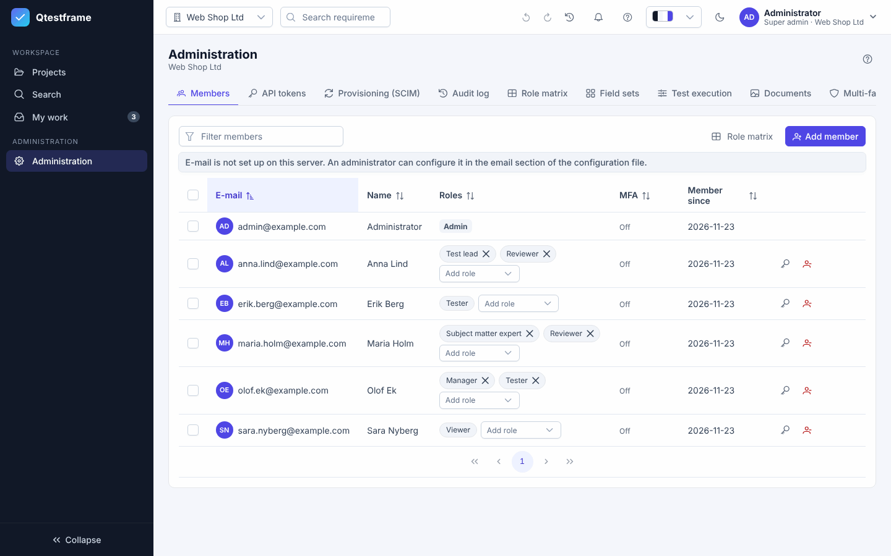
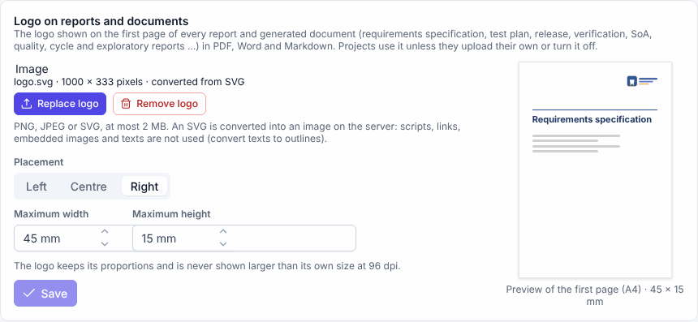
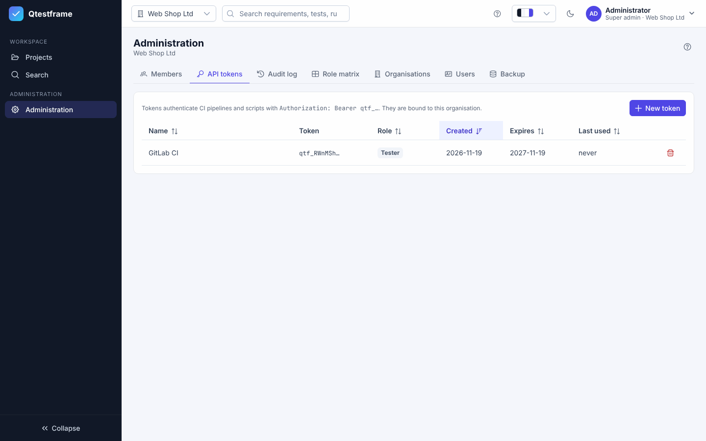
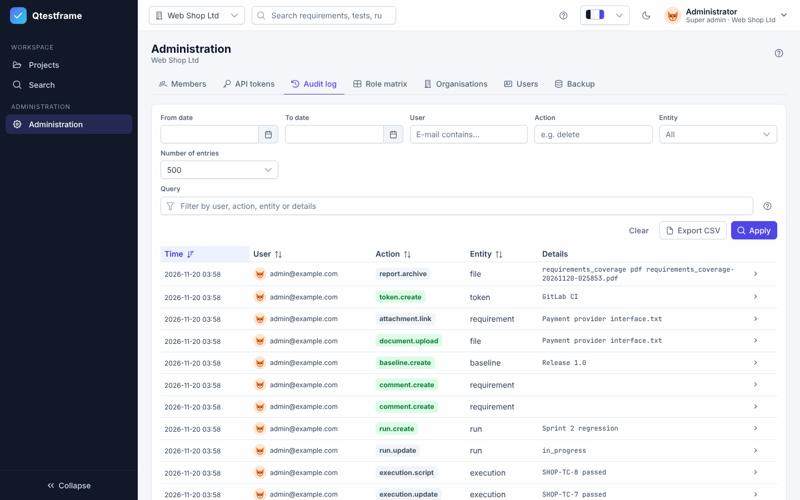
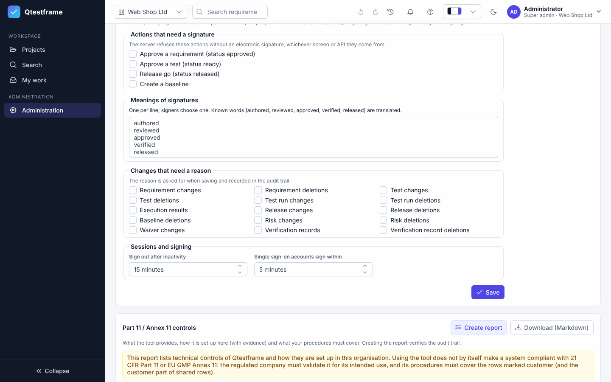
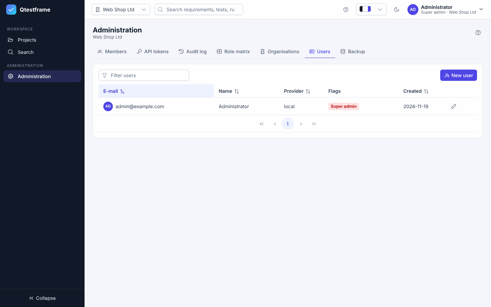
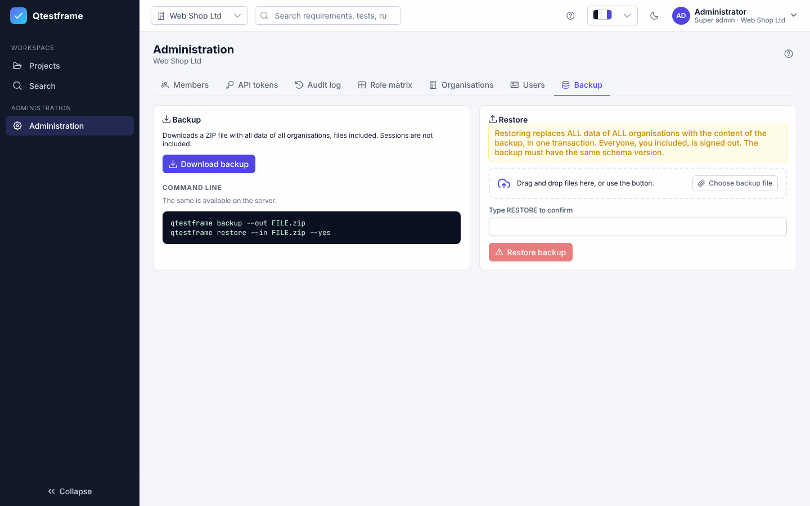

# Administration

**Administration** in the sidebar is shown to everyone who may see at least one of its sections. Which sections you see depends on your role:

| Section | Who sees it |
|---|---|
| **Members** | everyone (Viewer and up) can see the member list; **Admins** manage it |
| **Role matrix** (roles and permissions) | everyone |
| **API tokens** | Tester and up (your own tokens) |
| **Provisioning (SCIM)** | Admins |
| **Multi-factor authentication** | Admins (the organisation policy); super admins also set the server policy |
| **Audit log** | Test lead and up |
| **Electronic records** | Test lead and up (Admins change the settings) |
| **Field sets** (custom fields and templates per project type) | Admins and Test leads |
| **Organisations** | Super admins |
| **Users** | Super admins |
| **Backup** | Super admins |
| **System settings** | Super admins |

## Organisations and roles

An **organisation** (tenant) is an isolated workspace: its projects, members, tokens and audit log are invisible to other organisations. A person has one user account for the whole installation and can be a **member** of several organisations, with **one or more roles in each**.

### Roles and permissions

Every organisation starts with seven built-in roles. By default each role in the table can do everything the role above it can, except **Reviewer** and **Subject matter expert**, which sit beside Tester:

| Role | Can additionally (default) |
|---|---|
| **Viewer** | read all projects, requirements, tests, runs, documents and the member list; search; export and generate reports |
| **Reviewer** | approve and reject requirements and mark tests ready (*requirement.review*, *test.review*), without editing their content; write in [discussions](discussions.md) (*comment.create*, as all roles below except Viewer) |
| **Subject matter expert** | take part in writing requirements: create and edit requirements with their criteria, rationale, sources, relations, links and attachments (*requirement.write*); review requirements (*requirement.review*) and discuss them; read tests, runs, defects and risks. No tests, runs, cycles, waivers, settings or members |
| **Tester** | write and link tests, manage test folders and categories, create and edit runs, record results, import CI results, upload attachments to tests, runs and executions, create own API tokens |
| **Test lead** | plan [test cycles](test-cycles.md) (*cycle.plan*), mark tests ready (*test.review*), run automated scripts on the server, read the audit log, change the [test execution settings](#test-execution-settings) |
| **Manager** | approve and reject requirements (*requirement.review*), write requirements and requirement folders, create and edit projects, all categories and the [traceability rules](traceability-and-coverage.md#traceability-rules), create baselines |
| **Admin** | everything: delete projects, manage members and roles, rename the organisation, reset members' passwords, remove any comment |
| **Super admin** | everything in every organisation; manage organisations and users; backup and restore |

**Several roles.** A member can hold several roles at once – for example *Subject matter expert* and *Tester* for someone who writes requirements in their field and also tests. They then have the permissions of all their roles together; roles only add rights. Holding **Admin** among them makes them an administrator of the organisation.

The default matrix of permissions:

| Permission | Viewer | Reviewer | Subject matter expert | Tester | Test lead | Manager | Admin |
|---|:-:|:-:|:-:|:-:|:-:|:-:|:-:|
| `project.read`, `requirement.read`, `test.read`, `run.read`, `member.read`, `export` | ✔ | ✔ | ✔ | ✔ | ✔ | ✔ | ✔ |
| `test.review` | | ✔ | | | ✔ | ✔ | ✔ |
| `requirement.review` | | ✔ | ✔ | | | ✔ | ✔ |
| `comment.create` | | ✔ | ✔ | ✔ | ✔ | ✔ | ✔ |
| `requirement.write` | | | ✔ | | | ✔ | ✔ |
| `change.create` | | | ✔ | | ✔ | ✔ | ✔ |
| `change.approve` | | | | | ✔ | ✔ | ✔ |
| `test.write`, `run.write`, `run.execute`, `token.manage` | | | | ✔ | ✔ | ✔ | ✔ |
| `cycle.plan`, `script.execute`, `audit.read`, `settings.manage` | | | | | ✔ | ✔ | ✔ |
| `waiver.approve`, `project.create`, `project.update` | | | | | | ✔ | ✔ |
| `project.delete`, `member.manage`, `role.manage`, `tenant.manage` | | | | | | | ✔ |

**Waivers and risk acceptance.** Approving, rejecting and revoking [waivers and deviations](waivers-and-soa.md) and signing the acceptance of a residual risk need `waiver.approve` (a project permission, so a project role can grant it in one project). Every decision is an electronic signature (password, or a recent single sign-on) and is recorded in the audit log; the requester of a waiver cannot decide it. Grant `waiver.approve` only to people who may accept not meeting requirements.

**Change requests.** Proposing changes in [change requests](change-requests.md) (and assessing, applying, verifying and closing them) needs `change.create`; deciding them as a member of the project's change control board, and the emergency override of enforced change control, need `change.approve`. Both are project permissions. Every decision is an electronic signature, and the requester of a change request cannot decide it.

**Review decisions.** Setting a requirement to *Approved* or *Rejected* needs `requirement.review`; setting a test to *Ready* needs `test.review`. The same applies to bulk edits, to creating an item with that status and to restoring a version that has it. A reviewer without the write permission may change only the status; editing anything else still needs `requirement.write` or `test.write`. Each decision is recorded in the audit log as `requirement.review` or `test.review`. A copied requirement or test starts as *Draft*, so it is reviewed again.

**Issue trackers.** Connecting a project to Jira, GitHub or GitLab needs `project.update`; the token is entered there once and is never shown again (see [Connect Jira, GitHub or GitLab](defects.md#connect-jira-github-or-gitlab), which also explains how to make a GitLab token with the smallest scope, `api`). Pushing and syncing defects needs `run.execute`; creating, updating and refreshing [issues from requirements](requirements.md#issues-in-gitlab-github-or-jira) needs `requirement.write`. They are recorded in the audit log (`defect.push`, `defect.sync` when a status changes, `requirement.issue.create`, `requirement.issue.update`, `requirement.issue.sync`).

### Change roles and create your own

*(Admin, or any role with `role.manage`)* **Administration → Role matrix** shows the matrix of the organisation. Tick or untick a permission of any role except **Admin**; the changed cells are highlighted and a bar tells you how many roles have unsaved changes. Select **Save** to apply them; members with that role get the new permissions at once. You can only grant permissions that you hold yourself.

- A built-in role whose permissions differ from the defaults is marked *changed*; its **Reset to default** button (↺) restores them.
- **New role** creates your own role: enter a **Display name** (for example *Auditor*), a **Technical name** (lower-case letters, digits and `_`, used in the API and in SSO group mappings) and optionally a description, and choose the role whose permissions it starts with. Then adjust the permissions in the matrix.
- Your own roles are marked *custom*. You can rename them (✎) and delete them (🗑) once no member or API token uses them.
- New roles can be chosen under **Members**, for API tokens and in the identity-provider group mapping.

**Admin** always has every permission, so an organisation cannot lock itself out.


Buttons for actions you may not perform are hidden. If you are missing a button described in this guide, check your role in the user menu.

## Members

**Administration → Members** lists the members of the current organisation with their role and since when they are members.



- **Add member** *(Admin)*: enter the **E-mail** and choose one or more **Roles**. If the person already has an account, they are added with those roles. If the e-mail is unknown, a local account is created: when the server can send e-mail, leave **Send an invitation by e-mail** on (see [Invite by e-mail](#invite-by-e-mail)); otherwise give a **Display name** and an **Initial password**, and tell the person to change it after the first sign-in.
- **Change the roles** *(Admin)*: open the roles in the member's row and tick or untick roles; each role is shown as a chip, and a member always keeps at least one role. It applies immediately, also to the person's API tokens. The organisation always keeps at least one member with the **Admin** role.
- **Remove** *(Admin)*: removes the membership; the account itself remains.
- **Several members at once** *(Admin)*: tick members (or the box in the header for all shown), then choose a role under **Set role** (they get exactly that role), **Add role** or **Remove role** (the other roles stay), or select **Remove**, and confirm. Your own membership is left as it is, as are members whose roles would not change or who would be left without a role; the message says which were skipped. Both can be undone (removed members are added back with their old roles).
- An organisation must keep at least **one admin**: the last admin cannot be demoted or removed, and a change of several members that would leave no admin is refused as a whole.
- Members marked **SCIM** are [provisioned by your identity provider](#provisioning-with-scim): their roles follow their groups there, so their roles cannot be changed and they cannot be removed here (a change of several members skips them).

### Invite by e-mail

*(Admin, when e-mail is set up)* With **Send an invitation by e-mail** on, **Add and invite** sends the person an e-mail with a link instead of an initial password. The link leads to a page where they choose their name and password and are signed in straight away. It can be used **once** and is valid for **7 days**. People who sign in with single sign-on (OIDC or SAML): also turn on **Uses single sign-on**; their link asks them to sign in with their organisation account instead.

Until the invitation is accepted, the member shows an **Invited** tag (or **Invitation expired**); hover over it to see when it was sent and until when it is valid. In the member's row:

- **Send the invitation again** sends a new link; the old one stops working. Use it when the invitation expired or got lost.
- **Revoke the invitation** makes the link unusable and removes the person from the organisation.

If the person already has an account, they are added at once and get an e-mail that they were added. Every invitation, resend, revocation and acceptance is recorded in the [audit log](#audit-log).

### Reset a password

*(Admin, for local accounts)*: select **Reset password** in the member's row. Qtestframe generates a **temporary password** and shows it **once**; copy it and give it to the person through a safe channel. The person is signed out everywhere and must choose a new password at the next sign-in.

Admins can only reset passwords of people who belong to their organisation alone; for super admins and people who are members of other organisations too, a super admin must do it. Accounts that sign in through single sign-on have no password in Qtestframe.

### Reset multi-factor authentication

The **MFA** column shows who uses multi-factor authentication: **On**, *Off*, or **Missing** when the [MFA policy](#multi-factor-authentication) requires it for the member but they have not set it up yet.

*(Admin)* When someone has lost both their phone and their recovery codes, select **Reset MFA** (the shield) in their row and confirm. Their authenticator app, recovery codes and remembered devices are removed, they are signed out everywhere and told by a notification and an e-mail. They then sign in with their password alone, or, if MFA is required for them, set up a new authenticator app at the next sign-in. Make sure the request really comes from that person before you reset. As for passwords, admins can only reset people who belong to their organisation alone; super admins can reset anyone, also under [Users](#users). Every reset is recorded in the [audit log](#audit-log).

## Multi-factor authentication

**Administration → Multi-factor authentication** decides who must use a second factor (an authenticator app, see [your profile](getting-started.md#multi-factor-authentication)) when signing in with a password. The page shows how many members already use it.

- **Policy of the organisation** *(Admin)*: **Optional** (the default: everyone may, nobody must), **Required for everyone** or **Required for some roles**, for example only for admins. It applies to the members by their role in this organisation.
- **Server policy** *(Super admin)*: the same choices for every user of the installation; a role counts in any organisation, and *Super admin* can be chosen as a role. An organisation can require more than the server, never less.
- **Grace period**: people the policy newly covers may keep signing in without a second factor for this many days; they see a reminder with the date. Afterwards they must set it up at their next sign-in before they can do anything else. **0** means at the next sign-in.
- **Remember this device** *(Super admin, server policy)*: the number of days a browser may skip the code after the user chose *Remember this device*; **0** (the default) turns the option off.

API tokens are not affected. People who sign in with single sign-on normally get their second factor from the identity provider; whether Qtestframe asks for its own code as well is set per provider in the server configuration (`local_mfa`). Every policy change is recorded in the [audit log](#audit-log).

## Project sharing

By default every member of the organisation sees every project, with their organisation role. **Sharing** changes that per project: you can restrict a project to the people who work on it, and give people a different role in one project than in the organisation.

Open it with **Share** in the project header (or the share button of a project on the **Projects** page), or under **Categories & settings → Sharing**. You need `project.update` in the project *(Manager, or a project role that has it)*.

**Access** has two choices:

- **Everyone in the organisation** (the default): every member sees the project with their organisation role. Project members get their project role instead.
- **Restricted to project members**: only the project members (and the organisation's admins) see the project. For everyone else it does not exist: it is missing from the project list, search, reviews and notifications, and links to it show *not found*. Restricted projects show a lock (🔒) in the project list and the header.

**Project members** are people of the organisation or groups from your [identity provider (SCIM)](#provisioning-with-scim), each with one or more **project roles**: any roles of the organisation, also your own. Inside the project the project roles **replace** the organisation roles, so it can raise or lower someone's rights there: a Tester of the organisation can be Manager in one project, a Manager only Viewer in another. A person's own membership wins over a group's; several groups add up. Admins of the organisation always have full access to every project.

- **Add**: search for a person or group by name or e-mail, choose the project roles and select **Add**. Only members of the organisation can be added (add new people under [Members](#members) first). The person gets a notification (and an e-mail if they want e-mail notifications).
- **Change the roles**: tick or untick roles in the member's row. Roles you may not give are shown but cannot be removed.
- **Remove** removes someone from the project; members can also leave a project themselves. **Several members at once**: tick them, then choose **Set project role**, **Add project role**, **Remove project role** or **Remove**.
- You can only give, change or remove roles whose project permissions you have in the project yourself, so nobody can give more than they have.
- When you restrict a project that you see through your organisation roles, you are added as a project member with those roles, so you do not lock yourself out.
- Organisation-wide permissions – members, roles, API tokens, the audit log, creating projects – always follow the organisation roles. API tokens never exceed their own roles, also in a project.

Every change of the access or the members is recorded in the [audit log](#audit-log). Removing someone from the organisation removes their project memberships too. A duplicated project keeps the members of the original.

## E-mail

Notification e-mails, invitations and [reports by e-mail](reports-and-export.md#send-a-report-by-e-mail) need an outgoing mail server, which the server administrator sets up in the `email` section of the configuration file. Without it, these features are hidden and the profile explains that notifications are only shown in the app.

*(Admin)* **Administration → Members → Send test e-mail** sends a test e-mail to your own address. If it fails, the message shows the answer of the mail server, for example a wrong password or a refused connection; give it to the server administrator.

## Test execution settings

*(Admin and Test lead, or any role with `settings.manage`)* **Administration → Test execution** decides when a test may be executed. By default a test can only be executed when:

- the test has status **Ready**,
- every requirement it verifies has one of the **ready statuses** (default **Approved**, **Implemented** and **Verified**), and
- every test it [depends on](tests.md#dependencies) has passed: in the same run when that test is part of the run, otherwise its latest result.

Each rule can be relaxed separately: **Allow executing tests that are not Ready**, **Allow executing tests of requirements that are not ready** and **Allow starting tests before their prerequisites have passed**. You can also choose which requirement statuses count as ready.

What a rule forbids is refused by the server, also for API clients and CI imports. In the app you see it at once:

- in the **New run** dialog, picked tests that are not ready are marked, with a warning;
- on the run page, a **Readiness** column and a summary show which executions cannot be started yet;
- in the execution runner, a red box lists the reasons, with links to the test, requirement or prerequisite, and **Pass**, **Fail** and **Run script** are disabled. You can still mark the test **Blocked** or **Skipped**, assign it and write notes;
- when a rule is relaxed, the same reasons appear as an amber warning, and the test can be executed.

**Requirement status follows test results** (on by default) lets an implemented requirement become **Verified** when it is [verified](traceability-and-coverage.md#verification) — every criterion has passing evidence and every child requirement is verified — and go back to **Implemented** when that no longer holds. Turned off, statuses change only by hand and disagreements are listed under **Verification → Inconsistencies**. Whether each criterion needs evidence of its own is a project setting (**Settings → Project → Verification**).

## Logo on reports and documents

*(Admin and Test lead, or any role with `settings.manage`)* **Administration → Documents** sets the organisation's logo. It is shown at the top of the first page of every [report](reports-and-export.md#logo-on-the-first-page) and [generated document](documents.md#create-a-requirements-specification-or-a-test-plan) — requirements specifications, test plans, release, verification, SoA, quality, cycle and exploratory reports, custom reports and the change impact export — in PDF, Word and Markdown.



- **Upload logo** takes a PNG, JPEG or SVG image of at most 2 MB. An SVG is converted into an image on the server by Qtestframe's own renderer: scripts, links, embedded images and texts in it are never used (convert texts to outlines before you upload it).
- **Placement** puts the logo at the left (default), in the centre or at the right of the page.
- **Maximum width** and **Maximum height** (in millimetres; default 50 × 20 mm) bound its size. The logo keeps its proportions and is never shown larger than its own size at 96 dpi.
- The **preview** shows the first page of a document with the logo as it will be printed, also before you save.

Projects use this logo unless they upload their own under **Categories & settings → Project → Logo on reports and documents**, or turn on **No logo in this project's documents** *(Manager and Admin, or any role with `project.update`)*. A [project archive](reports-and-export.md#save-and-load-projects) carries the project's own logo; the organisation's logo is part of backups.

## Field sets and templates

*(Admin and Test lead, or any role with `settings.manage`)* **Administration → Field sets** keeps, per **project type**, the [custom fields](requirements.md#custom-fields) a new project of that type gets and the organisation's [templates](requirements.md#templates) for new requirements and tests. Changing a field set does not change existing projects: they keep their own copies and can apply the set again under **Categories & settings → Custom fields → Apply field set** (fields they already have are skipped). Organisation templates are offered in every project of the type, next to the built-in ones. Everyone in the organisation can read the field sets.

## Test configurations

*(Manager and Admin, or any role with `project.update`)* **Categories & settings → Configurations** holds the test configurations of a project: named combinations of **dimension values** such as *Browser = Chrome* and *OS = Windows*, a hardware revision or a firmware version. A [run](runs.md#configurations-in-a-run) that targets configurations executes each of its tests once per configuration. Everyone who can read the project sees the configurations.

- **New configuration**: add dimension values (dimension and value, each dimension at most once) and optionally a name and a description. Without a name, the configuration is named after its values, e.g. *Chrome / Windows*. Names are unique in the project, ignoring case.
- **Generate combinations**: give each dimension its values, separated by commas (*Browser*: Chrome, Firefox, Safari; *OS*: Windows, macOS), and the dialog previews every combination. **Create** adds them all at once (at most 200); with **Skip combinations that already exist**, existing names are left out.
- The arrows change the order in which configurations are listed and offered; the pencil edits one. Renaming a configuration also renames it in existing runs.
- **Delete** (also for several ticked configurations) removes configurations that no run targets. A configuration that is in use cannot be deleted; remove it from the runs first, or delete those runs.

The **Runs** column shows how many runs target each configuration. Creating configurations can be undone with the undo button.

## Change impact, staleness and defects

*(Manager and Admin, or any role with `project.update`)* **Categories & settings → Change impact** holds a project's rules for [change impact](traceability-and-coverage.md#change-impact), [stale results](traceability-and-coverage.md#stale-results), [blocking defects](traceability-and-coverage.md#blocking-defects) and [regressions](defects.md#regressions). Everyone who can read the project sees them. Changes apply from then on: what was already marked stays marked.

## Variants and code integration

*(Manager and Admin, or any role with `project.update`)* **Variants** holds the project's product variants, markets and customer configurations; **Settings → Project → Code integration** holds the shared secret of the project's GitLab and GitHub webhooks. The secret is stored encrypted with the other secrets, is write-only and is not part of project archives: set a new one after loading a project. Deliveries are checked with the secret token (GitLab) or the HMAC-SHA256 signature (GitHub), and every delivery is written to the audit log as `code.webhook`. CI tokens need `run.execute` to upload results for a build and `run.write` to create a regression run. See [Variants and code](variants-and-code.md).

## Web tests

[Web tests](tests.md#web-tests-playwright) run in a real browser on the server. They are switched on by the server administrator in the configuration file (`runner.web`, see below) and set up per project under **Settings → Web tests** *(Manager; permission project.update)*:

- **Base URL** — the address of the application under test, e.g. `https://staging.example.com`. `page.goto('/login')` in a web test opens `https://staging.example.com/login`.
- **Base URL per environment** — a run whose **Environment** matches the name (ignoring case) uses this URL instead, e.g. *production* → `https://www.example.com`. A test configuration with a **Base URL** dimension wins over both.
- **Test variables** — name and value, passed to every automated script of the project as `QTF_VAR_<NAME>` (in a web test `process.env.QTF_VAR_USERNAME`). Mark passwords and tokens **Secret**: their value is write-only — it is never shown again, not even to administrators (leave the field empty to keep it), and it is replaced by `***` in stored output and failure messages. Screenshots and traces can still show a secret that the page displays.

Only members with the permission *script.execute* (by default **Test lead** and **Manager**) can run scripts and web tests. Scripts run on the server with the server's privileges, restricted only by the sandbox; web tests always have network access, so treat **Run script** as running code on the server.

**Server setup** (the server administrator):

1. Install Node.js and Playwright in a directory, e.g. `/opt/qtestframe-playwright`: `npm i @playwright/test`, then the browsers with `npx playwright install --with-deps chromium` (add `firefox webkit` for those browsers).
2. In the configuration file set `runner.enabled: true` and:

   ```yaml
   runner:
     web:
       enabled: true
       node: /usr/bin/node
       playwright_dir: /opt/qtestframe-playwright   # has node_modules/@playwright/test
       browsers_path: /opt/qtestframe-playwright/browsers  # PLAYWRIGHT_BROWSERS_PATH, if not the default
       browser: chromium          # default browser: chromium, firefox or webkit
       headless: true
       timeout: 60s               # per test
       screenshots: on_failure    # on_failure, always or off
       trace: on_failure          # on_failure, always or off
       video: off                 # off, on_failure or always
       max_parallel: 2            # web tests running at the same time
   ```

3. Restart the server. **Run script** now works for web tests; the demo project of `qtestframe seed-demo` has one (*Login page shows the sign-in form*) that opens the server's own login page — set `server.base_url` to the address the server is reachable at.

## Consistency checks

Projects do not get the [built-in consistency checks](traceability-and-coverage.md#built-in-consistency-checks) as rules automatically: a manager adds them with **Add built-in checks** (they start as warnings, so release readiness does not change). Dismissed findings (*not a duplicate*, *not a conflict*) are part of backups and project archives; the cached vectors of the optional embeddings service are not (see [Duplicates and conflicts](duplicates-and-conflicts.md)).

## API tokens

API tokens let scripts and CI pipelines use the REST API without a password, for example for the [CI import](runs.md#import-results-from-ci).



1. Open **Administration → API tokens** and select **New token** *(Tester)*.
2. Enter a **Name** that says where it is used, for example *GitLab CI*.
3. Choose the **Roles** (by default all of yours). A token can never have more permissions than you.
4. Optionally set **Expires after (days)**; empty means it never expires.
5. Select **Create** and **copy the token now**: it starts with `qtf_` and is shown only once.

Use it as a bearer token: `Authorization: Bearer qtf_…`. A token belongs to one organisation, and on every request it is limited to the roles you currently have there: if you lose a role, so does the token. Tokens cannot create tokens. **Revoke** a token as soon as it is no longer needed or may have leaked; clients using it lose access immediately. The list shows when each token was **Last used**.

## Provisioning with SCIM

*(Admin)* With SCIM 2.0 your identity provider (Microsoft Entra ID, Okta, OneLogin, JumpCloud and others) creates, updates and deactivates the members of the organisation for you: when someone joins the Qtestframe application in the provider they become a member here, and when they leave they lose access.

How it works:

- **Users.** A provisioned user is matched by e-mail address. New users get an account **without a password**: they sign in with the organisation's single sign-on (OpenID Connect or SAML), which links the account at the first sign-in. An existing account with the same e-mail (for example a member you added by hand) is taken over.
- **Deactivation.** When the provider deactivates a user, the membership is removed and the person's sessions and API tokens in this organisation end at once. When the provider activates the user again, the membership comes back with the role from the groups. Deleting the user in the provider removes the membership; the account itself remains.
- **Roles from groups.** The provider can also push groups. Under **Roles of provisioned members** you choose for each group the role its members get, or **Not mapped**. A member in several mapped groups gets the roles of all of them. Members without a mapped group get the **Default role** (*Viewer* unless you change it), or nothing with **No access**.
- **Protected rules.** SCIM never makes anyone a super admin or removes that status, and the organisation always keeps one admin: a change that would remove the last admin is refused. The e-mail and name of a person who also belongs to other organisations are not changed by this organisation's provider.
- **Members list.** Provisioned members are marked **SCIM** in **Administration → Members**. Change their role through their groups in the provider (or the group mapping here); their role cannot be changed and they cannot be removed by hand, because the next synchronisation would undo it.

### Connect your identity provider

1. Open **Administration → Provisioning (SCIM)** and select **New SCIM token**. Give it a **Name** such as *Entra ID*, optionally an expiry, and select **Create**.
2. **Copy the token now**: it starts with `qtfscim_` and is shown only once. A SCIM token only works for provisioning this organisation; it is not an API token, and API tokens do not work for provisioning.
3. Copy the **SCIM base URL** from the same page (it ends with `/scim/v2`).
4. Set up provisioning in the provider:
   - **Microsoft Entra ID**: in the enterprise application for Qtestframe open **Provisioning**, set the mode to **Automatic**, enter the base URL as **Tenant URL** and the token as **Secret Token**, select **Test Connection**, then save. Assign users and groups to the application and start provisioning. Entra ID matches users on `userName` (the user principal name or e-mail) and synchronises about every 40 minutes.
   - **Okta**: in the Qtestframe app integration enable **SCIM provisioning**, enter the base URL as **SCIM connector base URL**, choose `email` as **Unique identifier field for users**, select **Push New Users**, **Push Profile Updates** and **Push Groups**, and choose **HTTP Header** authentication with the token. Under **To App** enable *Create Users*, *Update User Attributes* and *Deactivate Users*, then assign people and push groups.
   - Other providers work the same way: base URL, bearer token, and users and groups to push.
5. When the first groups arrive, map them to roles under **Roles of provisioned members** and choose the **Default role**.

**Recent provisioning events** on the same page shows the latest changes; each is also in the [audit log](#audit-log), with the actor *SCIM: token name*. **Revoke** a token when you replace it or it may have leaked; the provider then stops provisioning until it gets a new one. Every change of a request is saved together or not at all, and a provider that sends too many requests is slowed down (HTTP 429).

## OSLC

Qtestframe serves an OSLC provider (Requirements Management 2.1 and Quality Management 2.1) at `/api/v1/oslc/`, so that ALM tools such as IBM Engineering Lifecycle Management (DOORS Next, ETM), Polarion or Codebeamer can find, link, create and change requirements and test cases. It is always on; what users can do with it is described in [Interoperability](interoperability.md#oslc).

- **Addresses:** the catalog `/api/v1/oslc/catalog` (one service provider per project), a catalog per project `/api/v1/oslc/projects/<id>/catalog`, the discovery document `/api/v1/oslc/rootservices` (public, contains no data). Set **Base URL** under [System settings](#system-settings) (`server.base_url`) so that the resource addresses are the ones clients can reach.
- **Accounts:** clients sign in with an [API token](#api-tokens) as `Authorization: Bearer …`; clients that only offer user name and password can send the token as the password (any user name). Create the token for a person or service account whose role allows what the tool should do: **Viewer** to read and link from the other side, a role with write permissions to create and change items. Project sharing applies: restricted projects are only listed for their members.
- **Supported:** RDF/XML, Turtle and JSON-LD in both directions; creation factories, updates with `If-Match` (a stale update is refused), deletion to the trash; queries with `oslc.where` on any property, `oslc.select`, `oslc.orderBy`, `oslc.searchTerms` and paging; link properties as trace links, relations and links to the other tool's items; delegated selection and creation dialogs; resource shapes.
- **Dialogs in a frame:** the selection and creation dialogs open in a window of their own. For tools that show them inside their page, the server operator lists the tool's address in `server.frame_ancestors` (administrator guide, *Connecting other tools*).
- **Not supported:** OAuth 1.0a (use API tokens), previews, tracked resource sets and configuration management.

The API reference (`docs/api.md`, section *OSLC*) lists the properties and the query syntax.

## Audit log

*(Test lead and up)* **Administration → Audit log** records who did what and when in the organisation: creating, changing and deleting items, sign-ins, membership changes and more. Newest entries come first. Each entry shows the avatar of the person who did it.



- Filter by user, action, entity or details with a query, for example `user:anna action:delete` or `entity:requirement created_at>=2026-09-01`.
- Limit the time range with **From date** and **To date**.
- **Number of entries** sets how many are shown (up to 5000).
- **Export CSV** downloads the filtered log for an auditor; **Export Markdown** downloads it as a Markdown document with the date range and filter.


### Verify the audit trail

The audit log cannot be changed through the application, and every entry is linked to the one before it by a hash (a fingerprint of its content), so a change made directly in the database shows. **Verify audit trail** at the top of the page checks the whole chain and shows either *The audit trail is intact* (with the number of entries and signed checkpoints) or the **first broken link**: the entry number and what is wrong – the entry was changed, entries are missing or were removed at the end, or the chain was rewritten. Keep that evidence and report it as your procedures say.

**Export with hashes (JSON)** and **(CSV)** download the whole trail with each entry's number, hash and the hash of the entry before it, for archiving outside Qtestframe. The open *Details* of an entry also show its number, hash and, in electronic-records mode, the reason for the change.

## Electronic-records mode

*(Admins change it; Test lead and up can read it and create the report)* **Administration → Electronic records** turns on the controls regulated organisations need for electronic records and signatures (21 CFR Part 11, EU GMP Annex 11). It is **off** until an admin turns it on. When it is on:

- **Every signature asks you to confirm who you are**: your password and, if you use an authenticator app, a code from it. You choose the **meaning** of your signature (for example *Approved* or *Reviewed*) from the organisation's list. If you sign in with single sign-on, you sign shortly after signing in.
- **Some actions need a signature**: the admin chooses among approving a requirement, approving a test (status *Ready*), the release go (*Released*) and creating a baseline. When you do one of them – in the editor, a bulk change, the spreadsheet or a bulk review – the signature dialog opens; the change is saved once you have signed. If you cancel, nothing is saved.
- **Some changes need a reason**: when you save such a change, a dialog asks why (for example the number of a change request). The reason is stored in the audit log with the change.
- **You are signed out after a time without activity** (default 15 minutes). Background updates such as the notification count do not keep you signed in.

Signed records show their **Electronic signatures**: the printed name and e-mail of the signer, the date and time in UTC and in the signer's time zone, the meaning, what was signed and how the signer confirmed it. When the record is changed after it was signed, the signature shows *Record changed after signing*. You find them under **History** of a requirement or test, in a baseline's sign-offs, in a waiver, under the acceptance of a risk and in a release.



The admin sets on the same page the actions that need a signature, the meanings (one per line), the changes that need a reason, the inactivity time and how soon after a single sign-on accounts may sign. **Create report** shows the **Part 11 / Annex 11 controls**: for each requirement of the regulations what Qtestframe does, what your organisation's procedures must cover and the evidence from this installation; **Download (Markdown)** saves it. Qtestframe gives technical controls – validation, training, written policies and checking people's identity before they get an account remain your organisation's responsibility, and the report says so.

## Organisations

*(Super admin)* **Administration → Organisations** lists all organisations.

- **New organisation**: a **Slug** (short name used at sign-in, for example `acme`) and a **Name**.
- **Rename organisation** (also allowed for an organisation's admins).
- **Switch** to an organisation to work in it.
- **Delete** removes the organisation with **all** its projects and data. This cannot be undone.

## Users

*(Super admin)* **Administration → Users** lists every account of the installation with its sign-in provider and flags.



- **New user**: e-mail, display name, password and optionally **Super administrator**.
- **Edit user**: change the display name, set a new password (**Reset password (optional)**), make the user a super administrator, or mark the account **Disabled**. Disabling an account or setting a password signs the user out everywhere. **Must change password** forces a new password at the next sign-in.
- You cannot remove your own super admin flag or disable yourself.

Users who sign in with OIDC or SAML single sign-on can be created automatically on their first sign-in, with their role taken from their identity provider groups; this is configured on the server (see the [administrator guide](../../admin-guide/en/authentication.md#provisioning-of-single-sign-on-users)).

## Backup and restore

*(Super admin)* **Administration → Backup** saves and restores the whole installation.



- **Download backup** creates a ZIP file with all organisations, projects, items, history, comments and files (sessions are not included). Store it somewhere safe; it contains all data, including password hashes.
- **Restore**: choose the backup file, type `RESTORE` to confirm and select **Restore backup**. This **replaces all data** of the installation with the content of the file, in one step. The backup must come from the same version of the database schema. Everyone, including you, is signed out afterwards.

Restore is meant for disaster recovery and moving to a new server. To recover a single item, use its [history](requirements.md#history-and-restore) instead. A backup also contains the system settings (below), including the secrets stored there; they apply as soon as the restore is done.

Secrets in a backup (authenticator-app secrets, webhook secrets, tracker tokens, secret test variables, the e-mail password and client secrets) stay **encrypted** in the file. A backup can only be restored on a server that has the same key as the server it came from (see [Encryption of stored secrets](#encryption-of-stored-secrets)); otherwise the restore is refused and nothing is changed. The server administrator keeps that key safe, apart from the backups.

## System settings

*(Super admin)* **Administration → System settings** changes the configuration of the server while it runs: single sign-on, logging and syslog, the e-mail server, sign-in security and the test runner. Organisation admins do not see this page: every setting applies to the whole installation.

Choose a section in the list on the left (on a phone: at the top). Each section has its own **Save** button; only the values you changed are sent. **Export configuration** downloads the effective configuration as a YAML file, with every secret replaced by `REDACTED`, for example to copy it into the server's configuration file.

### Where a value comes from

Every setting shows a badge with the source of its current value:

- **Default** – the built-in value.
- **Configuration file** – set in the server's configuration file.
- **Environment** – set by a `QTF_…` environment variable of the server.
- **Changed here** – changed on this page (stored in the database).

A value changed here wins over the configuration file and the default. **Reset to file value** removes your change, and the value of the configuration file (or the default) applies again.

Some settings cannot be changed here. They show a lock and say why:

- **Set by the environment** – an environment variable always wins; ask the server administrator to change it.
- **Locked by the server administrator** – the configuration file lists the setting under `system_settings.locked`.
- **Configuration file only** – shown for information (for example the listen address or the database), because they can only change with a restart of the server.

Most settings apply at once. Settings with the badge **Applies after restart** (the test runner) are saved now and take effect the next time the server starts; until then the page shows the value in use. If the stored settings ever become invalid (for example after a change of the configuration file), the server ignores them at start-up and the page shows a warning.

Every change is recorded in the [audit log](#audit-log) with the old and the new value; passwords and client secrets are never written there, only that they were set or changed.

### Single sign-on (OIDC)

The **Single sign-on (OIDC)** section lists the OpenID Connect providers that appear as buttons on the sign-in page.

- **Add provider** asks for a name (lower-case letters, digits, `-` and `_`; it is part of the callback address), the **Button label**, the **Issuer** URL, the **Client ID** and the **Client secret**, the **Scopes**, the claims that hold the e-mail address, the name and the groups, and how users are provisioned: **Create users on first sign-in**, the **Default role** and organisation, and a **Group → role** mapping.
- **Test connection** fetches the issuer's discovery document (`/.well-known/openid-configuration`) from the server and tells you whether it was found and lists its endpoints. A failure shows the reason, for example that the server cannot reach the address or that the issuer in the document does not match.
- Register the **Callback URL** shown for the provider in your identity provider.
- The client secret is write-only: it is never shown again. Leave the field empty to keep it; **Remove the stored secret** deletes it.
- The switch in the list turns a provider off without deleting it. Changes apply at once; people who are signing in at an unchanged provider are not interrupted.

Once you change the providers here, this list replaces the providers of the configuration file. Secrets of providers from the file stay in the file and are not copied. **Reset to file value** brings back the providers of the configuration file.

### Logging and syslog

Choose the **Log level** and **Log format** of the server log, and whether the log (including the audit trail) is also sent to a central **syslog** server: network (`udp`, `tcp`, `tls` or a local socket), address, message format, facility and tag. **Send test message** sends one message with the values in the form, before you save them; the result is shown and read out next to the button. Changes apply at once. Certificates for syslog over TLS are set in the configuration file.

### E-mail server

The SMTP server for notifications, invitations and reports: host, port, encryption (`starttls`, `tls` or `none`), user name, password, sender address and name, timeout and the hour of the daily digest. The password is write-only. **Send test e-mail** sends a message to your own address with the values in the form (and the stored password, unless you typed a new one). Turning e-mail off stops all outgoing mail.

### Security

The **session lifetime** (how long a sign-in lasts; applies to new sign-ins), the **minimum password length** of local accounts, the number of **failed sign-ins** after which further attempts from the same address for the same account are refused, and for how long. **Local sign-in** (e-mail and password) can only be turned off while at least one single sign-on provider is enabled.

### Encryption of stored secrets

The **Security** section also shows, read-only, how the secrets that the server must be able to read back are protected: the secrets of authenticator apps, webhook signing secrets, defect tracker tokens, secret test variables, and the e-mail password and client secrets entered on this page. They are stored **encrypted** (AES-256-GCM) in the database. Earlier versions stored them unencrypted; that no longer holds, and values saved by an earlier version are encrypted when the server starts. Passwords and access tokens were never stored as such: only their hashes are kept.

The page shows:

- **Key provider** – what protects the key: a **local key** (a key file on the server or an environment variable), the server's **TPM 2.0** chip, or a **hardware security module** (PKCS#11).
- The details of the provider, such as the key file or the TPM device, and the **key fingerprint**, which identifies the key without revealing it.
- The **active data key** and how many **stored secrets** are encrypted. If some are not encrypted yet, a note says so; they are encrypted at the next start of the server.

The key provider is chosen in the server's configuration file (section `secrets`) and cannot be changed here. Without its key, the stored secrets – and backups – cannot be read; ask the server administrator to keep it safe. The server administrator manages the keys on the command line, for example `qtestframe secrets status` and `qtestframe secrets rotate`; see the [administrator guide](../../admin-guide/en/security.md#encryption-of-stored-secrets).

### Test runner

Whether automated scripts and web tests may run on the server, their timeouts and limits, and what web tests record as evidence. These settings **apply after a restart** of the server, because the runner and its sandbox are prepared when the server starts. Turning the runner on lets members with the right permission run code on the server; read the [security notes of the administrator guide](../../admin-guide/en/security.md#the-script-and-web-test-sandbox) first.

Retention: deleted items stay in the [trash](requirements.md#history-and-restore) for 30 days; this is not configurable. For backups, see [Backup and restore](#backup-and-restore). Multi-factor authentication has its own page, linked from the system settings.

The server administrator can do the same on the command line:

```bash
qtestframe backup --out qtestframe-backup.zip
qtestframe restore --in qtestframe-backup.zip --yes
```

## Command line

Server administrators can also manage organisations, users and members with the `qtestframe` command, for example to create the first organisation:

```bash
qtestframe tenant create --slug acme --name "Acme Corp"
echo 'Initial-pass-123' | qtestframe user create --email alice@example.com --name Alice --password-stdin
qtestframe member add --tenant acme --email alice@example.com --role manager
```
