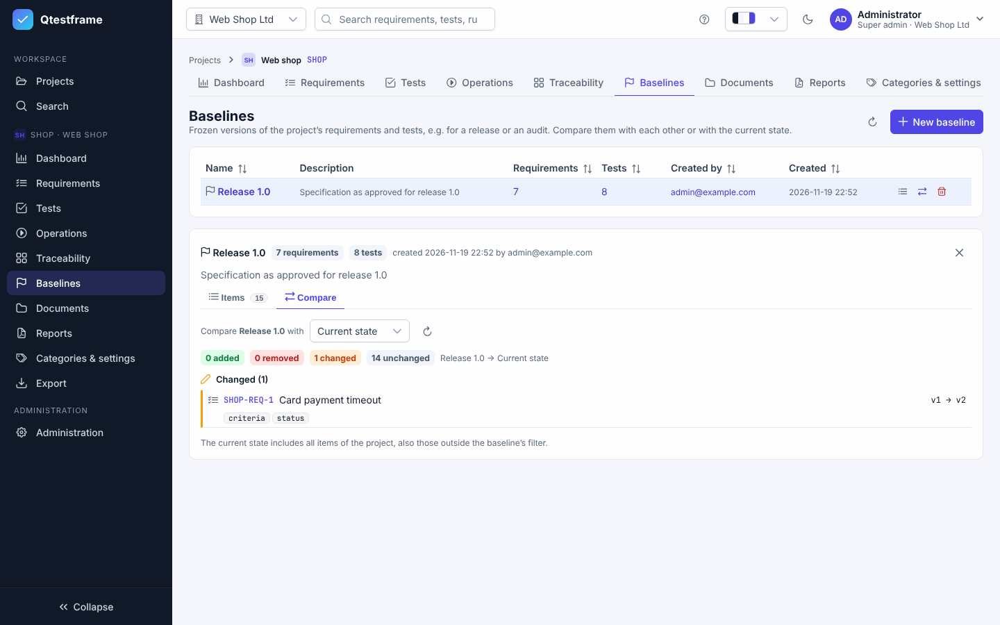

# Baselines

A **baseline** freezes the current version of the project's requirements and tests under a name, for example *Release 2.0* or *Audit 2026-Q3*. Later you can compare the baseline with the current state or with another baseline and see exactly what was added, removed or changed.

Viewing and comparing baselines needs **Viewer**; creating and deleting them needs **Manager**.

## Baseline or revision?

| | Revision (history) | Baseline |
|---|---|---|
| What | one version of **one** item | the versions of **all** (or filtered) items at one moment |
| Created | automatically on every change | by you, when you need it |
| Used for | seeing and undoing changes of an item | releases, audits, sign-offs, comparing releases |
| Where | the **History** tab of the editor | **Baselines** in the project sidebar |

A baseline does not copy anything you can edit; it records which version of every item belonged to it. Deleting a baseline never changes the items.

## Create a baseline

1. Select **Baselines**, then **New baseline**.
2. Enter a **Name**, for example *Release 2.0*, and a description if you like.
3. Optionally enter a **Filter**, for example `folder:Checkout` or `status:approved`. It is applied to requirements and tests like the export filter. Empty means all requirements and tests.
4. Select **Create baseline**. The list shows how many requirements and tests it holds.

## Look inside a baseline

Select a baseline to see its **Items**: every requirement and test with the version it had. Filter by **Requirement** or **Test**.

## Compare

1. Select **Compare** on a baseline.
2. Under **Compare with**, choose **Current state** or another baseline of the project.
3. The result lists:
   - **Added**: items that exist now (or in the second baseline) but not in the first;
   - **Removed**: items that were in the first baseline but no longer exist;
   - **Changed**: items whose version differs, with both version numbers and the changed fields;
   - the number of unchanged items.

Items are matched by their identity, not by key: a requirement that was moved or got a new key shows as *changed*, not as removed and added.

The **current state** includes all items of the project, also those outside the baseline's filter. Use **Compare again** after further changes.

To see the details of a change, open the item and look at its **History** tab; it shows the field-by-field difference of every version.

## Typical uses

- **Release:** create *Release 1.0* when the specification is approved; during the next release, compare with the current state to write release notes.
- **Audit:** an auditor can see exactly which version of each requirement was in force at a given date.
- **Two releases:** compare *Release 1.0* with *Release 2.0* to see what changed between them.
