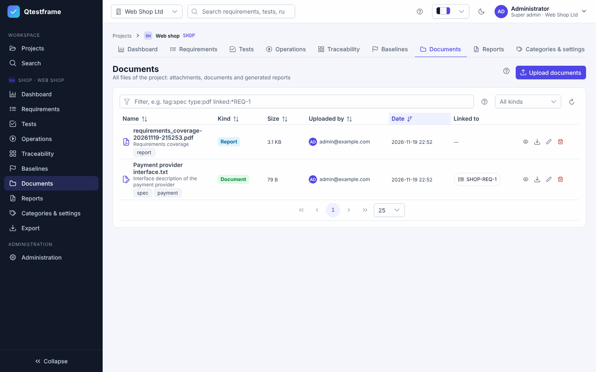

# Documents

Every project has a **document archive**: one place for all files of the project. It contains

- **documents** that you upload directly to the archive, such as specifications, contracts, test plans or meeting notes;
- **attachments** that were uploaded to a requirement, test, run or execution;
- **reports** that were generated and saved to the archive (see [Reports](reports-and-export.md#standard-reports));
- **generated documents**: a requirements specification or a test plan that Qtestframe writes for you (see [below](#create-a-requirements-specification-or-a-test-plan)).

Select **Documents** in the project sidebar. Everyone who can read the project can see and download its files.



## Find files

- The table shows each file's **name**, **kind** (document, attachment or report), **size**, who uploaded it, when, its tags and the items it is **Linked to**.
- Filter by **Kind**, or with a [query](search-and-filters.md) on the fields `name`, `description`, `tag`, `kind`, `type` (content type), `uploaded_by`, `created_at`, `size` and `linked`:

```text
kind=report                                    generated reports only
type:pdf created_at>=2026-09-01                PDF files since September
linked:SHOP-REQ-12                             files attached to SHOP-REQ-12
tag:contract -kind=attachment                  contract documents
size>5000000                                   files larger than about 5 MB
```

## Upload

1. Select **Upload documents**, or drag files from your computer onto the page.
2. Several files are uploaded one after another; a progress list shows each file and reports errors (for example a file that is too large).
3. Add a description and tags, comma-separated, to make the files easier to find. You can change them later with **Edit**.

The maximum size is 25 MB per file unless your administrator configured another limit. Uploading documents to the archive needs the **Tester** or **Manager** role (the right to edit tests or requirements).

## Create a requirements specification or a test plan

Qtestframe can write two complete documents for you and save them in the archive:

- a **requirements specification**, modelled on ISO/IEC/IEEE 29148: title page, document control with the revision history, contents, an introduction (purpose, the project description as scope, and the meaning of the key words MUST, SHOULD and MAY), the requirements grouped by folder, category or type, a traceability matrix, a [dependency graph](#dependency-graph-appendix) of the relations between the requirements and a glossary with references;
- a **test plan** with its **test specification**, modelled on ISO/IEC/IEEE 29119-3: the features to be tested (the requirements the tests verify), the test approach with entry criteria (the [execution rules](runs.md#when-can-a-test-be-executed) of your organisation) and exit criteria (those of your [releases](releases-and-risks.md)), the test environment (configurations and the environments of the runs), roles, the schedule (releases and runs), then every test with its steps, and a coverage appendix with the requirements that have no test.

1. Select **Create document** and choose **Requirements specification** or **Test plan**. (The **Reports** page has the same two documents under **Documents**.)
2. In the dialog, choose:
   - **Title**, **Version** and **Author**. Left empty, the title is the name of the document, the version is one more than the latest version of the same kind in the archive (*1.0*, *2.0* …) and the author is you.
   - **Language of the document**: English or Swedish, your language by default. A Swedish specification explains the Swedish key words **SKA**, **BÖR** and **FÅR**.
   - **Format**: PDF, Word (DOCX) or Markdown. PDF and Word have a title page, page numbers and a table of contents; in Word, the contents get their page numbers when Word updates the field (it asks when the file is opened).
   - **Content**: the current requirements and tests, or a [baseline](baselines.md). With a baseline the document shows the frozen texts, and its signatures are listed as approvals.
   - **Filter**: a [query](search-and-filters.md) on the requirements (specification) or the tests (test plan), for example `status:approved` or `folder:Checkout`.
   - **Include rejected and obsolete requirements** (and, for a test plan, deprecated tests). They are left out by default.
   - **Group the requirements by** folder, category (one dimension) or type (specification only; a test plan is always grouped by folder).
   - **Each requirement on a new page** (specification only, on by default): in PDF and Word every requirement starts at the top of a page. A folder or group heading right before a requirement (with the folder's description) moves to the new page with it, so a heading is never left alone at the bottom of a page, and no page stays blank. Turn it off for compact printing: the requirements then follow one another. See [Page layout](#page-layout).
   - The **fields** shown for each requirement or test, and the **appendices**. *Latest results* is off by default: a specification describes, it does not report. **Discussions of the items** adds an appendix with the [discussion](discussions.md) threads of the requirements or tests (removed comments are left out; resolved threads are marked). **Dependency graph of the requirements** (specification only, on by default) adds the [dependency graph appendix](#dependency-graph-appendix).
3. Select **Create**. A progress bar shows while the document is being written; a project with thousands of requirements takes a few seconds.

The new document appears at the top of the archive, highlighted, with **Open** (PDF) and **Download**. It is a *document* with the tags `generated`, `requirements-specification` or `test-plan` and the version (for example `v2.0`); the earlier versions of the same kind make up its revision history. Obligation keywords in requirement texts (MUST, SHALL, SKA …) are printed in bold.

### Page layout

In PDF and Word a requirement or test is never split across two pages when it fits on one: if it does not fit on the rest of a page, it starts on the next one, together with the folder headings right before it. Only an item longer than a page continues on the next page. In a specification with **Each requirement on a new page** every requirement starts a page anyway. Word keeps the items together with its *keep with next* and *page break before* paragraph settings, so the layout stays right when you edit the file. Markdown has no pages: it looks the same either way. The title page shows the [logo](reports-and-export.md#logo-on-the-first-page) of the project or the organisation at the top.

### Dependency graph appendix

The dependency graph appendix of a requirements specification draws the [relations](requirements.md#relations) between its requirements (*refines*, *depends on*, *provides*, *derived from*, *conflicts with*, *duplicates*, *relates to*), laid out like the app's [dependency graph](traceability-and-coverage.md#dependency-graphs): requirements that build on others to the right of (or below) what they build on, an arrow from a requirement to the one it refines, depends on, provides for or is derived from, and lines without an arrow for relations without a direction. Each relation type has its own colour and line pattern, each box shows the key, the status (also as the colour on its left) and the shortened title, and every figure has a legend.

- The figures are vector graphics in every format: drawn directly in PDF, as SVG in Markdown, and in Word as SVG with a picture for word processors that cannot show SVG. Zoom in as far as you need.
- Only requirements with relations are drawn. A large specification gets several figures of at most 24 requirements: connected groups of requirements are put together, and a group too large for one figure is divided by top-level folder (and then into parts). A requirement related to one in another figure is drawn as a grey reference to that figure.
- After the figures, a table lists every relation as text ("REQ-1 depends on REQ-3"), with the figures the two requirements are in; relations to requirements that are not in the specification are listed there too. Screen readers and text search use the table; each figure also has a text description.
- Without any relations the appendix is left out.

Creating documents needs the right to export, to read requirements (and tests for a test plan) and to upload documents (**Tester** or **Manager**).

## Preview and download

- **Preview** shows images (PNG, JPEG, GIF, WebP), PDF files and plain text directly in the browser.
- **Download** saves the file. Other file types are always downloaded rather than shown, for safety.

## Work with many files at once

Tick files in the list (the header checkbox ticks the whole page). The toolbar offers:

- **Download as ZIP**: one archive with all ticked files (at most 512 MB together). Files with the same name are numbered, for example *plan (2).pdf*. Anyone who can see the archive can download.
- **Add tags** / **Remove tags** for all ticked files.
- **Description**: replaces the description of each file (empty clears it).
- **Delete**, after confirmation.

Changing and deleting work on the files you may change: your own uploads, or every file with permission to change the project. When the selection also has other files, the toolbar says how many of them you can change, and only those are changed. Tag and description changes can be undone with the undo button.

## Link documents to items

A file in the archive can be attached to any number of requirements, tests, runs and executions of the same project, without copying it. In the **Attachments** tab of an item, choose **Attach from archive** and pick the files. The archive then lists the item under **Linked to**.

- **Removing an attachment** from an item only removes the link.
- An *attachment*-kind file that is no longer linked to anything is deleted automatically; *documents* and *reports* stay in the archive.
- **Deleting a file** in the archive removes it together with all its links, after a confirmation that names the linked items.

Editing and deleting a file is allowed for the person who uploaded it and for managers and admins of the project.

## Where are files stored?

Files are stored in the Qtestframe database, not on a separate file share. That means they are part of every [backup](administration.md#backup-and-restore), they are protected by the same access rules as the project, and they are deleted together with the project. Every download is checked against your permissions.
