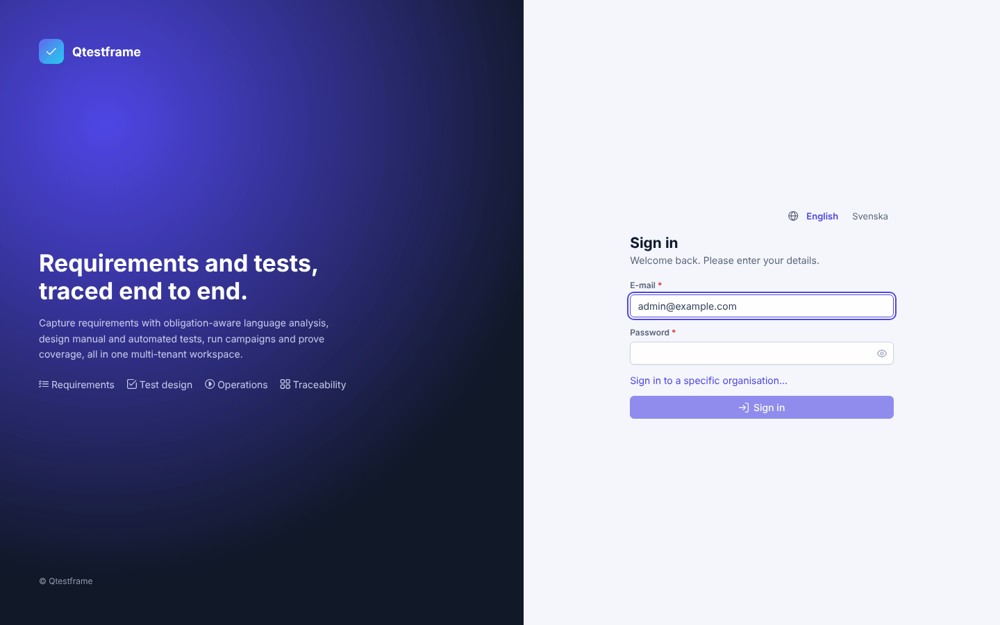
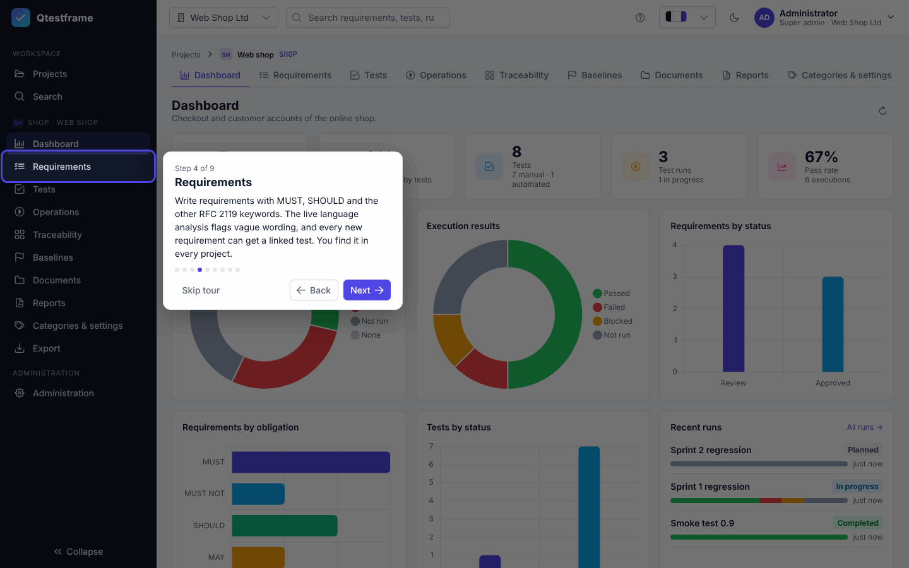
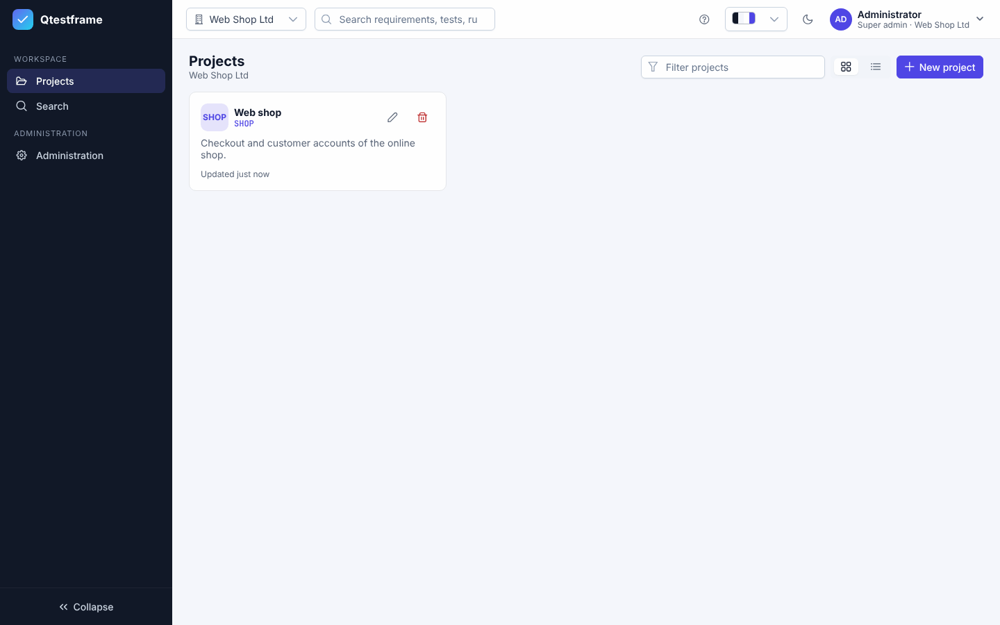
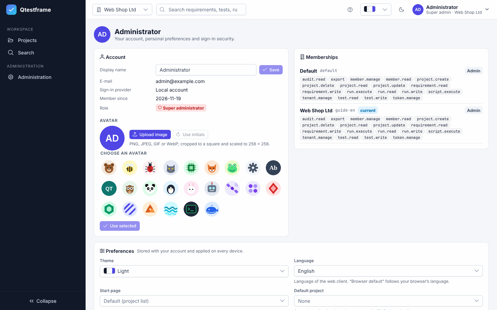

# Getting started

This page explains how to sign in, find your way around the screen, and set up Qtestframe the way you like it.

## Sign in

Open the address your administrator gave you (for a local trial installation `http://localhost:8080`).

1. Enter your **E-mail** and **Password** and select **Sign in**.
2. If you belong to several organisations and want to start in a particular one, select **Sign in to a specific organisation…** and enter its short name (slug), for example `acme`. Without it you start in your default organisation (see [Preferences](#preferences)) or the one you used last.
3. If your organisation uses single sign-on, the page shows a button per provider below **or continue with**. Select it and sign in at your identity provider; you return to Qtestframe automatically.

The language buttons at the top of the sign-in page switch between English and Swedish before you sign in. After sign-in, the language in your preferences wins.

> **Tip:** After ten failed attempts within five minutes, sign-in is blocked for a while for that e-mail address and network address. Wait a few minutes and try again, or ask an administrator to [reset your password](administration.md#reset-a-password).

### What you see after signing in

- **The intro tour.** On your first sign-in a short tour highlights the main parts of the screen. Use **Next** and **Back**, or **Skip tour** (or <kbd>Esc</kbd>) to close it. You can start it again at any time with **Help → Restart intro tour**.

  
- **Sign-in information.** On later sign-ins Qtestframe can show when and from where you last signed in, and how many failed attempts there have been since. If you do not recognise a sign-in, change your password and sign out your other sessions (see [Security](#security)).
- **A forced password change.** If an administrator has reset your password, you must choose a new one before you can continue.

## The layout

### Sidebar

The dark bar on the left is the main navigation:

- **Workspace:** **Projects** (all projects of the current organisation) and **Search** (search across projects).
- **The open project:** once you open a project, its key and name appear with its sections: **Dashboard**, **Requirements**, **Tests**, **Operations** (test runs), **Traceability**, **Baselines**, **Categories & settings**, **Export** and, where available, **Documents** and **Reports**.
- **Administration**, if your role allows it.

Inside a project, the same sections are also shown as tabs at the top of the page, below the breadcrumb *Projects › project name*.

**Collapse** at the bottom shrinks the sidebar to icons; hover an icon to see its name. On screens narrower than 1024 pixels the sidebar is hidden and opens with the menu button (☰) in the top bar; <kbd>Esc</kbd> or the close button closes it again.

### Top bar

From left to right:

| Element | Use |
|---|---|
| **Organisation** switch | Shows the current organisation and lets you switch to another one you are a member of. On phones it is a building icon. |
| **Search** field | Searches requirements, tests and runs in all projects of the organisation. Type text or a [query](search-and-filters.md) and press <kbd>Enter</kbd>. On phones it is a magnifier button. |
| **Help** (?) | Opens the **User guide**, **Help for this page** and **Restart intro tour**. |
| **Colour theme** | Picks one of the eleven themes, see [Themes](accessibility-and-languages.md#themes). |
| **Light mode / Dark mode** | Switches between light and dark quickly. |
| **User menu** | Your name and role, **Profile & password**, light/dark mode, **Language** and **Sign out**. |

### Organisations

An organisation (tenant) is a separate workspace with its own projects, members and API tokens. When you switch organisation in the top bar, Qtestframe takes you to that organisation's project list. Your role can differ between organisations, so what you may do can change too.

If you see the message *You have no current organisation*, pick one in the organisation switch. If you are not a member of any organisation, ask an administrator to add you.

### Search

The search field in the top bar searches everywhere in the current organisation. Results are grouped by type with the matching text highlighted; select a result to open it. Full details are in [Search and filters](search-and-filters.md).

### Theme and language

- Pick a **colour theme** in the top bar or in your preferences. Your choice is stored with your account and follows you to every device.
- Change the **language** with **User menu → Language**: *English* or *Svenska*. The change applies at once and is saved as your preference.

## Your profile

Open **User menu → Profile & password**.

### Account

- **Display name**: the name others see in comments, history and the audit log.
- **Avatar**: choose a picture for your account: upload an image (PNG, JPEG, GIF or WebP, at most 1 MB), pick one of the built-in pictures, or use your initials.
- **Sign-in provider**, **Member since** and your **Memberships**: the organisations you belong to and your role in each.

### Preferences

Preferences are stored with your account and applied on every device. Change them and select **Save preferences**.

| Preference | Effect |
|---|---|
| **Language** | English or Swedish; *Browser default* follows the browser. |
| **Theme** | Colour theme. *Follow the operating system* switches between light and dark with your system setting. |
| **Start page** | What you see after signing in: the project list, the last opened project, a default project or search. |
| **Default project** | The project opened when the start page is *Default project*. |
| **Default organisation** | The organisation selected at sign-in when you do not name one. |
| **Rows per table page** | 10, 25, 50 or 100 rows in tables. |
| **Date format** | *Locale* (as usual in your language), *ISO* (2026-03-14 09:30) or *Relative* (3 hours ago). |
| **Time zone** | The time zone for all times; *Browser* uses your computer's. |
| **Also create linked test (new requirements)** | Your personal default for the checkbox in the requirement editor. |
| **Compact tables** | Denser table rows, to see more at once. |
| **Hide the live requirement-language analysis** | Turns off the analysis box in the requirement editor. |

### Security

- **Password**: for local accounts, enter your **Current password** and the **New password** twice, then select **Change password**. If you sign in with single sign-on, your password is managed by your identity provider.
- **API tokens**: tokens for CI pipelines and scripts are created under **Administration → API tokens** (see [API tokens](administration.md#api-tokens)).
- **Active sessions**: every browser and device that is signed in with your account, with browser, IP address, sign-in time and last activity. **Sign out** ends one session; **Sign out all other sessions** ends all except the one you are using.
- **Sign-in history**: your recent sign-ins and failed attempts, if shown.

## Next steps

- Follow the [tutorial](tutorial.md) to build a small project from scratch.
- Learn the [query language](search-and-filters.md); it works in every filter field.
