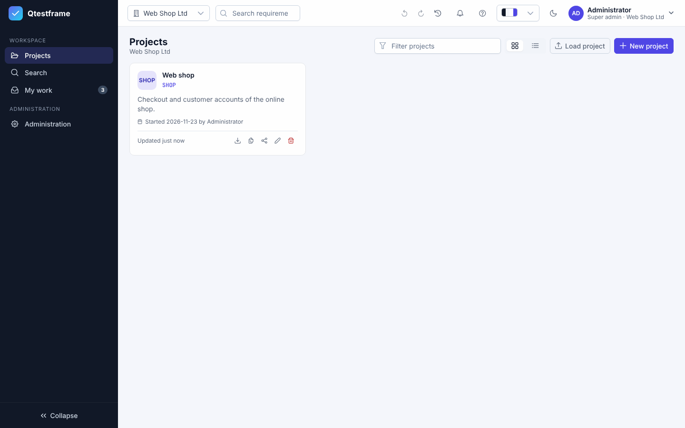

# Qtestframe user guide

Qtestframe is a tool for managing **requirement specifications and tests** in one place. You write requirements, design manual and automated tests that verify them, run test campaigns, record results and defects, and prove coverage with a traceability matrix, a dashboard and reports. Several organisations (tenants) can share one installation without seeing each other's data.

This guide is for everyone who works in Qtestframe: requirement authors, testers, test managers and administrators. It describes the web client as you see it. You can read it here in the app (**Help → User guide**, or the **?** link on many pages), or as Markdown files in the `docs/user-guide` folder of the source code.

## Where to start

- **New to Qtestframe?** Read [Getting started](getting-started.md), then work through the tutorial [Your first test campaign](tutorial.md). It takes about 30 minutes and touches every important feature.
- **Looking for an answer?** Try the [FAQ](faq.md) or the search field at the top of the guide.
- **Administrator?** Go straight to [Administration](administration.md).

## Contents

| Page | What it covers |
|---|---|
| [Getting started](getting-started.md) | Signing in, the layout, organisations, search, theme and language, your profile and preferences |
| [Tutorial: your first test campaign](tutorial.md) | A complete walk-through from an empty project to a report |
| [Requirements](requirements.md) | Obligation levels, the language analysis, fields, evaluation criteria, relations, comments, history, bulk edit, moving and attachments |
| [Tests](tests.md) | Manual steps, automated scripts, shared steps, categories, execution history, comments, history and attachments |
| [Catalogue](catalogue.md) | Standard requirements and tests to add to a project: browsing, searching, the preview and adding with tests and trace links |
| [Test runs and execution](runs.md) | Runs, the execution runner and its keyboard shortcuts, defects, CI import with API tokens, attachments |
| [Waivers, residual risk and the SoA](waivers-and-soa.md) | Waivers and deviations with signed approvals, residual risk and its acceptance, the Statement of Applicability (ISO/IEC 27001 Annex A) |
| [Traceability and coverage](traceability-and-coverage.md) | The traceability matrix, how coverage is calculated, the dashboard |
| [Variants and code](variants-and-code.md) | Variants and applicability, coverage per variant, commits, merge requests, builds and the regression selection |
| [Baselines](baselines.md) | Freezing a release and comparing versions |
| [Search and filters](search-and-filters.md) | The query language with many examples |
| [Reports and export](reports-and-export.md) | Standard reports, the custom report builder, export formats and the document archive |
| [Documents](documents.md) | The project's document archive: uploads, previews and links |
| [Administration](administration.md) | Organisations, users, members and roles, project sharing, password resets, API tokens, the audit log, backup and restore |
| [Accessibility and languages](accessibility-and-languages.md) | Keyboard use, screen readers, themes, English and Swedish, phones and tablets |
| [FAQ](faq.md) | Answers to common questions |
| [References](references.md) | RFC 2119, RFC 8174 and other RFCs, NIST publications, and standards for requirements and testing |

## Key concepts

| Term | Meaning |
|---|---|
| **Organisation** (tenant) | An isolated workspace. Projects, members and API tokens belong to one organisation. You can be a member of several and switch between them. |
| **Project** | A container for requirements, tests, runs, baselines and documents. Its **key** (for example `SHOP`) prefixes every item ID: `SHOP-REQ-12`, `SHOP-TC-7`. |
| **Requirement** | A statement of what the system must, should or may do, with an obligation level, status, priority, evaluation criteria and more. |
| **Evaluation criterion** | How fulfilment of a requirement is judged: a method (test, inspection, analysis, demonstration, review) and a threshold. |
| **Test** (test case) | A manual test with steps, or an automated test with a script. |
| **Link** (trace link) | Connects a requirement with a test that verifies it. Links are the basis of coverage. |
| **Run** (test run) | A test campaign, for example *Sprint 12 regression*, with a set of tests to execute in an environment and build. |
| **Execution** | One test inside a run, with its result, step results, notes, defects and output. |
| **Coverage** | The verification state of a requirement, derived from the latest results of its linked tests: *None*, *Not run*, *Passed*, *Failed* or *Partial*. |
| **Baseline** | A frozen snapshot of the requirement and test versions of a project, for example for a release. |
| **Role** | What you may do in an organisation: *Viewer*, *Tester*, *Manager* or *Admin*. *Super admins* manage the whole installation. |

## Conventions in this guide

- Names of buttons, menus and fields are written in **bold**, exactly as they appear in the English user interface. The Swedish guide uses the Swedish labels.
- Menu paths are written with arrows: **User menu → Profile & password**.
- Keys are written like <kbd>Enter</kbd>; query examples like `status:approved`.
- A note such as *(Manager)* after an action tells you the lowest role that may do it. See the [role matrix](administration.md#roles-and-permissions).
