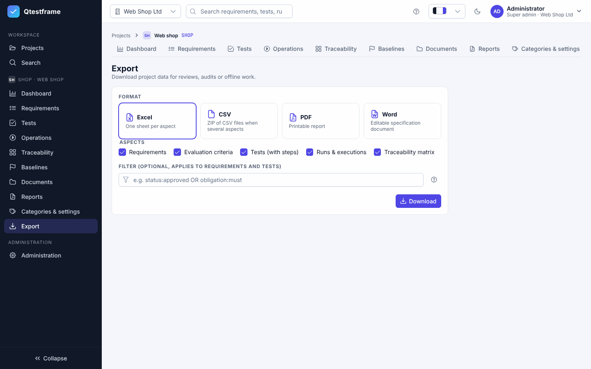
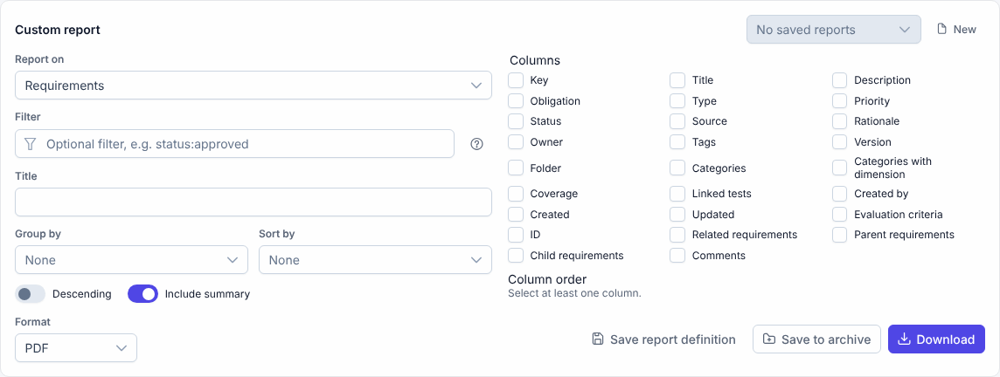

# Reports and export

Qtestframe gets data out in two ways (a whole project can also be [saved as a file and loaded again](#save-and-load-projects)):

- **Export** downloads the raw project data (requirements, criteria, tests, traceability, runs) as spreadsheets, documents or Markdown, for reviews, audits, offline work or other tools.
- **Reports** produce formatted documents for people: a project status report, a coverage report, a run summary, a defect list or a report you design yourself. Reports can be downloaded or stored in the project's [document archive](documents.md).

Everyone with the **Viewer** role or higher may export and generate reports. Saving a custom report definition needs **Tester** (tests) or **Manager** (requirements); storing a generated report in the archive is open to everyone who may generate it.

## Export

Select **Export** in the project sidebar.

1. Choose the **Format**:

   | Format | Result |
   |---|---|
   | **PDF** | A printable landscape report with one table per aspect and page numbers. |
   | **DOCX** | An editable Word document with a heading and a table per aspect, for example as the base of a specification document. |
   | **XLSX** | An Excel workbook with a *Summary* sheet and one sheet per aspect; bold header row, frozen first row, auto-filter and sensible column widths. |
   | **CSV** | One `.csv` file for one aspect; a `.zip` with one CSV per aspect when you choose several. UTF-8, comma-separated. |
   | **Markdown** | One `.md` file with every aspect: a heading, the project, filter and time, and a table per aspect. Plain text that reads well in a wiki, a Git repository or any text editor; keys link to Qtestframe when the server address is configured. |
   | **ReqIF** | The requirements as a ReqIF 1.2 file (`.reqif`) for requirements tools such as IBM DOORS, Polarion, Jama or ProR. See [ReqIF for requirements tools](#reqif-for-requirements-tools). |
   | **ReqIF (with attachments)** | A `.reqifz` archive: the ReqIF file and the requirements' attachments and images. |

2. Choose the **Aspects**:

   | Aspect | Columns |
   |---|---|
   | **Requirements** | key, title, obligation, type, priority, status, folder, categories, tags, description, rationale, source, owner, version, linked tests, coverage |
   | **Evaluation criteria** | requirement, number, criterion, method, threshold |
   | **Tests (with steps)** | key, title, execution, status, priority, folder, categories, tags, preconditions, steps, expected result, script language, linked requirements, last result |
   | **Traceability matrix** | one row per requirement–test link with coverage and last result; requirements without links get one row |
   | **Runs & executions** | one row per execution with run, status, environment, build, result, executed by, duration and notes |

   ReqIF contains requirements only, so the aspects are not used for it.

3. Optionally enter a **Filter**. It applies to requirements if it is a valid requirement query and to tests if it is a valid test query: `obligation=must` filters only requirements, `type=automated` only tests, `folder:Checkout` both.
4. Select **Download**. The file is named after the project key and the time, for example `SHOP-20261119-143000.xlsx`.

**Safe for spreadsheets:** values that start with `=`, `+`, `-` or `@` are prefixed in CSV files, and XLSX cells are always text, so nothing in your data is executed as a formula.

### ReqIF for requirements tools

ReqIF (Requirements Interchange Format) is the standard file format for exchanging requirements between tools. Use it to give a customer or supplier your requirements in their own tool, or to bring requirements back after they were worked on there.

What the ReqIF file contains:

- **One object per requirement** with key (*ReqIF.ForeignID*), title (*ReqIF.Name*), description as formatted text (*ReqIF.Text*), obligation, type, priority and status as value lists, source, rationale, owner, tags, categories, acceptance criteria (one line per criterion: method, text and threshold), version, author and creation time.
- **The folders as headings.** Every folder is a heading object (*ReqIF.ChapterName*); the requirements of a folder and then its subfolders are placed below it, so the requirements tool shows the same chapters as the requirements tree. With a filter, only folders that contain exported requirements are included.
- **Relations** between the exported requirements (*refines*, *depends on* and the others) as ReqIF relations.
- **Formatting.** Paragraphs, line breaks, lists, headings, code blocks, bold, italics, links and images in descriptions are converted to formatted text. In a `.reqifz` file, images and other attachments are files in the archive and are listed in the *Attachments* attribute.
- **Stable identifiers.** Every object keeps the same identifier in every export, so a tool can recognise requirements it already has and update them.

**Importing it again.** A ReqIF file from Qtestframe can be [imported](requirements.md#import-requirements) into any project. Titles, descriptions with their formatting, obligation, type, priority, status, source, rationale, owner, tags, criteria and folders come back; the original key is kept as the external ID (*ID: SHOP-REQ-12* in the source), and the new requirements get keys of the target project. Categories and attachments are not imported. To bring an edited version back into the **same** project as updates, with relations, use the [ReqIF import with updates](#reqif-from-doors-and-polarion).

## Standard reports

Select **Reports** in the project sidebar. The standard reports are ready-made layouts:

| Report | Content | Parameters |
|---|---|---|
| **Project status** | key figures, requirements by status and obligation, coverage, recent runs | – |
| **Requirements coverage** | every requirement with its linked tests, their last results and the coverage | optional filter |
| **Traceability** | the requirement × test links, and the [traceability rules](traceability-and-coverage.md#traceability-rules) with their results and violations | optional filter |
| **Run summary** | one run: totals, executions, defects and durations | the run (required) |
| **Defects** | all defects recorded on executions, grouped by defect | – |
| **Test inventory** | tests by folder, type, status and category | optional filter |
| **Risk report** | the [risks](releases-and-risks.md) with key figures, the heat map before and after mitigation, the risks above the acceptance threshold, the risk register with the [residual risk](waivers-and-soa.md#residual-risk), traceability to requirements and tests, untested mitigations and the top risks | – |
| **Compliance** | compliance with laws, standards and best practices: per source, per clause, the missing catalogue requirements and the requirements not fulfilled (see [Compliance with laws and standards](traceability-and-coverage.md#compliance-with-laws-and-standards)) | optional laws, standards and best practices (default: those the project uses) |
| **Statement of Applicability** | every control of a standard with applicability, justification, implementation, owner, requirements and evidence (see [Statement of Applicability](waivers-and-soa.md#statement-of-applicability)) | the standard (default: ISO/IEC 27001:2022 Annex A) |
| **Release readiness** | one release: go / no-go, every exit criterion with what blocks it and what a [waiver](waivers-and-soa.md#waivers-and-deviations) or risk sign-off accepts, the waivers in force and the risks above the acceptance threshold | the release (default: the current one) |
| **Quality metrics** | requirements volatility, defect density, escaped defects, test effectiveness, result age, review turnaround, time to fix defects and requirement quality, with their trends (see [Quality metrics](traceability-and-coverage.md#quality-metrics)) | optional history in days (30, 90, 180 or 365) and the days after which a result is stale |
| **Exploratory session** | one [exploratory session](exploratory-testing.md): charter and scope, session time, the debrief with coverage, time split and outcome, every note and the defects raised | the session (default: the newest debriefed one) |
| **Exploratory testing** | every exploratory session: key figures, sessions and bugs per session hour by area and by tester, the average time split and every session with its outcome | – |

**The risk report** contains:

- **Key figures**: all risks; open risks (*Identified* or *Mitigating*); mitigated, accepted and closed risks; open risks per level; open risks without requirements, with an untested mitigation and with a verified mitigation; and open risks that have not been changed for 90 days or more.
- **Risks by level and status**: a table with one row per level and one column per status.
- **Open risks by mitigation state** (see below).
- **Heat map**: likelihood (rows, 5 at the top) × impact (columns). Each cell gives the number of risks that are not closed and the cell's level, for example *2 · High*, so the table can be read without colours.
- **Top open risks**: the ten open risks with the highest score.
- **Risk register**: every risk with key, title, category, owner, likelihood, impact, score, level, status, mitigation, the requirements that address it, the mitigation state and when it was last changed.
- **Traceability**: one row per risk, requirement and linked test, with the requirement's coverage and the test's latest result.
- **Open risks with untested mitigation**: open risks without requirements, or with requirements that have no tests, and which of their requirements have no tests or have not passed.
- **Open risks not updated for 90 days or more**: a reminder to review them.

The **mitigation state** of a risk comes from the requirements that address it: *No requirements*, *Untested* (none of them has linked tests), *Partly tested* (some have), *Tested, not all passed* (all have tests, but not all tests passed) or *Verified* (all linked tests of all its requirements passed). A risk has one likelihood × impact score; the report shows that score and its level, and how far the mitigation is verified by tests.

1. Choose a report.
2. Fill in its parameters, for example the run for **Run summary**.
3. Choose the **Format**: **PDF**, **Word** (DOCX), **Excel** (XLSX), **CSV** or **Markdown** (`.md`, text with tables for wikis, Git repositories and chat tools; several sections are one document).
4. Select **Download**, or **Save to archive**. A saved report becomes a document of kind *report* in **Documents**, where the whole team can find, preview and download it later.

Reports are produced in the language you currently use in Qtestframe (**User menu → Language**, see [Languages](accessibility-and-languages.md#languages)). With the Swedish interface, the report's title, section names, column headers, key figures and values such as statuses, results, coverage and obligation (for example *Godkänt*, *Underkänd*, *MUST (SKA)*) are in Swedish, with the same words as in the app. Your own content, such as titles, names, descriptions, tags and notes, is never translated. This applies to downloads, reports saved to the archive, custom reports, several reports at once and reports sent by e-mail.

### Documents

Below the standard reports, **Documents** offers two complete documents: a **requirements specification** and a **test plan** with its test specification. **Create…** opens the generator in the [document archive](documents.md#create-a-requirements-specification-or-a-test-plan), where the document is saved.

## Custom reports

Under **Custom report** you design a report yourself:

1. **Report on**: requirements, tests, test runs or the executions of a run (then choose the run).
2. **Filter**: any [query](search-and-filters.md), for example `status:approved obligation=must`.
3. **Columns**: pick the columns; arrange them under **Column order**.
4. **Group by**: optionally group rows, for example by status or folder, with a count per group.
5. **Sort by**, optionally **Descending**.
6. **Include summary**: totals at the top.
7. **Title** of the report.

Generate the report in any format, as above. To reuse it, select **Save report definition** and give it a name: **Load saved report** brings it back at any time, to generate it again with the current data, change it (**Save as a new report** keeps the original) or delete it. **New** starts an empty report.

**Examples:**

- *Open MUST requirements*: requirements, filter `obligation=must -status:verified`, columns key, title, status, owner, coverage, grouped by owner.
- *Failed tests this sprint*: executions of the run *Sprint 12*, filter `status:failed`, columns key, title, executed by, defects, notes.
- *Automation status*: tests, grouped by execution type, columns key, title, status, last result.

## Several reports at once

**Several reports at once**, at the bottom of the Reports page, lists the standard reports and your saved custom reports. Tick the ones you need, for example a weekly pack of *Project status*, *Run summary* and two saved reports, then:

- choose the **format** (only formats that every ticked report supports are offered),
- for *Run summary*, choose the **run**,
- **Download as ZIP** to get all of them in one file, or **Save to archive** to store each of them in the [document archive](documents.md) (tagged *report*). When saving, a report that cannot be created is listed with the reason and the others are still saved.

**Delete saved reports** removes the ticked saved custom reports (standard reports cannot be deleted). Saving to the archive and deleting need permission to edit requirements or tests; downloading needs the export permission.

## Send a report by e-mail

When the server can send e-mail, every standard report has an envelope button (**Send by e-mail**), and the custom report builder has **Send by e-mail** too. Choose:

- **Members**: people of your organisation who may read the project. A member who may not read what the report shows (for example test runs) is left out, and the message says who.
- **Other addresses**, separated by commas: people outside the organisation. This needs the permission to update the project, so that Qtestframe cannot be used to send e-mail to anyone.
- an optional **Message** and the **Format**.

The report is created with your permissions and attached to the e-mail; the report and the e-mail text are in your current interface language. If it cannot be delivered, you get a [notification](reviews-and-notifications.md#notifications).

## Scheduled reports

**Scheduled reports**, at the bottom of the Reports page, e-mails [saved custom reports](#custom-reports) on a schedule. *(Requires permission to edit requirements or tests.)* Select **Schedule a report**, then choose the saved report, **How often** (daily, weekly on a weekday, or monthly on a day from 1 to 28), the **Time** and **Time zone**, the **Format**, the recipients and an optional message.

The list shows each schedule with its recipients, when it was **Last sent** (or the error of the last attempt), and the **Next run**. Turn **Active** off to pause a schedule, **Send now** to send it at once (the schedule stays as it is), or edit and delete it. Only the person who scheduled a report, or someone who may update the project, can change it.

Good to know:

- The report is created with the permissions of the person who scheduled it, at the time it is sent. If that person is no longer a member or may no longer export, the schedule shows an error instead of sending.
- The report and its e-mail are in the interface language of the person who scheduled the report or last edited the schedule. Switch the language and save the schedule again to change it.
- Members who may no longer read the report are left out.
- If the server was down when a report was due, it is sent once when the server is back, not once for every missed time.
- Deleting the saved report also deletes its schedules.

## Save and load projects

A whole project can be saved as one file and loaded again as a **new** project, on the same server or another one: to hand a project over, keep a copy outside the server, or start a new project from a template.

- **Save project**: on the project list (the download button of a project) or under **Categories & settings → Project → Save and load**. The file (`<key>-project-<date>.zip`) holds everything in the project: requirements with criteria and folders, tests with steps and test data, traceability links and relations, links, runs with all results, iterations and evidence, defects, risks, releases, baselines and sign-offs, reviews, comments, version history, documents and attachments with their content, categories, configurations, traceability rules, saved reports, webhooks and the project settings. It needs the permissions to change the project and to export (by default **Manager** and **Admin**).
- **Load project**: on the project list, or in the same section of the settings. Choose the file; Qtestframe checks it and shows what it contains. Then choose the **Key** and **Name** of the new project (a free key is suggested if the original one is taken) and select **Load project**. You need the permission to create projects. The new project opens when it is ready.
- **Duplicate project** does both in one step: it creates a copy with a new key inside the same organisation.

What to know about loaded projects:

- The new project gets new IDs everywhere, and item keys follow the new project key (`DEMO-REQ-1` becomes `COPY-REQ-1`, also where a description mentions it). New items continue the numbering of the original.
- People stay as they were: *created by*, owners and assignees are kept as text, and comments and reviews refer to the same accounts. A review request whose reviewer has no account on the server is left out; the result says how many entries were left out.
- **Secrets are never saved**: webhooks are loaded switched off and without their secret, and the defect tracker without its token. Set them again under **Categories & settings → Project** before you switch them on.
- Members, roles, API tokens, notifications, scheduled e-mail reports, the audit log and the trash are not part of the file. Access to the new project follows the roles of the organisation, as for every project.
- A file saved by a newer version of Qtestframe cannot be loaded; update the server first. Files from older versions load.

The file contains the project data in plain form. Store it as carefully as the project itself.

## Exchanging data with other tools

Requirements often live in more than one place: a customer keeps them in IBM DOORS or Siemens Polarion, a colleague prefers to review them in Excel, and an ALM tool wants to link to them. Qtestframe exchanges data in four ways, all under **Import** on the requirements and tests pages and through the API:

| Way | Direction | Good for |
|---|---|---|
| [Excel round-trip](#edit-in-excel-and-import-back) | out and back in | editing many items at once in Excel, also offline |
| [ReqIF import with updates](#reqif-from-doors-and-polarion) | in, again and again | a specification maintained in DOORS, DOORS Next or Polarion |
| [CSV and Excel exports of DOORS and Polarion](#csv-and-excel-from-doors-and-polarion) | in, once | a first import when ReqIF is not available |
| [OSLC](#oslc-links-from-alm-tools) | read by other tools | links from IBM ELM, Polarion, Codebeamer and other OSLC clients |

Every import shows a **preview** first and saves nothing until you select **Save**. The preview compares the file with the project, row by row:

- **New**: an item that does not exist yet and will be created.
- **Changed**: an item that the file changes; each changed field is listed with its old and new value.
- **Unchanged**: nothing to do.
- **Conflict**: someone saved the item in Qtestframe after your file was made, and the file has other values. A conflict is not saved unless you select **Overwrite the conflicts with the file**. Open the item to see what was changed, or export again.
- **Error**: a value that cannot be imported, with the cell (for example `F12`) and the reason: an unknown priority, an unknown requirement key, an empty title, a status you may not set.

Use the status buttons above the table to show only some rows, and clear the box of rows you do not want. **Save** stores all selected rows in one go: if one of them cannot be saved, nothing is. Every saved item gets a new version in its history, changed links become suspect as with a normal edit, and the import is recorded in the audit log.

### Edit in Excel and import back

1. On the requirements or tests page, select **Import → Export for editing in Excel**. The workbook contains the items of the current list (with its filter and folder) *(Viewer with the export permission)*.
2. Edit the workbook in Excel or another spreadsheet program. Keep the columns **ID** and **Version**: they tell Qtestframe which item a row is and which version you started from.
3. Select **Import → Import an edited Excel workbook**, choose the file, check the preview and select **Save** *(Manager)*.

What the workbook contains:

- **One row per item** with *ID*, *Key*, *Version* and one column per field: folder, title, description, obligation, type, priority, status, source, rationale, owner, tags, acceptance criteria (one per line, for example `test: Login works (threshold: 2 s)`) and one column per relation type (*Refines*, *Depends on* …) with the keys of the related requirements. Tests have preconditions, expected result, execution type, estimated minutes and *Verifies* (the keys of the requirements the test verifies) instead.
- **Steps of tests** on the sheet *Steps*, one row per step: the test, the step number, action, data, expected result and, for a shared step, the key of the called test. The steps of a test listed on the *Tests* sheet are replaced by its rows on the *Steps* sheet.
- **Drop-down lists** for the fields with fixed values, grey columns that are only for information (*Verified by*), and a sheet *Instructions*.

Tips:

- **New items:** add a row and leave *ID* empty. To give a new test steps, type a temporary key such as `NEW-1` in *Key* and use it on the *Steps* sheet.
- **Folders:** write a path such as `Security/Login`; missing folders are created.
- **Columns** may be deleted or reordered: a missing column changes nothing. Columns Qtestframe does not know are listed and ignored.
- **Another project:** rows with the ID of an item of another project are errors; clear the IDs to create the items in this project.

### ReqIF from DOORS and Polarion

ReqIF is the format IBM DOORS, DOORS Next, Siemens Polarion and most requirements tools export. **Import → ReqIF from DOORS or Polarion, with updates** imports such a file (`.reqif` or `.reqifz`) and remembers where every requirement came from, so that importing a newer version of the same document **updates** the requirements instead of creating them again *(Manager)*.

1. Choose the file. The preview lists the document's **attributes** with their type, a sample value and the field each is read into.
2. Check the fields. Qtestframe recognises the ReqIF standard names (*ReqIF.Name*, *ReqIF.Text*, *ReqIF.ChapterName*, *ReqIF.ForeignID*) and common names of DOORS and Polarion (*Title*, *Description*, *Status*, *Priority*, *Severity* as obligation, *Assignee* as owner, *ID*). Choose another field or *ignore* for any attribute; the preview updates at once. **Heading (folder)** marks the attribute with chapter names; **ID in the other tool** is recorded in the source of new requirements (*ID: BRK-12*).
3. Choose the **Target folder** and whether **Headings become folders**: the chapters of the document's hierarchy become folders below the target folder (in DOORS, objects with a chapter name and no text; in Polarion, work items of type *Heading*).
4. Check the rows and the **relations**, and select **Save**.

What happens:

- **Relations** between the imported requirements (DOORS link modules, Polarion link roles) become requirement relations. Their type is taken from the name: *refines*, *satisfies* and *has parent* become *refines*, *derived from* becomes *derived from*, *depends on* and *requires* become *depends on*, and so on; others become *relates to*.
- **Formatted text** (XHTML) becomes plain text with its line breaks and lists.
- **Importing again** updates the requirements created by earlier imports of the same document and adds new ones. A requirement edited in Qtestframe since the last import shows as a conflict when the document has other values. Relations that were removed in the other tool are removed here too; relations you made in Qtestframe stay. Requirements are never deleted by an import.
- A requirement without a title in the document gets the first words of its text when it is created; later imports keep the title you gave it.
- A ReqIF file **exported from the same project** (see [above](#reqif-for-requirements-tools)) is matched to its requirements, so you can send a specification to a supplier and import their edited version back with the same preview.

### CSV and Excel from DOORS and Polarion

When only a CSV or Excel export is available, use **Import → From a file** and choose **Exported from: IBM DOORS** or **Siemens Polarion**. The preset reads the typical columns of these exports: from DOORS *Absolute Number*, *Object Heading*, *Object Text*, *Object Level* and *Object Number*; from Polarion *ID*, *Title*, *Description*, *Status*, *Type*, *Priority*, *Severity*, *Assignee* and *Outline Number*. Heading rows become folders, nested by their level. You can still change the field of any column. This import creates requirements once; for repeated updates use ReqIF.

### OSLC: links from ALM tools

OSLC (Open Services for Lifecycle Collaboration) lets other tools find Qtestframe's requirements and test cases and link to them. Qtestframe is a read-only OSLC provider for Requirements Management 2.0 and Quality Management 2.0. Give the tool the address of the catalog, `<server address>/api/v1/oslc/catalog` (or the discovery document `/api/v1/oslc/rootservices`), and an [API token](administration.md#api-tokens). The tool then sees the projects you may read, can search requirements and test cases by key, title or change date, and shows them with their links (which tests verify a requirement, which requirements a test verifies, relations). Selection dialogs inside the other tool and creating items through OSLC are not supported. Your administrator can find the details in [Administration](administration.md#oslc).

## Which one to use?

| Need | Use |
|---|---|
| Work with the data in Excel or another tool | **Export**, XLSX or CSV |
| Put the data or a report into a wiki, a pull request or a Git repository | **Export** or **Reports**, Markdown |
| Hand requirements over to a requirements tool (DOORS, Polarion …) or another Qtestframe | **Export**, ReqIF |
| Edit many requirements or tests in Excel and bring the changes back | **Import → Export for editing in Excel** and **Import an edited Excel workbook** |
| Keep requirements maintained in DOORS or Polarion up to date | **Import → ReqIF from DOORS or Polarion, with updates** |
| Let an ALM tool link to requirements and tests | [OSLC](#oslc-links-from-alm-tools) |
| A specification document to review or sign | **Documents → Create document → Requirements specification** (PDF or Word, from a baseline if it is to be signed); for a plain table **Export**, DOCX |
| A test plan with the test specification | **Documents → Create document → Test plan** |
| A status report for a steering meeting | **Reports → Project status**, PDF |
| Evidence for an audit or a release | **Reports → Requirements coverage** or **Run summary**, saved to the archive, together with a [baseline](baselines.md) |
| A recurring list with your own columns | A saved **custom report** |
| The same report in people's inbox every week | A saved custom report under **Scheduled reports** |
| Hand a whole project over, keep a copy or start from a template | **Save project** and **Load project** (see [above](#save-and-load-projects)) |
