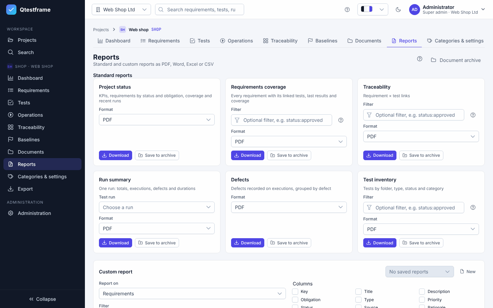

# Reports and export

Qtestframe gets data out in two ways:

- **Export** downloads the raw project data (requirements, criteria, tests, traceability, runs) as spreadsheets or documents, for reviews, audits, offline work or other tools.
- **Reports** produce formatted documents for people: a project status report, a coverage report, a run summary, a defect list or a report you design yourself. Reports can be downloaded or stored in the project's [document archive](documents.md).

Everyone with the **Viewer** role or higher may export and generate reports. Saving a custom report definition needs **Tester** (tests) or **Manager** (requirements); storing a generated report in the archive is open to everyone who may generate it.

## Export

Select **Export** in the project sidebar.

1. Choose the **Format**:

   | Format | Result |
   |---|---|
   | **XLSX** | An Excel workbook with a *Summary* sheet and one sheet per aspect; bold header row, frozen first row, auto-filter and sensible column widths. |
   | **CSV** | One `.csv` file for one aspect; a `.zip` with one CSV per aspect when you choose several. UTF-8, comma-separated. |
   | **PDF** | A printable landscape report with one table per aspect and page numbers. |
   | **DOCX** | An editable Word document with a heading and a table per aspect, for example as the base of a specification document. |
   | **ReqIF** | The requirements as a ReqIF 1.2 file (`.reqif`) for requirements tools such as IBM DOORS, Polarion, Jama or ProR. See [ReqIF for requirements tools](#reqif-for-requirements-tools). |
   | **ReqIF (with attachments)** | A `.reqifz` archive: the ReqIF file and the requirements' attachments and images. |

2. Choose the **Aspects**:

   | Aspect | Columns |
   |---|---|
   | **Requirements** | key, title, obligation, type, priority, status, folder, categories, tags, description, rationale, source, owner, version, linked tests, coverage |
   | **Evaluation criteria** | requirement, number, criterion, method, threshold |
   | **Tests (with steps)** | key, title, execution, status, priority, folder, categories, tags, preconditions, steps, expected result, script language, linked requirements, last result |
   | **Traceability matrix** | one row per requirement–test link with coverage and last result; requirements without links get one row |
   | **Runs & executions** | one row per execution with run, status, environment, build, result, executed by, duration and notes |

   ReqIF contains requirements only, so the aspects are not used for it.

3. Optionally enter a **Filter**. It applies to requirements if it is a valid requirement query and to tests if it is a valid test query: `obligation=must` filters only requirements, `type=automated` only tests, `folder:Checkout` both.
4. Select **Download**. The file is named after the project key and the time, for example `SHOP-20261119-143000.xlsx`.

**Safe for spreadsheets:** values that start with `=`, `+`, `-` or `@` are prefixed in CSV files, and XLSX cells are always text, so nothing in your data is executed as a formula.

### ReqIF for requirements tools

ReqIF (Requirements Interchange Format) is the standard file format for exchanging requirements between tools. Use it to give a customer or supplier your requirements in their own tool, or to bring requirements back after they were worked on there.

What the ReqIF file contains:

- **One object per requirement** with key (*ReqIF.ForeignID*), title (*ReqIF.Name*), description as formatted text (*ReqIF.Text*), obligation, type, priority and status as value lists, source, rationale, owner, tags, categories, acceptance criteria (one line per criterion: method, text and threshold), version, author and creation time.
- **The folders as headings.** Every folder is a heading object (*ReqIF.ChapterName*); the requirements of a folder and then its subfolders are placed below it, so the requirements tool shows the same chapters as the requirements tree. With a filter, only folders that contain exported requirements are included.
- **Relations** between the exported requirements (*refines*, *depends on* and the others) as ReqIF relations.
- **Formatting.** Paragraphs, line breaks, lists, headings, code blocks, bold, italics, links and images in descriptions are converted to formatted text. In a `.reqifz` file, images and other attachments are files in the archive and are listed in the *Attachments* attribute.
- **Stable identifiers.** Every object keeps the same identifier in every export, so a tool can recognise requirements it already has and update them.

**Importing it again.** A ReqIF file from Qtestframe can be [imported](requirements.md#import-requirements) into any project. Titles, descriptions with their formatting, obligation, type, priority, status, source, rationale, owner, tags, criteria and folders come back; the original key is kept as the external ID (*ID: SHOP-REQ-12* in the source), and the new requirements get keys of the target project. Relations, categories and attachments are not imported.

## Standard reports

Select **Reports** in the project sidebar. The standard reports are ready-made layouts:

| Report | Content | Parameters |
|---|---|---|
| **Project status** | key figures, requirements by status and obligation, coverage, recent runs | – |
| **Requirements coverage** | every requirement with its linked tests, their last results and the coverage | optional filter |
| **Traceability** | the requirement × test links, and the [traceability rules](traceability-and-coverage.md#traceability-rules) with their results and violations | optional filter |
| **Run summary** | one run: totals, executions, defects and durations | the run (required) |
| **Defects** | all defects recorded on executions, grouped by defect | – |
| **Test inventory** | tests by folder, type, status and category | optional filter |

1. Choose a report.
2. Fill in its parameters, for example the run for **Run summary**.
3. Choose the **Format**: **PDF**, **Word** (DOCX), **Excel** (XLSX) or **CSV**.
4. Select **Download**, or **Save to archive**. A saved report becomes a document of kind *report* in **Documents**, where the whole team can find, preview and download it later.

Reports are produced in the language you currently use in Qtestframe (**User menu → Language**, see [Languages](accessibility-and-languages.md#languages)). With the Swedish interface, the report's title, section names, column headers, key figures and values such as statuses, results, coverage and obligation (for example *Godkänt*, *Underkänd*, *MUST (SKA)*) are in Swedish, with the same words as in the app. Your own content, such as titles, names, descriptions, tags and notes, is never translated. This applies to downloads, reports saved to the archive, custom reports, several reports at once and reports sent by e-mail.

## Custom reports

Under **Custom report** you design a report yourself:

1. **Report on**: requirements, tests, test runs or the executions of a run (then choose the run).
2. **Filter**: any [query](search-and-filters.md), for example `status:approved obligation=must`.
3. **Columns**: pick the columns; arrange them under **Column order**.
4. **Group by**: optionally group rows, for example by status or folder, with a count per group.
5. **Sort by**, optionally **Descending**.
6. **Include summary**: totals at the top.
7. **Title** of the report.

Generate the report in any format, as above. To reuse it, select **Save report definition** and give it a name: **Load saved report** brings it back at any time, to generate it again with the current data, change it (**Save as a new report** keeps the original) or delete it. **New** starts an empty report.

**Examples:**

- *Open MUST requirements*: requirements, filter `obligation=must -status:verified`, columns key, title, status, owner, coverage, grouped by owner.
- *Failed tests this sprint*: executions of the run *Sprint 12*, filter `status:failed`, columns key, title, executed by, defects, notes.
- *Automation status*: tests, grouped by execution type, columns key, title, status, last result.

## Several reports at once

**Several reports at once**, at the bottom of the Reports page, lists the standard reports and your saved custom reports. Tick the ones you need, for example a weekly pack of *Project status*, *Run summary* and two saved reports, then:

- choose the **format** (only formats that every ticked report supports are offered),
- for *Run summary*, choose the **run**,
- **Download as ZIP** to get all of them in one file, or **Save to archive** to store each of them in the [document archive](documents.md) (tagged *report*). When saving, a report that cannot be created is listed with the reason and the others are still saved.

**Delete saved reports** removes the ticked saved custom reports (standard reports cannot be deleted). Saving to the archive and deleting need permission to edit requirements or tests; downloading needs the export permission.

## Send a report by e-mail

When the server can send e-mail, every standard report has an envelope button (**Send by e-mail**), and the custom report builder has **Send by e-mail** too. Choose:

- **Members**: people of your organisation who may read the project. A member who may not read what the report shows (for example test runs) is left out, and the message says who.
- **Other addresses**, separated by commas: people outside the organisation. This needs the permission to update the project, so that Qtestframe cannot be used to send e-mail to anyone.
- an optional **Message** and the **Format**.

The report is created with your permissions and attached to the e-mail; the report and the e-mail text are in your current interface language. If it cannot be delivered, you get a [notification](reviews-and-notifications.md#notifications).

## Scheduled reports

**Scheduled reports**, at the bottom of the Reports page, e-mails [saved custom reports](#custom-reports) on a schedule. *(Requires permission to edit requirements or tests.)* Select **Schedule a report**, then choose the saved report, **How often** (daily, weekly on a weekday, or monthly on a day from 1 to 28), the **Time** and **Time zone**, the **Format**, the recipients and an optional message.

The list shows each schedule with its recipients, when it was **Last sent** (or the error of the last attempt), and the **Next run**. Turn **Active** off to pause a schedule, **Send now** to send it at once (the schedule stays as it is), or edit and delete it. Only the person who scheduled a report, or someone who may update the project, can change it.

Good to know:

- The report is created with the permissions of the person who scheduled it, at the time it is sent. If that person is no longer a member or may no longer export, the schedule shows an error instead of sending.
- The report and its e-mail are in the interface language of the person who scheduled the report or last edited the schedule. Switch the language and save the schedule again to change it.
- Members who may no longer read the report are left out.
- If the server was down when a report was due, it is sent once when the server is back, not once for every missed time.
- Deleting the saved report also deletes its schedules.

## Which one to use?

| Need | Use |
|---|---|
| Work with the data in Excel or another tool | **Export**, XLSX or CSV |
| Hand requirements over to a requirements tool (DOORS, Polarion …) or another Qtestframe | **Export**, ReqIF |
| A specification document to review or sign | **Export**, DOCX, aspects requirements and criteria |
| A status report for a steering meeting | **Reports → Project status**, PDF |
| Evidence for an audit or a release | **Reports → Requirements coverage** or **Run summary**, saved to the archive, together with a [baseline](baselines.md) |
| A recurring list with your own columns | A saved **custom report** |
| The same report in people's inbox every week | A saved custom report under **Scheduled reports** |
