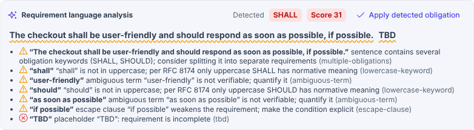
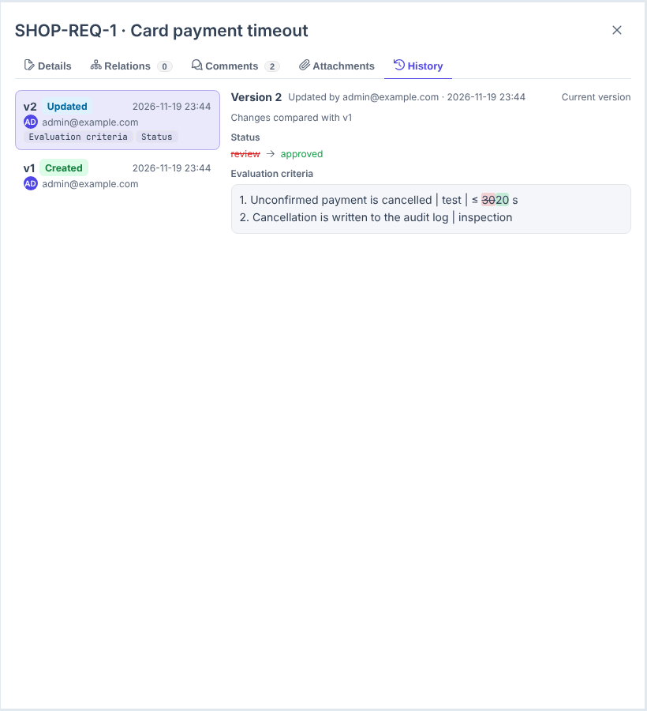

# Requirements

The **Requirements** section of a project holds the specification: every requirement with its obligation level, status, evaluation criteria, links to tests, relations to other requirements, comments, change history and attachments.

Reading requirements needs the role **Viewer**; creating and changing them needs **Manager**. Linking tests to a requirement needs **Tester**.

## The requirements page

- **Folder tree** (left): select **All requirements** or a folder. **Include subfolders** decides whether items of subfolders are listed. On narrow screens the tree opens with the **Folders** button.
- **Filter bar**: a [query](search-and-filters.md) field plus quick filters for **Status**, **Obligation**, **Priority**, **Coverage** and **Category**. The quick filters are combined into a query that is shown under the bar (`q = …`). **Clear** resets all filters.
- **Columns**: choose which columns the table shows: obligation, status, priority, type, coverage, linked tests, categories, folder, owner, source, tags, **relations**, relation count, criteria, version, comments, created by, created and updated date. The **Relations** column lists the related items grouped by relation, in both directions, for example *depends on SHOP-REQ-2*, *provided by SHOP-REQ-3* and *verified by SHOP-TC-1*; select a key to open the item. Move columns by dragging their header, or with the arrow buttons in **Columns**; **Reset** restores the default columns. Your choice is remembered in this browser, also for the run, executions and document tables.
- **Table**: sort by clicking a column header; select a row (or its title) to open the editor. The ID (for example `SHOP-REQ-12`) is assigned automatically.

The current folder, filter and open requirement are part of the page address, so you can bookmark or share a filtered view.

## Obligation levels

Every requirement has an **obligation** based on [RFC 2119 and RFC 8174](references.md#requirement-key-words-rfcs):

| Level | Meaning |
|---|---|
| **Must**, **Shall** | Absolute requirement |
| **Must not**, **Shall not** | Absolute prohibition |
| **Should** | Recommended: there may be valid reasons to deviate, but the consequences must be understood |
| **Should not** | Not recommended |
| **May**, **Optional** | Truly optional |
| **Will** | Statement of intent or fact (not an RFC 2119 keyword) |
| **Describe** | Descriptive text without obligation, such as an introduction or a note |

When you create a requirement with **Obligation** set to **Auto-detect from text**, the level is detected from the title and description. If several keywords appear, the strongest one wins (Must not before Must before Shall not … before Describe). Text without any keyword has no obligation and is counted as *unspecified* on the dashboard. Later edits never change the obligation automatically; use **Apply detected obligation** in the analysis box, or pick a level yourself.

Only UPPER-CASE keywords carry normative meaning (RFC 8174). Write `MUST`, not `must`. Requirements written in Swedish use the Swedish keywords described under [The language analysis](#the-language-analysis). The [References](references.md) page lists these and other standards for requirements and testing.

While you write, **Help: obligation levels** below the description (open for new requirements) shows the keywords of each level in the language of the interface, what they mean and an example, with tips on writing them. [Analytics](traceability-and-coverage.md#requirement-analytics) shows how the levels and keywords are spread over the project.

### Highlighted obligation keywords

Wherever a requirement's description is shown read-only, its obligation keywords are highlighted: in the requirement editor when you may only read the requirement, in the [catalogue](catalogue.md) preview and in the preview of [Import requirements](#import-requirements). Each level has its own style, and the levels differ not only in colour but also in weight and underline, so they are clear in every theme, high contrast included:

| Level | Keywords | Underline |
|---|---|---|
| Must | MUST, SHALL, REQUIRED, SKA, SKALL, MÅSTE | solid, extra bold |
| Must not | MUST NOT, SHALL NOT, SKA INTE, FÅR INTE | double, extra bold |
| Should | SHOULD, RECOMMENDED, BÖR | dashed, bold |
| Should not | SHOULD NOT, NOT RECOMMENDED, BÖR INTE | double, bold |
| May | MAY, OPTIONAL, FÅR, VALFRI | dotted |

Negations such as `MUST NOT` and `SKA INTE` are one keyword. Only keywords written in capitals are highlighted, only whole words (`MAYBE` is not `MAY`), and never inside links or code between backticks (`` `MUST` ``). Point at a keyword to see its meaning; screen readers read the level after the keyword, for example "MUST NOT (obligation: Must not)". The keywords are the same ones the [language analysis](#the-language-analysis) knows.

While you edit the description, the line **Obligation keyword** under it shows the keywords found as you type, with their level. It tells you when the keyword does not match the **Obligation** field (with a button to set the field to the detected level), when the text has more than one keyword and when a keyword is written in lower case. **What do the keywords mean?** opens **Help: obligation levels**.

To turn the highlighting and the line off, clear **Highlight obligation keywords** in your [preferences](getting-started.md#preferences).

## The language analysis

While you type the description, the **Requirement language analysis** box shows the detected obligation, a **Score** from 0 to 100, the keywords highlighted in your text and a list of **Findings**.

The analysis understands **English** and **Swedish**. By default (**Detect language**) it works out the language of the text and shows it next to the selector, for example *Detected: Swedish*; pick **English** or **Swedish** in the selector to force one. Your choice is remembered in this browser. The findings are always shown in your interface language, whichever language the requirement is written in.

| Rule | Severity | Found when |
|---|---|---|
| Missing keyword | Warning | there is no obligation keyword (MUST, SHALL, SHOULD, MAY …) |
| Lower-case keyword | Info | a keyword is not in upper case, such as `must` |
| Negative requirement | Info | `MUST NOT` or `SHALL NOT`: harder to verify; say what the system does instead |
| Several obligations | Warning | one sentence contains more than one keyword; split it |
| Long sentence | Info | a sentence has more than 40 words |
| Ambiguous term | Warning | vague words such as *fast, easy, user-friendly, simple, efficient, adequate, appropriate, approximately, flexible, robust, reliable, intuitive, sufficient, as needed, normally, usually, seamless, scalable, optimal, several, many, few, reasonable, timely, acceptable, as soon as possible, suitable* |
| Placeholder | Error | `TBD`, `TBC`, `TODO`, `XXX`, `???`: the requirement is incomplete |
| Unbounded term | Info | *all, always, never, every, any, none*: check that it is really meant universally |
| And/or | Warning | `and/or`: say whether both or either is required |
| Passive capability | Info | *be able to*, *be capable of*: describe the behaviour instead |
| Escape clause | Warning | *if possible, where applicable, unless, except*: make the condition explicit |
| Ambiguous negation | Warning | Swedish only: *måste inte* is often read as a prohibition but means "need not"; write *får inte* or *behöver inte* |

In Swedish text the keywords are **SKA**/**SKALL** (shall), **MÅSTE** (must), **BÖR** (should), **FÅR** (may), **FÅR INTE** (must not), **SKA INTE** (shall not), **BÖR INTE** (should not), **BEHÖVER INTE** and **VALFRI** (optional), **KOMMER ATT** (will) and **BESKRIVER**/**NOT:** (descriptive); upper-case English keywords also count. Swedish has no upper-case convention, so the lower-case rule only applies to English. The other rules use Swedish words, such as *snabb, användarvänlig, osv, och/eller, kunna, om möjligt, alla*. Note that *får* also means "receives", so a sentence like *användaren får ett mejl* is read as *may*.

**Score** = 100 − 25 per error − 10 per warning − 2 per info, never below 0. For example *The system shall respond fast and/or retry TBD.* scores 53: a lower-case keyword (info), *fast* (warning), *and/or* (warning) and *TBD* (error).

If you do not want the box, turn it off in your profile: **Hide the live requirement-language analysis**.

## Fields

| Field | Use |
|---|---|
| **Title** | A short name (required). |
| **Description** | The requirement statement itself, analysed while you type. |
| **Obligation** | See above. |
| **Status** | Draft, Review, Approved, Implemented, Verified, Rejected or Obsolete. *Approved* and *Rejected* are review decisions: they need the permission *requirement.review* (Reviewer or Manager) and are greyed out without it. Reviewers see **Approve** and **Reject** buttons at the top of the editor. |
| **Type** | Functional, Non-functional, Security, Performance, Usability, Interface, Constraint, Business or Regulatory. |
| **Priority** | Critical, High, Medium or Low. |
| **Owner** | Who is responsible for the requirement. Type `@` to pick a person, see [Mention people](#mention-people). |
| **Source** | Where it comes from. Pick one from the list (▾), which offers the project's sources and the sources other requirements already use, or type your own, for example *Customer spec §4.2*. The list of the project is edited under **Categories & settings → Requirement sources** (one per line; empty means the defaults: Customer, Contract, Standard, Regulation, Stakeholder, …). |
| **Rationale** | Why it exists. |
| **Folder** | Where it is filed. |
| **Categories** | Values of the project's requirement category dimensions, for example *Area / Security*. |
| **Tags** | Free keywords; type a tag and press <kbd>Enter</kbd>, or select one of the **Suggested tags** below the field. Suggestions come from the title and description: tags the project already uses that the text mentions come first (a solid border), then abbreviations such as *GDPR* and words of the title or words used more than once (a dashed border). Every tag gets a colour of its own, the same everywhere (tables, the tag cloud, documents), so equal tags are easy to spot. |

The header of the editor shows the ID, the **version** (for example *v3*), the coverage and who changed it last. The version increases with every change.

## Evaluation criteria

Under **Evaluation criteria** you state how fulfilment is judged. Each criterion has a description, a **method** and an optional **threshold**:

| Method | Typical use |
|---|---|
| **Test** | executing a test case (the default) |
| **Inspection** | examining code, documents or configuration |
| **Analysis** | calculation, simulation or measurement evaluation, for example *p95 < 2 s* |
| **Demonstration** | showing the function to a reviewer |
| **Review** | a formal review |

Select **Add criterion** to add one; use the arrows to reorder and the bin to remove one. Saving replaces the list. When you link a test, you can choose the criterion it verifies in **Criterion for new links**.

## Linked tests

**Also create linked test** (ticked by default; your personal default is in your profile) creates a draft manual test when you create a requirement:

- titled *Verify SHOP-REQ-n: …*, with the requirement's priority and the tag `auto-generated`;
- with one step per evaluation criterion, or one step derived from the text if there are none;
- in the test folder with the same path as the requirement's folder (missing folders are created);
- linked to the requirement, so its coverage starts as **Not run** instead of **None**.

The section **Linked tests** of the editor lists all linked tests with their last result. **Link tests** adds more (Tester); the **×** on a row removes a link. Links can also be set in the [traceability matrix](traceability-and-coverage.md).

## Relations

The **Relations** tab connects requirements of the same project:

| Relation | Meaning |
|---|---|
| **refines (parent)** / **refined by (child)** | decomposition: this requirement is a more detailed part of the other one |
| **depends on** / **required by** | this requirement needs the other one |
| **provides** / **provided by** | this requirement supplies something (a capability, an interface, data) that the other one needs |
| **derived from** / **source of** | this requirement was derived from the other one |
| **conflicts with** | both cannot be satisfied at the same time |
| **duplicates** / **duplicated by** | the same content twice |
| **relates to** | an informal relation |

Select **Add relation…**, choose the type and then the requirements. A requirement cannot relate to itself, and *refines* relations may not form a cycle. In queries, `parent:`, `child:` and `related:` find requirements by their relations, for example `child:*` for requirements that have been decomposed.

### Relations of many requirements at once

To relate many requirements in one step, select them in the list and choose **Relations** in the toolbar (needs **Manager**):

- **Add:** choose the relation that **each selected requirement** should have, for example *refines (parent)*, and **Choose requirements…** for the other end. Every selected requirement gets the relation to every chosen requirement, so you can make ten requirements children of one parent at once. Relations that already exist, would relate a requirement to itself or would form a *refines* cycle are skipped and counted in the message.
- **Remove:** choose the relation to remove, or **Any relation**, and optionally the requirements at the other end; with none chosen, the matching relations to any requirement are removed.

The dialog says how many relations will be added or removed before you confirm. On a requirement's **Relations** tab, tick several relations (or **Select all**) and choose **Remove** to remove them together. Both can be undone with **Undo**.

## Mention people

Type `@` in **Owner**, **Description**, **Rationale**, a comment, or in a test's description and preconditions and an execution's **Assignee** and notes: a list of people appears. It holds the users of the organisation (with their avatar) and names that are already used as owner or assignee in the project but have no account (*no account*). Keep typing to narrow the list, use the arrow keys and <kbd>Enter</kbd> or <kbd>Tab</kbd> to insert, or <kbd>Esc</kbd> to close the list.

A mention is written as `@handle`: for users the part of the e-mail address before the `@` (`@anna.berg` for *anna.berg@example.com*), for other people the name with dots instead of spaces (`@carl.carlsson`). Mentions of known people are shown as a chip with avatar and name, in the editor's comments and in the **Owner** column. Plain names still work: the owner is free text.

To find everything that mentions someone, filter with `mention:anna.berg` (or `mention:@anna.berg`).

## Comments

The **Comments** tab is a discussion thread on the requirement. Write in the field and select **Comment** (or press <kbd>Ctrl</kbd>+<kbd>Enter</kbd>). Everyone who can read the requirement can read and write comments. You can edit and delete your own comments; administrators can delete any comment. The number of comments is shown on the tab and in the **Comments** column.

## When someone else saved first

If someone saves a requirement while you are editing it, your **Save** does not overwrite their work. A dialog **Someone else changed this** says who saved the newer version and when, and lists the fields they changed next to your unsaved values; fields you changed too are marked. Choose:

- **Keep editing**: close the dialog and go on (for example to copy your text first);
- **Discard mine, load theirs**: load the saved version and drop your changes;
- **Save my changes**: save only the fields you changed on top of their version. Fields only they changed keep their values; where you both changed a field, yours is saved. The newer version stays in the **History** tab, so you can still compare or restore it.

The same applies to tests.

## History and restore

Every change creates a new **version**. The **History** tab lists the versions with who made the change (with their avatar), when and what kind of change it was (created, updated, restored, moved, bulk update). Select a version to see a field-by-field comparison with the previous one.

**Restore this version** copies the content of an old version back as a **new** version: title, description, obligation, type, priority, status, source, rationale, owner, tags, categories and criteria. Nothing is lost; the newer versions stay in the history. The folder and project are not changed. Categories that no longer exist are dropped.

## Approve many requirements at once

Holders of the review permission (`requirement.review`) can approve or reject many requirements in one step. Tick the requirements and choose **Approve or reject…** in the toolbar, or, with nothing ticked, choose **Bulk review** above the list. Then choose:

- **Which items**: the selected ones, all shown in the list (the current folder and filters, so filter first for a subset, e.g. `folder:Payments obligation:must`), or all requirements of the project.
- **Decision**: approve or reject.
- **Only items with status**: by default only requirements in *Review*. Add *Draft* to approve drafts directly.
- **Include anyway, despite**: see below.
- **Comment**: added to every requirement that changes, for example "Approved in the review meeting of 12 March".
- **Also complete my open review requests**: shown when [review requests](reviews-and-notifications.md) to you are open for some of the requirements; on by default. Your requests are then decided together with the requirements (*Approved* when you approve, *Changes requested* when you reject), and the people who asked are notified. Their checklists are not ticked; the review records that it was decided in bulk. Requests to other reviewers still keep a requirement out.

The preview shows which requirements change and which are skipped, grouped by the reason:

| Reason | Meaning |
|---|---|
| Already has this status | nothing to do |
| Status not chosen above | its status is not one of those you chose |
| The latest review asked for changes | a [review request](reviews-and-notifications.md) was answered with *Request changes* |
| Review requests are still open | someone has not finished reviewing it |
| Has suspect links | a linked test changed since the link was confirmed |
| No obligation level | approving needs an obligation level (rejecting does not) |

Choose a check under **Include anyway, despite** to approve those requirements anyway. Nothing is saved until you choose the button at the bottom. Each change is recorded in the requirement's history and the audit log, and the whole step can be undone with the undo button in the top bar (undo needs write permission; completed review requests stay decided).

## Bulk edit

Tick the checkboxes of several requirements (or the header checkbox for the whole page). A toolbar appears:

- **Set status**, **Set priority**, **Set obligation**: applied at once to all selected requirements;
- **Categories +** / **Categories −**: add or remove category values;
- **Tags +** / **Tags −**: add or remove tags (removing ignores upper and lower case);
- **Move**: move them to a folder;
- **Delete**: delete them after confirmation;
- **×**: clear the selection.

Every bulk change is recorded in each requirement's history.

## Move requirements and folders

- **Within the project:** drag rows by their handle (☰) onto a folder in the tree, or select them and use **Move**. Keys, links, categories and history stay as they are.
- **Folders:** drag a folder onto another one to nest it, or use **⋮ → Move to top level**. A folder cannot be moved into itself or its own subfolders.
- **To another project:** right-click a folder and choose **Move to project…**. The folder with all subfolders and requirements moves to the target project in the same organisation. There:
  - each requirement gets a **new key** of the target project (for example `CORE-REQ-17`); the old key is not reused;
  - categories are matched by dimension and name; values the target project does not have are dropped;
  - **links to tests are removed**, because links never cross projects;
  - criteria and history move along.

Without a mouse, use the folder's **⋮** actions button or the **Move** button of the selection.

**Several folders at once:** choose **Select several folders** (☑) above the tree. Each folder gets a checkbox; a ticked folder includes its subfolders. The toolbar then moves the ticked folders **into** another folder, to the **top level** or to **another project** (with everything in them, as above), or **deletes** them (keeping their requirements in the parent folder, or deleting them too). A move into one of the ticked folders is refused before anything changes. **Done** returns to the normal tree.

**Folder colour:** right-click a folder (or use **⋮**) and choose **Edit…** to give it a colour. Every requirement in the folder, and in subfolders without a colour of their own, gets a coloured stripe at the start of its row and a swatch next to its folder path, so items of the same folder are easy to spot. The folder tree shows the colour as a dot (a narrow dot when it is inherited). Choose **No colour** to remove it. Test folders work the same way, and a test folder created to mirror a requirement folder takes its colour.

**Deleting a folder** asks what to do with the content: **Delete, keep content** moves subfolders and requirements to the parent folder; **Delete everything** deletes the subtree including all requirements in it.

## Links to other items

The **Links** tab of a requirement, a test and a run lists links to other things, inside the tool and outside it. **Add link** offers:

| Link to | Choose |
|---|---|
| **Requirement**, **Test** | one or more items of the project with the item picker |
| **Run** | a test run of the project |
| **Archive file** | a document or saved report of the project's [document archive](documents.md) |
| **Report** | a saved report definition; the link opens it under **Reports** |
| **Web address** | an `https://`, `http://` or `mailto:` address, for example a design specification, a ticket or a wiki page |

A **label** (optional) says what the link is, for example *Design spec* or *Jira ticket*. Links to items of the tool open them; files and web addresses open in a new tab. Under **Linked from** you see the requirements, tests and runs that link to this item, so links work in both directions.

Links can only point to items of the same project. When a linked item is deleted its links go with it (and come back when you undo the deletion); when an item moves to another project, its links to items of the old project are dropped and its web links move along. Adding and removing links needs the permission to edit the item that carries them, and you only see links to kinds of items you may read. Adding and removing a link can be undone.

### Links of many items at once

Select requirements or tests in their list, or runs on the **Operations** page, and choose **Links** in the toolbar:

- **Add:** choose what to link to and the targets (several requirements, tests, runs or files at once, or one web address) and an optional label. Every selected item gets a link to every target; existing links and links of an item to itself are left out.
- **Remove:** choose a kind of link, or **Any link**, and optionally the targets; with none chosen, all links of that kind are removed from the selected items.

The dialog says how many links will be added or removed before you confirm; items you may not change are skipped and counted in the message. On an item's **Links** tab, tick several links (or **Select all**) and choose **Remove** to remove them together. Both can be undone.

**Keys and addresses in texts.** In comments, an item key such as `SHOP-REQ-12` or `SHOP-TC-3` becomes a link to that item, and a web address becomes a link that opens in a new tab. The address `/go/SHOP-TC-3` in the tool always opens that item, which is handy in e-mails and chats.

## Issues in GitLab, GitHub or Jira

When the project is connected to an issue tracker (see [Connect Jira, GitHub or GitLab](defects.md#connect-jira-github-or-gitlab)), a requirement can be handed to the developers as an issue. The **Links** tab of the requirement then starts with **Issue in GitLab** (or GitHub, Jira):

- **Create GitLab issue** shows a preview of the issue and creates it. The issue gets:
  - the title `[SHOP-REQ-12] <title>`;
  - a description with the requirement text, the rationale, the acceptance criteria, the type, priority, obligation, status, owner, source, tags and version, the linked tests with their latest results, and links back to the requirement and its tests in Qtestframe (when the server's address, `server.base_url`, is set);
  - labels: the tracker's default labels plus labels mapped from the requirement (see below);
  - the milestone and assignee of the tracker settings, if set.

  The issue is added to the requirement's links as a web link, with its key and its state (**Open** or **Closed**).
- A requirement has at most one issue in the tracker. If it already has one, Qtestframe offers **Open issue** and **Update issue** instead of creating another one.
- **Update issue** puts the current title and text of the requirement into the issue, for example after the requirement was changed or its tests were run. In GitLab and GitHub only the part written by Qtestframe is replaced (it is marked with hidden comments); notes the developers added below or above it are kept. In Jira the whole description is replaced.
- **Refresh state** reads the issue's state back. The state is not refreshed automatically: refresh it here or with **Issues** in the list.

With **Comment on the issue when all linked tests passed** in the tracker settings, refreshing the state of an open issue whose linked tests all passed adds one comment saying so, with a link to the requirement. If the tests stop passing and pass again later, the next refresh comments again.

**Labels from requirement fields** in the tracker settings maps fields to labels: templates separated by commas, where `{type}`, `{priority}`, `{obligation}`, `{status}` and `{tags}` (one label per tag) are replaced by the requirement's values. The default is `requirement, type::{type}, priority::{priority}, {tags}`, which gives for example `requirement`, `type::functional`, `priority::high` and `login`; GitLab shows `type::functional` as a scoped label. Enter `none` for no mapped labels. In Jira, spaces in labels become `_`, and the issue type of requirement issues is set by **Issue type for requirements** (default *Task*).

### Issues of many requirements at once

Select requirements in the list and choose **Issues** in the toolbar:

- **Create issues** creates an issue for each selected requirement that has none. Requirements that have one are skipped, so none gets two; tick **Update the issues that exist** to update them instead.
- **Refresh states** reads the state of the selected requirements' issues.

The result lists each requirement with its issue, and the requirements the tracker refused with its reason. Up to 100 requirements can be handled at a time.

Creating, updating and refreshing issues needs the permission to edit requirements (`requirement.write`, by default Manager); everyone who can read requirements sees the issue and its state. Every create, update and refresh is recorded in the [audit log](administration.md#audit-log). The tracker's token is never shown.

## Attachments

The **Attachments** tab of the editor holds files that belong to the requirement: drawings, specifications, mails, screenshots. Drag files onto the tab or choose them to upload (up to 25 MB per file unless your administrator set another limit); several files upload one after another, with progress. Images, PDF files and plain text can be previewed; other files are downloaded.

You can also select **Attach from archive**: a file that is already in the project's [document archive](documents.md) is linked rather than copied, so one specification can be attached to many requirements. Removing an attachment only unlinks it; an uploaded attachment that is no longer linked anywhere is deleted.

Uploading and removing attachments needs the **Manager** role (the same as editing the requirement); reading them needs **Viewer**.

## Import requirements

Customers often send their requirements as a spreadsheet, a ReqIF export from their requirements tool or a Word document. **Import** in the header of the requirements page reads such a file and creates the requirements in one go. Importing needs the permission to edit requirements (**Manager** by default).

1. Drag the file onto the dialog or choose it. Supported are **CSV** (comma, semicolon or tab separated; UTF-8 with or without byte order mark, UTF-16 and Windows-1252), **Excel** (`.xlsx`), **ReqIF 1.x** (`.reqif` and the zipped `.reqifz`) and **Word** (`.docx`), up to 20 MB and 5,000 requirements per file.
2. Check the **preview**: the detected format, how each column is read and the first 50 requirements with notes (a derived title, an unknown value, a duplicate). Nothing is stored yet.
3. Change the field of a column if it was guessed wrongly, or set it to *ignore*. Clear the **Import** box of rows you do not want.
4. Choose the options and select **Import**. The list reloads and the dialog shows how many requirements, folders and tests were created and what was skipped.

**Columns (CSV, Excel and tables in Word).** The first of the leading rows that names a title or description column is the header row; rows above it are ignored. Column names are recognised in English and Swedish, regardless of case:

| Field | Column names |
|---|---|
| Title | Title, Name, Heading, Summary · Titel, Namn, Rubrik |
| Description | Description, Text, Requirement, Statement · Beskrivning, Krav, Kravtext |
| ID | ID, Key, Ref, Number · Nyckel, Referens, Nummer, Krav-ID |
| Obligation | Obligation, Level · Kravnivå, Nivå |
| Type | Type · Typ, Kravtyp |
| Priority | Priority · Prioritet |
| Status | Status, State · Tillstånd |
| Source | Source, Origin · Källa, Ursprung |
| Rationale | Rationale, Justification, Comment · Motivering, Kommentar |
| Owner | Owner, Responsible · Ägare, Ansvarig |
| Tags | Tags, Labels · Taggar, Etiketter (separated by commas) |
| Folder | Folder, Section, Chapter · Mapp, Avsnitt, Kapitel (a path such as `Security / Login`) |
| Acceptance criteria | Criteria, Acceptance criteria · Kriterier, Acceptanskriterier (one per line; a line may start with a method, e.g. `inspection: …`) |

Values of type, priority, status and obligation may be written in English or Swedish (*High*/*Hög*, *Approved*/*Godkänd*, *Security*/*Säkerhet*). An unknown value is noted and the default is used. A row without a title gets one from the first words of its description. A file exported from Qtestframe (requirements as CSV or Excel) can be imported again; in an Excel export the evaluation criteria of the criteria sheet come along.

**ReqIF.** Every SPEC-OBJECT becomes a requirement: *ReqIF.Name* (or an attribute named title or name) gives the title, *ReqIF.Text* the description and *ReqIF.ForeignID* the ID; other attributes are matched by name like columns. Formatted text (XHTML) is imported as plain text with its line breaks; in a ReqIF file exported by Qtestframe it is read back with its formatting (paragraphs, lists, bold …), so an [export](reports-and-export.md#reqif-for-requirements-tools) comes back unchanged. Objects with only a *ReqIF.ChapterName* are headings: the specification hierarchy below them becomes folders.

**Word.** Headings (the styles *Heading 1*, *Heading 2* … or *Rubrik 1* …) become folders. Every other paragraph or list item that contains an obligation keyword becomes a requirement: the paragraph is the description and the title is its first eight words. A leading identifier such as `REQ-12:` or `[SRS-7]` becomes the ID. List items right after a requirement ending with a colon are added to it. Tables with a header row are read like a spreadsheet. If the document writes its keywords in uppercase (MUST, SHALL), lowercase *may* or *should* in running text are not taken as requirements.

**Obligation levels.** An obligation column (MUST, SHALL NOT, SKA, BÖR, FÅR …) wins; otherwise the level is detected from the title and description as in the editor, see [Obligation levels](#obligation-levels).

**Options.**

- **Target folder:** where the requirements go (the folder selected in the tree, or the top level).
- **Create folders from the file:** folder paths, sections and headings are created below the target folder; existing folders with the same name are reused. Without it everything goes into the target folder.
- **Status:** for requirements without a status in the file (default *Draft*). *Approved* and *Rejected* need the review permission.
- **Create a linked test for each requirement**, as in the editor (needs the permission to edit tests).
- **Skip duplicates:** a row is skipped when its ID is already recorded in a requirement of the project, or when a requirement with the same title (ignoring case) exists; rows repeated within the file count too.

The ID of an imported requirement is kept in its **Source** field as `ID: REQ-12` (after the source of the file, if there is one), which is how duplicates are found the next time. The import is all or nothing: if one requirement cannot be stored, none is. Every import is recorded in the audit log.

## Copy a requirement

**Copy** in the editor creates a new requirement based on this one: titled *Copy of …*, with a new key in the same folder and the description, obligation, type, priority, source, rationale, owner, tags, categories and evaluation criteria. The copy starts as **Draft** and opens in the editor so you can adapt it. **▾ → Copy and relate as derived from** also records the relation *derived from* the original. Links to tests, comments and history are not copied.

## AI prompts (software projects)

In a project whose **project type** is **Software** (set it when you create the project, or under **Categories & settings → Project**), **AI prompts** appears in the project navigation. It builds a ready-to-use prompt for an AI assistant (for example a coding assistant) from the project's requirements or tests. Qtestframe only writes the text; you copy it into the assistant your organisation allows. Nothing is sent to an AI service.

1. Choose what the prompt is for:

   | From | Prompt | What the assistant is asked to do |
   |---|---|---|
   | requirements | **Implement requirements** | write the code, traceable to the requirement keys, with tests; list open questions |
   | requirements | **Review requirements** | check them against ISO/IEC/IEEE 29148 and RFC 2119; propose rewrites and measurable criteria |
   | requirements | **Design test cases** | derive test cases of a **test type**, as JSON that can be imported with the API |
   | tests | **Automate test cases** | write automated tests in your **test framework**, one per test case, named after its key |
   | tests | **Review tests** | check quality and coverage against the requirements they verify |
   | tests | **Plan a test type** | a test plan for one test type: scope, tools, entry and exit criteria, tests to add |

2. Choose the items: **all**, those **matching a filter** (the [query language](search-and-filters.md)), or **selected** ones. You can also start from a requirement or test: **AI prompt** at the bottom of the editor, or **AI prompt** in the bulk toolbar for the selected rows.
3. Choose the **test type** (unit, integration, system, acceptance, end-to-end, API, regression, smoke, performance, security, usability or accessibility), the **test framework or tools** (suggestions such as pytest, Playwright, JUnit 5 or Go testing; any text is fine), the **language of the prompt** (English or Swedish) and any **additional instructions**.
4. Select **Build prompt**, then **Copy** or **Download (.md)**.

A prompt contains the project's **technical context**, the items with their obligation, status, description, rationale, criteria with thresholds, relations, linked tests or requirements, steps with test data and expected results, prerequisites and, for automation, the current script, followed by instructions and the expected form of the answer. Describe the languages, frameworks, architecture and conventions of the project once under **Categories & settings → Project → Technical context**; every prompt includes it.

Reading the items is enough to build a prompt. A prompt holds at most 200 items. Only paste prompts into AI services that your organisation allows for this information.

## Delete a requirement

Open it and select **Delete**, or select several and use **Delete** in the bulk toolbar. Deleting also removes its links, relations, comments and history. Select **Undo** (<kbd>Ctrl</kbd>+<kbd>Z</kbd>) right afterwards to bring it back with everything, see [Undo and redo](getting-started.md#undo-and-redo).
