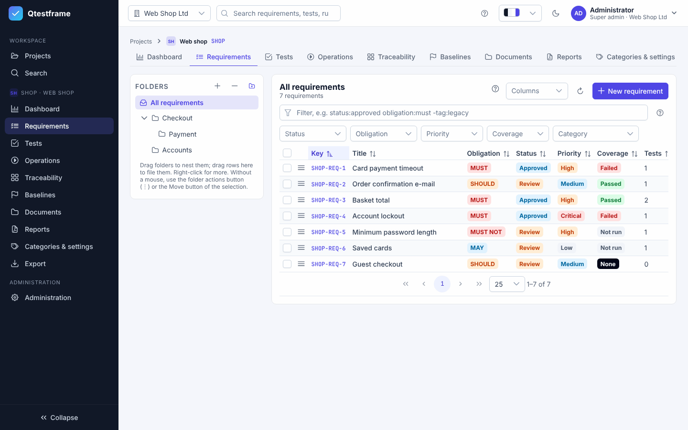
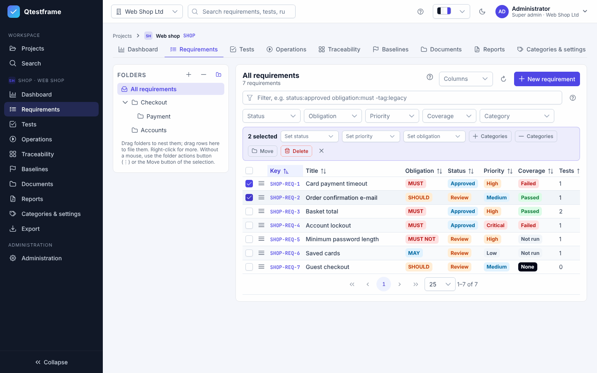

# Requirements

The **Requirements** section of a project holds the specification: every requirement with its obligation level, status, evaluation criteria, links to tests, relations to other requirements, comments, change history and attachments.

Reading requirements needs the role **Viewer**; creating and changing them needs **Manager**. Linking tests to a requirement needs **Tester**.

## The requirements page

- **Folder tree** (left): select **All requirements** or a folder. **Include subfolders** decides whether items of subfolders are listed. On narrow screens the tree opens with the **Folders** button.
- **Filter bar**: a [query](search-and-filters.md) field plus quick filters for **Status**, **Obligation**, **Priority**, **Coverage** and **Category**. The quick filters are combined into a query that is shown under the bar (`q = …`). **Clear** resets all filters.
- **Columns**: choose which columns the table shows: obligation, status, priority, type, coverage, linked tests, categories, folder, owner, source, tags, **relations**, relation count, criteria, version, comments, created by, created and updated date. The **Relations** column lists the related items grouped by relation, in both directions, for example *depends on SHOP-REQ-2*, *provided by SHOP-REQ-3* and *verified by SHOP-TC-1*; select a key to open the item. Move columns by dragging their header, or with the arrow buttons in **Columns**; **Reset** restores the default columns. Your choice is remembered in this browser, also for the run, executions and document tables.
- **Table**: sort by clicking a column header; select a row (or its title) to open the editor. The ID (for example `SHOP-REQ-12`) is assigned automatically.

The current folder, filter and open requirement are part of the page address, so you can bookmark or share a filtered view.

## Obligation levels

Every requirement has an **obligation** based on [RFC 2119 and RFC 8174](references.md#requirement-key-words-rfcs):

| Level | Meaning |
|---|---|
| **Must**, **Shall** | Absolute requirement |
| **Must not**, **Shall not** | Absolute prohibition |
| **Should** | Recommended: there may be valid reasons to deviate, but the consequences must be understood |
| **Should not** | Not recommended |
| **May**, **Optional** | Truly optional |
| **Will** | Statement of intent or fact (not an RFC 2119 keyword) |
| **Describe** | Descriptive text without obligation, such as an introduction or a note |

When you create a requirement with **Obligation** set to **Auto-detect from text**, the level is detected from the title and description. If several keywords appear, the strongest one wins (Must not before Must before Shall not … before Describe). Text without any keyword has no obligation and is counted as *unspecified* on the dashboard. Later edits never change the obligation automatically; use **Apply detected obligation** in the analysis box, or pick a level yourself.

Only UPPER-CASE keywords carry normative meaning (RFC 8174). Write `MUST`, not `must`. Requirements written in Swedish use the Swedish keywords described under [The language analysis](#the-language-analysis). The [References](references.md) page lists these and other standards for requirements and testing.

## The language analysis

While you type the description, the **Requirement language analysis** box shows the detected obligation, a **Score** from 0 to 100, the keywords highlighted in your text and a list of **Findings**.

The analysis understands **English** and **Swedish**. By default (**Detect language**) it works out the language of the text and shows it next to the selector, for example *Detected: Swedish*; pick **English** or **Swedish** in the selector to force one. Your choice is remembered in this browser. The findings are always shown in your interface language, whichever language the requirement is written in.

| Rule | Severity | Found when |
|---|---|---|
| Missing keyword | Warning | there is no obligation keyword (MUST, SHALL, SHOULD, MAY …) |
| Lower-case keyword | Info | a keyword is not in upper case, such as `must` |
| Negative requirement | Info | `MUST NOT` or `SHALL NOT`: harder to verify; say what the system does instead |
| Several obligations | Warning | one sentence contains more than one keyword; split it |
| Long sentence | Info | a sentence has more than 40 words |
| Ambiguous term | Warning | vague words such as *fast, easy, user-friendly, simple, efficient, adequate, appropriate, approximately, flexible, robust, reliable, intuitive, sufficient, as needed, normally, usually, seamless, scalable, optimal, several, many, few, reasonable, timely, acceptable, as soon as possible, suitable* |
| Placeholder | Error | `TBD`, `TBC`, `TODO`, `XXX`, `???`: the requirement is incomplete |
| Unbounded term | Info | *all, always, never, every, any, none*: check that it is really meant universally |
| And/or | Warning | `and/or`: say whether both or either is required |
| Passive capability | Info | *be able to*, *be capable of*: describe the behaviour instead |
| Escape clause | Warning | *if possible, where applicable, unless, except*: make the condition explicit |
| Ambiguous negation | Warning | Swedish only: *måste inte* is often read as a prohibition but means "need not"; write *får inte* or *behöver inte* |

In Swedish text the keywords are **SKA**/**SKALL** (shall), **MÅSTE** (must), **BÖR** (should), **FÅR** (may), **FÅR INTE** (must not), **SKA INTE** (shall not), **BÖR INTE** (should not), **BEHÖVER INTE** and **VALFRI** (optional), **KOMMER ATT** (will) and **BESKRIVER**/**NOT:** (descriptive); upper-case English keywords also count. Swedish has no upper-case convention, so the lower-case rule only applies to English. The other rules use Swedish words, such as *snabb, användarvänlig, osv, och/eller, kunna, om möjligt, alla*. Note that *får* also means "receives", so a sentence like *användaren får ett mejl* is read as *may*.

**Score** = 100 − 25 per error − 10 per warning − 2 per info, never below 0. For example *The system shall respond fast and/or retry TBD.* scores 53: a lower-case keyword (info), *fast* (warning), *and/or* (warning) and *TBD* (error).

If you do not want the box, turn it off in your profile: **Hide the live requirement-language analysis**.

## Fields

| Field | Use |
|---|---|
| **Title** | A short name (required). |
| **Description** | The requirement statement itself, analysed while you type. |
| **Obligation** | See above. |
| **Status** | Draft, Review, Approved, Implemented, Verified, Rejected or Obsolete. |
| **Type** | Functional, Non-functional, Security, Performance, Usability, Interface, Constraint, Business or Regulatory. |
| **Priority** | Critical, High, Medium or Low. |
| **Owner** | Who is responsible for the requirement. Type `@` to pick a person, see [Mention people](#mention-people). |
| **Source** | Where it comes from, for example *Customer spec §4.2*. |
| **Rationale** | Why it exists. |
| **Folder** | Where it is filed. |
| **Categories** | Values of the project's requirement category dimensions, for example *Area / Security*. |
| **Tags** | Free keywords; type a tag and press <kbd>Enter</kbd>, or select one of the **Suggested tags** below the field. Suggestions come from the title and description: tags the project already uses that the text mentions come first (a solid border), then abbreviations such as *GDPR* and words of the title or words used more than once (a dashed border). |

The header of the editor shows the ID, the **version** (for example *v3*), the coverage and who changed it last. The version increases with every change.

## Evaluation criteria

Under **Evaluation criteria** you state how fulfilment is judged. Each criterion has a description, a **method** and an optional **threshold**:

| Method | Typical use |
|---|---|
| **Test** | executing a test case (the default) |
| **Inspection** | examining code, documents or configuration |
| **Analysis** | calculation, simulation or measurement evaluation, for example *p95 < 2 s* |
| **Demonstration** | showing the function to a reviewer |
| **Review** | a formal review |

Select **Add criterion** to add one; use the arrows to reorder and the bin to remove one. Saving replaces the list. When you link a test, you can choose the criterion it verifies in **Criterion for new links**.

## Linked tests

**Also create linked test** (ticked by default; your personal default is in your profile) creates a draft manual test when you create a requirement:

- titled *Verify SHOP-REQ-n: …*, with the requirement's priority and the tag `auto-generated`;
- with one step per evaluation criterion, or one step derived from the text if there are none;
- in the test folder with the same path as the requirement's folder (missing folders are created);
- linked to the requirement, so its coverage starts as **Not run** instead of **None**.

The section **Linked tests** of the editor lists all linked tests with their last result. **Link tests** adds more (Tester); the **×** on a row removes a link. Links can also be set in the [traceability matrix](traceability-and-coverage.md).

## Relations

The **Relations** tab connects requirements of the same project:

| Relation | Meaning |
|---|---|
| **refines (parent)** / **refined by (child)** | decomposition: this requirement is a more detailed part of the other one |
| **depends on** / **required by** | this requirement needs the other one |
| **provides** / **provided by** | this requirement supplies something (a capability, an interface, data) that the other one needs |
| **derived from** / **source of** | this requirement was derived from the other one |
| **conflicts with** | both cannot be satisfied at the same time |
| **duplicates** / **duplicated by** | the same content twice |
| **relates to** | an informal relation |

Select **Add relation…**, choose the type and then the requirements. A requirement cannot relate to itself, and *refines* relations may not form a cycle. In queries, `parent:`, `child:` and `related:` find requirements by their relations, for example `child:*` for requirements that have been decomposed.

## Mention people

Type `@` in **Owner**, **Description**, **Rationale**, a comment, or in a test's description and preconditions and an execution's **Assignee** and notes: a list of people appears. It holds the users of the organisation (with their avatar) and names that are already used as owner or assignee in the project but have no account (*no account*). Keep typing to narrow the list, use the arrow keys and <kbd>Enter</kbd> or <kbd>Tab</kbd> to insert, or <kbd>Esc</kbd> to close the list.

A mention is written as `@handle`: for users the part of the e-mail address before the `@` (`@anna.berg` for *anna.berg@example.com*), for other people the name with dots instead of spaces (`@carl.carlsson`). Mentions of known people are shown as a chip with avatar and name, in the editor's comments and in the **Owner** column. Plain names still work: the owner is free text.

To find everything that mentions someone, filter with `mention:anna.berg` (or `mention:@anna.berg`).

## Comments

The **Comments** tab is a discussion thread on the requirement. Write in the field and select **Comment** (or press <kbd>Ctrl</kbd>+<kbd>Enter</kbd>). Everyone who can read the requirement can read and write comments. You can edit and delete your own comments; administrators can delete any comment. The number of comments is shown on the tab and in the **Comments** column.

## History and restore

Every change creates a new **version**. The **History** tab lists the versions with who made the change (with their avatar), when and what kind of change it was (created, updated, restored, moved, bulk update). Select a version to see a field-by-field comparison with the previous one.

**Restore this version** copies the content of an old version back as a **new** version: title, description, obligation, type, priority, status, source, rationale, owner, tags, categories and criteria. Nothing is lost; the newer versions stay in the history. The folder and project are not changed. Categories that no longer exist are dropped.

## Bulk edit

Tick the checkboxes of several requirements (or the header checkbox for the whole page). A toolbar appears:

- **Set status**, **Set priority**, **Set obligation**: applied at once to all selected requirements;
- **Categories +** / **Categories −**: add or remove category values;
- **Move**: move them to a folder;
- **Delete**: delete them after confirmation;
- **×**: clear the selection.

Every bulk change is recorded in each requirement's history.

## Move requirements and folders

- **Within the project:** drag rows by their handle (☰) onto a folder in the tree, or select them and use **Move**. Keys, links, categories and history stay as they are.
- **Folders:** drag a folder onto another one to nest it, or use **⋮ → Move to top level**. A folder cannot be moved into itself or its own subfolders.
- **To another project:** right-click a folder and choose **Move to project…**. The folder with all subfolders and requirements moves to the target project in the same organisation. There:
  - each requirement gets a **new key** of the target project (for example `CORE-REQ-17`); the old key is not reused;
  - categories are matched by dimension and name; values the target project does not have are dropped;
  - **links to tests are removed**, because links never cross projects;
  - criteria and history move along.

Without a mouse, use the folder's **⋮** actions button or the **Move** button of the selection.

**Deleting a folder** asks what to do with the content: **Delete, keep content** moves subfolders and requirements to the parent folder; **Delete everything** deletes the subtree including all requirements in it.

## Attachments

The **Attachments** tab of the editor holds files that belong to the requirement: drawings, specifications, mails, screenshots. Drag files onto the tab or choose them to upload (up to 25 MB per file unless your administrator set another limit); several files upload one after another, with progress. Images, PDF files and plain text can be previewed; other files are downloaded.

You can also select **Attach from archive**: a file that is already in the project's [document archive](documents.md) is linked rather than copied, so one specification can be attached to many requirements. Removing an attachment only unlinks it; an uploaded attachment that is no longer linked anywhere is deleted.

Uploading and removing attachments needs the **Manager** role (the same as editing the requirement); reading them needs **Viewer**.

## Delete a requirement

Open it and select **Delete**, or select several and use **Delete** in the bulk toolbar. Deleting also removes its links, comments and history. This cannot be undone; if you might need it again, set the status to **Obsolete** instead.
