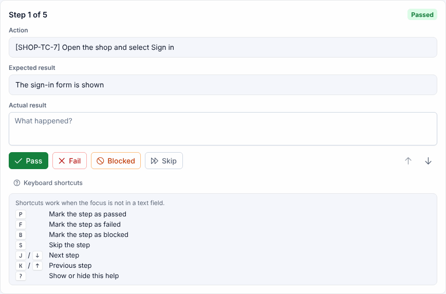

# Test runs and execution

A **run** (test run, campaign) is a set of tests that you execute together, for example *Sprint 12 regression* on the *staging* environment with build *1.4.2*. Each test in a run is an **execution** with its own result. Runs are under **Operations** in the project sidebar.

| Action | Role needed |
|---|---|
| View runs and results | Viewer |
| Create, edit and delete runs, add tests | Tester |
| Record results, import CI results | Tester |
| Run automated scripts on the server | Manager |

## The run list

**Operations** lists the runs of the project with their status, environment, build, progress bar and pass rate. Filter with the query language, for example `status:in_progress env:staging`. Select a run to open it.


## Create a run

Select **New run** and fill in:

- **Name**, for example *Sprint 12 regression* (a dated default is suggested);
- **Description**, **Environment** (e.g. *staging*) and **Build** (e.g. *1.4.2+sha*): free text that is shown with the results and passed to automated scripts;
- **Tests to include**: the union of three tabs:
  - **Tests**: **Pick tests…** to select individual tests;
  - **Folders**: tests in the selected folders, including subfolders;
  - **Query**: every test matching a filter such as `status:ready category:Negative`; **Preview** counts the matches.

Select **Create run**. A test appears only once in a run even if several tabs select it. Without any tests the run starts empty, and you add tests later.

When a test is added, its current steps (with shared steps expanded) are copied into the execution. Later edits of the test do not change this run.

## The run page


- **Run status**: **Planned**, **In progress**, **Completed** or **Aborted**. The start time is set when the run first becomes *In progress* (also automatically when the first result is recorded); the end time when it becomes *Completed* or *Aborted*.
- **Progress** and **Pass rate** summarise the executions.
- **Execute** opens the runner at the first execution that has not been run yet.
- **Add tests** adds more tests; **CI import** shows how a pipeline reports results; **Edit run** changes name, description, environment and build; **Delete** removes the run with all its results.
- The table lists every execution with test, result, **Assignee**, **Executed by**, **Defects**, **Finished** time and duration. Filter it, for example `status:failed` or `assignee:anna`.
- Per row: **Mark passed** and **Mark failed** record a result directly; the play button opens the execution in the runner.

## The execution runner

The runner shows one execution at a time. Its header tells you which execution of the run this is (*Execution 3 of 12*) and who executed it last.


### Manual tests

1. Read the **Preconditions** at the top.
2. The left column lists the steps with their status; select a step to jump to it.
3. For the current step, carry out the **Action** with the **Test data** and compare with the **Expected result**.
4. Record the outcome with **Pass**, **Fail**, **Blocked** or **Skip**. For anything other than a pass, write what happened in **Actual result**. The runner moves on to the next step.
5. Below the steps:
   - **Overall status** is derived from the steps (*Will be saved as …*): any failed step → **Failed**; otherwise any blocked step → **Blocked**; all passed or skipped with at least one pass → **Passed**; all skipped → **Skipped**; partly done → **In progress**. You can also set it explicitly.
   - **Assignee**: who should execute the test.
   - **Defects**: defect IDs or URLs, each followed by <kbd>Enter</kbd>.
   - **Notes**: observations, links, anything worth keeping.
6. Select **Save**, or **Save & next** to save and open the next execution. **Previous** and **Next** move between executions. *Unsaved changes* reminds you to save.

A test without steps shows only the overall result, notes and defects.

### Keyboard shortcuts

The shortcuts work when the focus is not in a text field. Press <kbd>?</kbd> in the runner to show them.

| Key | Action |
|---|---|
| <kbd>P</kbd> | Mark the step as passed |
| <kbd>F</kbd> | Mark the step as failed |
| <kbd>B</kbd> | Mark the step as blocked |
| <kbd>S</kbd> | Skip the step |
| <kbd>J</kbd> or <kbd>↓</kbd> | Next step |
| <kbd>K</kbd> or <kbd>↑</kbd> | Previous step |
| <kbd>?</kbd> | Show or hide the keyboard help |



### Automated tests

For an automated test the runner shows the **Script** and its **Output**. Select **Run script** to execute it on the server: the execution is set to *In progress*, the script runs, and the result is **Passed** for exit code 0 and **Failed** otherwise (or when it exceeds the time limit). The output and duration are stored.

The button needs the **Manager** role. If the administrator has not enabled the script runner, the server answers that it is disabled; results then come from CI.

## Defects

Record a defect wherever a test fails: in the runner under **Defects** (an ID such as `JIRA-123` or a full URL). Defects are shown on the run page, in the test's **Executions** tab and in reports.

To make IDs clickable, set the **Defect tracker URL template** in **Categories & settings**, for example `https://jira.example.com/browse/{id}`. `{id}` is replaced by the defect ID; without `{id}` the ID is appended. Values that already are URLs are linked directly.

Find defects with queries: `defect:JIRA-*` in the run's filter finds executions with a JIRA defect; in the tests list it finds tests with such a defect in their latest executions.

## Import results from CI

Automated pipelines (GitLab CI, GitHub Actions, Jenkins …) can report results into a run by test key.

1. Create an API token: **Administration → API tokens → New token**, role **Tester** or higher (see [API tokens](administration.md#api-tokens)). Copy the token; it is shown only once and starts with `qtf_`.
2. Open the run and select **CI import**. The dialog shows the endpoint with the run's ID and a ready-made command.


3. Post the results from your pipeline:

```bash
curl -X POST "https://qtf.example.com/api/v1/runs/$RUN_ID/results" \
  -H "Authorization: Bearer $QTF_TOKEN" \
  -H "Content-Type: application/json" \
  -d '{"results":[
        {"test_key":"SHOP-TC-7","status":"passed","duration_ms":1234,"output":"ok"},
        {"test_key":"SHOP-TC-9","status":"failed","duration_ms":877,"output":"expected 35, got 34"}
      ]}'
```

- `status` is one of `passed`, `failed`, `blocked`, `skipped`, `in_progress` or `not_run`.
- Test keys are matched without regard to case within the run's project. Tests that are not in the run yet are added.
- The answer reports how many executions were `updated` and lists `unknown` keys, which were skipped.
- An invalid status stops the import with an error; results before it stay applied.

Keep the token in your CI system's secret store, never in the repository. A token is bound to one organisation and never has more rights than its owner.

## Attachments on runs and executions

Runs and executions have **Attachments** too: log files, screenshots of a failure, test reports from other tools. In the runner, open the **Attachments** tab next to **Result** and drag files onto it or select **Choose files**; on the run page, attachments belong to the run as a whole. You can also attach a file from the project's [document archive](documents.md). Uploading and removing attachments on runs and executions needs **Tester** (the right to record results).
