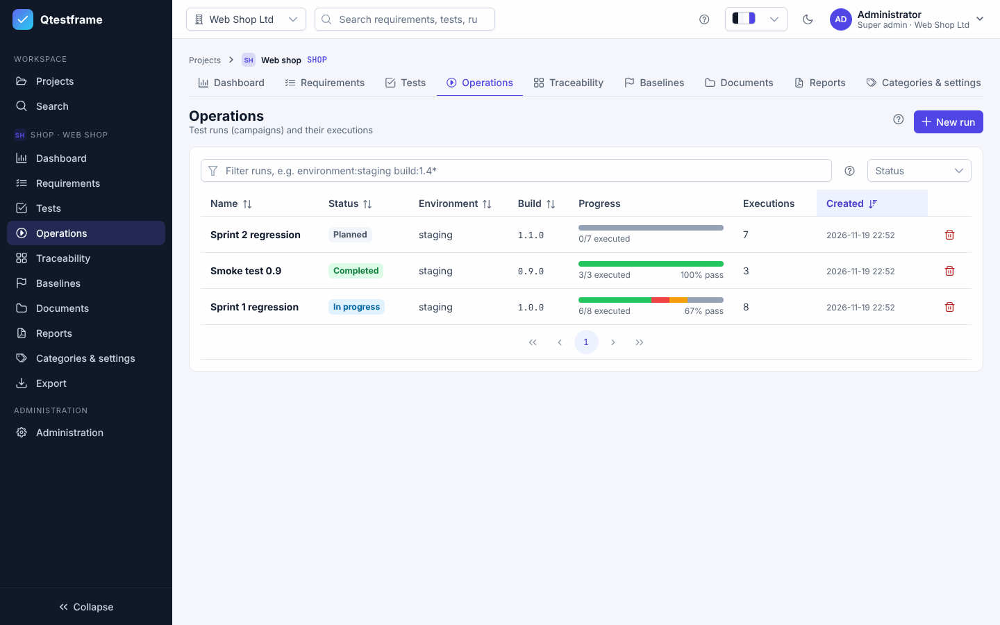
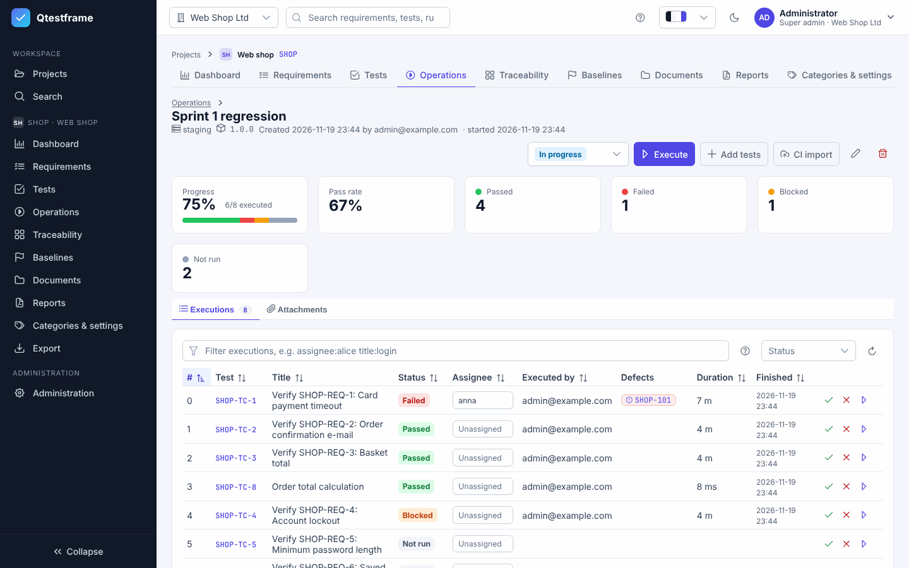
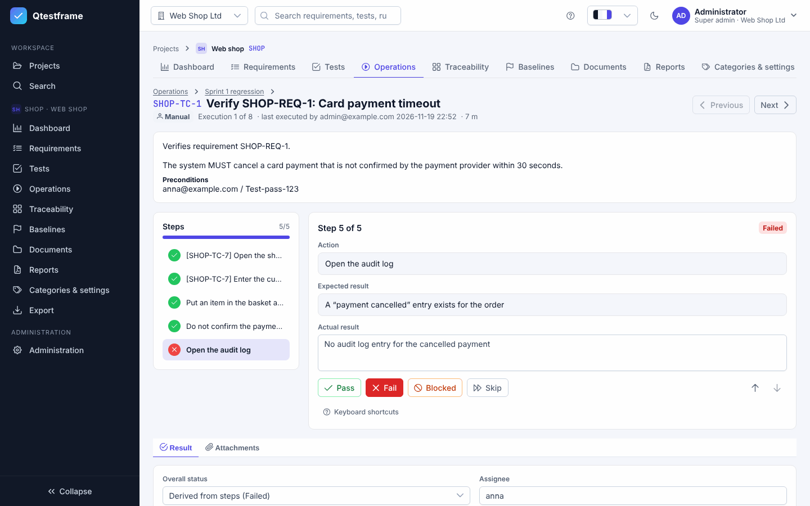
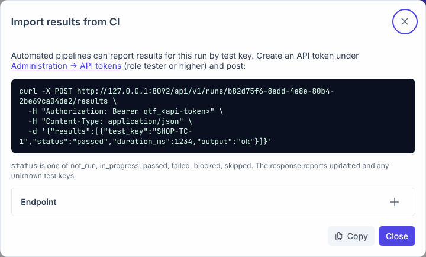

# Test runs and execution

A **run** (test run, campaign) is a set of tests that you execute together, for example *Sprint 12 regression* on the *staging* environment with build *1.4.2*. Each test in a run is an **execution** with its own result. Runs are under **Operations** in the project sidebar.

| Action | Role needed |
|---|---|
| View runs and results | Viewer |
| Create, edit and delete runs, add tests | Tester |
| Record results, import CI results | Tester |
| Run automated scripts on the server | Test lead |
| Change the [test execution settings](administration.md#test-execution-settings) | Test lead |

## The run list

**Operations** lists the runs of the project with their status, environment, build, progress bar and pass rate. Filter with the query language, for example `status:in_progress env:staging`. Select a run to open it.



## Change many runs at once

Tick the runs in the list (or the header checkbox for the whole page). The toolbar that appears changes all of them at once (permission to change runs):

- **Set status**: for example abort old runs, or close runs that are finished in practice.
- **Set release**: put the runs in a [release](releases-and-risks.md), or take them out of one.
- **Environment / build**: set the environment, the build or both (an empty field clears it).
- **Delete**: delete the runs with all their results, after confirmation.

Status, release, environment and build changes can be undone with the undo button in the top bar; deleting cannot.

## Create a run

Select **New run** and fill in:

- **Name**, for example *Sprint 12 regression* (a dated default is suggested);
- **Description**, **Environment** (e.g. *staging*) and **Build** (e.g. *1.4.2+sha*): free text that is shown with the results and passed to automated scripts;
- **Configurations** (when the project has [test configurations](administration.md#test-configurations)): the configurations the run targets, for example *Chrome / Windows* and *Firefox / Linux*. Each test is then executed once per configuration; see [Configurations in a run](#configurations-in-a-run). Without configurations each test is executed once;
- **Tests to include**: the union of three tabs:
  - **Tests**: **Pick tests…** to select individual tests;
  - **Folders**: tests in the selected folders, including subfolders;
  - **Query**: every test matching a filter such as `status:ready category:Negative`; **Preview** counts the matches.

Select **Create run**. A test appears only once in a run even if several tabs select it. Without any tests the run starts empty, and you add tests later.

When a test is added, its current steps (with shared steps expanded) are copied into the execution. Later edits of the test do not change this run.

## The run page



- **Run status**: **Planned**, **In progress**, **Completed** or **Aborted**. The start time is set when the run first becomes *In progress* (also automatically when the first result is recorded); the end time when it becomes *Completed* or *Aborted*. A run becomes **Completed by itself** when every test in it has a final result (passed, failed, blocked or skipped), also a run with a single test. It goes back to *In progress* when a result is taken back to *Not run* or *In progress*, or when tests are added. You can still set the status by hand; an *Aborted* run is never changed automatically.
- **Progress** and **Pass rate** summarise the executions.
- **Execute** opens the runner at the first execution that has not been run yet.
- **Add tests** adds more tests; **CI import** shows how a pipeline reports results; **Edit run** changes name, description, environment and build; **Delete** removes the run with all its results.
- The table lists every execution with test, result, **Assignee**, **Executed by**, **Defects**, **Finished** time and duration. Filter it, for example `status:failed` or `assignee:anna`.
- Per row: **Mark passed** and **Mark failed** record a result directly; the play button opens the execution in the runner.

## Configurations in a run

A run can target one or more [test configurations](administration.md#test-configurations). Adding a test then creates **one execution per test and configuration**: a run with 10 tests and 3 configurations has 30 executions.

- The run list shows the configurations of each run in the **Configurations** column; the filter `configuration:Chrome` (or `config:`) finds runs that target a configuration.
- On the run page, **Results per configuration** shows progress and pass rate of each configuration; select a configuration's name to see only its executions, or use **Show configuration** above the table. The **Configuration** column names the configuration of each execution, and the filter `configuration:"Chrome / Windows"` works in the execution table as well.
- **Edit run → Configurations** changes the configurations later. An added configuration gets an execution for every test of the run. A removed configuration's executions are deleted, which is refused while one of them has a result (set them back to *Not run* first). Adding the first configuration to a run without configurations assigns the existing executions to that configuration; removing the last one keeps its executions as executions without configuration.
- Prerequisites ([dependencies](tests.md#dependencies)) count per configuration: in a run, a prerequisite counts as passed when it passed in the **same configuration**.
- The runner shows the configuration in its header, and the [execution history](tests.md#execution-history) of a test shows the configuration of each execution.

Runs without configurations work exactly as before. How results in several configurations count for requirements is described in [How coverage is calculated](traceability-and-coverage.md#how-coverage-is-calculated).

## Record many results at once

On the run page, tick tests in the execution table (the header checkbox ticks the whole page). The toolbar then offers:

- **Set result**: *Passed*, *Failed*, *Blocked*, *Skipped* or *Not run* for all ticked tests.
- **Result, assignee, note…**: a dialog to set a result, assign the tests to someone (empty removes the assignee) and add a note below the notes they already have, in one step. **Only tests that have not been run yet** leaves tests that already have a result alone, for example to mark the rest *Skipped* at the end of a run.
- **Remove from run** (permission to change runs): takes the tests out of the run, with their results, step results and evidence, after confirmation.

The same [execution settings](administration.md) apply as for one test at a time: *Passed* and *Failed* are only recorded for tests that may be executed. Tests that may not are listed with the reason, and the rest are recorded. Prerequisites in the same selection are handled: when you mark a test and its prerequisite *Passed* together, the prerequisite is recorded first. *Blocked*, *Skipped*, *Not run*, assignees and notes are always possible.

Step results are not changed: a bulk result is the overall result of each test. The run completes by itself when every test has a final result, and requirements whose status follows the evidence are updated. Results, assignees and notes can be undone with the undo button; removing tests cannot.

## The execution runner

The runner shows one execution at a time. Its header tells you which execution of the run this is (*Execution 3 of 12*) and who executed it last.



### Manual tests

1. Read the **Preconditions** at the top.
2. The left column lists the steps with their status; select a step to jump to it.
3. For the current step, carry out the **Action** with the **Test data** and compare with the **Expected result**.
4. Record the outcome with **Pass**, **Fail**, **Blocked** or **Skip**. For anything other than a pass, write what happened in **Actual result**. The runner moves on to the next step.
5. Below the steps:
   - **Overall status** is derived from the steps (*Will be saved as …*): any failed step → **Failed**; otherwise any blocked step → **Blocked**; all passed or skipped with at least one pass → **Passed**; all skipped → **Skipped**; partly done → **In progress**. You can also set it explicitly.
   - **Assignee**: who should execute the test. Type `@` to pick a person ([mentions](requirements.md#mention-people)).
   - **Defects**: defect IDs or URLs, each followed by <kbd>Enter</kbd>.
   - **Notes**: observations, links, anything worth keeping.
6. Select **Save**, or **Save & next** to save and open the next execution. On the last execution the button is **Save & finish**: it saves and returns to the run page, where the run is completed once every test has a result; if some still have none, it says how many and opens the first of them. **Previous** and **Next** move between executions. *Unsaved changes* reminds you to save.

A test without steps shows only the overall result, notes and defects.

### Data-driven tests: iterations

A [data-driven test](tests.md#data-driven-tests) has one **iteration** per row of its test data. The runner lists the iterations above the steps, each with its result; select one to work on it. It shows the values of the iteration's row, and the steps, the preconditions and the expected results with the placeholders replaced by these values.

- With steps, every iteration has its own step results, evidence and actual results. Its result is derived from its steps like the result of a test. Marking the last step of an iteration moves on to the first step of the next one.
- Without steps, mark each iteration **Passed**, **Failed**, **Blocked** or **Skipped** with the buttons below the values (or the keys P, F, B and S).
- Each iteration has its own notes.

The **overall result** of the execution follows the iterations, evaluated top-down: **Failed** if an iteration failed; else **Blocked** if one is blocked; **Passed** when all iterations passed or were skipped (at least one passed); **Skipped** when all were skipped; **Not run** when none has a result; otherwise **In progress**. As for steps, you can choose another overall result by hand. A result set directly on the execution (with **Mark passed** in the run, a bulk result or a CI import) is recorded as the overall result; the iterations keep their results, and the next change of an iteration derives the overall result again.

The run page shows the number of iterations next to the result of a data-driven execution.

### Keyboard shortcuts

The shortcuts work when the focus is not in a text field. Press <kbd>?</kbd> in the runner to show them.

| Key | Action |
|---|---|
| <kbd>P</kbd> | Mark the step as passed |
| <kbd>F</kbd> | Mark the step as failed |
| <kbd>B</kbd> | Mark the step as blocked |
| <kbd>S</kbd> | Skip the step |
| <kbd>J</kbd> or <kbd>↓</kbd> | Next step |
| <kbd>K</kbd> or <kbd>↑</kbd> | Previous step |
| <kbd>?</kbd> | Show or hide the keyboard help |


### Automated tests

For an automated test the runner shows the **Script** and its **Output**. Select **Run script** to execute it on the server: the execution is set to *In progress*, the script runs, and the result is **Passed** for exit code 0 and **Failed** otherwise (or when it exceeds the time limit). The output and duration are stored.

The button needs the **Test lead** or **Manager** role (permission *script.execute*). If the administrator has not enabled the script runner, the server answers that it is disabled; results then come from CI.

### Evidence

Each step of a manual test has an **Evidence** section under *Actual result*: open it to record what proves the result. Write observations, values or links in the text field (for example *response time 120 ms, order 4711*), and add files such as screenshots or log extracts *(Tester)*. Files can be dropped onto the area or picked from the archive, like other [attachments](#attachments-on-runs-and-executions). The step's header shows how much evidence it has.

Evidence is saved with the execution (select **Save**), stays with this run when the test changes later, and appears in the document archive as *Evidence of a test step*, linked to the step. Deleting the run deletes its evidence files.

### When can a test be executed?

Before a test is executed, Qtestframe checks that it is ready: the test has status **Ready**, the requirements it verifies are approved (or implemented or verified), and the tests it [depends on](tests.md#dependencies) have passed. What happens when a check fails is set in the [test execution settings](administration.md#test-execution-settings):

- **blocked** (the default): the runner shows a red box with the reasons and links; **Pass**, **Fail** and **Run script** are disabled, and the server refuses such results. You can still mark the test **Blocked** or **Skipped**;
- **allowed**: the reasons appear as an amber warning, and you can execute the test.

Each reason says exactly what is wrong, what to do about it and which setting decides, for example:

- *SHOP-TC-4 has status Draft; only tests with status Ready can be executed.* — **What to do:** finish the test and have it reviewed and marked Ready (needs *test.review*). *Blocked by the execution setting “Allow executing tests that are not Ready”, which is off.*
- *It verifies SHOP-REQ-2, which has status Approved; the execution settings require linked requirements to be Implemented or Verified.* — **What to do:** move the requirement on when it has been implemented, or ask an administrator to add its status to the ready statuses.
- *It depends on SHOP-TC-1, which is Failed in this run; a prerequisite must have passed first.* — **What to do:** execute SHOP-TC-1 first and make it pass, or add it to the run.

So you can tell whether the test itself, a requirement, a prerequisite or an organisation setting stops it. The run page shows the same in its **Readiness** column (select the entry to see the full explanation), with a summary above the table; the tooltips of the disabled Pass and Fail buttons and any refused result name the reasons too, and the **New run** dialog marks picked tests that are not ready.

## Defects

Record a defect wherever a test fails: in the runner under **Defects** (an ID such as `JIRA-123` or a full URL). Defects are shown on the run page, in the test's **Executions** tab and in reports.

To make IDs clickable, set the **Defect tracker URL template** in **Categories & settings**, for example `https://jira.example.com/browse/{id}`. `{id}` is replaced by the defect ID; without `{id}` the ID is appended. Values that already are URLs are linked directly.

Find defects with queries: `defect:JIRA-*` in the run's filter finds executions with a JIRA defect; in the tests list it finds tests with such a defect in their latest executions.

## Import results from CI

Automated pipelines (GitLab CI, GitHub Actions, Jenkins …) can report results into a run by test key.

1. Create an API token: **Administration → API tokens → New token**, role **Tester** or higher (see [API tokens](administration.md#api-tokens)). Copy the token; it is shown only once and starts with `qtf_`.
2. Open the run and select **CI import**. The dialog shows the endpoint with the run's ID and a ready-made command.



3. Post the results from your pipeline:

```bash
curl -X POST "https://qtf.example.com/api/v1/runs/$RUN_ID/results" \
  -H "Authorization: Bearer $QTF_TOKEN" \
  -H "Content-Type: application/json" \
  -d '{"results":[
        {"test_key":"SHOP-TC-7","status":"passed","duration_ms":1234,"output":"ok"},
        {"test_key":"SHOP-TC-9","status":"failed","duration_ms":877,"output":"expected 35, got 34"}
      ]}'
```

- `status` is one of `passed`, `failed`, `blocked`, `skipped`, `in_progress` or `not_run`.
- Test keys are matched without regard to case within the run's project. Tests that are not in the run yet are added.
- The answer reports how many executions were `updated` and lists `unknown` keys, which were skipped.
- An invalid status stops the import with an error; results before it stay applied.
- **Configurations:** when the run targets [configurations](#configurations-in-a-run), name the configuration of the results with `?configuration=NAME` in the address (`.../results?configuration=Chrome%20%2F%20Windows`) or per result with the field `"configuration": "Chrome / Windows"` (name or ID). A configuration the run does not target yet is added to it. Without a configuration, a run with exactly one configuration uses it and a run without configurations records the results without configuration, as before; a run with several configurations answers with an error.

Keep the token in your CI system's secret store, never in the repository. A token is bound to one organisation and never has more rights than its owner.

Besides this JSON format there are three easier ways for test tools that already write reports: JUnit XML, the `qtestframe report` command and the Playwright reporter.

### Link automated tests to test keys

Every automated test must say which Qtestframe test it executes. Put the test key (for example `SHOP-TC-12`) in one of these places:

- **in the test name**, e.g. `test_login[SHOP-TC-12]`, `TestCart/SHOP-TC-12_add` or `SHOP-TC-12 pays by card`. Where a name may not contain hyphens, `SHOP_TC_12` works as well. The key may also be part of the class name.
- **as a property of the test case** in the JUnit report, named `qtestframe.key` or `test_key`. With pytest: `record_property("test_key", "SHOP-TC-12")`.
- **with Playwright** as a tag `@SHOP-TC-12` or an annotation `{ type: 'qtestframe', description: 'SHOP-TC-12' }`.

Several test cases with the same key (for example the same test in two browsers) give one result: *failed* wins over *passed*, and the durations add up.

### JUnit XML

Almost every test tool writes JUnit XML: Playwright (`junit` reporter), pytest (`--junitxml`), Go (with go-junit-report), Maven Surefire and Gradle, Jest (jest-junit) and Vitest (`--reporter=junit`). Post the file to the run:

```bash
curl -X POST "https://qtf.example.com/api/v1/runs/$RUN_ID/junit" \
  -H "Authorization: Bearer $QTF_TOKEN" \
  -H "Content-Type: application/xml" \
  --data-binary @results/junit.xml
```

- A test case with `<failure>` or `<error>` is recorded as *failed*, one with `<skipped>` as *skipped*, all others as *passed*. The duration comes from `time`; the output holds the failure message and `system-out`/`system-err`.
- The answer lists, besides `updated`, `unknown` and `rejected`, the names of test cases without a key under `unmapped`.
- Add `?create_missing=true` to create a draft automated test for every test case without a key (titled like the test case) and record its result. A later import finds the test again by its title. This needs the right to write tests.
- Several files can be sent at once as a multipart upload (`-F file=@a.xml -F file=@b.xml`); together they may be at most 20 MB.
- `?configuration=NAME` records the results in that configuration, as for the JSON format.

### The qtestframe report command

The `qtestframe` program can upload reports itself. It finds the run by name in the project, or creates it:

```bash
export QTF_URL=https://qtf.example.com QTF_TOKEN=qtf_…
qtestframe report --project SHOP --run "Nightly $BUILD_NUMBER" --create-run \
  --build "$BUILD_NUMBER" --environment staging \
  --junit 'results/*.xml'
```

- `--run-id ID` reports into a known run instead of `--project`/`--run`.
- `--junit` and `--json` (the JSON format above) take files or patterns and can be repeated.
- `--create-missing` creates tests for test cases without a key, as above.
- `--configuration NAME` (or `QTF_CONFIGURATION`) records the results in that configuration; the run gets the configuration if it does not target it yet. Run the command once per configuration, e.g. once per browser.
- The command prints how many results were recorded and lists unknown keys, test cases without a key and rejected results with the reason. It ends with an error code when the upload fails, and with `--fail-on-unknown` also when results matched no test.

### Playwright reporter

For Playwright there is a reporter (`@qtestframe/playwright-reporter`, in `integrations/playwright-reporter` of the Qtestframe sources) that reports while the tests run, without a JUnit file:

```ts
// playwright.config.ts
reporter: [
  ['list'],
  ['@qtestframe/playwright-reporter', { project: 'SHOP', run: 'Nightly', createRun: true }],
],
```

It reads the server address and token from `QTF_URL` and `QTF_TOKEN`; the option `configuration` (or `QTF_CONFIGURATION`) names the [configuration](#configurations-in-a-run) of the results. It takes the key from the annotation, tag or title, writes the error and the `test.step()` titles with their result into the output and uploads screenshots, traces and other attachments of failed tests as attachments of the execution. If reporting fails, it only logs a message; your test run is not affected.

## Links of a run

The **Links** tab of the run page links the run to requirements, tests, other runs, archive files, reports and web addresses, for example the CI build or the release notes, see [Links](requirements.md#links-to-other-items).

## Attachments on runs and executions

Runs and executions have **Attachments** too: log files, screenshots of a failure, test reports from other tools. In the runner, open the **Attachments** tab next to **Result** and drag files onto it or select **Choose files**; on the run page, attachments belong to the run as a whole. You can also attach a file from the project's [document archive](documents.md). Uploading and removing attachments on runs and executions needs **Tester** (the right to record results).
