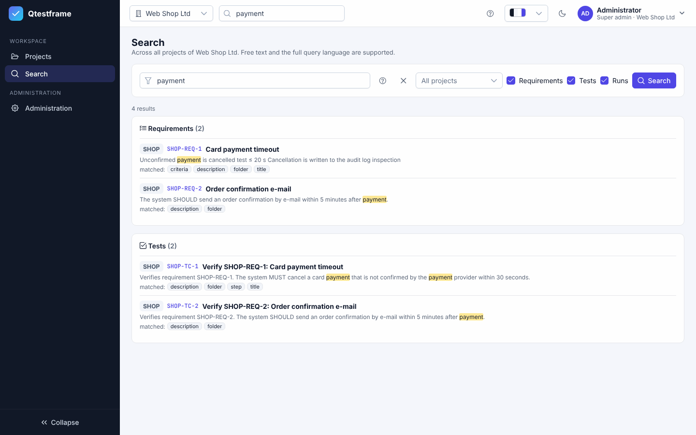
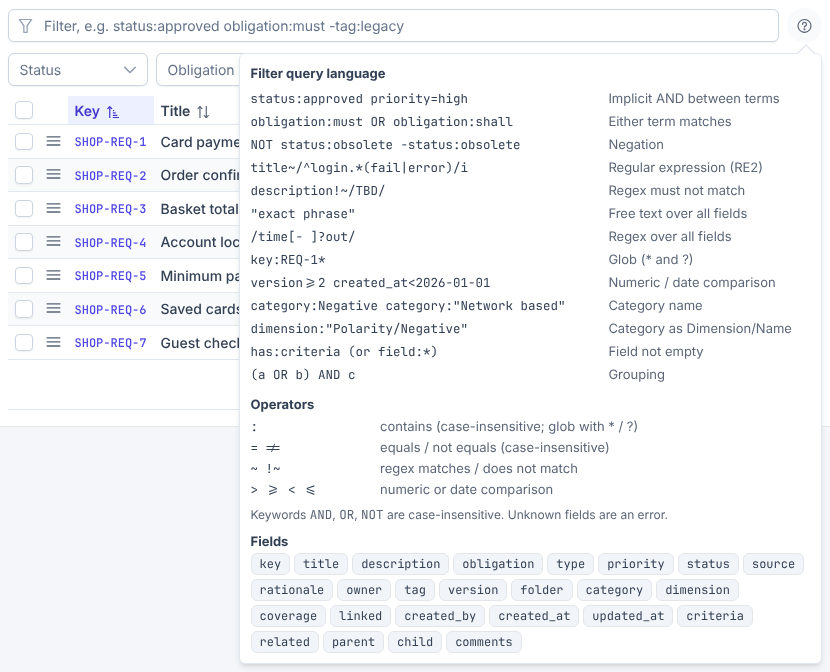

# Search and filters

Every list in Qtestframe can be filtered with the same **query language**: requirements, tests, runs, executions, the traceability matrix, the audit log and the document archive. The same language drives the **global search** in the top bar, the query tab when you create a run, baseline filters, export filters and reports.

## Global search

Type into the search field in the top bar and press <kbd>Enter</kbd> (on phones, select the magnifier first). The **Search** page lists matching requirements, tests and runs of **all projects of the current organisation**, with the matched text highlighted and the fields that matched.



- **Search in** limits the result to requirements, tests or runs.
- **Project** limits it to one project.
- Besides the item fields you can use `project:` (key or name) and `kind:` (`requirement`, `test`, `run`), for example `kind=requirement project:SHOP coverage:none`.

## Filters in lists

The filter field above a table takes a query. Press <kbd>Enter</kbd> to apply it. If the query has an error, the field is marked and the message tells you where the problem is. The **?** button (**Query help**) next to the field lists the operators and all fields of that list.



Quick filters (status, priority and so on) are turned into a query for you and shown under the filter bar as `q = …`. Copy it if you want to reuse or extend it.

## Tag cloud

**Tags** in the project sidebar shows every tag of the project's requirements, tests and documents; the more often a tag is used, the larger it is. Hover over a tag to see how many items of each kind carry it. Filter the cloud by name and sort it **By use** or **A–Z**.

Select one or more tags to list the items that carry them, grouped into requirements, tests and documents. With several tags, choose whether items need **All tags** or **Any tag**. **Open as filtered list** opens the requirements or tests page with the same query (for example `tag=gdpr AND tag=login`), and the address of the page keeps the selection, so you can bookmark it.

With permission to edit both requirements and tests, the selected tags can also be changed in the whole project: **Rename** (one tag), **Merge** (several tags into one, which can be one of them or a new name, for example to clean up *gdpr*, *GDPR* and *privacy*) or **Remove from all items**. Documents are changed too if you may change the project. Each change is recorded in the history of the requirements and tests it touches.

## Syntax in five minutes

| You write | It finds |
|---|---|
| `login` | *login* anywhere in any field (case does not matter) |
| `"session timeout"` | the exact phrase anywhere |
| `status:approved` | items whose status contains *approved* |
| `priority=high` | priority exactly *high* |
| `status:approved priority=high` | both: terms next to each other are combined with AND |
| `obligation=must OR obligation=shall` | either one |
| `NOT status:obsolete` or `-status:obsolete` | everything except obsolete items |
| `(tag:smoke OR tag:regression) -status:deprecated` | grouping with parentheses |
| `title~/^login.*(fail\|error)/i` | a regular expression; `/i` ignores case |
| `description!~/TBD/` | the description does not match |
| `key:*-REQ-1?` | glob: `*` any characters, `?` one character, matched against the whole value |
| `version>=2` | numeric comparison |
| `updated_at>=2026-01-01` | date comparison |
| `has:criteria` or `criteria:*` | the field is not empty |

### Operators

| Operator | Meaning |
|---|---|
| `field:value` | contains (case-insensitive); with `*` or `?` a glob over the whole value |
| `field=value` | equals (case-insensitive); `field=""` matches empty fields |
| `field!=value` | equals none of the values |
| `field~/regex/` | regular expression matches (RE2 syntax, case-sensitive unless `/i`) |
| `field!~/regex/` | regular expression matches no value |
| `field>v`, `>=`, `<`, `<=` | compares numbers numerically, everything else (such as dates) as text |
| `/regex/` | regular expression over all fields |
| `AND`, `OR`, `NOT` (also `&&`, `\|\|`, `!`, `-`) | logic; NOT binds tighter than AND, AND tighter than OR |

Keywords and field names are case-insensitive. Values with spaces need quotes: `category:"Network based"`. Inside quotes, write `\"` for a quote. An empty query matches everything.

**Fields with several values** (tags, categories, criteria, steps, linked items): a positive condition holds if **any** value matches; a negative one (`!=`, `!~`) only if **no** value matches.

## Fields

### Requirements

`id`, `key`, `title`, `description` (`desc`), `obligation`, `type`, `priority`, `status`, `source`, `rationale`, `owner`, `tag` (`tags`), `version`, `folder` (the folder path, e.g. `Checkout / Payment`), `category` (`categories`, value names), `dimension` (`Dimension/Name`), `coverage`, `linked` (keys of linked tests), `related`, `parent`, `child` (keys of related, parent and child requirements), `comments`, `open_discussions` (`open-discussion`: unresolved threads, `has:open-discussion`), `mention` (`mentions`: [@handles](requirements.md#mention-people) in owner, title, description, rationale and source, and the people mentioned in its discussion; `mentions:me` for yourself), `created_by`, `created_at`, `updated_at`, `criteria` (`criterion`: description, method and threshold), `risk` (the highest level of the open [risks](releases-and-risks.md#risk-levels) it addresses: `risk:high`), `defects` (number of open defects on it or its tests: `defects>0`), `catalog` (the [catalogue](catalogue.md) entry it was copied from: `catalog:AUTH-01`, `has:catalog`), `verification` (`verified`: the [verification](traceability-and-coverage.md#verification) state, `verification:failed`), `element` (`elements`: a [system element](traceability-and-coverage.md#system-elements) it is allocated to, or one above it: `element:"Power unit"`), `variant` (`variants`: the [variants](variants-and-code.md) it applies to: `variant:"EU model"`), `applicability` (`all` or `selected`).

### Tests

`id`, `key`, `title`, `description` (`desc`), `preconditions`, `execution_type` (`type`), `script_language` (`language`), `script`, `expected`, `step` (`steps`: action, expected result and data of all steps), `priority`, `status`, `estimate`, `owner`, `tag` (`tags`), `folder`, `category`, `dimension`, `linked` (keys of linked requirements), `last_result` (`result`), `defect` (`defects`), `calls` (keys of called tests), `depends_on` (`depends`: keys of prerequisite tests), `comments`, `open_discussions` (`open-discussion`: unresolved threads, `has:open-discussion`), `mention` (@handles in the texts and steps, and the people mentioned in its discussion; `mentions:me` for yourself), `version`, `created_by`, `created_at`, `updated_at`, `flaky` (`true` for [flaky tests](tests.md#flaky-tests): `flaky:true`), `flakiness` (`flips`: the number of pass/fail flips among the last results: `flakiness>=3`), `catalog` (the catalogue entry it was copied from), `variant` (`variants`: the variants it applies to), `applicability` (`all` or `selected`).

### Owners and assignees

`owner:me` finds the requirements, tests and risks you own, `assignee:me` the defects and executions assigned to you, `review_owner:me` the risks whose review you own — however you are named in the field, and only you (not every name containing *me*). `owner:anna@example.com` finds the items of one member; `-owner:me` or `owner!=me` the others.

### Runs and executions

Runs: `id`, `name`, `description`, `status`, `environment` (`env`), `build`, `created_by`, `created_at`.
Executions (the filter on a run page): `id`, `key`, `title`, `status`, `assignee`, `executed_by`, `notes`, `output`, `defect`, `mention` (@handles in assignee and notes).

### Custom fields and sorting

Every [custom field](requirements.md#custom-fields) of the project is a field `cf.<key>` of its list (requirements, tests, runs, defects and risks): `cf.supplier:"Acme"`, `cf.mass>2` (numbers compare as numbers), `cf.due<2026-07-01`, `cf.coating=zinc` (one of the chosen options), `cf.reviewed=true` (a checkbox) and `has:cf.supplier`. A key the project does not have matches nothing.

`sort:<field>` sorts the result, `sort:-<field>` (or `sort:<field>:desc`) in descending order, for example `status:draft sort:-cf.mass sort:title`. Items without a value come last. A sort term cannot be negated or used inside `OR`.

### Other lists

- **Audit log:** `action`, `entity`, `entity_id`, `user`, `details`, `created_at`.
- **Document archive:** `name`, `description`, `tag`, `kind`, `type` (content type), `uploaded_by`, `created_at`, `size`, `linked` (keys of linked items).

Using a field that does not exist in a list is an error, so `coverage:none` works in requirements but not in tests.

## Examples

**Requirements**

```text
obligation=must status!=approved               MUST requirements not yet approved
coverage:none category:Security                security requirements without any test
coverage:failed priority=critical              critical requirements whose tests fail
has:criteria coverage:none                     criteria written, but no test linked
-has:criteria status:approved                  approved, but no evaluation criteria
description~/\b(fast|easy|TBD)\b/i             weak wording, as the language analysis sees it
folder:"Checkout / Payment"                    a folder and its subfolders (path contains)
child:*                                        requirements that have been decomposed
parent:SHOP-REQ-4                              children of SHOP-REQ-4
linked:SHOP-TC-3                               requirements verified by SHOP-TC-3
version>=3 updated_at>=2026-06-01              changed often and recently
owner:anna OR owner:ben                        owned by Anna or Ben
dimension:Area/UI                              requirements in category Area / UI
tag:gdpr -status:obsolete                      current GDPR requirements
```

**Tests**

```text
type=automated last_result:failed              failed automated tests
status:ready category:Negative                 ready negative tests
dimension:Level/System execution_type=manual   manual system tests
-linked:*                                      tests not linked to any requirement
step~/password/i                               tests with a step about passwords
defect:JIRA-*                                  tests with a JIRA defect in their latest executions
estimate>30                                    tests estimated at more than 30 minutes
language=python                                Python scripts
```

**Runs and executions**

```text
status:in_progress env:staging                 runs in progress on staging
build:1.4.*                                    all 1.4 builds
created_at>=2026-09-01                         runs since September
status:failed                                  (on a run page) failed executions
assignee:anna -status:passed                   Anna's executions that have not passed
output~/timeout/i                              automated executions whose output mentions a timeout
```

**Global search**

```text
"order confirmation"                           the phrase in any project
kind=test project:SHOP payment                 tests of project SHOP about payment
kind=requirement coverage:none                 uncovered requirements in all projects
```

## Why is my query invalid?

The most common reasons:

- **Unknown field**: the field does not exist in this list (for example `coverage` in tests). Open **Query help** to see the fields.
- **Unclosed quote, parenthesis or regex**: `title:"login`, `(a OR b`, `title~/abc`.
- **A space after the operator**: write `status:approved`, not `status: approved`.
- **Invalid regular expression**: the regex uses RE2 syntax, which has no look-ahead (`(?=…)`) or back-references.
- **Limits**: at most 4096 characters, 64 regular expressions or globs, and 128 levels of nesting.

A `-` only negates when it is directly followed by the term: `-status:obsolete`, not `- status:obsolete`.
