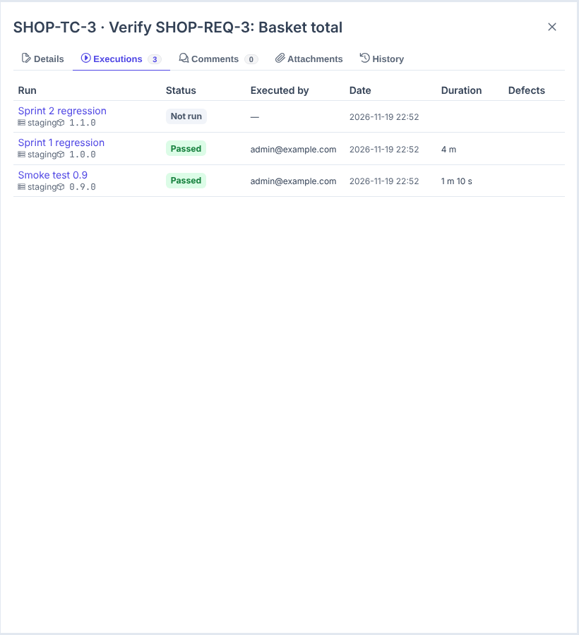

# Tests

The **Tests** section holds the test cases of a project. A test is either **manual**, executed step by step by a person, or **automated**, a script that the server runs. Tests are organised in folders, classified with categories, linked to the requirements they verify and reused in many runs.

Reading tests needs **Viewer**; creating, editing, linking and copying tests needs **Tester**.

The page works like the [requirements page](requirements.md#the-requirements-page): folder tree, filter bar with quick filters (**Status**, **Execution**, **Priority**, **Last result**, **Category**), selectable columns (including execution type, last result, linked requirements, language, steps, tags, **relations** — *verifies*, *calls* and *called by* — defects, created by and dates) and a table. Bulk edit, moving and deleting work the same way; the bulk toolbar has **Set execution** instead of *Set obligation*.


## Fields

| Field | Use |
|---|---|
| **Title** | A short name (required). |
| **Execution type** | **Manual** or **Automated**. |
| **Description** | What the test is about. |
| **Preconditions** | What must be true before the test starts, for example *a customer account exists*. Shown to the tester in the runner. |
| **Status** | Draft, Ready, Review or Deprecated. |
| **Priority** | Critical, High, Medium or Low. |
| **Estimate (minutes)** | Expected duration. |
| **Owner** | The project member responsible for the test. Type `@` to pick a person; the test then appears in their [work list](reviews-and-notifications.md#my-work) while it is in draft or review, or when it becomes suspect or its results stale. |
| **Folder**, **Categories**, **Tags** | Filing and classification. **Suggested tags** under the tags field come from the title, description, preconditions and steps, as for [requirements](requirements.md#fields). |
| **Overall expected result** | The expected outcome of the test as a whole. |

## Manual tests: steps

Each step has an **Action** (what to do), an **Expected result** (what should happen) and optional **Data** (input values, accounts, files).


- **Add step** appends a step; the **+** on a row inserts one below it.
- The arrows move a step up or down; the bin removes it.
- When you save, the step list replaces the old one. Saving the same steps again is not counted as a change.

When a test is added to a run, its steps are copied into the run. Editing the test afterwards does not change existing runs, only new ones.

## Automated tests: scripts

Switch **Execution type** to **Automated** to show the **Script** field. Choose the **Script language**: **sh**, **Bash**, **Python**, **JavaScript** (Node.js) or **Web test (Playwright)** (see [Web tests](#web-tests-playwright)).


- The script runs on the server in a sandbox when someone selects **Run script** in the execution runner.
- Exit code **0** means **Passed**; any other exit code, or exceeding the time limit, means **Failed**.
- Standard output and errors are stored as the execution's **Output**, together with the duration.
- The script can read these environment variables: `QTF_TEST_KEY`, `QTF_RUN_ID`, `QTF_RUN_NAME`, `QTF_ENVIRONMENT`, `QTF_BUILD` and `QTF_BASE_URL`, so one script can test the environment and build named in the run. The project's [test variables](administration.md#web-tests) arrive as `QTF_VAR_<NAME>`, for example `QTF_VAR_USERNAME`; the values of secret variables are masked as `***` in the stored output.

Running scripts needs the **Manager** role and must be enabled by the administrator (`runner.enabled`). If your scripts run elsewhere, for example in a CI pipeline, leave the script empty and [import the results](runs.md#import-results-from-ci) instead. Steps are optional for automated tests.

## Web tests (Playwright)

A **web test** drives a real browser with [Playwright](https://playwright.dev): choose the script language **Web test (Playwright)**. The editor offers a **starter template**; select **Insert starter template** when the script is empty.

Write the script in one of two ways:

- **The body of one test** (the usual case). Qtestframe wraps it into a Playwright test named after the test case, with `page`, `context`, `request` and `baseURL` at hand and `test` and `expect` imported:

  ```js
  await page.goto('/login');
  await expect(page.getByRole('heading', { level: 1 })).toHaveText('Sign in');
  await page.getByLabel('E-mail').fill(process.env.QTF_VAR_USERNAME);
  ```

- **A complete spec file**: when the script calls `test(` itself (for example `test('…', async ({ page }) => { … })` or `test.describe(…)`), it is used as it is. Import `test` and `expect` from `@playwright/test` yourself. Every test of the file must pass for the execution to pass.

Paths such as `page.goto('/login')` are relative to the **base URL** of the project (an administrator sets it under **Settings → Web tests**, also one per run environment). A [test configuration](administration.md#test-configurations) with a **Browser** dimension picks the browser: *Chrome*, *Chromium* or *Edge* run in Chromium, *Firefox* in Firefox, *Safari* or *WebKit* in WebKit; a **Base URL** dimension overrides the base URL.

**Record a script instead of typing it**: on a computer with Node.js, run `npx playwright codegen https://your-app.example.com`, click through the scenario in the browser that opens, and copy the lines inside the generated `test(…)` into the script (or paste the whole file).

Web tests run on the server in the background when someone selects **Run script** or [Run automated tests](runs.md#run-all-automated-tests); the result, the output, screenshots and a trace are stored with the execution (see [Web tests and their evidence](runs.md#web-tests-and-their-evidence)). The server must have Playwright installed and web tests enabled (see [Web tests](administration.md#web-tests)).

## Shared steps

A step can **call** another test of the same project instead of having its own action. Use it for sequences that many tests share, such as signing in.

1. In the steps of a test, select **Insert call to test…**.
2. Choose the test to call and select **Insert call**. The step shows **Calls** with the called test's key.
3. Move the call step to the right position and save.

When a run is created, the call is replaced by the called test's steps (marked `[KEY]`). Calls can be nested up to five levels. A test cannot call itself, and calls may not form a cycle. The called test shows **Used by:** with all tests that call it. If you delete a called test, the call becomes an empty step.

## Data-driven tests

A data-driven (parameterised) test is written once and executed with several sets of data, for example the same login with a customer, a business and an administrator account.

1. In the test editor, open the **Test data** section below the steps and select **Add parameter**. Name the parameter, for example `username` (letters, digits, `_`, `.` and `-`, not starting with a digit; at most 50 parameters).
2. Select **Add row** for every set of data and fill in the values. A row can have a name (*Customer*); without one it is called *Row 1*, *Row 2* … The arrows move rows, the bin removes one (at most 500 rows).
3. Use the parameters in the steps, the preconditions, the description and the expected results as `{{username}}` (spaces inside the braces are allowed: `{{ username }}`).

**Paste table** takes cells copied from Excel, LibreOffice or Google Sheets (or comma- or semicolon-separated text). Tick whether the first line names the parameters and whether the first column holds the row names, and whether the pasted rows replace the test data or are added to it. **Copy table** copies the test data as a table you can paste into a spreadsheet. A placeholder that is not a parameter is left as it is; the editor warns about such placeholders, as they are usually typos.

When the test is added to a run, every row becomes an **iteration** of the execution with its own copy of the steps, with the placeholders replaced by the row's values. Changing the test data afterwards does not change existing runs, only new ones. A test without rows is executed once, as before. See [Data-driven tests: iterations](runs.md#data-driven-tests-iterations) for how iterations are executed and how the overall result is derived.

**Shared steps and parameters:** steps called from another test ([shared steps](#shared-steps)) are resolved with the parameters of the **calling** test, so a shared *Sign in as {{username}}* works with each row of every test that calls it. The test data of the called test is not used when it is called; it applies only when that test itself is executed. Placeholders the calling test does not define stay unchanged.

The test data is part of the test's version history and of the export (**Export → Test data**: one line per row and parameter).

## Categories

Categories classify tests and requirements along **dimensions**. New projects get these defaults:

| Scope | Dimension | Values |
|---|---|---|
| Tests | Polarity | Positive, Negative |
| Tests | Interface | External, Internal |
| Tests | Medium | File based, Network based |
| Tests | Execution | Manual, Automated |
| Tests | Level | Unit, Integration, System, Acceptance |
| Requirements | Area | Core, UI, Security, Operations |

An item can have any number of category values, also several of the same dimension. Manage them in **Categories & settings**:


- **New dimension** creates a dimension with its first value; **Add value** adds values to it.
- Select a colour swatch to recolour a value; it is shown in that colour everywhere.
- **Rename dimension** moves all values to a new dimension name. If the target dimension already has a value with the same name, the two are merged.
- Deleting a value removes it from all items.
- Tick values (across dimensions of one tab) to change several at once: **Move to dimension** (an existing one or a new name; a value with the same name there absorbs the moved one), **Colour**, **Merge** (choose the value to keep; items with the others get it and the others are deleted, for example to clean up duplicates such as *UI* and *User interface*), **Copy to tests** / **Copy to requirements** (values that already exist there are skipped) and **Delete**. Each change is all or nothing; colour changes can be undone.

In queries, `category:Negative` matches the value name and `dimension:Polarity/Negative` the full form.

The same page holds the project's **Name**, **Description**, the **Defect tracker URL template** (see [Defects](runs.md#defects)), the [Save and load](reports-and-export.md#save-and-load-projects) section (**Save project**, **Duplicate project**, **Load project**) and, for admins, **Delete project**. Editing categories needs **Manager** (or the write permission of their scope, Tester for test categories).

## Mark many tests ready at once

Holders of `test.review` can mark many tests *Ready* in one step: tick the tests and choose **Mark ready…**, or choose **Bulk review** above the list with nothing ticked. As for requirements (see [Approve many requirements at once](requirements.md#approve-many-requirements-at-once)), you choose the tests (selected, shown in the list, or all), the statuses they may come from (by default *Review*; add *Draft* to include drafts) and an optional comment, and a preview shows what changes.

Besides the checks for requirements (the latest review asked for changes, open review requests, suspect links), a test is skipped when it cannot be run as written: a **manual test without steps** or an **automated test without a script**. Choose the check under **Include anyway, despite** to mark them ready anyway.

## Spreadsheet view

Choose **Spreadsheet** to edit tests like in a spreadsheet; it works as for [requirements](requirements.md#spreadsheet-view) (keyboard, copy and paste from Excel, fill down, new rows, saving, conflicts, undo and **Export view**). The columns are **Key**, **Title**, **Description**, **Priority**, **Status**, **Execution**, **Preconditions**, **Expected result**, **Estimate (min)**, **Categories**, **Tags**, **Folder** and the read-only **Steps** (the number of steps), **Last result**, **Requirements**, **Created by** and **Version**. Steps, scripts and test data are edited in the editor (double-click the key or press **Ctrl+Enter**). Setting a test to *Ready* is a review decision and needs `test.review`, in the sheet as in the editor.

## Copy a test

**Copy** in the editor creates a duplicate titled *Copy of …* with a new key in the same folder, including steps, categories and tags. The copy starts as **Draft**, so it is reviewed again. Links to requirements are not copied.

A test becomes **Ready** through a review: setting that status needs the permission *test.review* (Reviewer, Test lead or Manager); reviewers see a **Mark ready** button at the top of the editor.

## Linked requirements

The **Linked requirements** section shows which requirements the test verifies. **Link requirements** adds links; **×** removes one. Tests without any link do not contribute to coverage.

## Dependencies

A test can **depend on** other tests: they are its prerequisites and must have passed before it may be started. For example, *Change the delivery address* depends on *Sign in*.

In the test editor, the section **Depends on** lists the prerequisites with their latest result. Select **Add prerequisite** to pick tests of the same project, and **×** to remove one *(Tester)*. **Required by** lists the tests that wait for this one. A test cannot depend on itself, and dependencies may not form a cycle.

When the test is executed, each prerequisite counts as passed when its execution in the same run has passed; when the prerequisite is not part of the run, its latest result counts. Until then the runner shows why the test cannot start, unless the [test execution settings](administration.md#test-execution-settings) allow it. The **Relations** column of the test list shows *depends on* and *required by*, the [dependency graph](traceability-and-coverage.md#dependency-graphs) draws them, and the filter `depends_on:SHOP-TC-1` (or `depends:`) finds the tests that depend on SHOP-TC-1.

## Test flow

**Test flow** in the project navigation (or **Flow diagram** at the bottom of the test editor) draws a test as a flowchart:

- **Start**, then a check **Prerequisites passed?** when the test has [dependencies](#dependencies) (no → *Blocked*), then the **Preconditions**;
- every step as a box with its number, action and test data; a step with an expected result is followed by a decision **As expected?** whose *no* branch ends in **Failed**;
- a [shared step](#shared-steps) as a box with double side bars (*Runs the steps of TC-…*). Select it, or its button under **Shared steps**, to show the called test's steps in place, numbered 3.1, 3.2 …, inside a dashed frame; **Expand all** and **Collapse all** do it for every call. A test that calls itself is marked and not expanded;
- an automated test as **Run the script** followed by **Exit code 0?**;
- the overall **Expected result** as a last check, and **Passed** at the end.

**List** shows the same flow as a numbered text list, with the *otherwise* outcome of each check. Use the zoom buttons for large tests.

**Run order** shows a test run in **stages**: a test is placed after all tests of the run it depends on, so stage 1 holds the tests without prerequisites in the run. Tests of one stage can be executed in any order or in parallel. Each card shows the latest result in the run, which tests it waits for and links to the runner and to its flow diagram. Prerequisites that are not part of the run are listed as warnings.

## Execution history

The **Executions** tab lists every execution of the test in all runs, newest first, with the run, its environment and build, the result, who executed it, when, the duration and any defects. Use it to see whether a test is flaky or when it started to fail.



In runs with [configurations](runs.md#configurations-in-a-run) the configuration of each execution is shown below the run, and a data-driven execution links to its iterations in the runner.

The table column **Last result** shows the most recent result (in any configuration). In queries, `last_result:failed` finds tests whose latest result failed, and `defect:SHOP-*` tests with such a defect.

A result marked **Flip** differs from the previous passed or failed result of the test: there the test started to fail, or passed again.

## Flaky tests

A test is *flaky* when its result changes back and forth between passed and failed without the test or the product being changed in between. Qtestframe looks at the last 10 passed or failed results of every test, from all runs — manual results as well as automated ones from JUnit imports, the `qtestframe report` uploader and the Playwright reporter. Blocked, skipped and not run results are left out, since they say nothing about the test itself.

The *flakiness* of a test is the number of flips among those results: a passed result after a failed one, or the reverse. A test with **2 or more flips** counts as flaky. A test that broke once and was fixed has at most two flips spread over a long time; a test that alternates reaches the threshold quickly.

- In the tests list, flaky tests have a **Flaky** badge next to the last result (point at it to see the number of flips).
- The query `flaky:true` lists the flaky tests; `flakiness>=3` (or `flips>=3`) those with at least three flips.
- The **Quality** tab of the [dashboard](traceability-and-coverage.md#the-dashboard) shows the ten flakiest tests with their latest results.
- The **Executions** tab of a test marks every flip.

A flaky test hides real failures and wastes time on reruns: find the cause (timing, test data, order, the environment) or put the test aside until it is fixed.

## Comments and history

The **Discussion** tab and **History** work exactly as for [requirements](requirements.md#discussion) (see [Discussions](discussions.md)). Restoring a test version restores its fields and steps as a new version; steps get new IDs and calls to deleted tests are dropped. If someone else saves a test while you edit it, you can compare and choose instead of overwriting their changes, see [When someone else saved first](requirements.md#when-someone-else-saved-first).

## Links

The **Links** tab of a test links it to other tests, requirements, runs, documents and saved reports of the archive, report definitions and web addresses, see [Links](requirements.md#links-to-other-items).

## Attachments

The **Attachments** tab holds files for the test: test data, expected screenshots, configuration files. Upload by drag and drop or file selection, or use **Attach from archive**. Uploading and removing needs **Tester**. See [Requirements → Attachments](requirements.md#attachments) for details.
