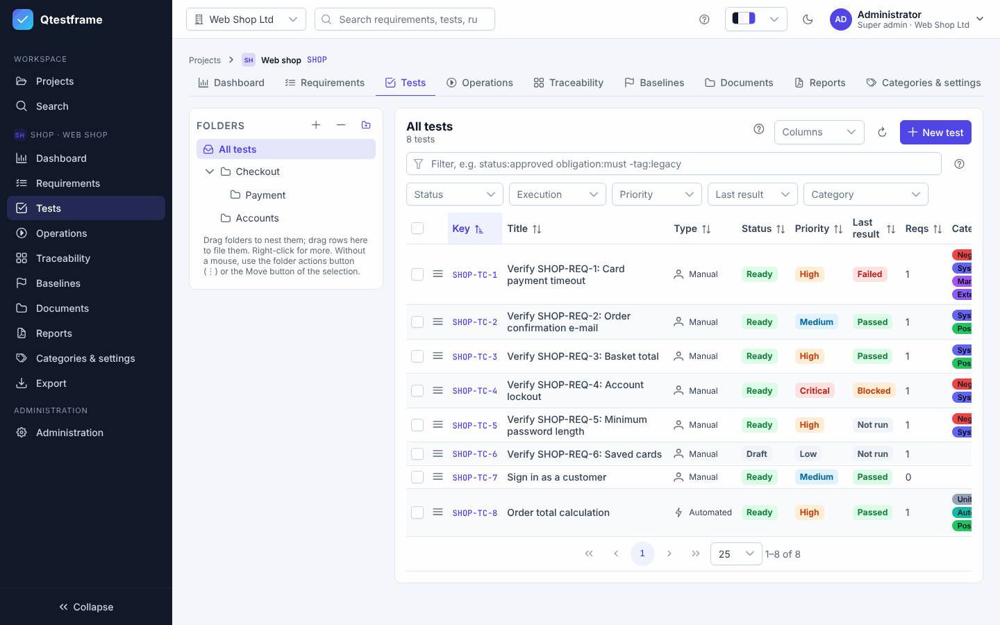
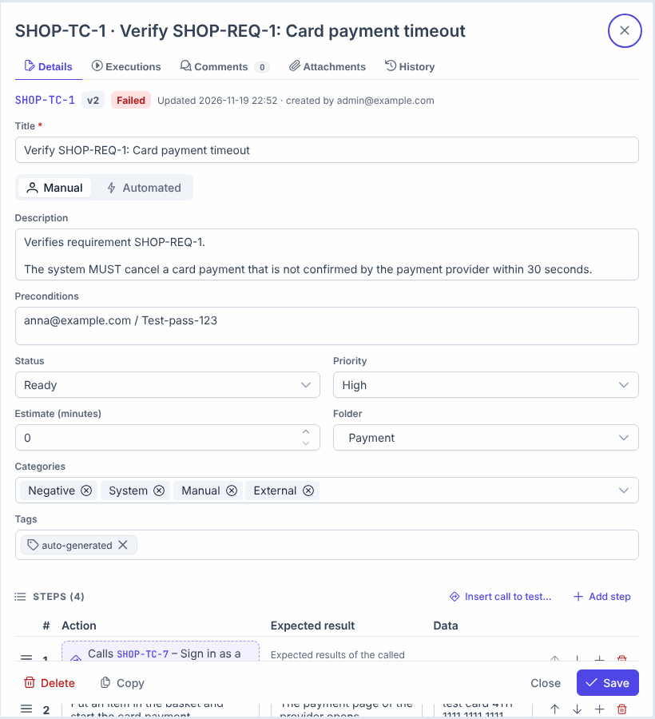
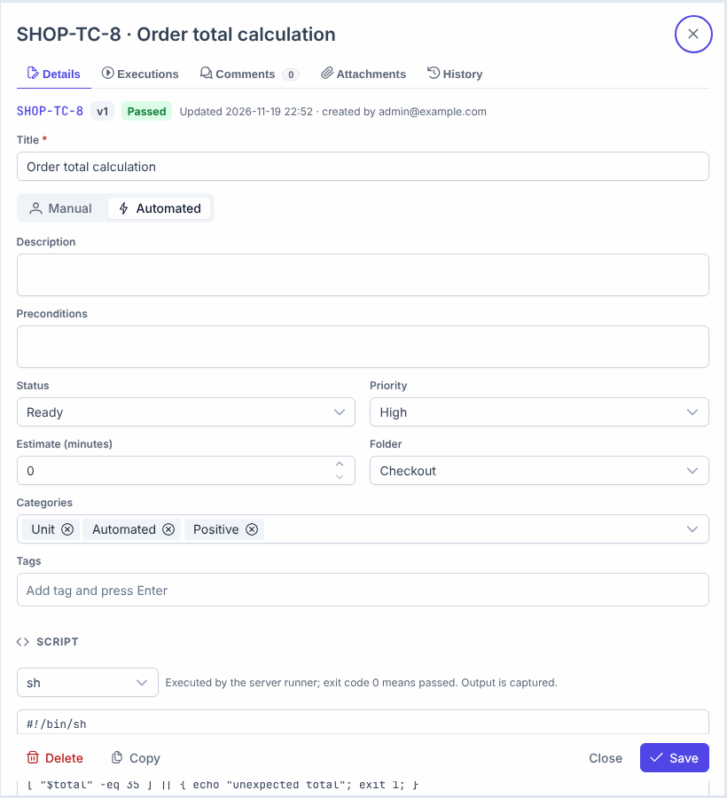
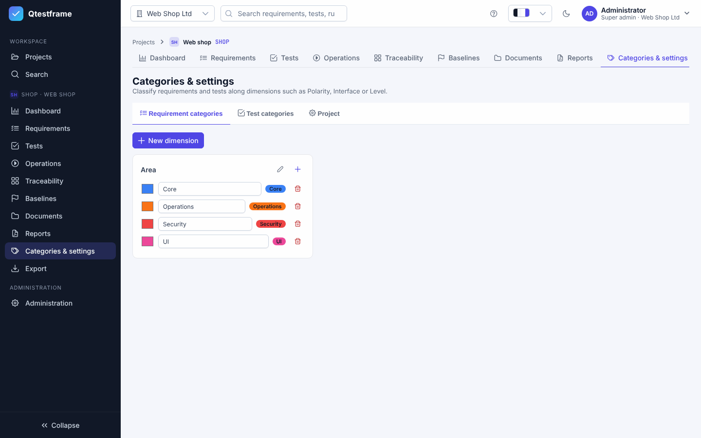

# Tests

The **Tests** section holds the test cases of a project. A test is either **manual**, executed step by step by a person, or **automated**, a script that the server runs. Tests are organised in folders, classified with categories, linked to the requirements they verify and reused in many runs.

Reading tests needs **Viewer**; creating, editing, linking and copying tests needs **Tester**.

The page works like the [requirements page](requirements.md#the-requirements-page): folder tree, filter bar with quick filters (**Status**, **Execution**, **Priority**, **Last result**, **Category**), selectable columns and a table. Bulk edit, moving and deleting work the same way; the bulk toolbar has **Set execution** instead of *Set obligation*.

## Fields

| Field | Use |
|---|---|
| **Title** | A short name (required). |
| **Execution type** | **Manual** or **Automated**. |
| **Description** | What the test is about. |
| **Preconditions** | What must be true before the test starts, for example *a customer account exists*. Shown to the tester in the runner. |
| **Status** | Draft, Ready, Review or Deprecated. |
| **Priority** | Critical, High, Medium or Low. |
| **Estimate (minutes)** | Expected duration. |
| **Folder**, **Categories**, **Tags** | Filing and classification. |
| **Overall expected result** | The expected outcome of the test as a whole. |

## Manual tests: steps

Each step has an **Action** (what to do), an **Expected result** (what should happen) and optional **Data** (input values, accounts, files).

- **Add step** appends a step; the **+** on a row inserts one below it.
- The arrows move a step up or down; the bin removes it.
- When you save, the step list replaces the old one. Saving the same steps again is not counted as a change.

When a test is added to a run, its steps are copied into the run. Editing the test afterwards does not change existing runs, only new ones.

## Automated tests: scripts

Switch **Execution type** to **Automated** to show the **Script** field. Choose the **Script language**: **sh**, **Bash**, **Python** or **JavaScript** (Node.js).

- The script runs on the server in a sandbox when someone selects **Run script** in the execution runner.
- Exit code **0** means **Passed**; any other exit code, or exceeding the time limit, means **Failed**.
- Standard output and errors are stored as the execution's **Output**, together with the duration.
- The script can read these environment variables: `QTF_TEST_KEY`, `QTF_RUN_ID`, `QTF_RUN_NAME`, `QTF_ENVIRONMENT` and `QTF_BUILD`, so one script can test the environment and build named in the run.

Running scripts needs the **Manager** role and must be enabled by the administrator (`runner.enabled`). If your scripts run elsewhere, for example in a CI pipeline, leave the script empty and [import the results](runs.md#import-results-from-ci) instead. Steps are optional for automated tests.

## Shared steps

A step can **call** another test of the same project instead of having its own action. Use it for sequences that many tests share, such as signing in.

1. In the steps of a test, select **Insert call to test…**.
2. Choose the test to call and select **Insert call**. The step shows **Calls** with the called test's key.
3. Move the call step to the right position and save.

When a run is created, the call is replaced by the called test's steps (marked `[KEY]`). Calls can be nested up to five levels. A test cannot call itself, and calls may not form a cycle. The called test shows **Used by:** with all tests that call it. If you delete a called test, the call becomes an empty step.

## Categories

Categories classify tests and requirements along **dimensions**. New projects get these defaults:

| Scope | Dimension | Values |
|---|---|---|
| Tests | Polarity | Positive, Negative |
| Tests | Interface | External, Internal |
| Tests | Medium | File based, Network based |
| Tests | Execution | Manual, Automated |
| Tests | Level | Unit, Integration, System, Acceptance |
| Requirements | Area | Core, UI, Security, Operations |

An item can have any number of category values, also several of the same dimension. Manage them in **Categories & settings**:

- **New dimension** creates a dimension with its first value; **Add value** adds values to it.
- Select a colour swatch to recolour a value; it is shown in that colour everywhere.
- **Rename dimension** moves all values to a new dimension name. If the target dimension already has a value with the same name, the two are merged.
- Deleting a value removes it from all items.

In queries, `category:Negative` matches the value name and `dimension:Polarity/Negative` the full form.

The same page holds the project's **Name**, **Description**, the **Defect tracker URL template** (see [Defects](runs.md#defects)) and, for admins, **Delete project**. Editing categories needs **Manager** (or the write permission of their scope, Tester for test categories).

## Copy a test

**Copy** in the editor creates a duplicate titled *Copy of …* with a new key in the same folder, including steps, categories and tags. Links to requirements are not copied.

## Linked requirements

The **Linked requirements** section shows which requirements the test verifies. **Link requirements** adds links; **×** removes one. Tests without any link do not contribute to coverage.

## Execution history

The **Executions** tab lists every execution of the test in all runs, newest first, with the run, its environment and build, the result, who executed it, when, the duration and any defects. Use it to see whether a test is flaky or when it started to fail.

The table column **Last result** shows the most recent result. In queries, `last_result:failed` finds tests whose latest result failed, and `defect:SHOP-*` tests with such a defect.

## Comments and history

**Comments** and **History** work exactly as for [requirements](requirements.md#comments). Restoring a test version restores its fields and steps as a new version; steps get new IDs and calls to deleted tests are dropped.

## Attachments

The **Attachments** tab holds files for the test: test data, expected screenshots, configuration files. Upload by drag and drop or file selection, or use **Attach from archive**. Uploading and removing needs **Tester**. See [Requirements → Attachments](requirements.md#attachments) for details.
