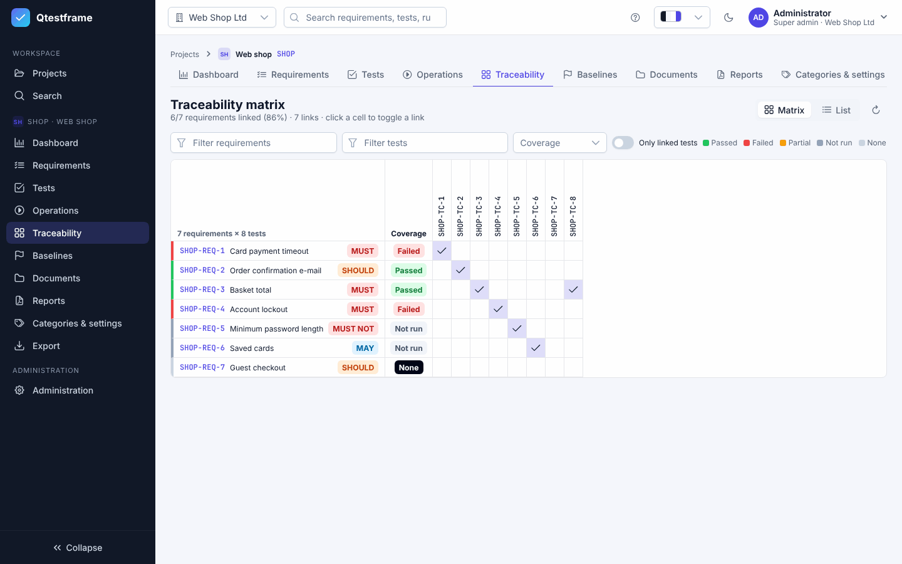
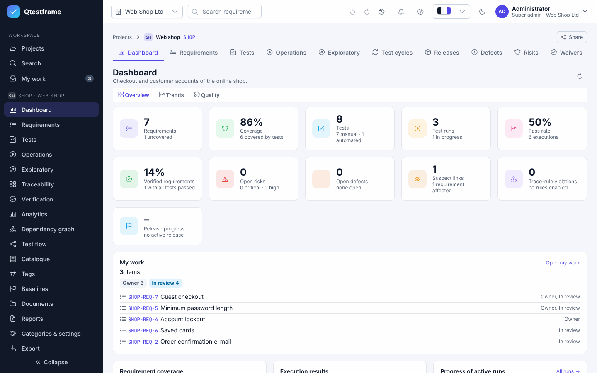

# Traceability and coverage

Traceability answers two questions: *which tests verify this requirement?* and *has it been verified successfully?* Qtestframe answers them with **links** between requirements and tests and with the **coverage** derived from the test results.

## The traceability matrix

Select **Traceability** in the project sidebar.

- Requirements are the **rows**, tests the **columns**. A marked (pressed) cell means *linked*.
- The coloured bar at the start of each row shows the requirement's coverage; the **Coverage legend** explains the colours. Point at a test's column header to see its key, title and last result.
- The summary says how many requirements are linked, for example *14/20 requirements linked (70 %)*.
- **Filter requirements** and **Filter tests** take [queries](search-and-filters.md), for example `folder:Checkout` and `type=automated`.
- **Only linked tests** hides tests that are not linked to any shown requirement.
- **View** switches between **Matrix** and **List**. The list shows each requirement with its linked tests and is easier to read on phones.

**Link and unlink:** click (or focus and press <kbd>Enter</kbd> or <kbd>Space</kbd> on) an empty cell to link the requirement and the test; click a marked cell to remove the link. This needs the **Tester** role. Links can also be managed in the requirement editor (**Link tests**) and the test editor (**Link requirements**).

The matrix scrolls in both directions; the requirement column stays visible.

### Link several at once

With the **Tester** role, a toolbar above the matrix (and the list) works on many links at once:

1. Tick requirements with the checkbox at the start of their row, or **Select all shown requirements** (use the filters first to narrow them down).
2. Optionally choose tests in **Tests for the selected requirements**; with none chosen, the actions take all tests.
3. Choose an action; the number on each button says how many links it affects:
   - **Link** links every selected requirement to every chosen test; existing links are kept.
   - **Unlink** removes the links between the selected requirements and the chosen tests (after a confirmation).
   - **Confirm suspect** confirms the suspect links among them (cells with a warning sign: the requirement or test changed after the link was confirmed).

Ticking only tests (no requirements) lets **Unlink** and **Confirm suspect** act on all links of those tests. Linking and unlinking can be undone with **Undo**; the status that follows evidence is updated once for all affected requirements.

## How coverage is calculated

Coverage is derived from the **last result** of every linked test. It is computed every time you look at it and never stored, so it is always current.

**Last result of a test:** among the test's executions in runs of this project that are not *Not run*, the one with the latest time (finished, else started, else the run's creation time). A test without such an execution has the last result **Not run**.

**Coverage of a requirement**, evaluated top-down:

| Coverage | When |
|---|---|
| **None** | no test is linked |
| **Failed** | at least one linked test is *Failed* or *Blocked* |
| **Passed** | all linked tests are *Passed* |
| **Partial** | at least one linked test is *Passed*, the others are *Not run*, *Skipped* or *In progress* |
| **Not run** | otherwise: tests are linked, but none has passed or failed yet |

Examples:

- REQ-1 is linked to TC-1 (passed) and TC-2 (passed) → **Passed**.
- REQ-2 is linked to TC-1 (passed) and TC-3 (not run) → **Partial**.
- REQ-3 is linked to TC-1 (passed) and TC-4 (blocked) → **Failed**.
- REQ-4 has a linked test that was never executed → **Not run**.
- REQ-5 has no links → **None**.

**Configurations:** when tests are executed in [configurations](runs.md#configurations-in-a-run), every configuration a test is planned in counts **as a result of its own**: the last result of the test *in that configuration* (an execution without configuration counts as one more configuration). The rules above are then applied to all these results together. So a requirement is **Passed** only when each of its tests passed in **every configuration** it is planned in; one failed or blocked configuration makes it **Failed**; a test that passed in Chrome but has not been run in Firefox yet makes it **Partial**. A configuration counts as planned as soon as the test has an execution in it in any run of the project, even one that has not been run yet.

- REQ-6 is linked to TC-5, planned in *Chrome* (passed) and *Firefox* (passed) → **Passed**.
- REQ-7 is linked to TC-6, planned in *Chrome* (passed) and *Firefox* (not run) → **Partial**.
- REQ-8 is linked to TC-7, planned in *Chrome* (passed) and *Safari* (failed) → **Failed**.

Without configurations nothing changes: each test has one result, its last result. A release counts a test as passed only when it passed in every configuration of the release's runs.

**Coverage by configuration:** the requirement editor shows, below the linked tests, a table with the last result of each linked test in each configuration and the coverage **in each configuration** (counting only the tests planned in it). In the traceability matrix, **Coverage in configuration** shows the coverage and the test results of one configuration only, or of the executions without configuration.

Things to keep in mind:

- Coverage is calculated per requirement, not per evaluation criterion. A link can name the criterion a test verifies, but every link counts the same.
- Only runs of the same project count. A test that was moved from another project keeps its old executions, but they no longer count.
- A newer *Passed* result replaces an older *Failed* one; there is no need to delete old runs.

Coverage appears as a column and quick filter in the requirements list, as the query field `coverage` (for example `coverage:failed` or `coverage:none category:Security`), in the matrix, in exports, in reports and on the dashboard.

## The dashboard

**Dashboard** is the first page of every project.

- **Key figures**: number of requirements (and how many are uncovered), coverage (how many are covered by tests), number of tests (manual and automated), test runs (in progress) and the pass rate of all executions.
- **Requirement coverage**: how many requirements are *Passed*, *Failed*, *Partial*, *Not run* and *None*.
- **Execution results**: all results of all runs.
- **Requirements by status** and **Requirements by obligation** (requirements without a keyword count as *unspecified*).
- **Tests by status**.
- **Recent runs**: the five newest runs with their progress; **All runs →** opens the run list.

On the dashboard, a requirement counts as *covered* as soon as at least one test is linked, regardless of results.

## Dependency graphs

**Dependency graph** in the project sidebar draws how items build on each other. Choose **Requirements** or **Tests** at the top:

- **Requirements**: the relations between requirements, such as *depends on*, *provides*, *refines*, *derived from*, *conflicts with*, *duplicates* and *relates to* (see [Relations](requirements.md#relations));
- **Tests**: the [dependencies](tests.md#dependencies) between tests (*depends on*) and the shared steps (*calls*).

The graph is read from left to right: prerequisites, parent requirements and sources are on the left, what builds on them to the right. Each box shows the key, the title and the coverage (requirements) or last result (tests), with a coloured bar in the same colours as elsewhere. Each relation type has its own colour and line style, explained next to its checkbox.

- Untick a relation type to hide those lines; items left without relations disappear unless **Show items without relations** is on.
- Type in **Highlight items…** to highlight matching items.
- Right-click an item (or focus it and press <kbd>Space</kbd>) to highlight its neighbours; **Show all** ends this.
- Select an item (or press <kbd>Enter</kbd>) to open it. Zoom with the magnifier buttons; scroll to move around.
- **List** shows the same relations as a table, one item per row, which is easier to read with a screen reader or to print.

Cycles (for example two requirements that depend on each other) are drawn, but one of their lines is shown without an arrow.

## Requirement analytics

**Analytics** in the project navigation analyses all requirements of the project at once (open it again or select **Analyse again** after changes). At the top: the **health** (the share of requirements without problems or warnings), the number of requirements and tests, the share **covered by tests** (rejected and obsolete requirements are not counted) and the average **language score**.

- **Obligation levels** shows how many requirements have each level, including those with **no obligation**.
- **Keywords per meaning** groups the keywords that mean the same (MUST, SHALL and REQUIRED; MAY and OPTIONAL …) and shows how each is used, so you see the convention of the project at a glance.

**Findings** lists what the analysis noticed, problems first, each with an explanation, **what to do** and the requirements (or tests) concerned; select a key to open the item. Filter by severity or category:

| Category | Findings |
|---|---|
| Obligation levels | keywords not written in capitals as RFC 2119 and RFC 8174 require ("must", "Should"), and requirements whose keywords are *only* in lower case and so have no normative keyword at all; WILL used as an obligation (it is not an RFC 2119 keyword); requirements without an obligation level; a level in the field but no keyword in the text; field and text disagree; several levels in one requirement; the spread: almost everything mandatory, no mandatory requirements, many optional (MAY) or many SHOULD or descriptive requirements |
| Consistency | requirements in more than one language (for example mostly English with a few Swedish ones), a requirement whose title and sentences are in different languages, and English keywords in a requirement written in another language (MUST in a Swedish sentence); a keyword used by a few requirements while another with the same meaning dominates, for example *SHALL is used in 1 requirement, while MUST is used in 95 %*; keywords with the same meaning used about equally |
| Coverage | mandatory and other requirements without tests; failing or not yet run tests; requirements without acceptance criteria |
| Tests | tests that verify no requirement; accepted requirements without a test that is Ready |
| Quality | empty descriptions, duplicate titles, conflicting requirements, low language scores, many drafts, requirements without an owner |
| Language | the findings of the [language analysis](requirements.md#the-language-analysis) summed up per rule: ambiguous terms, TBDs, escape clauses … |

**Languages of the requirements** shows how many requirements are written in each language. Only texts long enough to tell the language are counted; a title of one or two words is not enough.

**Language** chooses the language of the analysis (detected per requirement by default). Test findings are shown when you may read tests.
