# Tutorial: your first test campaign

In this tutorial you build a small project from nothing and take it all the way to a report. You will write requirements, let Qtestframe create linked tests, refine them, run them manually and automatically, record a defect, check coverage, freeze a baseline and export the result.

**Example:** the checkout of a web shop, project key `SHOP`.

**You need:** the role **Manager** or **Admin** in your organisation (requirements and projects need the Manager role; see [roles](administration.md#roles-and-permissions)). Running scripts on the server also needs the script runner to be switched on by your administrator (step 9). Allow about 30 minutes.

> **Just exploring?** Your administrator can load a ready-made demo project (*Demo – Online Banking*) with `qtestframe seed-demo`. The steps below work in it too, but starting from an empty project teaches you more.

## Step 1: Create a project

1. Select **Projects** in the sidebar.
2. Select **New project**.
3. Enter the **Name** `Web shop`. Qtestframe suggests a key from the name when you leave the field.
4. Set the **Key** to `SHOP`. The key prefixes every item, for example `SHOP-REQ-1` and `SHOP-TC-1`. It has 2–16 capital letters or digits, starts with a letter, and **cannot be changed later**. Add a **Description** if you like.
5. Leave **Seed default categories (Polarity, Interface, Medium, Execution, Level, Area)** ticked. These category dimensions are used to classify tests and requirements later.
6. Select **Create**.

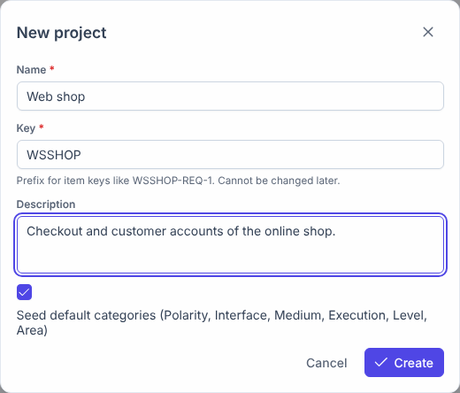

Open the project by selecting its card. You land on its **Dashboard**, which is still empty. The project's sections now appear in the sidebar.

## Step 2: Create folders

Folders group requirements (and, separately, tests) in a tree, like chapters of a specification.

1. Select **Requirements** in the sidebar. The folder tree is on the left, the requirement table on the right.
2. Select the **+** button (**New folder**) above the tree, enter `Checkout` and select **Save**.
3. Create a subfolder: right-click **Checkout** (or use its **⋮** actions button) and choose **New subfolder**. Name it `Payment`.
4. Create a second top-level folder `Accounts` the same way.

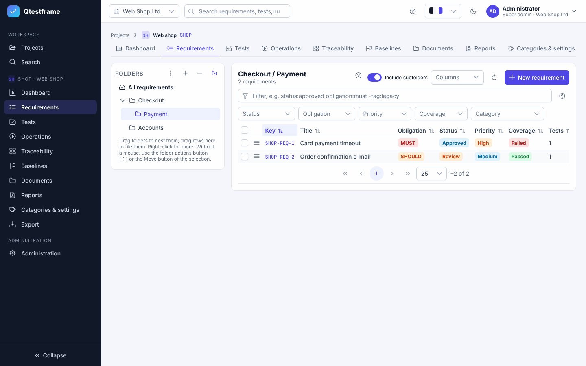

You can drag folders to nest or reorder them. Select a folder to show only its requirements; **Include subfolders** decides whether requirements in subfolders are shown too.

## Step 3: Write requirements with MUST and SHOULD

1. Select the **Payment** folder, then **New requirement**. The editor opens on the right with the folder already filled in.
2. Enter the **Title** `Card payment timeout`.
3. In **Description**, first type a deliberately weak statement:

   `The system should respond fast and/or retry TBD.`

   The **Requirement language analysis** box appears below the text and updates as you type. It finds:

   - the obligation keyword *should*, written in lower case (only the upper-case `SHOULD` has normative meaning under RFC 8174),
   - the ambiguous term *fast*, which cannot be verified,
   - *and/or*, which leaves open whether both or one is needed,
   - the placeholder *TBD*, which marks the requirement as incomplete.

   The **Score** drops to 53 of 100.

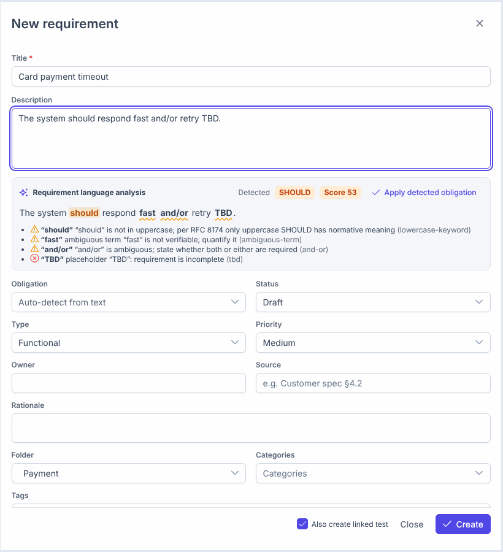

4. Now replace the text with a precise one:

   `The system MUST cancel a card payment that is not confirmed by the payment provider within 30 seconds.`

   The analysis shows **Detected: Must** and a score of 100.

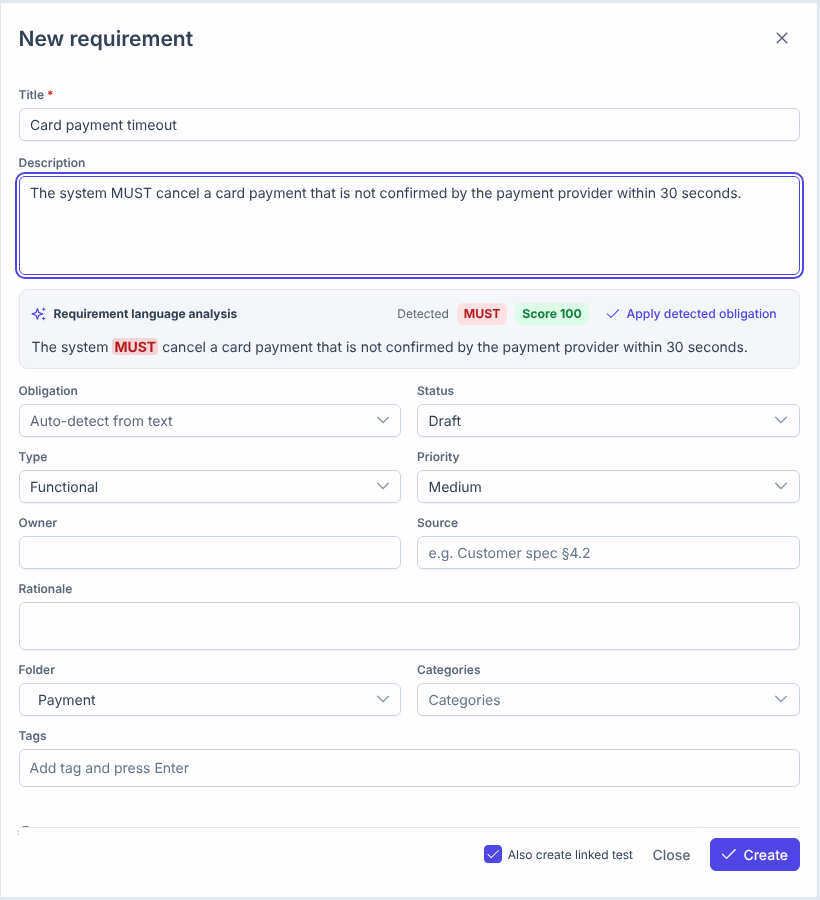

5. Leave **Obligation** on **Auto-detect from text**: the detected level is stored when you create the requirement. You can also choose a level yourself; **Apply detected obligation** sets the field to what the analysis found.
6. Set **Priority** to **High** and, under **Categories**, choose **Area / Core**.

Which keyword to use:

| Keyword | Meaning | Example |
|---|---|---|
| `MUST` / `SHALL` | Absolute requirement | The system MUST log every failed sign-in. |
| `MUST NOT` / `SHALL NOT` | Absolute prohibition | The system MUST NOT store card numbers. |
| `SHOULD` | Recommended; exceptions need a reason | The system SHOULD send an order confirmation within 5 minutes. |
| `SHOULD NOT` | Not recommended | The checkout SHOULD NOT require more than three pages. |
| `MAY` / `OPTIONAL` | Truly optional | The customer MAY save the card for later purchases. |
| `WILL` | Statement of intent or fact | The payment provider WILL send a callback. |

Write one obligation per sentence. If the analysis reports *several obligation keywords*, split the sentence into two requirements. More rules are explained in [Requirements](requirements.md#the-language-analysis).

## Step 4: Add evaluation criteria

Evaluation criteria say **how** you will judge that the requirement is fulfilled. They also become the steps of the linked test.

1. In the editor, under **Evaluation criteria**, select **Add criterion**.
2. Enter `Unconfirmed payment is cancelled`, keep the method **Test** and enter the threshold `≤ 30 s`.
3. Add a second criterion `Cancellation is written to the audit log` with the method **Inspection**.
4. Check that **Also create linked test** at the bottom is ticked.
5. Select **Create**.

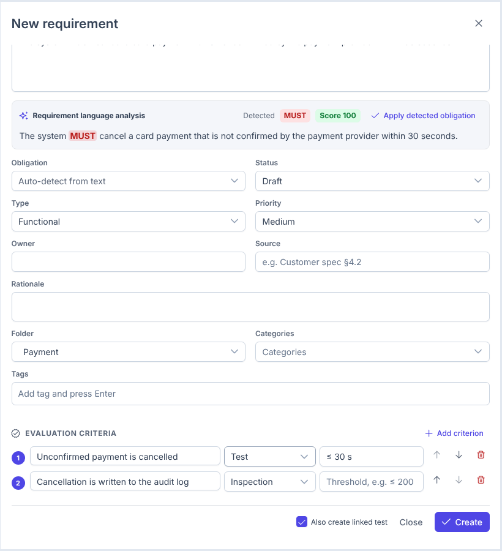

A message confirms *SHOP-REQ-1 with linked test SHOP-TC-1*. In the table, the requirement's **Coverage** is **Not run**: it has a test, but the test has not been executed yet.

Add one more requirement in the same folder for practice:

`The system SHOULD send an order confirmation by e-mail within 5 minutes after payment.`

## Step 5: Refine the automatic linked test

1. Select **Tests** in the sidebar. The test folder tree mirrors your requirement folders: there is a **Checkout / Payment** folder that Qtestframe created for you.
2. Open **SHOP-TC-1 Verify SHOP-REQ-1: Card payment timeout**. It is a manual test in status **Draft**, tagged `auto-generated`, with one step per criterion, for example *Verify (test): Unconfirmed payment is cancelled* with the expected result *≤ 30 s*.
3. Make the steps concrete. Click into a step to edit **Action**, **Expected result** and **Data**:

   | # | Action | Expected result | Data |
   |---|---|---|---|
   | 1 | Put an item in the basket and start the card payment | The payment page of the provider opens | test card 4111 1111 1111 1111 |
   | 2 | Do not confirm the payment; wait 30 seconds | The order shows *Payment cancelled* | |
   | 3 | Open the audit log | A *payment cancelled* entry exists for the order | |

4. Use **Add step** to append a step, the **+** on a row to insert one below, and the arrows to reorder.
5. Set **Status** to **Ready** and add the categories **Polarity / Negative** and **Interface / External**.
6. Select **Save**.

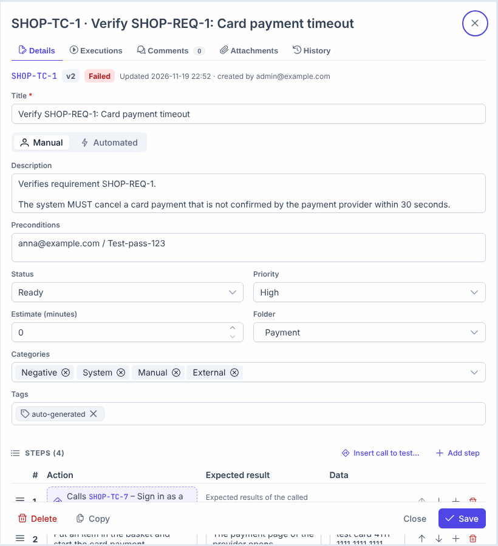

Under **Linked requirements** at the bottom you see SHOP-REQ-1. Use **Link requirements** to link further requirements to the same test.

## Step 6: Add a shared step

Many tests begin the same way, for example by signing in. Write those steps once and call them from other tests.

1. Select **New test** and create a test `Sign in as a customer` with two steps: *Open the shop and select Sign in* → *The sign-in form is shown*, and *Enter the customer e-mail and password* → *The account page is shown*. Set its status to **Ready** and select **Create**.
2. Open SHOP-TC-1 again and select **Insert call to test…** above the steps.
3. Choose **Sign in as a customer** and select **Insert call**. The new step reads **Calls SHOP-TC-…**.
4. Move the call step to the top with the up arrow and select **Save**.


When a run is created, the called test's steps are inserted in place of the call, marked with the called test's key. If you improve the shared test later, new runs get the improvement. The shared test lists where it is used under **Used by**.

## Step 7: Create a run

1. Select **Operations** in the sidebar, then **New run**.
2. Enter the **Name** `Sprint 1 regression`, the **Environment** `staging` and the **Build** `1.0.0`.
3. Choose the tests to include. The run gets the union of all three tabs:
   - **Tests**: **Pick tests…** and select individual tests;
   - **Folders**: tick **Checkout**; tests in subfolders are included;
   - **Query**: a filter such as `status:ready`; **Preview** shows how many tests match.
4. Select **Create run**.

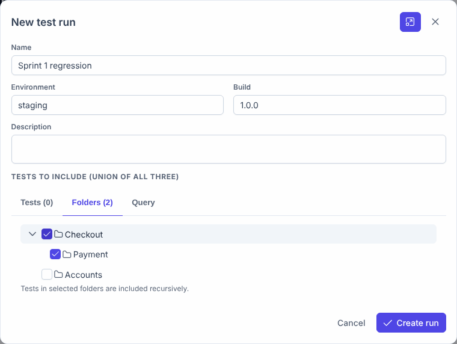

The run opens with one **execution** per test, all **Not run**. The steps of each test, including the inserted shared steps, are copied into the run now, so later edits to the tests do not change this run.

## Step 8: Execute manually and record a defect

1. In the run, select **Execute** (or the play button of one execution). The execution runner opens.
2. The left column lists the steps; the right side shows the current step with its **Action**, **Expected result** and **Test data**.
3. Do what the step says and compare the result:
   - if it matches, select **Pass** or press <kbd>P</kbd>;
   - if not, type what happened in **Actual result** and select **Fail** or press <kbd>F</kbd>.

   **Blocked** (<kbd>B</kbd>) and **Skip** (<kbd>S</kbd>) are also available. The runner moves to the next step automatically. Press <kbd>?</kbd> to see all shortcuts.
4. Let step 3 fail: the audit log entry is missing. Under **Defects**, enter `SHOP-101` (the ID in your issue tracker) and press <kbd>Enter</kbd>. Add a remark in **Notes**.
5. The **Overall status** is derived from the steps: one failed step makes the execution **Failed**. Select **Save & next** to save and go to the next execution.

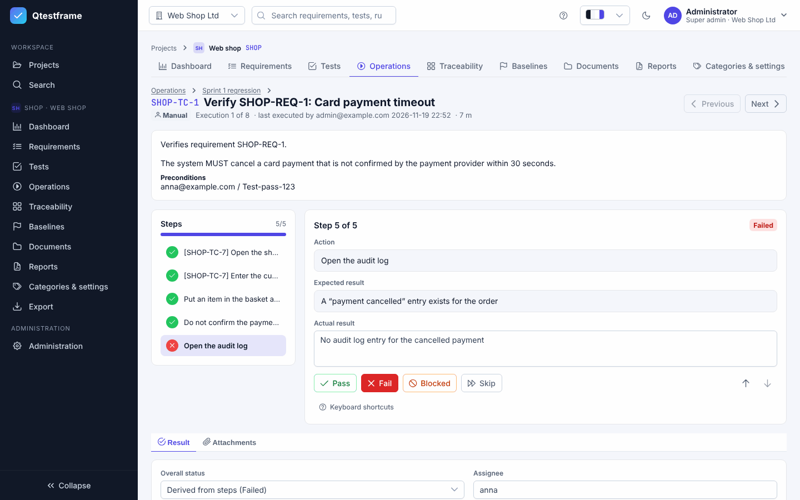

**Turn defect IDs into links:** in **Categories & settings**, enter a **Defect tracker URL template** such as `https://jira.example.com/browse/{id}`. From then on `SHOP-101` links to your tracker.

## Step 9: Run an automated script

Automated tests are scripts that run on the server. Exit code 0 means *passed*, anything else *failed*.

1. In **Tests**, select **New test**, enter `Order total calculation`, and switch the execution type to **Automated**.
2. Choose the **Script** language **sh** and enter:

   ```sh
   #!/bin/sh
   # exit code 0 = passed, non-zero = failed
   total=$((2 * 15 + 5))
   echo "order total: $total"
   [ "$total" -eq 35 ] || { echo "unexpected total"; exit 1; }
   ```

3. Select **Create**.
4. Open the run *Sprint 1 regression*, select **Add tests**, choose the new test and confirm.
5. Open its execution and select **Run script**. After a moment the **Output** shows the script's output and the execution is **Passed**, with its duration.

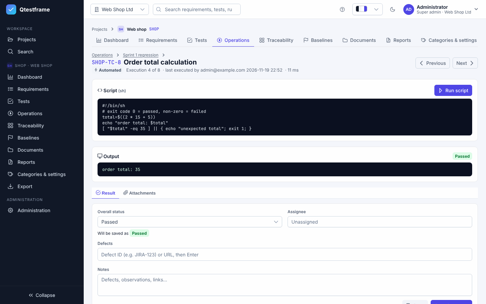

**Run script** needs the **Manager** role (permission `script.execute`) and the server setting `runner.enabled: true`. If the button is missing or reports that the runner is disabled, ask your administrator. CI pipelines can instead report results through the API; see [CI import](runs.md#import-results-from-ci).

## Step 10: Check traceability and the dashboard

1. Select **Traceability**. Requirements are rows, tests are columns, and a marked cell means *linked*. The coloured bar at the start of each row shows the coverage (see the legend): SHOP-REQ-1 is now **Failed** because its test failed. The **Requirements** list shows the same in its **Coverage** column.
2. Click an empty cell to link a requirement with a test, or a marked cell to remove the link. **Only linked tests** hides tests without links.
3. Select **Dashboard**. It summarises requirement coverage, execution results, requirements by status and obligation, tests by status and the recent runs.

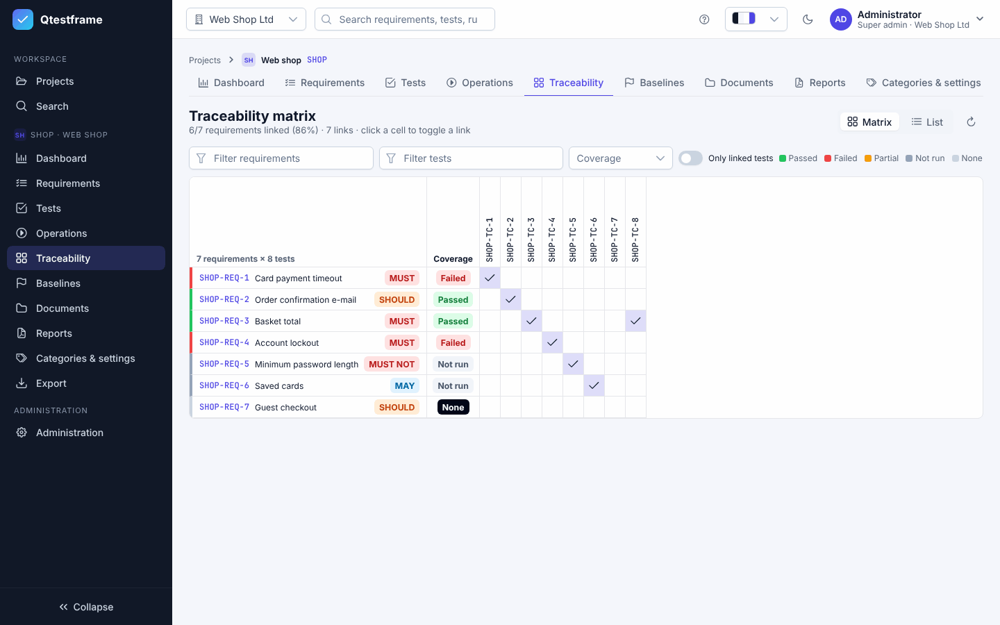

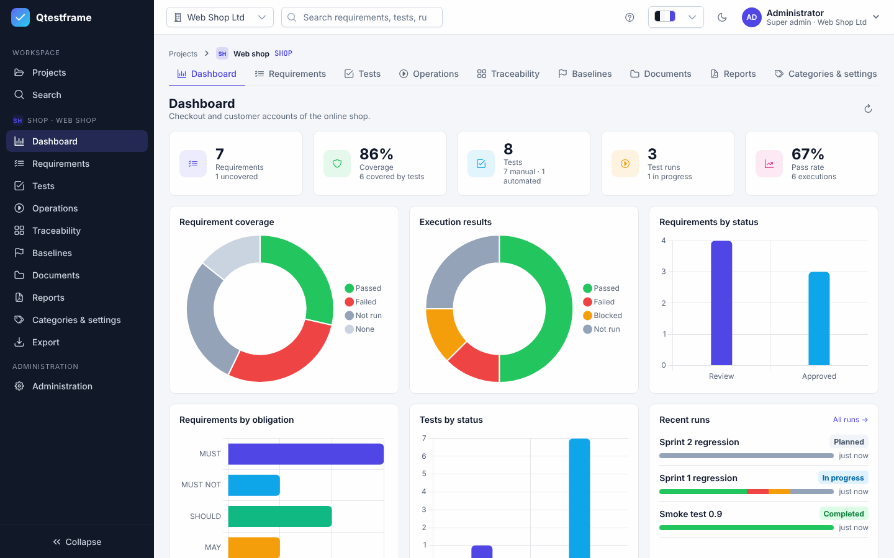

How coverage is calculated is explained in [Traceability and coverage](traceability-and-coverage.md#how-coverage-is-calculated).

## Step 11: Create a baseline

Before a release, freeze the current versions of all requirements and tests.

1. Select **Baselines**, then **New baseline**.
2. Enter the **Name** `Release 1.0`. Leave **Filter (optional)** empty to include everything.
3. Select **Create baseline**.

Now change something, for example the threshold of a criterion of SHOP-REQ-1. Back in **Baselines**, select **Compare** on *Release 1.0* and compare it with **Current state**: SHOP-REQ-1 is listed under **Changed**, with the changed fields and both version numbers.

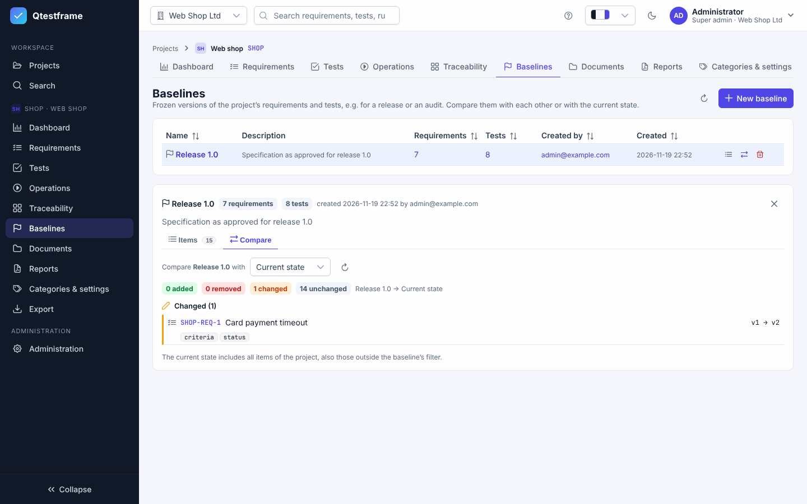

## Step 12: Export or generate a report

**Export the data:**

1. Select **Export**.
2. Choose the **Format**: **XLSX** (one sheet per aspect), **CSV** (a ZIP when you choose several aspects), **PDF** (printable) or **DOCX** (editable document).
3. Tick the **Aspects** you need: requirements, evaluation criteria, tests with steps, traceability matrix, runs and executions.
4. Optionally enter a filter such as `folder:Checkout`, then select **Download**.

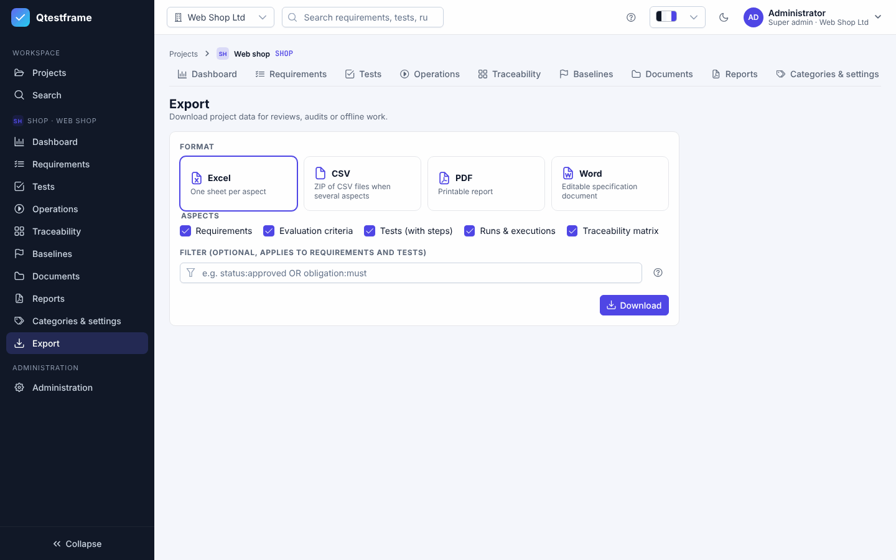

**Generate a report:** in **Reports**, choose a standard report such as **Requirements coverage** or **Run summary** (for *Sprint 1 regression*), pick PDF, DOCX, XLSX or CSV, and download it, or save it to the project's document archive so that the whole team finds it under **Documents**. Under **Custom report** you choose the item type, filter, columns, grouping and sorting yourself. See [Reports and export](reports-and-export.md).

## What you have learned

You have created a project with folders, written verifiable requirements with the help of the language analysis, added evaluation criteria, refined the automatically created test, reused steps, run a campaign manually and automatically, recorded a defect, checked coverage, frozen a baseline and exported the results.

Next, read about [requirements](requirements.md) and [tests](tests.md) in more depth, or learn the [query language](search-and-filters.md) to find anything quickly.
