# Qtestframe user guide

Qtestframe is a tool for managing **requirement specifications and tests** in one place. You write requirements, design manual and automated tests that verify them, run test campaigns, record results and defects, and prove coverage with a traceability matrix, a dashboard and reports. Several organisations (tenants) can share one installation without seeing each other's data.

This guide is for everyone who works in Qtestframe: requirement authors, testers, test managers and administrators. It describes the web client as you see it. You can read it here in the app (**Help → User guide**, or the **?** link on many pages), or as Markdown files in the `docs/user-guide` folder of the source code.

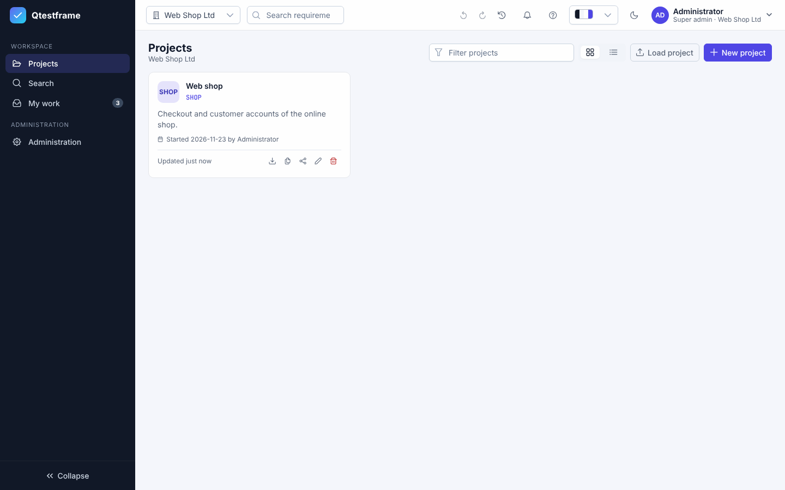

## Where to start

- **New to Qtestframe?** Read [Getting started](#getting-started), then work through the tutorial [Your first test campaign](#tutorial-your-first-test-campaign). It takes about 30 minutes and touches every important feature.
- **Looking for an answer?** Try the [FAQ](#faq) or the search field at the top of the guide.
- **Administrator?** Go straight to [Administration](#administration).

## Contents

| Page | What it covers |
|---|---|
| [Getting started](#getting-started) | Signing in, the layout, organisations, search, theme and language, your profile and preferences |
| [Tutorial: your first test campaign](#tutorial-your-first-test-campaign) | A complete walk-through from an empty project to a report |
| [Requirements](#requirements) | Obligation levels, the language analysis, fields, evaluation criteria, relations, comments, history, bulk edit, moving and attachments |
| [Tests](#tests) | Manual steps, automated scripts, shared steps, categories, execution history, comments, history and attachments |
| [Catalogue](#catalogue) | Standard requirements and tests to add to a project: browsing, searching, the preview and adding with tests and trace links |
| [Test runs and execution](#test-runs-and-execution) | Runs, the execution runner and its keyboard shortcuts, defects, CI import with API tokens, attachments |
| [Traceability and coverage](#traceability-and-coverage) | The traceability matrix, how coverage is calculated, the dashboard |
| [Baselines](#baselines) | Freezing a release and comparing versions |
| [Search and filters](#search-and-filters) | The query language with many examples |
| [Reports and export](#reports-and-export) | Standard reports, the custom report builder, export formats and the document archive |
| [Documents](#documents) | The project's document archive: uploads, previews and links |
| [Administration](#administration) | Organisations, users, members and roles, password resets, API tokens, the audit log, backup and restore |
| [Accessibility and languages](#accessibility-and-languages) | Keyboard use, screen readers, themes, English and Swedish, phones and tablets |
| [FAQ](#faq) | Answers to common questions |
| [References](#references) | RFC 2119, RFC 8174 and other RFCs, NIST publications, and standards for requirements and testing |

## Key concepts

| Term | Meaning |
|---|---|
| **Organisation** (tenant) | An isolated workspace. Projects, members and API tokens belong to one organisation. You can be a member of several and switch between them. |
| **Project** | A container for requirements, tests, runs, baselines and documents. Its **key** (for example `SHOP`) prefixes every item ID: `SHOP-REQ-12`, `SHOP-TC-7`. |
| **Requirement** | A statement of what the system must, should or may do, with an obligation level, status, priority, evaluation criteria and more. |
| **Evaluation criterion** | How fulfilment of a requirement is judged: a method (test, inspection, analysis, demonstration, review) and a threshold. |
| **Test** (test case) | A manual test with steps, or an automated test with a script. |
| **Link** (trace link) | Connects a requirement with a test that verifies it. Links are the basis of coverage. |
| **Run** (test run) | A test campaign, for example *Sprint 12 regression*, with a set of tests to execute in an environment and build. |
| **Execution** | One test inside a run, with its result, step results, notes, defects and output. |
| **Coverage** | The verification state of a requirement, derived from the latest results of its linked tests: *None*, *Not run*, *Passed*, *Failed* or *Partial*. |
| **Baseline** | A frozen snapshot of the requirement and test versions of a project, for example for a release. |
| **Role** | What you may do in an organisation: *Viewer*, *Tester*, *Manager* or *Admin*. *Super admins* manage the whole installation. |

## Conventions in this guide

- Names of buttons, menus and fields are written in **bold**, exactly as they appear in the English user interface. The Swedish guide uses the Swedish labels.
- Menu paths are written with arrows: **User menu → Profile & password**.
- Keys are written like <kbd>Enter</kbd>; query examples like `status:approved`.
- A note such as *(Manager)* after an action tells you the lowest role that may do it. See the [role matrix](#roles-and-permissions).

# Getting started

This page explains how to sign in, find your way around the screen, and set up Qtestframe the way you like it.

## Sign in

Open the address your administrator gave you (for a local trial installation `http://localhost:8080`).

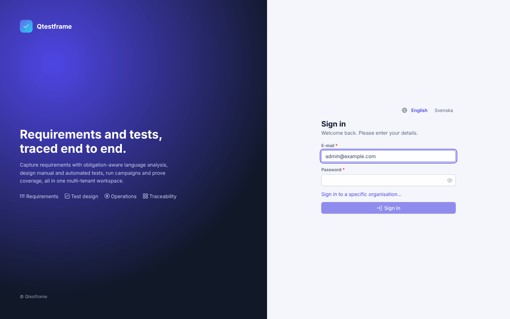

1. Enter your **E-mail** and **Password** and select **Sign in**.
2. If you belong to several organisations and want to start in a particular one, select **Sign in to a specific organisation…** and enter its short name (slug), for example `acme`. Without it you start in your default organisation (see [Preferences](#preferences)) or the one you used last.
3. If your organisation uses single sign-on, the page shows a button per provider below **or continue with**. Select it and sign in at your identity provider; you return to Qtestframe automatically.

The language buttons at the top of the sign-in page switch between English and Swedish before you sign in. After sign-in, the language in your preferences wins.

> **Tip:** After ten failed attempts within five minutes, sign-in is blocked for a while for that e-mail address and network address. Wait a few minutes and try again, or ask an administrator to [reset your password](#reset-a-password).

### What you see after signing in

- **The intro tour.** On your first sign-in a short tour highlights the main parts of the screen. Use **Next** and **Back**, or **Skip tour** (or <kbd>Esc</kbd>) to close it. You can start it again at any time with **Help → Restart intro tour**.

  
- **Sign-in information.** On later sign-ins Qtestframe can show when and from where you last signed in, and how many failed attempts there have been since. If you do not recognise a sign-in, change your password and sign out your other sessions (see [Security](#security)).
- **A forced password change.** If an administrator has reset your password, you must choose a new one before you can continue.

## The layout


### Sidebar

The dark bar on the left is the main navigation:

- **Workspace:** **Projects** (all projects of the current organisation) and **Search** (search across projects).
- **The open project:** once you open a project, its key and name appear with its sections: **Dashboard**, **Requirements**, **Tests**, **Operations** (test runs), **Traceability**, **Analytics**, **Dependency graph**, **Test flow**, **AI prompts** (software projects), **Tags**, **Baselines**, **Categories & settings**, **Export** and, where available, **Documents** and **Reports**.
- **Administration**, if your role allows it.

Inside a project, the same sections are also shown as tabs at the top of the page, below the breadcrumb *Projects › project name*.

**Collapse** at the bottom shrinks the sidebar to icons; hover an icon to see its name. On screens narrower than 1024 pixels the sidebar is hidden and opens with the menu button (☰) in the top bar; <kbd>Esc</kbd> or the close button closes it again.

### Top bar

From left to right:

| Element | Use |
|---|---|
| **Organisation** switch | Shows the current organisation and lets you switch to another one you are a member of. On phones it is a building icon. |
| **Search** field | Searches requirements, tests and runs in all projects of the organisation. Type text or a [query](#search-and-filters) and press <kbd>Enter</kbd>. On phones it is a magnifier button. |
| **Help** (?) | Opens the **User guide**, **Help for this page**, **Query language**, **References and standards** and **Restart intro tour**. |
| **Undo / Redo / Undo history** | Undoes and redoes your changes, see [Undo and redo](#undo-and-redo). |
| **Colour theme** | Picks one of the twenty-two themes, see [Themes](#themes). |
| **Light mode / Dark mode** | Switches between light and dark quickly. |
| **User menu** | Your name and role, **Profile & password**, light/dark mode, **Language** and **Sign out**. |

### Undo and redo

Most changes can be undone: editing, creating, copying and deleting requirements and tests, moving them, bulk edits, links, relations, dependencies, review decisions, restoring a version, test results in the runner, and creating, renaming and moving folders.

- **Undo** (↶, <kbd>Ctrl</kbd>+<kbd>Z</kbd>) reverts the latest change; select it again to go further back. The tooltip names the change, for example *Undo: Edit SHOP-TC-4*.
- **Redo** (↷, <kbd>Ctrl</kbd>+<kbd>Shift</kbd>+<kbd>Z</kbd> or <kbd>Ctrl</kbd>+<kbd>Y</kbd>) applies an undone change again. A new change clears what could be redone.
- **Undo history** (🕘) lists your last 50 changes, newest first, with when they were made. Selecting one undoes it and everything after it.

The keyboard shortcuts work outside text fields; in a text field they undo your typing as usual. The history belongs to you and your browser tab: it is cleared when you switch organisation, sign out or reload the page. A deleted requirement or test comes back with its key, links, relations, comments, history, attachments and execution results; deletions can be undone for 30 days through the API (see `GET /projects/{pid}/trash` in the API reference). An undo fails when the situation changed in the meantime, for example when someone else edited the item or you no longer have the permission; the item is then left as it is and a message explains why.

### Help where you need it

- Many fields and sections have a small **i** next to their name. Point at it with the mouse, or move the keyboard focus to it, to see what the field means. Select it (or tap it on a phone) to keep the explanation open, and choose **Read more in the user guide** to open the section that describes it. <kbd>Esc</kbd> closes it.
- Press <kbd>?</kbd> anywhere outside a text field to open the guide page for the current view (in the execution runner, <kbd>?</kbd> shows the runner's keyboard shortcuts instead).
- The **?** next to every filter field lists the operators and fields of the [query language](#search-and-filters) for that list.

### Organisations

An organisation (tenant) is a separate workspace with its own projects, members and API tokens. When you switch organisation in the top bar, Qtestframe takes you to that organisation's project list. Your role can differ between organisations, so what you may do can change too.

If you see the message *You have no current organisation*, pick one in the organisation switch. If you are not a member of any organisation, ask an administrator to add you.

### Search

The search field in the top bar searches everywhere in the current organisation. Results are grouped by type with the matching text highlighted; select a result to open it. Full details are in [Search and filters](#search-and-filters).

### Theme and language

- Pick a **colour theme** in the top bar or in your preferences. Your choice is stored with your account and follows you to every device.
- Change the **language** with **User menu → Language**: *English* or *Svenska*. The change applies at once and is saved as your preference.

## Your profile

Open **User menu → Profile & password**.

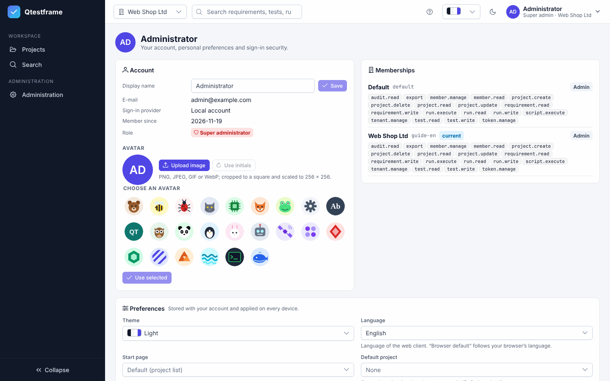

### Account

- **Display name**: the name others see in comments, history and the audit log.
- **Avatar**: choose a picture for your account: upload an image (PNG, JPEG, GIF or WebP, at most 1 MB), pick one of the built-in pictures, or use your initials.
- **Sign-in provider**, **Member since** and your **Memberships**: the organisations you belong to and your role in each.

### Preferences

Preferences are stored with your account and applied on every device. Change them and select **Save preferences**.

| Preference | Effect |
|---|---|
| **Language** | English or Swedish; *Browser default* follows the browser. |
| **Theme** | Colour theme. *Follow the operating system* switches between light and dark with your system setting. |
| **Start page** | What you see after signing in: the project list, the last opened project, a default project or search. |
| **Default project** | The project opened when the start page is *Default project*. |
| **Default organisation** | The organisation selected at sign-in when you do not name one. |
| **Rows per table page** | 10, 25, 50 or 100 rows in tables. |
| **Date format** | *Locale* (as usual in your language), *ISO* (2026-03-14 09:30) or *Relative* (3 hours ago). |
| **Time zone** | The time zone for all times; *Browser* uses your computer's. |
| **Also create linked test (new requirements)** | Your personal default for the checkbox in the requirement editor. |
| **Compact tables** | Denser table rows, to see more at once. |
| **Hide the live requirement-language analysis** | Turns off the analysis box in the requirement editor. |

### Security

- **Password**: for local accounts, enter your **Current password** and the **New password** twice, then select **Change password**. If you sign in with single sign-on, your password is managed by your identity provider.
- **API tokens**: tokens for CI pipelines and scripts are created under **Administration → API tokens** (see [API tokens](#api-tokens)).
- **Active sessions**: every browser and device that is signed in with your account, with browser, IP address, sign-in time and last activity. **Sign out** ends one session; **Sign out all other sessions** ends all except the one you are using.
- **Sign-in history**: your recent sign-ins and failed attempts, if shown.

## Next steps

- Follow the [tutorial](#tutorial-your-first-test-campaign) to build a small project from scratch.
- Learn the [query language](#search-and-filters); it works in every filter field.

# Tutorial: your first test campaign

In this tutorial you build a small project from nothing and take it all the way to a report. You will write requirements, let Qtestframe create linked tests, refine them, run them manually and automatically, record a defect, check coverage, freeze a baseline and export the result.

**Example:** the checkout of a web shop, project key `SHOP`.

**You need:** the role **Manager** or **Admin** in your organisation (requirements and projects need the Manager role; see [roles](#roles-and-permissions)). Running scripts on the server also needs the script runner to be switched on by your administrator (step 9). Allow about 30 minutes.

> **Just exploring?** Your administrator can load a ready-made demo project (*Demo – Online Banking*) with `qtestframe seed-demo`. The steps below work in it too, but starting from an empty project teaches you more.

## Step 1: Create a project

1. Select **Projects** in the sidebar.
2. Select **New project**.
3. Enter the **Name** `Web shop`. Qtestframe suggests a key from the name when you leave the field.
4. Set the **Key** to `SHOP`. The key prefixes every item, for example `SHOP-REQ-1` and `SHOP-TC-1`. It has 2–16 capital letters or digits, starts with a letter, and **cannot be changed later**. Add a **Description** if you like.
5. Leave **Seed default categories (Polarity, Interface, Medium, Execution, Level, Area)** ticked. These category dimensions are used to classify tests and requirements later.
6. Select **Create**.


Open the project by selecting its card. You land on its **Dashboard**, which is still empty. The project's sections now appear in the sidebar.

## Step 2: Create folders

Folders group requirements (and, separately, tests) in a tree, like chapters of a specification.

1. Select **Requirements** in the sidebar. The folder tree is on the left, the requirement table on the right.
2. Select the **+** button (**New folder**) above the tree, enter `Checkout` and select **Save**.
3. Create a subfolder: right-click **Checkout** (or use its **⋮** actions button) and choose **New subfolder**. Name it `Payment`.
4. Create a second top-level folder `Accounts` the same way.


You can drag folders to nest or reorder them. Select a folder to show only its requirements; **Include subfolders** decides whether requirements in subfolders are shown too.

## Step 3: Write requirements with MUST and SHOULD

1. Select the **Payment** folder, then **New requirement**. The editor opens on the right with the folder already filled in.
2. Enter the **Title** `Card payment timeout`.
3. In **Description**, first type a deliberately weak statement:

   `The system should respond fast and/or retry TBD.`

   The **Requirement language analysis** box appears below the text and updates as you type. It finds:

   - the obligation keyword *should*, written in lower case (only the upper-case `SHOULD` has normative meaning under RFC 8174),
   - the ambiguous term *fast*, which cannot be verified,
   - *and/or*, which leaves open whether both or one is needed,
   - the placeholder *TBD*, which marks the requirement as incomplete.

   The **Score** drops to 53 of 100.

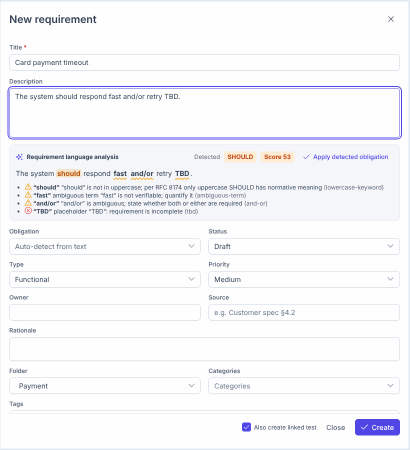

4. Now replace the text with a precise one:

   `The system MUST cancel a card payment that is not confirmed by the payment provider within 30 seconds.`

   The analysis shows **Detected: Must** and a score of 100.


5. Leave **Obligation** on **Auto-detect from text**: the detected level is stored when you create the requirement. You can also choose a level yourself; **Apply detected obligation** sets the field to what the analysis found.
6. Set **Priority** to **High** and, under **Categories**, choose **Area / Core**.
7. Set **Status** to **Approved**: in a real project you do this once the requirement has been reviewed. By default a test can only be executed when it is **Ready** and every requirement it verifies is **Approved**, **Implemented** or **Verified** (see [Test execution settings](#test-execution-settings)).

Which keyword to use:

| Keyword | Meaning | Example |
|---|---|---|
| `MUST` / `SHALL` | Absolute requirement | The system MUST log every failed sign-in. |
| `MUST NOT` / `SHALL NOT` | Absolute prohibition | The system MUST NOT store card numbers. |
| `SHOULD` | Recommended; exceptions need a reason | The system SHOULD send an order confirmation within 5 minutes. |
| `SHOULD NOT` | Not recommended | The checkout SHOULD NOT require more than three pages. |
| `MAY` / `OPTIONAL` | Truly optional | The customer MAY save the card for later purchases. |
| `WILL` | Statement of intent or fact | The payment provider WILL send a callback. |

Write one obligation per sentence. If the analysis reports *several obligation keywords*, split the sentence into two requirements. More rules are explained in [Requirements](#the-language-analysis).

## Step 4: Add evaluation criteria

Evaluation criteria say **how** you will judge that the requirement is fulfilled. They also become the steps of the linked test.

1. In the editor, under **Evaluation criteria**, select **Add criterion**.
2. Enter `Unconfirmed payment is cancelled`, keep the method **Test** and enter the threshold `≤ 30 s`.
3. Add a second criterion `Cancellation is written to the audit log` with the method **Inspection**.
4. Check that **Also create linked test** at the bottom is ticked.
5. Select **Create**.

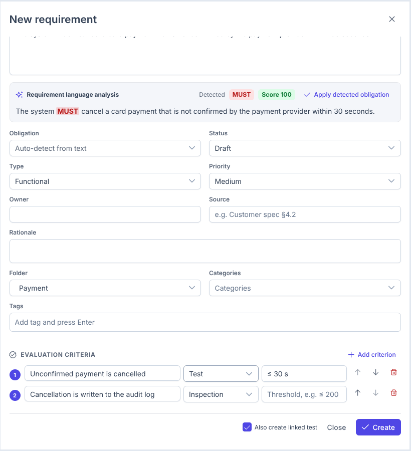

A message confirms *SHOP-REQ-1 with linked test SHOP-TC-1*. In the table, the requirement's **Coverage** is **Not run**: it has a test, but the test has not been executed yet.

Add one more requirement in the same folder for practice:

`The system SHOULD send an order confirmation by e-mail within 5 minutes after payment.`

## Step 5: Refine the automatic linked test

1. Select **Tests** in the sidebar. The test folder tree mirrors your requirement folders: there is a **Checkout / Payment** folder that Qtestframe created for you.
2. Open **SHOP-TC-1 Verify SHOP-REQ-1: Card payment timeout**. It is a manual test in status **Draft**, tagged `auto-generated`, with one step per criterion, for example *Verify (test): Unconfirmed payment is cancelled* with the expected result *≤ 30 s*.
3. Make the steps concrete. Click into a step to edit **Action**, **Expected result** and **Data**:

   | # | Action | Expected result | Data |
   |---|---|---|---|
   | 1 | Put an item in the basket and start the card payment | The payment page of the provider opens | test card 4111 1111 1111 1111 |
   | 2 | Do not confirm the payment; wait 30 seconds | The order shows *Payment cancelled* | |
   | 3 | Open the audit log | A *payment cancelled* entry exists for the order | |

4. Use **Add step** to append a step, the **+** on a row to insert one below, and the arrows to reorder.
5. Set **Status** to **Ready** and add the categories **Polarity / Negative** and **Interface / External**.
6. Select **Save**.


Under **Linked requirements** at the bottom you see SHOP-REQ-1. Use **Link requirements** to link further requirements to the same test.

## Step 6: Add a shared step

Many tests begin the same way, for example by signing in. Write those steps once and call them from other tests.

1. Select **New test** and create a test `Sign in as a customer` with two steps: *Open the shop and select Sign in* → *The sign-in form is shown*, and *Enter the customer e-mail and password* → *The account page is shown*. Set its status to **Ready** and select **Create**.
2. Open SHOP-TC-1 again and select **Insert call to test…** above the steps.
3. Choose **Sign in as a customer** and select **Insert call**. The new step reads **Calls SHOP-TC-…**.
4. Move the call step to the top with the up arrow and select **Save**.


When a run is created, the called test's steps are inserted in place of the call, marked with the called test's key. If you improve the shared test later, new runs get the improvement. The shared test lists where it is used under **Used by**.

## Step 7: Create a run

1. Select **Operations** in the sidebar, then **New run**.
2. Enter the **Name** `Sprint 1 regression`, the **Environment** `staging` and the **Build** `1.0.0`.
3. Choose the tests to include. The run gets the union of all three tabs:
   - **Tests**: **Pick tests…** and select individual tests;
   - **Folders**: tick **Checkout**; tests in subfolders are included;
   - **Query**: a filter such as `status:ready`; **Preview** shows how many tests match.
4. Select **Create run**.

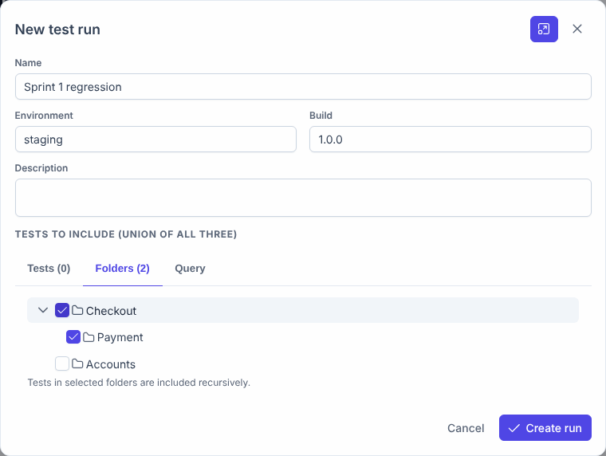

The run opens with one **execution** per test, all **Not run**. The steps of each test, including the inserted shared steps, are copied into the run now, so later edits to the tests do not change this run.

## Step 8: Execute manually and record a defect

1. In the run, select **Execute** (or the play button of one execution). The execution runner opens.
2. The left column lists the steps; the right side shows the current step with its **Action**, **Expected result** and **Test data**.
3. Do what the step says and compare the result:
   - if it matches, select **Pass** or press <kbd>P</kbd>;
   - if not, type what happened in **Actual result** and select **Fail** or press <kbd>F</kbd>.

   **Blocked** (<kbd>B</kbd>) and **Skip** (<kbd>S</kbd>) are also available. The runner moves to the next step automatically. Press <kbd>?</kbd> to see all shortcuts.
4. Let step 3 fail: the audit log entry is missing. Under **Defects**, enter `SHOP-101` (the ID in your issue tracker) and press <kbd>Enter</kbd>. Add a remark in **Notes**.
5. The **Overall status** is derived from the steps: one failed step makes the execution **Failed**. Select **Save & next** to save and go to the next execution.


**Turn defect IDs into links:** in **Categories & settings**, enter a **Defect tracker URL template** such as `https://jira.example.com/browse/{id}`. From then on `SHOP-101` links to your tracker.

## Step 9: Run an automated script

Automated tests are scripts that run on the server. Exit code 0 means *passed*, anything else *failed*.

1. In **Tests**, select **New test**, enter `Order total calculation`, and switch the execution type to **Automated**.
2. Choose the **Script** language **sh** and enter:

   ```sh
   #!/bin/sh
   # exit code 0 = passed, non-zero = failed
   total=$((2 * 15 + 5))
   echo "order total: $total"
   [ "$total" -eq 35 ] || { echo "unexpected total"; exit 1; }
   ```

3. Select **Create**.
4. Open the run *Sprint 1 regression*, select **Add tests**, choose the new test and confirm.
5. Open its execution and select **Run script**. After a moment the **Output** shows the script's output and the execution is **Passed**, with its duration.

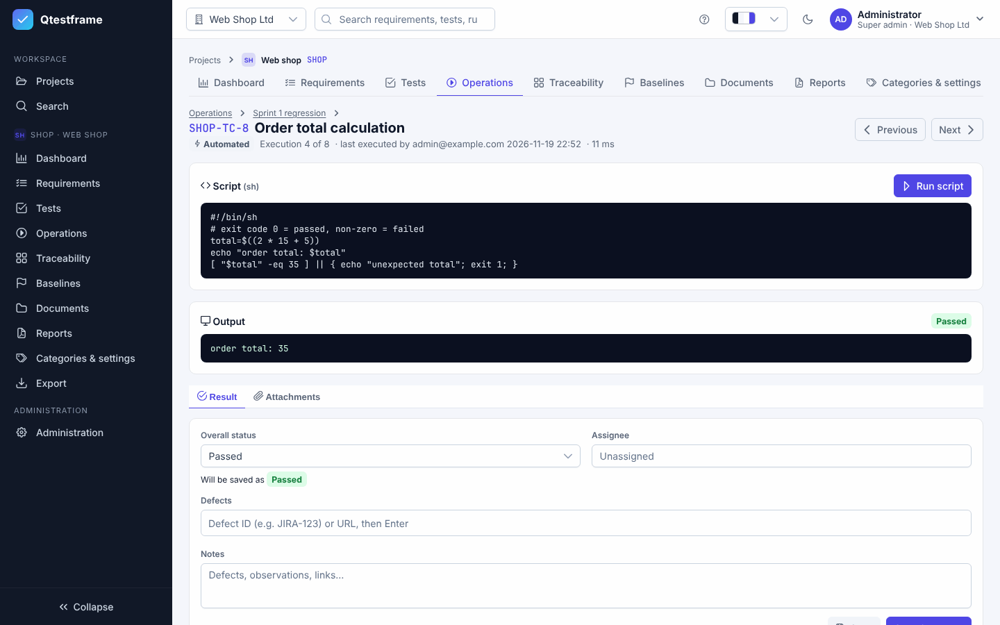

**Run script** needs the **Manager** role (permission `script.execute`) and the server setting `runner.enabled: true`. If the button is missing or reports that the runner is disabled, ask your administrator. CI pipelines can instead report results through the API; see [CI import](#import-results-from-ci).

## Step 10: Check traceability and the dashboard

1. Select **Traceability**. Requirements are rows, tests are columns, and a marked cell means *linked*. The coloured bar at the start of each row shows the coverage (see the legend): SHOP-REQ-1 is now **Failed** because its test failed. The **Requirements** list shows the same in its **Coverage** column.
2. Click an empty cell to link a requirement with a test, or a marked cell to remove the link. **Only linked tests** hides tests without links.
3. Select **Dashboard**. It summarises requirement coverage, execution results, requirements by status and obligation, tests by status and the recent runs.


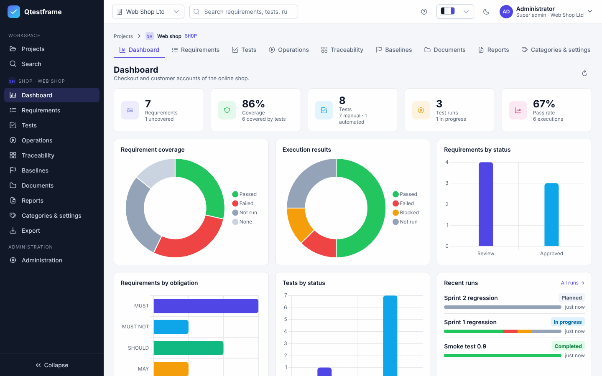

How coverage is calculated is explained in [Traceability and coverage](#how-coverage-is-calculated).

## Step 11: Create a baseline

Before a release, freeze the current versions of all requirements and tests.

1. Select **Baselines**, then **New baseline**.
2. Enter the **Name** `Release 1.0`. Leave **Filter (optional)** empty to include everything.
3. Select **Create baseline**.

Now change something, for example the threshold of a criterion of SHOP-REQ-1. Back in **Baselines**, select **Compare** on *Release 1.0* and compare it with **Current state**: SHOP-REQ-1 is listed under **Changed**, with the changed fields and both version numbers.

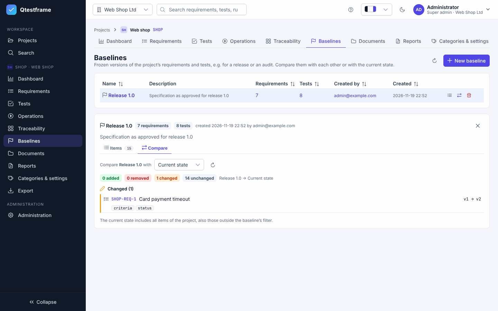

## Step 12: Export or generate a report

**Export the data:**

1. Select **Export**.
2. Choose the **Format**: **XLSX** (one sheet per aspect), **CSV** (a ZIP when you choose several aspects), **PDF** (printable) or **DOCX** (editable document).
3. Tick the **Aspects** you need: requirements, evaluation criteria, tests with steps, traceability matrix, runs and executions.
4. Optionally enter a filter such as `folder:Checkout`, then select **Download**.

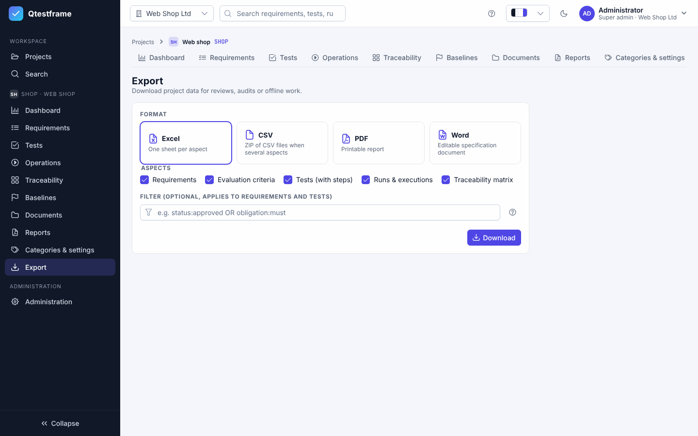

**Generate a report:** in **Reports**, choose a standard report such as **Requirements coverage** or **Run summary** (for *Sprint 1 regression*), pick PDF, DOCX, XLSX or CSV, and download it, or save it to the project's document archive so that the whole team finds it under **Documents**. Under **Custom report** you choose the item type, filter, columns, grouping and sorting yourself. See [Reports and export](#reports-and-export).

## What you have learned

You have created a project with folders, written verifiable requirements with the help of the language analysis, added evaluation criteria, refined the automatically created test, reused steps, run a campaign manually and automatically, recorded a defect, checked coverage, frozen a baseline and exported the results.

Next, read about [requirements](#requirements) and [tests](#tests) in more depth, or learn the [query language](#search-and-filters) to find anything quickly.

# Requirements

The **Requirements** section of a project holds the specification: every requirement with its obligation level, status, evaluation criteria, links to tests, relations to other requirements, comments, change history and attachments.

Reading requirements needs the role **Viewer**; creating and changing them needs **Manager**. Linking tests to a requirement needs **Tester**.

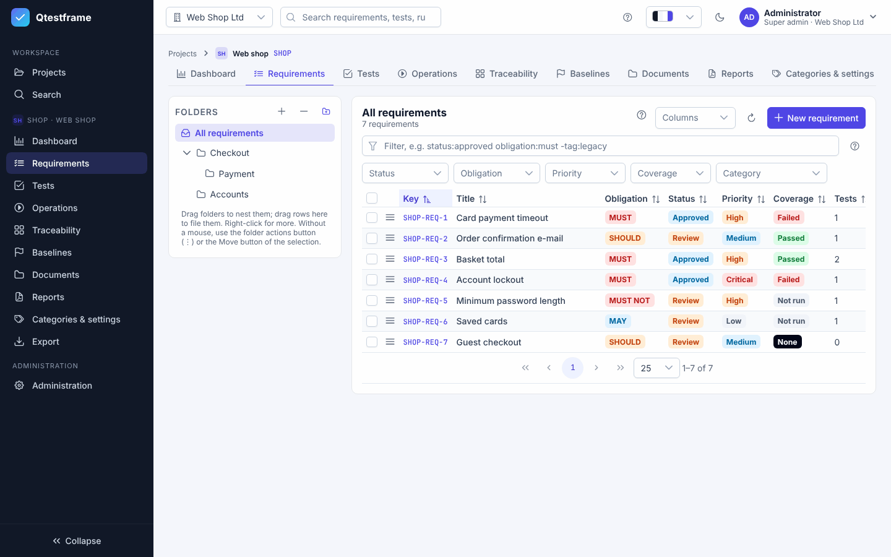

## The requirements page

- **Folder tree** (left): select **All requirements** or a folder. **Include subfolders** decides whether items of subfolders are listed. On narrow screens the tree opens with the **Folders** button.
- **Filter bar**: a [query](#search-and-filters) field plus quick filters for **Status**, **Obligation**, **Priority**, **Coverage** and **Category**. The quick filters are combined into a query that is shown under the bar (`q = …`). **Clear** resets all filters.
- **Columns**: choose which columns the table shows: obligation, status, priority, type, coverage, linked tests, categories, folder, owner, source, tags, **relations**, relation count, criteria, version, comments, created by, created and updated date. The **Relations** column lists the related items grouped by relation, in both directions, for example *depends on SHOP-REQ-2*, *provided by SHOP-REQ-3* and *verified by SHOP-TC-1*; select a key to open the item. Move columns by dragging their header, or with the arrow buttons in **Columns**; **Reset** restores the default columns. Your choice is remembered in this browser, also for the run, executions and document tables.
- **Table**: sort by clicking a column header; select a row (or its title) to open the editor. The ID (for example `SHOP-REQ-12`) is assigned automatically.

The current folder, filter and open requirement are part of the page address, so you can bookmark or share a filtered view.

## Obligation levels

Every requirement has an **obligation** based on [RFC 2119 and RFC 8174](#requirement-key-words-rfcs):

| Level | Meaning |
|---|---|
| **Must**, **Shall** | Absolute requirement |
| **Must not**, **Shall not** | Absolute prohibition |
| **Should** | Recommended: there may be valid reasons to deviate, but the consequences must be understood |
| **Should not** | Not recommended |
| **May**, **Optional** | Truly optional |
| **Will** | Statement of intent or fact (not an RFC 2119 keyword) |
| **Describe** | Descriptive text without obligation, such as an introduction or a note |

When you create a requirement with **Obligation** set to **Auto-detect from text**, the level is detected from the title and description. If several keywords appear, the strongest one wins (Must not before Must before Shall not … before Describe). Text without any keyword has no obligation and is counted as *unspecified* on the dashboard. Later edits never change the obligation automatically; use **Apply detected obligation** in the analysis box, or pick a level yourself.

Only UPPER-CASE keywords carry normative meaning (RFC 8174). Write `MUST`, not `must`. Requirements written in Swedish use the Swedish keywords described under [The language analysis](#the-language-analysis). The [References](#references) page lists these and other standards for requirements and testing.

While you write, **Help: obligation levels** below the description (open for new requirements) shows the keywords of each level in the language of the interface, what they mean and an example, with tips on writing them. [Analytics](#requirement-analytics) shows how the levels and keywords are spread over the project.

## The language analysis

While you type the description, the **Requirement language analysis** box shows the detected obligation, a **Score** from 0 to 100, the keywords highlighted in your text and a list of **Findings**.

The analysis understands **English** and **Swedish**. By default (**Detect language**) it works out the language of the text and shows it next to the selector, for example *Detected: Swedish*; pick **English** or **Swedish** in the selector to force one. Your choice is remembered in this browser. The findings are always shown in your interface language, whichever language the requirement is written in.

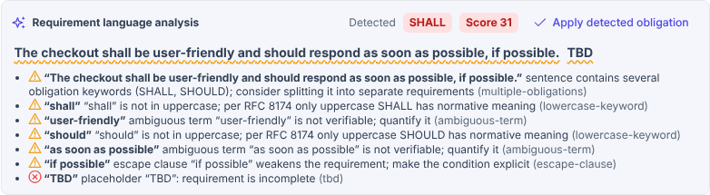

| Rule | Severity | Found when |
|---|---|---|
| Missing keyword | Warning | there is no obligation keyword (MUST, SHALL, SHOULD, MAY …) |
| Lower-case keyword | Info | a keyword is not in upper case, such as `must` |
| Negative requirement | Info | `MUST NOT` or `SHALL NOT`: harder to verify; say what the system does instead |
| Several obligations | Warning | one sentence contains more than one keyword; split it |
| Long sentence | Info | a sentence has more than 40 words |
| Ambiguous term | Warning | vague words such as *fast, easy, user-friendly, simple, efficient, adequate, appropriate, approximately, flexible, robust, reliable, intuitive, sufficient, as needed, normally, usually, seamless, scalable, optimal, several, many, few, reasonable, timely, acceptable, as soon as possible, suitable* |
| Placeholder | Error | `TBD`, `TBC`, `TODO`, `XXX`, `???`: the requirement is incomplete |
| Unbounded term | Info | *all, always, never, every, any, none*: check that it is really meant universally |
| And/or | Warning | `and/or`: say whether both or either is required |
| Passive capability | Info | *be able to*, *be capable of*: describe the behaviour instead |
| Escape clause | Warning | *if possible, where applicable, unless, except*: make the condition explicit |
| Ambiguous negation | Warning | Swedish only: *måste inte* is often read as a prohibition but means "need not"; write *får inte* or *behöver inte* |

In Swedish text the keywords are **SKA**/**SKALL** (shall), **MÅSTE** (must), **BÖR** (should), **FÅR** (may), **FÅR INTE** (must not), **SKA INTE** (shall not), **BÖR INTE** (should not), **BEHÖVER INTE** and **VALFRI** (optional), **KOMMER ATT** (will) and **BESKRIVER**/**NOT:** (descriptive); upper-case English keywords also count. Swedish has no upper-case convention, so the lower-case rule only applies to English. The other rules use Swedish words, such as *snabb, användarvänlig, osv, och/eller, kunna, om möjligt, alla*. Note that *får* also means "receives", so a sentence like *användaren får ett mejl* is read as *may*.

**Score** = 100 − 25 per error − 10 per warning − 2 per info, never below 0. For example *The system shall respond fast and/or retry TBD.* scores 53: a lower-case keyword (info), *fast* (warning), *and/or* (warning) and *TBD* (error).

If you do not want the box, turn it off in your profile: **Hide the live requirement-language analysis**.

## Fields

| Field | Use |
|---|---|
| **Title** | A short name (required). |
| **Description** | The requirement statement itself, analysed while you type. |
| **Obligation** | See above. |
| **Status** | Draft, Review, Approved, Implemented, Verified, Rejected or Obsolete. *Approved* and *Rejected* are review decisions: they need the permission *requirement.review* (Reviewer or Manager) and are greyed out without it. Reviewers see **Approve** and **Reject** buttons at the top of the editor. |
| **Type** | Functional, Non-functional, Security, Performance, Usability, Interface, Constraint, Business or Regulatory. |
| **Priority** | Critical, High, Medium or Low. |
| **Owner** | Who is responsible for the requirement. Type `@` to pick a person, see [Mention people](#mention-people). |
| **Source** | Where it comes from. Pick one from the list (▾), which offers the project's sources and the sources other requirements already use, or type your own, for example *Customer spec §4.2*. The list of the project is edited under **Categories & settings → Requirement sources** (one per line; empty means the defaults: Customer, Contract, Standard, Regulation, Stakeholder, …). |
| **Rationale** | Why it exists. |
| **Folder** | Where it is filed. |
| **Categories** | Values of the project's requirement category dimensions, for example *Area / Security*. |
| **Tags** | Free keywords; type a tag and press <kbd>Enter</kbd>, or select one of the **Suggested tags** below the field. Suggestions come from the title and description: tags the project already uses that the text mentions come first (a solid border), then abbreviations such as *GDPR* and words of the title or words used more than once (a dashed border). Every tag gets a colour of its own, the same everywhere (tables, the tag cloud, documents), so equal tags are easy to spot. |

The header of the editor shows the ID, the **version** (for example *v3*), the coverage and who changed it last. The version increases with every change.

## Evaluation criteria

Under **Evaluation criteria** you state how fulfilment is judged. Each criterion has a description, a **method** and an optional **threshold**:

| Method | Typical use |
|---|---|
| **Test** | executing a test case (the default) |
| **Inspection** | examining code, documents or configuration |
| **Analysis** | calculation, simulation or measurement evaluation, for example *p95 < 2 s* |
| **Demonstration** | showing the function to a reviewer |
| **Review** | a formal review |

Select **Add criterion** to add one; use the arrows to reorder and the bin to remove one. Saving replaces the list. When you link a test, you can choose the criterion it verifies in **Criterion for new links**.

## Linked tests

**Also create linked test** (ticked by default; your personal default is in your profile) creates a draft manual test when you create a requirement:

- titled *Verify SHOP-REQ-n: …*, with the requirement's priority and the tag `auto-generated`;
- with one step per evaluation criterion, or one step derived from the text if there are none;
- in the test folder with the same path as the requirement's folder (missing folders are created);
- linked to the requirement, so its coverage starts as **Not run** instead of **None**.

The section **Linked tests** of the editor lists all linked tests with their last result. **Link tests** adds more (Tester); the **×** on a row removes a link. Links can also be set in the [traceability matrix](#traceability-and-coverage).

## Relations

The **Relations** tab connects requirements of the same project:

| Relation | Meaning |
|---|---|
| **refines (parent)** / **refined by (child)** | decomposition: this requirement is a more detailed part of the other one |
| **depends on** / **required by** | this requirement needs the other one |
| **provides** / **provided by** | this requirement supplies something (a capability, an interface, data) that the other one needs |
| **derived from** / **source of** | this requirement was derived from the other one |
| **conflicts with** | both cannot be satisfied at the same time |
| **duplicates** / **duplicated by** | the same content twice |
| **relates to** | an informal relation |

Select **Add relation…**, choose the type and then the requirements. A requirement cannot relate to itself, and *refines* relations may not form a cycle. In queries, `parent:`, `child:` and `related:` find requirements by their relations, for example `child:*` for requirements that have been decomposed.

### Relations of many requirements at once

To relate many requirements in one step, select them in the list and choose **Relations** in the toolbar (needs **Manager**):

- **Add:** choose the relation that **each selected requirement** should have, for example *refines (parent)*, and **Choose requirements…** for the other end. Every selected requirement gets the relation to every chosen requirement, so you can make ten requirements children of one parent at once. Relations that already exist, would relate a requirement to itself or would form a *refines* cycle are skipped and counted in the message.
- **Remove:** choose the relation to remove, or **Any relation**, and optionally the requirements at the other end; with none chosen, the matching relations to any requirement are removed.

The dialog says how many relations will be added or removed before you confirm. On a requirement's **Relations** tab, tick several relations (or **Select all**) and choose **Remove** to remove them together. Both can be undone with **Undo**.

## Mention people

Type `@` in **Owner**, **Description**, **Rationale**, a comment, or in a test's description and preconditions and an execution's **Assignee** and notes: a list of people appears. It holds the users of the organisation (with their avatar) and names that are already used as owner or assignee in the project but have no account (*no account*). Keep typing to narrow the list, use the arrow keys and <kbd>Enter</kbd> or <kbd>Tab</kbd> to insert, or <kbd>Esc</kbd> to close the list.

A mention is written as `@handle`: for users the part of the e-mail address before the `@` (`@anna.berg` for *anna.berg@example.com*), for other people the name with dots instead of spaces (`@carl.carlsson`). Mentions of known people are shown as a chip with avatar and name, in the editor's comments and in the **Owner** column. Plain names still work: the owner is free text.

To find everything that mentions someone, filter with `mention:anna.berg` (or `mention:@anna.berg`).

## Comments

The **Comments** tab is a discussion thread on the requirement. Write in the field and select **Comment** (or press <kbd>Ctrl</kbd>+<kbd>Enter</kbd>). Everyone who can read the requirement can read and write comments. You can edit and delete your own comments; administrators can delete any comment. The number of comments is shown on the tab and in the **Comments** column.

## When someone else saved first

If someone saves a requirement while you are editing it, your **Save** does not overwrite their work. A dialog **Someone else changed this** says who saved the newer version and when, and lists the fields they changed next to your unsaved values; fields you changed too are marked. Choose:

- **Keep editing**: close the dialog and go on (for example to copy your text first);
- **Discard mine, load theirs**: load the saved version and drop your changes;
- **Save my changes**: save only the fields you changed on top of their version. Fields only they changed keep their values; where you both changed a field, yours is saved. The newer version stays in the **History** tab, so you can still compare or restore it.

The same applies to tests.

## History and restore

Every change creates a new **version**. The **History** tab lists the versions with who made the change (with their avatar), when and what kind of change it was (created, updated, restored, moved, bulk update). Select a version to see a field-by-field comparison with the previous one.

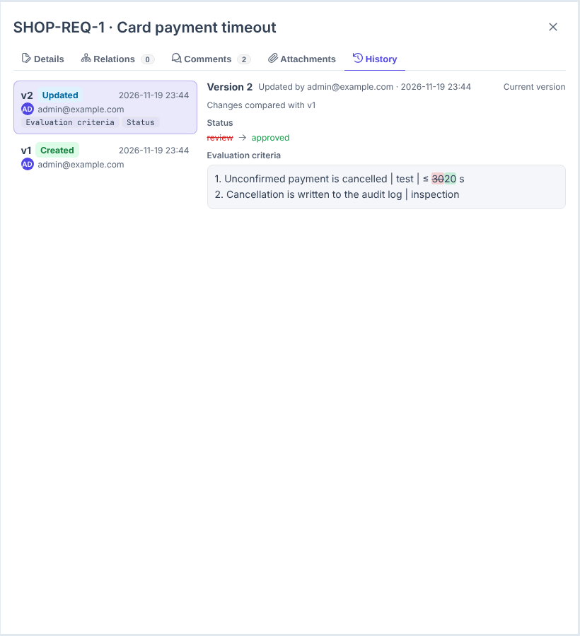

**Restore this version** copies the content of an old version back as a **new** version: title, description, obligation, type, priority, status, source, rationale, owner, tags, categories and criteria. Nothing is lost; the newer versions stay in the history. The folder and project are not changed. Categories that no longer exist are dropped.

## Approve many requirements at once

Holders of the review permission (`requirement.review`) can approve or reject many requirements in one step. Tick the requirements and choose **Approve or reject…** in the toolbar, or, with nothing ticked, choose **Bulk review** above the list. Then choose:

- **Which items**: the selected ones, all shown in the list (the current folder and filters, so filter first for a subset, e.g. `folder:Payments obligation:must`), or all requirements of the project.
- **Decision**: approve or reject.
- **Only items with status**: by default only requirements in *Review*. Add *Draft* to approve drafts directly.
- **Include anyway, despite**: see below.
- **Comment**: added to every requirement that changes, for example "Approved in the review meeting of 12 March".
- **Also complete my open review requests**: shown when [review requests](#reviews-and-notifications) to you are open for some of the requirements; on by default. Your requests are then decided together with the requirements (*Approved* when you approve, *Changes requested* when you reject), and the people who asked are notified. Their checklists are not ticked; the review records that it was decided in bulk. Requests to other reviewers still keep a requirement out.

The preview shows which requirements change and which are skipped, grouped by the reason:

| Reason | Meaning |
|---|---|
| Already has this status | nothing to do |
| Status not chosen above | its status is not one of those you chose |
| The latest review asked for changes | a [review request](#reviews-and-notifications) was answered with *Request changes* |
| Review requests are still open | someone has not finished reviewing it |
| Has suspect links | a linked test changed since the link was confirmed |
| No obligation level | approving needs an obligation level (rejecting does not) |

Choose a check under **Include anyway, despite** to approve those requirements anyway. Nothing is saved until you choose the button at the bottom. Each change is recorded in the requirement's history and the audit log, and the whole step can be undone with the undo button in the top bar (undo needs write permission; completed review requests stay decided).

## Bulk edit

Tick the checkboxes of several requirements (or the header checkbox for the whole page). A toolbar appears:

- **Set status**, **Set priority**, **Set obligation**: applied at once to all selected requirements;
- **Categories +** / **Categories −**: add or remove category values;
- **Tags +** / **Tags −**: add or remove tags (removing ignores upper and lower case);
- **Move**: move them to a folder;
- **Delete**: delete them after confirmation;
- **×**: clear the selection.

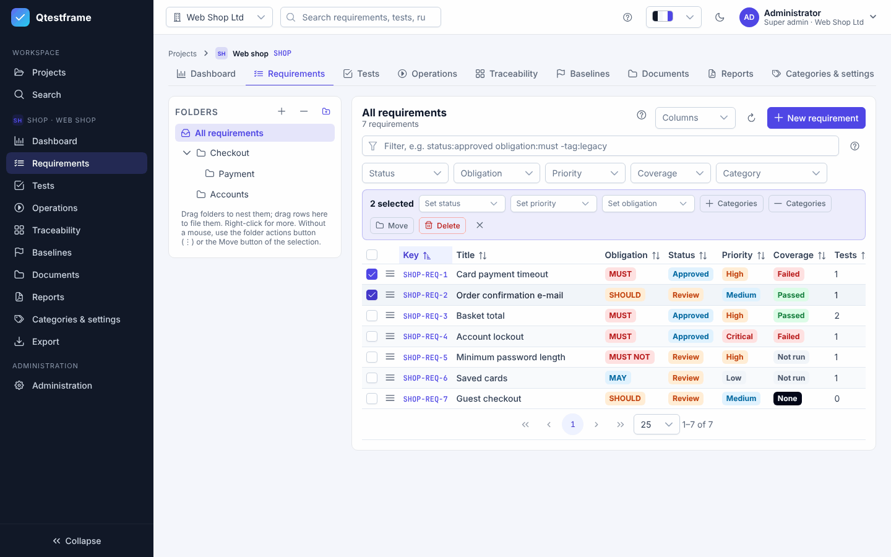

Every bulk change is recorded in each requirement's history.

## Move requirements and folders

- **Within the project:** drag rows by their handle (☰) onto a folder in the tree, or select them and use **Move**. Keys, links, categories and history stay as they are.
- **Folders:** drag a folder onto another one to nest it, or use **⋮ → Move to top level**. A folder cannot be moved into itself or its own subfolders.
- **To another project:** right-click a folder and choose **Move to project…**. The folder with all subfolders and requirements moves to the target project in the same organisation. There:
  - each requirement gets a **new key** of the target project (for example `CORE-REQ-17`); the old key is not reused;
  - categories are matched by dimension and name; values the target project does not have are dropped;
  - **links to tests are removed**, because links never cross projects;
  - criteria and history move along.

Without a mouse, use the folder's **⋮** actions button or the **Move** button of the selection.

**Several folders at once:** choose **Select several folders** (☑) above the tree. Each folder gets a checkbox; a ticked folder includes its subfolders. The toolbar then moves the ticked folders **into** another folder, to the **top level** or to **another project** (with everything in them, as above), or **deletes** them (keeping their requirements in the parent folder, or deleting them too). A move into one of the ticked folders is refused before anything changes. **Done** returns to the normal tree.

**Folder colour:** right-click a folder (or use **⋮**) and choose **Edit…** to give it a colour. Every requirement in the folder, and in subfolders without a colour of their own, gets a coloured stripe at the start of its row and a swatch next to its folder path, so items of the same folder are easy to spot. The folder tree shows the colour as a dot (a narrow dot when it is inherited). Choose **No colour** to remove it. Test folders work the same way, and a test folder created to mirror a requirement folder takes its colour.

**Deleting a folder** asks what to do with the content: **Delete, keep content** moves subfolders and requirements to the parent folder; **Delete everything** deletes the subtree including all requirements in it.

## Links to other items

The **Links** tab of a requirement, a test and a run lists links to other things, inside the tool and outside it. **Add link** offers:

| Link to | Choose |
|---|---|
| **Requirement**, **Test** | one or more items of the project with the item picker |
| **Run** | a test run of the project |
| **Archive file** | a document or saved report of the project's [document archive](#documents) |
| **Report** | a saved report definition; the link opens it under **Reports** |
| **Web address** | an `https://`, `http://` or `mailto:` address, for example a design specification, a ticket or a wiki page |

A **label** (optional) says what the link is, for example *Design spec* or *Jira ticket*. Links to items of the tool open them; files and web addresses open in a new tab. Under **Linked from** you see the requirements, tests and runs that link to this item, so links work in both directions.

Links can only point to items of the same project. When a linked item is deleted its links go with it (and come back when you undo the deletion); when an item moves to another project, its links to items of the old project are dropped and its web links move along. Adding and removing links needs the permission to edit the item that carries them, and you only see links to kinds of items you may read. Adding and removing a link can be undone.

### Links of many items at once

Select requirements or tests in their list, or runs on the **Operations** page, and choose **Links** in the toolbar:

- **Add:** choose what to link to and the targets (several requirements, tests, runs or files at once, or one web address) and an optional label. Every selected item gets a link to every target; existing links and links of an item to itself are left out.
- **Remove:** choose a kind of link, or **Any link**, and optionally the targets; with none chosen, all links of that kind are removed from the selected items.

The dialog says how many links will be added or removed before you confirm; items you may not change are skipped and counted in the message. On an item's **Links** tab, tick several links (or **Select all**) and choose **Remove** to remove them together. Both can be undone.

**Keys and addresses in texts.** In comments, an item key such as `SHOP-REQ-12` or `SHOP-TC-3` becomes a link to that item, and a web address becomes a link that opens in a new tab. The address `/go/SHOP-TC-3` in the tool always opens that item, which is handy in e-mails and chats.

## Attachments

The **Attachments** tab of the editor holds files that belong to the requirement: drawings, specifications, mails, screenshots. Drag files onto the tab or choose them to upload (up to 25 MB per file unless your administrator set another limit); several files upload one after another, with progress. Images, PDF files and plain text can be previewed; other files are downloaded.

You can also select **Attach from archive**: a file that is already in the project's [document archive](#documents) is linked rather than copied, so one specification can be attached to many requirements. Removing an attachment only unlinks it; an uploaded attachment that is no longer linked anywhere is deleted.

Uploading and removing attachments needs the **Manager** role (the same as editing the requirement); reading them needs **Viewer**.

## Import requirements

Customers often send their requirements as a spreadsheet, a ReqIF export from their requirements tool or a Word document. **Import** in the header of the requirements page reads such a file and creates the requirements in one go. Importing needs the permission to edit requirements (**Manager** by default).

1. Drag the file onto the dialog or choose it. Supported are **CSV** (comma, semicolon or tab separated; UTF-8 with or without byte order mark, UTF-16 and Windows-1252), **Excel** (`.xlsx`), **ReqIF 1.x** (`.reqif` and the zipped `.reqifz`) and **Word** (`.docx`), up to 20 MB and 5,000 requirements per file.
2. Check the **preview**: the detected format, how each column is read and the first 50 requirements with notes (a derived title, an unknown value, a duplicate). Nothing is stored yet.
3. Change the field of a column if it was guessed wrongly, or set it to *ignore*. Clear the **Import** box of rows you do not want.
4. Choose the options and select **Import**. The list reloads and the dialog shows how many requirements, folders and tests were created and what was skipped.

**Columns (CSV, Excel and tables in Word).** The first of the leading rows that names a title or description column is the header row; rows above it are ignored. Column names are recognised in English and Swedish, regardless of case:

| Field | Column names |
|---|---|
| Title | Title, Name, Heading, Summary · Titel, Namn, Rubrik |
| Description | Description, Text, Requirement, Statement · Beskrivning, Krav, Kravtext |
| ID | ID, Key, Ref, Number · Nyckel, Referens, Nummer, Krav-ID |
| Obligation | Obligation, Level · Kravnivå, Nivå |
| Type | Type · Typ, Kravtyp |
| Priority | Priority · Prioritet |
| Status | Status, State · Tillstånd |
| Source | Source, Origin · Källa, Ursprung |
| Rationale | Rationale, Justification, Comment · Motivering, Kommentar |
| Owner | Owner, Responsible · Ägare, Ansvarig |
| Tags | Tags, Labels · Taggar, Etiketter (separated by commas) |
| Folder | Folder, Section, Chapter · Mapp, Avsnitt, Kapitel (a path such as `Security / Login`) |
| Acceptance criteria | Criteria, Acceptance criteria · Kriterier, Acceptanskriterier (one per line; a line may start with a method, e.g. `inspection: …`) |

Values of type, priority, status and obligation may be written in English or Swedish (*High*/*Hög*, *Approved*/*Godkänd*, *Security*/*Säkerhet*). An unknown value is noted and the default is used. A row without a title gets one from the first words of its description. A file exported from Qtestframe (requirements as CSV or Excel) can be imported again; in an Excel export the evaluation criteria of the criteria sheet come along.

**ReqIF.** Every SPEC-OBJECT becomes a requirement: *ReqIF.Name* (or an attribute named title or name) gives the title, *ReqIF.Text* the description and *ReqIF.ForeignID* the ID; other attributes are matched by name like columns. Formatted text (XHTML) is imported as plain text with its line breaks; in a ReqIF file exported by Qtestframe it is read back with its formatting (paragraphs, lists, bold …), so an [export](#reqif-for-requirements-tools) comes back unchanged. Objects with only a *ReqIF.ChapterName* are headings: the specification hierarchy below them becomes folders.

**Word.** Headings (the styles *Heading 1*, *Heading 2* … or *Rubrik 1* …) become folders. Every other paragraph or list item that contains an obligation keyword becomes a requirement: the paragraph is the description and the title is its first eight words. A leading identifier such as `REQ-12:` or `[SRS-7]` becomes the ID. List items right after a requirement ending with a colon are added to it. Tables with a header row are read like a spreadsheet. If the document writes its keywords in uppercase (MUST, SHALL), lowercase *may* or *should* in running text are not taken as requirements.

**Obligation levels.** An obligation column (MUST, SHALL NOT, SKA, BÖR, FÅR …) wins; otherwise the level is detected from the title and description as in the editor, see [Obligation levels](#obligation-levels).

**Options.**

- **Target folder:** where the requirements go (the folder selected in the tree, or the top level).
- **Create folders from the file:** folder paths, sections and headings are created below the target folder; existing folders with the same name are reused. Without it everything goes into the target folder.
- **Status:** for requirements without a status in the file (default *Draft*). *Approved* and *Rejected* need the review permission.
- **Create a linked test for each requirement**, as in the editor (needs the permission to edit tests).
- **Skip duplicates:** a row is skipped when its ID is already recorded in a requirement of the project, or when a requirement with the same title (ignoring case) exists; rows repeated within the file count too.

The ID of an imported requirement is kept in its **Source** field as `ID: REQ-12` (after the source of the file, if there is one), which is how duplicates are found the next time. The import is all or nothing: if one requirement cannot be stored, none is. Every import is recorded in the audit log.

## Copy a requirement

**Copy** in the editor creates a new requirement based on this one: titled *Copy of …*, with a new key in the same folder and the description, obligation, type, priority, source, rationale, owner, tags, categories and evaluation criteria. The copy starts as **Draft** and opens in the editor so you can adapt it. **▾ → Copy and relate as derived from** also records the relation *derived from* the original. Links to tests, comments and history are not copied.

## AI prompts (software projects)

In a project whose **project type** is **Software** (set it when you create the project, or under **Categories & settings → Project**), **AI prompts** appears in the project navigation. It builds a ready-to-use prompt for an AI assistant (for example a coding assistant) from the project's requirements or tests. Qtestframe only writes the text; you copy it into the assistant your organisation allows. Nothing is sent to an AI service.

1. Choose what the prompt is for:

   | From | Prompt | What the assistant is asked to do |
   |---|---|---|
   | requirements | **Implement requirements** | write the code, traceable to the requirement keys, with tests; list open questions |
   | requirements | **Review requirements** | check them against ISO/IEC/IEEE 29148 and RFC 2119; propose rewrites and measurable criteria |
   | requirements | **Design test cases** | derive test cases of a **test type**, as JSON that can be imported with the API |
   | tests | **Automate test cases** | write automated tests in your **test framework**, one per test case, named after its key |
   | tests | **Review tests** | check quality and coverage against the requirements they verify |
   | tests | **Plan a test type** | a test plan for one test type: scope, tools, entry and exit criteria, tests to add |

2. Choose the items: **all**, those **matching a filter** (the [query language](#search-and-filters)), or **selected** ones. You can also start from a requirement or test: **AI prompt** at the bottom of the editor, or **AI prompt** in the bulk toolbar for the selected rows.
3. Choose the **test type** (unit, integration, system, acceptance, end-to-end, API, regression, smoke, performance, security, usability or accessibility), the **test framework or tools** (suggestions such as pytest, Playwright, JUnit 5 or Go testing; any text is fine), the **language of the prompt** (English or Swedish) and any **additional instructions**.
4. Select **Build prompt**, then **Copy** or **Download (.md)**.

A prompt contains the project's **technical context**, the items with their obligation, status, description, rationale, criteria with thresholds, relations, linked tests or requirements, steps with test data and expected results, prerequisites and, for automation, the current script, followed by instructions and the expected form of the answer. Describe the languages, frameworks, architecture and conventions of the project once under **Categories & settings → Project → Technical context**; every prompt includes it.

Reading the items is enough to build a prompt. A prompt holds at most 200 items. Only paste prompts into AI services that your organisation allows for this information.

## Delete a requirement

Open it and select **Delete**, or select several and use **Delete** in the bulk toolbar. Deleting also removes its links, relations, comments and history. Select **Undo** (<kbd>Ctrl</kbd>+<kbd>Z</kbd>) right afterwards to bring it back with everything, see [Undo and redo](#undo-and-redo).

# Tests

The **Tests** section holds the test cases of a project. A test is either **manual**, executed step by step by a person, or **automated**, a script that the server runs. Tests are organised in folders, classified with categories, linked to the requirements they verify and reused in many runs.

Reading tests needs **Viewer**; creating, editing, linking and copying tests needs **Tester**.

The page works like the [requirements page](#the-requirements-page): folder tree, filter bar with quick filters (**Status**, **Execution**, **Priority**, **Last result**, **Category**), selectable columns (including execution type, last result, linked requirements, language, steps, tags, **relations** — *verifies*, *calls* and *called by* — defects, created by and dates) and a table. Bulk edit, moving and deleting work the same way; the bulk toolbar has **Set execution** instead of *Set obligation*.

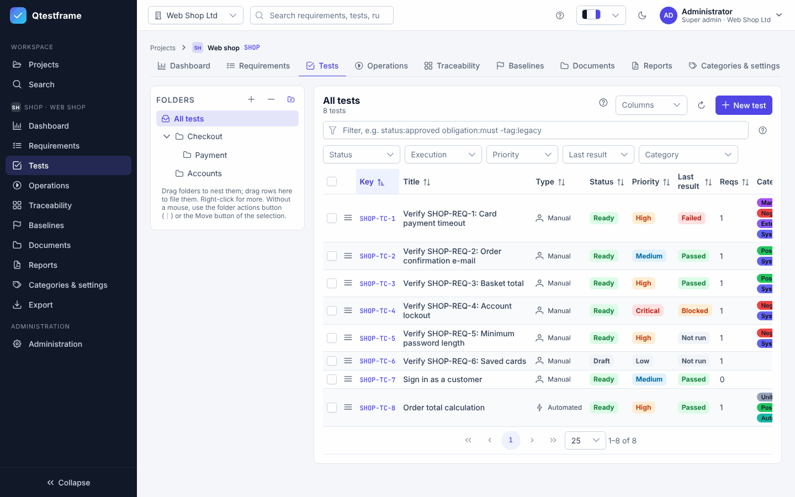

## Fields

| Field | Use |
|---|---|
| **Title** | A short name (required). |
| **Execution type** | **Manual** or **Automated**. |
| **Description** | What the test is about. |
| **Preconditions** | What must be true before the test starts, for example *a customer account exists*. Shown to the tester in the runner. |
| **Status** | Draft, Ready, Review or Deprecated. |
| **Priority** | Critical, High, Medium or Low. |
| **Estimate (minutes)** | Expected duration. |
| **Folder**, **Categories**, **Tags** | Filing and classification. **Suggested tags** under the tags field come from the title, description, preconditions and steps, as for [requirements](#fields). |
| **Overall expected result** | The expected outcome of the test as a whole. |

## Manual tests: steps

Each step has an **Action** (what to do), an **Expected result** (what should happen) and optional **Data** (input values, accounts, files).


- **Add step** appends a step; the **+** on a row inserts one below it.
- The arrows move a step up or down; the bin removes it.
- When you save, the step list replaces the old one. Saving the same steps again is not counted as a change.

When a test is added to a run, its steps are copied into the run. Editing the test afterwards does not change existing runs, only new ones.

## Automated tests: scripts

Switch **Execution type** to **Automated** to show the **Script** field. Choose the **Script language**: **sh**, **Bash**, **Python**, **JavaScript** (Node.js) or **Web test (Playwright)** (see [Web tests](#web-tests-playwright)).


- The script runs on the server in a sandbox when someone selects **Run script** in the execution runner.
- Exit code **0** means **Passed**; any other exit code, or exceeding the time limit, means **Failed**.
- Standard output and errors are stored as the execution's **Output**, together with the duration.
- The script can read these environment variables: `QTF_TEST_KEY`, `QTF_RUN_ID`, `QTF_RUN_NAME`, `QTF_ENVIRONMENT`, `QTF_BUILD` and `QTF_BASE_URL`, so one script can test the environment and build named in the run. The project's [test variables](#web-tests) arrive as `QTF_VAR_<NAME>`, for example `QTF_VAR_USERNAME`; the values of secret variables are masked as `***` in the stored output.

Running scripts needs the **Manager** role and must be enabled by the administrator (`runner.enabled`). If your scripts run elsewhere, for example in a CI pipeline, leave the script empty and [import the results](#import-results-from-ci) instead. Steps are optional for automated tests.

## Web tests (Playwright)

A **web test** drives a real browser with [Playwright](https://playwright.dev): choose the script language **Web test (Playwright)**. The editor offers a **starter template**; select **Insert starter template** when the script is empty.

Write the script in one of two ways:

- **The body of one test** (the usual case). Qtestframe wraps it into a Playwright test named after the test case, with `page`, `context`, `request` and `baseURL` at hand and `test` and `expect` imported:

  ```js
  await page.goto('/login');
  await expect(page.getByRole('heading', { level: 1 })).toHaveText('Sign in');
  await page.getByLabel('E-mail').fill(process.env.QTF_VAR_USERNAME);
  ```

- **A complete spec file**: when the script calls `test(` itself (for example `test('…', async ({ page }) => { … })` or `test.describe(…)`), it is used as it is. Import `test` and `expect` from `@playwright/test` yourself. Every test of the file must pass for the execution to pass.

Paths such as `page.goto('/login')` are relative to the **base URL** of the project (an administrator sets it under **Settings → Web tests**, also one per run environment). A [test configuration](#test-configurations) with a **Browser** dimension picks the browser: *Chrome*, *Chromium* or *Edge* run in Chromium, *Firefox* in Firefox, *Safari* or *WebKit* in WebKit; a **Base URL** dimension overrides the base URL.

**Record a script instead of typing it**: on a computer with Node.js, run `npx playwright codegen https://your-app.example.com`, click through the scenario in the browser that opens, and copy the lines inside the generated `test(…)` into the script (or paste the whole file).

Web tests run on the server in the background when someone selects **Run script** or [Run automated tests](#run-all-automated-tests); the result, the output, screenshots and a trace are stored with the execution (see [Web tests and their evidence](#web-tests-and-their-evidence)). The server must have Playwright installed and web tests enabled (see [Web tests](#web-tests)).

## Shared steps

A step can **call** another test of the same project instead of having its own action. Use it for sequences that many tests share, such as signing in.

1. In the steps of a test, select **Insert call to test…**.
2. Choose the test to call and select **Insert call**. The step shows **Calls** with the called test's key.
3. Move the call step to the right position and save.

When a run is created, the call is replaced by the called test's steps (marked `[KEY]`). Calls can be nested up to five levels. A test cannot call itself, and calls may not form a cycle. The called test shows **Used by:** with all tests that call it. If you delete a called test, the call becomes an empty step.

## Data-driven tests

A data-driven (parameterised) test is written once and executed with several sets of data, for example the same login with a customer, a business and an administrator account.

1. In the test editor, open the **Test data** section below the steps and select **Add parameter**. Name the parameter, for example `username` (letters, digits, `_`, `.` and `-`, not starting with a digit; at most 50 parameters).
2. Select **Add row** for every set of data and fill in the values. A row can have a name (*Customer*); without one it is called *Row 1*, *Row 2* … The arrows move rows, the bin removes one (at most 500 rows).
3. Use the parameters in the steps, the preconditions, the description and the expected results as `{{username}}` (spaces inside the braces are allowed: `{{ username }}`).

**Paste table** takes cells copied from Excel, LibreOffice or Google Sheets (or comma- or semicolon-separated text). Tick whether the first line names the parameters and whether the first column holds the row names, and whether the pasted rows replace the test data or are added to it. **Copy table** copies the test data as a table you can paste into a spreadsheet. A placeholder that is not a parameter is left as it is; the editor warns about such placeholders, as they are usually typos.

When the test is added to a run, every row becomes an **iteration** of the execution with its own copy of the steps, with the placeholders replaced by the row's values. Changing the test data afterwards does not change existing runs, only new ones. A test without rows is executed once, as before. See [Data-driven tests: iterations](#data-driven-tests-iterations) for how iterations are executed and how the overall result is derived.

**Shared steps and parameters:** steps called from another test ([shared steps](#shared-steps)) are resolved with the parameters of the **calling** test, so a shared *Sign in as {{username}}* works with each row of every test that calls it. The test data of the called test is not used when it is called; it applies only when that test itself is executed. Placeholders the calling test does not define stay unchanged.

The test data is part of the test's version history and of the export (**Export → Test data**: one line per row and parameter).

## Categories

Categories classify tests and requirements along **dimensions**. New projects get these defaults:

| Scope | Dimension | Values |
|---|---|---|
| Tests | Polarity | Positive, Negative |
| Tests | Interface | External, Internal |
| Tests | Medium | File based, Network based |
| Tests | Execution | Manual, Automated |
| Tests | Level | Unit, Integration, System, Acceptance |
| Requirements | Area | Core, UI, Security, Operations |

An item can have any number of category values, also several of the same dimension. Manage them in **Categories & settings**:

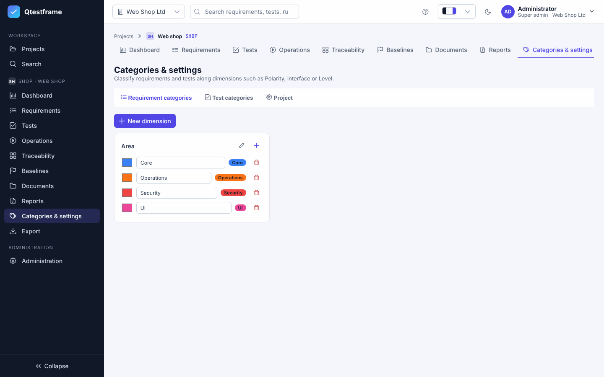

- **New dimension** creates a dimension with its first value; **Add value** adds values to it.
- Select a colour swatch to recolour a value; it is shown in that colour everywhere.
- **Rename dimension** moves all values to a new dimension name. If the target dimension already has a value with the same name, the two are merged.
- Deleting a value removes it from all items.
- Tick values (across dimensions of one tab) to change several at once: **Move to dimension** (an existing one or a new name; a value with the same name there absorbs the moved one), **Colour**, **Merge** (choose the value to keep; items with the others get it and the others are deleted, for example to clean up duplicates such as *UI* and *User interface*), **Copy to tests** / **Copy to requirements** (values that already exist there are skipped) and **Delete**. Each change is all or nothing; colour changes can be undone.

In queries, `category:Negative` matches the value name and `dimension:Polarity/Negative` the full form.

The same page holds the project's **Name**, **Description**, the **Defect tracker URL template** (see [Defects](#defects)), the [Save and load](#save-and-load-projects) section (**Save project**, **Duplicate project**, **Load project**) and, for admins, **Delete project**. Editing categories needs **Manager** (or the write permission of their scope, Tester for test categories).

## Mark many tests ready at once

Holders of `test.review` can mark many tests *Ready* in one step: tick the tests and choose **Mark ready…**, or choose **Bulk review** above the list with nothing ticked. As for requirements (see [Approve many requirements at once](#approve-many-requirements-at-once)), you choose the tests (selected, shown in the list, or all), the statuses they may come from (by default *Review*; add *Draft* to include drafts) and an optional comment, and a preview shows what changes.

Besides the checks for requirements (the latest review asked for changes, open review requests, suspect links), a test is skipped when it cannot be run as written: a **manual test without steps** or an **automated test without a script**. Choose the check under **Include anyway, despite** to mark them ready anyway.

## Copy a test

**Copy** in the editor creates a duplicate titled *Copy of …* with a new key in the same folder, including steps, categories and tags. The copy starts as **Draft**, so it is reviewed again. Links to requirements are not copied.

A test becomes **Ready** through a review: setting that status needs the permission *test.review* (Reviewer, Test lead or Manager); reviewers see a **Mark ready** button at the top of the editor.

## Linked requirements

The **Linked requirements** section shows which requirements the test verifies. **Link requirements** adds links; **×** removes one. Tests without any link do not contribute to coverage.

## Dependencies

A test can **depend on** other tests: they are its prerequisites and must have passed before it may be started. For example, *Change the delivery address* depends on *Sign in*.

In the test editor, the section **Depends on** lists the prerequisites with their latest result. Select **Add prerequisite** to pick tests of the same project, and **×** to remove one *(Tester)*. **Required by** lists the tests that wait for this one. A test cannot depend on itself, and dependencies may not form a cycle.

When the test is executed, each prerequisite counts as passed when its execution in the same run has passed; when the prerequisite is not part of the run, its latest result counts. Until then the runner shows why the test cannot start, unless the [test execution settings](#test-execution-settings) allow it. The **Relations** column of the test list shows *depends on* and *required by*, the [dependency graph](#dependency-graphs) draws them, and the filter `depends_on:SHOP-TC-1` (or `depends:`) finds the tests that depend on SHOP-TC-1.

## Test flow

**Test flow** in the project navigation (or **Flow diagram** at the bottom of the test editor) draws a test as a flowchart:

- **Start**, then a check **Prerequisites passed?** when the test has [dependencies](#dependencies) (no → *Blocked*), then the **Preconditions**;
- every step as a box with its number, action and test data; a step with an expected result is followed by a decision **As expected?** whose *no* branch ends in **Failed**;
- a [shared step](#shared-steps) as a box with double side bars (*Runs the steps of TC-…*). Select it, or its button under **Shared steps**, to show the called test's steps in place, numbered 3.1, 3.2 …, inside a dashed frame; **Expand all** and **Collapse all** do it for every call. A test that calls itself is marked and not expanded;
- an automated test as **Run the script** followed by **Exit code 0?**;
- the overall **Expected result** as a last check, and **Passed** at the end.

**List** shows the same flow as a numbered text list, with the *otherwise* outcome of each check. Use the zoom buttons for large tests.

**Run order** shows a test run in **stages**: a test is placed after all tests of the run it depends on, so stage 1 holds the tests without prerequisites in the run. Tests of one stage can be executed in any order or in parallel. Each card shows the latest result in the run, which tests it waits for and links to the runner and to its flow diagram. Prerequisites that are not part of the run are listed as warnings.

## Execution history

The **Executions** tab lists every execution of the test in all runs, newest first, with the run, its environment and build, the result, who executed it, when, the duration and any defects. Use it to see whether a test is flaky or when it started to fail.

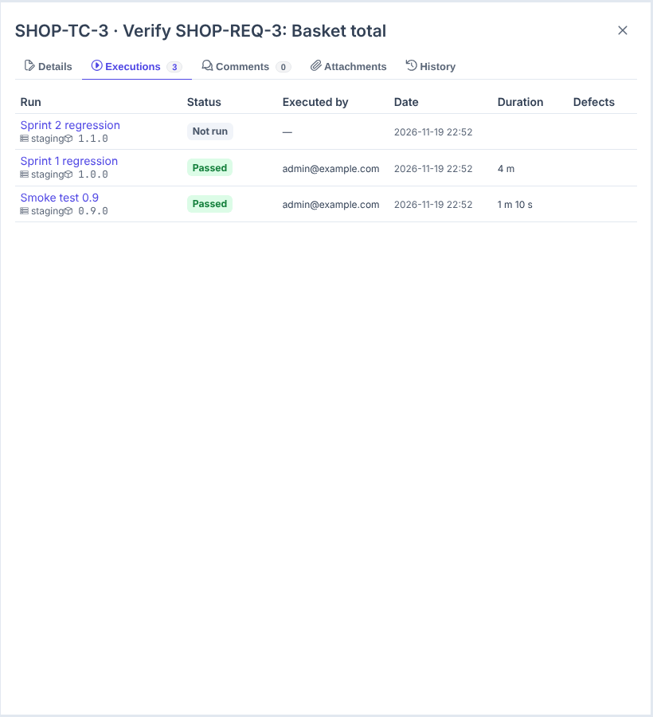

In runs with [configurations](#configurations-in-a-run) the configuration of each execution is shown below the run, and a data-driven execution links to its iterations in the runner.

The table column **Last result** shows the most recent result (in any configuration). In queries, `last_result:failed` finds tests whose latest result failed, and `defect:SHOP-*` tests with such a defect.

A result marked **Flip** differs from the previous passed or failed result of the test: there the test started to fail, or passed again.

## Flaky tests

A test is *flaky* when its result changes back and forth between passed and failed without the test or the product being changed in between. Qtestframe looks at the last 10 passed or failed results of every test, from all runs — manual results as well as automated ones from JUnit imports, the `qtestframe report` uploader and the Playwright reporter. Blocked, skipped and not run results are left out, since they say nothing about the test itself.

The *flakiness* of a test is the number of flips among those results: a passed result after a failed one, or the reverse. A test with **2 or more flips** counts as flaky. A test that broke once and was fixed has at most two flips spread over a long time; a test that alternates reaches the threshold quickly.

- In the tests list, flaky tests have a **Flaky** badge next to the last result (point at it to see the number of flips).
- The query `flaky:true` lists the flaky tests; `flakiness>=3` (or `flips>=3`) those with at least three flips.
- The **Quality** tab of the [dashboard](#the-dashboard) shows the ten flakiest tests with their latest results.
- The **Executions** tab of a test marks every flip.

A flaky test hides real failures and wastes time on reruns: find the cause (timing, test data, order, the environment) or put the test aside until it is fixed.

## Comments and history

**Comments** and **History** work exactly as for [requirements](#comments). Restoring a test version restores its fields and steps as a new version; steps get new IDs and calls to deleted tests are dropped. If someone else saves a test while you edit it, you can compare and choose instead of overwriting their changes, see [When someone else saved first](#when-someone-else-saved-first).

## Links

The **Links** tab of a test links it to other tests, requirements, runs, documents and saved reports of the archive, report definitions and web addresses, see [Links](#links-to-other-items).

## Attachments

The **Attachments** tab holds files for the test: test data, expected screenshots, configuration files. Upload by drag and drop or file selection, or use **Attach from archive**. Uploading and removing needs **Tester**. See [Requirements → Attachments](#attachments) for details.

# Catalogue

The **catalogue** is a built-in library of standard requirements and tests for software development: security, privacy and compliance, performance and reliability, operations and maintainability, usability and accessibility (also forms, preferences and mobile apps), common functionality (also workflow and approvals, collaboration, files, scheduling) and domain-specific functionality such as e-commerce checkout, billing, industrial automation and control systems, electrical energy, oil and gas, telecom, the chemical industry and industrial manufacturing. Instead of writing *"Passwords must be at least 12 characters"* and its test for every project, you choose the items that fit and add them to the project in one go, with their tests and trace links.

Browsing the catalogue needs permission to read requirements or tests (every role has it). Adding requirements needs **Manager** (`requirement.write`), adding tests **Tester** (`test.write`).

## Where the texts come from

The catalogue texts are written for Qtestframe, in English and Swedish. Each item is based on recognised standards and good practice, such as OWASP ASVS and the OWASP Top 10, WCAG 2.2, ISO/IEC 25010, NIST SP 800-63B, ISO/IEC 27001 and other standards in the ISO/IEC 27000 series (27002, 27005, 27017, 27018, 27019, 27035, 27701 …), IEC 62443, PCI DSS and EU legislation: the GDPR, the Cyber Resilience Act (CRA), DORA, NIS2, the Critical Entities Resilience Directive (CER), the Radio Equipment Directive (RED, with EN 18031) and the AI Act. It **cites** them under **Based on** by name and section. The catalogue does not copy the text of any standard: read the cited standard when you need its exact wording.

For Swedish organisations, the *Privacy and compliance* group also covers protective security under the Protective Security Act (säkerhetsskyddslagen 2018:585) and the Cybersecurity Act that implements the NIS2 directive, and the *Security* and *Operations* groups cover vulnerability disclosure (ISO/IEC 29147, RFC 9116, CSAF) and vulnerability handling (ISO/IEC 30111, IEC 62443-4-1, the EU Cyber Resilience Act). These items cite the laws and regulations by name and section; they help you plan and verify, but they are not legal advice.

Every requirement is one verifiable statement with exactly one obligation keyword (MUST, SHOULD, MAY … in English; SKA, BÖR, FÅR … in Swedish, see [Requirements](#requirements)), evaluation criteria and a rationale. Every test has preconditions, numbered steps with an expected result each and an overall expected result. Values that a team usually adjusts (12 characters, 2 seconds, 99.9 %) are part of the text, so you can change them after adding the item.

Every requirement lists at least one catalogue test that verifies it, and every test verifies at least one requirement, so adding a requirement with its tests always gives you a way to check it. Every item is complete in both English and Swedish, with the same criteria and steps in both languages.

## Browse and search

Open **Catalogue** in the project sidebar, or select **Add from catalogue** at the top of the requirement or test list.

- Switch between **Requirements** and **Tests** at the top.
- Choose **English** or **Svenska** for the language of the texts. The items are added in this language.
- On the left, **Groups and areas** lists the catalogue's groups (for example *Security*) and their areas (for example *Authentication*) with the number of items that match the current search and filters. Select **Everything** to see all areas. Use the arrow keys to move in the tree and Enter to select. On a narrow screen the tree opens with the **Areas** button.
- The **search** field finds items whose title, ID, tags, cited standards or description contain all the words you type (type `62443` or `27001`, for example, to list the items that cite that standard). The best matches come first: an exact ID such as `AUTH-01`, then the words in the title, then the other fields.
- Narrow the list with **Type**, **Obligation** and **Priority** (requirements), **Execution** (tests) and **Tags**. **Hide items already in the project** leaves out what you have added before.

Each row shows the ID, the title, the obligation and priority, and how many catalogue tests verify the requirement (or how many requirements the test verifies). **In project** marks items that the project already has; hover over it to see their keys.

## Preview an item

Select a row to see the full text on the right (on a phone it opens as a panel): the description with the obligation keyword highlighted, the rationale, the evaluation criteria with their thresholds, the cited standards and the catalogue tests that verify the requirement. For a test you see the preconditions, the steps, the expected result and the requirements it verifies. Select an ID under *Verified by* or *Verifies* to jump to that item.

## Add items to the project

1. Tick the items you want. **Select all shown** ticks everything the list shows, so to take a whole area, select the area in the tree first. You can tick requirements and tests on both tabs; the bar at the bottom counts them.
2. Select **Add N requirements (+ M tests)**. M includes the tests that verify the chosen requirements.
3. In the dialog, choose:
   - **Language** of the texts.
   - **Folder for the requirements** and **Folder for the tests** (top level by default).
   - **Subfolders**: none, *one folder per area* (for example *Authentication*) or *group and area folders* (*Security / Authentication*). Existing folders with the same name are reused.
   - **Status** of the requirements and the tests (*Draft* by default, so they are reviewed like other new items).
   - **Source of the requirements**: the cited standards (default) or one of the project's sources.
   - **Also add the tests that verify the chosen requirements** (on by default).
   - **Add copies of items already in the project**: off by default, so items the project already has are skipped.
4. The summary shows how many requirements and tests will be added and how many are skipped. Select **Add**.

At most 500 items can be added at once. The import is all or nothing: if something fails, nothing is added.

Qtestframe creates the requirements and tests as if you had written them, with a first history version, and creates **trace links** between each requirement and the tests that verify it, also to matching items that were added to the project earlier. The automatic linked draft test that a new requirement usually gets is not created: the catalogue tests take its place.

## After adding

A box at the top of the page sums up what was added. **Open the added requirements** and **Open the added tests** open the lists filtered to the new items. **Undo** (or Ctrl+Z) moves them to the trash; redo brings them back with their links. Folders that the import created stay.

The added items are ordinary project items: edit the texts and values to fit your system. The editor shows **From the catalogue: AUTH-01 · …** with the cited standards, and **Show in the catalogue** opens the original entry. This origin is kept when you edit, copy, move or restore the item. In filters, `catalog:AUTH-01` finds the items copied from one entry, `catalog:AUTH-*` those of an area and `has:catalog` every item from the catalogue (see [Search and filters](#search-and-filters)).

## Tips

- Start a new project from the catalogue: add the groups that apply, then delete or adapt what does not fit.
- Use the **Draft** status and a [bulk review](#requirements) to agree on the adapted items as a team.
- The catalogue is part of Qtestframe and grows with new versions. Items you have added do not change when the catalogue changes.

# Test runs and execution

A **run** (test run, campaign) is a set of tests that you execute together, for example *Sprint 12 regression* on the *staging* environment with build *1.4.2*. Each test in a run is an **execution** with its own result. Runs are under **Operations** in the project sidebar.

| Action | Role needed |
|---|---|
| View runs and results | Viewer |
| Create, edit and delete runs, add tests | Tester |
| Record results, import CI results | Tester |
| Run automated scripts on the server | Test lead |
| Change the [test execution settings](#test-execution-settings) | Test lead |

## The run list

**Operations** lists the runs of the project with their status, environment, build, progress bar and pass rate. Filter with the query language, for example `status:in_progress env:staging`. Select a run to open it.

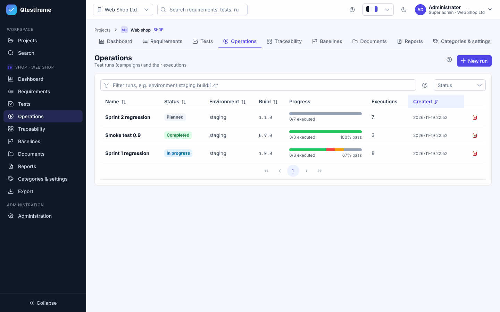

## Change many runs at once

Tick the runs in the list (or the header checkbox for the whole page). The toolbar that appears changes all of them at once (permission to change runs):

- **Set status**: for example abort old runs, or close runs that are finished in practice.
- **Set release**: put the runs in a [release](#releases-and-risks), or take them out of one.
- **Environment / build**: set the environment, the build or both (an empty field clears it).
- **Delete**: delete the runs with all their results, after confirmation.

Status, release, environment and build changes can be undone with the undo button in the top bar; deleting cannot.

## Create a run

Select **New run** and fill in:

- **Name**, for example *Sprint 12 regression* (a dated default is suggested);
- **Description**, **Environment** (e.g. *staging*) and **Build** (e.g. *1.4.2+sha*): free text that is shown with the results and passed to automated scripts;
- **Configurations** (when the project has [test configurations](#test-configurations)): the configurations the run targets, for example *Chrome / Windows* and *Firefox / Linux*. Each test is then executed once per configuration; see [Configurations in a run](#configurations-in-a-run). Without configurations each test is executed once;
- **Tests to include**: the union of three tabs:
  - **Tests**: **Pick tests…** to select individual tests;
  - **Folders**: tests in the selected folders, including subfolders;
  - **Query**: every test matching a filter such as `status:ready category:Negative`; **Preview** counts the matches.

Select **Create run**. A test appears only once in a run even if several tabs select it. Without any tests the run starts empty, and you add tests later.

When a test is added, its current steps (with shared steps expanded) are copied into the execution. Later edits of the test do not change this run.

## The run page


- **Run status**: **Planned**, **In progress**, **Completed** or **Aborted**. The start time is set when the run first becomes *In progress* (also automatically when the first result is recorded); the end time when it becomes *Completed* or *Aborted*. A run becomes **Completed by itself** when every test in it has a final result (passed, failed, blocked or skipped), also a run with a single test. It goes back to *In progress* when a result is taken back to *Not run* or *In progress*, or when tests are added. You can still set the status by hand; an *Aborted* run is never changed automatically.
- **Progress** and **Pass rate** summarise the executions.
- **Execute** opens the runner at the first execution that has not been run yet.
- **Add tests** adds more tests; **CI import** shows how a pipeline reports results; **Edit run** changes name, description, environment and build; **Delete** removes the run with all its results.
- The table lists every execution with test, result, **Assignee**, **Executed by**, **Defects**, **Finished** time and duration. Filter it, for example `status:failed` or `assignee:anna`.
- Per row: **Mark passed** and **Mark failed** record a result directly; the play button opens the execution in the runner.

## Configurations in a run

A run can target one or more [test configurations](#test-configurations). Adding a test then creates **one execution per test and configuration**: a run with 10 tests and 3 configurations has 30 executions.

- The run list shows the configurations of each run in the **Configurations** column; the filter `configuration:Chrome` (or `config:`) finds runs that target a configuration.
- On the run page, **Results per configuration** shows progress and pass rate of each configuration; select a configuration's name to see only its executions, or use **Show configuration** above the table. The **Configuration** column names the configuration of each execution, and the filter `configuration:"Chrome / Windows"` works in the execution table as well.
- **Edit run → Configurations** changes the configurations later. An added configuration gets an execution for every test of the run. A removed configuration's executions are deleted, which is refused while one of them has a result (set them back to *Not run* first). Adding the first configuration to a run without configurations assigns the existing executions to that configuration; removing the last one keeps its executions as executions without configuration.
- Prerequisites ([dependencies](#dependencies)) count per configuration: in a run, a prerequisite counts as passed when it passed in the **same configuration**.
- The runner shows the configuration in its header, and the [execution history](#execution-history) of a test shows the configuration of each execution.

Runs without configurations work exactly as before. How results in several configurations count for requirements is described in [How coverage is calculated](#how-coverage-is-calculated).

## Record many results at once

On the run page, tick tests in the execution table (the header checkbox ticks the whole page). The toolbar then offers:

- **Set result**: *Passed*, *Failed*, *Blocked*, *Skipped* or *Not run* for all ticked tests.
- **Result, assignee, note…**: a dialog to set a result, assign the tests to someone (empty removes the assignee) and add a note below the notes they already have, in one step. **Only tests that have not been run yet** leaves tests that already have a result alone, for example to mark the rest *Skipped* at the end of a run.
- **Remove from run** (permission to change runs): takes the tests out of the run, with their results, step results and evidence, after confirmation.

The same [execution settings](#administration) apply as for one test at a time: *Passed* and *Failed* are only recorded for tests that may be executed. Tests that may not are listed with the reason, and the rest are recorded. Prerequisites in the same selection are handled: when you mark a test and its prerequisite *Passed* together, the prerequisite is recorded first. *Blocked*, *Skipped*, *Not run*, assignees and notes are always possible.

Step results are not changed: a bulk result is the overall result of each test. The run completes by itself when every test has a final result, and requirements whose status follows the evidence are updated. Results, assignees and notes can be undone with the undo button; removing tests cannot.

## The execution runner

The runner shows one execution at a time. Its header tells you which execution of the run this is (*Execution 3 of 12*) and who executed it last.


### Manual tests

1. Read the **Preconditions** at the top.
2. The left column lists the steps with their status; select a step to jump to it.
3. For the current step, carry out the **Action** with the **Test data** and compare with the **Expected result**.
4. Record the outcome with **Pass**, **Fail**, **Blocked** or **Skip**. For anything other than a pass, write what happened in **Actual result**. The runner moves on to the next step.
5. Below the steps:
   - **Overall status** is derived from the steps (*Will be saved as …*): any failed step → **Failed**; otherwise any blocked step → **Blocked**; all passed or skipped with at least one pass → **Passed**; all skipped → **Skipped**; partly done → **In progress**. You can also set it explicitly.
   - **Assignee**: who should execute the test. Type `@` to pick a person ([mentions](#mention-people)).
   - **Defects**: defect IDs or URLs, each followed by <kbd>Enter</kbd>.
   - **Notes**: observations, links, anything worth keeping.
6. Select **Save**, or **Save & next** to save and open the next execution. On the last execution the button is **Save & finish**: it saves and returns to the run page, where the run is completed once every test has a result; if some still have none, it says how many and opens the first of them. **Previous** and **Next** move between executions. *Unsaved changes* reminds you to save.

A test without steps shows only the overall result, notes and defects.

### Data-driven tests: iterations

A [data-driven test](#data-driven-tests) has one **iteration** per row of its test data. The runner lists the iterations above the steps, each with its result; select one to work on it. It shows the values of the iteration's row, and the steps, the preconditions and the expected results with the placeholders replaced by these values.

- With steps, every iteration has its own step results, evidence and actual results. Its result is derived from its steps like the result of a test. Marking the last step of an iteration moves on to the first step of the next one.
- Without steps, mark each iteration **Passed**, **Failed**, **Blocked** or **Skipped** with the buttons below the values (or the keys P, F, B and S).
- Each iteration has its own notes.

The **overall result** of the execution follows the iterations, evaluated top-down: **Failed** if an iteration failed; else **Blocked** if one is blocked; **Passed** when all iterations passed or were skipped (at least one passed); **Skipped** when all were skipped; **Not run** when none has a result; otherwise **In progress**. As for steps, you can choose another overall result by hand. A result set directly on the execution (with **Mark passed** in the run, a bulk result or a CI import) is recorded as the overall result; the iterations keep their results, and the next change of an iteration derives the overall result again.

The run page shows the number of iterations next to the result of a data-driven execution.

### Keyboard shortcuts

The shortcuts work when the focus is not in a text field. Press <kbd>?</kbd> in the runner to show them.

| Key | Action |
|---|---|
| <kbd>P</kbd> | Mark the step as passed |
| <kbd>F</kbd> | Mark the step as failed |
| <kbd>B</kbd> | Mark the step as blocked |
| <kbd>S</kbd> | Skip the step |
| <kbd>J</kbd> or <kbd>↓</kbd> | Next step |
| <kbd>K</kbd> or <kbd>↑</kbd> | Previous step |
| <kbd>?</kbd> | Show or hide the keyboard help |

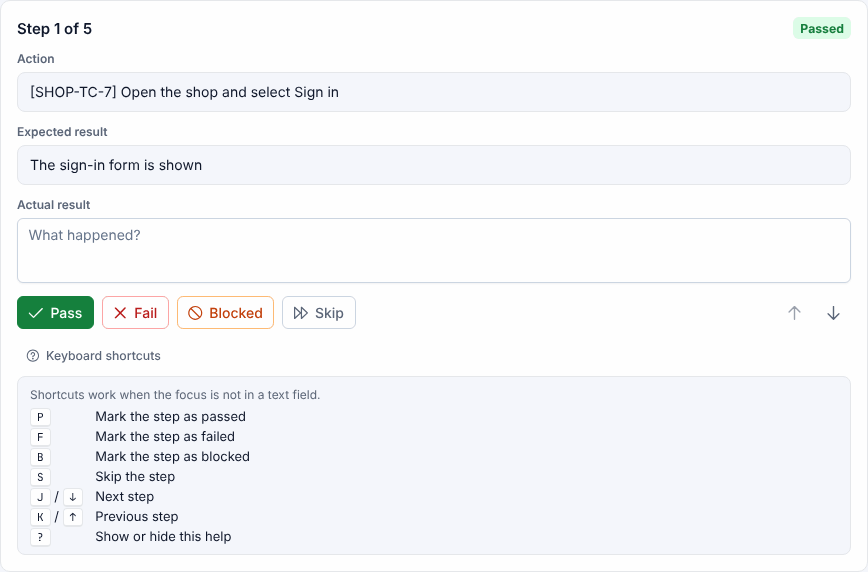

### Automated tests

For an automated test the runner shows the **Script** and its **Output**. Select **Run script** to execute it on the server: the execution is set to *In progress*, the script runs, and the result is **Passed** for exit code 0 and **Failed** otherwise (or when it exceeds the time limit). The output and duration are stored.

The button needs the **Test lead** or **Manager** role (permission *script.execute*). If the administrator has not enabled the script runner, the server answers that it is disabled; results then come from CI.

### Web tests and their evidence

A [web test](#web-tests-playwright) takes seconds to minutes, so **Run script** puts it in a queue and answers at once: the execution shows *Queued* or *Running* (with **Cancel**), you can go on with other tests, and the page updates itself when the result is in. The server runs a few web tests at the same time (set by the administrator); the others wait in the queue.

When the test has finished, the runner shows the result, Playwright's **Output** (the steps and the failure message; values of secret variables appear as `***`) and the **Web test evidence**:

- **Screenshots** — by default only when the test fails, showing the page at the moment of the failure. Select a screenshot to enlarge it.
- **Trace** (`trace.zip`, by default when the test fails) — a recording of every action with the page before and after, the network requests and the console. Download it and open it with `npx playwright show-trace trace.zip`, or drop it onto [trace.playwright.dev](https://trace.playwright.dev) (the file is opened in your browser and not uploaded).
- **Video** — when the administrator has switched videos on.

The files are also listed under **Attachments** of the execution. Running the web test again replaces them (other attachments stay).

### Run all automated tests

On the run page, **Run automated tests** queues every automated test of the run that has not passed yet, each in its configurations; select executions and use **Run automated** in the bulk bar to run just those (passed ones included). Tests that may not be executed yet (see [When can a test be executed?](#when-can-a-test-be-executed)) are left out and listed. A prerequisite that is in the run as well runs first, and its dependent tests wait for it — if it fails, they are not executed.

While tests are queued or running, a panel shows the progress (*queued*, *running*, *done*, passed and failed) and the tests in the queue; **Cancel queued** removes the tests that have not started (their executions keep their earlier result). The executions and results update as the jobs finish. Scripts in the other languages are run this way too.

Jobs do not survive a restart of the server: tests still queued or running then get their earlier result back, with a note in their output.

### Evidence

Each step of a manual test has an **Evidence** section under *Actual result*: open it to record what proves the result. Write observations, values or links in the text field (for example *response time 120 ms, order 4711*), and add files such as screenshots or log extracts *(Tester)*. Files can be dropped onto the area or picked from the archive, like other [attachments](#attachments-on-runs-and-executions). The step's header shows how much evidence it has.

Evidence is saved with the execution (select **Save**), stays with this run when the test changes later, and appears in the document archive as *Evidence of a test step*, linked to the step. Deleting the run deletes its evidence files.

### When can a test be executed?

Before a test is executed, Qtestframe checks that it is ready: the test has status **Ready**, the requirements it verifies are approved (or implemented or verified), and the tests it [depends on](#dependencies) have passed. What happens when a check fails is set in the [test execution settings](#test-execution-settings):

- **blocked** (the default): the runner shows a red box with the reasons and links; **Pass**, **Fail** and **Run script** are disabled, and the server refuses such results. You can still mark the test **Blocked** or **Skipped**;
- **allowed**: the reasons appear as an amber warning, and you can execute the test.

Each reason says exactly what is wrong, what to do about it and which setting decides, for example:

- *SHOP-TC-4 has status Draft; only tests with status Ready can be executed.* — **What to do:** finish the test and have it reviewed and marked Ready (needs *test.review*). *Blocked by the execution setting “Allow executing tests that are not Ready”, which is off.*
- *It verifies SHOP-REQ-2, which has status Approved; the execution settings require linked requirements to be Implemented or Verified.* — **What to do:** move the requirement on when it has been implemented, or ask an administrator to add its status to the ready statuses.
- *It depends on SHOP-TC-1, which is Failed in this run; a prerequisite must have passed first.* — **What to do:** execute SHOP-TC-1 first and make it pass, or add it to the run.

So you can tell whether the test itself, a requirement, a prerequisite or an organisation setting stops it. The run page shows the same in its **Readiness** column (select the entry to see the full explanation), with a summary above the table; the tooltips of the disabled Pass and Fail buttons and any refused result name the reasons too, and the **New run** dialog marks picked tests that are not ready.

## Defects

Record a defect wherever a test fails: in the runner under **Defects** (an ID such as `JIRA-123` or a full URL). Defects are shown on the run page, in the test's **Executions** tab and in reports.

To make IDs clickable, set the **Defect tracker URL template** in **Categories & settings**, for example `https://jira.example.com/browse/{id}`. `{id}` is replaced by the defect ID; without `{id}` the ID is appended. Values that already are URLs are linked directly.

Find defects with queries: `defect:JIRA-*` in the run's filter finds executions with a JIRA defect; in the tests list it finds tests with such a defect in their latest executions.

## Import results from CI

Automated pipelines (GitLab CI, GitHub Actions, Jenkins …) can report results into a run by test key.

1. Create an API token: **Administration → API tokens → New token**, role **Tester** or higher (see [API tokens](#api-tokens)). Copy the token; it is shown only once and starts with `qtf_`.
2. Open the run and select **CI import**. The dialog shows the endpoint with the run's ID and a ready-made command.

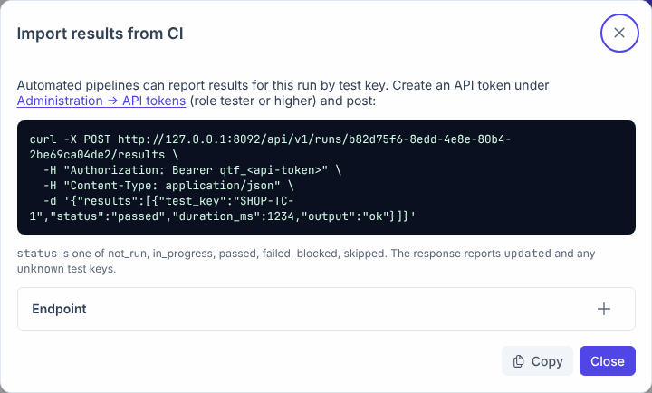

3. Post the results from your pipeline:

```bash
curl -X POST "https://qtf.example.com/api/v1/runs/$RUN_ID/results" \
  -H "Authorization: Bearer $QTF_TOKEN" \
  -H "Content-Type: application/json" \
  -d '{"results":[
        {"test_key":"SHOP-TC-7","status":"passed","duration_ms":1234,"output":"ok"},
        {"test_key":"SHOP-TC-9","status":"failed","duration_ms":877,"output":"expected 35, got 34"}
      ]}'
```

- `status` is one of `passed`, `failed`, `blocked`, `skipped`, `in_progress` or `not_run`.
- Test keys are matched without regard to case within the run's project. Tests that are not in the run yet are added.
- The answer reports how many executions were `updated` and lists `unknown` keys, which were skipped.
- An invalid status stops the import with an error; results before it stay applied.
- **Configurations:** when the run targets [configurations](#configurations-in-a-run), name the configuration of the results with `?configuration=NAME` in the address (`.../results?configuration=Chrome%20%2F%20Windows`) or per result with the field `"configuration": "Chrome / Windows"` (name or ID). A configuration the run does not target yet is added to it. Without a configuration, a run with exactly one configuration uses it and a run without configurations records the results without configuration, as before; a run with several configurations answers with an error.

Keep the token in your CI system's secret store, never in the repository. A token is bound to one organisation and never has more rights than its owner.

Besides this JSON format there are three easier ways for test tools that already write reports: JUnit XML, the `qtestframe report` command and the Playwright reporter.

### Link automated tests to test keys

Every automated test must say which Qtestframe test it executes. Put the test key (for example `SHOP-TC-12`) in one of these places:

- **in the test name**, e.g. `test_login[SHOP-TC-12]`, `TestCart/SHOP-TC-12_add` or `SHOP-TC-12 pays by card`. Where a name may not contain hyphens, `SHOP_TC_12` works as well. The key may also be part of the class name.
- **as a property of the test case** in the JUnit report, named `qtestframe.key` or `test_key`. With pytest: `record_property("test_key", "SHOP-TC-12")`.
- **with Playwright** as a tag `@SHOP-TC-12` or an annotation `{ type: 'qtestframe', description: 'SHOP-TC-12' }`.

Several test cases with the same key (for example the same test in two browsers) give one result: *failed* wins over *passed*, and the durations add up.

### JUnit XML

Almost every test tool writes JUnit XML: Playwright (`junit` reporter), pytest (`--junitxml`), Go (with go-junit-report), Maven Surefire and Gradle, Jest (jest-junit) and Vitest (`--reporter=junit`). Post the file to the run:

```bash
curl -X POST "https://qtf.example.com/api/v1/runs/$RUN_ID/junit" \
  -H "Authorization: Bearer $QTF_TOKEN" \
  -H "Content-Type: application/xml" \
  --data-binary @results/junit.xml
```

- A test case with `<failure>` or `<error>` is recorded as *failed*, one with `<skipped>` as *skipped*, all others as *passed*. The duration comes from `time`; the output holds the failure message and `system-out`/`system-err`.
- The answer lists, besides `updated`, `unknown` and `rejected`, the names of test cases without a key under `unmapped`.
- Add `?create_missing=true` to create a draft automated test for every test case without a key (titled like the test case) and record its result. A later import finds the test again by its title. This needs the right to write tests.
- Several files can be sent at once as a multipart upload (`-F file=@a.xml -F file=@b.xml`); together they may be at most 20 MB.
- `?configuration=NAME` records the results in that configuration, as for the JSON format.

### The qtestframe report command

The `qtestframe` program can upload reports itself. It finds the run by name in the project, or creates it:

```bash
export QTF_URL=https://qtf.example.com QTF_TOKEN=qtf_…
qtestframe report --project SHOP --run "Nightly $BUILD_NUMBER" --create-run \
  --build "$BUILD_NUMBER" --environment staging \
  --junit 'results/*.xml'
```

- `--run-id ID` reports into a known run instead of `--project`/`--run`.
- `--junit` and `--json` (the JSON format above) take files or patterns and can be repeated.
- `--create-missing` creates tests for test cases without a key, as above.
- `--configuration NAME` (or `QTF_CONFIGURATION`) records the results in that configuration; the run gets the configuration if it does not target it yet. Run the command once per configuration, e.g. once per browser.
- The command prints how many results were recorded and lists unknown keys, test cases without a key and rejected results with the reason. It ends with an error code when the upload fails, and with `--fail-on-unknown` also when results matched no test.

### Playwright reporter

For Playwright there is a reporter (`@qtestframe/playwright-reporter`, in `integrations/playwright-reporter` of the Qtestframe sources) that reports while the tests run, without a JUnit file:

```ts
// playwright.config.ts
reporter: [
  ['list'],
  ['@qtestframe/playwright-reporter', { project: 'SHOP', run: 'Nightly', createRun: true }],
],
```

It reads the server address and token from `QTF_URL` and `QTF_TOKEN`; the option `configuration` (or `QTF_CONFIGURATION`) names the [configuration](#configurations-in-a-run) of the results. It takes the key from the annotation, tag or title, writes the error and the `test.step()` titles with their result into the output and uploads screenshots, traces and other attachments of failed tests as attachments of the execution. If reporting fails, it only logs a message; your test run is not affected.

## Links of a run

The **Links** tab of the run page links the run to requirements, tests, other runs, archive files, reports and web addresses, for example the CI build or the release notes, see [Links](#links-to-other-items).

## Attachments on runs and executions

Runs and executions have **Attachments** too: log files, screenshots of a failure, test reports from other tools. In the runner, open the **Attachments** tab next to **Result** and drag files onto it or select **Choose files**; on the run page, attachments belong to the run as a whole. You can also attach a file from the project's [document archive](#documents). Uploading and removing attachments on runs and executions needs **Tester** (the right to record results).

# Releases and risks

A **release** is a version of your product that you plan, test and ship, for example *Spring 2027* or *2.1.0*. It brings together the requirements it must deliver (its **scope**), the test runs that test it and the **exit criteria** that decide whether it may ship. The **risk register** lists what could go wrong, how likely and how bad it would be, and which requirements address each risk. Open risks feed straight into the exit criteria of a release.

Releases and risks are in the project sidebar.

| Action | Role needed |
|---|---|
| View releases, their status and the risk register | Viewer |
| Create, edit and delete releases, change their scope and exit criteria, mark them released | Manager |
| Create, edit and delete risks and link requirements to them | Manager |
| Put a run in a release | Tester |

## The release list

**Releases** lists every release of the project with its version, status (*Planned*, *Active*, *Released* or *Cancelled*), target date, number of requirements and runs, and a **Go** or **No-go** badge. Select a release to open its details below the list.

To create a release, select **New release** and enter a name and, if you like, a version, status, target date and description. A new release starts with the default exit criteria:

- coverage at least 100 %,
- every MUST and SHALL requirement passed,
- at least 95 % of the requirements passed,
- no failed tests,
- no suspect links.

## Scope

The **Scope** tab lists the requirements the release must deliver, with their status, coverage and risk level.

- Select **Add requirements** to pick requirements from a list.
- Or enter a filter in the query language, for example `tag:checkout` or `risk:high`, and select **Add matching**: every requirement that matches is added. See [Search and filters](#search-and-filters) for the syntax.
- Select **×** on a row to remove a requirement from the scope.

A requirement can be in the scope of several releases.

## Runs in a release

A run belongs to a release when you choose the release under **Release** in the **New run** dialog or in **Edit run** on the run page. Choose **No release** to take it out again. The **Operations** list shows the release of each run in its **Release** column, and the run page shows it next to the environment and build.

Only results of the release's runs count for the exit criteria: a test that passed in a run of another release does not make this release pass.

The **Runs** tab of a release lists its runs with their status and progress; select a run to open it.

## Exit criteria

The **Exit criteria** tab lists the conditions the release must meet. Select **Add criterion**, choose a type and, where the type has one, a threshold or level; select the trash icon to remove one. Select **Save criteria** to keep the changes.

| Criterion | Met when | Parameter |
|---|---|---|
| Coverage | at least the threshold of the scope requirements have a test | threshold in % |
| Passed | at least the threshold of the scope requirements passed all their tests in the release's runs | threshold in % |
| Mandatory passed | every MUST and SHALL requirement in scope passed | — |
| Executed | at least the threshold of the executions of the release's runs have a result | threshold in % |
| No failed tests | no test failed or is blocked in the release's runs | — |
| Approved | at least the threshold of the scope requirements are approved, implemented or verified | threshold in % |
| No suspect links | no scope requirement has a [suspect link](#traceability-and-coverage) | — |
| No open defects | no open defect of at least the chosen severity is linked to a scope requirement or its tests | minimum severity |
| Risks mitigated | every risk of at least the chosen level that a scope requirement addresses is mitigated, accepted or closed | minimum risk level |
| Traceability rules | no requirement in scope and no test linked to one breaks an enabled [traceability rule](#traceability-rules) of the chosen severity; the status tab lists the items with the rules they break | errors only, or errors and warnings |

A release without exit criteria is always a go.

## Go / no-go

The **Status** tab evaluates the exit criteria now. It shows **Go** when every criterion is met and **No-go** otherwise, how many criteria are met, and a summary of the scope (requirements, how many have tests, passed, failed and not run) and the runs.

Each criterion shows whether it is met, the actual value next to the target (for example *80 % (target ≥ 95 %)*), and the items that block it: requirements without tests, failed tests, open defects or risks that still need action. Every item is a link that opens it.

The badge in the release list is the same evaluation, so you can see at a glance which releases are ready.

A percentage criterion with nothing to measure is **not met**: a release without requirements in its scope, or without executions for *executed*, shows *Nothing to measure yet* and is a no-go. A release without any exit criteria is always a go.

## Mark a release released

Select **Mark released** on an open release.

- If the release is a **go**, confirm and the release is marked released.
- If it is a **no-go**, the dialog lists the criteria that are not met. You can still release with an **override**: write why in **Why release anyway?** (at least 3 characters) and select **Release anyway**. The note is saved with the release and in the audit log.

When a release is marked released, Qtestframe creates the [baseline](#baselines) *Release* followed by the release name: it freezes the scope requirements and their tests in the versions they had. The release then shows when and by whom it was released, the override note if there was one, and a link to the baseline.

## Change many releases at once

Tick releases in the list. The toolbar then offers:

- **Set status**. Choosing **Released** releases only the ticked releases that are a go, each with its baseline; releases with a no-go are skipped and listed. To release despite a no-go, use **Mark released** on that release, which asks for the reason.
- **Target date** for all of them (empty clears it).
- **Copy exit criteria** from another release; they replace the criteria of the ticked releases.
- **Add requirements** (pick them) or **Add by filter** (for example `obligation:must tag:payments`) to the scope of every ticked release.
- **Delete**, after confirmation; the runs keep their results.

Every release is checked before any is changed. Changes of status (other than *Released*), target date and exit criteria can be undone with the undo button.

## The risk register

**Risks** lists the risks of the project. Every risk has a key such as *SHOP-RISK-3*, a title, a category, an owner, a **likelihood** and an **impact** from 1 to 5, a status and a **mitigation**: what you do to make it less likely or less harmful.

| Likelihood | | Impact | |
|---|---|---|---|
| 1 | Rare | 1 | Negligible |
| 2 | Unlikely | 2 | Minor |
| 3 | Possible | 3 | Moderate |
| 4 | Likely | 4 | Major |
| 5 | Almost certain | 5 | Severe |

The register shows the score and level of each risk, its status, owner, the requirements that address it, and how many of them are **covered** (have tests) and **verified** (all their tests passed). Filter it by text, level or status. Closed risks are hidden unless you select **Include closed risks** or filter on the status *Closed*.

To add a risk, select **New risk**. Choose the likelihood and impact (the dialog shows the score and level as you go), describe the mitigation and select **Link requirements** to choose the requirements that address the risk. Select a risk in the register to change it.

The requirement editor shows the risks a requirement addresses under **Risks**, and the requirement list has optional **Risk** and **Open defects** columns (see **Columns**).

### Change many risks at once

Tick risks in the register. The toolbar sets **status**, **likelihood** or **impact** of all of them, **Owner / category** sets either or both (empty clears), **Link requirements** links the same requirements to every ticked risk, and **Delete** removes them after confirmation. Only rows that are shown stay ticked, so filtering the register or choosing a heat-map cell never leaves hidden risks in the selection. Every risk is checked before any is changed. Changes other than linking and deleting can be undone with the undo button.

## The heat map

The heat map counts the risks in a 5 × 5 grid: likelihood from 5 at the top to 1 at the bottom, impact from 1 on the left to 5 on the right. The colour of a cell is the level of its score. Select a cell to show only the risks with that likelihood and impact in the register; select it again, or the **×** on the filter chip, to show all.

Next to the heat map, **Open risks by level** counts the risks that are not closed, per level; select a level to filter the register.

## Risk levels

The **score** of a risk is likelihood × impact, from 1 to 25. The score gives the **level**:

| Level | Score |
|---|---|
| Low | 1–4 |
| Medium | 5–9 |
| High | 10–16 |
| Critical | 17–25 |

The statuses *Identified* and *Mitigating* mean the risk still needs action; *Mitigated*, *Accepted* and *Closed* mean it does not.

## How risks affect a release

A requirement gets the level of the highest **open** risk it addresses. You can filter requirements on it with `risk:critical` or `risk:high`, and on open defects with `defects>0`.

The exit criterion **Risks mitigated** with the level *High* blocks a release while a requirement in its scope addresses a risk of level high or critical that is still *Identified* or *Mitigating*. The status tab lists these risks; mitigate them (or accept them) and set their status, and the criterion is met. A typical workflow:

1. Record the risks and link the requirements that address them.
2. Put those requirements in the release scope.
3. Add **Risks mitigated** with the level you can accept to the exit criteria.
4. Test the requirements in the release's runs; as the mitigation works, set the risks to *Mitigated*.

# Defects

A **defect** (bug) is a problem found while testing. Every defect has a key such as `SHOP-BUG-3`, a title, a description, a status, a severity, a priority and an assignee, and it is linked to the requirements, tests and executions it concerns. Defects are under **Defects** in the project sidebar.

Defects can be mirrored in **Jira** or **GitHub Issues**: Qtestframe creates the issue for you and reads its status back, so the developers work in their tracker while the test team sees the state of each defect next to its tests.

| Action | Role needed |
|---|---|
| View defects | Viewer |
| Report and edit defects, link them, push, sync and import issues | Tester |
| Delete defects, connect the tracker | Manager |

## The defect list

**Defects** lists the defects of the project, open ones first and the most severe at the top. The columns show the key, title, status, severity, assignee, the linked items and the issue in the tracker with its own status.

Filter with the quick filters **Status** and **Severity**, or with the [query language](#search-and-filters), for example `open:true severity:critical`, `assignee:anna*` or `linked:SHOP-REQ-12`. The fields are `key`, `title`, `description`, `status`, `severity`, `priority`, `assignee`, `external` (the issue key in the tracker), `created_by`, `open` (`true` for *Open* and *In progress*) and `linked` (keys of linked requirements and tests).

Select a defect to open and edit it. Select **New defect** to report one.

## Change many defects at once

Tick defects in the list (the header checkbox ticks the whole page). The toolbar changes all of them at once:

- **Set status** and **Set severity**, and **Assign…** to give them to someone (empty removes the assignee). The new assignee is notified. This needs permission to record results (`run.execute`).
- **Push to Jira/GitHub** creates an issue for each ticked defect that has none yet; defects that already have an issue are left alone. **Sync** reads the status of the ticked defects' issues. Both are shown when a tracker is connected.
- **Delete** (permission to change the project), after confirmation.

Every defect is checked before any is changed, so one wrong value changes nothing. Status, severity and assignee changes can be undone with the undo button in the top bar.

## Statuses and severities

| Status | Meaning |
|---|---|
| **Open** | Reported, not yet being worked on |
| **In progress** | Someone is fixing it |
| **Resolved** | Fixed, waiting to be verified by a new test |
| **Closed** | Verified or done |
| **Rejected** | Not a defect, a duplicate or will not be fixed |

*Open* and *In progress* count as **open**. Open defects are shown on requirements and tests and block a release (see [Open defects and releases](#open-defects-and-releases)).

| Severity | Typical use |
|---|---|
| **Critical** | Crash, data loss, security issue, no workaround |
| **Major** | An important function does not work (the default) |
| **Minor** | Works with a workaround, or a small function is affected |
| **Trivial** | Cosmetic, e.g. a typo |

Severity says how bad the problem is; **priority** (critical, high, medium, low) says how soon it should be fixed.

## Linking defects to items

A defect can be linked to any number of **requirements**, **tests** and **executions** of the project. In the defect dialog, under **Linked items**, select **Link requirement** or **Link test** to pick items, or **Link execution** to choose a run and one of its executions. Remove a link with ×.

The **Defects** tab of a requirement or test shows its defects:

- a **test** shows the defects linked to it and to its executions in every run (*via an execution*);
- a **requirement** shows the defects linked to it, to its tests and to their executions (*via a test*).

There you can **Report defect** (a new defect already linked to the item) or **Link existing** (choose a defect of the project). × removes a direct link. A requirement with open defects shows a red badge such as *2 open defects* next to its key; select it to open the tab.

Defect keys work like other keys: `SHOP-BUG-3` in a description or comment becomes a link, and `/go/SHOP-BUG-3` opens the defect.

Defect IDs typed into the **Defects** field of an execution (the older free-text list, see [Defects in the runner](#defects)) keep working. When such an ID is a defect key of this tool, for example `SHOP-BUG-3`, it links to the defect itself.

## Report a defect from a failed execution

When a test fails in the [execution runner](#the-execution-runner), a notice with **Report defect** appears on the result. It opens the defect dialog prefilled with:

- the test's key and title as the title;
- the run, the failed steps with their expected and actual results, and the notes of the execution as the description;
- a link to the execution (and so to the test and its requirements).

Adjust the text, set the severity and select **Report defect**. The new defect appears in the **Defects** tab of the runner, and the test and its requirements show it too. The tab also has **Link existing** for a defect that is already known.

## Connect Jira or GitHub

A manager connects the project to a tracker in **Categories & settings**, tab **Project**, card **Defect tracker**. Choose the **Tracker** and fill in the fields; **Check connection** saves the settings and checks the address, the project or repository and the token.

### Jira

- **Jira site address**: the address of the site, e.g. `https://example.atlassian.net`, or of your Jira Server or Data Center.
- **Jira project key**, e.g. `SHOP`, and the **Issue type** of new issues (default *Bug*).
- **Jira account e-mail** and **Token**: for Jira Cloud, the e-mail of the account and an **API token** created at id.atlassian.com under *Security, API tokens*. For Jira Server or Data Center, leave the e-mail empty and use a **personal access token**.

The account needs permission to browse the project and to create issues in it.

### GitHub Issues

- **Repository** as `owner/repository`.
- **API address**: empty for github.com; for GitHub Enterprise Server e.g. `https://github.example.com/api/v3`.
- **Labels** added to new issues, separated by commas, e.g. `bug, qtestframe`.
- **Token**: a **fine-grained personal access token** with access to the repository and the repository permission **Issues: Read and write** (*Metadata: Read* is included automatically).

### The token

The token is **write-only**: once saved it is never shown or sent back to the browser, the card only says **Token saved**. To keep it, leave the field empty when you change other settings. To replace it, type a new one and save. **Remove token** deletes it. Setting the tracker to **None** removes the whole connection.

## Push, sync and import

With a tracker connected, the defect list has three more actions:

- **Push to tracker** (the upload button of a defect) creates an issue from the defect: the title with the defect key, the description, the severity and priority, and the keys of the linked items. The defect then shows the issue key, a link to it and its status in the tracker. A defect that already has an issue cannot be pushed again.
- **Sync** (the sync button of a defect) reads the issue's status and updates the defect's status; **Sync all** does this for every defect with an issue in the connected tracker and reports how many changed. Statuses are mapped as follows:

  | Jira | GitHub | Defect status |
  |---|---|---|
  | status category *To Do* | open | Open |
  | status category *In Progress* | | In progress |
  | *Done* | closed (completed) | Closed |
  | *Done* with resolution *Won't Do*, *Duplicate* or similar | closed (not planned) | Rejected |

- **Import issue** creates a defect from an issue that already exists in the tracker: enter its key (`SHOP-123` in Jira, `#123` or `owner/repo#123` in GitHub) and the severity. Title and status come from the issue.

Sync reads only; it never changes the issue. Changes you make to a defect in Qtestframe are not written to the tracker.

If the tracker cannot be reached or refuses a request, for example because the token expired or lacks a permission, a red notice at the top of the list shows the tracker's own answer. Check the settings with **Check connection**.

## Open defects and releases

Open defects (status *Open* or *In progress*) linked to a requirement, to its tests or to their executions count for the requirement. They are shown:

- as the badge on the requirement and the count on the **Defects** tab;
- in the requirement list as the column *Open defects* (`open_defects`);
- in the [release](#releases-and-risks) exit criterion **No open defects** (`no_open_defects`): a release is not ready while a requirement in its scope has an open defect. The criterion can be limited to a minimum severity, e.g. only *critical* and *major* defects block the release. The release page lists the defects that block it.

Resolve or close the defects (in Qtestframe or in the tracker followed by **Sync**) to meet the criterion.

# Reviews and notifications

Qtestframe tells you when something needs your attention, lets you ask colleagues to review a requirement or a test, and records electronic sign-offs of baselines. Webhooks send the same events to other systems.

## Notifications

The bell in the top bar shows how many notifications you have not read. Open it to see the latest ones; choose one to go to the item it is about. **All notifications** lists everything, with a filter for unread ones.

You get a notification when someone else:

- assigns a requirement (owner), an execution or a defect to you,
- mentions you with `@handle` in a description, a comment or execution notes,
- asks you to review something, or finishes a review you asked for,
- changes the status of a defect assigned to you.

You are never notified about your own changes. Read notifications are cleaned up after some time.

On **All notifications**, tick notifications (or **Select all shown**) to **Mark read**, **Mark unread** or **Delete** them together. **Delete read** removes every notification you have already read.

### Notifications by e-mail

When the server can send e-mail, you can also get your notifications by e-mail. Choose under **Profile → E-mail notifications** (or **E-mail notifications** on the notifications page):

- **Off** (the default): notifications are only shown in the app.
- **Immediately**: each notification is e-mailed to you, with a link to the item.
- **Daily digest**: once a day you get one e-mail with the notifications you have not read yet and that were not e-mailed before. Nothing is sent on days without new notifications.

You never get e-mails about your own actions. Every notification e-mail has a link back to this setting, so you can change it or turn it off at any time.

## Request a review

Open a requirement or a test. Under the review bar, **Review requests** shows who has been asked and what they decided. Choose **Request review** (you need write permission for the item):

1. Choose one or more reviewers.
2. Write a message and, if you like, a due date.
3. Adjust the checklist: one point per line. Each kind of item has a default checklist (for example "Verifiable (can be tested)" for requirements).

Each reviewer gets a separate request and a notification. A person who already has a pending request for the item is not asked twice. You can cancel a pending request with the cross next to it.

## Do a review

**My reviews** in the side bar lists the requests sent to you; overdue ones are highlighted. Choose **Review** to open one:

- Tick each checklist point. A point that does not apply needs a short note instead.
- Write a comment.
- **Approve** needs every point ticked or explained. **Request changes** needs a comment saying what to change.
- **Save** keeps your work without deciding.

If the item changes after the request was sent, the review is marked "changed since" so everyone can see that the decision was about an older version.

### Items in review status

Below the requests, **In review status** lists the requirements and tests whose status is **Review** and that concern you, in all projects, even when nobody sent you a request. **Why you see it** tells you how each one concerns you:

- **you own it**: the requirement's **Owner** names you (your name, e-mail or @handle);
- **you wrote it**: you created the requirement or test;
- **review requested**: someone asked you to review it;
- **you may review**: your role may review requirements or tests.

Items that have waited longest come first. Turn on **Only items I own, wrote or was asked to review** to hide the ones you only see because of your role. Open an item to review it: approve it, reject it or set it back to **Draft**. Once its status is no longer **Review**, it leaves the list.

Many reviews at once: when you approve or reject requirements, or mark tests ready, in a [bulk review](#approve-many-requirements-at-once), you can complete your open requests for those items in the same step. They are then decided without the checklist and marked as decided in bulk.

A review request records a decision; it does not change the item's status. Holders of the review permission still approve a requirement or mark a test ready with the review bar.

## Many review requests at once

**My reviews** has two tabs: **To review** (requests sent to you) and **Requested by me** (requests you sent). Tick requests in either list for a toolbar; only pending requests are changed.

- **To review**: **Approve** several at once (with a comment, and after confirming that the checklists are not ticked; each review records that it was approved in bulk), or **Request changes** with one comment for all of them. The people who asked are notified.
- **Requested by me**: **Remind** the reviewers (they get a new notification, with your message), set the **Due date** (empty removes it), or **Cancel** the requests.

## Sign a baseline

Open a baseline under **Baselines**. **Sign-offs** lists the electronic signatures: who signed, as what (author, reviewer, approver or release), when, and a fingerprint of the content.

To sign you need the review permission for requirements or tests. Choose **Sign**, choose what your signature means, and confirm with your password. If you sign in with single sign-on, your sign-in must be less than 15 minutes old. API tokens cannot sign.

Each signature stores a SHA-256 fingerprint of the baseline's items. **Valid** means the content is still exactly what was signed. A signed baseline cannot be deleted, and every signature is written to the audit log.

## Webhooks

Under **Categories & settings**, project administrators (permission to change the project) can add webhooks. A webhook sends events as HTTP POST requests with a JSON body:

```json
{ "id": "…", "event": "defect.created", "project_id": "…", "actor": "anna@example.com", "time": "…", "data": { … } }
```

- Choose the events, or **All events**. Events include `requirement.updated`, `run.completed`, `defect.status`, `release.released`, `review.completed` and `baseline.signed`.
- The signing secret is shown only once, when you create the webhook or choose **New secret**.
- Every request has the header `X-Qtestframe-Signature: sha256=<hex>`, the HMAC-SHA256 of the body with the secret. Check it before you trust a request.
- **Send test** sends a `ping` event at once. The table shows the result of the latest delivery.

Deliveries are not retried and redirects are not followed.

Tick webhooks in the list to **Turn on** or **Turn off** several at once, **Add events** or **Remove events** (each webhook must keep at least one event, otherwise nothing is changed), **Send test** to all of them (the result of each is listed), or **Delete** them. Changes other than deleting can be undone with the undo button.

# Traceability and coverage

Traceability answers two questions: *which tests verify this requirement?* and *has it been verified successfully?* Qtestframe answers them with **links** between requirements and tests and with the **coverage** derived from the test results.

## The traceability matrix

Select **Traceability** in the project sidebar.


- Requirements are the **rows**, tests the **columns**. A marked (pressed) cell means *linked*.
- Each mark is coloured by the linked test's latest result and has its own symbol: ✓ passed (green), ✕ failed (red), ⊘ blocked (amber), » skipped (purple), clock in progress (blue), – not run (grey). A suspect link has an amber frame and a warning triangle. The **Marks** legend explains them; screen readers announce the result with each cell. The **List** view colours the linked tests the same way.
- The coloured bar at the start of each row shows the requirement's coverage; the **Coverage legend** explains the colours. Point at a test's column header to see its key, title and last result.
- The summary says how many requirements are linked, for example *14/20 requirements linked (70 %)*.
- **Filter requirements** and **Filter tests** take [queries](#search-and-filters), for example `folder:Checkout` and `type=automated`.
- **Only linked tests** hides tests that are not linked to any shown requirement.
- **View** switches between **Matrix** and **List**. The list shows each requirement with its linked tests and is easier to read on phones. **Rules** shows the [traceability rules](#traceability-rules).

**Link and unlink:** click (or focus and press <kbd>Enter</kbd> or <kbd>Space</kbd> on) an empty cell to link the requirement and the test; click a marked cell to remove the link. This needs the **Tester** role. Links can also be managed in the requirement editor (**Link tests**) and the test editor (**Link requirements**).

The matrix scrolls in both directions; the requirement column stays visible.

### Link several at once

With the **Tester** role, a toolbar above the matrix (and the list) works on many links at once:

1. Tick requirements with the checkbox at the start of their row, or **Select all shown requirements** (use the filters first to narrow them down).
2. Optionally choose tests in **Tests for the selected requirements**; with none chosen, the actions take all tests.
3. Choose an action; the number on each button says how many links it affects:
   - **Link** links every selected requirement to every chosen test; existing links are kept.
   - **Unlink** removes the links between the selected requirements and the chosen tests (after a confirmation).
   - **Confirm suspect** confirms the suspect links among them (cells with a warning sign: the requirement or test changed after the link was confirmed).

Ticking only tests (no requirements) lets **Unlink** and **Confirm suspect** act on all links of those tests. Linking and unlinking can be undone with **Undo**; the status that follows evidence is updated once for all affected requirements.

## Traceability rules

Rules say how the items of a project must be traced, so that gaps show up long before an audit or a release. A rule says: *the items that match a query must have at least N traces of a kind*, for example *every MUST requirement is verified by at least one test*.

Select **Traceability** in the project sidebar and **View → Rules**. Every rule shows:

- a green tick when no item breaks it, a red cross for a broken **error** and an amber one for a broken **warning**;
- which items it applies to and what they need, for example *Requirements matching obligation:must needs at least 1 linked test (not suspect)*;
- how many items match it and how many of them break it. **Show violations** lists the items that break it with what is missing (*has 0, needs 1*, or *1 of 2 qualify, needs 1* when some traces do not meet the conditions); select a key to open the item.

**Only violations** hides the rules that pass and the rules that are turned off; **Filter rules and items** finds a rule by name or a violating item by key or title. The requirement and test editors show the rules the item breaks above the fields, with a link to the rules.

### Create and edit rules

Rules are managed by users who can change the project settings (permission `project.update`, by default **Manager** and **Admin**); everyone else sees the results. Select **New rule**, optionally **Start from** a preset, and fill in:

| Field | Meaning |
|---|---|
| **Name**, **Description** | what the rule is for |
| **Severity** | **Error** or **Warning**. Errors make the rules fail; release exit criteria can count errors only or warnings too |
| **Rule is on** | rules that are off are listed but not counted |
| **Applies to** | requirements or tests |
| **Items the rule applies to** | a [query](#search-and-filters), for example `obligation:must type:security` or `folder:Payments`; empty applies the rule to every item |
| **Must have** | the kind of trace: **Tests that verify it** (trace links of a requirement), **Requirements it verifies** (trace links of a test), **Relations to requirements** or **Item links** |
| **At least** | how many traces an item needs (default 1) |
| **Relation type**, **Direction** | for relations: for example *Refines* and *incoming* means *refined by child requirements*; *any relation* and *both directions* count every relation |
| **Link to**, **Direction** | for item links: what the link must point to (a requirement, test, run, file, report, web address or anything) |
| **Only … that match** | a query on the item at the other end, for example `type:functional` to count only functional child requirements |
| **Only links that are not suspect** | suspect links do not count |
| **Only tests whose last result passed** | tests that have not passed do not count |
| **Every trace must meet the conditions** | an item breaks the rule as soon as one of its traces does not meet the conditions (for example has a suspect link). With it, **At least** may be 0 |

**Try it** evaluates the rule without saving it and says how many items match and break it. Use the eye button to turn a rule off and on, the pencil to edit it and the trash icon to delete it; all of these can be undone.

The presets:

| Preset | Rule |
|---|---|
| Every MUST requirement is verified by a test | requirements matching `obligation:must OR obligation:shall` need at least 1 linked test (error) |
| Every MUST requirement has a passed test | as above, but the test must not be suspect and its last result must be passed (error) |
| No suspect links on MUST requirements | every link of a MUST or SHALL requirement must not be suspect, at least 0 (warning) |
| Every test verifies a requirement | every test is linked to at least 1 requirement (warning) |
| Business requirements are refined by at least one requirement | requirements matching `type:business` have at least 1 incoming *refines* relation (warning) |
| Security requirements are verified by two tests | requirements matching `type:security` need at least 2 linked tests (warning) |

The rules are also evaluated on a release's scope by the exit criterion [Traceability rules](#exit-criteria), and the **Traceability** report lists every enabled rule with its result and the items that break it.

## How coverage is calculated

Coverage is derived from the **last result** of every linked test. It is computed every time you look at it and never stored, so it is always current.

**Last result of a test:** among the test's executions in runs of this project that are not *Not run*, the one with the latest time (finished, else started, else the run's creation time). A test without such an execution has the last result **Not run**.

**Coverage of a requirement**, evaluated top-down:

| Coverage | When |
|---|---|
| **None** | no test is linked |
| **Failed** | at least one linked test is *Failed* or *Blocked* |
| **Passed** | all linked tests are *Passed* |
| **Partial** | at least one linked test is *Passed*, the others are *Not run*, *Skipped* or *In progress* |
| **Not run** | otherwise: tests are linked, but none has passed or failed yet |

Examples:

- REQ-1 is linked to TC-1 (passed) and TC-2 (passed) → **Passed**.
- REQ-2 is linked to TC-1 (passed) and TC-3 (not run) → **Partial**.
- REQ-3 is linked to TC-1 (passed) and TC-4 (blocked) → **Failed**.
- REQ-4 has a linked test that was never executed → **Not run**.
- REQ-5 has no links → **None**.

**Configurations:** when tests are executed in [configurations](#configurations-in-a-run), every configuration a test is planned in counts **as a result of its own**: the last result of the test *in that configuration* (an execution without configuration counts as one more configuration). The rules above are then applied to all these results together. So a requirement is **Passed** only when each of its tests passed in **every configuration** it is planned in; one failed or blocked configuration makes it **Failed**; a test that passed in Chrome but has not been run in Firefox yet makes it **Partial**. A configuration counts as planned as soon as the test has an execution in it in any run of the project, even one that has not been run yet.

- REQ-6 is linked to TC-5, planned in *Chrome* (passed) and *Firefox* (passed) → **Passed**.
- REQ-7 is linked to TC-6, planned in *Chrome* (passed) and *Firefox* (not run) → **Partial**.
- REQ-8 is linked to TC-7, planned in *Chrome* (passed) and *Safari* (failed) → **Failed**.

Without configurations nothing changes: each test has one result, its last result. A release counts a test as passed only when it passed in every configuration of the release's runs.

**Coverage by configuration:** the requirement editor shows, below the linked tests, a table with the last result of each linked test in each configuration and the coverage **in each configuration** (counting only the tests planned in it). In the traceability matrix, **Coverage in configuration** shows the coverage and the test results of one configuration only, or of the executions without configuration.

Things to keep in mind:

- Coverage is calculated per requirement, not per evaluation criterion. A link can name the criterion a test verifies, but every link counts the same.
- Only runs of the same project count. A test that was moved from another project keeps its old executions, but they no longer count.
- A newer *Passed* result replaces an older *Failed* one; there is no need to delete old runs.

Coverage appears as a column and quick filter in the requirements list, as the query field `coverage` (for example `coverage:failed` or `coverage:none category:Security`), in the matrix, in exports, in reports and on the dashboard.

## The dashboard

**Dashboard** is the first page of every project. It has three tabs: **Overview** for the state today, **Trends** for how it changed and **Quality** for what needs attention. The tab is part of the address, so a link can open the dashboard on a given tab. On a phone the charts are stacked.


**Overview**

- **Key figures**: number of requirements (and how many are uncovered), coverage (how many are covered by tests), number of tests (manual and automated), test runs (in progress) and the pass rate of all executions.
- **Requirement coverage**: how many requirements are *Passed*, *Failed*, *Partial*, *Not run* and *None*.
- **Execution results**: all results of all runs.
- **Progress of active runs**: one bar per planned or running run (the newest eight), split into passed, failed, blocked, skipped and not run.
- **Recent runs**: the five newest runs with their progress; **All runs →** opens the run list.
- **Requirements by status** and **Requirements by obligation** (requirements without a keyword count as *unspecified*).
- **Tests by status**.

On the dashboard, a requirement counts as *covered* as soon as at least one test is linked, regardless of results.

**Trends**

- **Coverage and pass rate over time**: the coverage (share of requirements with linked tests) and the pass rate (share of executed tests whose latest result passed) per day. Choose the period above the chart: 30, 90 or 365 days.
- **Defects opened and closed per week**: new defects and defects that were resolved, closed or rejected, per week (Monday to Sunday).
- **Release burn-up**: for the release chosen in the list, the requirements in its scope, how many of them have linked tests and how many have all their tests passed in the release's runs, day by day from the creation of the release. The target date of the release is shown above the chart. See [Releases](#releases-and-risks).

The trends come from a snapshot of the figures that Qtestframe saves once a day for every project (and when the dashboard is opened and today's snapshot is missing). A new project, or a project from before this feature, does not start empty: on the first snapshot, the earlier days are reconstructed from what has dates — when requirements, tests and links were created, the results of the runs and when defects were reported and resolved (up to a year back). Days without a snapshot are bridged by the line.

**Quality**

- **Flaky tests**: the ten tests whose results change most often between passed and failed, with their latest results (oldest first; a ring marks every flip) and when the result last flipped. Click a test to open it. See [Flaky tests](#flaky-tests).
- **Open defects by severity**: open and in-progress defects per severity.
- **Requirement coverage by group**: the coverage per top-level folder (requirements in subfolders count for the top folder) or, with **Category**, per requirement category; the twelve largest groups.

Every chart has a text alternative with its figures for screen readers, and the legend names each colour.

## Dependency graphs

**Dependency graph** in the project sidebar draws how items build on each other. Choose **Requirements** or **Tests** at the top:

- **Requirements**: the relations between requirements, such as *depends on*, *provides*, *refines*, *derived from*, *conflicts with*, *duplicates* and *relates to* (see [Relations](#relations));
- **Tests**: the [dependencies](#dependencies) between tests (*depends on*) and the shared steps (*calls*).

The graph is read from left to right: prerequisites, parent requirements and sources are on the left, what builds on them to the right. Each box shows the key, the title and the coverage (requirements) or last result (tests), with a coloured bar in the same colours as elsewhere. Each relation type has its own colour and line style, explained next to its checkbox.

- Untick a relation type to hide those lines; items left without relations disappear unless **Show items without relations** is on.
- Type in **Highlight items…** to highlight matching items.
- Right-click an item (or focus it and press <kbd>Space</kbd>) to highlight its neighbours; **Show all** ends this.
- Select an item (or press <kbd>Enter</kbd>) to open it. Zoom with the magnifier buttons; scroll to move around.
- **Rotate 90°** (the turning-arrow button next to the zoom) lays the graph out from top to bottom instead of left to right: prerequisites and parents are then at the top. The choice is kept in the address (`dir=vertical`) and in your browser.
- **Print or save** prints the graph on its own page (landscape when it is wide) or saves it as an **SVG** image (sharp at any size, keeps the links to the items), a **PNG** image, or **Markdown** with a Mermaid diagram (drawn by GitHub, GitLab and many editors) and a table of the items and their relations. The saved files show what is currently on screen: the chosen relation types, direction and items.
- **List** shows the same relations as a table, one item per row, which is easier to read with a screen reader or to print.

Cycles (for example two requirements that depend on each other) are drawn, but one of their lines is shown without an arrow.

## Requirement analytics

**Analytics** in the project navigation analyses all requirements of the project at once (open it again or select **Analyse again** after changes). At the top: the **health** (the share of requirements without problems or warnings), the number of requirements and tests, the share **covered by tests** (rejected and obsolete requirements are not counted) and the average **language score**.

- **Obligation levels** shows how many requirements have each level, including those with **no obligation**.
- **Keywords per meaning** groups the keywords that mean the same (MUST, SHALL and REQUIRED; MAY and OPTIONAL …) and shows how each is used, so you see the convention of the project at a glance.

**Findings** lists what the analysis noticed, problems first, each with an explanation, **what to do** and the requirements (or tests) concerned; select a key to open the item. Filter by severity or category:

| Category | Findings |
|---|---|
| Obligation levels | keywords not written in capitals as RFC 2119 and RFC 8174 require ("must", "Should"), and requirements whose keywords are *only* in lower case and so have no normative keyword at all; WILL used as an obligation (it is not an RFC 2119 keyword); requirements without an obligation level; a level in the field but no keyword in the text; field and text disagree; several levels in one requirement; the spread: almost everything mandatory, no mandatory requirements, many optional (MAY) or many SHOULD or descriptive requirements |
| Consistency | requirements in more than one language (for example mostly English with a few Swedish ones), a requirement whose title and sentences are in different languages, and English keywords in a requirement written in another language (MUST in a Swedish sentence); a keyword used by a few requirements while another with the same meaning dominates, for example *SHALL is used in 1 requirement, while MUST is used in 95 %*; keywords with the same meaning used about equally |
| Coverage | mandatory and other requirements without tests; failing or not yet run tests; requirements without acceptance criteria |
| Tests | tests that verify no requirement; accepted requirements without a test that is Ready |
| Quality | empty descriptions, duplicate titles, conflicting requirements, low language scores, many drafts, requirements without an owner |
| Language | the findings of the [language analysis](#the-language-analysis) summed up per rule: ambiguous terms, TBDs, escape clauses … |

**Languages of the requirements** shows how many requirements are written in each language. Only texts long enough to tell the language are counted; a title of one or two words is not enough.

**Language** chooses the language of the analysis (detected per requirement by default). Test findings are shown when you may read tests.

# Baselines

A **baseline** freezes the current version of the project's requirements and tests under a name, for example *Release 2.0* or *Audit 2026-Q3*. Later you can compare the baseline with the current state or with another baseline and see exactly what was added, removed or changed.

Viewing and comparing baselines needs **Viewer**; creating and deleting them needs **Manager**.

## Baseline or revision?

| | Revision (history) | Baseline |
|---|---|---|
| What | one version of **one** item | the versions of **all** (or filtered) items at one moment |
| Created | automatically on every change | by you, when you need it |
| Used for | seeing and undoing changes of an item | releases, audits, sign-offs, comparing releases |
| Where | the **History** tab of the editor | **Baselines** in the project sidebar |

A baseline does not copy anything you can edit; it records which version of every item belonged to it. Deleting a baseline never changes the items.

## Create a baseline

1. Select **Baselines**, then **New baseline**.
2. Enter a **Name**, for example *Release 2.0*, and a description if you like.
3. Optionally enter a **Filter**, for example `folder:Checkout` or `status:approved`. It is applied to requirements and tests like the export filter. Empty means all requirements and tests.
4. Select **Create baseline**. The list shows how many requirements and tests it holds.


## Look inside a baseline

Select a baseline to see its **Items**: every requirement and test with the version it had. Filter by **Requirement** or **Test**.

## Compare

1. Select **Compare** on a baseline.
2. Under **Compare with**, choose **Current state** or another baseline of the project.
3. The result lists:
   - **Added**: items that exist now (or in the second baseline) but not in the first;
   - **Removed**: items that were in the first baseline but no longer exist;
   - **Changed**: items whose version differs, with both version numbers and the changed fields;
   - the number of unchanged items.

Items are matched by their identity, not by key: a requirement that was moved or got a new key shows as *changed*, not as removed and added.

The **current state** includes all items of the project, also those outside the baseline's filter. Use **Compare again** after further changes.

### Restore the baseline version

When you compare with the current state and may edit requirements or tests, each changed item has a checkbox. Tick the items to roll back (or **Select all changed items**) and select **Restore baseline version**. Each ticked item gets the content it had in the baseline (title, text, fields, status, categories) as a new version; its history shows a *restore* entry, so the change can itself be undone.

Items are skipped, with the reason shown, when they are no longer in the baseline, have been deleted, already have the baseline version, you may not edit them, or restoring would set a review status (such as *Approved*) without your having review permission.

To see the details of a change, open the item and look at its **History** tab; it shows the field-by-field difference of every version.

## Sign or delete many baselines

Tick baselines in the list:

- **Sign…** signs every ticked baseline with one confirmation: choose what your signature means, add a comment and enter your password once. Each signature records the fingerprint of its own baseline. Baselines you already signed with that meaning are skipped. Signing needs the review permission; see [Sign a baseline](#sign-a-baseline).
- **Delete** removes the ticked baselines after confirmation. **Signed baselines are kept**: they are listed instead of deleted.

## Typical uses

- **Release:** create *Release 1.0* when the specification is approved; during the next release, compare with the current state to write release notes.
- **Audit:** an auditor can see exactly which version of each requirement was in force at a given date.
- **Two releases:** compare *Release 1.0* with *Release 2.0* to see what changed between them.

# Search and filters

Every list in Qtestframe can be filtered with the same **query language**: requirements, tests, runs, executions, the traceability matrix, the audit log and the document archive. The same language drives the **global search** in the top bar, the query tab when you create a run, baseline filters, export filters and reports.

## Global search

Type into the search field in the top bar and press <kbd>Enter</kbd> (on phones, select the magnifier first). The **Search** page lists matching requirements, tests and runs of **all projects of the current organisation**, with the matched text highlighted and the fields that matched.

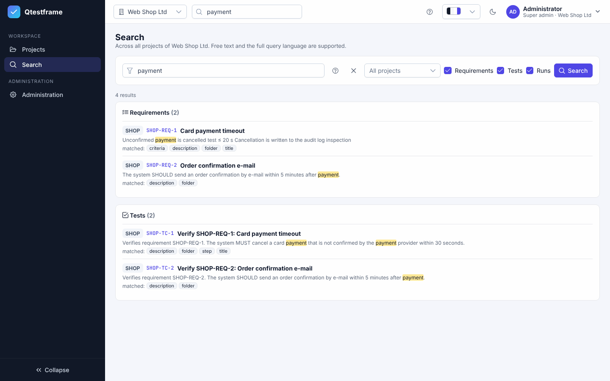

- **Search in** limits the result to requirements, tests or runs.
- **Project** limits it to one project.
- Besides the item fields you can use `project:` (key or name) and `kind:` (`requirement`, `test`, `run`), for example `kind=requirement project:SHOP coverage:none`.

## Filters in lists

The filter field above a table takes a query. Press <kbd>Enter</kbd> to apply it. If the query has an error, the field is marked and the message tells you where the problem is. The **?** button (**Query help**) next to the field lists the operators and all fields of that list.


Quick filters (status, priority and so on) are turned into a query for you and shown under the filter bar as `q = …`. Copy it if you want to reuse or extend it.

## Tag cloud

**Tags** in the project sidebar shows every tag of the project's requirements, tests and documents; the more often a tag is used, the larger it is. Hover over a tag to see how many items of each kind carry it. Filter the cloud by name and sort it **By use** or **A–Z**.

Select one or more tags to list the items that carry them, grouped into requirements, tests and documents. With several tags, choose whether items need **All tags** or **Any tag**. **Open as filtered list** opens the requirements or tests page with the same query (for example `tag=gdpr AND tag=login`), and the address of the page keeps the selection, so you can bookmark it.

With permission to edit both requirements and tests, the selected tags can also be changed in the whole project: **Rename** (one tag), **Merge** (several tags into one, which can be one of them or a new name, for example to clean up *gdpr*, *GDPR* and *privacy*) or **Remove from all items**. Documents are changed too if you may change the project. Each change is recorded in the history of the requirements and tests it touches.

## Syntax in five minutes

| You write | It finds |
|---|---|
| `login` | *login* anywhere in any field (case does not matter) |
| `"session timeout"` | the exact phrase anywhere |
| `status:approved` | items whose status contains *approved* |
| `priority=high` | priority exactly *high* |
| `status:approved priority=high` | both: terms next to each other are combined with AND |
| `obligation=must OR obligation=shall` | either one |
| `NOT status:obsolete` or `-status:obsolete` | everything except obsolete items |
| `(tag:smoke OR tag:regression) -status:deprecated` | grouping with parentheses |
| `title~/^login.*(fail\|error)/i` | a regular expression; `/i` ignores case |
| `description!~/TBD/` | the description does not match |
| `key:*-REQ-1?` | glob: `*` any characters, `?` one character, matched against the whole value |
| `version>=2` | numeric comparison |
| `updated_at>=2026-01-01` | date comparison |
| `has:criteria` or `criteria:*` | the field is not empty |

### Operators

| Operator | Meaning |
|---|---|
| `field:value` | contains (case-insensitive); with `*` or `?` a glob over the whole value |
| `field=value` | equals (case-insensitive); `field=""` matches empty fields |
| `field!=value` | equals none of the values |
| `field~/regex/` | regular expression matches (RE2 syntax, case-sensitive unless `/i`) |
| `field!~/regex/` | regular expression matches no value |
| `field>v`, `>=`, `<`, `<=` | compares numbers numerically, everything else (such as dates) as text |
| `/regex/` | regular expression over all fields |
| `AND`, `OR`, `NOT` (also `&&`, `\|\|`, `!`, `-`) | logic; NOT binds tighter than AND, AND tighter than OR |

Keywords and field names are case-insensitive. Values with spaces need quotes: `category:"Network based"`. Inside quotes, write `\"` for a quote. An empty query matches everything.

**Fields with several values** (tags, categories, criteria, steps, linked items): a positive condition holds if **any** value matches; a negative one (`!=`, `!~`) only if **no** value matches.

## Fields

### Requirements

`id`, `key`, `title`, `description` (`desc`), `obligation`, `type`, `priority`, `status`, `source`, `rationale`, `owner`, `tag` (`tags`), `version`, `folder` (the folder path, e.g. `Checkout / Payment`), `category` (`categories`, value names), `dimension` (`Dimension/Name`), `coverage`, `linked` (keys of linked tests), `related`, `parent`, `child` (keys of related, parent and child requirements), `comments`, `mention` (`mentions`: [@handles](#mention-people) in owner, title, description, rationale and source), `created_by`, `created_at`, `updated_at`, `criteria` (`criterion`: description, method and threshold), `risk` (the highest level of the open [risks](#risk-levels) it addresses: `risk:high`), `defects` (number of open defects on it or its tests: `defects>0`), `catalog` (the [catalogue](#catalogue) entry it was copied from: `catalog:AUTH-01`, `has:catalog`).

### Tests

`id`, `key`, `title`, `description` (`desc`), `preconditions`, `execution_type` (`type`), `script_language` (`language`), `script`, `expected`, `step` (`steps`: action, expected result and data of all steps), `priority`, `status`, `estimate`, `tag` (`tags`), `folder`, `category`, `dimension`, `linked` (keys of linked requirements), `last_result` (`result`), `defect` (`defects`), `calls` (keys of called tests), `depends_on` (`depends`: keys of prerequisite tests), `comments`, `mention` (@handles in the texts and steps), `version`, `created_by`, `created_at`, `updated_at`, `flaky` (`true` for [flaky tests](#flaky-tests): `flaky:true`), `flakiness` (`flips`: the number of pass/fail flips among the last results: `flakiness>=3`), `catalog` (the catalogue entry it was copied from).

### Runs and executions

Runs: `id`, `name`, `description`, `status`, `environment` (`env`), `build`, `created_by`, `created_at`.
Executions (the filter on a run page): `id`, `key`, `title`, `status`, `assignee`, `executed_by`, `notes`, `output`, `defect`, `mention` (@handles in assignee and notes).

### Other lists

- **Audit log:** `action`, `entity`, `entity_id`, `user`, `details`, `created_at`.
- **Document archive:** `name`, `description`, `tag`, `kind`, `type` (content type), `uploaded_by`, `created_at`, `size`, `linked` (keys of linked items).

Using a field that does not exist in a list is an error, so `coverage:none` works in requirements but not in tests.

## Examples

**Requirements**

```text
obligation=must status!=approved               MUST requirements not yet approved
coverage:none category:Security                security requirements without any test
coverage:failed priority=critical              critical requirements whose tests fail
has:criteria coverage:none                     criteria written, but no test linked
-has:criteria status:approved                  approved, but no evaluation criteria
description~/\b(fast|easy|TBD)\b/i             weak wording, as the language analysis sees it
folder:"Checkout / Payment"                    a folder and its subfolders (path contains)
child:*                                        requirements that have been decomposed
parent:SHOP-REQ-4                              children of SHOP-REQ-4
linked:SHOP-TC-3                               requirements verified by SHOP-TC-3
version>=3 updated_at>=2026-06-01              changed often and recently
owner:anna OR owner:ben                        owned by Anna or Ben
dimension:Area/UI                              requirements in category Area / UI
tag:gdpr -status:obsolete                      current GDPR requirements
```

**Tests**

```text
type=automated last_result:failed              failed automated tests
status:ready category:Negative                 ready negative tests
dimension:Level/System execution_type=manual   manual system tests
-linked:*                                      tests not linked to any requirement
step~/password/i                               tests with a step about passwords
defect:JIRA-*                                  tests with a JIRA defect in their latest executions
estimate>30                                    tests estimated at more than 30 minutes
language=python                                Python scripts
```

**Runs and executions**

```text
status:in_progress env:staging                 runs in progress on staging
build:1.4.*                                    all 1.4 builds
created_at>=2026-09-01                         runs since September
status:failed                                  (on a run page) failed executions
assignee:anna -status:passed                   Anna's executions that have not passed
output~/timeout/i                              automated executions whose output mentions a timeout
```

**Global search**

```text
"order confirmation"                           the phrase in any project
kind=test project:SHOP payment                 tests of project SHOP about payment
kind=requirement coverage:none                 uncovered requirements in all projects
```

## Why is my query invalid?

The most common reasons:

- **Unknown field**: the field does not exist in this list (for example `coverage` in tests). Open **Query help** to see the fields.
- **Unclosed quote, parenthesis or regex**: `title:"login`, `(a OR b`, `title~/abc`.
- **A space after the operator**: write `status:approved`, not `status: approved`.
- **Invalid regular expression**: the regex uses RE2 syntax, which has no look-ahead (`(?=…)`) or back-references.
- **Limits**: at most 4096 characters, 64 regular expressions or globs, and 128 levels of nesting.

A `-` only negates when it is directly followed by the term: `-status:obsolete`, not `- status:obsolete`.

# Reports and export

Qtestframe gets data out in two ways (a whole project can also be [saved as a file and loaded again](#save-and-load-projects)):

- **Export** downloads the raw project data (requirements, criteria, tests, traceability, runs) as spreadsheets, documents or Markdown, for reviews, audits, offline work or other tools.
- **Reports** produce formatted documents for people: a project status report, a coverage report, a run summary, a defect list or a report you design yourself. Reports can be downloaded or stored in the project's [document archive](#documents).

Everyone with the **Viewer** role or higher may export and generate reports. Saving a custom report definition needs **Tester** (tests) or **Manager** (requirements); storing a generated report in the archive is open to everyone who may generate it.

## Export

Select **Export** in the project sidebar.


1. Choose the **Format**:

   | Format | Result |
   |---|---|
   | **PDF** | A printable landscape report with one table per aspect and page numbers. |
   | **DOCX** | An editable Word document with a heading and a table per aspect, for example as the base of a specification document. |
   | **XLSX** | An Excel workbook with a *Summary* sheet and one sheet per aspect; bold header row, frozen first row, auto-filter and sensible column widths. |
   | **CSV** | One `.csv` file for one aspect; a `.zip` with one CSV per aspect when you choose several. UTF-8, comma-separated. |
   | **Markdown** | One `.md` file with every aspect: a heading, the project, filter and time, and a table per aspect. Plain text that reads well in a wiki, a Git repository or any text editor; keys link to Qtestframe when the server address is configured. |
   | **ReqIF** | The requirements as a ReqIF 1.2 file (`.reqif`) for requirements tools such as IBM DOORS, Polarion, Jama or ProR. See [ReqIF for requirements tools](#reqif-for-requirements-tools). |
   | **ReqIF (with attachments)** | A `.reqifz` archive: the ReqIF file and the requirements' attachments and images. |

2. Choose the **Aspects**:

   | Aspect | Columns |
   |---|---|
   | **Requirements** | key, title, obligation, type, priority, status, folder, categories, tags, description, rationale, source, owner, version, linked tests, coverage |
   | **Evaluation criteria** | requirement, number, criterion, method, threshold |
   | **Tests (with steps)** | key, title, execution, status, priority, folder, categories, tags, preconditions, steps, expected result, script language, linked requirements, last result |
   | **Traceability matrix** | one row per requirement–test link with coverage and last result; requirements without links get one row |
   | **Runs & executions** | one row per execution with run, status, environment, build, result, executed by, duration and notes |

   ReqIF contains requirements only, so the aspects are not used for it.

3. Optionally enter a **Filter**. It applies to requirements if it is a valid requirement query and to tests if it is a valid test query: `obligation=must` filters only requirements, `type=automated` only tests, `folder:Checkout` both.
4. Select **Download**. The file is named after the project key and the time, for example `SHOP-20261119-143000.xlsx`.

**Safe for spreadsheets:** values that start with `=`, `+`, `-` or `@` are prefixed in CSV files, and XLSX cells are always text, so nothing in your data is executed as a formula.

### ReqIF for requirements tools

ReqIF (Requirements Interchange Format) is the standard file format for exchanging requirements between tools. Use it to give a customer or supplier your requirements in their own tool, or to bring requirements back after they were worked on there.

What the ReqIF file contains:

- **One object per requirement** with key (*ReqIF.ForeignID*), title (*ReqIF.Name*), description as formatted text (*ReqIF.Text*), obligation, type, priority and status as value lists, source, rationale, owner, tags, categories, acceptance criteria (one line per criterion: method, text and threshold), version, author and creation time.
- **The folders as headings.** Every folder is a heading object (*ReqIF.ChapterName*); the requirements of a folder and then its subfolders are placed below it, so the requirements tool shows the same chapters as the requirements tree. With a filter, only folders that contain exported requirements are included.
- **Relations** between the exported requirements (*refines*, *depends on* and the others) as ReqIF relations.
- **Formatting.** Paragraphs, line breaks, lists, headings, code blocks, bold, italics, links and images in descriptions are converted to formatted text. In a `.reqifz` file, images and other attachments are files in the archive and are listed in the *Attachments* attribute.
- **Stable identifiers.** Every object keeps the same identifier in every export, so a tool can recognise requirements it already has and update them.

**Importing it again.** A ReqIF file from Qtestframe can be [imported](#import-requirements) into any project. Titles, descriptions with their formatting, obligation, type, priority, status, source, rationale, owner, tags, criteria and folders come back; the original key is kept as the external ID (*ID: SHOP-REQ-12* in the source), and the new requirements get keys of the target project. Relations, categories and attachments are not imported.

## Standard reports

Select **Reports** in the project sidebar. The standard reports are ready-made layouts:

| Report | Content | Parameters |
|---|---|---|
| **Project status** | key figures, requirements by status and obligation, coverage, recent runs | – |
| **Requirements coverage** | every requirement with its linked tests, their last results and the coverage | optional filter |
| **Traceability** | the requirement × test links, and the [traceability rules](#traceability-rules) with their results and violations | optional filter |
| **Run summary** | one run: totals, executions, defects and durations | the run (required) |
| **Defects** | all defects recorded on executions, grouped by defect | – |
| **Test inventory** | tests by folder, type, status and category | optional filter |

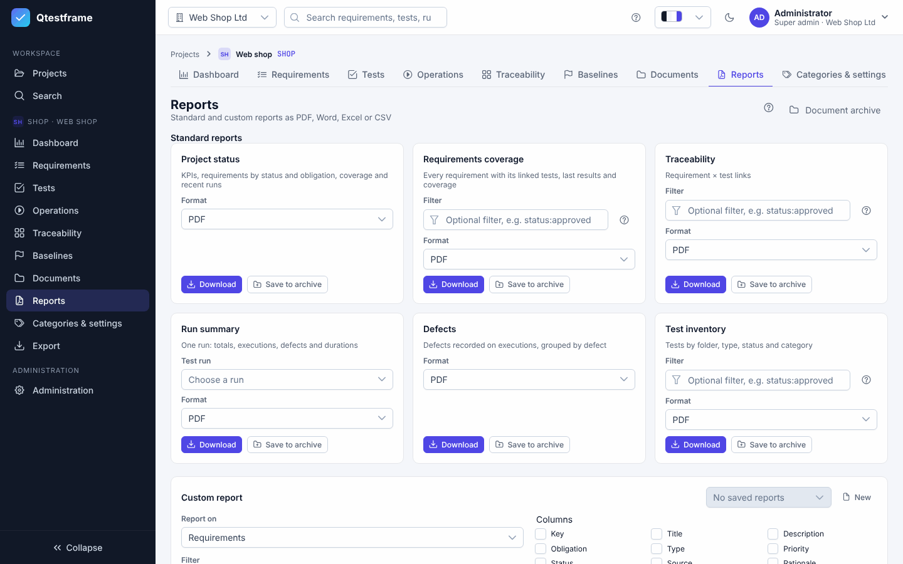

1. Choose a report.
2. Fill in its parameters, for example the run for **Run summary**.
3. Choose the **Format**: **PDF**, **Word** (DOCX), **Excel** (XLSX), **CSV** or **Markdown** (`.md`, text with tables for wikis, Git repositories and chat tools; several sections are one document).
4. Select **Download**, or **Save to archive**. A saved report becomes a document of kind *report* in **Documents**, where the whole team can find, preview and download it later.

Reports are produced in the language you currently use in Qtestframe (**User menu → Language**, see [Languages](#languages)). With the Swedish interface, the report's title, section names, column headers, key figures and values such as statuses, results, coverage and obligation (for example *Godkänt*, *Underkänd*, *MUST (SKA)*) are in Swedish, with the same words as in the app. Your own content, such as titles, names, descriptions, tags and notes, is never translated. This applies to downloads, reports saved to the archive, custom reports, several reports at once and reports sent by e-mail.

## Custom reports

Under **Custom report** you design a report yourself:

1. **Report on**: requirements, tests, test runs or the executions of a run (then choose the run).
2. **Filter**: any [query](#search-and-filters), for example `status:approved obligation=must`.
3. **Columns**: pick the columns; arrange them under **Column order**.
4. **Group by**: optionally group rows, for example by status or folder, with a count per group.
5. **Sort by**, optionally **Descending**.
6. **Include summary**: totals at the top.
7. **Title** of the report.

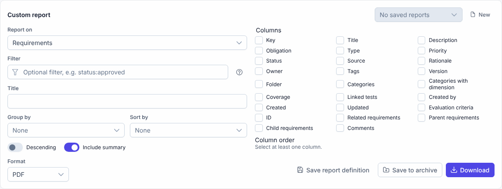

Generate the report in any format, as above. To reuse it, select **Save report definition** and give it a name: **Load saved report** brings it back at any time, to generate it again with the current data, change it (**Save as a new report** keeps the original) or delete it. **New** starts an empty report.

**Examples:**

- *Open MUST requirements*: requirements, filter `obligation=must -status:verified`, columns key, title, status, owner, coverage, grouped by owner.
- *Failed tests this sprint*: executions of the run *Sprint 12*, filter `status:failed`, columns key, title, executed by, defects, notes.
- *Automation status*: tests, grouped by execution type, columns key, title, status, last result.

## Several reports at once

**Several reports at once**, at the bottom of the Reports page, lists the standard reports and your saved custom reports. Tick the ones you need, for example a weekly pack of *Project status*, *Run summary* and two saved reports, then:

- choose the **format** (only formats that every ticked report supports are offered),
- for *Run summary*, choose the **run**,
- **Download as ZIP** to get all of them in one file, or **Save to archive** to store each of them in the [document archive](#documents) (tagged *report*). When saving, a report that cannot be created is listed with the reason and the others are still saved.

**Delete saved reports** removes the ticked saved custom reports (standard reports cannot be deleted). Saving to the archive and deleting need permission to edit requirements or tests; downloading needs the export permission.

## Send a report by e-mail

When the server can send e-mail, every standard report has an envelope button (**Send by e-mail**), and the custom report builder has **Send by e-mail** too. Choose:

- **Members**: people of your organisation who may read the project. A member who may not read what the report shows (for example test runs) is left out, and the message says who.
- **Other addresses**, separated by commas: people outside the organisation. This needs the permission to update the project, so that Qtestframe cannot be used to send e-mail to anyone.
- an optional **Message** and the **Format**.

The report is created with your permissions and attached to the e-mail; the report and the e-mail text are in your current interface language. If it cannot be delivered, you get a [notification](#notifications).

## Scheduled reports

**Scheduled reports**, at the bottom of the Reports page, e-mails [saved custom reports](#custom-reports) on a schedule. *(Requires permission to edit requirements or tests.)* Select **Schedule a report**, then choose the saved report, **How often** (daily, weekly on a weekday, or monthly on a day from 1 to 28), the **Time** and **Time zone**, the **Format**, the recipients and an optional message.

The list shows each schedule with its recipients, when it was **Last sent** (or the error of the last attempt), and the **Next run**. Turn **Active** off to pause a schedule, **Send now** to send it at once (the schedule stays as it is), or edit and delete it. Only the person who scheduled a report, or someone who may update the project, can change it.

Good to know:

- The report is created with the permissions of the person who scheduled it, at the time it is sent. If that person is no longer a member or may no longer export, the schedule shows an error instead of sending.
- The report and its e-mail are in the interface language of the person who scheduled the report or last edited the schedule. Switch the language and save the schedule again to change it.
- Members who may no longer read the report are left out.
- If the server was down when a report was due, it is sent once when the server is back, not once for every missed time.
- Deleting the saved report also deletes its schedules.

## Save and load projects

A whole project can be saved as one file and loaded again as a **new** project, on the same server or another one: to hand a project over, keep a copy outside the server, or start a new project from a template.

- **Save project**: on the project list (the download button of a project) or under **Categories & settings → Project → Save and load**. The file (`<key>-project-<date>.zip`) holds everything in the project: requirements with criteria and folders, tests with steps and test data, traceability links and relations, links, runs with all results, iterations and evidence, defects, risks, releases, baselines and sign-offs, reviews, comments, version history, documents and attachments with their content, categories, configurations, traceability rules, saved reports, webhooks and the project settings. It needs the permissions to change the project and to export (by default **Manager** and **Admin**).
- **Load project**: on the project list, or in the same section of the settings. Choose the file; Qtestframe checks it and shows what it contains. Then choose the **Key** and **Name** of the new project (a free key is suggested if the original one is taken) and select **Load project**. You need the permission to create projects. The new project opens when it is ready.
- **Duplicate project** does both in one step: it creates a copy with a new key inside the same organisation.

What to know about loaded projects:

- The new project gets new IDs everywhere, and item keys follow the new project key (`DEMO-REQ-1` becomes `COPY-REQ-1`, also where a description mentions it). New items continue the numbering of the original.
- People stay as they were: *created by*, owners and assignees are kept as text, and comments and reviews refer to the same accounts. A review request whose reviewer has no account on the server is left out; the result says how many entries were left out.
- **Secrets are never saved**: webhooks are loaded switched off and without their secret, and the defect tracker without its token. Set them again under **Categories & settings → Project** before you switch them on.
- Members, roles, API tokens, notifications, scheduled e-mail reports, the audit log and the trash are not part of the file. Access to the new project follows the roles of the organisation, as for every project.
- A file saved by a newer version of Qtestframe cannot be loaded; update the server first. Files from older versions load.

The file contains the project data in plain form. Store it as carefully as the project itself.

## Which one to use?

| Need | Use |
|---|---|
| Work with the data in Excel or another tool | **Export**, XLSX or CSV |
| Put the data or a report into a wiki, a pull request or a Git repository | **Export** or **Reports**, Markdown |
| Hand requirements over to a requirements tool (DOORS, Polarion …) or another Qtestframe | **Export**, ReqIF |
| A specification document to review or sign | **Export**, DOCX, aspects requirements and criteria |
| A status report for a steering meeting | **Reports → Project status**, PDF |
| Evidence for an audit or a release | **Reports → Requirements coverage** or **Run summary**, saved to the archive, together with a [baseline](#baselines) |
| A recurring list with your own columns | A saved **custom report** |
| The same report in people's inbox every week | A saved custom report under **Scheduled reports** |
| Hand a whole project over, keep a copy or start from a template | **Save project** and **Load project** (see [above](#save-and-load-projects)) |

# Documents

Every project has a **document archive**: one place for all files of the project. It contains

- **documents** that you upload directly to the archive, such as specifications, contracts, test plans or meeting notes;
- **attachments** that were uploaded to a requirement, test, run or execution;
- **reports** that were generated and saved to the archive (see [Reports](#standard-reports)).

Select **Documents** in the project sidebar. Everyone who can read the project can see and download its files.

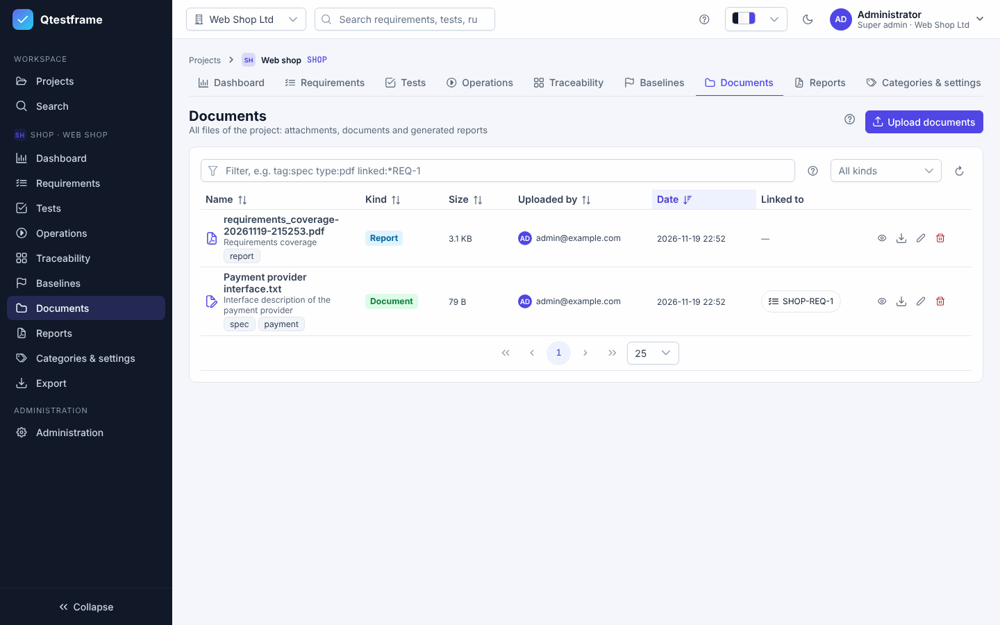

## Find files

- The table shows each file's **name**, **kind** (document, attachment or report), **size**, who uploaded it, when, its tags and the items it is **Linked to**.
- Filter by **Kind**, or with a [query](#search-and-filters) on the fields `name`, `description`, `tag`, `kind`, `type` (content type), `uploaded_by`, `created_at`, `size` and `linked`:

```text
kind=report                                    generated reports only
type:pdf created_at>=2026-09-01                PDF files since September
linked:SHOP-REQ-12                             files attached to SHOP-REQ-12
tag:contract -kind=attachment                  contract documents
size>5000000                                   files larger than about 5 MB
```

## Upload

1. Select **Upload documents**, or drag files from your computer onto the page.
2. Several files are uploaded one after another; a progress list shows each file and reports errors (for example a file that is too large).
3. Add a description and tags, comma-separated, to make the files easier to find. You can change them later with **Edit**.

The maximum size is 25 MB per file unless your administrator configured another limit. Uploading documents to the archive needs the **Tester** or **Manager** role (the right to edit tests or requirements).

## Preview and download

- **Preview** shows images (PNG, JPEG, GIF, WebP), PDF files and plain text directly in the browser.
- **Download** saves the file. Other file types are always downloaded rather than shown, for safety.

## Work with many files at once

Tick files in the list (the header checkbox ticks the whole page). The toolbar offers:

- **Download as ZIP**: one archive with all ticked files (at most 512 MB together). Files with the same name are numbered, for example *plan (2).pdf*. Anyone who can see the archive can download.
- **Add tags** / **Remove tags** for all ticked files.
- **Description**: replaces the description of each file (empty clears it).
- **Delete**, after confirmation.

Changing and deleting work on the files you may change: your own uploads, or every file with permission to change the project. When the selection also has other files, the toolbar says how many of them you can change, and only those are changed. Tag and description changes can be undone with the undo button.

## Link documents to items

A file in the archive can be attached to any number of requirements, tests, runs and executions of the same project, without copying it. In the **Attachments** tab of an item, choose **Attach from archive** and pick the files. The archive then lists the item under **Linked to**.

- **Removing an attachment** from an item only removes the link.
- An *attachment*-kind file that is no longer linked to anything is deleted automatically; *documents* and *reports* stay in the archive.
- **Deleting a file** in the archive removes it together with all its links, after a confirmation that names the linked items.

Editing and deleting a file is allowed for the person who uploaded it and for managers and admins of the project.

## Where are files stored?

Files are stored in the Qtestframe database, not on a separate file share. That means they are part of every [backup](#backup-and-restore), they are protected by the same access rules as the project, and they are deleted together with the project. Every download is checked against your permissions.

# Administration

**Administration** in the sidebar is shown to everyone who may see at least one of its sections. Which sections you see depends on your role:

| Section | Who sees it |
|---|---|
| **Members** | everyone (Viewer and up) can see the member list; **Admins** manage it |
| **Role matrix** (roles and permissions) | everyone |
| **API tokens** | Tester and up (your own tokens) |
| **Provisioning (SCIM)** | Admins |
| **Audit log** | Manager and up |
| **Organisations** | Super admins |
| **Users** | Super admins |
| **Backup** | Super admins |

## Organisations and roles

An **organisation** (tenant) is an isolated workspace: its projects, members, tokens and audit log are invisible to other organisations. A person has one user account for the whole installation and can be a **member** of several organisations, with **one role in each**.

### Roles and permissions

Every organisation starts with six built-in roles. By default each role in the table can do everything the role above it can, except **Reviewer**, which sits beside Tester:

| Role | Can additionally (default) |
|---|---|
| **Viewer** | read all projects, requirements, tests, runs, documents and the member list; search; export and generate reports |
| **Reviewer** | approve and reject requirements and mark tests ready (*requirement.review*, *test.review*), without editing their content |
| **Tester** | write and link tests, manage test folders and categories, create and edit runs, record results, import CI results, upload attachments to tests, runs and executions, create own API tokens |
| **Test lead** | mark tests ready (*test.review*), run automated scripts on the server, read the audit log, change the [test execution settings](#test-execution-settings) |
| **Manager** | approve and reject requirements (*requirement.review*), write requirements and requirement folders, create and edit projects, all categories and the [traceability rules](#traceability-rules), create baselines |
| **Admin** | everything: delete projects, manage members and roles, rename the organisation, reset members' passwords, delete any comment |
| **Super admin** | everything in every organisation; manage organisations and users; backup and restore |

The default matrix of permissions:

| Permission | Viewer | Reviewer | Tester | Test lead | Manager | Admin |
|---|:-:|:-:|:-:|:-:|:-:|:-:|
| `project.read`, `requirement.read`, `test.read`, `run.read`, `member.read`, `export` | ✔ | ✔ | ✔ | ✔ | ✔ | ✔ |
| `test.review` | | ✔ | | ✔ | ✔ | ✔ |
| `requirement.review` | | ✔ | | | ✔ | ✔ |
| `test.write`, `run.write`, `run.execute`, `token.manage` | | | ✔ | ✔ | ✔ | ✔ |
| `script.execute`, `audit.read`, `settings.manage` | | | | ✔ | ✔ | ✔ |
| `requirement.write`, `project.create`, `project.update` | | | | | ✔ | ✔ |
| `project.delete`, `member.manage`, `role.manage`, `tenant.manage` | | | | | | ✔ |

**Review decisions.** Setting a requirement to *Approved* or *Rejected* needs `requirement.review`; setting a test to *Ready* needs `test.review`. The same applies to bulk edits, to creating an item with that status and to restoring a version that has it. A reviewer without the write permission may change only the status; editing anything else still needs `requirement.write` or `test.write`. Each decision is recorded in the audit log as `requirement.review` or `test.review`. A copied requirement or test starts as *Draft*, so it is reviewed again.

### Change roles and create your own

*(Admin, or any role with `role.manage`)* **Administration → Role matrix** shows the matrix of the organisation. Tick or untick a permission of any role except **Admin**; the changed cells are highlighted and a bar tells you how many roles have unsaved changes. Select **Save** to apply them; members with that role get the new permissions at once. You can only grant permissions that you hold yourself.

- A built-in role whose permissions differ from the defaults is marked *changed*; its **Reset to default** button (↺) restores them.
- **New role** creates your own role: enter a **Display name** (for example *Auditor*), a **Technical name** (lower-case letters, digits and `_`, used in the API and in SSO group mappings) and optionally a description, and choose the role whose permissions it starts with. Then adjust the permissions in the matrix.
- Your own roles are marked *custom*. You can rename them (✎) and delete them (🗑) once no member or API token uses them.
- New roles can be chosen under **Members**, for API tokens and in the identity-provider group mapping.

**Admin** always has every permission, so an organisation cannot lock itself out.

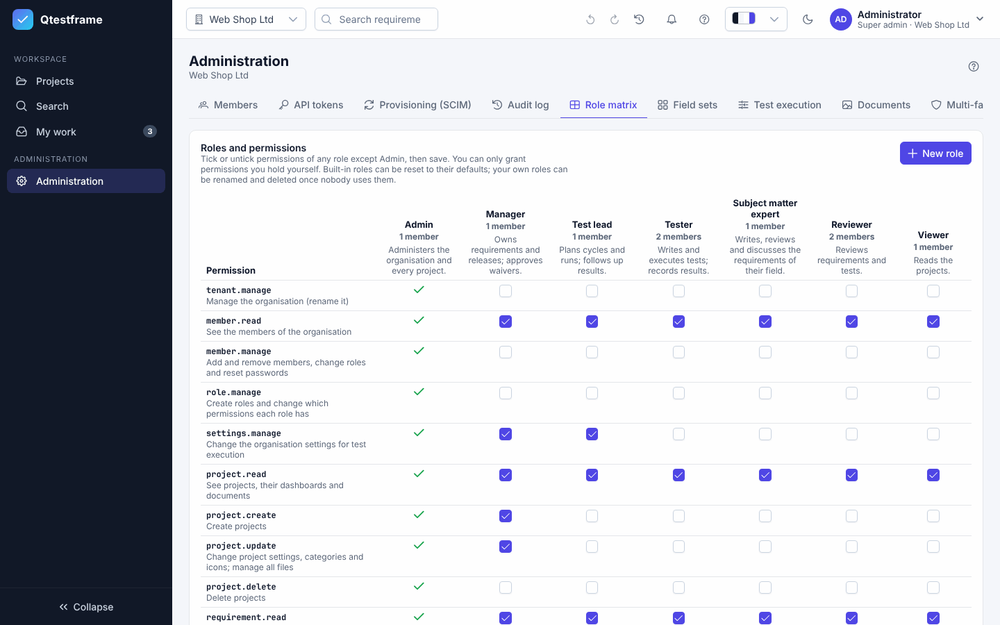

Buttons for actions you may not perform are hidden. If you are missing a button described in this guide, check your role in the user menu.

## Members

**Administration → Members** lists the members of the current organisation with their role and since when they are members.

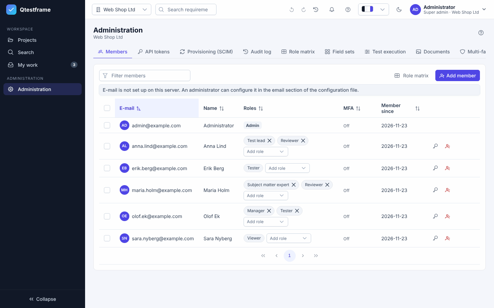

- **Add member** *(Admin)*: enter the **E-mail** and choose the **Role**. If the person already has an account, they are added with that role. If the e-mail is unknown, a local account is created: when the server can send e-mail, leave **Send an invitation by e-mail** on (see [Invite by e-mail](#invite-by-e-mail)); otherwise give a **Display name** and an **Initial password**, and tell the person to change it after the first sign-in.
- **Change a role** *(Admin)*: pick another role in the member's row. It applies immediately, also to the person's API tokens.
- **Remove** *(Admin)*: removes the membership; the account itself remains.
- **Several members at once** *(Admin)*: tick members (or the box in the header for all shown), then choose a role under **Set role** or select **Remove**, and confirm. Your own membership is left as it is, as are members who already have the role; the message says which were skipped. Both can be undone (removed members are added back with their old roles).
- An organisation must keep at least **one admin**: the last admin cannot be demoted or removed, and a change of several members that would leave no admin is refused as a whole.
- Members marked **SCIM** are [provisioned by your identity provider](#provisioning-with-scim): their role follows their groups there, so their role cannot be changed and they cannot be removed here (a change of several members skips them).

### Invite by e-mail

*(Admin, when e-mail is set up)* With **Send an invitation by e-mail** on, **Add and invite** sends the person an e-mail with a link instead of an initial password. The link leads to a page where they choose their name and password and are signed in straight away. It can be used **once** and is valid for **7 days**. People who sign in with single sign-on (OIDC or SAML): also turn on **Uses single sign-on**; their link asks them to sign in with their organisation account instead.

Until the invitation is accepted, the member shows an **Invited** tag (or **Invitation expired**); hover over it to see when it was sent and until when it is valid. In the member's row:

- **Send the invitation again** sends a new link; the old one stops working. Use it when the invitation expired or got lost.
- **Revoke the invitation** makes the link unusable and removes the person from the organisation.

If the person already has an account, they are added at once and get an e-mail that they were added. Every invitation, resend, revocation and acceptance is recorded in the [audit log](#audit-log).

### Reset a password

*(Admin, for local accounts)*: select **Reset password** in the member's row. Qtestframe generates a **temporary password** and shows it **once**; copy it and give it to the person through a safe channel. The person is signed out everywhere and must choose a new password at the next sign-in.

Admins can only reset passwords of people who belong to their organisation alone; for super admins and people who are members of other organisations too, a super admin must do it. Accounts that sign in through single sign-on have no password in Qtestframe.

## E-mail

Notification e-mails, invitations and [reports by e-mail](#send-a-report-by-e-mail) need an outgoing mail server, which the server administrator sets up in the `email` section of the configuration file. Without it, these features are hidden and the profile explains that notifications are only shown in the app.

*(Admin)* **Administration → Members → Send test e-mail** sends a test e-mail to your own address. If it fails, the message shows the answer of the mail server, for example a wrong password or a refused connection; give it to the server administrator.

## Test execution settings

*(Admin and Test lead, or any role with `settings.manage`)* **Administration → Test execution** decides when a test may be executed. By default a test can only be executed when:

- the test has status **Ready**,
- every requirement it verifies has one of the **ready statuses** (default **Approved**, **Implemented** and **Verified**), and
- every test it [depends on](#dependencies) has passed: in the same run when that test is part of the run, otherwise its latest result.

Each rule can be relaxed separately: **Allow executing tests that are not Ready**, **Allow executing tests of requirements that are not ready** and **Allow starting tests before their prerequisites have passed**. You can also choose which requirement statuses count as ready.

What a rule forbids is refused by the server, also for API clients and CI imports. In the app you see it at once:

- in the **New run** dialog, picked tests that are not ready are marked, with a warning;
- on the run page, a **Readiness** column and a summary show which executions cannot be started yet;
- in the execution runner, a red box lists the reasons, with links to the test, requirement or prerequisite, and **Pass**, **Fail** and **Run script** are disabled. You can still mark the test **Blocked** or **Skipped**, assign it and write notes;
- when a rule is relaxed, the same reasons appear as an amber warning, and the test can be executed.

## Test configurations

*(Manager and Admin, or any role with `project.update`)* **Categories & settings → Configurations** holds the test configurations of a project: named combinations of **dimension values** such as *Browser = Chrome* and *OS = Windows*, a hardware revision or a firmware version. A [run](#configurations-in-a-run) that targets configurations executes each of its tests once per configuration. Everyone who can read the project sees the configurations.

- **New configuration**: add dimension values (dimension and value, each dimension at most once) and optionally a name and a description. Without a name, the configuration is named after its values, e.g. *Chrome / Windows*. Names are unique in the project, ignoring case.
- **Generate combinations**: give each dimension its values, separated by commas (*Browser*: Chrome, Firefox, Safari; *OS*: Windows, macOS), and the dialog previews every combination. **Create** adds them all at once (at most 200); with **Skip combinations that already exist**, existing names are left out.
- The arrows change the order in which configurations are listed and offered; the pencil edits one. Renaming a configuration also renames it in existing runs.
- **Delete** (also for several ticked configurations) removes configurations that no run targets. A configuration that is in use cannot be deleted; remove it from the runs first, or delete those runs.

The **Runs** column shows how many runs target each configuration. Creating configurations can be undone with the undo button.

## Web tests

[Web tests](#web-tests-playwright) run in a real browser on the server. They are switched on by the server administrator in the configuration file (`runner.web`, see below) and set up per project under **Settings → Web tests** *(Manager; permission project.update)*:

- **Base URL** — the address of the application under test, e.g. `https://staging.example.com`. `page.goto('/login')` in a web test opens `https://staging.example.com/login`.
- **Base URL per environment** — a run whose **Environment** matches the name (ignoring case) uses this URL instead, e.g. *production* → `https://www.example.com`. A test configuration with a **Base URL** dimension wins over both.
- **Test variables** — name and value, passed to every automated script of the project as `QTF_VAR_<NAME>` (in a web test `process.env.QTF_VAR_USERNAME`). Mark passwords and tokens **Secret**: their value is write-only — it is never shown again, not even to administrators (leave the field empty to keep it), and it is replaced by `***` in stored output and failure messages. Screenshots and traces can still show a secret that the page displays.

Only members with the permission *script.execute* (by default **Test lead** and **Manager**) can run scripts and web tests. Scripts run on the server with the server's privileges, restricted only by the sandbox; web tests always have network access, so treat **Run script** as running code on the server.

**Server setup** (the server administrator):

1. Install Node.js and Playwright in a directory, e.g. `/opt/qtestframe-playwright`: `npm i @playwright/test`, then the browsers with `npx playwright install --with-deps chromium` (add `firefox webkit` for those browsers).
2. In the configuration file set `runner.enabled: true` and:

   ```yaml
   runner:
     web:
       enabled: true
       node: /usr/bin/node
       playwright_dir: /opt/qtestframe-playwright   # has node_modules/@playwright/test
       browsers_path: /opt/qtestframe-playwright/browsers  # PLAYWRIGHT_BROWSERS_PATH, if not the default
       browser: chromium          # default browser: chromium, firefox or webkit
       headless: true
       timeout: 60s               # per test
       screenshots: on_failure    # on_failure, always or off
       trace: on_failure          # on_failure, always or off
       video: off                 # off, on_failure or always
       max_parallel: 2            # web tests running at the same time
   ```

3. Restart the server. **Run script** now works for web tests; the demo project of `qtestframe seed-demo` has one (*Login page shows the sign-in form*) that opens the server's own login page — set `server.base_url` to the address the server is reachable at.

## API tokens

API tokens let scripts and CI pipelines use the REST API without a password, for example for the [CI import](#import-results-from-ci).

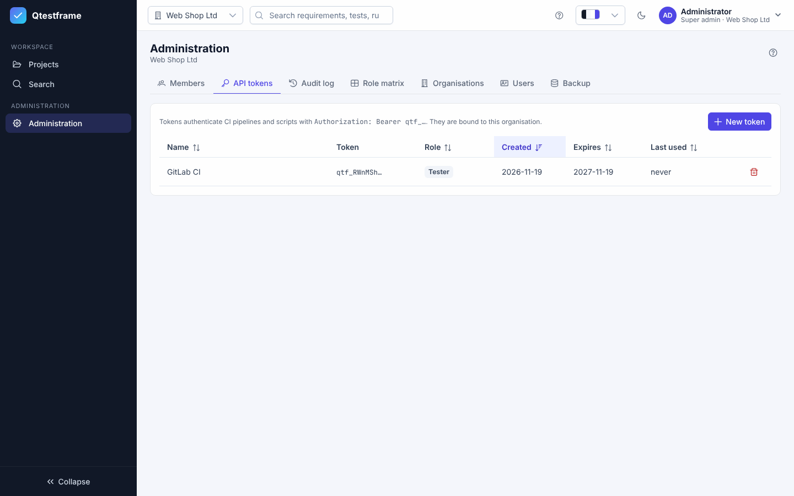

1. Open **Administration → API tokens** and select **New token** *(Tester)*.
2. Enter a **Name** that says where it is used, for example *GitLab CI*.
3. Choose the **Role**. A token can never have a higher role than you.
4. Optionally set **Expires after (days)**; empty means it never expires.
5. Select **Create** and **copy the token now**: it starts with `qtf_` and is shown only once.

Use it as a bearer token: `Authorization: Bearer qtf_…`. A token belongs to one organisation, and on every request it is limited to the role you currently have there: if your role is lowered, so is the token's. Tokens cannot create tokens. **Revoke** a token as soon as it is no longer needed or may have leaked; clients using it lose access immediately. The list shows when each token was **Last used**.

## Provisioning with SCIM

*(Admin)* With SCIM 2.0 your identity provider (Microsoft Entra ID, Okta, OneLogin, JumpCloud and others) creates, updates and deactivates the members of the organisation for you: when someone joins the Qtestframe application in the provider they become a member here, and when they leave they lose access.

How it works:

- **Users.** A provisioned user is matched by e-mail address. New users get an account **without a password**: they sign in with the organisation's single sign-on (OpenID Connect or SAML), which links the account at the first sign-in. An existing account with the same e-mail (for example a member you added by hand) is taken over.
- **Deactivation.** When the provider deactivates a user, the membership is removed and the person's sessions and API tokens in this organisation end at once. When the provider activates the user again, the membership comes back with the role from the groups. Deleting the user in the provider removes the membership; the account itself remains.
- **Roles from groups.** The provider can also push groups. Under **Roles of provisioned members** you choose for each group the role its members get, or **Not mapped**. A member in several mapped groups gets the most privileged of their roles. Members without a mapped group get the **Default role** (*Viewer* unless you change it), or nothing with **No access**.
- **Protected rules.** SCIM never makes anyone a super admin or removes that status, and the organisation always keeps one admin: a change that would remove the last admin is refused. The e-mail and name of a person who also belongs to other organisations are not changed by this organisation's provider.
- **Members list.** Provisioned members are marked **SCIM** in **Administration → Members**. Change their role through their groups in the provider (or the group mapping here); their role cannot be changed and they cannot be removed by hand, because the next synchronisation would undo it.

### Connect your identity provider

1. Open **Administration → Provisioning (SCIM)** and select **New SCIM token**. Give it a **Name** such as *Entra ID*, optionally an expiry, and select **Create**.
2. **Copy the token now**: it starts with `qtfscim_` and is shown only once. A SCIM token only works for provisioning this organisation; it is not an API token, and API tokens do not work for provisioning.
3. Copy the **SCIM base URL** from the same page (it ends with `/scim/v2`).
4. Set up provisioning in the provider:
   - **Microsoft Entra ID**: in the enterprise application for Qtestframe open **Provisioning**, set the mode to **Automatic**, enter the base URL as **Tenant URL** and the token as **Secret Token**, select **Test Connection**, then save. Assign users and groups to the application and start provisioning. Entra ID matches users on `userName` (the user principal name or e-mail) and synchronises about every 40 minutes.
   - **Okta**: in the Qtestframe app integration enable **SCIM provisioning**, enter the base URL as **SCIM connector base URL**, choose `email` as **Unique identifier field for users**, select **Push New Users**, **Push Profile Updates** and **Push Groups**, and choose **HTTP Header** authentication with the token. Under **To App** enable *Create Users*, *Update User Attributes* and *Deactivate Users*, then assign people and push groups.
   - Other providers work the same way: base URL, bearer token, and users and groups to push.
5. When the first groups arrive, map them to roles under **Roles of provisioned members** and choose the **Default role**.

**Recent provisioning events** on the same page shows the latest changes; each is also in the [audit log](#audit-log), with the actor *SCIM: token name*. **Revoke** a token when you replace it or it may have leaked; the provider then stops provisioning until it gets a new one. Every change of a request is saved together or not at all, and a provider that sends too many requests is slowed down (HTTP 429).

## Audit log

*(Manager)* **Administration → Audit log** records who did what and when in the organisation: creating, changing and deleting items, sign-ins and sign-outs, membership changes and more. Newest entries come first. Each entry shows the avatar of the person who did it.


- Filter by user, action, entity or details with a query, for example `user:anna action:delete` or `entity:requirement created_at>=2026-09-01`.
- Limit the time range with **From date** and **To date**.
- **Number of entries** sets how many are shown (up to 5000).
- **Export CSV** downloads the filtered log for an auditor; **Export Markdown** downloads it as a Markdown document with the date range and filter.

## Organisations

*(Super admin)* **Administration → Organisations** lists all organisations.

- **New organisation**: a **Slug** (short name used at sign-in, for example `acme`) and a **Name**.
- **Rename organisation** (also allowed for an organisation's admins).
- **Switch** to an organisation to work in it.
- **Delete** removes the organisation with **all** its projects and data. This cannot be undone.

## Users

*(Super admin)* **Administration → Users** lists every account of the installation with its sign-in provider and flags.

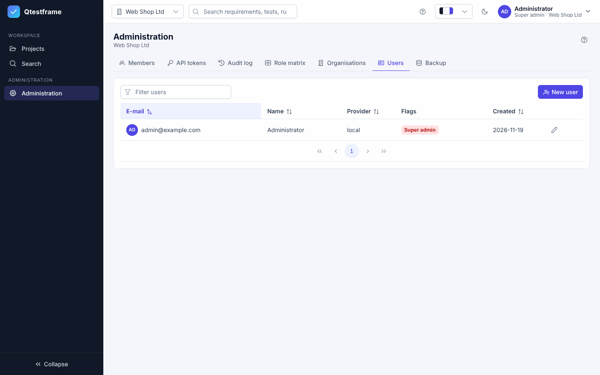

- **New user**: e-mail, display name, password and optionally **Super administrator**.
- **Edit user**: change the display name, set a new password (**Reset password (optional)**), make the user a super administrator, or mark the account **Disabled**. Disabling an account or setting a password signs the user out everywhere. **Must change password** forces a new password at the next sign-in.
- You cannot remove your own super admin flag or disable yourself.

Users who sign in with OIDC or SAML single sign-on can be created automatically on their first sign-in, with their role taken from their identity provider groups; this is configured on the server (see the operations guide).

## Backup and restore

*(Super admin)* **Administration → Backup** saves and restores the whole installation.

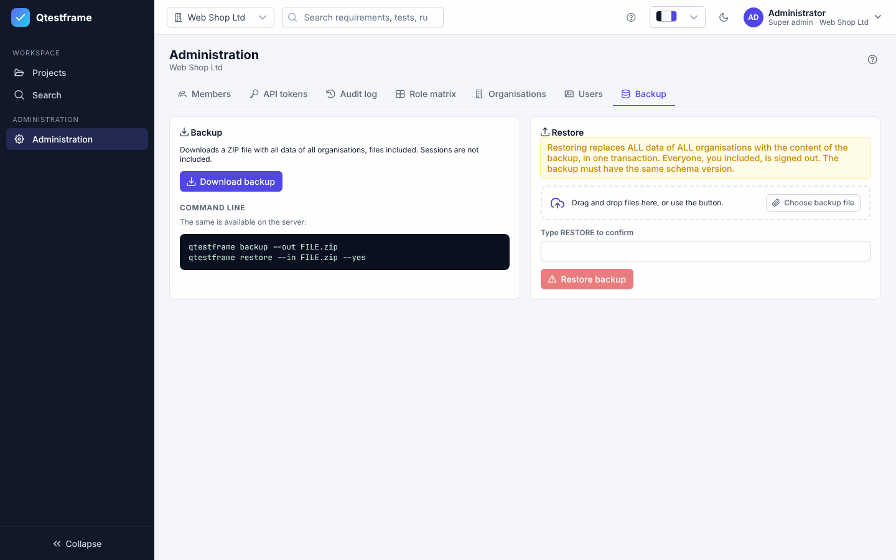

- **Download backup** creates a ZIP file with all organisations, projects, items, history, comments and files (sessions are not included). Store it somewhere safe; it contains all data, including password hashes.
- **Restore**: choose the backup file, type `RESTORE` to confirm and select **Restore backup**. This **replaces all data** of the installation with the content of the file, in one step. The backup must come from the same version of the database schema. Everyone, including you, is signed out afterwards.

Restore is meant for disaster recovery and moving to a new server. To recover a single item, use its [history](#history-and-restore) instead.

The server administrator can do the same on the command line:

```bash
qtestframe backup --out qtestframe-backup.zip
qtestframe restore --in qtestframe-backup.zip --yes
```

## Command line

Server administrators can also manage organisations, users and members with the `qtestframe` command, for example to create the first organisation:

```bash
qtestframe tenant create --slug acme --name "Acme Corp"
echo 'Initial-pass-123' | qtestframe user create --email alice@example.com --name Alice --password-stdin
qtestframe member add --tenant acme --email alice@example.com --role manager
```

# Accessibility and languages

Qtestframe is designed to meet **WCAG 2.1 level AA**. It works with the keyboard alone, with screen readers, with browser zoom, on phones and tablets, in English and Swedish and in twenty-two colour themes.

## Keyboard

Everything can be done without a mouse.

| Key | Effect |
|---|---|
| <kbd>Tab</kbd> / <kbd>Shift</kbd>+<kbd>Tab</kbd> | Move to the next / previous control. The focused control has a clearly visible outline. |
| <kbd>Enter</kbd> / <kbd>Space</kbd> | Activate a button or link, tick a checkbox, toggle a cell in the traceability matrix. |
| <kbd>Esc</kbd> | Close a dialog, menu, drawer or the intro tour. Focus returns to where you were. |
| Arrow keys | Move within menus, lists, tabs, the folder tree and selection buttons. |
| <kbd>Ctrl</kbd>+<kbd>Enter</kbd> | Post a comment. |
| <kbd>Enter</kbd> in a filter field | Apply the query. |
| <kbd>?</kbd> | Open the user guide page for the current view (outside text fields). |
| <kbd>Ctrl</kbd>+<kbd>Z</kbd> / <kbd>Ctrl</kbd>+<kbd>Shift</kbd>+<kbd>Z</kbd> or <kbd>Ctrl</kbd>+<kbd>Y</kbd> | [Undo / redo](#undo-and-redo) the last change (outside text fields; on a Mac <kbd>⌘</kbd>). |

### Skip link

The first <kbd>Tab</kbd> on every page shows **Skip to main content**. Press <kbd>Enter</kbd> to jump past the sidebar and the top bar straight to the page content.

### Moving between pages

When you open another page, focus moves to its main heading and the page title is announced, so you know where you are without searching.

### Folder trees and tables

- In the folder tree, the arrow keys move between folders and open or close them. The **⋮** actions button of a folder offers everything that is otherwise done by dragging or right-clicking: new subfolder, rename, move, delete.
- Rows of the requirement and test tables open with <kbd>Enter</kbd> on the title. To move rows without dragging, select them and use **Move** in the bulk toolbar.

### Execution runner

The runner has single-key shortcuts (<kbd>P</kbd> pass, <kbd>F</kbd> fail, <kbd>B</kbd> blocked, <kbd>S</kbd> skip, <kbd>J</kbd>/<kbd>K</kbd> or arrows for next/previous step, <kbd>?</kbd> help). They only work while the focus is not in a text field, so typing an actual result never triggers them. See [Keyboard shortcuts](#keyboard-shortcuts).

## Screen readers

Qtestframe is built to be used with screen readers such as NVDA, JAWS, VoiceOver and TalkBack.

- Pages have **landmarks** (navigation, search, main) and a logical **heading structure**, so you can jump with your screen reader's heading and landmark commands.
- All buttons that only show an icon have a text label, for example *Delete SHOP-REQ-4* instead of just *bin*.
- **Status messages** (saved, deleted, failed) are announced politely; errors are announced immediately.
- Form fields have labels; required fields and errors are announced.
- In the language analysis, findings are announced with their severity (error, warning).
- On phones, tables become stacked cards; each value is read together with its column name.
- Screenshots in this guide have text alternatives that describe what they show.
- The **intro tour** is a modal dialog: its text is announced at each step, focus stays inside it, and <kbd>Esc</kbd> ends it.

## Themes

Pick a theme with the **Colour theme** picker in the top bar, or under **Profile → Preferences → Theme**. The choice is stored with your account and follows you to every device. The quick **Light mode / Dark mode** button next to it switches between the light and dark basic themes.

| Theme | Character |
|---|---|
| **Light** | the default: bright and neutral |
| **Dark** | dark surfaces, easier on the eyes in dim light |
| **Follow the operating system** | light or dark, as set on your computer or phone |
| **Spring**, **Autumn**, **Desert** | light themes with seasonal colours |
| **Ocean**, **Sunset**, **Nordic**, **Lavender**, **Rose** | light themes: sea blue, warm evening colours, calm grey-blue, soft violet, soft pink |
| **Camouflage**, **City camouflage** | dark themes with a camouflage pattern in the sidebar and top bar |
| **Arctic camouflage** | a light theme with a winter camouflage pattern in white, pale grey and blue-grey |
| **Navy blue**, **Midnight**, **Forest** | dark themes: navy with gold, deep blue-violet, dark green |
| **Green terminal**, **Amber terminal** | dark themes in a monospace font, like an old computer screen |
| **High contrast dark**, **High contrast light** | white on black (with yellow) or black on white (with blue), with visible borders and underlined links, for low vision; text meets the stricter AAA contrast of 7:1 |
| **Crazy** | a playful, colourful theme |

All themes meet the AA contrast requirements for text and controls. Qtestframe also respects your system's **reduced motion** setting.

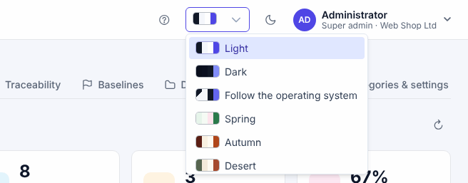

## Languages

The user interface is available in **English** and **Swedish** (*Svenska*).

- Change it with **User menu → Language**, or under **Profile → Preferences → Language**. It applies immediately and is stored with your account.
- **Browser default** follows the language of your browser; if that is neither English nor Swedish, English is used.
- On the sign-in page, the language buttons apply before you sign in; after sign-in your preference wins.
- Dates and numbers follow the chosen language unless you set another **Date format** in your preferences.
- This user guide is available in both languages. If a page has not been translated yet, the English page is shown with a notice.
- [Reports](#standard-reports) are produced in the language you use when you create them; scheduled reports in the language of the person who scheduled them.
- Your data is not translated: requirements, tests and comments stay in the language they were written in. The RFC 2119 obligation levels (MUST, SHOULD, …) are always shown in English, also in the Swedish interface, where they are explained in Swedish (for example *MUST (SKA)*). The [language analysis](#the-language-analysis) checks requirement texts written in either English or Swedish, with Swedish keywords such as *SKA* and *BÖR*.

## Phones and tablets

Qtestframe adapts to the screen size; nothing needs to be installed.

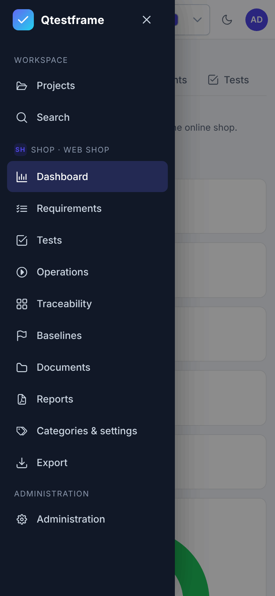

- **Below 1024 pixels** (tablets, small windows) the sidebar becomes a drawer. Open it with the menu button (☰) at the top left; it closes when you choose a page, tap outside it or press <kbd>Esc</kbd>.
- **Below 768 pixels** the search field becomes a magnifier button that opens a search dialog.
- **Below 640 pixels** (phones) tables turn into stacked cards, forms use a single column and editors open full-screen.
- The folder tree of the requirements and tests pages opens with the **Folders** button on narrow screens.
- The execution runner works well on a tablet next to the system under test.
- Large tables such as the traceability matrix scroll sideways inside their frame; the **List** view of the matrix is easier to use on a phone.


## Zoom and text size

When you zoom the browser, the layout reflows instead of scrolling sideways; at high zoom levels you get the tablet or phone layout described above. Text size settings of the browser or operating system are respected. **Compact tables** in your preferences show more rows if you prefer density over size.

# FAQ

Answers to the questions users ask most often. Use the search field at the top of the guide to find a word on all pages.

## Getting access

### I forgot my password. What do I do?

There is no self-service reset. Ask an **admin** of your organisation to [reset your password](#reset-a-password). You get a temporary password that you must change at the next sign-in. If you sign in with single sign-on (a button below *or continue with*), your password is managed by your company's identity provider; reset it there.

### Why was my session ended?

A session ends when:

- it reaches its maximum age (12 hours by default, set by your administrator) and you have to sign in again;
- you or someone with access to your account selected **Sign out** for it under **Profile → Active sessions**, or **Sign out all other sessions** on another device;
- an administrator reset your password, set a new one, or disabled your account;
- a super admin restored a backup, which signs everyone out;
- your browser deleted its cookies.

Sign in again. If you did not expect it, change your password and check your active sessions.

### I see "You have no current organisation". What now?

You are signed in but not working in an organisation. Choose one in the organisation switch in the top bar. If the list is empty, you are not a member of any organisation yet; ask an admin to add you.

### How do I switch to another organisation?

Use the organisation switch at the left of the top bar (on phones, the building icon). Qtestframe opens that organisation's project list. To start in a particular organisation every time, set **Default organisation** in your preferences.

## Editing

### How do I refer to a colleague in a requirement or comment?

Type `@` followed by the start of their name, then pick them from the list, see [Mention people](#mention-people). The list holds the users of the organisation and names already used as owner or assignee in the project. `mention:` in a filter finds what mentions someone.

### Where do the suggested tags come from?

From the title and description of the item. Tags the project already uses come first when the text mentions them, then abbreviations and frequent words. Common words and requirement keywords are never suggested. Select a suggestion to add it; ignore the others.

### Why can't I edit a requirement?

Writing requirements needs the **Manager** role in the current organisation. With **Viewer** or **Tester** the editor opens read-only, and buttons such as **New requirement** and **Save** are hidden. Check your role in the user menu; ask an admin if you need more rights. Testers can still link tests to requirements and comment on them.

### Why can't I see the Run script button?

Running scripts on the server needs the **Test lead** or **Manager** role (the permission *script.execute*), and the administrator must enable the script runner (`runner.enabled`). Without the role, the runner says that the *script.execute* permission is needed. If the runner is disabled on the server, use the [CI import](#import-results-from-ci) instead.

### How do I undo a change?

Select **Undo** (↶) in the top bar or press <kbd>Ctrl</kbd>+<kbd>Z</kbd> outside a text field; the **Undo history** (🕘) lists your recent changes. This works for edits, deletions, moves, bulk edits, links and more, see [Undo and redo](#undo-and-redo). A deleted requirement or test comes back with its key, links, comments and history.

For older changes, open the item, go to the **History** tab, select the version you want and choose **Restore this version**. This creates a new version with the old content; nothing is lost and you can restore again.

### Can Qtestframe write code or tests with AI?

In a **software** project, **AI prompts** builds a prompt from your requirements or tests (implement them, review them, design or automate test cases, plan a test type) that you copy into the AI assistant your organisation uses. Qtestframe itself does not call any AI service. See [AI prompts](#ai-prompts-software-projects).

### Why can't I approve a requirement or mark a test ready?

Approving or rejecting a requirement needs the permission *requirement.review*, marking a test **Ready** needs *test.review*. By default the **Reviewer** and **Manager** roles have both and the **Test lead** has *test.review*; a **Tester** can write tests but not mark them ready. Without the permission these statuses are greyed out in the editor. See [Roles and permissions](#roles-and-permissions).

### Can two people edit the same requirement at the same time?

Yes, but the last one to save wins: each save replaces the fields with what that person sees. Both versions are in the **History**, so nothing is lost; compare them there and restore if needed. Use **Comments** to coordinate.

### Why was the obligation not updated when I changed the text?

The obligation is detected automatically only when the requirement is **created** with **Auto-detect from text**. After that it is never changed behind your back. Use **Apply detected obligation** in the analysis box, or pick the level yourself.

### What happens when I move a requirement to another project?

It gets a **new key** in the target project (for example `SHOP-REQ-7` becomes `CORE-REQ-31`); categories are matched by dimension and name and dropped if the target has no such value; **links to tests are removed**, because links never cross projects; criteria and history move along. Within a project, moving only changes the folder. See [Move requirements and folders](#move-requirements-and-folders).

### Who can see my comments?

Everyone who can read the item, which means every member of the organisation with access to the project, whatever their role. Comments are not visible to other organisations. You can edit and delete your own comments; admins can delete any comment. Comments are deleted together with their item.

### What does "auto-generated" mean on a test?

The test was created automatically together with a requirement (**Also create linked test**). It is an ordinary test: refine its steps, change its status and remove the tag if you like.

## Coverage and results

### How is coverage calculated?

From the **last result** of every test linked to the requirement: no linked test → *None*; any linked test failed or blocked → *Failed*; all passed → *Passed*; some passed and the rest not run, skipped or in progress → *Partial*; otherwise *Not run*. Only runs of the same project count. Details and examples are in [How coverage is calculated](#how-coverage-is-calculated).

### What does "Not run" mean?

For a **test** or **execution**: it has no result yet. For a **requirement's coverage**: tests are linked, but none of them has passed or failed in any run of this project yet. That is different from *None*, which means no test is linked at all.

### A test passed again; why is my requirement still "Failed"?

Coverage uses the latest result of **each** linked test. If another linked test is still failed or blocked, the requirement stays *Failed*. Open the requirement's **Linked tests** to see each test's last result. Also check that the new result was saved (in the runner, **Save**).

### Why does the dashboard say "covered" when the tests have not been run?

On the dashboard, *covered* means that at least one test is linked. Whether those tests passed is shown in **Requirement coverage** next to it.

### How do I import CI results?

Create an API token (**Administration → API tokens**, role Tester or higher), open the run and select **CI import** for a ready-made command, and post the results by test key from your pipeline. See [Import results from CI](#import-results-from-ci).

### A CI import reports "unknown" test keys. Why?

Those keys do not exist in the run's project. Check the spelling (case does not matter) and that the tests have not been moved to another project, which gives them new keys.

### Why are Pass and Fail disabled in the runner?

The test may not be executed yet: it is not **Ready**, a requirement it verifies is not approved, or a test it depends on has not passed. The red box above the steps lists each reason with what to do and the setting that decides: whether the **test** is not Ready (still Draft or in Review), a **requirement** it verifies does not have one of the statuses the execution settings require (for example it is Approved but the settings require Implemented), or a **prerequisite** has not passed. Fix them (or ask an admin or test lead to change the [test execution settings](#test-execution-settings)); meanwhile you can mark the test **Blocked** or **Skipped**.

### How do I create a role of my own?

*(Admin)* **Administration → Role matrix → New role**: give it a name, choose the role whose permissions it starts with, then tick and untick permissions in the matrix and save. See [Change roles and create your own](#change-roles-and-create-your-own).

### Can I change a result after saving it?

Yes. Open the execution in the runner, change the step results or the overall status, and save. The time and the person are updated. The test's execution history shows the latest state of each execution.

## Baselines and history

### What is the difference between a baseline and a revision?

A **revision** is one version of one item, created automatically on every change (the **History** tab). A **baseline** is a named snapshot of the versions of all (or filtered) items of a project at one moment, created by you, for example for a release. See [Baseline or revision?](#baseline-or-revision).

### Does deleting a baseline delete requirements?

No. A baseline only records versions. Deleting it leaves all items unchanged.

## Search and filters

### Why is my query invalid?

Usually a field that does not exist in that list (for example `coverage` in tests), a space after the operator (`status: approved`), an unclosed quote, parenthesis or regex, or a regex feature RE2 does not support. The field is marked and the message names the position. Open **Query help** (**?** next to the filter) for the fields. See [Why is my query invalid?](#why-is-my-query-invalid).

### How do I find requirements without tests?

Filter the requirements with `coverage:none`, or `-linked:*`. Combine it, for example `coverage:none obligation=must`.

### Does search cover all projects?

The search in the top bar covers all projects of the **current organisation** that you can read. Filters in a list only cover that list. Other organisations are never searched.

## Settings and devices

### What does a field mean?

Point at the small **i** next to it, or move the keyboard focus there: a short explanation appears, with a link to the section of this guide that describes the field. Press <kbd>?</kbd> to open the guide page of the current view. For the standards behind requirement levels and testing, see [References](#references).

### How do I change the language or theme?

Language: **User menu → Language** (English or Svenska). Theme: the **Colour theme** picker in the top bar, or the sun/moon button for light and dark. Both are also in **Profile → Preferences** and are stored with your account, so they follow you to every device.

### Can I use Qtestframe on a phone?

Yes. The interface adapts to phones and tablets: the sidebar becomes a drawer behind the menu button, tables become cards and editors open full-screen. Executing manual tests on a tablet works well. See [Phones and tablets](#phones-and-tablets).

### How do I restart the intro tour?

Select **Help** (the question mark in the top bar) → **Restart intro tour**.

### Can I change the key of a project?

No. The key is part of every item ID and cannot be changed after the project is created. You can change the project's name, description and colour in **Categories & settings** (or with ✎ on the project list). If you really need another key, use **Duplicate project** on the project list: the copy gets the new key, and all item keys follow it (see [Save and load projects](#save-and-load-projects)). Then delete the original.

## Files and data

### Where are files stored?

In the Qtestframe database, together with the rest of the data. Files are therefore included in backups, protected by the project's access rules, and deleted with the project. See [Documents](#where-are-files-stored).

### How large may an uploaded file be?

25 MB per file by default; your administrator can change the limit. Avatars and project icons may be at most 1 MB.

### Why does a file download instead of opening?

Only images (PNG, JPEG, GIF, WebP), PDF files and plain text are shown in the browser. All other types are downloaded, so that no file can run code in your browser.

### How do I restore a backup?

A **super admin** opens **Administration → Backup**, chooses the backup file under **Restore**, types `RESTORE` and selects **Restore backup**. All current data is replaced and everyone is signed out. The backup must come from the same schema version. Server administrators can use `qtestframe restore --in FILE.zip --yes`. To recover a single item, use its history instead.

### How do I move a project to another server?

Select **Save project** (the download button on the project list) and, on the other server, **Load project** with the file. The copy has everything in the project except secrets such as webhook secrets and the tracker token; see [Save and load projects](#save-and-load-projects). To move all organisations at once, a super admin uses a backup instead.

### Can I get my data out of Qtestframe?

Yes: **Export** downloads requirements, criteria, tests, traceability and runs as XLSX, CSV, PDF or DOCX, and every function is also available through the REST API with an API token.

# References

Standards, guidelines and other documents behind Qtestframe's way of writing requirements and tests. Use them when you set up a specification process, train authors or need to justify a rule to an auditor. Links go to the publisher. ISO and IEEE standards are not free to read, but their catalogue pages describe the scope.

## Requirement key words (RFCs)

These define the obligation levels and the [language analysis](#the-language-analysis) in Qtestframe.

| Document | What it says | Used in Qtestframe for |
|---|---|---|
| [RFC 2119](https://www.rfc-editor.org/rfc/rfc2119) – *Key words for use in RFCs to Indicate Requirement Levels* (S. Bradner, 1997) | Defines **MUST**, **MUST NOT**, **REQUIRED**, **SHALL**, **SHALL NOT**, **SHOULD**, **SHOULD NOT**, **RECOMMENDED**, **NOT RECOMMENDED**, **MAY** and **OPTIONAL**, and warns against using them where they are not needed. | The obligation levels (*must*, *shall*, *should*, *may*, *optional* and their negations) and keyword detection |
| [RFC 8174](https://www.rfc-editor.org/rfc/rfc8174) – *Ambiguity of Uppercase vs Lowercase in RFC 2119 Key Words* (B. Leiba, 2017) | Clarifies that only the **UPPERCASE** forms carry the RFC 2119 meaning; lowercase words have their normal English meaning. | The *Lower-case keyword* rule |
| [BCP 14](https://www.rfc-editor.org/info/bcp14) | The "best current practice" made up of RFC 2119 and RFC 8174. Specifications cite it with a standard sentence: *The key words "MUST", "MUST NOT", … are to be interpreted as described in BCP 14 [RFC2119] [RFC8174] when, and only when, they appear in all capitals, as shown here.* | Put this sentence in the introduction of your specification |
| [RFC 7322](https://www.rfc-editor.org/rfc/rfc7322) – *RFC Style Guide* (2014) | Editorial rules for RFCs, including how to cite BCP 14. | A model for a house style |
| [RFC 3552](https://www.rfc-editor.org/rfc/rfc3552) – *Guidelines for Writing RFC Text on Security Considerations* (BCP 72, 2003) | How to analyse and describe threats in a specification. | Writing *security* requirements |
| [RFC 6919](https://www.rfc-editor.org/rfc/rfc6919) – *Further Key Words for Use in RFCs to Indicate Requirement Levels* (2013) | An April Fools' RFC with key words such as *MUST (BUT WE KNOW YOU WON'T)*. | A humorous reminder of why ambiguous wording fails |

### Other RFCs that Qtestframe implements

| Document | Where |
|---|---|
| [RFC 9110](https://www.rfc-editor.org/rfc/rfc9110) – *HTTP Semantics* | The REST API |
| [RFC 8259](https://www.rfc-editor.org/rfc/rfc8259) – *JSON* | API requests and responses, backups |
| [RFC 3339](https://www.rfc-editor.org/rfc/rfc3339) – *Date and Time on the Internet: Timestamps* | Dates in the API, in queries (`updated_at>=2026-01-01`) and the audit log filter |
| [RFC 4180](https://www.rfc-editor.org/rfc/rfc4180) – *CSV Files* | CSV export |
| [RFC 5424](https://www.rfc-editor.org/rfc/rfc5424) – *The Syslog Protocol* | Server logging to syslog |
| [RFC 5280](https://www.rfc-editor.org/rfc/rfc5280) – *X.509 Certificate and CRL Profile* | TLS certificates and the certificate scripts |
| [RFC 6265](https://www.rfc-editor.org/rfc/rfc6265) – *HTTP State Management Mechanism* (cookies) | Session cookies |
| [RFC 6749](https://www.rfc-editor.org/rfc/rfc6749) – *OAuth 2.0* and [RFC 7519](https://www.rfc-editor.org/rfc/rfc7519) – *JSON Web Token* | Single sign-on with [OpenID Connect Core 1.0](https://openid.net/specs/openid-connect-core-1_0.html) |
| [SAML 2.0 Core](https://docs.oasis-open.org/security/saml/v2.0/saml-core-2.0-os.pdf) (OASIS) | Single sign-on with SAML |

## NIST publications

The US National Institute of Standards and Technology publishes free guidance that many organisations use as requirement and test catalogues, especially for security.

| Document | Relevance |
|---|---|
| [NIST SP 800-53 Rev. 5](https://doi.org/10.6028/NIST.SP.800-53r5) – *Security and Privacy Controls for Information Systems and Organizations* (2020) | A catalogue of controls, often imported as security requirements. Use categories (for example *Control family / AC*) to keep track of them. |
| [NIST SP 800-53A Rev. 5](https://doi.org/10.6028/NIST.SP.800-53Ar5) – *Assessing Security and Privacy Controls in Information Systems and Organizations* (2022) | Assessment procedures per control, using the methods *examine*, *interview* and *test*; they map onto the [evaluation criteria](#evaluation-criteria) methods. |
| [NIST SP 800-115](https://doi.org/10.6028/NIST.SP.800-115) – *Technical Guide to Information Security Testing and Assessment* (2008) | Planning and running security tests: review, target identification, vulnerability validation. |
| [NIST SP 800-160 Vol. 1 Rev. 1](https://doi.org/10.6028/NIST.SP.800-160v1r1) – *Engineering Trustworthy Secure Systems* (2022) | Systems security engineering, including stakeholder needs, requirements definition and verification, aligned with ISO/IEC/IEEE 15288. |
| [NIST SP 800-218](https://doi.org/10.6028/NIST.SP.800-218) – *Secure Software Development Framework (SSDF) Version 1.1* (2022) | Practices for secure development, including defining security requirements and testing them. |
| [NIST IR 8397](https://doi.org/10.6028/NIST.IR.8397) – *Guidelines on Minimum Standards for Developer Verification of Software* (2021) | Minimum verification techniques: threat modelling, automated testing, static and dynamic analysis, fuzzing and more. |
| [NIST SP 800-142](https://doi.org/10.6028/NIST.SP.800-142) – *Practical Combinatorial Testing* (2010) | Designing a small number of tests that cover parameter interactions. |
| [NIST SP 800-63B-4](https://doi.org/10.6028/NIST.SP.800-63B-4) – *Digital Identity Guidelines: Authentication and Authenticator Management* (2025) | Requirements for passwords, multi-factor authentication and sessions. |
| [NIST SP 800-92](https://doi.org/10.6028/NIST.SP.800-92) – *Guide to Computer Security Log Management* (2006) | Requirements for audit and security logging. |
| [NIST CSWP 29](https://doi.org/10.6028/NIST.CSWP.29) – *The NIST Cybersecurity Framework (CSF) 2.0* (2024) | High-level outcomes that can be broken down into requirements. |
| [NIST Planning Report 02-3](https://www.nist.gov/system/files/documents/director/planning/report02-3.pdf) – *The Economic Impacts of Inadequate Infrastructure for Software Testing* (2002) | A classic study of the cost of finding defects late. |

## Requirement engineering standards and guides

| Document | Relevance |
|---|---|
| [ISO/IEC/IEEE 29148:2018](https://www.iso.org/standard/72089.html) – *Systems and software engineering — Life cycle processes — Requirements engineering* | The main international standard for requirements: characteristics of good requirements (necessary, unambiguous, complete, singular, feasible, verifiable, correct), requirement attributes and specification contents. Replaces IEEE 830. |
| [ISO/IEC Directives, Part 2](https://www.iso.org/sites/directives/current/part2/index.xhtml) – *Principles and rules for the structure and drafting of ISO and IEC documents* | Defines the verbal forms of international standards: **shall** (requirement), **should** (recommendation), **may** (permission), **can** (possibility). Swedish standards from [SIS](https://www.sis.se/) use *ska*, *bör*, *får* and *kan*, which Qtestframe's Swedish analysis follows. |
| [INCOSE Guide to Writing Requirements](https://www.incose.org/docs/default-source/working-groups/requirements-wg/guidetowritingrequirements/incose_rwg_gtwr_v4_summary_sheet.pdf) (version 4, 2023; link to the free summary sheet) | Rules for well-formed requirements: active voice, no vague terms, no escape clauses, avoid "not", one thought per requirement. The language analysis checks several of these rules. |
| [EARS – Easy Approach to Requirements Syntax](https://doi.org/10.1109/RE.2009.9) (A. Mavin et al., IEEE RE 2009) | Simple sentence patterns: *While …, when …, the system shall …*. |
| [IREB CPRE Foundation Level](https://www.ireb.org/en/cpre/foundation/) | Certification syllabus and glossary for requirements engineering. |
| [ISO/IEC 25010:2023](https://www.iso.org/standard/78176.html) – *Product quality model* | Quality characteristics (performance efficiency, usability, security, reliability …) that make a good checklist for non-functional requirement types. |

## Testing standards and guides

| Document | Relevance |
|---|---|
| [ISO/IEC/IEEE 29119](https://committee.iso.org/sites/jtc1sc7/home/projects/flagship-standards/isoiecieee-29119-series.html) – *Software testing* series, especially [Part 1: General concepts](https://www.iso.org/standard/81291.html) (2022) and [Part 3: Test documentation](https://www.iso.org/standard/79429.html) (2021) | Test processes, documentation templates (test plan, test case, test log, incident report) and techniques. Part 3 replaces IEEE 829. |
| [IEEE 1012-2016](https://standards.ieee.org/ieee/1012/5609/) – *System, Software, and Hardware Verification and Validation* | V&V activities and integrity levels. |
| [ISTQB Glossary](https://glossary.istqb.org/) and [Certified Tester Foundation Level v4.0](https://www.istqb.org/certifications/certified-tester-foundation-level-ctfl-v4-0/) | The common vocabulary of testing (test case, test run, defect, coverage …) used in this guide. |
| [OWASP Application Security Verification Standard (ASVS)](https://owasp.org/www-project-application-security-verification-standard/) | A ready-made list of testable security requirements for web applications, in three levels. |
| [OWASP Web Security Testing Guide](https://owasp.org/www-project-web-security-testing-guide/) | How to test the security of web applications; complements ASVS. |
| [WCAG 2.2](https://www.w3.org/TR/WCAG22/) (and [WCAG 2.1](https://www.w3.org/TR/WCAG21/)) – *Web Content Accessibility Guidelines* | Testable accessibility success criteria. Qtestframe itself aims at WCAG 2.1 AA, see [Accessibility and languages](#accessibility-and-languages). |

## Domain-specific standards

Regulated domains add their own requirement and verification rules. Qtestframe's obligation levels, evaluation criteria, baselines, history and audit log are useful there, but check the standard of your domain, for example *DO-178C* (airborne software), *IEC 62304* (medical device software), *ISO 26262* (road vehicles), *IEC 61508* (functional safety) or *EN 50128* (railway software).
