# Qtestframe user guide

Qtestframe is a tool for managing **requirement specifications and tests** in one place. You write requirements, design manual and automated tests that verify them, run test campaigns, record results and defects, and prove coverage with a traceability matrix, a dashboard and reports. Several organisations (tenants) can share one installation without seeing each other's data.

This guide is for everyone who works in Qtestframe: requirement authors, testers, test managers and administrators. It describes the web client as you see it. You can read it here in the app (**Help → User guide**, or the **?** link on many pages), or as Markdown files in the `docs/user-guide` folder of the source code.


## Where to start

- **New to Qtestframe?** Read [Getting started](#getting-started), then work through the tutorial [Your first test campaign](#tutorial-your-first-test-campaign). It takes about 30 minutes and touches every important feature.
- **Looking for an answer?** Try the [FAQ](#faq) or the search field at the top of the guide. Unknown words are explained in the [Glossary](#glossary).
- **Want the big picture?** [How Qtestframe works](#how-qtestframe-works) explains how the tool is built up and how its items relate.
- **Administrator?** Go straight to [Administration](#administration).

## Contents

| Page | What it covers |
|---|---|
| [Getting started](#getting-started) | Signing in, the layout, organisations, search, theme and language, your profile and preferences |
| [Tutorial: your first test campaign](#tutorial-your-first-test-campaign) | A complete walk-through from an empty project to a report |
| [Requirements](#requirements) | Obligation levels, the language analysis, fields, evaluation criteria, relations, comments, history, bulk edit, moving and attachments |
| [Tests](#tests) | Manual steps, automated scripts, shared steps, categories, execution history, comments, history and attachments |
| [Catalogue](#catalogue) | Standard requirements and tests to add to a project: browsing, searching, the preview and adding with tests and trace links |
| [Test cycles](#test-cycles) | Planning test cycles: tests, testers and estimates, the runs a cycle creates, progress, burndown, workload, recurring cycles |
| [Test runs and execution](#test-runs-and-execution) | Runs, the execution runner and its keyboard shortcuts, defects, CI import with API tokens, attachments |
| [Exploratory testing](#exploratory-testing) | Session-based exploratory testing: charters, the session timer, typed notes with keyboard shortcuts, defects from notes, debriefs, metrics and the session report |
| [Waivers, residual risk and the SoA](#waivers-residual-risk-and-the-statement-of-applicability) | Waivers and deviations with signed approvals, residual risk and its acceptance, the Statement of Applicability (ISO/IEC 27001 Annex A) |
| [Traceability and coverage](#traceability-and-coverage) | The traceability matrix, how coverage is calculated, the dashboard |
| [Duplicates and conflicts](#duplicates-and-conflicts) | Similar requirements while writing, suspected duplicate requirements and tests, potentially conflicting requirements, merging, thresholds |
| [Variants and code](#variants-and-code) | Variants and applicability, coverage per variant, commits, merge requests, builds and the regression selection |
| [CI/CD](#cicd) | Pipeline templates for GitLab and GitHub, uploading results, the quality gate, commit statuses and merge request notes, test selection and child pipelines |
| [Baselines](#baselines) | Freezing a release and comparing versions |
| [Discussions](#discussions) | Threaded comments on items with Markdown, @mentions, reactions, resolving, and the project's Discussions page |
| [Search and filters](#search-and-filters) | The query language with many examples |
| [Reports and export](#reports-and-export) | Standard reports, the custom report builder, export formats and the document archive |
| [Interoperability](#interoperability-reqif-and-oslc) | ReqIF export and import with tests, relations and attachments; OSLC links, selection and creation from DOORS Next, Polarion, Codebeamer |
| [Documents](#documents-1) | The project's document archive: uploads, previews and links |
| [Administration](#administration) | Organisations, users, members and roles, project sharing, password resets, API tokens, the audit log, backup and restore |
| [Accessibility and languages](#accessibility-and-languages) | Keyboard use, screen readers, themes, English and Swedish, phones and tablets |
| [How Qtestframe works](#how-qtestframe-works) | The program, where data lives, organisations, projects and roles, the items and how they relate (with a diagram), the query language, background work, notifications, integrations, security, backups, and pointers for administrators |
| [FAQ](#faq) | Answers to common questions about using the tool, testing and requirements concepts, standards and formats, and how Qtestframe works |
| [Glossary](#glossary) | Alphabetical explanations of testing, requirements, standards and Qtestframe terms, each with what it means in Qtestframe |
| [References](#references) | RFC 2119, RFC 8174 and other RFCs, NIST publications, standards for requirements and testing, and the formats, protocols and frameworks Qtestframe uses |

## Key concepts

| Term | Meaning |
|---|---|
| **Organisation** (tenant) | An isolated workspace. Projects, members and API tokens belong to one organisation. You can be a member of several and switch between them. |
| **Project** | A container for requirements, tests, runs, baselines and documents. Its **key** (for example `SHOP`) prefixes every item ID: `SHOP-REQ-12`, `SHOP-TC-7`. |
| **Requirement** | A statement of what the system must, should or may do, with an obligation level, status, priority, evaluation criteria and more. |
| **Evaluation criterion** | How fulfilment of a requirement is judged: a method (test, inspection, analysis, demonstration, review) and a threshold. |
| **Test** (test case) | A manual test with steps, or an automated test with a script. |
| **Link** (trace link) | Connects a requirement with a test that verifies it. Links are the basis of coverage. |
| **Run** (test run) | A test campaign, for example *Sprint 12 regression*, with a set of tests to execute in an environment and build. |
| **Execution** | One test inside a run, with its result, step results, notes, defects and output. |
| **Coverage** | The verification state of a requirement, derived from the latest results of its linked tests: *None*, *Not run*, *Passed*, *Failed* or *Partial*. |
| **Baseline** | A frozen snapshot of the requirement and test versions of a project, for example for a release. |
| **Role** | What you may do in an organisation: *Viewer*, *Tester*, *Manager* or *Admin*. *Super admins* manage the whole installation. |

## Conventions in this guide

- Names of buttons, menus and fields are written in **bold**, exactly as they appear in the English user interface. The Swedish guide uses the Swedish labels.
- Menu paths are written with arrows: **User menu → Profile & password**.
- Keys are written like <kbd>Enter</kbd>; query examples like `status:approved`.
- A note such as *(Manager)* after an action tells you the lowest role that may do it. See the [role matrix](#roles-and-permissions).

# Getting started

This page explains how to sign in, find your way around the screen, and set up Qtestframe the way you like it.

## Sign in

Open the address your administrator gave you (for a local trial installation `http://localhost:8080`).


1. Enter your **E-mail** and **Password** and select **Sign in**.
2. If you belong to several organisations and want to start in a particular one, select **Sign in to a specific organisation…** and enter its short name (slug), for example `acme`. Without it you start in your default organisation (see [Preferences](#preferences)) or the one you used last.
3. If your organisation uses single sign-on, the page shows a button per provider below **or continue with**. Select it and sign in at your identity provider; you return to Qtestframe automatically.
4. If you use [multi-factor authentication](#multi-factor-authentication), the page then asks for the **Authentication code**: open your authenticator app, enter the 6-digit code it shows for Qtestframe and select **Verify**. Each code works once; if one is refused, wait for the next. Without your phone, select **Use a recovery code instead** and enter one of your recovery codes. If your organisation allows it, **Remember this device** skips the code on this browser for a number of days.

The language buttons at the top of the sign-in page switch between English and Swedish before you sign in. After sign-in, the language in your preferences wins.

> **Tip:** After ten failed attempts within five minutes, sign-in is blocked for a while for that e-mail address and network address. Wait a few minutes and try again, or ask an administrator to [reset your password](#reset-a-password).

### What you see after signing in

- **The intro tour.** On your first sign-in a short tour highlights the main parts of the screen. Use **Next** and **Back**, or **Skip tour** (or <kbd>Esc</kbd>) to close it. You can start it again at any time with **Help → Restart intro tour**.

  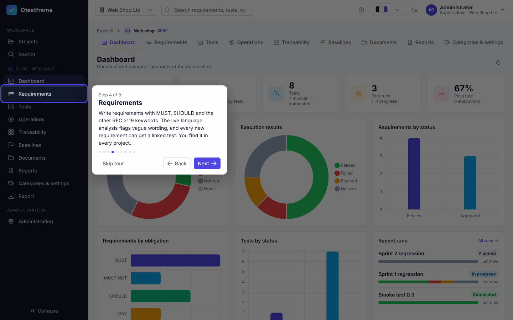
- **Sign-in information.** On later sign-ins Qtestframe can show when and from where you last signed in, and how many failed attempts there have been since. If you do not recognise a sign-in, change your password and sign out your other sessions (see [Security](#security)).
- **A forced password change.** If an administrator has reset your password, you must choose a new one before you can continue.
- **Multi-factor authentication required.** If your organisation requires a second factor and you have not set one up, a reminder tells you by when; after that date you must [set up an authenticator app](#multi-factor-authentication) at sign-in before you can continue.

## The layout


### Sidebar

The dark bar on the left is the main navigation:

- **Workspace:** **Projects** (all projects of the current organisation) and **Search** (search across projects). Each project card shows when the project was started and by whom: who created it, or loaded or duplicated it from a [project file](#reports-and-export). The creator is left out when it is not known (projects from the demo data or the command line, and projects older than this information). The table view has the same as columns, and **Categories & settings → Project** shows it too.
- **The open project:** once you open a project, its key and name appear with its sections: **Dashboard**, **Requirements**, **Tests**, **Operations** (test runs), **Traceability**, **Analytics**, **Dependency graph**, **Test flow**, **AI prompts** (software projects), **Tags**, **Baselines**, **Categories & settings**, **Export** and, where available, **Documents** and **Reports**.
- **Administration**, if your role allows it.

Inside a project, the same sections are also shown as tabs at the top of the page, below the breadcrumb *Projects › project name*.

**Collapse** at the bottom shrinks the sidebar to icons; hover an icon to see its name. On screens narrower than 1024 pixels the sidebar is hidden and opens with the menu button (☰) in the top bar; <kbd>Esc</kbd> or the close button closes it again.

### Top bar

From left to right:

| Element | Use |
|---|---|
| **Organisation** switch | Shows the current organisation and lets you switch to another one you are a member of. On phones it is a building icon. |
| **Search** field | Searches requirements, tests and runs in all projects of the organisation. Type text or a [query](#search-and-filters) and press <kbd>Enter</kbd>. On phones it is a magnifier button. |
| **Help** (?) | Opens the **User guide**, **Help for this page**, **Query language**, **References and standards** and **Restart intro tour**. |
| **Undo / Redo / Undo history** | Undoes and redoes your changes, see [Undo and redo](#undo-and-redo). |
| **Colour theme** | Picks one of the twenty-two themes, see [Themes](#themes). |
| **Light mode / Dark mode** | Switches between light and dark quickly. |
| **User menu** | Your name and role, **Profile & password**, light/dark mode, **Language** and **Sign out**. |

### Undo and redo

Most changes can be undone: editing, creating, copying and deleting requirements and tests, moving them, bulk edits, links, relations, dependencies, review decisions, restoring a version, test results in the runner, and creating, renaming and moving folders.

- **Undo** (↶, <kbd>Ctrl</kbd>+<kbd>Z</kbd>) reverts the latest change; select it again to go further back. The tooltip names the change, for example *Undo: Edit SHOP-TC-4*.
- **Redo** (↷, <kbd>Ctrl</kbd>+<kbd>Shift</kbd>+<kbd>Z</kbd> or <kbd>Ctrl</kbd>+<kbd>Y</kbd>) applies an undone change again. A new change clears what could be redone.
- **Undo history** (🕘) lists your last 50 changes, newest first, with when they were made. Selecting one undoes it and everything after it.

The keyboard shortcuts work outside text fields; in a text field they undo your typing as usual. The history belongs to you and your browser tab: it is cleared when you switch organisation, sign out or reload the page. A deleted requirement or test comes back with its key, links, relations, comments, history, attachments and execution results; deletions can be undone for 30 days through the API (see `GET /projects/{pid}/trash` in the API reference). An undo fails when the situation changed in the meantime, for example when someone else edited the item or you no longer have the permission; the item is then left as it is and a message explains why.

### Autocomplete

Text fields where you often write the same thing suggest what you saved in them before: titles of requirements, tests, defects and risks, a requirement's source, owner and rationale, a test's preconditions and expected result, the action, expected result and data of test steps, execution notes and actual results, comments, review comments, run and release names, and recent searches. For a requirement's **Source** and **Owner** and a risk's **Owner**, the values already used in the project are suggested too.

- Start typing: after a short pause a list of at most eight suggestions opens under the field. Values that start with what you typed come first, then values with a word that starts with it, then values that contain it; the ones you use most and most recently win ties.
- Nothing is chosen until you press <kbd>↓</kbd> or <kbd>↑</kbd>, so <kbd>Enter</kbd> and <kbd>Tab</kbd> work as usual while the list is just open. On a highlighted suggestion, <kbd>Enter</kbd> or <kbd>Tab</kbd> puts it in the field (it replaces the text); <kbd>Esc</kbd> closes the list without closing the dialog. You can also click or tap a suggestion.
- In an empty one-line field, <kbd>↓</kbd> lists your most used recent values; in a multi-line field use <kbd>Alt</kbd>+<kbd>↓</kbd>, because the arrow keys move the cursor there.
- Screen readers hear how many suggestions there are and what was inserted. A clock icon marks your own history, a folder icon a value used in the project.

Your history is saved with your account when you save a form (not while you type), so it follows you to every browser. You only ever see your own history, and only from projects you can still open. Turn the suggestions off, or limit them to one source, with **Autocomplete suggestions** in your [preferences](#preferences); **Clear my autocomplete history** in your profile deletes everything that was saved. Passwords, tokens and e-mail addresses are never remembered.

### Help where you need it

- Many fields and sections have a small **i** next to their name. Point at it with the mouse, or move the keyboard focus to it, to see what the field means. Select it (or tap it on a phone) to keep the explanation open, and choose **Read more in the user guide** to open the section that describes it. <kbd>Esc</kbd> closes it.
- Press <kbd>?</kbd> anywhere outside a text field to open the guide page for the current view (in the execution runner, <kbd>?</kbd> shows the runner's keyboard shortcuts instead).
- The **?** next to every filter field lists the operators and fields of the [query language](#search-and-filters) for that list.

### Organisations

An organisation (tenant) is a separate workspace with its own projects, members and API tokens. When you switch organisation in the top bar, Qtestframe takes you to that organisation's project list. Your role can differ between organisations, so what you may do can change too.

If you see the message *You have no current organisation*, pick one in the organisation switch. If you are not a member of any organisation, ask an administrator to add you.

### Search

The search field in the top bar searches everywhere in the current organisation. Results are grouped by type with the matching text highlighted; select a result to open it. Full details are in [Search and filters](#search-and-filters).

### Theme and language

- Pick a **colour theme** in the top bar or in your preferences. Your choice is stored with your account and follows you to every device.
- Change the **language** with **User menu → Language**: *English* or *Svenska*. The change applies at once and is saved as your preference.

## Your profile

Open **User menu → Profile & password**.


### Account

- **Display name**: the name others see in comments, history and the audit log.
- **Avatar**: choose a picture for your account: upload an image (PNG, JPEG, GIF or WebP, at most 1 MB), pick one of the built-in pictures, or use your initials.
- **Sign-in provider**, **Member since** and your **Memberships**: the organisations you belong to and your role in each.

### Preferences

Preferences are stored with your account and applied on every device. Change them and select **Save preferences**.

| Preference | Effect |
|---|---|
| **Language** | English or Swedish; *Browser default* follows the browser. |
| **Theme** | Colour theme. *Follow the operating system* switches between light and dark with your system setting. |
| **Start page** | What you see after signing in: the project list, the last opened project, a default project or search. |
| **Default project** | The project opened when the start page is *Default project*. |
| **Default organisation** | The organisation selected at sign-in when you do not name one. |
| **Rows per table page** | 10, 25, 50 or 100 rows in tables. |
| **Date format** | *Locale* (as usual in your language), *ISO* (2026-03-14 09:30) or *Relative* (3 hours ago). |
| **Time zone** | The time zone for all times; *Browser* uses your computer's. |
| **Also create linked test (new requirements)** | Your personal default for the checkbox in the requirement editor. |
| **Compact tables** | Denser table rows, to see more at once. |
| **Hide the live requirement-language analysis** | Turns off the analysis box in the requirement editor. |
| **Highlight obligation keywords** | On by default: marks MUST, SHOULD, MAY, SKA, BÖR, FÅR … in requirement descriptions and shows the keyword line under the description in the editor. See [Highlighted obligation keywords](#highlighted-obligation-keywords). |
| **Autocomplete suggestions** | What text fields suggest (see [Autocomplete](#autocomplete)): *On: my history and values used in the project* (the default), *Only my own history*, *Only values used in the project* or *Off*. With *Off* no suggestions are shown; with *Off* and *Only values used in the project* nothing you save is added to your history. |

Under the preference, **Clear my autocomplete history** deletes all the values your text fields remember for you, in every organisation, and shows how many are stored.

### Security

- **Password**: for local accounts, enter your **Current password** and the **New password** twice, then select **Change password**. If you sign in with single sign-on, your password is managed by your identity provider.
- **API tokens**: tokens for CI pipelines and scripts are created under **Administration → API tokens** (see [API tokens](#api-tokens)).
- **Active sessions**: every browser and device that is signed in with your account, with browser, IP address, sign-in time and last activity. **Sign out** ends one session; **Sign out all other sessions** ends all except the one you are using.
- **Sign-in history**: your recent sign-ins and failed attempts, if shown. Wrong codes of the second factor are listed as failed attempts with the method *Second factor*.

### Multi-factor authentication

A second factor protects your account even if someone learns your password: after the password you enter a 6-digit code from an **authenticator app** on your phone, for example Microsoft Authenticator, Google Authenticator, 1Password or FreeOTP.

**Turn it on**

1. In your profile, under **Multi-factor authentication**, select **Set up authenticator app**.
2. Scan the QR code with the app. On a phone, **Open in an authenticator app on this device** adds the account directly; if you cannot scan, select **Cannot scan the code? Enter the key by hand** and type the setup key into the app.
3. Enter the 6-digit code the app shows and select **Turn on**.
4. Qtestframe shows ten **recovery codes**. Save them now (**Copy** or **Download**), for example in a password manager: they are shown only this once. Each code works once and lets you sign in without your phone. Then select **I have saved the codes**.

From then on, every sign-in with your password asks for a code. API tokens are not affected.

**Later**

- **New recovery codes** creates ten new codes (the old ones stop working). Do this when only a few are left; the profile warns you.
- **Forget remembered devices** makes every browser where you chose *Remember this device* ask for a code again.
- **Turn off** removes the authenticator app and your recovery codes; both need a current code (or a recovery code). If your organisation requires multi-factor authentication, you cannot turn it off. You get an e-mail when it is turned off.
- **New phone or lost phone**: with a recovery code you can still sign in; turn MFA off and set it up again with the new phone. Without phone and recovery codes, ask an administrator to [reset your multi-factor authentication](#reset-multi-factor-authentication).

If you sign in with single sign-on, your identity provider usually asks for the second factor; Qtestframe asks for its own code only if the server is configured to do so.

## Next steps

- Follow the [tutorial](#tutorial-your-first-test-campaign) to build a small project from scratch.
- Learn the [query language](#search-and-filters); it works in every filter field.

# Tutorial: your first test campaign

In this tutorial you build a small project from nothing and take it all the way to a report. You will write requirements, let Qtestframe create linked tests, refine them, run them manually and automatically, record a defect, check coverage, freeze a baseline and export the result.

**Example:** the checkout of a web shop, project key `SHOP`.

**You need:** the role **Manager** or **Admin** in your organisation (requirements and projects need the Manager role; see [roles](#roles-and-permissions)). Running scripts on the server also needs the script runner to be switched on by your administrator (step 9). Allow about 30 minutes.

> **Just exploring?** Your administrator can load a ready-made demo project (*Demo – Online Banking*) with `qtestframe seed-demo`. The steps below work in it too, but starting from an empty project teaches you more.

## Step 1: Create a project

1. Select **Projects** in the sidebar.
2. Select **New project**.
3. Enter the **Name** `Web shop`. Qtestframe suggests a key from the name when you leave the field.
4. Set the **Key** to `SHOP`. The key prefixes every item, for example `SHOP-REQ-1` and `SHOP-TC-1`. It has 2–16 capital letters or digits, starts with a letter, and **cannot be changed later**. Add a **Description** if you like.
5. Leave **Seed default categories (Polarity, Interface, Medium, Execution, Level, Area)** ticked. These category dimensions are used to classify tests and requirements later.
6. Select **Create**.

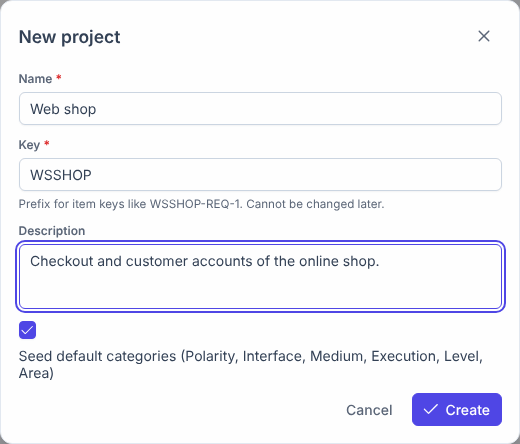

Open the project by selecting its card. You land on its **Dashboard**, which is still empty. The project's sections now appear in the sidebar.

## Step 2: Create folders

Folders group requirements (and, separately, tests) in a tree, like chapters of a specification.

1. Select **Requirements** in the sidebar. The folder tree is on the left, the requirement table on the right.
2. Select the **+** button (**New folder**) above the tree, enter `Checkout` and select **Save**.
3. Create a subfolder: right-click **Checkout** (or use its **⋮** actions button) and choose **New subfolder**. Name it `Payment`.
4. Create a second top-level folder `Accounts` the same way.

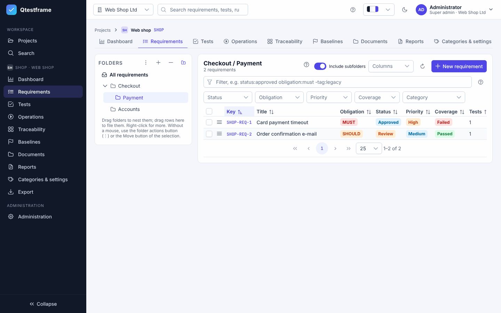

You can drag folders to nest or reorder them. Select a folder to show only its requirements; **Include subfolders** decides whether requirements in subfolders are shown too.

## Step 3: Write requirements with MUST and SHOULD

1. Select the **Payment** folder, then **New requirement**. The editor opens on the right with the folder already filled in.
2. Enter the **Title** `Card payment timeout`.
3. In **Description**, first type a deliberately weak statement:

   `The system should respond fast and/or retry TBD.`

   The **Requirement language analysis** box appears below the text and updates as you type. It finds:

   - the obligation keyword *should*, written in lower case (only the upper-case `SHOULD` has normative meaning under RFC 8174),
   - the ambiguous term *fast*, which cannot be verified,
   - *and/or*, which leaves open whether both or one is needed,
   - the placeholder *TBD*, which marks the requirement as incomplete.

   The **Score** drops to 53 of 100.


4. Now replace the text with a precise one:

   `The system MUST cancel a card payment that is not confirmed by the payment provider within 30 seconds.`

   The analysis shows **Detected: Must** and a score of 100.

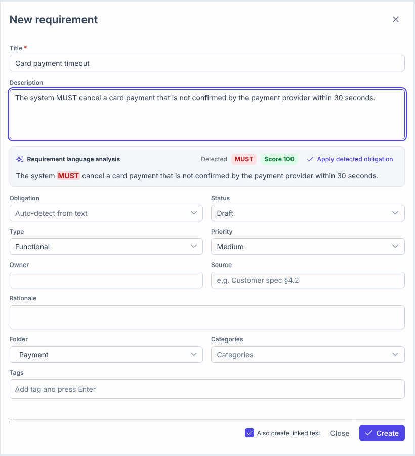

5. Leave **Obligation** on **Auto-detect from text**: the detected level is stored when you create the requirement. You can also choose a level yourself; **Apply detected obligation** sets the field to what the analysis found.
6. Set **Priority** to **High** and, under **Categories**, choose **Area / Core**.
7. Set **Status** to **Approved**: in a real project you do this once the requirement has been reviewed. By default a test can only be executed when it is **Ready** and every requirement it verifies is **Approved**, **Implemented** or **Verified** (see [Test execution settings](#test-execution-settings)).

Which keyword to use:

| Keyword | Meaning | Example |
|---|---|---|
| `MUST` / `SHALL` | Absolute requirement | The system MUST log every failed sign-in. |
| `MUST NOT` / `SHALL NOT` | Absolute prohibition | The system MUST NOT store card numbers. |
| `SHOULD` | Recommended; exceptions need a reason | The system SHOULD send an order confirmation within 5 minutes. |
| `SHOULD NOT` | Not recommended | The checkout SHOULD NOT require more than three pages. |
| `MAY` / `OPTIONAL` | Truly optional | The customer MAY save the card for later purchases. |
| `WILL` | Statement of intent or fact | The payment provider WILL send a callback. |

Write one obligation per sentence. If the analysis reports *several obligation keywords*, split the sentence into two requirements. More rules are explained in [Requirements](#the-language-analysis).

## Step 4: Add evaluation criteria

Evaluation criteria say **how** you will judge that the requirement is fulfilled. They also become the steps of the linked test.

1. In the editor, under **Evaluation criteria**, select **Add criterion**.
2. Enter `Unconfirmed payment is cancelled`, keep the method **Test** and enter the threshold `≤ 30 s`.
3. Add a second criterion `Cancellation is written to the audit log` with the method **Inspection**.
4. Check that **Also create linked test** at the bottom is ticked.
5. Select **Create**.


A message confirms *SHOP-REQ-1 with linked test SHOP-TC-1*. In the table, the requirement's **Coverage** is **Not run**: it has a test, but the test has not been executed yet.

Add one more requirement in the same folder for practice:

`The system SHOULD send an order confirmation by e-mail within 5 minutes after payment.`

## Step 5: Refine the automatic linked test

1. Select **Tests** in the sidebar. The test folder tree mirrors your requirement folders: there is a **Checkout / Payment** folder that Qtestframe created for you.
2. Open **SHOP-TC-1 Verify SHOP-REQ-1: Card payment timeout**. It is a manual test in status **Draft**, tagged `auto-generated`, with one step per criterion, for example *Verify (test): Unconfirmed payment is cancelled* with the expected result *≤ 30 s*.
3. Make the steps concrete. Click into a step to edit **Action**, **Expected result** and **Data**:

   | # | Action | Expected result | Data |
   |---|---|---|---|
   | 1 | Put an item in the basket and start the card payment | The payment page of the provider opens | test card 4111 1111 1111 1111 |
   | 2 | Do not confirm the payment; wait 30 seconds | The order shows *Payment cancelled* | |
   | 3 | Open the audit log | A *payment cancelled* entry exists for the order | |

4. Use **Add step** to append a step, the **+** on a row to insert one below, and the arrows to reorder.
5. Set **Status** to **Ready** and add the categories **Polarity / Negative** and **Interface / External**.
6. Select **Save**.


Under **Linked requirements** at the bottom you see SHOP-REQ-1. Use **Link requirements** to link further requirements to the same test.

## Step 6: Add a shared step

Many tests begin the same way, for example by signing in. Write those steps once and call them from other tests.

1. Select **New test** and create a test `Sign in as a customer` with two steps: *Open the shop and select Sign in* → *The sign-in form is shown*, and *Enter the customer e-mail and password* → *The account page is shown*. Set its status to **Ready** and select **Create**.
2. Open SHOP-TC-1 again and select **Insert call to test…** above the steps.
3. Choose **Sign in as a customer** and select **Insert call**. The new step reads **Calls SHOP-TC-…**.
4. Move the call step to the top with the up arrow and select **Save**.

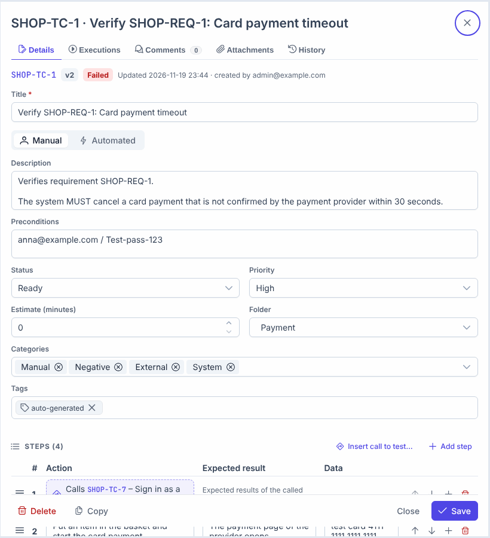

When a run is created, the called test's steps are inserted in place of the call, marked with the called test's key. If you improve the shared test later, new runs get the improvement. The shared test lists where it is used under **Used by**.

## Step 7: Create a run

1. Select **Operations** in the sidebar, then **New run**.
2. Enter the **Name** `Sprint 1 regression`, the **Environment** `staging` and the **Build** `1.0.0`.
3. Choose the tests to include. The run gets the union of all three tabs:
   - **Tests**: **Pick tests…** and select individual tests;
   - **Folders**: tick **Checkout**; tests in subfolders are included;
   - **Query**: a filter such as `status:ready`; **Preview** shows how many tests match.
4. Select **Create run**.


The run opens with one **execution** per test, all **Not run**. The steps of each test, including the inserted shared steps, are copied into the run now, so later edits to the tests do not change this run.

## Step 8: Execute manually and record a defect

1. In the run, select **Execute** (or the play button of one execution). The execution runner opens.
2. The left column lists the steps; the right side shows the current step with its **Action**, **Expected result** and **Test data**.
3. Do what the step says and compare the result:
   - if it matches, select **Pass** or press <kbd>P</kbd>;
   - if not, type what happened in **Actual result** and select **Fail** or press <kbd>F</kbd>.

   **Blocked** (<kbd>B</kbd>) and **Skip** (<kbd>S</kbd>) are also available. The runner moves to the next step automatically. Press <kbd>?</kbd> to see all shortcuts.
4. Let step 3 fail: the audit log entry is missing. Under **Defects**, enter `SHOP-101` (the ID in your issue tracker) and press <kbd>Enter</kbd>. Add a remark in **Notes**.
5. The **Overall status** is derived from the steps: one failed step makes the execution **Failed**. Select **Save & next** to save and go to the next execution.


**Turn defect IDs into links:** in **Categories & settings**, enter a **Defect tracker URL template** such as `https://jira.example.com/browse/{id}`. From then on `SHOP-101` links to your tracker.

## Step 9: Run an automated script

Automated tests are scripts that run on the server. Exit code 0 means *passed*, anything else *failed*.

1. In **Tests**, select **New test**, enter `Order total calculation`, and switch the execution type to **Automated**.
2. Choose the **Script** language **sh** and enter:

   ```sh
   #!/bin/sh
   # exit code 0 = passed, non-zero = failed
   total=$((2 * 15 + 5))
   echo "order total: $total"
   [ "$total" -eq 35 ] || { echo "unexpected total"; exit 1; }
   ```

3. Select **Create**.
4. Open the run *Sprint 1 regression*, select **Add tests**, choose the new test and confirm.
5. Open its execution and select **Run script**. After a moment the **Output** shows the script's output and the execution is **Passed**, with its duration.


**Run script** needs the **Manager** role (permission `script.execute`) and the server setting `runner.enabled: true`. If the button is missing or reports that the runner is disabled, ask your administrator. CI pipelines can instead report results through the API; see [CI import](#import-results-from-ci).

## Step 10: Check traceability and the dashboard

1. Select **Traceability**. Requirements are rows, tests are columns, and a marked cell means *linked*. The coloured bar at the start of each row shows the coverage (see the legend): SHOP-REQ-1 is now **Failed** because its test failed. The **Requirements** list shows the same in its **Coverage** column.
2. Click an empty cell to link a requirement with a test, or a marked cell to remove the link. **Only linked tests** hides tests without links.
3. Select **Dashboard**. It summarises requirement coverage, execution results, requirements by status and obligation, tests by status and the recent runs.

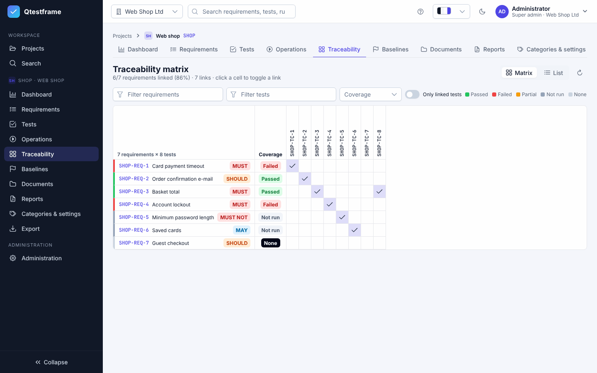


How coverage is calculated is explained in [Traceability and coverage](#how-coverage-is-calculated).

## Step 11: Create a baseline

Before a release, freeze the current versions of all requirements and tests.

1. Select **Baselines**, then **New baseline**.
2. Enter the **Name** `Release 1.0`. Leave **Filter (optional)** empty to include everything.
3. Select **Create baseline**.

Now change something, for example the threshold of a criterion of SHOP-REQ-1. Back in **Baselines**, select **Compare** on *Release 1.0* and compare it with **Current state**: SHOP-REQ-1 is listed under **Changed**, with the changed fields and both version numbers.


## Step 12: Export or generate a report

**Export the data:**

1. Select **Export**.
2. Choose the **Format**: **XLSX** (one sheet per aspect), **CSV** (a ZIP when you choose several aspects), **PDF** (printable) or **DOCX** (editable document).
3. Tick the **Aspects** you need: requirements, evaluation criteria, tests with steps, traceability matrix, runs and executions.
4. Optionally enter a filter such as `folder:Checkout`, then select **Download**.


**Generate a report:** in **Reports**, choose a standard report such as **Requirements coverage** or **Run summary** (for *Sprint 1 regression*), pick PDF, DOCX, XLSX or CSV, and download it, or save it to the project's document archive so that the whole team finds it under **Documents**. Under **Custom report** you choose the item type, filter, columns, grouping and sorting yourself. See [Reports and export](#reports-and-export).

## What you have learned

You have created a project with folders, written verifiable requirements with the help of the language analysis, added evaluation criteria, refined the automatically created test, reused steps, run a campaign manually and automatically, recorded a defect, checked coverage, frozen a baseline and exported the results.

Next, read about [requirements](#requirements) and [tests](#tests) in more depth, or learn the [query language](#search-and-filters) to find anything quickly.

# Requirements

The **Requirements** section of a project holds the specification: every requirement with its obligation level, status, evaluation criteria, links to tests, relations to other requirements, comments, change history and attachments.

Reading requirements needs the role **Viewer**; creating and changing them needs **Manager**. Linking tests to a requirement needs **Tester**.


## The requirements page

- **Folder tree** (left): select **All requirements** or a folder. **Include subfolders** decides whether items of subfolders are listed. On narrow screens the tree opens with the **Folders** button.
- **Filter bar**: a [query](#search-and-filters) field plus quick filters for **Status**, **Obligation**, **Priority**, **Coverage** and **Category**. The quick filters are combined into a query that is shown under the bar (`q = …`). **Clear** resets all filters.
- **Columns**: choose which columns the table shows: obligation, status, priority, type, coverage, linked tests, categories, folder, owner, source, tags, **relations**, relation count, criteria, version, comments, created by, created and updated date. The **Relations** column lists the related items grouped by relation, in both directions, for example *depends on SHOP-REQ-2*, *provided by SHOP-REQ-3* and *verified by SHOP-TC-1*; select a key to open the item. Move columns by dragging their header, or with the arrow buttons in **Columns**; **Reset** restores the default columns. Your choice is remembered in this browser, also for the run, executions and document tables.
- **Table**: sort by clicking a column header; select a row (or its title) to open the editor. The ID (for example `SHOP-REQ-12`) is assigned automatically.
- **List** / **Spreadsheet**: switch between the table and the [spreadsheet view](#spreadsheet-view), where you edit many requirements in place like in Excel.

The current folder, filter and open requirement are part of the page address, so you can bookmark or share a filtered view.

## Obligation levels

Every requirement has an **obligation** based on [RFC 2119 and RFC 8174](#requirement-key-words-rfcs):

| Level | Meaning |
|---|---|
| **Must**, **Shall** | Absolute requirement |
| **Must not**, **Shall not** | Absolute prohibition |
| **Should** | Recommended: there may be valid reasons to deviate, but the consequences must be understood |
| **Should not** | Not recommended |
| **May**, **Optional** | Truly optional |
| **Will** | Statement of intent or fact (not an RFC 2119 keyword) |
| **Describe** | Descriptive text without obligation, such as an introduction or a note |

When you create a requirement with **Obligation** set to **Auto-detect from text**, the level is detected from the title and description. If several keywords appear, the strongest one wins (Must not before Must before Shall not … before Describe). Text without any keyword has no obligation and is counted as *unspecified* on the dashboard. Later edits never change the obligation automatically; use **Apply detected obligation** in the analysis box, or pick a level yourself.

Only UPPER-CASE keywords carry normative meaning (RFC 8174). Write `MUST`, not `must`. Requirements written in Swedish use the Swedish keywords described under [The language analysis](#the-language-analysis). The [References](#references) page lists these and other standards for requirements and testing.

While you write, **Help: obligation levels** below the description (open for new requirements) shows the keywords of each level in the language of the interface, what they mean and an example, with tips on writing them. [Analytics](#requirement-analytics) shows how the levels and keywords are spread over the project.

### Highlighted obligation keywords

Wherever a requirement's description is shown read-only, its obligation keywords are highlighted: in the requirement editor when you may only read the requirement, in the [catalogue](#catalogue) preview and in the preview of [Import requirements](#import-requirements). Each level has its own style, and the levels differ not only in colour but also in weight and underline, so they are clear in every theme, high contrast included:

| Level | Keywords | Underline |
|---|---|---|
| Must | MUST, SHALL, REQUIRED, SKA, SKALL, MÅSTE | solid, extra bold |
| Must not | MUST NOT, SHALL NOT, SKA INTE, FÅR INTE | double, extra bold |
| Should | SHOULD, RECOMMENDED, BÖR | dashed, bold |
| Should not | SHOULD NOT, NOT RECOMMENDED, BÖR INTE | double, bold |
| May | MAY, OPTIONAL, FÅR, VALFRI | dotted |

Negations such as `MUST NOT` and `SKA INTE` are one keyword. Only keywords written in capitals are highlighted, only whole words (`MAYBE` is not `MAY`), and never inside links or code between backticks (`` `MUST` ``). Point at a keyword to see its meaning; screen readers read the level after the keyword, for example "MUST NOT (obligation: Must not)". The keywords are the same ones the [language analysis](#the-language-analysis) knows.

While you edit the description, the line **Obligation keyword** under it shows the keywords found as you type, with their level. It tells you when the keyword does not match the **Obligation** field (with a button to set the field to the detected level), when the text has more than one keyword and when a keyword is written in lower case. **What do the keywords mean?** opens **Help: obligation levels**.

To turn the highlighting and the line off, clear **Highlight obligation keywords** in your [preferences](#preferences).

## The language analysis

While you type the description, the **Requirement language analysis** box shows the detected obligation, a **Score** from 0 to 100, the keywords highlighted in your text and a list of **Findings**.

The analysis understands **English** and **Swedish**. By default (**Detect language**) it works out the language of the text and shows it next to the selector, for example *Detected: Swedish*; pick **English** or **Swedish** in the selector to force one. Your choice is remembered in this browser. The findings are always shown in your interface language, whichever language the requirement is written in.


| Rule | Severity | Found when |
|---|---|---|
| Missing keyword | Warning | there is no obligation keyword (MUST, SHALL, SHOULD, MAY …) |
| Lower-case keyword | Info | a keyword is not in upper case, such as `must` |
| Negative requirement | Info | `MUST NOT` or `SHALL NOT`: harder to verify; say what the system does instead |
| Several obligations | Warning | one sentence contains more than one keyword; split it |
| Long sentence | Info | a sentence has more than 40 words |
| Ambiguous term | Warning | vague words such as *fast, easy, user-friendly, simple, efficient, adequate, appropriate, approximately, flexible, robust, reliable, intuitive, sufficient, as needed, normally, usually, seamless, scalable, optimal, several, many, few, reasonable, timely, acceptable, as soon as possible, suitable* |
| Placeholder | Error | `TBD`, `TBC`, `TODO`, `XXX`, `???`: the requirement is incomplete |
| Unbounded term | Info | *all, always, never, every, any, none*: check that it is really meant universally |
| And/or | Warning | `and/or`: say whether both or either is required |
| Passive capability | Info | *be able to*, *be capable of*: describe the behaviour instead |
| Escape clause | Warning | *if possible, where applicable, unless, except*: make the condition explicit |
| Ambiguous negation | Warning | Swedish only: *måste inte* is often read as a prohibition but means "need not"; write *får inte* or *behöver inte* |

In Swedish text the keywords are **SKA**/**SKALL** (shall), **MÅSTE** (must), **BÖR** (should), **FÅR** (may), **FÅR INTE** (must not), **SKA INTE** (shall not), **BÖR INTE** (should not), **BEHÖVER INTE** and **VALFRI** (optional), **KOMMER ATT** (will) and **BESKRIVER**/**NOT:** (descriptive); upper-case English keywords also count. Swedish has no upper-case convention, so the lower-case rule only applies to English. The other rules use Swedish words, such as *snabb, användarvänlig, osv, och/eller, kunna, om möjligt, alla*. Note that *får* also means "receives", so a sentence like *användaren får ett mejl* is read as *may*.

**Score** = 100 − 25 per error − 10 per warning − 2 per info, never below 0. For example *The system shall respond fast and/or retry TBD.* scores 53: a lower-case keyword (info), *fast* (warning), *and/or* (warning) and *TBD* (error).

If you do not want the box, turn it off in your profile: **Hide the live requirement-language analysis**.

## Fields

| Field | Use |
|---|---|
| **Title** | A short name (required). |
| **Description** | The requirement statement itself, analysed while you type. |
| **Obligation** | See above. |
| **Status** | Draft, Review, Approved, Implemented, Verified, Rejected or Obsolete. *Approved* and *Rejected* are review decisions: they need the permission *requirement.review* (Reviewer or Manager) and are greyed out without it. Reviewers see **Approve** and **Reject** buttons at the top of the editor. |
| **Type** | Functional, Non-functional, Security, Performance, Usability, Interface, Constraint, Business or Regulatory. |
| **Priority** | Critical, High, Medium or Low. |
| **Owner** | Who is responsible for the requirement. Type `@` to pick a person, see [Mention people](#mention-people). |
| **Source** | Where it comes from. Pick one from the list (▾), which offers the project's sources and the sources other requirements already use, or type your own, for example *Customer spec §4.2*. The list of the project is edited under **Categories & settings → Requirement sources** (one per line; empty means the defaults: Customer, Contract, Standard, Regulation, Stakeholder, …). |
| **Rationale** | Why it exists. |
| **Folder** | Where it is filed. |
| **Categories** | Values of the project's requirement category dimensions, for example *Area / Security*. |
| **Tags** | Free keywords; type a tag and press <kbd>Enter</kbd>, or select one of the **Suggested tags** below the field. Suggestions come from the title and description: tags the project already uses that the text mentions come first (a solid border), then abbreviations such as *GDPR* and words of the title or words used more than once (a dashed border). Every tag gets a colour of its own, the same everywhere (tables, the tag cloud, documents), so equal tags are easy to spot. |
| **MITRE D3FEND techniques** | The defensive techniques the requirement implements, chosen from the [MITRE D3FEND](#mitre-d3fend-and-emb3d) list (type *D3-MFA* or part of a name). Requirements from the catalogue bring them along. In queries `d3fend:D3-AA` finds the requirements with the technique or one of its sub-techniques (*D3-MFA*), `d3fend:harden` those with a hardening technique. |
| **MITRE EMB3D mitigations and threats** | For embedded devices: the [MITRE EMB3D](#mitre-d3fend-and-emb3d) mitigations (*MID-026*) the requirement implements and threats (*TID-201*) it addresses. `emb3d:TID-201` also finds the requirements that list a mitigation of the threat. |

Only ids of the lists can be saved; an id the framework no longer has is flagged and must be removed. Tests have the same two fields for the techniques, mitigations and threats they verify. Both are in exports (columns **D3FEND** and **EMB3D**), project archives, backups and, with the field **MITRE D3FEND and EMB3D**, generated documents.

The header of the editor shows the ID, the **version** (for example *v3*), the coverage and who changed it last. The version increases with every change.

## Evaluation criteria

Under **Evaluation criteria** you state how fulfilment is judged. Each criterion has a description, a **method** and an optional **threshold**:

| Method | Typical use |
|---|---|
| **Test** | executing a test case (the default) |
| **Inspection** | examining code, documents or configuration |
| **Analysis** | calculation, simulation or measurement evaluation, for example *p95 < 2 s* |
| **Demonstration** | showing the function to a reviewer |
| **Review** | a formal review |

Select **Add criterion** to add one; use the arrows to reorder and the bin to remove one. Saving replaces the list. When you link a test, you can choose the criterion it verifies in **Criterion for new links**. The **Verification** tab shows the evidence of every criterion, maps tests (and test steps) to criteria and records inspections, analyses, demonstrations and reviews; a requirement is verified only when every criterion has passing evidence (see [Verification](#verification)).

## Linked tests

**Also create linked test** (ticked by default; your personal default is in your profile) creates a draft manual test when you create a requirement:

- titled *Verify SHOP-REQ-n: …*, with the requirement's priority and the tag `auto-generated`;
- with one step per evaluation criterion, or one step derived from the text if there are none;
- in the test folder with the same path as the requirement's folder (missing folders are created);
- linked to the requirement, so its coverage starts as **Not run** instead of **None**.

The section **Linked tests** of the editor lists all linked tests with their last result. **Link tests** adds more (Tester); the **×** on a row removes a link. Links can also be set in the [traceability matrix](#traceability-and-coverage).

## Relations

The **Relations** tab connects requirements of the same project:

| Relation | Meaning |
|---|---|
| **refines (parent)** / **refined by (child)** | decomposition: this requirement is a more detailed part of the other one |
| **depends on** / **required by** | this requirement needs the other one |
| **provides** / **provided by** | this requirement supplies something (a capability, an interface, data) that the other one needs |
| **derived from** / **source of** | this requirement was derived from the other one |
| **conflicts with** | both cannot be satisfied at the same time |
| **duplicates** / **duplicated by** | the same content twice |
| **relates to** | an informal relation |

Select **Add relation…**, choose the type and then the requirements. A requirement cannot relate to itself, and *refines* relations may not form a cycle. In queries, `parent:`, `child:` and `related:` find requirements by their relations, for example `child:*` for requirements that have been decomposed.

### Relations of many requirements at once

To relate many requirements in one step, select them in the list and choose **Relations** in the toolbar (needs **Manager**):

- **Add:** choose the relation that **each selected requirement** should have, for example *refines (parent)*, and **Choose requirements…** for the other end. Every selected requirement gets the relation to every chosen requirement, so you can make ten requirements children of one parent at once. Relations that already exist, would relate a requirement to itself or would form a *refines* cycle are skipped and counted in the message.
- **Remove:** choose the relation to remove, or **Any relation**, and optionally the requirements at the other end; with none chosen, the matching relations to any requirement are removed.

The dialog says how many relations will be added or removed before you confirm. On a requirement's **Relations** tab, tick several relations (or **Select all**) and choose **Remove** to remove them together. Both can be undone with **Undo**.

## Mention people

Type `@` in **Owner**, **Description**, **Rationale**, a comment, or in a test's description and preconditions and an execution's **Assignee** and notes: a list of people appears. It holds the users of the organisation (with their avatar) and names that are already used as owner or assignee in the project but have no account (*no account*). Keep typing to narrow the list, use the arrow keys and <kbd>Enter</kbd> or <kbd>Tab</kbd> to insert, or <kbd>Esc</kbd> to close the list.

A mention is written as `@handle`: for users the part of the e-mail address before the `@` (`@anna.berg` for *anna.berg@example.com*), for other people the name with dots instead of spaces (`@carl.carlsson`). Mentions of known people are shown as a chip with avatar and name, in the editor's comments and in the **Owner** column. An owner who is a member of the organisation is stored as their e-mail address, however you name them (`@anna.berg`, *Anna Berg* or *anna.berg@example.com*), so the item shows up in their [work list](#my-work) and they are notified; a member who may not see the project cannot be the owner. Other names (for example someone outside the organisation) stay as plain text. **Set owner** in the bulk toolbar gives many requirements or tests the same owner (empty removes it); the filter `owner:me` finds your own items.

To find everything that mentions someone, filter with `mention:anna.berg` (or `mention:@anna.berg`).

## Discussion

The **Discussion** tab holds the requirement's [discussion](#discussions): threads of comments in Markdown, with replies, @mentions, reactions and **Resolve**. The number on the tab is the number of open threads; the **Comments** column counts the comments. Everyone who can read the requirement can read the discussion; writing in it needs `comment.create` (every role except Viewer). You can edit and remove your own comments; moderators can remove any comment.

## When someone else saved first

If someone saves a requirement while you are editing it, your **Save** does not overwrite their work. A dialog **Someone else changed this** says who saved the newer version and when, and lists the fields they changed next to your unsaved values; fields you changed too are marked. Choose:

- **Keep editing**: close the dialog and go on (for example to copy your text first);
- **Discard mine, load theirs**: load the saved version and drop your changes;
- **Save my changes**: save only the fields you changed on top of their version. Fields only they changed keep their values; where you both changed a field, yours is saved. The newer version stays in the **History** tab, so you can still compare or restore it.

The same applies to tests.

## History and restore

Every change creates a new **version**. The **History** tab lists the versions with who made the change (with their avatar), when and what kind of change it was (created, updated, restored, moved, bulk update). Select a version to see a field-by-field comparison with the previous one.


**Restore this version** copies the content of an old version back as a **new** version: title, description, obligation, type, priority, status, source, rationale, owner, tags, categories and criteria. Nothing is lost; the newer versions stay in the history. The folder and project are not changed. Categories that no longer exist are dropped.

## Approve many requirements at once

Holders of the review permission (`requirement.review`) can approve or reject many requirements in one step. Tick the requirements and choose **Approve or reject…** in the toolbar, or, with nothing ticked, choose **Bulk review** above the list. Then choose:

- **Which items**: the selected ones, all shown in the list (the current folder and filters, so filter first for a subset, e.g. `folder:Payments obligation:must`), or all requirements of the project.
- **Decision**: approve or reject.
- **Only items with status**: by default only requirements in *Review*. Add *Draft* to approve drafts directly.
- **Include anyway, despite**: see below.
- **Comment**: added to every requirement that changes, for example "Approved in the review meeting of 12 March".
- **Also complete my open review requests**: shown when [review requests](#reviews-and-notifications) to you are open for some of the requirements; on by default. Your requests are then decided together with the requirements (*Approved* when you approve, *Changes requested* when you reject), and the people who asked are notified. Their checklists are not ticked; the review records that it was decided in bulk. Requests to other reviewers still keep a requirement out.

The preview shows which requirements change and which are skipped, grouped by the reason:

| Reason | Meaning |
|---|---|
| Already has this status | nothing to do |
| Status not chosen above | its status is not one of those you chose |
| The latest review asked for changes | a [review request](#reviews-and-notifications) was answered with *Request changes* |
| Review requests are still open | someone has not finished reviewing it |
| Has suspect links | a linked test changed since the link was confirmed |
| No obligation level | approving needs an obligation level (rejecting does not) |

Choose a check under **Include anyway, despite** to approve those requirements anyway. Nothing is saved until you choose the button at the bottom. Each change is recorded in the requirement's history and the audit log, and the whole step can be undone with the undo button in the top bar (undo needs write permission; completed review requests stay decided).

## Bulk edit

Tick the checkboxes of several requirements (or the header checkbox for the whole page). A toolbar appears:

- **Set status**, **Set priority**, **Set obligation**: applied at once to all selected requirements;
- **Categories +** / **Categories −**: add or remove category values;
- **Tags +** / **Tags −**: add or remove tags (removing ignores upper and lower case);
- **Move**: move them to a folder;
- **Delete**: delete them after confirmation;
- **×**: clear the selection.


Every bulk change is recorded in each requirement's history.

## Spreadsheet view

Choose **Spreadsheet** next to the refresh button to see the requirements as a spreadsheet: one row per requirement and one column per field (**Key**, **Title**, **Description**, **Type**, **Priority**, **Status**, **Obligation**, **Categories**, **Tags**, **Owner**, **Source**, **Folder**, and the read-only **Coverage**, **Tests** and **Version**). The choice is remembered in this browser and is part of the page address (`?view=sheet`), so a shared link opens the spreadsheet. The folder tree, the filters and the bulk toolbar work as in the list.

- **Columns**: show, hide and order the columns with **Columns**; drag the edge of a column header to make it wider or narrower (or press **Alt+Shift+←/→**). Widths and columns are remembered in this browser. The key column and the header row stay in place while you scroll.
- **Sort**: click a column header, or choose the column under **Sort** and the direction next to it.
- **Move around**: arrow keys, **Tab** and **Shift+Tab**, **Home** and **End** (first and last column), **Ctrl+Home** and **Ctrl+End** (first and last cell), **Page Up** and **Page Down**. The active cell has an outline.
- **Select**: **Shift** with the arrows or a click selects a range, **Ctrl+A** (**Cmd+A** on a Mac) selects every cell. **Space** ticks the row of the active cell and **Shift+Space** the rows of the range; ticked rows use the bulk toolbar above the sheet.
- **Edit**: press **F2** or **Enter**, or just start typing, to edit the active cell. **Enter** saves and moves down, **Tab** saves and moves right, **Escape** cancels. Lists such as **Status** and **Priority** open a list of their values; **Tags** and **Categories** take several values separated by commas (categories as *Dimension/Name*); multi-line fields such as **Description** take a line break with **Alt+Enter** or **Shift+Enter**. Grey cells with a lock in the header (key, computed values) cannot be edited, and neither can cells you lack the permission for: without write permission only a reviewer's status decisions can be made.
- **Copy and paste**: **Ctrl+C** copies the selected cells as tab-separated text that pastes into Excel or LibreOffice; tick **Copy with header row** to include the column names. **Ctrl+V** pastes a block copied from a spreadsheet at the active cell (a single value fills the whole selection; a first row that repeats the column names is left out). Every pasted value is checked first: when one is not valid, for example a priority that does not exist, nothing is saved and a message names the cell and the allowed values. **Ctrl+X** cuts.
- **Fill down and clear**: **Ctrl+D** copies the top value of the selection to the cells below it; **Delete** or **Backspace** empties the selected cells that can be empty.
- **New requirements**: type a title into the last row (**Type a title to add a requirement**) and press **Enter**; the requirement is created in the selected folder and the next empty row is ready for the next one. Values you type into the other cells of that row first are used too.
- **Open a requirement**: double-click its key or press **Ctrl+Enter** to open it in the editor.

Each change is saved at once, all cells of a paste or fill-down in one step: a cell shows a spinner while it is saved, a check mark when it is saved and a red frame with the reason when it was not. If someone else changed a requirement since you loaded the sheet, nothing is saved, the row is marked, and **Reload the row** shows their version so you can enter your change again. One edit, paste, fill-down or clear is one step for **Undo** (**Ctrl+Z**). Screen readers announce saved changes and errors.

**Export view** saves exactly what the sheet shows, with its columns in their order, sorted and filtered, as **Excel (XLSX)**, **CSV** or **Markdown** (needs the export permission).

On a phone the sheet scrolls sideways inside its frame; the list is easier to read there.

## Move requirements and folders

- **Within the project:** drag rows by their handle (☰) onto a folder in the tree, or select them and use **Move**. Keys, links, categories and history stay as they are.
- **Folders:** drag a folder onto another one to nest it, or use **⋮ → Move to top level**. A folder cannot be moved into itself or its own subfolders.
- **To another project:** right-click a folder and choose **Move to project…**. The folder with all subfolders and requirements moves to the target project in the same organisation. There:
  - each requirement gets a **new key** of the target project (for example `CORE-REQ-17`); the old key is not reused;
  - categories are matched by dimension and name; values the target project does not have are dropped;
  - **links to tests are removed**, because links never cross projects;
  - criteria and history move along.

Without a mouse, use the folder's **⋮** actions button or the **Move** button of the selection.

**Several folders at once:** choose **Select several folders** (☑) above the tree. Each folder gets a checkbox; a ticked folder includes its subfolders. The toolbar then moves the ticked folders **into** another folder, to the **top level** or to **another project** (with everything in them, as above), or **deletes** them (keeping their requirements in the parent folder, or deleting them too). A move into one of the ticked folders is refused before anything changes. **Done** returns to the normal tree.

**Folder colour:** right-click a folder (or use **⋮**) and choose **Edit…** to give it a colour. Every requirement in the folder, and in subfolders without a colour of their own, gets a coloured stripe at the start of its row and a swatch next to its folder path, so items of the same folder are easy to spot. The folder tree shows the colour as a dot (a narrow dot when it is inherited). Choose **No colour** to remove it. Test folders work the same way, and a test folder created to mirror a requirement folder takes its colour.

**Deleting a folder** asks what to do with the content: **Delete, keep content** moves subfolders and requirements to the parent folder; **Delete everything** deletes the subtree including all requirements in it.

## Links to other items

The **Links** tab of a requirement, a test and a run lists links to other things, inside the tool and outside it. **Add link** offers:

| Link to | Choose |
|---|---|
| **Requirement**, **Test** | one or more items of the project with the item picker |
| **Run** | a test run of the project |
| **Archive file** | a document or saved report of the project's [document archive](#documents-1) |
| **Report** | a saved report definition; the link opens it under **Reports** |
| **Web address** | an `https://`, `http://` or `mailto:` address, for example a design specification, a ticket or a wiki page |

A **label** (optional) says what the link is, for example *Design spec* or *Jira ticket*. Links to items of the tool open them; files and web addresses open in a new tab. Under **Linked from** you see the requirements, tests and runs that link to this item, so links work in both directions.

Links can only point to items of the same project. When a linked item is deleted its links go with it (and come back when you undo the deletion); when an item moves to another project, its links to items of the old project are dropped and its web links move along. Adding and removing links needs the permission to edit the item that carries them, and you only see links to kinds of items you may read. Adding and removing a link can be undone.

### Links of many items at once

Select requirements or tests in their list, or runs on the **Operations** page, and choose **Links** in the toolbar:

- **Add:** choose what to link to and the targets (several requirements, tests, runs or files at once, or one web address) and an optional label. Every selected item gets a link to every target; existing links and links of an item to itself are left out.
- **Remove:** choose a kind of link, or **Any link**, and optionally the targets; with none chosen, all links of that kind are removed from the selected items.

The dialog says how many links will be added or removed before you confirm; items you may not change are skipped and counted in the message. On an item's **Links** tab, tick several links (or **Select all**) and choose **Remove** to remove them together. Both can be undone.

**Keys and addresses in texts.** In comments, an item key such as `SHOP-REQ-12` or `SHOP-TC-3` becomes a link to that item, and a web address becomes a link that opens in a new tab. The address `/go/SHOP-TC-3` in the tool always opens that item, which is handy in e-mails and chats.

## Issues in GitLab, GitHub or Jira

When the project is connected to an issue tracker (see [Connect Jira, GitHub or GitLab](#connect-jira-github-or-gitlab)), a requirement can be handed to the developers as an issue (in Request Tracker a ticket). The **Links** tab of the requirement then starts with **Issue in GitLab** (or GitHub, Jira):

- **Create GitLab issue** shows a preview of the issue and creates it. The issue gets:
  - the title `[SHOP-REQ-12] <title>`;
  - a description with the requirement text, the rationale, the acceptance criteria, the type, priority, obligation, status, owner, source, tags and version, the linked tests with their latest results, and links back to the requirement and its tests in Qtestframe (when the server's address, `server.base_url`, is set);
  - labels: the tracker's default labels plus labels mapped from the requirement (see below);
  - the milestone and assignee of the tracker settings, if set.

  The issue is added to the requirement's links as a web link, with its key and its state (**Open** or **Closed**).
- A requirement has at most one issue in the tracker. If it already has one, Qtestframe offers **Open issue** and **Update issue** instead of creating another one.
- **Update issue** puts the current title and text of the requirement into the issue, for example after the requirement was changed or its tests were run. In GitLab and GitHub only the part written by Qtestframe is replaced (it is marked with hidden comments); notes the developers added below or above it are kept. In Jira the whole description is replaced.
- **Refresh state** reads the issue's state back. The state is not refreshed automatically: refresh it here or with **Issues** in the list.

With **Comment on the issue when all linked tests passed** in the tracker settings, refreshing the state of an open issue whose linked tests all passed adds one comment saying so, with a link to the requirement. If the tests stop passing and pass again later, the next refresh comments again.

**Labels from requirement fields** in the tracker settings maps fields to labels: templates separated by commas, where `{type}`, `{priority}`, `{obligation}`, `{status}` and `{tags}` (one label per tag) are replaced by the requirement's values. The default is `requirement, type::{type}, priority::{priority}, {tags}`, which gives for example `requirement`, `type::functional`, `priority::high` and `login`; GitLab shows `type::functional` as a scoped label. Enter `none` for no mapped labels. In Jira, spaces in labels become `_`, and the issue type of requirement issues is set by **Issue type for requirements** (default *Task*).

### Issues of many requirements at once

Select requirements in the list and choose **Issues** in the toolbar:

- **Create issues** creates an issue for each selected requirement that has none. Requirements that have one are skipped, so none gets two; tick **Update the issues that exist** to update them instead.
- **Refresh states** reads the state of the selected requirements' issues.

The result lists each requirement with its issue, and the requirements the tracker refused with its reason. Up to 100 requirements can be handled at a time.

Creating, updating and refreshing issues needs the permission to edit requirements (`requirement.write`, by default Manager); everyone who can read requirements sees the issue and its state. Every create, update and refresh is recorded in the [audit log](#audit-log). The tracker's token is never shown.

## Attachments

The **Attachments** tab of the editor holds files that belong to the requirement: drawings, specifications, mails, screenshots. Drag files onto the tab or choose them to upload (up to 25 MB per file unless your administrator set another limit); several files upload one after another, with progress. Images, PDF files and plain text can be previewed; other files are downloaded.

You can also select **Attach from archive**: a file that is already in the project's [document archive](#documents-1) is linked rather than copied, so one specification can be attached to many requirements. Removing an attachment only unlinks it; an uploaded attachment that is no longer linked anywhere is deleted.

Uploading and removing attachments needs the **Manager** role (the same as editing the requirement); reading them needs **Viewer**.

## Import requirements

Customers often send their requirements as a spreadsheet, a ReqIF export from their requirements tool or a Word document. **Import → From a file** in the header of the requirements page reads such a file and creates the requirements in one go. To update requirements from a DOORS or Polarion document again and again, to import them from Jira or Azure DevOps, or to edit requirements in Excel and bring the changes back, see [Exchanging data with other tools](#exchanging-data-with-other-tools). Importing needs the permission to edit requirements (**Manager** by default).

1. Drag the file onto the dialog or choose it. Supported are **CSV** (comma, semicolon or tab separated; UTF-8 with or without byte order mark, UTF-16 and Windows-1252), **Excel** (`.xlsx`), **ReqIF 1.x** (`.reqif` and the zipped `.reqifz`) and **Word** (`.docx`), up to 20 MB and 5,000 requirements per file.
2. Check the **preview**: the detected format, how each column is read and the first 50 requirements with notes (a derived title, an unknown value, a duplicate). Nothing is stored yet.
3. Change the field of a column if it was guessed wrongly, or set it to *ignore*. Clear the **Import** box of rows you do not want.
4. Choose the options and select **Import**. The list reloads and the dialog shows how many requirements, folders and tests were created and what was skipped.

**Columns (CSV, Excel and tables in Word).** The first of the leading rows that names a title or description column is the header row; rows above it are ignored. Column names are recognised in English and Swedish, regardless of case:

| Field | Column names |
|---|---|
| Title | Title, Name, Heading, Summary · Titel, Namn, Rubrik |
| Description | Description, Text, Requirement, Statement · Beskrivning, Krav, Kravtext |
| ID | ID, Key, Ref, Number · Nyckel, Referens, Nummer, Krav-ID |
| Obligation | Obligation, Level · Kravnivå, Nivå |
| Type | Type · Typ, Kravtyp |
| Priority | Priority · Prioritet |
| Status | Status, State · Tillstånd |
| Source | Source, Origin · Källa, Ursprung |
| Rationale | Rationale, Justification, Comment · Motivering, Kommentar |
| Owner | Owner, Responsible · Ägare, Ansvarig |
| Tags | Tags, Labels · Taggar, Etiketter (separated by commas) |
| Folder | Folder, Section, Chapter · Mapp, Avsnitt, Kapitel (a path such as `Security / Login`) |
| Acceptance criteria | Criteria, Acceptance criteria · Kriterier, Acceptanskriterier (one per line; a line may start with a method, e.g. `inspection: …`) |
| D3FEND techniques | D3FEND, D3FEND techniques · D3FEND-tekniker (ids such as `D3-MFA`, separated by commas) |
| EMB3D threats and mitigations | EMB3D, EMB3D threats · EMB3D-hot (ids such as `TID-201`, `MID-002`) |

Values of type, priority, status and obligation may be written in English or Swedish (*High*/*Hög*, *Approved*/*Godkänd*, *Security*/*Säkerhet*). An unknown value is noted and the default is used; unknown D3FEND and EMB3D ids are left out with a warning on the row. A row without a title gets one from the first words of its description. A file exported from Qtestframe (requirements as CSV or Excel) can be imported again; in an Excel export the evaluation criteria of the criteria sheet come along.

**ReqIF.** Every SPEC-OBJECT becomes a requirement: *ReqIF.Name* (or an attribute named title or name) gives the title, *ReqIF.Text* the description and *ReqIF.ForeignID* the ID; other attributes are matched by name like columns. Formatted text (XHTML) is imported as plain text with its line breaks; in a ReqIF file exported by Qtestframe it is read back with its formatting (paragraphs, lists, bold …), so an [export](#reqif-for-requirements-tools) comes back unchanged. Objects with only a *ReqIF.ChapterName* are headings: the specification hierarchy below them becomes folders.

**Word.** Headings (the styles *Heading 1*, *Heading 2* … or *Rubrik 1* …) become folders. Every other paragraph or list item that contains an obligation keyword becomes a requirement: the paragraph is the description and the title is its first eight words. A leading identifier such as `REQ-12:` or `[SRS-7]` becomes the ID. List items right after a requirement ending with a colon are added to it. Tables with a header row are read like a spreadsheet. If the document writes its keywords in uppercase (MUST, SHALL), lowercase *may* or *should* in running text are not taken as requirements.

**Obligation levels.** An obligation column (MUST, SHALL NOT, SKA, BÖR, FÅR …) wins; otherwise the level is detected from the title and description as in the editor, see [Obligation levels](#obligation-levels).

**Options.**

- **Target folder:** where the requirements go (the folder selected in the tree, or the top level).
- **Create folders from the file:** folder paths, sections and headings are created below the target folder; existing folders with the same name are reused. Without it everything goes into the target folder.
- **Status:** for requirements without a status in the file (default *Draft*). *Approved* and *Rejected* need the review permission.
- **Create a linked test for each requirement**, as in the editor (needs the permission to edit tests).
- **Skip duplicates:** a row is skipped when its ID is already recorded in a requirement of the project, or when a requirement with the same title (ignoring case) exists; rows repeated within the file count too.

The ID of an imported requirement is kept in its **Source** field as `ID: REQ-12` (after the source of the file, if there is one), which is how duplicates are found the next time. The import is all or nothing: if one requirement cannot be stored, none is. Every import is recorded in the audit log.

## Custom fields

A project can have fields of its own for requirements, tests, defects, risks and runs, for example *Supplier*, *Mass (kg)* or *Contract clause*. They are defined under **Categories & settings → Custom fields** *(Manager and Admin, or any role with `project.update`)*:

- **New field**: a **Label**, the **Key** (derived from the label; used in queries as `cf.<key>`, in exports and imports, and it cannot be changed later) and the **Type**: **Text**, **Long text**, **Number** (with an optional **Unit**), **Date**, **Single select**, **Multi select** (one option per line), **Checkbox**, **User** (a member of the organisation) or **URL**.
- **Required**, a **Default value** for new items, a **Help text** shown under the field, the order (the arrows) and **Show in lists** (the field is a column of the list by default).
- **Apply field set** copies the organisation's [field set](#field-sets-and-templates) of a project type into the project; fields the project already has are skipped. A new project gets the field set of its type automatically.
- **Delete** asks for confirmation and says how many items have a value. The values are not lost: they move to the field archive, listed at the bottom of the page.

The fields appear in the editor of each item under **Custom fields**. The server checks every value against its field (a number, a date, one of the options, an existing member, an http(s) link); a required field must be filled in when an item is created and cannot be emptied later. Items created before a field became required can still be saved without it.

Custom fields are columns of the lists (**Columns**) and of the [spreadsheet view](#spreadsheet-view), where they can be edited, pasted and filled down. They are part of the CSV and Excel exports (one column per field, the unit in the header), the ReqIF export (as attributes of the requirement type), custom reports (as columns), generated documents (the **Custom fields** option), baselines and their comparison, the history (one change per field), project archives and backups. A CSV, Excel or ReqIF import fills a custom field from a column named like its label, *Label (unit)* or its key; values that do not fit are left out with a warning. In the [query language](#fields-2), `cf.supplier:"Acme"` and `cf.mass>2` filter by custom fields and `sort:-cf.mass` sorts by them.

## Templates

**New requirement** and **New test** offer a **Template** that fills in the new item: title, a description skeleton, priority, status, obligation and type, acceptance criteria or steps, tags and custom field values. Fields the template does not set are left as they are, and everything can be changed before you save.

The picker lists the templates of the project, those of the organisation for the project's type and the built-in ones, in English or Swedish after your language:

| Project type | Built-in templates |
|---|---|
| General | Requirement with acceptance criteria; Manual test |
| Software | Functional requirement (user story); Non-functional requirement (measurable); API test (request/response) |
| Hardware | Design requirement with tolerance; Environmental test (IEC 60068 style); EMC test |
| System | Interface requirement; Integration test |
| Business | Business rule; Acceptance test |

Templates are managed under **Categories & settings → Templates** *(Manager and Admin)*: **New template**, edit or delete the project's own, copy any template (also a built-in one) into a new one, and the star makes a template the project's **default**, which is chosen as soon as a new item is opened.

## Copy a requirement

**Copy** in the editor creates a new requirement based on this one: titled *Copy of …*, with a new key in the same folder and the description, obligation, type, priority, source, rationale, owner, tags, categories and evaluation criteria. The copy starts as **Draft** and opens in the editor so you can adapt it. **▾ → Copy and relate as derived from** also records the relation *derived from* the original. Links to tests, comments and history are not copied.

## AI prompts (software projects)

In a project whose **project type** is **Software** (set it when you create the project, or under **Categories & settings → Project**), **AI prompts** appears in the project navigation. It builds a ready-to-use prompt for an AI assistant (for example a coding assistant) from the project's requirements or tests. Qtestframe only writes the text; you copy it into the assistant your organisation allows. Nothing is sent to an AI service.

1. Choose what the prompt is for:

   | From | Prompt | What the assistant is asked to do |
   |---|---|---|
   | requirements | **Implement requirements** | write the code, traceable to the requirement keys, with tests; list open questions |
   | requirements | **Review requirements** | check them against ISO/IEC/IEEE 29148 and RFC 2119; propose rewrites and measurable criteria |
   | requirements | **Design test cases** | derive test cases of a **test type**, as JSON that can be imported with the API |
   | tests | **Automate test cases** | write automated tests in your **test framework**, one per test case, named after its key |
   | tests | **Review tests** | check quality and coverage against the requirements they verify |
   | tests | **Plan a test type** | a test plan for one test type: scope, tools, entry and exit criteria, tests to add |

2. Choose the items: **all**, those **matching a filter** (the [query language](#search-and-filters)), or **selected** ones. You can also start from a requirement or test: **AI prompt** at the bottom of the editor, or **AI prompt** in the bulk toolbar for the selected rows.
3. Choose the **test type** (unit, integration, system, acceptance, end-to-end, API, regression, smoke, performance, security, usability or accessibility), the **test framework or tools** (suggestions such as pytest, Playwright, JUnit 5 or Go testing; any text is fine), the **language of the prompt** (English or Swedish) and any **additional instructions**.
4. Select **Build prompt**, then **Copy** or **Download (.md)**.

A prompt contains the project's **technical context**, the items with their obligation, status, description, rationale, criteria with thresholds, relations, linked tests or requirements, steps with test data and expected results, prerequisites and, for automation, the current script, followed by instructions and the expected form of the answer. Describe the languages, frameworks, architecture and conventions of the project once under **Categories & settings → Project → Technical context**; every prompt includes it.

Reading the items is enough to build a prompt. A prompt holds at most 200 items. Only paste prompts into AI services that your organisation allows for this information.

## Delete a requirement

Open it and select **Delete**, or select several and use **Delete** in the bulk toolbar. Deleting also removes its links, relations, comments and history. Select **Undo** (<kbd>Ctrl</kbd>+<kbd>Z</kbd>) right afterwards to bring it back with everything, see [Undo and redo](#undo-and-redo).

# Tests

The **Tests** section holds the test cases of a project. A test is either **manual**, executed step by step by a person, or **automated**, a script that the server runs. Tests are organised in folders, classified with categories, linked to the requirements they verify and reused in many runs.

Reading tests needs **Viewer**; creating, editing, linking and copying tests needs **Tester**.

The page works like the [requirements page](#the-requirements-page): folder tree, filter bar with quick filters (**Status**, **Execution**, **Priority**, **Last result**, **Category**), selectable columns (including execution type, last result, linked requirements, language, steps, tags, **relations** — *verifies*, *calls* and *called by* — defects, created by and dates) and a table. Bulk edit, moving and deleting work the same way; the bulk toolbar has **Set execution** instead of *Set obligation*.


## Fields

| Field | Use |
|---|---|
| **Title** | A short name (required). |
| **Execution type** | **Manual** or **Automated**. |
| **Description** | What the test is about. |
| **Preconditions** | What must be true before the test starts, for example *a customer account exists*. Shown to the tester in the runner. |
| **Status** | Draft, Ready, Review or Deprecated. |
| **Priority** | Critical, High, Medium or Low. |
| **Estimate (minutes)** | Expected duration. |
| **Owner** | The project member responsible for the test. Type `@` to pick a person; the test then appears in their [work list](#my-work) while it is in draft or review, or when it becomes suspect or its results stale. |
| **Folder**, **Categories**, **Tags** | Filing and classification. **Suggested tags** under the tags field come from the title, description, preconditions and steps, as for [requirements](#fields). |
| **Overall expected result** | The expected outcome of the test as a whole. |

## Manual tests: steps

Each step has an **Action** (what to do), an **Expected result** (what should happen) and optional **Data** (input values, accounts, files).


- **Add step** appends a step; the **+** on a row inserts one below it.
- The arrows move a step up or down; the bin removes it.
- When you save, the step list replaces the old one. Saving the same steps again is not counted as a change.

When a test is added to a run, its steps are copied into the run. Editing the test afterwards does not change existing runs, only new ones.

## Automated tests: scripts

Switch **Execution type** to **Automated** to show the **Script** field. Choose the **Script language**: **sh**, **Bash**, **Python**, **JavaScript** (Node.js) or **Web test (Playwright)** (see [Web tests](#web-tests-playwright)).

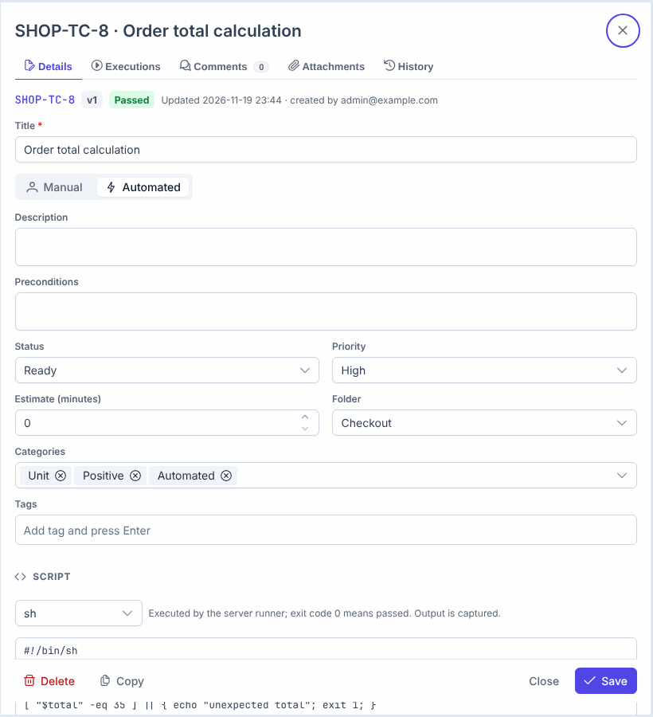

- The script runs on the server in a sandbox when someone selects **Run script** in the execution runner.
- Exit code **0** means **Passed**; any other exit code, or exceeding the time limit, means **Failed**.
- Standard output and errors are stored as the execution's **Output**, together with the duration.
- The script can read these environment variables: `QTF_TEST_KEY`, `QTF_RUN_ID`, `QTF_RUN_NAME`, `QTF_ENVIRONMENT`, `QTF_BUILD` and `QTF_BASE_URL`, so one script can test the environment and build named in the run. The project's [test variables](#web-tests) arrive as `QTF_VAR_<NAME>`, for example `QTF_VAR_USERNAME`; the values of secret variables are masked as `***` in the stored output.

Running scripts needs the **Manager** role and must be enabled by the administrator (`runner.enabled`). If your scripts run elsewhere, for example in a CI pipeline, leave the script empty and [import the results](#import-results-from-ci) instead. Steps are optional for automated tests.

## Web tests (Playwright)

A **web test** drives a real browser with [Playwright](https://playwright.dev): choose the script language **Web test (Playwright)**. The editor offers a **starter template**; select **Insert starter template** when the script is empty.

Write the script in one of two ways:

- **The body of one test** (the usual case). Qtestframe wraps it into a Playwright test named after the test case, with `page`, `context`, `request` and `baseURL` at hand and `test` and `expect` imported:

  ```js
  await page.goto('/login');
  await expect(page.getByRole('heading', { level: 1 })).toHaveText('Sign in');
  await page.getByLabel('E-mail').fill(process.env.QTF_VAR_USERNAME);
  ```

- **A complete spec file**: when the script calls `test(` itself (for example `test('…', async ({ page }) => { … })` or `test.describe(…)`), it is used as it is. Import `test` and `expect` from `@playwright/test` yourself. Every test of the file must pass for the execution to pass.

Paths such as `page.goto('/login')` are relative to the **base URL** of the project (an administrator sets it under **Settings → Web tests**, also one per run environment). A [test configuration](#test-configurations) with a **Browser** dimension picks the browser: *Chrome*, *Chromium* or *Edge* run in Chromium, *Firefox* in Firefox, *Safari* or *WebKit* in WebKit; a **Base URL** dimension overrides the base URL.

**Record a script instead of typing it**: on a computer with Node.js, run `npx playwright codegen https://your-app.example.com`, click through the scenario in the browser that opens, and copy the lines inside the generated `test(…)` into the script (or paste the whole file).

Web tests run on the server in the background when someone selects **Run script** or [Run automated tests](#run-all-automated-tests); the result, the output, screenshots and a trace are stored with the execution (see [Web tests and their evidence](#web-tests-and-their-evidence)). The server must have Playwright installed and web tests enabled (see [Web tests](#web-tests)).

## Shared steps

A step can **call** another test of the same project instead of having its own action. Use it for sequences that many tests share, such as signing in.

1. In the steps of a test, select **Insert call to test…**.
2. Choose the test to call and select **Insert call**. The step shows **Calls** with the called test's key.
3. Move the call step to the right position and save.

When a run is created, the call is replaced by the called test's steps (marked `[KEY]`). Calls can be nested up to five levels. A test cannot call itself, and calls may not form a cycle. The called test shows **Used by:** with all tests that call it. If you delete a called test, the call becomes an empty step.

## Data-driven tests

A data-driven (parameterised) test is written once and executed with several sets of data, for example the same login with a customer, a business and an administrator account.

1. In the test editor, open the **Test data** section below the steps and select **Add parameter**. Name the parameter, for example `username` (letters, digits, `_`, `.` and `-`, not starting with a digit; at most 50 parameters).
2. Select **Add row** for every set of data and fill in the values. A row can have a name (*Customer*); without one it is called *Row 1*, *Row 2* … The arrows move rows, the bin removes one (at most 500 rows).
3. Use the parameters in the steps, the preconditions, the description and the expected results as `{{username}}` (spaces inside the braces are allowed: `{{ username }}`).

**Paste table** takes cells copied from Excel, LibreOffice or Google Sheets (or comma- or semicolon-separated text). Tick whether the first line names the parameters and whether the first column holds the row names, and whether the pasted rows replace the test data or are added to it. **Copy table** copies the test data as a table you can paste into a spreadsheet. A placeholder that is not a parameter is left as it is; the editor warns about such placeholders, as they are usually typos.

When the test is added to a run, every row becomes an **iteration** of the execution with its own copy of the steps, with the placeholders replaced by the row's values. Changing the test data afterwards does not change existing runs, only new ones. A test without rows is executed once, as before. See [Data-driven tests: iterations](#data-driven-tests-iterations) for how iterations are executed and how the overall result is derived.

**Shared steps and parameters:** steps called from another test ([shared steps](#shared-steps)) are resolved with the parameters of the **calling** test, so a shared *Sign in as {{username}}* works with each row of every test that calls it. The test data of the called test is not used when it is called; it applies only when that test itself is executed. Placeholders the calling test does not define stay unchanged.

The test data is part of the test's version history and of the export (**Export → Test data**: one line per row and parameter).

## Categories

Categories classify tests and requirements along **dimensions**. New projects get these defaults:

| Scope | Dimension | Values |
|---|---|---|
| Tests | Polarity | Positive, Negative |
| Tests | Interface | External, Internal |
| Tests | Medium | File based, Network based |
| Tests | Execution | Manual, Automated |
| Tests | Level | Unit, Integration, System, Acceptance |
| Requirements | Area | Core, UI, Security, Operations |

An item can have any number of category values, also several of the same dimension. Manage them in **Categories & settings**:


- **New dimension** creates a dimension with its first value; **Add value** adds values to it.
- Select a colour swatch to recolour a value; it is shown in that colour everywhere.
- **Rename dimension** moves all values to a new dimension name. If the target dimension already has a value with the same name, the two are merged.
- Deleting a value removes it from all items.
- Tick values (across dimensions of one tab) to change several at once: **Move to dimension** (an existing one or a new name; a value with the same name there absorbs the moved one), **Colour**, **Merge** (choose the value to keep; items with the others get it and the others are deleted, for example to clean up duplicates such as *UI* and *User interface*), **Copy to tests** / **Copy to requirements** (values that already exist there are skipped) and **Delete**. Each change is all or nothing; colour changes can be undone.

In queries, `category:Negative` matches the value name and `dimension:Polarity/Negative` the full form.

The same page holds the project's **Name**, **Description**, the **Defect tracker URL template** (see [Defects](#defects)), the [Save and load](#save-and-load-projects) section (**Save project**, **Duplicate project**, **Load project**) and, for admins, **Delete project**. Editing categories needs **Manager** (or the write permission of their scope, Tester for test categories).

## Mark many tests ready at once

Holders of `test.review` can mark many tests *Ready* in one step: tick the tests and choose **Mark ready…**, or choose **Bulk review** above the list with nothing ticked. As for requirements (see [Approve many requirements at once](#approve-many-requirements-at-once)), you choose the tests (selected, shown in the list, or all), the statuses they may come from (by default *Review*; add *Draft* to include drafts) and an optional comment, and a preview shows what changes.

Besides the checks for requirements (the latest review asked for changes, open review requests, suspect links), a test is skipped when it cannot be run as written: a **manual test without steps** or an **automated test without a script**. Choose the check under **Include anyway, despite** to mark them ready anyway.

## Spreadsheet view

Choose **Spreadsheet** to edit tests like in a spreadsheet; it works as for [requirements](#spreadsheet-view) (keyboard, copy and paste from Excel, fill down, new rows, saving, conflicts, undo and **Export view**). The columns are **Key**, **Title**, **Description**, **Priority**, **Status**, **Execution**, **Preconditions**, **Expected result**, **Estimate (min)**, **Categories**, **Tags**, **Folder** and the read-only **Steps** (the number of steps), **Last result**, **Requirements**, **Created by** and **Version**. Steps, scripts and test data are edited in the editor (double-click the key or press **Ctrl+Enter**). Setting a test to *Ready* is a review decision and needs `test.review`, in the sheet as in the editor.

## Copy a test

**Copy** in the editor creates a duplicate titled *Copy of …* with a new key in the same folder, including steps, categories and tags. The copy starts as **Draft**, so it is reviewed again. Links to requirements are not copied.

A test becomes **Ready** through a review: setting that status needs the permission *test.review* (Reviewer, Test lead or Manager); reviewers see a **Mark ready** button at the top of the editor.

## Linked requirements

The **Linked requirements** section shows which requirements the test verifies. **Link requirements** adds links; **×** removes one. Tests without any link do not contribute to coverage.

## Dependencies

A test can **depend on** other tests: they are its prerequisites and must have passed before it may be started. For example, *Change the delivery address* depends on *Sign in*.

In the test editor, the section **Depends on** lists the prerequisites with their latest result. Select **Add prerequisite** to pick tests of the same project, and **×** to remove one *(Tester)*. **Required by** lists the tests that wait for this one. A test cannot depend on itself, and dependencies may not form a cycle.

When the test is executed, each prerequisite counts as passed when its execution in the same run has passed; when the prerequisite is not part of the run, its latest result counts. Until then the runner shows why the test cannot start, unless the [test execution settings](#test-execution-settings) allow it. The **Relations** column of the test list shows *depends on* and *required by*, the [dependency graph](#dependency-graphs) draws them, and the filter `depends_on:SHOP-TC-1` (or `depends:`) finds the tests that depend on SHOP-TC-1.

## Test flow

**Test flow** in the project navigation (or **Flow diagram** at the bottom of the test editor) draws a test as a flowchart:

- **Start**, then a check **Prerequisites passed?** when the test has [dependencies](#dependencies) (no → *Blocked*), then the **Preconditions**;
- every step as a box with its number, action and test data; a step with an expected result is followed by a decision **As expected?** whose *no* branch ends in **Failed**;
- a [shared step](#shared-steps) as a box with double side bars (*Runs the steps of TC-…*). Select it, or its button under **Shared steps**, to show the called test's steps in place, numbered 3.1, 3.2 …, inside a dashed frame; **Expand all** and **Collapse all** do it for every call. A test that calls itself is marked and not expanded;
- an automated test as **Run the script** followed by **Exit code 0?**;
- the overall **Expected result** as a last check, and **Passed** at the end.

**List** shows the same flow as a numbered text list, with the *otherwise* outcome of each check. Use the zoom buttons for large tests.

**Run order** shows a test run in **stages**: a test is placed after all tests of the run it depends on, so stage 1 holds the tests without prerequisites in the run. Tests of one stage can be executed in any order or in parallel. Each card shows the latest result in the run, which tests it waits for and links to the runner and to its flow diagram. Prerequisites that are not part of the run are listed as warnings.

## Execution history

The **Executions** tab lists every execution of the test in all runs, newest first, with the run, its environment and build, the result, who executed it, when, the duration and any defects. Use it to see whether a test is flaky or when it started to fail.


In runs with [configurations](#configurations-in-a-run) the configuration of each execution is shown below the run, and a data-driven execution links to its iterations in the runner.

The table column **Last result** shows the most recent result (in any configuration). In queries, `last_result:failed` finds tests whose latest result failed, and `defect:SHOP-*` tests with such a defect.

A result marked **Flip** differs from the previous passed or failed result of the test: there the test started to fail, or passed again.

## Flaky tests

A test is *flaky* when its result changes back and forth between passed and failed without the test or the product being changed in between. Qtestframe looks at the last 10 passed or failed results of every test, from all runs — manual results as well as automated ones from JUnit imports, the `qtestframe report` uploader and the Playwright reporter. Blocked, skipped and not run results are left out, since they say nothing about the test itself.

The *flakiness* of a test is the number of flips among those results: a passed result after a failed one, or the reverse. A test with **2 or more flips** counts as flaky. A test that broke once and was fixed has at most two flips spread over a long time; a test that alternates reaches the threshold quickly.

- In the tests list, flaky tests have a **Flaky** badge next to the last result (point at it to see the number of flips).
- The query `flaky:true` lists the flaky tests; `flakiness>=3` (or `flips>=3`) those with at least three flips.
- The **Quality** tab of the [dashboard](#the-dashboard) shows the ten flakiest tests with their latest results.
- The **Executions** tab of a test marks every flip.

A flaky test hides real failures and wastes time on reruns: find the cause (timing, test data, order, the environment) or put the test aside until it is fixed.

## Comments and history

The **Discussion** tab and **History** work exactly as for [requirements](#discussion) (see [Discussions](#discussions)). Restoring a test version restores its fields and steps as a new version; steps get new IDs and calls to deleted tests are dropped. If someone else saves a test while you edit it, you can compare and choose instead of overwriting their changes, see [When someone else saved first](#when-someone-else-saved-first).

## Links

The **Links** tab of a test links it to other tests, requirements, runs, documents and saved reports of the archive, report definitions and web addresses, see [Links](#links-to-other-items).

## Attachments

The **Attachments** tab holds files for the test: test data, expected screenshots, configuration files. Upload by drag and drop or file selection, or use **Attach from archive**. Uploading and removing needs **Tester**. See [Requirements → Attachments](#attachments) for details.

# Catalogue

The **catalogue** is a built-in library of standard requirements and tests for software development: security, privacy and compliance, performance and reliability, operations and maintainability, usability and accessibility (also forms, preferences and mobile apps), common functionality (also workflow and approvals, collaboration, files, scheduling) and domain-specific functionality such as e-commerce checkout, billing, industrial automation and control systems, electrical energy, oil and gas, telecom, the chemical industry and industrial manufacturing. Instead of writing *"Passwords must be at least 12 characters"* and its test for every project, you choose the items that fit and add them to the project in one go, with their tests and trace links. The catalogue also describes the typical **risks** of each area (see [Risks in the catalogue](#risks-in-the-catalogue)), each linked to the requirements that mitigate it.

Browsing the catalogue needs permission to read requirements or tests (every role has it). Adding requirements and risks needs **Manager** (`requirement.write`), adding tests **Tester** (`test.write`).

## Where the texts come from

The catalogue texts are written for Qtestframe, in English and Swedish. Each item is based on recognised standards and good practice, such as OWASP ASVS and the OWASP Top 10, WCAG 2.2, ISO/IEC 25010, NIST SP 800-63B, ISO/IEC 27001 and other standards in the ISO/IEC 27000 series (27002, 27005, 27017, 27018, 27019, 27035, 27701 …), IEC 62443, PCI DSS and EU legislation: the GDPR, the Cyber Resilience Act (CRA), DORA, NIS2, the Critical Entities Resilience Directive (CER), the Radio Equipment Directive (RED, with EN 18031) and the AI Act. It **cites** them under **Based on** by name and section. The catalogue does not copy the text of any standard: read the cited standard when you need its exact wording.

For Swedish organisations, the *Privacy and compliance* group also covers protective security under the Protective Security Act (säkerhetsskyddslagen 2018:585) and the Cybersecurity Act that implements the NIS2 directive, and the *Security* and *Operations* groups cover vulnerability disclosure (ISO/IEC 29147, RFC 9116, CSAF) and vulnerability handling (ISO/IEC 30111, IEC 62443-4-1, the EU Cyber Resilience Act). These items cite the laws and regulations by name and section; they help you plan and verify, but they are not legal advice.

Every requirement is one verifiable statement with exactly one obligation keyword (MUST, SHOULD, MAY … in English; SKA, BÖR, FÅR … in Swedish, see [Requirements](#requirements)), evaluation criteria and a rationale. Every test has preconditions, numbered steps with an expected result each and an overall expected result. Values that a team usually adjusts (12 characters, 2 seconds, 99.9 %) are part of the text, so you can change them after adding the item.

Every requirement lists at least one catalogue test that verifies it, and every test verifies at least one requirement, so adding a requirement with its tests always gives you a way to check it. Every item is complete in both English and Swedish, with the same criteria and steps in both languages.

## Browse and search

Open **Catalogue** in the project sidebar, or select **Add from catalogue** at the top of the requirement or test list.

- Switch between **Requirements**, **Tests** and **Risks** at the top.
- Choose **English** or **Svenska** for the language of the texts. The items are added in this language.
- **Catalogue type** limits the catalogue to one kind of work: *Software*, *Hardware*, *Equipment*, *Systems*, *Communications solutions*, *Projects*, *Services*, *Buildings and facilities*, *Governance*, *Documentation* or *Education* (only the types that have content are listed). It starts with the type that fits the project: software projects show *Software*, hardware projects *Hardware*, system projects *Systems* and business projects *Governance*; general projects show **All types**. The tree, the lists and the laws and standards follow the choice.
- On the left, **Groups and areas** lists the catalogue's groups (for example *Security*) and their areas (for example *Authentication*) with the number of items that match the current search and filters. Select **Everything** to see all areas. Use the arrow keys to move in the tree and Enter to select. On a narrow screen the tree opens with the **Areas** button.
- The **search** field finds items whose title, ID, tags, cited standards or description contain all the words you type (type `62443` or `27001`, for example, to list the items that cite that standard). The best matches come first: an exact ID such as `AUTH-01`, then the words in the title, then the other fields.
- Narrow the list with **Type**, **Obligation** and **Priority** (requirements), **Execution** (tests), **Category** and **Risk level** (risks) and **Tags**. **Hide items already in the project** leaves out what you have added before.

Each row shows the ID, the title, the obligation and priority, how many catalogue tests verify the requirement and how many catalogue risks it mitigates (or how many requirements the test verifies). **In project** marks items that the project already has; hover over it to see their keys.

## Comply with laws, standards and best practices

When the project has to meet a regulation or a standard, let the catalogue find the requirements for it:

1. Under **Comply with laws, standards and best practices**, select **Choose laws and standards…**.
2. The dialog lists every law, regulation, directive, standard, best practice and guideline that the catalogue cites, grouped by kind (*Laws and regulations*, *Directives*, *Standards and specifications*, *Best practices and frameworks*, *Guidelines and guidance*). Each shows its abbreviation, its jurisdiction (EU, Sweden, international …) and how many catalogue requirements cite it and how many tests verify them, counted in the chosen catalogue type. Type in the search field to find one by name, abbreviation or jurisdiction (`CRA`, `27001`, `Sweden`). Tick the sources one by one, or a whole kind with the box at its heading; the link icon opens the text of the source where one is known.
3. Select **Show the requirements**. Both tabs now list only the items for the chosen sources: the requirements that cite one of them and, under each, the catalogue tests that verify it (**Verified by:**; select a test to preview it). A tag on each requirement shows which of the chosen sources it cites.
4. The box sums up how many requirements cite the sources, how many tests verify them and how many the project already has. **Add the N missing requirements with their tests** ticks the requirements the project does not have yet and opens the usual dialog (see below), which adds them with their tests and trace links, skips duplicates and creates the folders you choose.

Remove a source with the × on its chip, or **Clear the choice** to see the whole catalogue again. The choice is part of the page address, so you can bookmark or share it. Among the sources are the EU regulations and directives (GDPR, CRA, NIS2 and its implementing regulation, DORA, CER, RED with EN 18031, the AI Act, ePrivacy, eIDAS …), Swedish law (the Cybersecurity Act, the Protective Security Act and Ordinance, the Act on accessibility of digital public services …), standards (ISO/IEC 27001, 27002 and the other 27000 parts, IEC 62443-2-1 to 4-2, ISO/IEC 29147 and 30111, ISO/IEC 25010, WCAG 2.2, IEC 61508, 61511, 61850 …) and best practices (OWASP ASVS and Top 10, NIST SP 800-63, ITIL 4, Google SRE …). How far the project meets them is shown under [Compliance with laws and standards](#compliance-with-laws-and-standards) in the requirement analytics.

## Preview an item

Select a row to see the full text on the right (on a phone it opens as a panel): the description with the obligation keyword highlighted, the rationale, the evaluation criteria with their thresholds, the cited standards and the catalogue tests that verify the requirement. For a test you see the preconditions, the steps, the expected result and the requirements it verifies. A requirement also lists the catalogue risks it mitigates. Select an ID under *Verified by*, *Verifies* or *Mitigates* to jump to that item.

## Add items to the project

1. Tick the items you want. **Select all shown** ticks everything the list shows, so to take a whole area, select the area in the tree first. You can tick requirements and tests on both tabs; the bar at the bottom counts them.
2. Select **Add N requirements (+ M tests)**. M includes the tests that verify the chosen requirements.
3. In the dialog, choose:
   - **Language** of the texts.
   - **Folder for the requirements** and **Folder for the tests** (top level by default).
   - **Subfolders**: none, *one folder per area* (for example *Authentication*) or *group and area folders* (*Security / Authentication*). Existing folders with the same name are reused.
   - **Status** of the requirements and the tests (*Draft* by default, so they are reviewed like other new items).
   - **Source of the requirements**: the cited standards (default) or one of the project's sources.
   - **Also add the tests that verify the chosen requirements** (on by default).
   - **Add copies of items already in the project**: off by default, so items the project already has are skipped.
4. The summary shows how many requirements and tests will be added and how many are skipped. When some of the chosen requirements say the same thing as requirements the project already has (written by hand, or from another catalogue entry), it lists them with the most similar project requirement and its similarity, and **Leave out the requirements similar to existing ones** skips them (reason *similar*). See [Duplicates and conflicts](#duplicates-and-conflicts).
5. Select **Add**.

At most 500 items can be added at once. The import is all or nothing: if something fails, nothing is added.

Qtestframe creates the requirements and tests as if you had written them, with a first history version, and creates **trace links** between each requirement and the tests that verify it, also to matching items that were added to the project earlier. The automatic linked draft test that a new requirement usually gets is not created: the catalogue tests take its place.

## Risks in the catalogue

The **Risks** tab lists typical risks of the areas: what can go wrong, for example *Accounts taken over with leaked passwords* or *Pressure vessel bursts*. There are risks for security, privacy, AI, availability and operations, data, the supply chain, hardware, equipment and buildings (safety), services, governance and projects. Every risk has:

- a **category** (security, privacy, safety, availability, data, compliance, supply chain, AI, operational, quality, project or environmental);
- a description of the threat or hazard and its consequence;
- a **typical likelihood and impact** on the same scale 1–5 as the [risk register](#the-risk-register), and the level they give (low, medium, high, critical);
- a **suggested mitigation**;
- the catalogue requirements that **mitigate** it (at least one, from any area), and sometimes catalogue tests that check it directly;
- the sources it is based on under **Based on**: risk management standards (ISO 31000, ISO/IEC 27005, ISO/IEC 23894 for AI, ISO 14971 for medical devices, ISO 26262 for vehicles, ISO 12100 for machinery, IEC 62443-3-2 for industrial systems), the AI Act's risk management (Art. 9), the GDPR's impact assessment (Art. 35), threat catalogues (OWASP Top 10, ENISA Threat Landscape) and the CWE weaknesses of the mitigating requirements;
- for risks caused by an attacker, the **MITRE ATT&CK techniques** that realise them (see [MITRE ATT&CK](#mitre-attck)).

Filter the risks by **Category**, **Risk level**, **ATT&CK tactic** and **ATT&CK technique**, by area in the tree, by tag or by the laws and standards to comply with (a risk counts for a source when it cites it or one of its mitigating requirements does). The preview shows the description, the suggested mitigation and the mitigating requirements; select one to open it.

**Add a risk with its mitigation.** Tick risks and select **Add N risks (+ requirements, tests)**. The dialog adds:

- the risks as project risks, with title, description, category, suggested mitigation and the typical likelihood and impact (adjust them to your own assessment afterwards), with the status *Identified* or *Mitigating*;
- with **Also add the requirements that mitigate the chosen risks** (on by default) the mitigating requirements, and with **Also add the tests that verify the chosen requirements** their tests;
- links between each new risk and the project requirements that mitigate it, both the new ones and those added earlier.

**Add requirements with their risks.** When you add requirements that mitigate catalogue risks, the dialog offers **Also add the N risks these requirements mitigate**. Requirements you add later are linked to the catalogue risks the project already has, so the order does not matter.

Risks the project already has from the catalogue are skipped, like requirements and tests, unless you choose **Add copies of items already in the project**.

## MITRE ATT&CK

[MITRE ATT&CK](https://attack.mitre.org/) describes how attackers work: **tactics** are their goals (initial access, credential access, impact …) and **techniques** the ways to reach them, such as *T1110.004 Brute Force: Credential Stuffing*. The catalogue knows the techniques of the Enterprise, ICS (industrial control systems) and Mobile matrices, without revoked or deprecated ones, and the [MITRE ATLAS](https://atlas.mitre.org/) techniques of attacks on AI systems (*AML.T0051 LLM Prompt Injection*).

- Every catalogue risk caused by an attacker lists the techniques that realise it: all security risks, and privacy, AI, availability, data and supply chain risks when an adversary causes them. Hazards, failures and obligations (safety, quality, project, environmental and compliance risks) have none.
- The **preview** of a risk shows each technique with its name, matrix and tactics, linked to its page on attack.mitre.org or atlas.mitre.org. **show risks with this technique** filters the list by it.
- **ATT&CK tactic** and **ATT&CK technique** filter the risks; a technique also finds its sub-techniques (*T1110* finds *T1110.004*). The search finds technique ids too.
- **Framework coverage** at the top of the page (tab **ATT&CK**) shows, for each matrix, the tactics with the number of catalogue risks that list one of their techniques and the number of requirements that cite one or mitigate such a risk, and a matrix of the techniques used, darker with more risks. Select a count or a technique to open the matching risks.

A risk you add to the project keeps its techniques: the risk dialog shows them under **MITRE ATT&CK techniques**, where you can change them (see [The risk register](#the-risk-register)).

## MITRE D3FEND and EMB3D

Two more MITRE frameworks connect the catalogue to the defences and to embedded devices:

- [MITRE D3FEND](https://d3fend.mitre.org/) is a knowledge graph of **defensive techniques**, grouped by the tactics *Model*, *Harden*, *Detect*, *Isolate*, *Deceive*, *Evict* and *Restore* (for example *D3-MFA Multi-factor Authentication* or *D3-BA Bootloader Authentication*). Security requirements and tests list the techniques they implement or verify.
- [MITRE EMB3D](https://emb3d.mitre.org/) is a threat model for **embedded devices**: threats such as *TID-201 Inadequate Bootloader Protection and Verification* and mitigations such as *MID-026 Secure Firmware Update*. Device, industrial and IoT requirements and tests list the mitigations and threats they address, and risks the threats that realise them.

The catalogue uses the published D3FEND and EMB3D data; ids that the frameworks no longer have cannot be used. Names are shown in English, as at MITRE.

- The **preview** names the techniques, mitigations and threats with links to their pages; **show items with it** filters the list on one.
- **D3FEND technique** and **EMB3D id** filter requirements and tests (risks: **EMB3D id**). Choosing a threat also finds the requirements that list one of its mitigations. The search finds the ids too.
- **Defenses (D3FEND)** in the preview of a risk shows, for each of its ATT&CK techniques, the D3FEND techniques that counter it (as D3FEND relates defensive and offensive techniques) and the catalogue requirements that implement them, the risk's own mitigating requirements first. A technique that no mitigating requirement counters is marked as a **gap**: consider adding one of the listed requirements.
- **Framework coverage** at the top of the page has a tab per framework: **ATT&CK** (see above), **D3FEND** (per tactic the defensive techniques that requirements and tests implement, and how many risks are fully countered) and **EMB3D** (per threat category every threat with the risks, requirements and tests that address it; **Only gaps** shows the threats no requirement addresses).

Items you add to the project keep their mappings: requirements and tests their D3FEND techniques and EMB3D ids, risks their EMB3D threats (see [Fields](#fields) and [The risk register](#the-risk-register)).

The area **Embedded firmware and microcontroller security** (catalogue type *Hardware*) collects requirements, tests and risks for the firmware of microcontrollers and constrained devices: hardware root of trust, measured boot and attestation, bootloader and update hardening, readout and debug protection, key storage, side-channel and fault injection resistance, memory protection and RTOS hardening, secure communication on constrained networks, the firmware bill of materials and vulnerability handling. It complements **Embedded device security** and is mapped to EMB3D throughout.

## After adding

A box at the top of the page sums up what was added, and how many of the added requirements are similar to requirements the project had, with a link to **Review duplicates**. **Open the added requirements**, **Open the added tests** and **Open the added risks** open the lists filtered to the new items. **Undo** (or Ctrl+Z) moves them to the trash (risks are deleted); redo brings them back with their links. Folders that the import created stay.

The added items are ordinary project items: edit the texts and values to fit your system. The editor shows **From the catalogue: AUTH-01 · …** with the cited standards, and **Show in the catalogue** opens the original entry. This origin is kept when you edit, copy, move or restore the item. In filters, `catalog:AUTH-01` finds the items copied from one entry, `catalog:AUTH-*` those of an area and `has:catalog` every item from the catalogue (see [Search and filters](#search-and-filters)). A risk from the catalogue shows its ID under its category in the register; the register can show the risks of one catalogue area.

## Tips

- Start a new project from the catalogue: add the groups that apply, then delete or adapt what does not fit.
- Use the **Draft** status and a [bulk review](#requirements) to agree on the adapted items as a team.
- The catalogue is part of Qtestframe and grows with new versions. Items you have added do not change when the catalogue changes.

# Test runs and execution

A **run** (test run, campaign) is a set of tests that you execute together, for example *Sprint 12 regression* on the *staging* environment with build *1.4.2*. Each test in a run is an **execution** with its own result. Runs are under **Operations** in the project sidebar.

| Action | Role needed |
|---|---|
| View runs and results | Viewer |
| Create, edit and delete runs, add tests | Tester |
| Record results, import CI results | Tester |
| Run automated scripts on the server | Test lead |
| Change the [test execution settings](#test-execution-settings) | Test lead |

## The run list

**Operations** lists the runs of the project with their status, environment, build, progress bar and pass rate. Filter with the query language, for example `status:in_progress env:staging`. Select a run to open it.


## Change many runs at once

Tick the runs in the list (or the header checkbox for the whole page). The toolbar that appears changes all of them at once (permission to change runs):

- **Set status**: for example abort old runs, or close runs that are finished in practice.
- **Set release**: put the runs in a [release](#releases-and-risks), or take them out of one.
- **Environment / build**: set the environment, the build or both (an empty field clears it).
- **Delete**: delete the runs with all their results, after confirmation.

Status, release, environment and build changes can be undone with the undo button in the top bar; deleting cannot.

## Create a run

Select **New run** and fill in:

- **Name**, for example *Sprint 12 regression* (a dated default is suggested);
- **Description**, **Environment** (e.g. *staging*) and **Build** (e.g. *1.4.2+sha*): free text that is shown with the results and passed to automated scripts;
- **Configurations** (when the project has [test configurations](#test-configurations)): the configurations the run targets, for example *Chrome / Windows* and *Firefox / Linux*. Each test is then executed once per configuration; see [Configurations in a run](#configurations-in-a-run). Without configurations each test is executed once;
- **Tests to include**: the union of three tabs:
  - **Tests**: **Pick tests…** to select individual tests;
  - **Folders**: tests in the selected folders, including subfolders;
  - **Query**: every test matching a filter such as `status:ready category:Negative`; **Preview** counts the matches.

Select **Create run**. A test appears only once in a run even if several tabs select it. Without any tests the run starts empty, and you add tests later.

When a test is added, its current steps (with shared steps expanded) are copied into the execution. Later edits of the test do not change this run.

## The run page

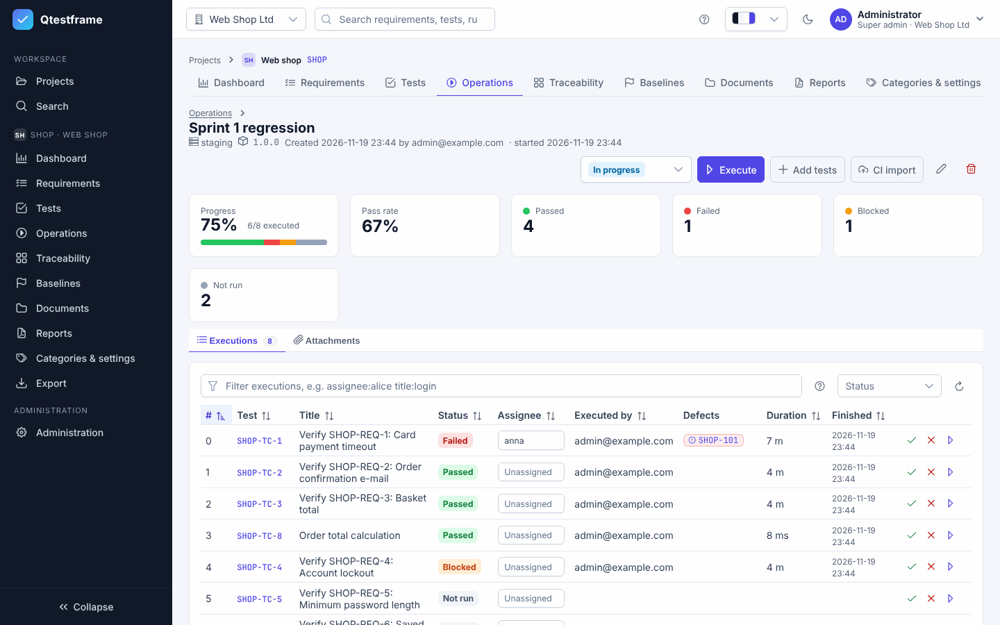

- **Run status**: **Planned**, **In progress**, **Completed** or **Aborted**. The start time is set when the run first becomes *In progress* (also automatically when the first result is recorded); the end time when it becomes *Completed* or *Aborted*. A run becomes **Completed by itself** when every test in it has a final result (passed, failed, blocked or skipped), also a run with a single test. It goes back to *In progress* when a result is taken back to *Not run* or *In progress*, or when tests are added. You can still set the status by hand; an *Aborted* run is never changed automatically.
- **Progress** and **Pass rate** summarise the executions.
- **Execute** opens the runner at the first execution that has not been run yet.
- **Add tests** adds more tests; **CI import** shows how a pipeline reports results; **Edit run** changes name, description, environment and build; **Delete** removes the run with all its results.
- The table lists every execution with test, result, **Assignee**, **Executed by**, **Defects**, **Finished** time and duration. Filter it, for example `status:failed` or `assignee:anna`.
- Per row: **Mark passed** and **Mark failed** record a result directly; the play button opens the execution in the runner.

## Configurations in a run

A run can target one or more [test configurations](#test-configurations). Adding a test then creates **one execution per test and configuration**: a run with 10 tests and 3 configurations has 30 executions.

- The run list shows the configurations of each run in the **Configurations** column; the filter `configuration:Chrome` (or `config:`) finds runs that target a configuration.
- On the run page, **Results per configuration** shows progress and pass rate of each configuration; select a configuration's name to see only its executions, or use **Show configuration** above the table. The **Configuration** column names the configuration of each execution, and the filter `configuration:"Chrome / Windows"` works in the execution table as well.
- **Edit run → Configurations** changes the configurations later. An added configuration gets an execution for every test of the run. A removed configuration's executions are deleted, which is refused while one of them has a result (set them back to *Not run* first). Adding the first configuration to a run without configurations assigns the existing executions to that configuration; removing the last one keeps its executions as executions without configuration.
- Prerequisites ([dependencies](#dependencies)) count per configuration: in a run, a prerequisite counts as passed when it passed in the **same configuration**.
- The runner shows the configuration in its header, and the [execution history](#execution-history) of a test shows the configuration of each execution.

Runs without configurations work exactly as before. How results in several configurations count for requirements is described in [How coverage is calculated](#how-coverage-is-calculated).

## Record many results at once

On the run page, tick tests in the execution table (the header checkbox ticks the whole page). The toolbar then offers:

- **Set result**: *Passed*, *Failed*, *Blocked*, *Skipped* or *Not run* for all ticked tests.
- **Result, assignee, note…**: a dialog to set a result, assign the tests to someone (empty removes the assignee) and add a note below the notes they already have, in one step. **Only tests that have not been run yet** leaves tests that already have a result alone, for example to mark the rest *Skipped* at the end of a run.
- **Remove from run** (permission to change runs): takes the tests out of the run, with their results, step results and evidence, after confirmation.

The same [execution settings](#administration) apply as for one test at a time: *Passed* and *Failed* are only recorded for tests that may be executed. Tests that may not are listed with the reason, and the rest are recorded. Prerequisites in the same selection are handled: when you mark a test and its prerequisite *Passed* together, the prerequisite is recorded first. *Blocked*, *Skipped*, *Not run*, assignees and notes are always possible.

Step results are not changed: a bulk result is the overall result of each test. The run completes by itself when every test has a final result, and requirements whose status follows the evidence are updated. Results, assignees and notes can be undone with the undo button; removing tests cannot.

## The execution runner

The runner shows one execution at a time. Its header tells you which execution of the run this is (*Execution 3 of 12*) and who executed it last.

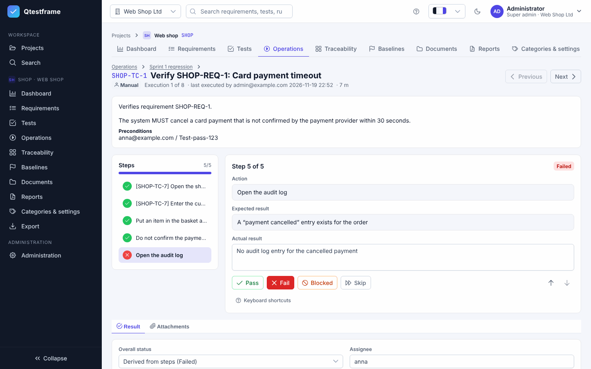

### Manual tests

1. Read the **Preconditions** at the top.
2. The left column lists the steps with their status; select a step to jump to it.
3. For the current step, carry out the **Action** with the **Test data** and compare with the **Expected result**.
4. Record the outcome with **Pass**, **Fail**, **Blocked** or **Skip**. For anything other than a pass, write what happened in **Actual result**. The runner moves on to the next step.
5. Below the steps:
   - **Overall status** is derived from the steps (*Will be saved as …*): any failed step → **Failed**; otherwise any blocked step → **Blocked**; all passed or skipped with at least one pass → **Passed**; all skipped → **Skipped**; partly done → **In progress**. You can also set it explicitly.
   - **Assignee**: who should execute the test. Type `@` to pick a person ([mentions](#mention-people)).
   - **Defects**: defect IDs or URLs, each followed by <kbd>Enter</kbd>.
   - **Notes**: observations, links, anything worth keeping.
6. Select **Save**, or **Save & next** to save and open the next execution. On the last execution the button is **Save & finish**: it saves and returns to the run page, where the run is completed once every test has a result; if some still have none, it says how many and opens the first of them. **Previous** and **Next** move between executions. *Unsaved changes* reminds you to save.

A test without steps shows only the overall result, notes and defects.

### Data-driven tests: iterations

A [data-driven test](#data-driven-tests) has one **iteration** per row of its test data. The runner lists the iterations above the steps, each with its result; select one to work on it. It shows the values of the iteration's row, and the steps, the preconditions and the expected results with the placeholders replaced by these values.

- With steps, every iteration has its own step results, evidence and actual results. Its result is derived from its steps like the result of a test. Marking the last step of an iteration moves on to the first step of the next one.
- Without steps, mark each iteration **Passed**, **Failed**, **Blocked** or **Skipped** with the buttons below the values (or the keys P, F, B and S).
- Each iteration has its own notes.

The **overall result** of the execution follows the iterations, evaluated top-down: **Failed** if an iteration failed; else **Blocked** if one is blocked; **Passed** when all iterations passed or were skipped (at least one passed); **Skipped** when all were skipped; **Not run** when none has a result; otherwise **In progress**. As for steps, you can choose another overall result by hand. A result set directly on the execution (with **Mark passed** in the run, a bulk result or a CI import) is recorded as the overall result; the iterations keep their results, and the next change of an iteration derives the overall result again.

The run page shows the number of iterations next to the result of a data-driven execution.

### Keyboard shortcuts

The shortcuts work when the focus is not in a text field. Press <kbd>?</kbd> in the runner to show them.

| Key | Action |
|---|---|
| <kbd>P</kbd> | Mark the step as passed |
| <kbd>F</kbd> | Mark the step as failed |
| <kbd>B</kbd> | Mark the step as blocked |
| <kbd>S</kbd> | Skip the step |
| <kbd>J</kbd> or <kbd>↓</kbd> | Next step |
| <kbd>K</kbd> or <kbd>↑</kbd> | Previous step |
| <kbd>?</kbd> | Show or hide the keyboard help |


### Automated tests

For an automated test the runner shows the **Script** and its **Output**. Select **Run script** to execute it on the server: the execution is set to *In progress*, the script runs, and the result is **Passed** for exit code 0 and **Failed** otherwise (or when it exceeds the time limit). The output and duration are stored.

The button needs the **Test lead** or **Manager** role (permission *script.execute*). If the administrator has not enabled the script runner, the server answers that it is disabled; results then come from CI.

### Web tests and their evidence

A [web test](#web-tests-playwright) takes seconds to minutes, so **Run script** puts it in a queue and answers at once: the execution shows *Queued* or *Running* (with **Cancel**), you can go on with other tests, and the page updates itself when the result is in. The server runs a few web tests at the same time (set by the administrator); the others wait in the queue.

When the test has finished, the runner shows the result, Playwright's **Output** (the steps and the failure message; values of secret variables appear as `***`) and the **Web test evidence**:

- **Screenshots** — by default only when the test fails, showing the page at the moment of the failure. Select a screenshot to enlarge it.
- **Trace** (`trace.zip`, by default when the test fails) — a recording of every action with the page before and after, the network requests and the console. Download it and open it with `npx playwright show-trace trace.zip`, or drop it onto [trace.playwright.dev](https://trace.playwright.dev) (the file is opened in your browser and not uploaded).
- **Video** — when the administrator has switched videos on.

The files are also listed under **Attachments** of the execution. Running the web test again replaces them (other attachments stay).

### Run all automated tests

On the run page, **Run automated tests** queues every automated test of the run that has not passed yet, each in its configurations; select executions and use **Run automated** in the bulk bar to run just those (passed ones included). Tests that may not be executed yet (see [When can a test be executed?](#when-can-a-test-be-executed)) are left out and listed. A prerequisite that is in the run as well runs first, and its dependent tests wait for it — if it fails, they are not executed.

While tests are queued or running, a panel shows the progress (*queued*, *running*, *done*, passed and failed) and the tests in the queue; **Cancel queued** removes the tests that have not started (their executions keep their earlier result). The executions and results update as the jobs finish. Scripts in the other languages are run this way too.

Jobs do not survive a restart of the server: tests still queued or running then get their earlier result back, with a note in their output.

### Evidence

Each step of a manual test has an **Evidence** section under *Actual result*: open it to record what proves the result. Write observations, values or links in the text field (for example *response time 120 ms, order 4711*), and add files such as screenshots or log extracts *(Tester)*. Files can be dropped onto the area or picked from the archive, like other [attachments](#attachments-on-runs-and-executions). The step's header shows how much evidence it has.

Evidence is saved with the execution (select **Save**), stays with this run when the test changes later, and appears in the document archive as *Evidence of a test step*, linked to the step. Deleting the run deletes its evidence files.

### When can a test be executed?

Before a test is executed, Qtestframe checks that it is ready: the test has status **Ready**, the requirements it verifies are approved (or implemented or verified), and the tests it [depends on](#dependencies) have passed. What happens when a check fails is set in the [test execution settings](#test-execution-settings):

- **blocked** (the default): the runner shows a red box with the reasons and links; **Pass**, **Fail** and **Run script** are disabled, and the server refuses such results. You can still mark the test **Blocked** or **Skipped**;
- **allowed**: the reasons appear as an amber warning, and you can execute the test.

Each reason says exactly what is wrong, what to do about it and which setting decides, for example:

- *SHOP-TC-4 has status Draft; only tests with status Ready can be executed.* — **What to do:** finish the test and have it reviewed and marked Ready (needs *test.review*). *Blocked by the execution setting “Allow executing tests that are not Ready”, which is off.*
- *It verifies SHOP-REQ-2, which has status Approved; the execution settings require linked requirements to be Implemented or Verified.* — **What to do:** move the requirement on when it has been implemented, or ask an administrator to add its status to the ready statuses.
- *It depends on SHOP-TC-1, which is Failed in this run; a prerequisite must have passed first.* — **What to do:** execute SHOP-TC-1 first and make it pass, or add it to the run.

So you can tell whether the test itself, a requirement, a prerequisite or an organisation setting stops it. The run page shows the same in its **Readiness** column (select the entry to see the full explanation), with a summary above the table; the tooltips of the disabled Pass and Fail buttons and any refused result name the reasons too, and the **New run** dialog marks picked tests that are not ready.

## Defects

Record a defect wherever a test fails: in the runner under **Defects** (an ID such as `JIRA-123` or a full URL). Defects are shown on the run page, in the test's **Executions** tab and in reports.

To make IDs clickable, set the **Defect tracker URL template** in **Categories & settings**, for example `https://jira.example.com/browse/{id}`. `{id}` is replaced by the defect ID; without `{id}` the ID is appended. Values that already are URLs are linked directly.

Find defects with queries: `defect:JIRA-*` in the run's filter finds executions with a JIRA defect; in the tests list it finds tests with such a defect in their latest executions.

## Import results from CI

Automated pipelines (GitLab CI, GitHub Actions, Jenkins …) can report results into a run by test key. For ready-made pipeline templates, the quality gate, commit statuses in GitLab and test selection, see [CI/CD](#cicd).

1. Create an API token: **Administration → API tokens → New token**, role **Tester** or higher (see [API tokens](#api-tokens)). Copy the token; it is shown only once and starts with `qtf_`.
2. Open the run and select **CI import**. The dialog shows the endpoint with the run's ID and a ready-made command.


3. Post the results from your pipeline:

```bash
curl -X POST "https://qtf.example.com/api/v1/runs/$RUN_ID/results" \
  -H "Authorization: Bearer $QTF_TOKEN" \
  -H "Content-Type: application/json" \
  -d '{"results":[
        {"test_key":"SHOP-TC-7","status":"passed","duration_ms":1234,"output":"ok"},
        {"test_key":"SHOP-TC-9","status":"failed","duration_ms":877,"output":"expected 35, got 34"}
      ]}'
```

- `status` is one of `passed`, `failed`, `blocked`, `skipped`, `in_progress` or `not_run`.
- Test keys are matched without regard to case within the run's project. Tests that are not in the run yet are added.
- The answer reports how many executions were `updated` and lists `unknown` keys, which were skipped.
- An invalid status stops the import with an error; results before it stay applied.
- **Configurations:** when the run targets [configurations](#configurations-in-a-run), name the configuration of the results with `?configuration=NAME` in the address (`.../results?configuration=Chrome%20%2F%20Windows`) or per result with the field `"configuration": "Chrome / Windows"` (name or ID). A configuration the run does not target yet is added to it. Without a configuration, a run with exactly one configuration uses it and a run without configurations records the results without configuration, as before; a run with several configurations answers with an error.

Keep the token in your CI system's secret store, never in the repository. A token is bound to one organisation and never has more rights than its owner.

Besides this JSON format there are three easier ways for test tools that already write reports: JUnit XML, the `qtestframe report` command and the Playwright reporter.

### Link automated tests to test keys

Every automated test must say which Qtestframe test it executes. Put the test key (for example `SHOP-TC-12`) in one of these places:

- **in the test name**, e.g. `test_login[SHOP-TC-12]`, `TestCart/SHOP-TC-12_add` or `SHOP-TC-12 pays by card`. Where a name may not contain hyphens, `SHOP_TC_12` works as well. The key may also be part of the class name.
- **as a property of the test case** in the JUnit report, named `qtestframe.key` or `test_key`. With pytest: `record_property("test_key", "SHOP-TC-12")`.
- **with Playwright** as a tag `@SHOP-TC-12` or an annotation `{ type: 'qtestframe', description: 'SHOP-TC-12' }`.

Several test cases with the same key (for example the same test in two browsers) give one result: *failed* wins over *passed*, and the durations add up.

### JUnit XML

Almost every test tool writes JUnit XML: Playwright (`junit` reporter), pytest (`--junitxml`), Go (with go-junit-report), Maven Surefire and Gradle, Jest (jest-junit) and Vitest (`--reporter=junit`). Post the file to the run:

```bash
curl -X POST "https://qtf.example.com/api/v1/runs/$RUN_ID/junit" \
  -H "Authorization: Bearer $QTF_TOKEN" \
  -H "Content-Type: application/xml" \
  --data-binary @results/junit.xml
```

- A test case with `<failure>` or `<error>` is recorded as *failed*, one with `<skipped>` as *skipped*, all others as *passed*. The duration comes from `time`; the output holds the failure message and `system-out`/`system-err`.
- The answer lists, besides `updated`, `unknown` and `rejected`, the names of test cases without a key under `unmapped`.
- Add `?create_missing=true` to create a draft automated test for every test case without a key (titled like the test case) and record its result. A later import finds the test again by its title. This needs the right to write tests.
- Several files can be sent at once as a multipart upload (`-F file=@a.xml -F file=@b.xml`); together they may be at most 20 MB.
- `?configuration=NAME` records the results in that configuration, as for the JSON format.

### The qtestframe report command

The `qtestframe` program can upload reports itself. It finds the run by name in the project, or creates it:

```bash
export QTF_URL=https://qtf.example.com QTF_TOKEN=qtf_…
qtestframe report --project SHOP --run "Nightly $BUILD_NUMBER" --create-run \
  --build "$BUILD_NUMBER" --environment staging \
  --junit 'results/*.xml'
```

- `--run-id ID` reports into a known run instead of `--project`/`--run`.
- `--junit` and `--json` (the JSON format above) take files or patterns and can be repeated.
- `--create-missing` creates tests for test cases without a key, as above.
- `--configuration NAME` (or `QTF_CONFIGURATION`) records the results in that configuration; the run gets the configuration if it does not target it yet. Run the command once per configuration, e.g. once per browser.
- The command prints how many results were recorded and lists unknown keys, test cases without a key and rejected results with the reason. It ends with an error code when the upload fails, and with `--fail-on-unknown` also when results matched no test.

### Playwright reporter

For Playwright there is a reporter (`@qtestframe/playwright-reporter`, in `integrations/playwright-reporter` of the Qtestframe sources) that reports while the tests run, without a JUnit file:

```ts
// playwright.config.ts
reporter: [
  ['list'],
  ['@qtestframe/playwright-reporter', { project: 'SHOP', run: 'Nightly', createRun: true }],
],
```

It reads the server address and token from `QTF_URL` and `QTF_TOKEN`; the option `configuration` (or `QTF_CONFIGURATION`) names the [configuration](#configurations-in-a-run) of the results. It takes the key from the annotation, tag or title, writes the error and the `test.step()` titles with their result into the output and uploads screenshots, traces and other attachments of failed tests as attachments of the execution. If reporting fails, it only logs a message; your test run is not affected.

## Links of a run

The **Links** tab of the run page links the run to requirements, tests, other runs, archive files, reports and web addresses, for example the CI build or the release notes, see [Links](#links-to-other-items).

## Attachments on runs and executions

Runs and executions have **Attachments** too: log files, screenshots of a failure, test reports from other tools. In the runner, open the **Attachments** tab next to **Result** and drag files onto it or select **Choose files**; on the run page, attachments belong to the run as a whole. You can also attach a file from the project's [document archive](#documents-1). Uploading and removing attachments on runs and executions needs **Tester** (the right to record results).

# Exploratory testing

Exploratory testing is test design and test execution at the same time: the tester learns the product while testing it and decides what to try next from what they just saw. Qtestframe supports **session-based test management** (SBTM): the work is done in **sessions** of a fixed length, each with a **charter**, and every session ends with a **debrief**.

| Action | Role needed |
|---|---|
| View sessions, notes, metrics and the history | Viewer (`run.read`) |
| Plan, change and delete sessions; reopen a debrief | Tester (`run.write`) |
| Run a session: the timer, notes, files, defects from notes, the debrief | Tester (`run.execute`) |
| Export the session report | Viewer (`export`) |
| Let sessions count as verification evidence | Manager (`project.update`) |

Only the session's **tester** runs it, takes its notes and debriefs it. Someone else needs `run.write` as well: a test lead who stops a forgotten session, or a reviewer who debriefs it. A session without tester belongs to whoever starts it.

## Plan a session

Open **Exploratory** in the project's navigation and select **New session**.

- **Charter**: a short name for the mission, for example *Explore checkout with expired cards*.
- **Mission**: what to explore, with which resources, to discover what (*Explore … with … to discover …*).
- **Tester**: who does the session (by default you).
- **Time box**: the planned length, usually 30, 60 or 90 minutes; any length from 5 to 480 minutes is accepted.
- **Areas**: the requirement and test folders the session explores. The metrics count sessions and bugs per area.
- **Requirements** and **Tests** in scope: the items the session is about. A defect raised in the session is linked to these requirements, and a debriefed session can be evidence for them (see below).

A new session is **planned**. The list shows every session with its charter, tester, status, outcome, session time against the time box, the number of notes and of bugs. Filter it by text, status and area, or select **My sessions**.

## Run a session

Open a session to see the **session runner**: the timer at the top, the note field, the notes taken so far, and on the side the charter with its scope, the screenshots and files, and the history.

### The timer

**Start** starts the timer, **Pause** pauses it (a break does not count) and **Resume** continues. **Stop** ends the session for good. The time is kept by the server, not by the browser: you can reload the page, close the browser or continue on another computer, and the session time stays right. The bar under the clock shows how much of the time box is used; past the time box it turns orange, but the timer keeps going.

| Status | Meaning |
|---|---|
| Planned | Not started yet |
| In progress | The timer runs |
| Paused | Started, the timer is paused |
| Completed | Stopped, waiting for the debrief |
| Debriefed | Debriefed; the session is closed |

### Notes

Notes are taken from the start of the session until its debrief. Each note has a **type** and is stamped with the session time at which it was taken:

- **Observation**: what you saw, including set-up and what works.
- **Question**: something to ask the product owner or the developers.
- **Issue**: something that is wrong or unclear but perhaps not a bug.
- **Idea**: a test idea for later, or an improvement.
- **Bug**: a problem in the product.

Write the note and select **Add note**, or press **Ctrl+Enter**. Choose **Files of the session** to refer to screenshots you uploaded under **Screenshots and files** (the files are stored like every attachment and appear in the project's [documents](#documents-1)).

### Keyboard shortcuts

The runner is made to be used without the mouse. Outside the note field:

| Key | Action |
|---|---|
| O, Q, I, D, B | Choose the note type (Observation, Question, Issue, iDea, Bug) and go to the note field |
| N | Go to the note field and keep the type |
| T | Start or pause the timer |
| ? | Show or hide the shortcuts |

In the note field, **Ctrl+Enter** (⌘+Enter on a Mac) adds the note and **Esc** leaves the field so that the letters work as shortcuts again. Screen readers announce the type chosen and each note added.

### Raise a defect from a note

Select **Raise defect** next to a note. The defect is prefilled: the title is the first line of the note, the description the note with the session's key, the session time and the charter, and *found in* is *test*. Change what you need and confirm. The defect is linked to the session and to the requirements in its scope, the note shows the defect's key and becomes a bug note. See [Defects](#defects-1).

## Debrief

When the session is stopped, the debrief opens. In SBTM the debrief is a short conversation between the tester and a test lead; record its result here:

- **Summary**: what was covered, what was found, what is left.
- **Outcome**: *Passed* (the scope works as required), *Failed* (problems found that fail it) or *Inconclusive* (it could not be judged, for example because it was blocked).
- **Coverage of the charter**: your estimate in percent of how much of the charter the session covered.
- **Time split**: the share of the session spent on **set-up** (preparing the environment and the data), **testing** (test design and execution) and **bug investigation** (investigating and reporting problems). The three add up to 100 %. The form suggests a split from the notes.
- **Reviewer's comment**: what a reviewer adds.

The tester debriefs their own session. Someone else with `run.write` can debrief it as a **reviewer**: the session then shows *Reviewed by*. A debrief can be changed later; **Reopen** (with `run.write`) removes it and makes the session completed again. A debriefed session and its notes cannot be changed.

## Sessions as verification evidence

By default exploratory sessions are not verification evidence. Under **Settings → Project → Verification** a manager can turn on **Exploratory sessions are verification evidence**. Then a debriefed session counts as evidence of kind *exploratory* for the requirements in its scope, about the requirement as a whole:

- *Passed* passes, *Failed* fails, *Inconclusive* does not count;
- for each requirement only the newest debriefed session counts; older ones are shown as *superseded*;
- a session never verifies an [evaluation criterion](#requirements) on its own, so it verifies on its own only a requirement without criteria. With criteria it adds to the evidence: a failed session fails the requirement.

The requirements' status follows the verification when the project lets the status follow the evidence. See [Traceability and coverage](#traceability-and-coverage).

## Metrics

Above the list, **Metrics** show the number of sessions, the session hours, the bugs (bug notes and notes a defect was raised from) and the **bugs per session hour**, the average time split and coverage of the debriefs, and the same per **area** and per **tester**.

## Report, history and audit

**Markdown** and **PDF** at the top of the runner export the **session report**: the charter and scope, the session time, the debrief, every note in the order taken and the defects raised. The same report, and the summary of all sessions (*Exploratory testing*), are standard reports on the **Reports** page, where they can also be saved in the document archive or e-mailed ([Reports and export](#reports-and-export)).

**History** lists the revisions of the session: when it was planned, changed, stopped, debriefed and reopened, with the changed fields. Every action (planning, timer, notes, defects, debrief) is recorded in the organisation's audit log. Sessions, their scope and notes are part of the project archive (**Save project**) and of the backup.

# Test cycles

A **test cycle** plans the testing for one goal, for example *Sprint 14 regression* or *Release 2.1 acceptance*. It says which tests are to be run (its **plan**), in which configurations, by whom and how long they should take. When the cycle starts it creates its [test run](#test-runs-and-execution) and from then on tracks the results: planned against executed, passed, failed and blocked, estimated against actual time, a burndown and the workload of every tester.

Select **Test cycles** in the project sidebar.

| Task | Role (permission) |
|---|---|
| See cycles, their plan and progress | every role that sees runs (`run.read`) |
| Create and change cycles, plan tests, assign testers, start and close cycles, recurring cycles | **Test lead**, **Manager**, **Admin** (`cycle.plan`) |
| Create the cycle's runs | also `run.write` |
| Execute the planned tests | **Tester** and above (`run.execute`), in the cycle's run as usual |

## Creating a cycle

Select **New cycle** and enter:

- a **name**, unique in the project, and optionally a **goal**;
- the **owner**, usually the test lead (you by default);
- the **start date** and **end date**; they also bound the burndown;
- optionally the **release**, **variant** and **build** the cycle tests, and its **environment**. The cycle's runs get them, so the results count for that release and variant;
- the **configurations** to test in. Each planned test is then executed once per configuration, and each configuration can have its own tester;
- optionally a time to **start automatically**: at that time the cycle starts by itself and its run is created;
- or choose **Copy a previous cycle**: the new cycle gets that cycle's plan, testers, estimates, release, variant and configurations. This is the quickest way to the next sprint's regression.

A new cycle is **Planned**.

## Planning tests

On the **Plan** tab, select **Plan tests** and choose how to add tests:

| By | What is added |
|---|---|
| **Selection** | the tests you pick in the test picker |
| **Query** | every test matching a [query](#search-and-filters), for example `tag:regression priority:high` |
| **Folder** | the tests of a folder, and of the folders below it if you like |
| **Regression selection** | the tests that verify changed requirements (and, if you like, the requirements that depend on, refine or are derived from them) with their prerequisites, as the [regression selection](#variants-and-code) on the Code page; for the cycle's variant |
| **Previous cycle** | another cycle's plan with its testers, estimates and configurations |

You can choose a **tester** and an **estimate** for the tests you add, and the configurations (without a choice, a test is planned in every configuration of the cycle). Tests already planned in a configuration are skipped.

**Estimates.** Without an estimate of your own, a planned test gets the test's **Estimated minutes** (a field of the test), or else the average duration of its past executions with a result. Change estimates and testers later by selecting rows in the plan and choosing **Assign** or **Set estimate**; **Remove** takes rows out of the plan (results already recorded stay in the run).

The plan shows every row with its configuration, tester, estimate, the latest result in the cycle's runs (select it to open the execution) and the actual time.

## Running the cycle

Select **Start cycle**. The cycle becomes **Active** and creates its run: one execution per planned test and configuration, assigned to the tester, with the cycle's release, variant, build and environment. The testers get a notification and execute as usual in the [execution runner](#test-runs-and-execution). Changing a tester in the plan also changes the executions that have no result yet.

Tests planned after the start are not in a run yet; the button **Create run for n new tests** creates a further run of the cycle for them. **Close cycle** ends it; **Reopen** makes it active again.

A planned test counts as **executed** once it has a final result (passed, failed, blocked or skipped) in one of the cycle's runs. If a test was run more than once, the latest final result counts.

## Board by tester

The **Board by tester** tab has a column per tester (and one for tests nobody is assigned to) with the open tests, the estimated time left, and the executed tests folded away. Select a test to open its execution.

## Progress

The key figures at the top show the planned tests (and how many have no tester), the share executed, the results, the estimated time with the time left, and the actual time of the executed tests against their estimates.

The **Progress** tab has:

- the **burndown**: per day from the start date to the end date, the planned tests (or the estimated time) not yet executed at the end of the day, against the **ideal** line from the whole plan on the first day to nothing on the last. The text above it says how far the cycle is behind or ahead of the ideal line today. Tests planned later appear from the day they were added;
- the **workload per tester**: planned, executed (by result) and open tests per tester, with estimated time, time left and actual time.

## Recurring cycles

On the **Recurring** tab of the cycle list, a **recurring cycle** creates a new cycle on a schedule — daily, weekly on a weekday or monthly on a day, at a time in a time zone, like [scheduled report e-mails](#reports-and-export). Each new cycle gets:

- its **name** from a pattern: `{date}` becomes the start date and `{n}` the number of the cycle, for example *Nightly regression {date}*;
- the fields, plan, testers and estimates of a **template cycle**, and/or the tests matching a **query**;
- today as its start date and the **duration** you set;
- with **Start each new cycle at once**, its run straight away.

The cycles are created as the recurring cycle's **owner**, who must still be allowed to plan cycles in the project. **Create the next cycle now** (the play button) creates one immediately. A recurring cycle whose last run failed shows the error.

## Timeline

The **Timeline** tab shows the cycles with dates as bars on a common time axis, coloured by status.

## Filtering cycles

The filter field of the cycle list takes the [query language](#search-and-filters) with these fields:

| Field | Matches |
|---|---|
| `name`, `goal`, `description`, `environment` | text of the cycle |
| `status` | `planned`, `active`, `closed` |
| `owner`, `assignee` | the owner, any tester (e-mail or name) |
| `release`, `variant`, `build`, `configuration` | what the cycle tests |
| `start`, `end` | the dates, e.g. `start>=2027-03-01` |
| `planned`, `executed`, `passed`, `failed`, `blocked`, `unassigned` | counts, e.g. `failed>0` |
| `progress` | percent executed, e.g. `progress<50` |
| `test` | a planned test's key |

In the test list, `cycle:"Sprint 14"` finds the tests planned in a cycle; in the run list, `cycle:` finds the runs of a cycle.

## Releases and reports

A release can wait for a cycle: the exit criterion **Test cycle executed** (see [exit criteria](#exit-criteria)) is met when at least the threshold — 100 % by default — of the cycle's planned tests have a result.

The **Test cycle report** on the [Reports](#reports-and-export) page shows one cycle's key figures, the workload per tester, the burndown and the whole plan with results, in PDF, Word, Excel, CSV or Markdown.

## History and audit

The **History** tab lists the versions of the cycle — its fields and its plan — with who changed what. Creating, changing, planning and deleting cycles and recurring cycles are recorded in the audit log. Cycles and recurring cycles are part of project archives and backups; a loaded project's recurring cycles are switched off until someone enables them.

# Releases and risks

A **release** is a version of your product that you plan, test and ship, for example *Spring 2027* or *2.1.0*. It brings together the requirements it must deliver (its **scope**), the test runs that test it and the **exit criteria** that decide whether it may ship. The **risk register** lists what could go wrong, how likely and how bad it would be, and which requirements address each risk. Open risks feed straight into the exit criteria of a release.

Releases and risks are in the project sidebar.

| Action | Role needed |
|---|---|
| View releases, their status and the risk register | Viewer |
| Create, edit and delete releases, change their scope and exit criteria, mark them released | Manager |
| Create, edit and delete risks and link requirements to them | Manager |
| Put a run in a release | Tester |

## The release list

**Releases** lists every release of the project with its version, status (*Planned*, *Active*, *Released* or *Cancelled*), target date, number of requirements and runs, and a **Go** or **No-go** badge. Select a release to open its details below the list.

To create a release, select **New release** and enter a name and, if you like, a version, status, target date and description. A new release starts with the default exit criteria:

- coverage at least 100 %,
- every MUST and SHALL requirement passed,
- at least 95 % of the requirements passed,
- no failed tests,
- no suspect links.

## Scope

The **Scope** tab lists the requirements the release must deliver, with their status, coverage and risk level.

- Select **Add requirements** to pick requirements from a list.
- Or enter a filter in the query language, for example `tag:checkout` or `risk:high`, and select **Add matching**: every requirement that matches is added. See [Search and filters](#search-and-filters) for the syntax.
- Select **×** on a row to remove a requirement from the scope.

A requirement can be in the scope of several releases.

## Runs in a release

A run belongs to a release when you choose the release under **Release** in the **New run** dialog or in **Edit run** on the run page. Choose **No release** to take it out again. The **Operations** list shows the release of each run in its **Release** column, and the run page shows it next to the environment and build.

Only results of the release's runs count for the exit criteria: a test that passed in a run of another release does not make this release pass.

The **Runs** tab of a release lists its runs with their status and progress; select a run to open it.

## Exit criteria

The **Exit criteria** tab lists the conditions the release must meet. Select **Add criterion**, choose a type and, where the type has one, a threshold or level; select the trash icon to remove one. Select **Save criteria** to keep the changes.

| Criterion | Met when | Parameter |
|---|---|---|
| Coverage | at least the threshold of the scope requirements have a test | threshold in % |
| Passed | at least the threshold of the scope requirements passed all their tests in the release's runs | threshold in % |
| Mandatory passed | every MUST and SHALL requirement in scope passed | — |
| Executed | at least the threshold of the executions of the release's runs have a result | threshold in % |
| No failed tests | no test failed or is blocked in the release's runs | — |
| Approved | at least the threshold of the scope requirements are approved, implemented or verified | threshold in % |
| No suspect links | no scope requirement has a [suspect link](#traceability-and-coverage) | — |
| No open defects | no open defect of at least the chosen severity is linked to a scope requirement or its tests | minimum severity |
| Risks mitigated | every risk of at least the chosen level that a scope requirement addresses is mitigated, accepted or closed | minimum risk level |
| Traceability rules | no requirement in scope and no test linked to one breaks an enabled [traceability rule](#traceability-rules) of the chosen severity; the status tab lists the items with the rules they break | errors only, or errors and warnings |
| No blocking defects | no requirement in scope is [blocked by an open defect](#blocking-defects) under the project's severity rules; a stale pass does not count for **Passed** and **Mandatory passed** | — |
| Residual risk | no risk linked to the scope that is not closed has a [residual level](#residual-risk) above the threshold, unless its acceptance is signed | the project's risk acceptance threshold, or a level |
| Test cycle executed | at least the threshold of the planned tests of the chosen [test cycle](#test-cycles) have a result in the cycle's runs; 100 % means the cycle is fully executed | threshold in % and the test cycle |

A release without exit criteria is always a go.

An approved [waiver](#waivers-and-deviations) for the release or for the whole project makes the criteria accept its requirements: they are listed under each criterion as *waived* instead of blocking it. The **Status** tab also lists the waivers in force and the risks of the scope above the risk acceptance threshold.

## Go / no-go

The **Status** tab evaluates the exit criteria now. It shows **Go** when every criterion is met and **No-go** otherwise, how many criteria are met, and a summary of the scope (requirements, how many have tests, passed, failed and not run) and the runs.

Each criterion shows whether it is met, the actual value next to the target (for example *80 % (target ≥ 95 %)*), and the items that block it: requirements without tests, failed tests, open defects or risks that still need action. Every item is a link that opens it.

The badge in the release list is the same evaluation, so you can see at a glance which releases are ready.

In a project with [variants](#variants-and-code), a release can target variants: the exit criteria are then evaluated for each of them, the **Status** tab shows a matrix of criteria × variants, and the release is a go only when every targeted variant is (see [release gates per variant](#release-gates-per-variant)).

A percentage criterion with nothing to measure is **not met**: a release without requirements in its scope, or without executions for *executed*, shows *Nothing to measure yet* and is a no-go. A release without any exit criteria is always a go.

## Mark a release released

Select **Mark released** on an open release.

- If the release is a **go**, confirm and the release is marked released.
- If it is a **no-go**, the dialog lists the criteria that are not met. You can still release with an **override**: write why in **Why release anyway?** (at least 3 characters) and select **Release anyway**. The note is saved with the release and in the audit log.

When a release is marked released, Qtestframe creates the [baseline](#baselines) *Release* followed by the release name: it freezes the scope requirements and their tests in the versions they had. The release then shows when and by whom it was released, the override note if there was one, and a link to the baseline.

## Change many releases at once

Tick releases in the list. The toolbar then offers:

- **Set status**. Choosing **Released** releases only the ticked releases that are a go, each with its baseline; releases with a no-go are skipped and listed. To release despite a no-go, use **Mark released** on that release, which asks for the reason.
- **Target date** for all of them (empty clears it).
- **Copy exit criteria** from another release; they replace the criteria of the ticked releases.
- **Add requirements** (pick them) or **Add by filter** (for example `obligation:must tag:payments`) to the scope of every ticked release.
- **Delete**, after confirmation; the runs keep their results.

Every release is checked before any is changed. Changes of status (other than *Released*), target date and exit criteria can be undone with the undo button.

## The risk register

**Risks** lists the risks of the project. Every risk has a key such as *SHOP-RISK-3*, a title, a category, an owner (a project member — type `@` to pick one — or a plain name), a **likelihood** and an **impact** from 1 to 5, a status and a **mitigation**: what you do to make it less likely or less harmful.

| Likelihood | | Impact | |
|---|---|---|---|
| 1 | Rare | 1 | Negligible |
| 2 | Unlikely | 2 | Minor |
| 3 | Possible | 3 | Moderate |
| 4 | Likely | 4 | Major |
| 5 | Almost certain | 5 | Severe |

The register shows the score and level of each risk, its status, owner, the requirements that address it, and how many of them are **covered** (have tests) and **verified** (all their tests passed). Filter it by text, level or status. Closed risks are hidden unless you select **Include closed risks** or filter on the status *Closed*.

To add a risk, select **New risk**. Choose the likelihood and impact (the dialog shows the score and level as you go), describe the mitigation and select **Link requirements** to choose the requirements that address the risk. Select a risk in the register to change it. You can also start from the typical risks of the [catalogue](#risks-in-the-catalogue): they come with a suggested mitigation and the requirements that mitigate them, already linked.

**MITRE ATT&CK techniques** records how an attacker would realise the risk: choose techniques from the list of the [MITRE ATT&CK](#mitre-attck) Enterprise, ICS and Mobile matrices and MITRE ATLAS (type an id such as `T1110` or part of a name to find one). The dialog shows their tactics and links to their pages. Risks from the catalogue bring their techniques along; leave the field empty for hazards and failures. Only techniques of the list can be saved: an id that was revoked or deprecated in a later ATT&CK release is flagged and must be removed. The register shows the techniques under the title, the text filter finds them, and in queries `attack:T1110` finds the risks with that technique or one of its sub-techniques (also `attack:"credential stuffing"`), and `tactic:TA0006` or `tactic:"credential access"` those with a technique of the tactic. The techniques are included in exports, project archives and backups.

**MITRE EMB3D threats** records the threats to an embedded device that realise the risk (see [MITRE D3FEND and EMB3D](#mitre-d3fend-and-emb3d)); choose them from the EMB3D list (*TID-201*, or part of a name). Risks from the catalogue bring their threats along, and only threats of the list can be saved. In queries `emb3d:TID-201` (alias `threat:`) finds the risks with the threat, `emb3d:hardware` those with a hardware threat.

The requirement editor shows the risks a requirement mitigates under **Mitigates risks**. Select **Link a risk** to choose a risk of the project that the requirement mitigates, or the **×** on a risk to remove the link; the risk's requirements change with it. The requirement list has optional **Risk** and **Open defects** columns (see **Columns**).

### Change many risks at once

Tick risks in the register. The toolbar sets **status**, **likelihood** or **impact** of all of them, **Owner / category** sets either or both (empty clears), **Link requirements** links the same requirements to every ticked risk, and **Delete** removes them after confirmation. Only rows that are shown stay ticked, so filtering the register or choosing a heat-map cell never leaves hidden risks in the selection. Every risk is checked before any is changed. Changes other than linking and deleting can be undone with the undo button.

### Import a risk register

**Import** above the register reads a risk register from a CSV or Excel file: the *Risk register* sheet of the [risk report](#the-risk-report) (in English or Swedish), or a sheet of your own with columns such as *Key*, *Title*, *Description*, *Category*, *Owner*, *Likelihood*, *Impact*, *Status*, *Mitigation*, *Review date*, *Review owner*, *ATT&CK techniques* and *EMB3D threats*. Choose the file to see a preview: rows with the key of a risk of the project **change** it (only the columns the file has), the other rows become **new** risks, and each row lists its warnings. Unknown ATT&CK, ATLAS and EMB3D ids, unknown statuses and likelihoods or impacts outside 1–5 are left out with a warning; a row without a title is skipped. Select **Import** to save. *(Requirement author or any role with `requirement.write`)*

## The heat map

The heat map counts the risks in a 5 × 5 grid: likelihood from 5 at the top to 1 at the bottom, impact from 1 on the left to 5 on the right. The colour of a cell is the level of its score. Select a cell to show only the risks with that likelihood and impact in the register; select it again, or the **×** on the filter chip, to show all.

Next to the heat map, **Open risks by level** counts the risks that are not closed, per level; select a level to filter the register.

When the project has risks from the catalogue, **Catalogue area** above the heat map shows only the risks of one area (for example *Authentication* or *Fire safety*), or those not from the catalogue. The heat map, the level counts and the register follow the choice, and the area is part of the page address. The risk list of the API takes the same choice as the query fields `catalog_area` (alias `area`) and `catalog`, for example `area:authentication` or `catalog:AUTH-R01`.

## Risk levels

The **score** of a risk is likelihood × impact, from 1 to 25. The score gives the **level**:

| Level | Score |
|---|---|
| Low | 1–4 |
| Medium | 5–9 |
| High | 10–16 |
| Critical | 17–25 |

The statuses *Identified* and *Mitigating* mean the risk still needs action; *Mitigated*, *Accepted* and *Closed* mean it does not.

## How risks affect a release

A requirement gets the level of the highest **open** risk it addresses. You can filter requirements on it with `risk:critical` or `risk:high`, and on open defects with `defects>0`.

The exit criterion **Risks mitigated** with the level *High* blocks a release while a requirement in its scope addresses a risk of level high or critical that is still *Identified* or *Mitigating*. The status tab lists these risks; mitigate them (or accept them) and set their status, and the criterion is met. A typical workflow:

1. Record the risks and link the requirements that address them.
2. Put those requirements in the release scope.
3. Add **Risks mitigated** with the level you can accept to the exit criteria.
4. Test the requirements in the release's runs; as the mitigation works, set the risks to *Mitigated*.

## The risk report

The **Risk report** under **Reports** summarises the register for a review meeting or an audit: key figures, risks by level and status, the heat map, the top risks, the register, the traceability from each risk to its requirements, their tests and latest results, the open risks whose mitigation is not tested yet, and the **MITRE ATT&CK techniques** of the risks with their tactics, the risks that list them and a link to each technique, and the **MITRE EMB3D threats** of the risks in the same way. See [Standard reports](#standard-reports). The [dashboard](#the-dashboard) shows the open risks per level and a small heat map.

# Waivers, residual risk and the Statement of Applicability

Not every requirement is met in time, and not every risk can be removed. This page explains three ways to record such decisions formally, so that they are visible, approved and time-limited:

- a **waiver** accepts that requirements are not met for now; a **deviation** accepts that they are met by a different solution;
- the **residual risk** of a risk is what is left after its mitigation, compared with a **risk acceptance threshold** and accepted with a sign-off;
- the **Statement of Applicability** (SoA) records, for every control of a standard such as ISO/IEC 27001, whether it applies, why, who owns it and how far it is implemented.

| Action | Role needed |
|---|---|
| View waivers, residual risks and the Statement of Applicability | Viewer |
| Create, edit, request and withdraw waivers; enter residual risk; edit the SoA | Manager (`requirement.write`) |
| Approve, reject and revoke waivers; accept a residual risk | Manager (`waiver.approve`) |
| Change the project's risk acceptance threshold | Manager (`project.update`) |

## Waivers and deviations

**Waivers** in the project sidebar lists every waiver and deviation with its type, status, what it applies to (a release or the whole project), its requirements and its expiry date. Filter by text, status, type and release, or tick **In force only**. The figures above the list show how many waivers are in force, how many await approval and how many expire within 30 days.

To request one, select **New waiver** (or **Request a waiver** in a requirement or on the status tab of a release) and fill in:

- **Type**: *Waiver* (the requirements are failed, untested or not fulfilled, and that is accepted for now) or *Deviation* (they are met by a different solution).
- **Applies to**: one release, or the whole project.
- **Requirements**: the requirements it accepts.
- **Justification**, **Compensating measures** (for a deviation: the solution chosen instead) and **Conditions**.
- **Linked risk**: an existing risk, or **Create a new risk** with a likelihood and impact; the new risk is linked to the same requirements.
- **Expires**: the last day the waiver counts. Leave it empty for no expiry date.
- **Approvers**: the e-mail addresses of the people who must all approve it. Leave it empty to let one person with the permission `waiver.approve` decide.

A new waiver is a **draft**. **Request approval** makes it **requested** and notifies the approvers. Until it is decided you can still edit it or **Withdraw** it back to a draft.

### Approve or reject

Open a requested waiver and select **Approve or reject**. Choose the decision, add a comment (required for a rejection) and confirm with your password: this is an **electronic signature** over the exact content of the waiver, like the [sign-off of a baseline](#baselines). If the waiver changes afterwards, earlier signatures no longer count and are shown as *not valid*. You cannot decide a waiver you requested yourself, and API tokens cannot sign.

The waiver is **approved** when every designated approver has approved it (or, without approvers, after one approval) and **rejected** at the first rejection. The requester and the approvers are notified.

### What an approved waiver does

While a waiver is approved and its expiry date has not passed, it is **in force**:

- **Release readiness**: the [exit criteria](#exit-criteria) treat its requirements as accepted. *Coverage* and *Passed* count them as met, *MUST and SHALL requirements passed* does not list them, and a failed test of only waived requirements does not count for *No failed tests*. They are listed separately under each criterion as *waived*, and the **Status** tab of the release lists the waivers in force.
- **Analytics and compliance**: requirements under a project-wide waiver are shown separately (the finding *Requirements accepted by a waiver*, and *Waived* in the compliance analysis) and are not counted as gaps or as fulfilled.
- **Reports and documents**: the compliance report and the release readiness report have a section on waivers, and the [requirements specification](#documents-1) marks waived requirements (**Waived by**) and lists the waivers in an appendix.

A requirement shows its waivers below its risks in the requirement editor.

In a project with [variants](#variants-and-code), a waiver can be limited to variants with **Only for variants**. In a release that targets variants it then accepts its requirements only in those variants and the variants below them; a release evaluated without variants counts only waivers for every variant (see [release gates per variant](#release-gates-per-variant)).

### Expiry and revocation

The day after its expiry date, an approved waiver becomes **expired**: its requirements are no longer accepted, and the requester and approvers are notified. An approver can also **Revoke** an approved waiver at any time, with a reason. An approved waiver cannot be edited or deleted; revoke it and request a new one instead. Every step is recorded in the audit log.

## Residual risk

The [risk register](#the-risk-register) scores each risk by likelihood × impact. Under **Residual risk after mitigation** in the risk dialog you enter the likelihood and impact you expect once the mitigation works:

- The residual score takes effect when the mitigation is **verified**: every requirement linked to the risk has passed all its tests. Until then the inherent score still applies.
- Tick **Enter the residual score by hand** and give a **justification** to make it take effect at once, for example when the mitigation is organisational.
- **Review date** and **Review owner** plan the next review; a risk whose review date has passed is marked *Review due*.

The **Residual** column of the register shows the score and level in effect, with an icon for a verified or hand-entered score. Switch the heat map between **Before mitigation** and **After mitigation**; selecting a cell filters the register on that view.

### Risk acceptance threshold and accepting a risk

The **Risk acceptance threshold** below the heat map is the highest residual level the project accepts without a sign-off (by default *Medium*). Risks whose residual level is above it are flagged with a warning icon.

To accept such a risk, open it and select **Accept risk** *(waiver.approve)*: confirm with your password to sign. The risk becomes *Accepted*. The signature covers the residual assessment as it is: when the assessment changes, the acceptance is shown as *out of date* and no longer counts. **Withdraw acceptance** removes it.

A release flags the risks of its scope whose residual level is above the threshold on its **Status** tab. Add the exit criterion **Residual risk** to make them block the release unless they are accepted; the criterion can use the project's threshold or a level of its own. The [risk report](#reports-and-export) shows the heat map before and after mitigation and lists the risks above the threshold.

## Statement of Applicability

**SoA** in the project sidebar lists every control of a reference source. Choose the source at the top: **ISO/IEC 27001:2022 Annex A** comes with its 93 controls (A.5.1–A.5.37, A.6.1–A.6.8, A.7.1–A.7.14 and A.8.1–A.8.34, with their short names). For any other law or standard of the [catalogue's sources](#catalogue), the controls are the clauses that the catalogue and your requirements cite.

For each control the table shows:

- **Applicable**: *Applicable*, *Excluded* or *Not decided*, with the **Justification** for including or excluding it (required for an exclusion) and the **Owner**;
- **Implementation**, derived from the requirements that cite the control: *Implemented* (all of them passed their tests), *Partially implemented* (some passed, or are accepted by a waiver), *Planned* (requirements exist, none passed yet) or *Not implemented* (no requirement cites it);
- the **Requirements** and the **Evidence** (the tests that verify them).

A requirement cites a control when it was added from a catalogue requirement whose references name the control (for example `ISO/IEC 27001:2022 A.8.5`), or when its own **Source** field names it.

The table works like the [spreadsheet view](#requirements): type in the **Applicable**, **Justification** and **Owner** cells, paste a block from a spreadsheet or fill down with <kbd>Ctrl</kbd>+<kbd>D</kbd>. Each change is saved at once. Press <kbd>Ctrl</kbd>+<kbd>Enter</kbd> on a control (or double-click it in the first column) to see its requirements and evidence. Filter by text, applicability, implementation and group; the figures above the table count the controls.

**Download** creates the statement as PDF, Word, Excel or Markdown; **Save to archive** stores it in the [document archive](#documents-1). It is also the standard report **Statement of Applicability** on the **Reports** page.

# Defects

A **defect** (bug) is a problem found while testing. Every defect has a key such as `SHOP-BUG-3`, a title, a description, a status, a severity, a priority and an assignee, and it is linked to the requirements, tests and executions it concerns. Defects are under **Defects** in the project sidebar.

Defects can be mirrored in **Jira**, **GitHub Issues**, **GitLab** or **Request Tracker (RT)**: Qtestframe creates the issue for you and reads its status back, so the developers work in their tracker while the test team sees the state of each defect next to its tests.

| Action | Role needed |
|---|---|
| View defects | Viewer |
| Report and edit defects, link them, push, sync and import issues | Tester |
| Delete defects, connect the tracker | Manager |

## The defect list

**Defects** lists the defects of the project, open ones first and the most severe at the top. The columns show the key, title, status, severity, assignee, the linked items and the issue in the tracker with its own status.

Filter with the quick filters **Status** and **Severity**, or with the [query language](#search-and-filters), for example `open:true severity:critical`, `assignee:anna*` or `linked:SHOP-REQ-12`. The fields are `key`, `title`, `description`, `status`, `severity`, `priority`, `assignee`, `external` (the issue key in the tracker), `created_by`, `open` (`true` for *Open* and *In progress*) and `linked` (keys of linked requirements and tests).

Select a defect to open and edit it. Select **New defect** to report one.

## Change many defects at once

Tick defects in the list (the header checkbox ticks the whole page). The toolbar changes all of them at once:

- **Set status** and **Set severity**, and **Assign…** to give them to someone (empty removes the assignee). The new assignee is notified. This needs permission to record results (`run.execute`).
- **Push to Jira/GitHub/GitLab** creates an issue for each ticked defect that has none yet; defects that already have an issue are left alone. **Sync** reads the status of the ticked defects' issues. Both are shown when a tracker is connected.
- **Delete** (permission to change the project), after confirmation.

Every defect is checked before any is changed, so one wrong value changes nothing. Status, severity and assignee changes can be undone with the undo button in the top bar.

## Statuses and severities

| Status | Meaning |
|---|---|
| **Open** | Reported, not yet being worked on |
| **In progress** | Someone is fixing it |
| **Resolved** | Fixed, waiting to be verified by a new test |
| **Closed** | Verified or done |
| **Rejected** | Not a defect, a duplicate or will not be fixed |

*Open* and *In progress* count as **open**. Open defects are shown on requirements and tests and block a release (see [Open defects and releases](#open-defects-and-releases)).

| Severity | Typical use |
|---|---|
| **Critical** | Crash, data loss, security issue, no workaround |
| **Major** | An important function does not work (the default) |
| **Minor** | Works with a workaround, or a small function is affected |
| **Trivial** | Cosmetic, e.g. a typo |

Severity says how bad the problem is; **priority** (critical, high, medium, low) says how soon it should be fixed.

**Found in** records the phase in which the defect was found: *Requirements*, *Design*, *Development*, *Test*, *Acceptance* or *Production* (empty when unknown). Defects found in production count as escaped in the [quality metrics](#quality-metrics); filter with `found_in:production`.

## Linking defects to items

A defect can be linked to any number of **requirements**, **tests** and **executions** of the project. In the defect dialog, under **Linked items**, select **Link requirement** or **Link test** to pick items, or **Link execution** to choose a run and one of its executions. Remove a link with ×.

The **Defects** tab of a requirement or test shows its defects:

- a **test** shows the defects linked to it and to its executions in every run (*via an execution*);
- a **requirement** shows the defects linked to it, to its tests and to their executions (*via a test*).

There you can **Report defect** (a new defect already linked to the item) or **Link existing** (choose a defect of the project). × removes a direct link. A requirement with open defects shows a red badge such as *2 open defects* next to its key; select it to open the tab.

Defect keys work like other keys: `SHOP-BUG-3` in a description or comment becomes a link, and `/go/SHOP-BUG-3` opens the defect.

Defect IDs typed into the **Defects** field of an execution (the older free-text list, see [Defects in the runner](#defects)) keep working. When such an ID is a defect key of this tool, for example `SHOP-BUG-3`, it links to the defect itself.

## Report a defect from a failed execution

When a test fails in the [execution runner](#the-execution-runner), a notice with **Report defect** appears on the result. It opens the defect dialog prefilled with:

- the test's key and title as the title;
- the run, the failed steps with their expected and actual results, and the notes of the execution as the description;
- a link to the execution (and so to the test and its requirements).

Adjust the text, set the severity and select **Report defect**. The new defect appears in the **Defects** tab of the runner, and the test and its requirements show it too. The tab also has **Link existing** for a defect that is already known.

## Connect Jira, GitHub or GitLab

A manager connects the project to a tracker in **Categories & settings**, tab **Project**, card **Issue tracker**. The same connection is used for defects and for [issues created from requirements](#issues-in-gitlab-github-or-jira). Choose the **Tracker** and fill in the fields; **Check connection** saves the settings and checks the address, the project or repository and the token.

### Jira

- **Jira site address**: the address of the site, e.g. `https://example.atlassian.net`, or of your Jira Server or Data Center.
- **Jira project key**, e.g. `SHOP`, and the **Issue type** of new issues (default *Bug*).
- **Jira account e-mail** and **Token**: for Jira Cloud, the e-mail of the account and an **API token** created at id.atlassian.com under *Security, API tokens*. For Jira Server or Data Center, leave the e-mail empty and use a **personal access token**.

The account needs permission to browse the project and to create issues in it.

### GitHub Issues

- **Repository** as `owner/repository`.
- **API address**: empty for github.com; for GitHub Enterprise Server e.g. `https://github.example.com/api/v3`.
- **Labels** added to new issues, separated by commas, e.g. `bug, qtestframe`.
- **Token**: a **fine-grained personal access token** with access to the repository and the repository permission **Issues: Read and write** (*Metadata: Read* is included automatically).
- **Milestone** and **Assignee** (optional): given to new issues; the milestone by number or title, the assignee by login.

### GitLab

- **GitLab address**: empty for gitlab.com; for a self-managed instance its address, e.g. `https://gitlab.example.com`. Only `https` addresses are accepted.
- **Project**: the numeric project ID (shown on the project's overview page) or its path, e.g. `group/subgroup/project`. You can also paste the project's address; it is reduced to the path.
- **Labels** added to new issues, separated by commas. GitLab creates labels that do not exist yet.
- **Milestone** (optional): the number GitLab shows as `%3`, or the title. Milestones of the project's groups work too.
- **Assignee** (optional): the GitLab username of whoever gets new issues.
- **Token**: an access token with the scope **`api`** (the smallest scope that can create and edit issues). Make one of these:
  - a **project access token** (recommended, as it can only reach this project): in the GitLab project, **Settings → Access tokens → Add new token**, give it a name and an expiry date, the role **Reporter** (or higher) and the scope **api**;
  - a **group access token**, in the same way under the group's **Settings → Access tokens**, when several projects of the group share it;
  - a **personal access token**: **Edit profile → Access tokens → Add new token** with the scope **api**; it acts as you in every project you can reach, so prefer one of the others.

  Copy the token when GitLab shows it (it is shown only once) and paste it into **Token**. Reporter can create issues and set labels, milestones and assignees; with Guest only the title and description are kept. Qtestframe sends the token in the `PRIVATE-TOKEN` header.

The status of a GitLab issue is *opened* or *closed*; see the table under [Push, sync and import](#push-sync-and-import).

### Request Tracker (RT)

Qtestframe works with RT 5 through its REST2 API.

- **RT address**: the address of the RT instance, e.g. `https://rt.example.com` (without `/REST/2.0`).
- **Queue**: the queue new tickets go to, by name (e.g. `General`) or number.
- **Custom field for labels** (optional): RT has no labels. If the queue has a custom field for them, for example a multi-value field *Tags*, give its name: the labels of new tickets (the **Labels** field and the labels of [issues from requirements](#issues-in-gitlab-github-or-jira)) are written to it. Empty sends no labels.
- **Token**: an authentication token of the RT user Qtestframe acts as. Sign in to RT as that user, open **Logged in as → Settings → Auth Tokens**, create a token and paste it. The user needs the rights *CreateTicket*, *ShowTicket*, *ModifyTicket* and *CommentOnTicket* in the queue. Qtestframe sends it as `Authorization: token …`.

A ticket is referred to by its number: `#123` (also `123` or `RT#123`). The description of a ticket is its first message, which RT does not let anyone replace: **Update issue** on a requirement therefore changes the subject and adds the new text as a comment. Tickets are created and commented as plain text.

### The token

The token is **write-only**: once saved it is never shown or sent back to the browser, the card only says **Token saved**. To keep it, leave the field empty when you change other settings. To replace it, type a new one and save. **Remove token** deletes it. Setting the tracker to **None** removes the whole connection.

## Push, sync and import

With a tracker connected, the defect list has three more actions:

- **Push to tracker** (the upload button of a defect) creates an issue from the defect: the title with the defect key, the description, the severity and priority, and the keys of the linked items. The defect then shows the issue key, a link to it and its status in the tracker. A defect that already has an issue cannot be pushed again.
- **Sync** (the sync button of a defect) reads the issue's status and updates the defect's status; **Sync all** does this for every defect with an issue in the connected tracker and reports how many changed. Statuses are mapped as follows:

  | Jira | GitHub | GitLab | RT | Defect status |
  |---|---|---|---|---|
  | status category *To Do* | open | opened | new | Open |
  | status category *In Progress* | | | open, stalled | In progress |
  | *Done* | closed (completed) | closed | resolved | Closed |
  | *Done* with resolution *Won't Do*, *Duplicate* or similar | closed (not planned) | | rejected, deleted | Rejected |

  Statuses of a custom RT lifecycle that are not in the table leave the defect's status as it is; the RT status is still shown.

- **Import issue** creates a defect from an issue that already exists in the tracker: enter its key (`SHOP-123` in Jira, `#123` or `owner/repo#123` in GitHub, `#123` or `group/project#123` in GitLab, `#123` in RT) and the severity. Title and status come from the issue.

Sync reads only; it never changes the issue. Changes you make to a defect in Qtestframe are not written to the tracker.

If the tracker cannot be reached or refuses a request, for example because the token expired or lacks a permission, a red notice at the top of the list shows the tracker's own answer. Check the settings with **Check connection**. The notice explains the common answers: **401** the token was rejected (wrong, expired or revoked), **403** the token lacks a scope or role, **404** the project, repository or issue does not exist or the token cannot see it, **422** the tracker refused the content (for example an unknown label or milestone). When the tracker limits the rate, Qtestframe waits and tries again if the tracker asks for a short wait, and otherwise says how long to wait.

Qtestframe reaches the tracker from the server, through the server's outbound proxy (`HTTPS_PROXY`, `NO_PROXY`) if one is set, and trusts the certificates the server's system trusts. For a self-managed GitLab or Jira with a certificate from your own CA, install that CA on the server.

## Regressions

When a test that verified the fix of a defect fails again, the defect has come back. A test verified the fix when the defect is **Resolved** or **Closed**, it is linked to the test or to one of its executions, and the test passed after the defect was resolved. When such a test fails (by hand, in bulk, from a script or from imported results), Qtestframe by default **reopens** the defect and links it to the failing execution. **Categories & settings → Change impact → Regressions** can instead **create a linked regression defect** ("Regression: …", with the same severity, priority and assignee) or do nothing.

The defect's assignee (or, without one, its author) gets a notification, and the webhooks get the event `defect.regression`. Each failing execution counts once per defect.

The defect dialog shows the **Regression history** of a defect, and the **Impact** tab of a test that of the test: when the test failed again, in which run, and whether the defect was reopened or a regression defect was created.

## Open defects and releases

Open defects (status *Open* or *In progress*) linked to a requirement, to its tests or to their executions count for the requirement. They are shown:

- as the badge on the requirement and the count on the **Defects** tab;
- in the requirement list as the column *Open defects* (`open_defects`);
- in the [release](#releases-and-risks) exit criterion **No open defects** (`no_open_defects`): a release is not ready while a requirement in its scope has an open defect. The criterion can be limited to a minimum severity, e.g. only *critical* and *major* defects block the release. The release page lists the defects that block it.

Resolve or close the defects (in Qtestframe or in the tracker followed by **Sync**) to meet the criterion.

# Reviews and notifications

Qtestframe tells you when something needs your attention, lets you ask colleagues to review a requirement or a test, and records electronic sign-offs of baselines. Webhooks and chat channels send the same events to other systems and to Slack, Teams and other chat tools.

## My work

**My work** in the main navigation (under **Projects** and **Search**) is your personal work list: everything that needs you, across all projects you can see, including your reviews. The badge next to it shows how many items need you; it turns red when some of them are overdue. Each row links to the item and says why it is there. An item is listed once, with all its reasons: a requirement you own that someone asked you to review is one row with **Owner** and **Review requested**.

| Reason | The item is listed because |
|---|---|
| **Owner** | you own a requirement in draft, review, approved or implemented, a test in draft or review, or an open risk (identified or mitigating) |
| **Assigned** | an open defect or a test execution that has not been run yet (in a planned or running run) is assigned to you |
| **Review requested** | someone asked you to review a requirement or a test. Choose **Review** on the row to open the review right there (see [Do a review](#do-a-review)) |
| **Changes requested** | a reviewer you asked requested changes, and you have not changed the item since. Changing the item, or asking that reviewer again, removes the reason |
| **Awaiting review** | a review you asked for is still pending (waiting for someone else) |
| **In review** | a requirement or test with status **Review** that you own, wrote or were asked to review (waiting for someone else unless you are the reviewer) |
| **Approval** | a requested waiver or deviation waits for your signature: you are one of its approvers, or it names none and you may approve waivers. Your own requests are not listed. |
| **Risk acceptance** | a mitigated or accepted risk is above the project's acceptance threshold and has no valid acceptance signature, and you may sign it |
| **Risk review** | you own the next review of a risk and it is due within a week |
| **Overdue** | its due date has passed: a review request's due date or a risk's review date |
| **Suspect**, **Stale results**, **Blocked** | a requirement or test you own became suspect (something linked or related changed), has stale test results, or is blocked by an open defect — also when it is otherwise finished |

Rows that only wait for someone else (**Awaiting review**, **In review**) are listed but not counted in the badge; the line above the list says how many are waiting for others. Overdue items come first, then by due date, then the most recently changed. Choose a project to see only its items, or a reason to see only those rows. The project dashboard shows the same list for the project in the **My work** widget, with the number of items per reason; select a reason to open the filtered list.

The work list is computed when you open it; finishing the work (approving the review, closing the defect, running the test, changing the status) removes the row.

### Reviews in My work

Switch **My work** from **All work** to **Reviews** for everything about reviews in one place (the number is how many reviews wait for you):

- **To review**: the review requests sent to you. Choose **Review** to open one.
- **Requested by me**: the review requests you sent, with who reviews and what they decided.
- **In review status**: the requirements and tests in review that concern you (see [Items in review status](#items-in-review-status)).

**Pending** shows the open requests, **All** also the decided and cancelled ones. Links to a review request (in a notification, a discussion or an older bookmark to **My reviews**) open it here.

## Notifications

The bell in the top bar shows how many notifications you have not read. Open it to see the latest ones; choose one to go to the item it is about. **All notifications** lists everything, with a filter for unread ones.

You get a notification when someone else:

- makes you the owner of a requirement, a test or a risk (also in a bulk change), or assigns an execution or a defect to you,
- mentions you with `@handle` in a description, a comment or execution notes,
- replies in or resolves a [discussion](#discussions) thread you wrote in, or starts a thread on an item you own or a review you take part in,
- asks you to review something, or finishes a review you asked for,
- changes the status of a defect assigned to you.

You are never notified about your own changes. Read notifications are cleaned up after some time.

On **All notifications**, tick notifications (or **Select all shown**) to **Mark read**, **Mark unread** or **Delete** them together. **Delete read** removes every notification you have already read.

### Notifications by e-mail

When the server can send e-mail, you can also get your notifications by e-mail. Choose under **Profile → E-mail notifications** (or **E-mail notifications** on the notifications page):

- **Off** (the default): notifications are only shown in the app.
- **Immediately**: each notification is e-mailed to you, with a link to the item.
- **Daily digest**: once a day you get one e-mail with the notifications you have not read yet and that were not e-mailed before. Nothing is sent on days without new notifications.

You never get e-mails about your own actions. Every notification e-mail has a link back to this setting, so you can change it or turn it off at any time.

## Request a review

Open a requirement or a test. Under the review bar, **Review requests** shows who has been asked and what they decided. Choose **Request review** (you need write permission for the item):

1. Choose one or more reviewers.
2. Write a message and, if you like, a due date.
3. Adjust the checklist: one point per line. Each kind of item has a default checklist (for example "Verifiable (can be tested)" for requirements).

Each reviewer gets a separate request and a notification. A person who already has a pending request for the item is not asked twice. You can cancel a pending request with the cross next to it.

## Do a review

The requests sent to you are in **My work**: as rows with the reason **Review requested**, and under **Reviews → To review**, where overdue ones are highlighted. Choose **Review** to open one. The dialog links to the item (**Open** and its key) if you want to read it in full first:

- Tick each checklist point. A point that does not apply needs a short note instead.
- Write a comment.
- **Approve** needs every point ticked or explained. **Request changes** needs a comment saying what to change.
- **Save** keeps your work without deciding.

If the item changes after the request was sent, the review is marked "changed since" so everyone can see that the decision was about an older version.

### Items in review status

**My work → Reviews → In review status** lists the requirements and tests whose status is **Review** and that concern you, in all projects, even when nobody sent you a request. **Why you see it** tells you how each one concerns you:

- **you own it**: the requirement's **Owner** names you (your name, e-mail or @handle);
- **you wrote it**: you created the requirement or test;
- **review requested**: someone asked you to review it;
- **you may review**: your role may review requirements or tests.

Items that have waited longest come first. Turn on **Only items I own, wrote or was asked to review** to hide the ones you only see because of your role. Open an item to review it: approve it, reject it or set it back to **Draft**. Once its status is no longer **Review**, it leaves the list.

Many reviews at once: when you approve or reject requirements, or mark tests ready, in a [bulk review](#approve-many-requirements-at-once), you can complete your open requests for those items in the same step. They are then decided without the checklist and marked as decided in bulk.

A review request records a decision; it does not change the item's status. Holders of the review permission still approve a requirement or mark a test ready with the review bar.

## Many review requests at once

In **My work → Reviews**, **To review** lists the requests sent to you and **Requested by me** the requests you sent. Tick requests in either list for a toolbar; only pending requests are changed.

- **To review**: **Approve** several at once (with a comment, and after confirming that the checklists are not ticked; each review records that it was approved in bulk), or **Request changes** with one comment for all of them. The people who asked are notified.
- **Requested by me**: **Remind** the reviewers (they get a new notification, with your message), set the **Due date** (empty removes it), or **Cancel** the requests.

## Sign a baseline

Open a baseline under **Baselines**. **Sign-offs** lists the electronic signatures: who signed, as what (author, reviewer, approver or release), when, and a fingerprint of the content.

To sign you need the review permission for requirements or tests. Choose **Sign**, choose what your signature means, and confirm with your password. If you sign in with single sign-on, your sign-in must be less than 15 minutes old. API tokens cannot sign.

Each signature stores a SHA-256 fingerprint of the baseline's items. **Valid** means the content is still exactly what was signed. A signed baseline cannot be deleted, and every signature is written to the audit log.

## Webhooks

Under **Categories & settings**, project administrators (permission to change the project) can add webhooks. A webhook sends events as HTTP POST requests with a JSON body:

```json
{ "id": "…", "event": "defect.created", "project_id": "…", "actor": "anna@example.com", "time": "…", "data": { … } }
```

- Choose the events, or **All events**. Events include `requirement.updated`, `run.completed`, `defect.status`, `release.released`, `review.completed` and `baseline.signed`.
- The signing secret is shown only once, when you create the webhook or choose **New secret**.
- Every request has the header `X-Qtestframe-Signature: sha256=<hex>`, the HMAC-SHA256 of the body with the secret. Check it before you trust a request.
- **Send test** sends a `ping` event at once. The table shows the result of the latest delivery.

Deliveries are not retried and redirects are not followed.

Tick webhooks in the list to **Turn on** or **Turn off** several at once, **Add events** or **Remove events** (each webhook must keep at least one event, otherwise nothing is changed), **Send test** to all of them (the result of each is listed), or **Delete** them. Changes other than deleting can be undone with the undo button.

## Chat notifications

Under **Categories & settings**, project administrators (permission to change the project) can post the project's events to a chat channel in **Slack**, **Microsoft Teams**, **Mattermost**, **Rocket.Chat**, **Google Chat**, **Matrix** or **Discord**. Choose **Add chat channel**, pick the chat tool and paste the webhook URL that the tool gives you (Matrix: the homeserver, the room and the access token of a bot user). Your administrator guide describes how to get the URL in each tool.

Each message names the event, links the item's key and title to the item in Qtestframe, and shows its status (in words and in colour), its priority, who did it and a short summary, such as "9 passed, 2 failed" for a completed run or the start of a new defect's description. Messages are written in the language you choose for the channel (English or Swedish) and are kept within the length limits of each chat tool.

For every channel you choose:

- **Events**: **All events** (including events that later versions of Qtestframe add), or a selection, grouped into test runs, defects, requirements and tests, reviews, releases, waivers and risks.
- **Filters**: **only failed** test runs and results; a **lowest priority** (for example *High*: only items of high or critical priority; defects use their priority or severity, risks their level; events without a priority, such as a completed run, still pass); a **release** (only the release itself, its runs and results and its waivers).
- **Digest**: 0 posts each event at once. With, say, 60 minutes the events are collected and posted as one message every hour ("12 events in BANK …", with the first events listed and "… and 4 more").
- **Active**: turn the channel off without losing its settings.

The webhook URL and the token are secrets: they are stored encrypted and never shown again; the list only shows where the channel posts (for example `hooks.slack.com`). To change them, enter a new one; leave the field empty to keep the saved one.

**Send test message** posts a test message at once, also to a channel that is turned off, and tells you whether it arrived. **Delivery log** lists the last 50 posts with their HTTP status and error. A post that fails is tried again after 1, 2, 4, 8 and 16 minutes (a URL or token the chat tool refuses is not tried again). After 5 failed posts in a row the channel turns itself off, the list shows why, and the project's administrators get a notification. Fix the URL, send a test message and turn the channel on again.

In a **restricted** project, messages show only the event, the item key, the status and the link, so titles and descriptions do not end up in a chat that people outside the project can read. An organisation administrator can allow a channel to show the full content.

# Discussions

Every requirement, test, defect, risk, test run and review request has a **discussion**: threads of comments where you ask questions, agree on changes and mention colleagues. A thread stays open until someone resolves it, so open questions do not get lost.

## Where to find a discussion

- **Requirements and tests**: the **Discussion** tab of the editor. The number on the tab is the number of open (unresolved) threads.
- **Test runs**: the **Discussion** tab of the run, next to the executions, files and links.
- **Defects and risks**: below the form when you open a defect or a risk.
- **Review requests**: in the review dialog, below the checklist and the review comment. The reviewer, the person who asked for the review and everyone who can read the reviewed item take part.
- **All threads of a project**: the project's **Discussions** page (see [The Discussions page](#the-discussions-page)).

## Write a comment

Type in the field at the bottom and select **Start thread** (or press <kbd>Ctrl</kbd>+<kbd>Enter</kbd>). Each new comment written there starts a thread. To answer in a thread, select **Reply** below it. Replies are one level deep: a reply to a reply goes to the same thread.

Comments are written in **Markdown**:

| You type | You get |
|---|---|
| `**bold**`, `*italic*`, `~~struck~~` | **bold**, *italic*, ~~struck~~ |
| `` `code` `` and blocks between ```` ``` ```` lines | code |
| lines starting with `-` or `1.` | lists |
| `> text` | a quote |
| `[text](https://example.com)` or a bare address | a link (opens in a new tab) |
| `SHOP-REQ-12`, `SHOP-TC-3`, `SHOP-BUG-4` | a link to that item |

HTML typed into a comment is shown as text, and images are not shown, so a comment cannot load anything from other sites.

## Mention people

Type `@` and a list of the project's people appears, as in the other text fields (see [Mention people](requirements.md#mention-people)). Use the arrow keys and <kbd>Enter</kbd> or <kbd>Tab</kbd> to insert someone. Mentioned members get a notification, and an e-mail if they chose to get notifications by e-mail (see [Notifications](reviews-and-notifications.md#notifications)). Nobody hears about a project they cannot see.

Who else is told:

- the people who wrote in a thread, about new replies and when the thread is resolved;
- the owner of the item (a requirement's owner, a defect's assignee, a risk's owner, the reviewer and the requester of a review request), about a new thread.

Everybody is told once per comment, and never about their own comments.

## Edit, remove, react

- **Edit** (pencil) changes your own comment; it is then marked *(edited)*. People you mention in the new text are notified.
- **Delete** (bin) removes your own comment. It stays in its thread as *This comment was removed*, so the replies still make sense; its text is gone. A **moderator** (someone who may change the project's settings, `project.update`, or manage members) can remove anybody's comment; the audit log records it as moderated.
- **Add reaction** (smiley) adds a thumbs up, thumbs down, heart, hooray, *looking* or *done*. Select a reaction under a comment to add or take back yours.

## Resolve and reopen

When a question is answered, select **Resolve** below the thread. Resolved threads are folded away: turn on **Show resolved** to see them, marked *Resolved* (point at the mark to see who resolved it and when). **Reopen** opens a thread again. Anybody who can write in the discussion can resolve and reopen threads.

## The Discussions page

The project's **Discussions** page lists the threads of all its items, the latest activity first: the item (with its kind), who started the thread and how, the number of replies and who wrote last. Select an item to open it with its discussion.

Narrow the list with:

- **Open**, **Resolved** or **All** threads;
- **All threads**, **I took part** (threads you wrote in) or **Mention me**;
- the kind of item (requirements, tests, defects, risks, test runs, review requests);
- **Search the comments** for a word in any comment of the thread.

The filters are part of the page address, so you can bookmark *Open threads that mention me*.

## Find items with open discussions

In the requirement and test lists, filter with:

- `has:open-discussion`: items with at least one unresolved thread (`open_discussions>2` for more than two);
- `mentions:me`: items that mention you, in their texts or in their discussion; `mention:anna.berg` for someone else.

See [Search and filters](search-and-filters.md).

## Permissions

| To | You need |
|---|---|
| read a discussion | the read permission of the item (for example `requirement.read`, `run.read`) |
| comment, reply, edit your comments, resolve, reopen and react | `comment.create` (every role except **Viewer** by default) |
| remove your own comments | `comment.create` |
| remove anybody's comment | `project.update` in the project, or `member.manage` |

`comment.create` is a project permission: a project role can grant or withhold it in one project. Every comment, edit, removal, resolution and reopening is recorded in the audit log (`comment.create`, `comment.update`, `comment.delete`, `comment.resolve`, `comment.reopen`).

## Discussions elsewhere

- **Generated documents**: tick **Discussions of the items** under *Appendices* when you generate a requirements specification or a test plan to add an appendix with the threads of its requirements or tests (see [Create a requirements specification or a test plan](documents.md#create-a-requirements-specification-or-a-test-plan)).
- **Saved projects, backups and the trash**: discussions are part of a saved project and of a backup, and a deleted requirement or test comes back from the trash with its discussion. Deleting a defect, a risk or a run deletes its discussion.
- **Webhooks**: the events `comment.created`, `comment.mentioned` and `comment.resolved` send new comments, mentions and resolved threads to other systems.

# Traceability and coverage

Traceability answers two questions: *which tests verify this requirement?* and *has it been verified successfully?* Qtestframe answers them with **links** between requirements and tests and with the **coverage** derived from the test results.

## The traceability matrix

Select **Traceability** in the project sidebar.


- Requirements are the **rows**, tests the **columns**. A marked (pressed) cell means *linked*.
- Each mark is coloured by the linked test's latest result and has its own symbol: ✓ passed (green), ✕ failed (red), ⊘ blocked (amber), » skipped (purple), clock in progress (blue), – not run (grey). A suspect link has an amber frame and a warning triangle. The **Marks** legend explains them; screen readers announce the result with each cell. The **List** view colours the linked tests the same way.
- The coloured bar at the start of each row shows the requirement's coverage; the **Coverage legend** explains the colours. Point at a test's column header to see its key, title and last result.
- The summary says how many requirements are linked, for example *14/20 requirements linked (70 %)*.
- **Filter requirements** and **Filter tests** take [queries](#search-and-filters), for example `folder:Checkout` and `type=automated`.
- **Only linked tests** hides tests that are not linked to any shown requirement.
- **View** switches between **Matrix** and **List**. The list shows each requirement with its linked tests and is easier to read on phones. **Rules** shows the [traceability rules](#traceability-rules).

**Link and unlink:** click (or focus and press <kbd>Enter</kbd> or <kbd>Space</kbd> on) an empty cell to link the requirement and the test; click a marked cell to remove the link. This needs the **Tester** role. Links can also be managed in the requirement editor (**Link tests**) and the test editor (**Link requirements**).

The matrix scrolls in both directions; the requirement column stays visible.

### Link several at once

With the **Tester** role, a toolbar above the matrix (and the list) works on many links at once:

1. Tick requirements with the checkbox at the start of their row, or **Select all shown requirements** (use the filters first to narrow them down).
2. Optionally choose tests in **Tests for the selected requirements**; with none chosen, the actions take all tests.
3. Choose an action; the number on each button says how many links it affects:
   - **Link** links every selected requirement to every chosen test; existing links are kept.
   - **Unlink** removes the links between the selected requirements and the chosen tests (after a confirmation).
   - **Confirm suspect** confirms the suspect links among them (cells with a warning sign: the requirement or test changed after the link was confirmed).

Ticking only tests (no requirements) lets **Unlink** and **Confirm suspect** act on all links of those tests. Linking and unlinking can be undone with **Undo**; the status that follows evidence is updated once for all affected requirements.

## Traceability rules

Rules say how the items of a project must be traced, so that gaps show up long before an audit or a release. A rule says: *the items that match a query must have at least N traces of a kind*, for example *every MUST requirement is verified by at least one test*.

Select **Traceability** in the project sidebar and **View → Rules**. Every rule shows:

- a green tick when no item breaks it, a red cross for a broken **error** and an amber one for a broken **warning**;
- which items it applies to and what they need, for example *Requirements matching obligation:must needs at least 1 linked test (not suspect)*;
- how many items match it and how many of them break it. **Show violations** lists the items that break it with what is missing (*has 0, needs 1*, or *1 of 2 qualify, needs 1* when some traces do not meet the conditions); select a key to open the item.

**Only violations** hides the rules that pass and the rules that are turned off; **Filter rules and items** finds a rule by name or a violating item by key or title. The requirement and test editors show the rules the item breaks above the fields, with a link to the rules.

### Create and edit rules

Rules are managed by users who can change the project settings (permission `project.update`, by default **Manager** and **Admin**); everyone else sees the results. Select **New rule**, optionally **Start from** a preset, and fill in:

| Field | Meaning |
|---|---|
| **Name**, **Description** | what the rule is for |
| **Severity** | **Error** or **Warning**. Errors make the rules fail; release exit criteria can count errors only or warnings too |
| **Rule is on** | rules that are off are listed but not counted |
| **Applies to** | requirements or tests |
| **Items the rule applies to** | a [query](#search-and-filters), for example `obligation:must type:security` or `folder:Payments`; empty applies the rule to every item |
| **Must have** | the kind of trace: **Tests that verify it** (trace links of a requirement), **Requirements it verifies** (trace links of a test), **Relations to requirements** or **Item links** |
| **At least** | how many traces an item needs (default 1) |
| **Relation type**, **Direction** | for relations: for example *Refines* and *incoming* means *refined by child requirements*; *any relation* and *both directions* count every relation |
| **Link to**, **Direction** | for item links: what the link must point to (a requirement, test, run, file, report, web address or anything) |
| **Only … that match** | a query on the item at the other end, for example `type:functional` to count only functional child requirements |
| **Only links that are not suspect** | suspect links do not count |
| **Only tests whose last result passed** | tests that have not passed do not count |
| **Every trace must meet the conditions** | an item breaks the rule as soon as one of its traces does not meet the conditions (for example has a suspect link). With it, **At least** may be 0 |

**Try it** evaluates the rule without saving it and says how many items match and break it. Use the eye button to turn a rule off and on, the pencil to edit it and the trash icon to delete it; all of these can be undone.

The presets:

| Preset | Rule |
|---|---|
| Every MUST requirement is verified by a test | requirements matching `obligation:must OR obligation:shall` need at least 1 linked test (error) |
| Every MUST requirement has a passed test | as above, but the test must not be suspect and its last result must be passed (error) |
| No suspect links on MUST requirements | every link of a MUST or SHALL requirement must not be suspect, at least 0 (warning) |
| Every test verifies a requirement | every test is linked to at least 1 requirement (warning) |
| Business requirements are refined by at least one requirement | requirements matching `type:business` have at least 1 incoming *refines* relation (warning) |
| Security requirements are verified by two tests | requirements matching `type:security` need at least 2 linked tests (warning) |

The rules are also evaluated on a release's scope by the exit criterion [Traceability rules](#exit-criteria), and the **Traceability** report lists every enabled rule with its result and the items that break it.

### Built-in consistency checks

Besides the rules you write, Qtestframe has **built-in checks** with a fixed condition. They find items whose state contradicts their relations, links or release:

| Check | An item breaks it when |
|---|---|
| Conflicting requirements in a release | two requirements related by *conflicts with* are both approved (or implemented or verified) and in the same release |
| Approved requirement with an unmet dependency | an approved requirement *depends on* one that is rejected, obsolete or deleted (still in the trash) |
| Active requirement with an obsolete parent | a requirement that *refines* or is *derived from* an obsolete requirement is not rejected or obsolete itself |
| Test verifies an inactive requirement | a test verifies a rejected or obsolete requirement |
| Broken test prerequisite | a prerequisite of a test is deleted, its latest result failed, or prerequisites form a cycle |
| MUST requirement in a release without passing evidence | a MUST or SHALL requirement in a planned or active release has no linked test that is not suspect and passed its latest execution |
| High risk without verified mitigation | a high or critical risk (not closed or accepted) has no linked requirement, or not every one of its requirements is verified (a risk whose requirements are all verified counts as mitigated) |
| Regulatory requirement rejected without justification | a requirement added from a regulation of the [catalogue](#catalogue) (a law or directive) is rejected, and it has no comment and no rationale of its own |
| Suspected duplicate requirements | two active requirements say the same thing: their title, description and criteria are similar (at least 0.68 by default, synonyms and word forms in English and Swedish included) and they have no *duplicates* relation. See [Duplicates and conflicts](#duplicates-and-conflicts) |
| Potentially conflicting requirements | two active requirements likely contradict each other: the same statement with opposite obligations (MUST and MUST NOT), thresholds on the same quantity that cannot both hold (≤ 2 s and ≥ 5 s) or different values of a mutually exclusive set (enabled and disabled), with a confidence of at least 0.6 by default, and they have no *conflicts with* relation |
| Suspected duplicate tests | two active tests say the same thing (title, description, preconditions and steps) and are not linked as duplicates |

A project gets them with **Add built-in checks** (on the rules or in **Analytics**): they are added as rules with the severity *warning*, so they show up in the release exit criterion [Traceability rules](#exit-criteria) only when it counts warnings, or after you raise a check to *error*. A built-in check is marked **Built-in**; you can rename it, change its severity, turn it off, narrow it with a query and, for the duplicate checks, set the **Similarity threshold** (0.5 to 1), for the conflict check the **Least confidence** (0.5 to 1) or, for the risk check, the **Least risk level**.

Each violation names the other items involved (the conflicting requirement and the release, the obsolete parent, the failing prerequisite …), each a link, and offers a fix where one is obvious: **Remove relation**, **Unlink**, **Remove prerequisite**, **Remove from** the release, **Set obsolete**, **Record a justification**, **Link a mitigation**, for a suspected duplicate **Mark as duplicate** (adds the *duplicates* relation; for tests an item link labelled *duplicates*), for a potential conflict **Mark as conflicting** (adds the *conflicts with* relation), and **Not a problem** (the pair is not reported again). [Duplicates and conflicts](#duplicates-and-conflicts) shows the evidence and can also merge duplicates. **Not a problem** also acknowledges a dependency on a deleted item.

## Change impact

A change of a requirement rarely stays with that requirement. When the **substance** of a requirement changes (its title, description, obligation or criteria), Qtestframe marks what may no longer be right:

- the tests that verify it: their links become [suspect](#the-traceability-matrix);
- the requirements related to it: by default those that **refine**, are **derived from** or **depend on** it. Their relation becomes suspect, and so do the links of their tests;
- its issue in the tracker: it is marked **out of date** until you update the issue from the requirement (**Update issue**) or select **The issue is still right**;
- the generated documents in the archive that contain it: they are shown as **Outdated** in **Documents**, with the items that changed since;
- the latest results of its tests: they become [stale](#stale-results).

A change of a test's title, description, preconditions, steps, expected result, script or execution type makes its links suspect and its latest result stale.

### A change travels on

What a change makes suspect can in turn change, so the impact travels on: when A changes, B (which refines A) becomes suspect, then C (which refines B), and so on, up to the project's **impact depth** (3 by default, at most 10; see [How far a change travels](#how-far-a-change-travels)). Every item is reached once, along the shortest way, even when the relations form a cycle, and the dialogs show the **path** to it: *A → refined by → B → refined by → C → verified by → T-12*.

Besides the requirement relations and the tests, a change reaches, as **Review recommended**:

- the **risks** a changed requirement addresses (and, from a risk, the other requirements that address it);
- the **open defects** of an affected requirement or test;
- requirements and tests connected by **item links**, and linked runs;
- tests that **call** a changed test as shared steps or **depend** on it;
- the **variants** an affected item applies to (when chosen explicitly) and the **code changes** (commits, merge requests) that refer to it.

These are not marked; their owners can be notified. A test that changes affects the requirements it verifies, not what lies beyond them. A change of the **status** alone (for example in a bulk status change) only recommends reviews. Tracker issues, documents and results belong to the changed item itself.

### Before you save

Every change goes through the same preview: saving a requirement or test, a **bulk edit** or **bulk status change** in the list, an **Excel** or **ReqIF** round-trip import, **restoring a version** from the history and **restoring items from a baseline**. When something would be affected, a dialog shows it as a tree grouped by type and depth, with the counts by type and by depth, and for each item whether it **Becomes suspect** or only **Review recommended**, and the path along which the change reaches it. Choose what to do:

| Choice | What happens |
|---|---|
| **Mark suspect** (the default) | Marks what the project's rules mark suspect, flags the tracker issues out of date and notifies the owners of the items recommended for review |
| **Notify owners only** | Marks nothing; the owners (requirement and risk owners, defect assignees, test authors) get one notification each, listing their affected items |
| **Skip** | Marks nothing and notifies nobody. Results recorded before the change still go stale and documents still become outdated: those follow from the change itself |

Select **Save** to save with your choice, or **Cancel** to change nothing. Items that are already marked are shown as such and are not counted again.

Through the API, every changing endpoint takes `?dry_run=impact` (the change is made in a transaction, its impact returned and everything rolled back) and `?impact=suspect|notify|skip`.

### The Impact tab

The **Impact** tab of a requirement or test shows the same list at any time, under **If this requirement changes** (or **If this test changes**). For a requirement it also shows:

- **Blocking defects**: the open defects that block it or warn about it (see [Blocking defects](#blocking-defects));
- **Suspect now**: its suspect relations, with **Confirm** for each (and **Confirm all**), and the linked tests whose result is stale.

The badges next to the requirement's key (**Blocked by 1 defect**, **1 stale result**, **1 suspect relation**) open the tab. For a test, the tab also shows its **Regression history** (see [Defects](#regressions)). **Impact analysis** opens the item in the [impact analysis](#impact-analysis).

### The impact of a baseline

In **Baselines**, compare a baseline with the current state and select **Impact**. The dialog lists every requirement and test whose substance changed since the baseline, the largest impact first, with the totals of the items affected. Open an item to see what its change makes suspect, out of date, outdated or stale.

### Impact analysis

**Impact analysis** (in the project's sections) shows the impact of one or more items, or of everything that changed since a baseline, without changing anything. Select **Requirements** or **Tests** to pick items, or choose a baseline under **Changes since a baseline**, set the **Impact depth** and select **Analyse**. The result shows the counts by type and depth and either a **Graph** (the changed items on the left, every affected item to the right of the item it is reached from; dashed: review recommended) or a **Table** with the type, depth, effect, owner and path of every item. **CSV** and **PDF** export the analysis. The address of the page keeps the choice, so you can send an analysis as a link.

### Along which relations

**Categories & settings → Change impact** decides, per relation type, which requirement becomes suspect when the one at the other end changes, and whether it becomes **suspect** or only gets a **review recommended**:

| Setting | Meaning |
|---|---|
| **Incoming (the requirement pointing at it)** | A *refines* B: when B changes, A becomes suspect (the default for refines, derived from and depends on) |
| **Outgoing (the requirement it points at)** | A *provides* B: when A changes, B becomes suspect |
| **Both directions** | either end changing makes the other suspect |
| **Off** | changes do not travel along this type (the default for the other types) |

The mode next to each type (**Becomes suspect** or **Review recommended**) applies to everything reached through it: an item is suspect only when every step on its path marks suspect.

**Mark the tracker issues of a changed requirement out of date** can be turned off.

### How far a change travels

**Impact depth** (1 to 10, default 3) is the number of steps between requirements, tests and risks a change travels. Depth 1 is the direct impact only: the requirements related to the changed one and the tests of both. The verifying tests of an affected requirement and the defects, variants and code changes of an affected item do not count as a step.

**Other connections** turns the other kinds of connection on or off: trace links (they can mark suspect or only recommend a review), shared steps, test dependencies, item links, risks, defects, variants and code changes (these only recommend a review).

**Changed variant applicability** decides what happens when the [variants an item applies to](#applicability) change: **Recommends a review (default)** — nothing is marked, the owners of the items the rules reach are notified —, **Marks links and relations suspect** — the change counts like a change of the text, along the rules above — or **Has no impact**. The preview before saving and the **Impact** list name the change *applicability*.

## Stale results

A test result goes **stale** when

- it is older than the project allows (by default 90 days; **Results go stale after** can be changed or turned off), or
- the test, or a requirement it verifies, changed in substance after the result was recorded (**Results go stale when the test or a requirement it verifies changes**).

A stale result does not count as passing evidence. A requirement does not become **Verified** on it (and a verified one goes back to **Implemented**), coverage counts it as not run, and the release exit criteria **Passed** and **Mandatory passed** list the requirement with *stale result*. Stale results have a **Stale** badge in the test list, in the coverage column of the requirement list, in the traceability matrix and in reports. Run the test again to get a fresh result.

In the search, `stale:true` finds tests with a stale latest result and `stale>0` requirements with one.

## Blocking defects

An open defect linked to a requirement, to a test that verifies it or to an execution of such a test **blocks** the requirement, or only **warns** about it, depending on its severity. By default critical and major defects block, minor ones warn and trivial ones do neither; **Categories & settings → Change impact → Defects that block requirements** changes this per project.

Blocked requirements show **Blocked** in the requirement list and in the traceability matrix, the requirement shows **Blocked by 1 defect** next to its key, and the **Quality** section of the dashboard counts blocked requirements, requirements with warnings, stale results and suspect relations. In the search, `blocked>0` finds blocked requirements. The release exit criterion **No blocking defects** fails while a requirement in scope is blocked.

## How coverage is calculated

Coverage is derived from the **last result** of every linked test. It is computed every time you look at it and never stored, so it is always current.

**Last result of a test:** among the test's executions in runs of this project that are not *Not run*, the one with the latest time (finished, else started, else the run's creation time). A test without such an execution has the last result **Not run**.

**Coverage of a requirement**, evaluated top-down:

| Coverage | When |
|---|---|
| **None** | no test is linked |
| **Failed** | at least one linked test is *Failed* or *Blocked* |
| **Passed** | all linked tests are *Passed* |
| **Partial** | at least one linked test is *Passed*, the others are *Not run*, *Skipped* or *In progress* |
| **Not run** | otherwise: tests are linked, but none has passed or failed yet |

Examples:

- REQ-1 is linked to TC-1 (passed) and TC-2 (passed) → **Passed**.
- REQ-2 is linked to TC-1 (passed) and TC-3 (not run) → **Partial**.
- REQ-3 is linked to TC-1 (passed) and TC-4 (blocked) → **Failed**.
- REQ-4 has a linked test that was never executed → **Not run**.
- REQ-5 has no links → **None**.

**Configurations:** when tests are executed in [configurations](#configurations-in-a-run), every configuration a test is planned in counts **as a result of its own**: the last result of the test *in that configuration* (an execution without configuration counts as one more configuration). The rules above are then applied to all these results together. So a requirement is **Passed** only when each of its tests passed in **every configuration** it is planned in; one failed or blocked configuration makes it **Failed**; a test that passed in Chrome but has not been run in Firefox yet makes it **Partial**. A configuration counts as planned as soon as the test has an execution in it in any run of the project, even one that has not been run yet.

- REQ-6 is linked to TC-5, planned in *Chrome* (passed) and *Firefox* (passed) → **Passed**.
- REQ-7 is linked to TC-6, planned in *Chrome* (passed) and *Firefox* (not run) → **Partial**.
- REQ-8 is linked to TC-7, planned in *Chrome* (passed) and *Safari* (failed) → **Failed**.

Without configurations nothing changes: each test has one result, its last result. A release counts a test as passed only when it passed in every configuration of the release's runs.

**Coverage by configuration:** the requirement editor shows, below the linked tests, a table with the last result of each linked test in each configuration and the coverage **in each configuration** (counting only the tests planned in it). In the traceability matrix, **Coverage in configuration** shows the coverage and the test results of one configuration only, or of the executions without configuration.

Things to keep in mind:

- Coverage is calculated per requirement, not per evaluation criterion; every link counts the same. Which criteria the tests and other evidence verify is shown by [Verification](#verification).
- Only runs of the same project count. A test that was moved from another project keeps its old executions, but they no longer count.
- A newer *Passed* result replaces an older *Failed* one; there is no need to delete old runs.

Coverage appears as a column and quick filter in the requirements list, as the query field `coverage` (for example `coverage:failed` or `coverage:none category:Security`), in the matrix, in exports, in reports and on the dashboard.

## Verification

Coverage says whether the linked tests passed. **Verification** goes one step further: a requirement counts as **verified** only when **every evaluation criterion has passing evidence**, and — in a hierarchy — when every requirement that refines it is verified too. Evidence is a passed test, a passed test step, or a **verification record** for an inspection, analysis, demonstration or review. So hardware, facility and governance requirements that no test can verify can be verified too.

Open a requirement and choose the **Verification** tab. It shows the state with the reasons when the requirement is not verified (for example *Criterion 2 has no evidence.*), the evidence of every criterion, the requirements that refine it, the verification records, the criteria of the linked tests and the system elements the requirement is allocated to. The badge next to the coverage in the editor's header opens the tab.

| State | When |
|---|---|
| **Verified** | every criterion (and every child) has passing evidence |
| **Partly verified** | some of it is verified, not all |
| **Failed** | some evidence failed: a test failed or was blocked, a record's result is *Fail* |
| **Not yet passed** | there is evidence, but none of it has passed yet (not run, a suspect link, a step not executed) |
| **No evidence** | no test and no verification record |

**Verification** in the project navigation lists every requirement with its state, as a hierarchy, per system element and with the inconsistencies. In a project with [variants](#show-for-a-variant), **Show for variant** limits it to the requirements of one variant, verified only by the tests that apply to the variant and the results that count for it (runs for the variant, its parents and runs without a variant, in its configurations). Verification records count for every variant.

### Tests for criteria and test steps

A test linked to a requirement can be mapped to the criteria it verifies. In the **Verification** tab choose **Map criteria** next to the test, tick the criteria and, if you want, the **step** of the test that shows it. A criterion mapped to a step is passed when that step passed in the test's latest execution. When you link a test you can also choose a criterion right away (the selector next to **Link tests**).

A link **without** criteria counts for the whole requirement, as before: for every criterion that has no evidence of its own. A project that wants every criterion to have its own evidence turns on **strict criterion coverage** under **Settings → Project → Verification**. A failing test always fails the requirement, mapped or not. There, too, a project can let debriefed [exploratory sessions](#sessions-as-verification-evidence) count as evidence for the requirements in their scope (off by default).

### Verification records

For a criterion that is verified by inspection, analysis, demonstration or review choose **Record evidence for criterion n** (or **Record evidence** for the whole requirement) and fill in:

- **Method** and **Result**: *Pass*, *Fail* or *Conditional pass* (counts as passed and is shown as conditional);
- **Performed by** and the **Date**;
- a **Note** and **Documents from the archive** (for example the inspection protocol uploaded to [Documents](#documents-1));
- **Valid until**: the record stops counting after that day; **Valid until the requirement changes**: when the title, description, obligation or criteria change, the record is invalidated (like a suspect link) and has to be recorded again.

For each criterion only the newest valid record counts; older ones are shown as superseded. A second person can **Sign off** a record (anyone with the review or execute permission except its author and its performer). Changing the method, result, criterion, dates or performer removes the sign-off.

### Requirement hierarchy and roll-up

The hierarchy is built from the relation **refines**: a requirement that refines another is its child (see [Relations](#requirements)). A parent is verified only when its own criteria are verified and all its children (except rejected and obsolete ones) are. A parent without criteria or evidence of its own is verified when all its children are.

**Verification** in the project navigation shows the hierarchy as a tree with badges: the state, the criteria verified (*2/3 criteria*) and the children verified (*1/2 children*). **Only not verified** keeps the branches that still need work.

With the default setting the status follows the evidence (**Administration → Test execution**, see [Test execution settings](#test-execution-settings)): an implemented requirement becomes verified when it is verified, and a verified requirement falls back to implemented when a child or criterion no longer is — so a verified parent with an unverified child cannot remain. When the organisation verifies manually, such a requirement is listed under **Verification → Inconsistencies** and in the [analytics](#requirement-analytics) (*Verified requirements with unverified children*).

### System elements

**Verification → System elements** holds the product breakdown of the project: systems, subsystems, components, products and suppliers, as a tree. Requirements and tests are allocated to elements in the **Verification** tab of a requirement (and with the API). Every element shows how many of the requirements allocated to it **or to an element below it** are verified (*42/50 verified*), how many have evidence or failed, and how many of its tests passed. The counts link to the lists filtered by the element.

In the query language `element:"Power unit"` finds the requirements and tests allocated to *Power unit* or to an element below it, and `verification:verified`, `verification:none` … filter by the verification state.

The **Verification** report and the requirements specification show the same: the report has the evidence per criterion, the requirements that are not verified and why, the records, the roll-up, the inconsistencies and the coverage per element; the specification shows the verification of every requirement and criterion.

## The dashboard

**Dashboard** is the first page of every project. It has three tabs: **Overview** for the state today, **Trends** for how it changed and **Quality** for what needs attention. The tab is part of the address, so a link can open the dashboard on a given tab. On a phone the charts are stacked.

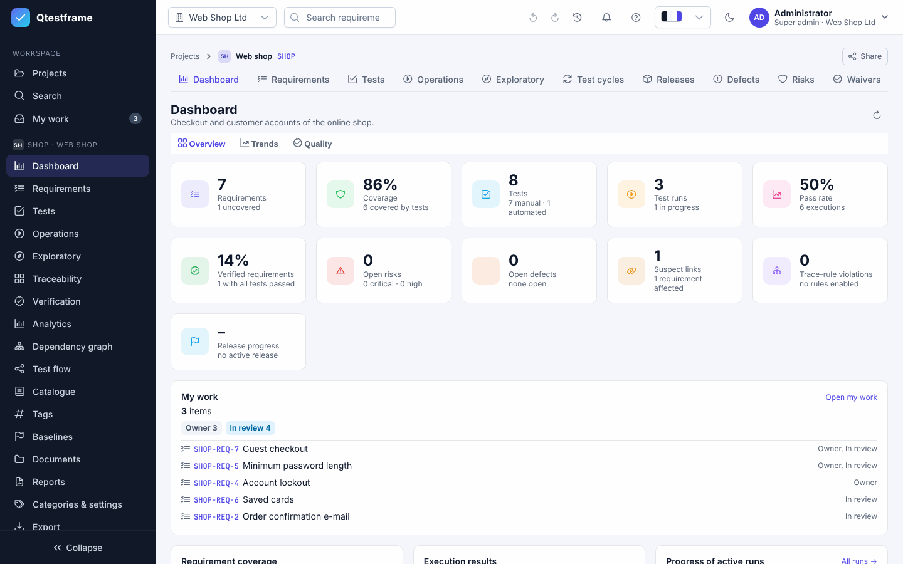

**Overview**

- **Key figures**: number of requirements (and how many are uncovered), coverage (how many are covered by tests), number of tests (manual and automated), test runs (in progress) and the pass rate of all executions.
- **Requirement coverage**: how many requirements are *Passed*, *Failed*, *Partial*, *Not run* and *None*.
- **Execution results**: all results of all runs.
- **Progress of active runs**: one bar per planned or running run (the newest eight), split into passed, failed, blocked, skipped and not run.
- **Recent runs**: the five newest runs with their progress; **All runs →** opens the run list.
- **Requirements by status** and **Requirements by obligation** (requirements without a keyword count as *unspecified*).
- **Tests by status**.
- **More key figures** (below the first ones): **Verified requirements** (the share of requirements whose linked tests all passed), **Open risks** (with how many are critical and high), **Open defects** (with their average age), **Suspect links** (links whose requirement or test changed since, and how many requirements have one, see [the traceability matrix](#the-traceability-matrix)), **Trace-rule violations** (items that break the enabled [traceability rules](#traceability-rules), and how many rules are broken) and **Release progress** (the share of executions with a result in the current release).
- **Manual and automated tests by last result**: one bar for manual and one for automated tests, split into passed, failed, blocked, skipped and not run.
- **Requirement review state**: the requirements by the state of their latest review request: *Not reviewed*, *Review pending*, *Changes requested* or *Approved* (cancelled requests do not count). See [Reviews](#reviews-and-notifications).
- **Release execution progress**: for the current release (the active one, else the planned one with the earliest target date), the results of all executions in its runs, and how many have a result and passed. The release name opens it.

On the dashboard, a requirement counts as *covered* as soon as at least one test is linked, regardless of results. *Verified* requirements are those whose linked tests all passed.

**Trends**

- **Coverage and pass rate over time**: the coverage (share of requirements with linked tests) and the pass rate (share of executed tests whose latest result passed) per day. Choose the period above the chart: 30, 90 or 365 days.
- **Defects opened and closed per week**: new defects and defects that were resolved, closed or rejected, per week (Monday to Sunday).
- **Activity in the last 30 days**: per day, the changes to requirements and tests (every saved version), the executions finished and the defects reported. This chart always covers the last 30 days, whatever the period above.
- **Release burn-up**: for the release chosen in the list, the requirements in its scope, how many of them have linked tests and how many have all their tests passed in the release's runs, day by day from the creation of the release. The target date of the release is shown above the chart. See [Releases](#releases-and-risks).

The trends come from a snapshot of the figures that Qtestframe saves once a day for every project (and when the dashboard is opened and today's snapshot is missing). A new project, or a project from before this feature, does not start empty: on the first snapshot, the earlier days are reconstructed from what has dates — when requirements, tests and links were created, the results of the runs and when defects were reported and resolved (up to a year back). Days without a snapshot are bridged by the line.

**Quality**

- **Flaky tests**: the ten tests whose results change most often between passed and failed, with their latest results (oldest first; a ring marks every flip) and when the result last flipped. Click a test to open it. See [Flaky tests](#flaky-tests).
- **Open defects by severity**: open and in-progress defects per severity.
- **Requirement coverage by group**: the coverage per top-level folder (requirements in subfolders count for the top folder) or, with **Category**, per requirement category; the twelve largest groups.
- **Open risks by level**: open risks (*Identified* or *Mitigating*) per level; **Risk register →** opens the [risk register](#the-risk-register).
- **Risk heat map**: a small 5 × 5 table of the risks that are not closed, by likelihood (rows, 5 at the top) and impact (columns). Besides its colour, each level has its own border (dotted for medium, dashed for high, solid with stripes for critical), explained below the table.
- **Mitigation of open risks**: the open risks by how far the requirements that address them are tested: *No requirements*, *Untested*, *Partly tested*, *Tested, not all passed* and *Verified* (as in the [risk report](#standard-reports)).
- **Age of open defects**: open and in-progress defects by age (under 7 days, 7–30, 30–90, over 90 days), split by severity, with the average and the oldest age.
- **Traceability rules**: whether all enabled rules of severity *error* are met, how many rules are enabled, how many are broken (errors and warnings) and the number of violations. **Traceability →** opens the matrix with the rules.
- **Quality metrics** and **Consistency checks** (the failing ones): the same as in [Analytics](#quality-metrics).

The further key figures and these charts are counted on the server in one request, loaded next to the rest of the dashboard.

Every chart has a text alternative with its figures for screen readers, and the legend names each colour. The heat map is a table with a caption, and every cell names its likelihood, impact, level and number of risks.

## Dependency graphs

**Dependency graph** in the project sidebar draws how items build on each other. Choose **Requirements** or **Tests** at the top:

- **Requirements**: the relations between requirements, such as *depends on*, *provides*, *refines*, *derived from*, *conflicts with*, *duplicates* and *relates to* (see [Relations](#relations));
- **Tests**: the [dependencies](#dependencies) between tests (*depends on*) and the shared steps (*calls*).

The graph is read from left to right: prerequisites, parent requirements and sources are on the left, what builds on them to the right. Each box shows the key, the title and the coverage (requirements) or last result (tests), with a coloured bar in the same colours as elsewhere. Each relation type has its own colour and line style, explained next to its checkbox.

- Untick a relation type to hide those lines; items left without relations disappear unless **Show items without relations** is on.
- Type in **Highlight items…** to highlight matching items.
- Right-click an item (or focus it and press <kbd>Space</kbd>) to highlight its neighbours; **Show all** ends this.
- Select an item (or press <kbd>Enter</kbd>) to open it. Zoom with the magnifier buttons; scroll to move around.
- **Rotate 90°** (the turning-arrow button next to the zoom) lays the graph out from top to bottom instead of left to right: prerequisites and parents are then at the top. The choice is kept in the address (`dir=vertical`) and in your browser.
- **Print or save** prints the graph on its own page (landscape when it is wide) or saves it as an **SVG** image (sharp at any size, keeps the links to the items), a **PNG** image, or **Markdown** with a Mermaid diagram (drawn by GitHub, GitLab and many editors) and a table of the items and their relations. The saved files show what is currently on screen: the chosen relation types, direction and items.
- **List** shows the same relations as a table, one item per row, which is easier to read with a screen reader or to print.

Cycles (for example two requirements that depend on each other) are drawn, but one of their lines is shown without an arrow.

## Requirement analytics

**Analytics** in the project navigation analyses all requirements of the project at once (open it again or select **Analyse again** after changes). In a project with variants, **Show for variant** analyses only the requirements and tests of one variant, with its coverage, results and verification; the compliance below follows the same choice. At the top: the **health** (the share of requirements without problems or warnings), the number of requirements and tests, the share **covered by tests** (rejected and obsolete requirements are not counted) and the average **language score**.

- **Obligation levels** shows how many requirements have each level, including those with **no obligation**.
- **Keywords per meaning** groups the keywords that mean the same (MUST, SHALL and REQUIRED; MAY and OPTIONAL …) and shows how each is used, so you see the convention of the project at a glance.

**Findings** lists what the analysis noticed, problems first, each with an explanation, **what to do** and the requirements (or tests) concerned; select a key to open the item. Filter by severity or category:

| Category | Findings |
|---|---|
| Obligation levels | keywords not written in capitals as RFC 2119 and RFC 8174 require ("must", "Should"), and requirements whose keywords are *only* in lower case and so have no normative keyword at all; WILL used as an obligation (it is not an RFC 2119 keyword); requirements without an obligation level; a level in the field but no keyword in the text; field and text disagree; several levels in one requirement; the spread: almost everything mandatory, no mandatory requirements, many optional (MAY) or many SHOULD or descriptive requirements |
| Consistency | requirements in more than one language (for example mostly English with a few Swedish ones), a requirement whose title and sentences are in different languages, and English keywords in a requirement written in another language (MUST in a Swedish sentence); a keyword used by a few requirements while another with the same meaning dominates, for example *SHALL is used in 1 requirement, while MUST is used in 95 %*; keywords with the same meaning used about equally |
| Coverage | mandatory and other requirements without tests; failing or not yet run tests; requirements without acceptance criteria |
| Tests | tests that verify no requirement; accepted requirements without a test that is Ready |
| Quality | empty descriptions, duplicate titles, conflicting requirements, low language scores, many drafts, requirements without an owner |
| Language | the findings of the [language analysis](#the-language-analysis) summed up per rule: ambiguous terms, TBDs, escape clauses … |

**Languages of the requirements** shows how many requirements are written in each language. Only texts long enough to tell the language are counted; a title of one or two words is not enough.

**Language** chooses the language of the analysis (detected per requirement by default). Test findings are shown when you may read tests.

### Consistency checks

**Consistency checks** in **Analytics** evaluates every [built-in consistency check](#built-in-consistency-checks) on the project, also those it has not added as rules yet (marked **Default**; they do not count for releases until they are added). **Show violations** lists the items with the items involved and the fixes.

### Quality metrics

**Quality metrics** in **Analytics** (and on the dashboard's **Quality** tab) measures the project from its history. Choose the period (30, 90, 180 or 365 days) and after how many days a latest result counts as stale. Trends are per week, or per month for periods over 120 days.

| Metric | What it measures |
|---|---|
| **Requirements volatility** | the changes to requirements after their creation (every saved version; moves do not count), per period, as changes per requirement and period, and the most changed requirements |
| **Defect density** | defects per active requirement, per folder and per category; a defect counts for a requirement when it is linked to it, to a test that verifies it or to an execution of such a test |
| **Escaped defects** | defects found in production (the defect's **Found in** field, see [Defects](#defects-1)) or reported after a release they concern was released; the share of all defects, per phase found and per release |
| **Test effectiveness** | defects found by tests (linked to a test or one of its executions) per test executed and per execution hour; executions without a duration are not counted in the hours |
| **Result age** | how old the latest result of each test is (0–7, 8–30, 31–90, 91–180 and more days, never run) and how many are older than the limit |
| **Review turnaround** | the time from a review request to its decision (median, mean and 90th percentile), and the pending requests |
| **Time to fix defects** | the time from reporting a defect to resolving it, per severity (rejected defects do not count) |
| **Requirement quality** | the share of active requirements whose text has warnings of the language analysis; the trend replays each requirement's text from its history |

Every chart has a text alternative and **Show as table** shows its figures as a table. **Export as report** opens the reports: the standard report **Quality metrics** contains the same figures.

### Compliance with laws and standards

At the bottom of **Analytics**, **Compliance with laws, standards and best practices** shows how far the project meets the regulations and standards of the [catalogue](#comply-with-laws-standards-and-best-practices). Without a choice it shows every source the project uses; choose others in the list (grouped by kind, with a search field) to see what is missing for them too.

For each source:

- **Catalogue requirements** are the catalogue requirements that cite it. One is **adopted** when the project has a requirement added from it that is not rejected or obsolete; otherwise it is **missing**. **Own** requirements are project requirements that were not added from those items but name the source in their **Source** field, for example `GDPR Art. 32; ISO/IEC 27001:2022 A.8.5` (written as in the catalogue's *Based on*; upper and lower case do not matter).
- **Fulfilment**: a requirement is *fulfilled* when it has tests and the latest result of every one of them is passed, *failing* when one failed, *blocked* when one is blocked, and *untested* otherwise. When the project has several copies of one catalogue item, the worst state counts.
- **Compliance** is the share of fulfilled requirements of all catalogue and own requirements for the source; **Adopted** is the share of catalogue requirements the project has; **MUST requirements** is the compliance of the mandatory ones. The bar shows the fulfilled, failing, blocked, untested and missing requirements.
- **By obligation** splits the counts into MUST (including MUST NOT), SHOULD and MAY. **By clause** gives the compliance per article, annex or control group, taken from the citations (`Art. 32`, `A.8`, `Annex I Part I`, `SR 1` …; *(general)* for citations of the source as a whole).
- **Missing requirements** lists the gaps, MUST first: select one to open it in the catalogue, or **Add the missing from the catalogue** to open the catalogue with the source chosen. **Adopted but not fulfilled** lists the project's requirements that still fail or lack passing tests; select a key to open the requirement.

The standard report **Compliance** (see [Reports and export](#reports-and-export)) contains the same figures, per source and clause, with the gaps. The analysis helps you plan and follow up; it is not a legal assessment.

# Duplicates and conflicts

Large requirement sets collect the same requirement twice (written by two people, imported from a customer document and from the [catalogue](#catalogue)) and requirements that contradict each other (*passwords at least 12 characters* and *at most 8*). Qtestframe looks for both: while you write, in the [built-in consistency checks](#built-in-consistency-checks) and on the **Duplicates & conflicts** page, where you decide what to do about each pair.

Everything is computed on the Qtestframe server. No text leaves it unless an administrator has turned on an [embeddings service](#embeddings-service).

## Similar requirements while writing

When you create or edit a requirement, **Similar requirements** below the description shows the five most similar requirements of the project, each with its similarity in percent, a moment after you stop typing. A similarity at or above the project's duplicate threshold (68 % by default) is highlighted: the requirement probably exists already. Open it in a new tab, or keep writing if yours says something else.

The test editor has the same panel, **Similar tests**, which compares the title, description, preconditions and steps.

Rejected and obsolete requirements and deprecated tests are not compared. The panel only appears for people who may change the item.

## How similarity is measured

Two requirements are similar when they use the same important words, not when they look alike letter by letter:

- **Normalisation and word forms.** Texts are compared in lower case without punctuation; words are reduced to their stem in English and Swedish (*users*, *user* → *user*; *användaren*, *användarna* → *använd*), so inflections do not matter.
- **Stop words.** Words without meaning of their own (*the*, *shall*, *och*, *ska* …) are ignored. The obligation keywords are compared by the conflict detection instead.
- **Synonyms and abbreviations** of the domain count as the same word, also across the two languages: *log in*, *sign in*, *logga in* and *inloggning*; *user*, *end user*, *användare* and *brukare*; *e-mail*, *e-post* and *mejl*; *2FA*, *two-factor* and *tvåfaktorsautentisering*; *delete*, *remove*, *radera* and *ta bort*, and more.
- **Compounds.** Swedish compounds are split when a part is a known word (*användarkonto* = *användare* + *konto*), and pieces of four letters make *lösenordsbyte* and *byte av lösenord* similar.
- **Rare words count more.** A word that appears in a few requirements of the project says more than one that appears in most of them (TF-IDF over the project).
- **Field weights.** The title counts most, then the description, then the acceptance criteria (for tests: preconditions, steps and expected results).

The result is a similarity from 0 to 1 (shown as a percentage). Texts that are the same apart from case and punctuation are 100 %.

## Potential conflicts

Two requirements **potentially conflict** when they talk about the same thing (they share enough of their important words) and:

| Kind | Example |
|---|---|
| **Opposite obligation** | *The user MUST be able to export reports as PDF.* and *The user MUST NOT be able to export reports as PDF.* (also *SKA* and *FÅR INTE*, *must* and *must never*) |
| **Thresholds** that cannot both hold | *respond within 2 seconds* and *respond in no less than 5 s*; *at least 12 characters* and *at most 8 characters*; *minst 12 tecken* and *högst 8 tecken*. Units are converted (2000 ms = 2 s, 15 minuters = 900 s), and a negative obligation turns the comparison round (*must not exceed 2 s* = at most 2 s) |
| **Exclusive values** | *enabled* and *disabled* by default, *mandatory* and *optional*, *encrypted* and *unencrypted*, *public* and *private*, *automatic* and *manual*, *aktiverad* and *avstängd* … |

Each conflict has a **confidence** from 0 to 1, higher when the two statements share more of their content. The obligation keywords are recognised as in the [language analysis](#requirements) (English and Swedish). A pair that conflicts is not also reported as a duplicate.

## The Duplicates & conflicts page

Open **Duplicates & conflicts** in the project sidebar. Choose **Requirements** or **Tests** at the top.

- **Potential conflicts** (requirements) shows each pair with its kind, confidence and the decisive terms, and the sentence of each requirement with the **evidence highlighted**: the keywords, the thresholds or the exclusive values.
- **Suspected duplicate requirements** (or tests) shows each pair with its similarity and the number of trace links of each item.

**Similarity from** and **Conflict confidence from** change what is listed; they start at the project's thresholds (the built-in checks). **Show dismissed** lists the pairs you dismissed too, so you can show them again.

For each pair you can:

| Action | What happens |
|---|---|
| **A duplicates B** | adds the relation *A duplicates B* (for tests: an item link labelled *duplicates*). The pair is no longer suspected. |
| **Merge…** | choose the item to **keep**; the other one is merged into it: its trace links, relations (tests: prerequisites) and item links move to the item you keep, it gets the status *Obsolete* (tests: *Deprecated*) and is marked as a duplicate of the kept item. Both get a comment that records the merge, and the status change appears in the history. Links the kept item already has are not doubled. |
| **Mark as conflicting** | adds the relation *conflicts with*. From then on the check [Conflicting requirements in a release](#built-in-consistency-checks) watches the pair. |
| **Not a duplicate** / **Not a conflict** | dismisses the finding: the pair is not shown again by the page or the built-in checks (it is remembered per pair and check, also in backups and project archives). **Show again** undoes it. |

Marking and merging need permission to change requirements (`requirement.write`) or tests (`test.write`). Everyone who can read the items can open the page.

## Built-in checks

The page uses the same detection as three [built-in consistency checks](#built-in-consistency-checks): **Suspected duplicate requirements**, **Potentially conflicting requirements** and **Suspected duplicate tests**. A violation is reported on the newer item of the pair; its fixes are **Mark as duplicate**, **Mark as conflicting** and **Not a problem**.

## Thresholds

| Setting | Default | Where |
|---|---|---|
| Similarity of a suspected duplicate | 0.68 | the rule of the check (**Similarity threshold**, 0.5 to 1) |
| Confidence of a potential conflict | 0.6 | the rule of the conflict check (**Least confidence**, 0.5 to 1) |
| Least similarity shown while writing | 0.25 | fixed |

The defaults were chosen on a labelled set of English and Swedish requirements (paraphrased duplicates, contradictions of each kind, and related requirements that are neither, such as *lock the account* and *unlock an account*): with them every labelled duplicate and conflict is found and no unrelated pair is reported. Raise the duplicate threshold to about 0.8 when the check reports requirements that only share a topic; lower it towards 0.6 to find paraphrases with fewer common words. Similarity depends on the project: a word that is rare in a small project counts more than in a large one.

## Importing from the catalogue

Before you add requirements from the [catalogue](#catalogue), the dialog warns about the chosen requirements that are similar to requirements the project already has and can leave them out. After adding, the result says how many new requirements are similar to existing ones.

## Embeddings service

An administrator can let an external **embeddings service** (an OpenAI-compatible `/v1/embeddings` endpoint) compute the similarity instead (**Administration → System settings → Similarity**; see the administrator guide). The page and the panel then say *Embeddings service*. The title, description and criteria or steps of requirements and tests are then **sent to that service**. Its vectors are cached per item version, so unchanged items are not sent again. The conflict detection always runs on the server. When the service fails, the local similarity is used.

# Variants and code

A product is often built in several **variants**: models, markets or customer configurations. Not every requirement applies to every variant, and a test run on one variant says nothing about another. Qtestframe keeps track of which requirements and tests apply to which variants and computes coverage per variant.

The second half of this page is about **code**: the commits, merge requests and pull requests that refer to requirements and tests, the CI **builds** whose results were uploaded, and the **regression selection** that proposes which tests to run after a change.

## Variants

Select **Variants** in the project sidebar, then the **Variants** tab. With the **Manager** role (permission `project.update`) you can add, change and remove variants.

Each variant has:

- a **name**, unique in the project, such as *EU model*;
- optionally a place **below** another variant: variants form a hierarchy, for example *EU* → *EU model DE*;
- a **kind**: product variant, market, customer configuration or other;
- **feature attributes**: names and values such as `region = EU` or `voltage = 230V`. A variant inherits the attributes of the variants above it; its own values win;
- the **test configurations** it is tested in. When you choose some, only results in those configurations (and results without a configuration) count for the variant. Leave it empty to count every configuration. See [test configurations](#test-runs-and-execution).

Removing a variant moves the variants below it up one level. Runs for it become variant-neutral, and requirements and tests that applied only to it apply to all variants again.

## Applicability

A requirement or test **applies** to all variants until you say otherwise. Open it, and in the **Variants** section of its details choose **Change**:

- **All variants**: the default; it also covers variants added later.
- **Selected variants**: the item applies to the chosen variants and to the variants below them. Choosing *EU* covers *EU model DE* too.
- **Expression**: a [query](#search-and-filters) evaluated against each variant. The fields are `name` and `variant` (the variant and the ones above it), `kind` and the feature attributes. Examples: `region:EU`, `region:EU AND NOT voltage:110V`, `kind:customer OR variant:"EU model"`.

To set the applicability of many items at once, select them in the list and choose **Applies to** in the toolbar.

**When the applicability changes,** the item's tests, the requirements related to it and the other items the [change impact](#change-impact) reaches may need a look: a test written for *EU* may not cover *US*. By default a **review is recommended**: nothing is marked suspect, and the owners of the items reached are notified. Under **Categories & settings → Change impact → Changed variant applicability** a project can make it mark the trace links and relations suspect instead (as a change of the text does), or have no impact. Changing the applicability of many items at once, and restoring a version or a baseline with another applicability, work the same way.

### History, undo and baselines

A change of the applicability is part of the item's **History** (shown as *Applicability*, with the variants before and after) and of the audit log. **Undo** (Ctrl+Z) takes it back, also for a change of many items at once: each item gets what it had. Restoring an older version from the history restores the applicability of that version too.

[Baselines](#baselines) record the applicability of every item. **Compare** lists *Applies to (variants)* among the changed fields when it differs, and **Restore** from a baseline gives the items the applicability they had, even when nothing else changed. Variants deleted since are left out. A deleted item keeps its applicability in the trash, and project archives and backups contain it.

### Show for a variant

In the requirement and test lists and on the **Traceability**, **Verification** and **Analytics** pages, choose a variant in **Show for variant**. The list then shows only the items that apply to it, with the coverage and last results that count for that variant. The query language knows variants too, and the API takes `?variant=` for the traceability matrix, exports, ReqIF and reports:

| Query | Finds |
|---|---|
| `variant:"EU model"` | items that apply to the variant *EU model* |
| `applicability:selected` | items that apply only to some variants |
| `applicability:all` | items that apply to all variants |
| `variant:US` (runs) | runs for the variant *US* |

## Coverage per variant

Coverage is computed per **variant × test configuration**:

1. A requirement counts in a variant when it applies to it. Otherwise its coverage there is **Not applicable**.
2. Only its linked tests that apply to the variant count.
3. Only results that count for the variant are used: results of runs for the variant or a variant above it, and results of **variant-neutral** runs. Results in configurations the variant is not tested in are left out.

When you create a run, choose the **Variant** it tests, or leave it variant-neutral. CI uploads can name the variant too (see [builds](#builds)).

The **Coverage matrix** tab shows every requirement against every variant, with the number of applicable requirements that passed. Filter the requirements with a query, and choose **In configuration** to see one test configuration only. In a requirement's details, the **Variants** section shows its coverage in every variant and, per variant, in every configuration.

### Releases and documents for a variant

On the **Releases** page, choose a variant in **Readiness for variant** to evaluate the exit criteria for it: only the release's requirements that apply to the variant, the tests that apply and the results that count.

### Release gates per variant

A release can **target** one or more variants: edit the release and choose them in **Target variants**. The exit criteria are then evaluated for every targeted variant, with the rules of [coverage per variant](#coverage-per-variant):

- only the release's requirements that apply to the variant, and only their linked tests that apply to it, count;
- only results of the release's runs for the variant or a variant above it, and of **variant-neutral** runs, count, in the configurations the variant is tested in. A variant-neutral run counts for every targeted variant.

The **Status** tab shows the matrix **Exit criteria per variant**: one row per criterion, one column per variant, each cell *Met*, *Waived* (met because waivers or signed risk acceptances accept what is missing) or *Not met*, and the go / no-go of each variant at the bottom. The release is a **go only when every targeted variant is a go**; marking it released needs that go or a release note for the override. In the list of criteria below the matrix, a criterion is met when it is met in every variant, and each blocking item names the variants it blocks in. The [release readiness report](#reports-and-export) contains the same matrix.

A [waiver](#waivers-residual-risk-and-the-statement-of-applicability) can be limited to variants (**Only for variants**): it then accepts its requirements only in those variants and the variants below them. A release without target variants counts only waivers for every variant. A release that targets no variant, and a project without variants, are evaluated as before.

When you [create a document](#documents-1), choose **For variant**: the requirements specification or test plan then contains only what applies to the variant, with its coverage and results, and names the variant on the title page.

## Code links

Requirements and tests can be linked to **commits** and **merge or pull requests**. Open an item and select the **Code** tab. It lists the linked changes with their status (open, merged or closed), repository, branch, author and the builds of each commit.

Links are made in two ways:

- **Automatically**: when a commit message, or the title, description or branch name of a merge or pull request, names an item key, the change is linked to it. Full keys (`DEMO-REQ-12`) and short keys (`REQ-12`, `TC-3`, meaning this project's) both work. A key of another project (`OTHER-REQ-1`) is ignored.
- **By hand**: choose **Link commit or MR** in the **Code** tab and give the SHA or number, the address and a title.

### Webhooks

The automatic links come from webhooks. With the **Manager** role, open **Settings → Project → Code integration**:

1. Choose **Generate** (or type a secret of 16 to 200 characters) and **Save**. Copy the secret now: it is never shown again.
2. In **GitLab**, open *Settings → Webhooks* of the repository, enter the **GitLab webhook URL**, put the secret into *Secret token* and tick *Push events* and *Merge request events*.
3. In **GitHub**, open *Settings → Webhooks → Add webhook*, enter the **GitHub webhook URL**, choose *application/json*, put the secret into *Secret* and choose the *Pushes* and *Pull requests* events.

Qtestframe checks every delivery: GitLab must send the secret token, GitHub must sign the body with the secret (HMAC-SHA256). Deliveries without a valid signature are rejected. **Remove secret** turns the webhooks off.

## Builds

A **build** is a CI build that test results were uploaded for. The CI passes it with the upload of [JUnit results](#test-runs-and-execution) or of JSON results, as query parameters:

```
POST /api/v1/runs/{run}/junit?build_id=4711&build_number=1.4.41&commit=3f2c9e1&branch=main&pipeline_url=https://ci.example.org/p/4711&variant=EU%20model
```

`qtestframe report` sends these by itself in GitLab CI, GitHub Actions and Jenkins (see [CI/CD](#cicd)). `build_id` is the CI's own id (unique per project); `build_number`, `commit`, `branch` and `pipeline_url` are optional, and `variant` makes the run a run for that variant. The run is then associated with the build.

- **Verified in build**: the **Code** tab of a requirement shows the latest build in which every linked test passed, and the builds its tests ran in with the coverage in each.
- **Build history**: the **Code** tab of a test lists the builds it ran in, newest first, with the result in each.
- **Code → Builds** lists all builds with their runs and pass rate.

## Regression selection

Select **Code → Regression selection** to find the tests to run after changes:

- **Changed requirements**: keys of requirements that changed;
- **Commits since build**: the commits after a build's own commit (on the build's branch), and the requirements and tests they name;
- **Variant**: only requirements and tests that apply to it;
- **Include requirements that depend on, refine or derive from them**: one step along these [relations](#requirements);
- **Include prerequisite tests**: the tests the selected tests depend on.

**Propose tests** lists the tests with the reason each is included. Deprecated tests are left out. **Create run** makes a run of them (for the chosen variant), named after the build when you start from one. CI can do the same with `POST /api/v1/projects/{pid}/regression/run`.

# CI/CD

Qtestframe works with your **CI/CD pipeline** (GitLab CI/CD in the first place, GitHub Actions and other CI systems too): the pipeline uploads its automated test results, a **quality gate** decides whether the change may go on, the result comes back to GitLab as a **commit status** and a **merge request note**, and **test selection** runs only the tests a change needs. Everything is done with the `qtestframe` command in the pipeline's jobs and an API token; the server needs no extra configuration.

This page builds on [test runs and the CI import](#test-runs-and-execution), [releases and their exit criteria](#releases-and-risks) and [code links, builds and the regression selection](#code-links).

## Set up a pipeline

Open **Settings → Project** and scroll to **CI setup**. It shows, for this project and server:

1. **An API token.** Create one with the role **tester** under **Administration → API tokens**, preferably for a separate CI user that is a member of the project with the tester role. A token never gets more than its user's own role. See [API tokens](#api-tokens).
2. **The CI/CD variables** to add in GitLab under *Settings → CI/CD → Variables*:

   | Variable | Value |
   |---|---|
   | `QTF_URL` | the server URL (already in the templates) |
   | `QTF_PROJECT` | the project key (already in the templates) |
   | `QTF_TOKEN` | the API token; mark it **masked** (and **protected** if only protected branches report) |
   | `QTF_CLI_IMAGE` | a container image that contains the `qtestframe` binary |
   | `QTF_GITLAB_TOKEN` | optional: a GitLab project access token with the role *Developer* and the scope `api`, for commit statuses and notes from the pipeline (masked) |
   | `QTF_RELEASE` | optional: the release whose exit criteria are the gate |

3. **A template.** Choose one, then **Copy** or **Download** it:
   - **GitLab**: your own test jobs write JUnit XML to `qtf-results/`; a final job uploads it and checks the gate.
   - **GitLab with test selection**: a first job selects the tests of the change and starts a generated child pipeline that runs them (see [Test selection](#test-selection)).
   - **GitLab component**: the same as a [CI/CD component](https://docs.gitlab.com/ee/ci/components/) with inputs, for a component project.
   - **GitHub Actions**: a workflow that does the same.

   Instead of copying, a `.gitlab-ci.yml` can include the template from the server: `include: - remote: 'https://<server>/api/v1/ci/templates/gitlab-ci.yml'`. The same files are in the source code under `examples/ci/`.

Anyone who can read the project sees the CI setup; the tokens are never shown there.

## Name automated tests after their key

Qtestframe matches an automated result to a test by its **test key**, for example `SHOP-TC-12`. Put the key into the test:

- in the **test name** or **class name** of the JUnit report, for example `test_SHOP_TC_12_checkout` or `SHOP-TC-12 checkout`. Underscores stand for hyphens, because most languages do not allow hyphens in names; the key must be written in full and in capitals (`ShopTc12` is not recognised);
- or as a **property** of the test case: `qtestframe.key`, `test_key` or `qtestframe`.

The same identifier is what test selection filters on (`SHOP_TC_12`). Results without a key can create draft automated tests with `--create-missing` (see [runs](#test-runs-and-execution)). To group tests into the jobs of a generated child pipeline, tag them `runner:pytest`, `runner:go`, `runner:playwright` or `runner:maven` (or any name of your own); without such a tag, tests with the script language *playwright* go to `playwright` and *python* to `pytest`, the others to `default`.

## Upload results

```
qtestframe report --run "Pipeline $CI_PIPELINE_IID" --create-run --junit 'qtf-results/*.xml'
```

In GitLab CI, GitHub Actions and Jenkins the command reads the CI variables and records the pipeline as the **build** of the results: its id and number, the commit, the branch, the pipeline URL and the merge request. The requirement then shows *verified in build* (see [Builds](#builds)). Override any of them with `--build-id`, `--build-number`, `--commit`, `--branch`, `--pipeline-url` and `--merge-request`, or turn it off with `--ci none`. `QTF_URL`, `QTF_TOKEN` and `QTF_PROJECT` are the defaults of `--url`, `--token` and `--project`.

## Quality gate

`qtestframe gate` checks whether the results are good enough, prints a summary with what fails (with links) in the job log and ends with exit code **0** when the gate passes, **1** when it fails and **2** when it cannot be evaluated (a wrong token, an unknown release). A failing job stops the pipeline.

```
qtestframe gate --run "Pipeline $CI_PIPELINE_IID" --release 1.0 --format junit --output qtf-gate.xml
```

**What is checked:**

- With `--release`: the release's [exit criteria](#releases-and-risks) on its scope, as on the release's *Status* tab. A release that targets variants is checked for each variant (`--variant` checks one).
- Without a release: the conditions of `--require` on the project's requirements (all except rejected and obsolete ones). Without `--require` they are: every MUST/SHALL requirement passed, no failed tests, no stale results and no requirement blocked by a defect.
- `--require` also replaces the release's criteria. It is repeatable and takes comma-separated lists.
- `--run` (name or id) or `--build` (the CI id or number) limits the results to that run or to the runs of that build; with a release, to its runs in the build.
- `--scope affected` checks only the requirements the merge request or commit refers to (from [code links](#code-links)); a [query](#search-and-filters) such as `--scope "tag:checkout"` checks the requirements it finds.

**Conditions** (`TYPE[:ARGUMENT][>=PERCENT]`):

| Condition | Met when |
|---|---|
| `must` (`mandatory_passed`) | every MUST and SHALL requirement has all its tests passed |
| `no_failed` | no test failed or is blocked |
| `no_stale` | no test has only a stale pass (see [staleness](#change-impact-staleness-and-defects)) |
| `no_blocking_defects` (`blocking`) | no requirement is blocked by an open defect |
| `coverage>=80` | at least 80 % of the requirements have tests |
| `passed>=95` | at least 95 % of the requirements have all their tests passed |
| `executed>=100` | every execution of the runs has a result |
| `approved>=90` | at least 90 % of the requirements are approved, implemented or verified |
| `no_suspect` | no suspect trace links |
| `no_open_defects:major` | no open defect of severity major or higher is linked |
| `risks_mitigated:high`, `residual_risk:medium` | the risk conditions of releases |
| `trace_rules` (`trace_rules:warning`) | the [traceability rules](#traceability-and-coverage) pass |
| `cycle_executed:"Sprint 3">=90` | 90 % of the planned tests of the test cycle have a result |

**Waivers** count as on the release status: an approved waiver for the release, or for the whole project, accepts its requirements, and the summary lists them as *waived*.

**Output.** `--format text` (the default) prints the summary; `json`, `junit` (one test case per condition, so GitLab's test report shows the gate) and `markdown` (also for GitHub's job summary) go to the file of `--output`, and the summary is still printed. The same check is available as `POST /api/v1/projects/{pid}/gate` (see the API description).

## Results back in GitLab

The result of a pipeline can show up where developers look:

- a **commit status** on the commit: `qtestframe/tests` (failed when a test failed or is blocked) and `qtestframe/gate` (the verdict of the gate), with a link to the run or release and a short summary;
- a **note on the merge request** with the results, the coverage of the requirements of the change, the failed tests and the gate's verdict. Qtestframe keeps **one** note per project and merge request and updates it with every upload (it finds its own note by a hidden marker), so the merge request is not flooded.

There are two ways, and you need only one.

### From the pipeline

Add `--post-status` and `--post-comment` to `qtestframe report` and `qtestframe gate`, or set the CI/CD variables `QTF_POST_STATUS` and `QTF_POST_COMMENT` to `true` (the templates do). The command reads `CI_API_V4_URL`, `CI_PROJECT_ID`, `CI_COMMIT_SHA` and `CI_MERGE_REQUEST_IID`, and authenticates with `QTF_GITLAB_TOKEN`: a project access token with the role **Developer** (commit statuses need Developer) and the scope `api`, stored as a masked variable.

The job's own token (`CI_JOB_TOKEN`) is tried when there is no `QTF_GITLAB_TOKEN`, but GitLab does not accept it for commit statuses and merge request notes today; the job log then says so. A failed post is a warning and does not fail the job.

### From the server

With the **Manager** role, open **Settings → Project → Results back to GitLab**:

1. Tick **Post commit statuses and merge request notes to GitLab**.
2. Enter the **GitLab API URL** (empty for gitlab.com), the **GitLab project** (its numeric id or `group/project`) and an **access token** (a project access token with the role Developer and the scope `api`). The token is stored encrypted and never shown again.
3. Choose what to post and, for `qtestframe/gate`, a **gate release** or **gate conditions** (for example `must, no_failed`). Without either, only `qtestframe/tests` is posted.

From then on, when results arrive with a commit (as `qtestframe report` sends them in a pipeline), the server posts the status and the note in the background. When GitLab is not reachable it tries again after 1, 2, 4, 8 and 16 minutes; a token GitLab refuses is not retried. **Recent posts** in the same card shows what was posted, or why not. The merge request is the one the pipeline names, or else the open merge request of the branch (from the [webhooks](#webhooks-1)).

## Test selection

`qtestframe select` answers "which tests does this change need?":

```
pytest -k "$(qtestframe select --format pytest)"
```

It collects the **change**: in a merge request pipeline the commits between `CI_MERGE_REQUEST_DIFF_BASE_SHA` and `CI_COMMIT_SHA` (with `git log`), the files they change (`git diff`) and the merge request; elsewhere the commits since `--since REV`, or `--commits` and `--files` given by hand. Then it selects:

- the requirements and tests the commits and the merge request are linked to ([code links](#code-links)), and the keys named in the commit messages (`SHOP-REQ-4`, `REQ-4`, `TC-7`);
- the tests of a **path map**: a file `qtestframe-map.yml` in the repository that maps file patterns to tests, tags and requirements (an example is in `examples/ci/qtestframe-map.yml`):

  ```yaml
  - paths: ["src/cart/**", "api/cart.go"]
    tests: [SHOP-TC-3]
    tags: [cart]
  - paths: ["src/payment/"]
    requirements: [SHOP-REQ-4]
  ```

- the [regression selection](#regression-selection) of them: the tests verifying the requirements, `--include-related` requirements and the prerequisite tests;
- the tests with a tag given with `--tag` (for example `--tag always-run` for smoke tests);
- with `--variant`, only what applies to the variant.

Only **automated** tests are selected (manual ones are counted in the log; `--include-manual` adds them). When the change is unknown (no commits, files, keys or merge request), nothing but the tagged tests is selected, unless `--fallback all`. Unknown keys are listed.

**Output** (`--format`):

| Format | Output | Use |
|---|---|---|
| `keys` | one key per line | your own scripts |
| `pytest` | `SHOP_TC_3 or SHOP_TC_7` | `pytest -k "…"` |
| `go` | `(SHOP_TC_3\|SHOP_TC_7)([^0-9]\|$)` | `go test -run '…'` |
| `playwright` | `(SHOP[-_]TC[-_]3\|…)(?![0-9])` | `npx playwright test --grep '…'` |
| `maven` | `*SHOP_TC_3*,*SHOP_TC_7*` | `mvn test -Dtest='…'` (also matches `SHOP_TC_31`; select more rather than less) |
| `json` | the selection with the reasons | |
| `gitlab-child-pipeline` | a child pipeline | see below |

An empty selection prints nothing: do not run the tests then, because an empty filter selects every test in most runners.

**A generated child pipeline.** `--format gitlab-child-pipeline --output qtestframe-pipeline.yml` writes a pipeline with one job per runner group, each with the selected tests in `$QTF_TESTS` and its filter in `$QTF_FILTER`, and a final job that runs `qtestframe report` and `qtestframe gate` also when tests failed. A parent job keeps the file as an artifact and starts it with `trigger: include: - artifact: qtestframe-pipeline.yml`; the template *GitLab with test selection* does that. Set each runner's image and command with `--image pytest=python:3.13` and `--job pytest='pytest -k "$QTF_FILTER" --junitxml="$QTF_RESULTS/pytest.xml"'`; the defaults use pytest, gotestsum, Playwright and Maven. `--create-run --run NAME` creates the run of the selection first, so the results land in it; `--gate-release` and `--gate-require` set the final gate.

The selection is also `POST /api/v1/projects/{pid}/ci/select`.

## GitHub Actions and other CI systems

- **GitHub Actions**: the template uses the workflow's `GITHUB_TOKEN` (with `statuses: write` and `pull-requests: write`) as `QTF_GITHUB_TOKEN`; `--post-status` and `--post-comment` then post a commit status and a pull request comment that is kept up to date. `--format markdown --output "$GITHUB_STEP_SUMMARY"` shows the gate in the job summary.
- **Jenkins** and others: `qtestframe report` reads Jenkins' variables (`BUILD_TAG`, `BUILD_NUMBER`, `GIT_COMMIT`, `BRANCH_NAME`, `CHANGE_ID`); elsewhere set `QTF_BUILD_ID`, `QTF_BUILD_NUMBER`, `QTF_COMMIT`, `QTF_BRANCH`, `QTF_MERGE_REQUEST` or pass the flags. `gate` and `select` work everywhere; posting statuses is for GitLab and GitHub.

## Limitations

- GitLab's job token (`CI_JOB_TOKEN`) cannot post commit statuses or merge request notes: use a project access token, or let the server post.
- The server posts only to GitLab; GitHub statuses come from the pipeline.
- Test selection is only as good as the links: commits and merge requests are known through the [webhooks](#webhooks-1) or the keys in commit messages, and files only through the path map.
- API tokens are limited by roles, not by finer scopes: give the CI user the tester role, or a custom role with only `project.read`, `test.read`, `run.read`, `run.execute` and `run.write`.

# Baselines

A **baseline** freezes the current version of the project's requirements and tests under a name, for example *Release 2.0* or *Audit 2026-Q3*. Later you can compare the baseline with the current state or with another baseline and see exactly what was added, removed or changed.

Viewing and comparing baselines needs **Viewer**; creating and deleting them needs **Manager**.

## Baseline or revision?

| | Revision (history) | Baseline |
|---|---|---|
| What | one version of **one** item | the versions of **all** (or filtered) items at one moment |
| Created | automatically on every change | by you, when you need it |
| Used for | seeing and undoing changes of an item | releases, audits, sign-offs, comparing releases |
| Where | the **History** tab of the editor | **Baselines** in the project sidebar |

A baseline does not copy anything you can edit; it records which version of every item belonged to it. Deleting a baseline never changes the items.

## Create a baseline

1. Select **Baselines**, then **New baseline**.
2. Enter a **Name**, for example *Release 2.0*, and a description if you like.
3. Optionally enter a **Filter**, for example `folder:Checkout` or `status:approved`. It is applied to requirements and tests like the export filter. Empty means all requirements and tests.
4. Select **Create baseline**. The list shows how many requirements and tests it holds.


## Look inside a baseline

Select a baseline to see its **Items**: every requirement and test with the version it had. Filter by **Requirement** or **Test**.

## Compare

1. Select **Compare** on a baseline.
2. Under **Compare with**, choose **Current state** or another baseline of the project.
3. The result lists:
   - **Added**: items that exist now (or in the second baseline) but not in the first;
   - **Removed**: items that were in the first baseline but no longer exist;
   - **Changed**: items whose version differs, with both version numbers and the changed fields;
   - the number of unchanged items.

Items are matched by their identity, not by key: a requirement that was moved or got a new key shows as *changed*, not as removed and added.

The **current state** includes all items of the project, also those outside the baseline's filter. Use **Compare again** after further changes.

### Restore the baseline version

When you compare with the current state and may edit requirements or tests, each changed item has a checkbox. Tick the items to roll back (or **Select all changed items**) and select **Restore baseline version**. Each ticked item gets the content it had in the baseline (title, text, fields, status, categories) as a new version; its history shows a *restore* entry, so the change can itself be undone.

Items are skipped, with the reason shown, when they are no longer in the baseline, have been deleted, already have the baseline version, you may not edit them, or restoring would set a review status (such as *Approved*) without your having review permission.

To see the details of a change, open the item and look at its **History** tab; it shows the field-by-field difference of every version.

## Sign or delete many baselines

Tick baselines in the list:

- **Sign…** signs every ticked baseline with one confirmation: choose what your signature means, add a comment and enter your password once. Each signature records the fingerprint of its own baseline. Baselines you already signed with that meaning are skipped. Signing needs the review permission; see [Sign a baseline](#sign-a-baseline).
- **Delete** removes the ticked baselines after confirmation. **Signed baselines are kept**: they are listed instead of deleted.

## Typical uses

- **Release:** create *Release 1.0* when the specification is approved; during the next release, compare with the current state to write release notes.
- **Audit:** an auditor can see exactly which version of each requirement was in force at a given date.
- **Two releases:** compare *Release 1.0* with *Release 2.0* to see what changed between them.

# Search and filters

Every list in Qtestframe can be filtered with the same **query language**: requirements, tests, runs, executions, the traceability matrix, the audit log and the document archive. The same language drives the **global search** in the top bar, the query tab when you create a run, baseline filters, export filters and reports.

## Global search

Type into the search field in the top bar and press <kbd>Enter</kbd> (on phones, select the magnifier first). The **Search** page lists matching requirements, tests and runs of **all projects of the current organisation**, with the matched text highlighted and the fields that matched.


- **Search in** limits the result to requirements, tests or runs.
- **Project** limits it to one project.
- Besides the item fields you can use `project:` (key or name) and `kind:` (`requirement`, `test`, `run`), for example `kind=requirement project:SHOP coverage:none`.

## Filters in lists

The filter field above a table takes a query. Press <kbd>Enter</kbd> to apply it. If the query has an error, the field is marked and the message tells you where the problem is. The **?** button (**Query help**) next to the field lists the operators and all fields of that list.

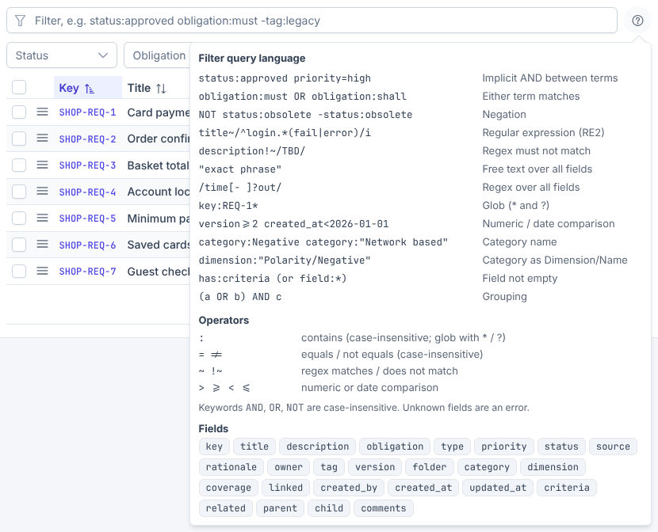

Quick filters (status, priority and so on) are turned into a query for you and shown under the filter bar as `q = …`. Copy it if you want to reuse or extend it.

## Tag cloud

**Tags** in the project sidebar shows every tag of the project's requirements, tests and documents; the more often a tag is used, the larger it is. Hover over a tag to see how many items of each kind carry it. Filter the cloud by name and sort it **By use** or **A–Z**.

Select one or more tags to list the items that carry them, grouped into requirements, tests and documents. With several tags, choose whether items need **All tags** or **Any tag**. **Open as filtered list** opens the requirements or tests page with the same query (for example `tag=gdpr AND tag=login`), and the address of the page keeps the selection, so you can bookmark it.

With permission to edit both requirements and tests, the selected tags can also be changed in the whole project: **Rename** (one tag), **Merge** (several tags into one, which can be one of them or a new name, for example to clean up *gdpr*, *GDPR* and *privacy*) or **Remove from all items**. Documents are changed too if you may change the project. Each change is recorded in the history of the requirements and tests it touches.

## Syntax in five minutes

| You write | It finds |
|---|---|
| `login` | *login* anywhere in any field (case does not matter) |
| `"session timeout"` | the exact phrase anywhere |
| `status:approved` | items whose status contains *approved* |
| `priority=high` | priority exactly *high* |
| `status:approved priority=high` | both: terms next to each other are combined with AND |
| `obligation=must OR obligation=shall` | either one |
| `NOT status:obsolete` or `-status:obsolete` | everything except obsolete items |
| `(tag:smoke OR tag:regression) -status:deprecated` | grouping with parentheses |
| `title~/^login.*(fail\|error)/i` | a regular expression; `/i` ignores case |
| `description!~/TBD/` | the description does not match |
| `key:*-REQ-1?` | glob: `*` any characters, `?` one character, matched against the whole value |
| `version>=2` | numeric comparison |
| `updated_at>=2026-01-01` | date comparison |
| `has:criteria` or `criteria:*` | the field is not empty |

### Operators

| Operator | Meaning |
|---|---|
| `field:value` | contains (case-insensitive); with `*` or `?` a glob over the whole value |
| `field=value` | equals (case-insensitive); `field=""` matches empty fields |
| `field!=value` | equals none of the values |
| `field~/regex/` | regular expression matches (RE2 syntax, case-sensitive unless `/i`) |
| `field!~/regex/` | regular expression matches no value |
| `field>v`, `>=`, `<`, `<=` | compares numbers numerically, everything else (such as dates) as text |
| `/regex/` | regular expression over all fields |
| `AND`, `OR`, `NOT` (also `&&`, `\|\|`, `!`, `-`) | logic; NOT binds tighter than AND, AND tighter than OR |

Keywords and field names are case-insensitive. Values with spaces need quotes: `category:"Network based"`. Inside quotes, write `\"` for a quote. An empty query matches everything.

**Fields with several values** (tags, categories, criteria, steps, linked items): a positive condition holds if **any** value matches; a negative one (`!=`, `!~`) only if **no** value matches.

## Fields

### Requirements

`id`, `key`, `title`, `description` (`desc`), `obligation`, `type`, `priority`, `status`, `source`, `rationale`, `owner`, `tag` (`tags`), `version`, `folder` (the folder path, e.g. `Checkout / Payment`), `category` (`categories`, value names), `dimension` (`Dimension/Name`), `coverage`, `linked` (keys of linked tests), `related`, `parent`, `child` (keys of related, parent and child requirements), `comments`, `open_discussions` (`open-discussion`: unresolved threads, `has:open-discussion`), `mention` (`mentions`: [@handles](#mention-people) in owner, title, description, rationale and source, and the people mentioned in its discussion; `mentions:me` for yourself), `created_by`, `created_at`, `updated_at`, `criteria` (`criterion`: description, method and threshold), `risk` (the highest level of the open [risks](#risk-levels) it addresses: `risk:high`), `defects` (number of open defects on it or its tests: `defects>0`), `catalog` (the [catalogue](#catalogue) entry it was copied from: `catalog:AUTH-01`, `has:catalog`), `verification` (`verified`: the [verification](#verification) state, `verification:failed`), `element` (`elements`: a [system element](#system-elements) it is allocated to, or one above it: `element:"Power unit"`), `variant` (`variants`: the [variants](#variants-and-code) it applies to: `variant:"EU model"`), `applicability` (`all` or `selected`).

### Tests

`id`, `key`, `title`, `description` (`desc`), `preconditions`, `execution_type` (`type`), `script_language` (`language`), `script`, `expected`, `step` (`steps`: action, expected result and data of all steps), `priority`, `status`, `estimate`, `owner`, `tag` (`tags`), `folder`, `category`, `dimension`, `linked` (keys of linked requirements), `last_result` (`result`), `defect` (`defects`), `calls` (keys of called tests), `depends_on` (`depends`: keys of prerequisite tests), `comments`, `open_discussions` (`open-discussion`: unresolved threads, `has:open-discussion`), `mention` (@handles in the texts and steps, and the people mentioned in its discussion; `mentions:me` for yourself), `version`, `created_by`, `created_at`, `updated_at`, `flaky` (`true` for [flaky tests](#flaky-tests): `flaky:true`), `flakiness` (`flips`: the number of pass/fail flips among the last results: `flakiness>=3`), `catalog` (the catalogue entry it was copied from), `variant` (`variants`: the variants it applies to), `applicability` (`all` or `selected`).

### Owners and assignees

`owner:me` finds the requirements, tests and risks you own, `assignee:me` the defects and executions assigned to you, `review_owner:me` the risks whose review you own — however you are named in the field, and only you (not every name containing *me*). `owner:anna@example.com` finds the items of one member; `-owner:me` or `owner!=me` the others.

### Runs and executions

Runs: `id`, `name`, `description`, `status`, `environment` (`env`), `build`, `created_by`, `created_at`.
Executions (the filter on a run page): `id`, `key`, `title`, `status`, `assignee`, `executed_by`, `notes`, `output`, `defect`, `mention` (@handles in assignee and notes).

### Custom fields and sorting

Every [custom field](#custom-fields) of the project is a field `cf.<key>` of its list (requirements, tests, runs, defects and risks): `cf.supplier:"Acme"`, `cf.mass>2` (numbers compare as numbers), `cf.due<2026-07-01`, `cf.coating=zinc` (one of the chosen options), `cf.reviewed=true` (a checkbox) and `has:cf.supplier`. A key the project does not have matches nothing.

`sort:<field>` sorts the result, `sort:-<field>` (or `sort:<field>:desc`) in descending order, for example `status:draft sort:-cf.mass sort:title`. Items without a value come last. A sort term cannot be negated or used inside `OR`.

### Other lists

- **Audit log:** `action`, `entity`, `entity_id`, `user`, `details`, `created_at`.
- **Document archive:** `name`, `description`, `tag`, `kind`, `type` (content type), `uploaded_by`, `created_at`, `size`, `linked` (keys of linked items).

Using a field that does not exist in a list is an error, so `coverage:none` works in requirements but not in tests.

## Examples

**Requirements**

```text
obligation=must status!=approved               MUST requirements not yet approved
coverage:none category:Security                security requirements without any test
coverage:failed priority=critical              critical requirements whose tests fail
has:criteria coverage:none                     criteria written, but no test linked
-has:criteria status:approved                  approved, but no evaluation criteria
description~/\b(fast|easy|TBD)\b/i             weak wording, as the language analysis sees it
folder:"Checkout / Payment"                    a folder and its subfolders (path contains)
child:*                                        requirements that have been decomposed
parent:SHOP-REQ-4                              children of SHOP-REQ-4
linked:SHOP-TC-3                               requirements verified by SHOP-TC-3
version>=3 updated_at>=2026-06-01              changed often and recently
owner:anna OR owner:ben                        owned by Anna or Ben
dimension:Area/UI                              requirements in category Area / UI
tag:gdpr -status:obsolete                      current GDPR requirements
```

**Tests**

```text
type=automated last_result:failed              failed automated tests
status:ready category:Negative                 ready negative tests
dimension:Level/System execution_type=manual   manual system tests
-linked:*                                      tests not linked to any requirement
step~/password/i                               tests with a step about passwords
defect:JIRA-*                                  tests with a JIRA defect in their latest executions
estimate>30                                    tests estimated at more than 30 minutes
language=python                                Python scripts
```

**Runs and executions**

```text
status:in_progress env:staging                 runs in progress on staging
build:1.4.*                                    all 1.4 builds
created_at>=2026-09-01                         runs since September
status:failed                                  (on a run page) failed executions
assignee:anna -status:passed                   Anna's executions that have not passed
output~/timeout/i                              automated executions whose output mentions a timeout
```

**Global search**

```text
"order confirmation"                           the phrase in any project
kind=test project:SHOP payment                 tests of project SHOP about payment
kind=requirement coverage:none                 uncovered requirements in all projects
```

## Why is my query invalid?

The most common reasons:

- **Unknown field**: the field does not exist in this list (for example `coverage` in tests). Open **Query help** to see the fields.
- **Unclosed quote, parenthesis or regex**: `title:"login`, `(a OR b`, `title~/abc`.
- **A space after the operator**: write `status:approved`, not `status: approved`.
- **Invalid regular expression**: the regex uses RE2 syntax, which has no look-ahead (`(?=…)`) or back-references.
- **Limits**: at most 4096 characters, 64 regular expressions or globs, and 128 levels of nesting.

A `-` only negates when it is directly followed by the term: `-status:obsolete`, not `- status:obsolete`.

# Reports and export

Qtestframe gets data out in two ways (a whole project can also be [saved as a file and loaded again](#save-and-load-projects)):

- **Export** downloads the raw project data (requirements, criteria, tests, traceability, runs) as spreadsheets, documents or Markdown, for reviews, audits, offline work or other tools.
- **Reports** produce formatted documents for people: a project status report, a coverage report, a run summary, a defect list or a report you design yourself. Reports can be downloaded or stored in the project's [document archive](#documents-1).

Everyone with the **Viewer** role or higher may export and generate reports. Saving a custom report definition needs **Tester** (tests) or **Manager** (requirements); storing a generated report in the archive is open to everyone who may generate it.

## Export

Select **Export** in the project sidebar.


1. Choose the **Format**:

   | Format | Result |
   |---|---|
   | **PDF** | A printable landscape report with one table per aspect and page numbers. |
   | **DOCX** | An editable Word document with a heading and a table per aspect, for example as the base of a specification document. |
   | **XLSX** | An Excel workbook with a *Summary* sheet and one sheet per aspect; bold header row, frozen first row, auto-filter and sensible column widths. |
   | **CSV** | One `.csv` file for one aspect; a `.zip` with one CSV per aspect when you choose several. UTF-8, comma-separated. |
   | **Markdown** | One `.md` file with every aspect: a heading, the project, filter and time, and a table per aspect. Plain text that reads well in a wiki, a Git repository or any text editor; keys link to Qtestframe when the server address is configured. |
   | **ReqIF** | The requirements as a ReqIF 1.2 file (`.reqif`) for requirements tools such as IBM DOORS, Polarion, Codebeamer, Jama or ProR, optionally with the test cases and their trace links, the verification records or as a baseline froze them. See [ReqIF for requirements tools](#reqif-for-requirements-tools). |
   | **ReqIF (with attachments)** | A `.reqifz` archive: the ReqIF file and the attachments and images of the items. |

2. Choose the **Aspects**:

   | Aspect | Columns |
   |---|---|
   | **Requirements** | key, title, obligation, type, priority, status, folder, categories, tags, description, rationale, source, owner, version, linked tests, coverage |
   | **Evaluation criteria** | requirement, number, criterion, method, threshold |
   | **Tests (with steps)** | key, title, execution, status, priority, folder, categories, tags, preconditions, steps, expected result, script language, linked requirements, last result |
   | **Traceability matrix** | one row per requirement–test link with coverage and last result; requirements without links get one row |
   | **Runs & executions** | one row per execution with run, status, environment, build, result, executed by, duration and notes |

   The aspects are not used for ReqIF; it has its own choices under **ReqIF content** (test cases, verification records, a baseline), see [Interoperability](#reqif-export).

3. Optionally enter a **Filter**. It applies to requirements if it is a valid requirement query and to tests if it is a valid test query: `obligation=must` filters only requirements, `type=automated` only tests, `folder:Checkout` both.
4. Select **Download**. The file is named after the project key and the time, for example `SHOP-20261119-143000.xlsx`.

**Safe for spreadsheets:** values that start with `=`, `+`, `-` or `@` are prefixed in CSV files, and XLSX cells are always text, so nothing in your data is executed as a formula.

### ReqIF for requirements tools

ReqIF (Requirements Interchange Format) is the standard file format for exchanging requirements between tools. Use it to give a customer or supplier your requirements in their own tool, or to bring requirements back after they were worked on there.

What the ReqIF file contains:

- **One object per requirement** with key (*ReqIF.ForeignID*), title (*ReqIF.Name*), description as formatted text (*ReqIF.Text*), obligation, type, priority and status as value lists, source, rationale, owner, tags, categories, acceptance criteria (one line per criterion: method, text and threshold), version, author and creation time.
- **The folders as headings.** Every folder is a heading object (*ReqIF.ChapterName*); the requirements of a folder and then its subfolders are placed below it, so the requirements tool shows the same chapters as the requirements tree. With a filter, only folders that contain exported requirements are included.
- **Relations** between the exported requirements (*refines*, *depends on* and the others) as ReqIF relations.
- **Formatting.** Paragraphs, line breaks, lists, headings, code blocks, bold, italics, links and images in descriptions are converted to formatted text. In a `.reqifz` file, images and other attachments are files in the archive and are listed in the *Attachments* attribute.
- **Stable identifiers.** Every object keeps the same identifier in every export, so a tool can recognise requirements it already has and update them.

**Importing it again.** A ReqIF file from Qtestframe can be [imported](#import-requirements) into any project. Titles, descriptions with their formatting, obligation, type, priority, status, source, rationale, owner, tags, criteria and folders come back; the original key is kept as the external ID (*ID: SHOP-REQ-12* in the source), and the new requirements get keys of the target project. Categories and attachments are not imported. To bring an edited version back into the **same** project as updates, with relations, use the [ReqIF import with updates](#reqif-from-doors-and-polarion).

## Standard reports

Select **Reports** in the project sidebar. The standard reports are ready-made layouts:

| Report | Content | Parameters |
|---|---|---|
| **Project status** | key figures, requirements by status and obligation, coverage, recent runs | – |
| **Requirements coverage** | every requirement with its linked tests, their last results and the coverage | optional filter |
| **Traceability** | the requirement × test links, and the [traceability rules](#traceability-rules) with their results and violations | optional filter |
| **Run summary** | one run: totals, executions, defects and durations | the run (required) |
| **Defects** | all defects recorded on executions, grouped by defect | – |
| **Test inventory** | tests by folder, type, status and category | optional filter |
| **Risk report** | the [risks](#releases-and-risks) with key figures, the heat map before and after mitigation, the risks above the acceptance threshold, the risk register with the [residual risk](#residual-risk), traceability to requirements and tests, untested mitigations and the top risks | – |
| **Compliance** | compliance with laws, standards and best practices: per source, per clause, the missing catalogue requirements and the requirements not fulfilled (see [Compliance with laws and standards](#compliance-with-laws-and-standards)) | optional laws, standards and best practices (default: those the project uses) |
| **Statement of Applicability** | every control of a standard with applicability, justification, implementation, owner, requirements and evidence (see [Statement of Applicability](#statement-of-applicability)) | the standard (default: ISO/IEC 27001:2022 Annex A) |
| **Release readiness** | one release: go / no-go, every exit criterion with what blocks it and what a [waiver](#waivers-and-deviations) or risk sign-off accepts, the waivers in force and the risks above the acceptance threshold | the release (default: the current one) |
| **Test cycle report** | one [test cycle](#test-cycles): planned against executed, passed, failed and blocked tests, estimated against actual time, the workload per tester, the burndown and the plan with every result | the cycle (default: the current one) |
| **Quality metrics** | requirements volatility, defect density, escaped defects, test effectiveness, result age, review turnaround, time to fix defects and requirement quality, with their trends (see [Quality metrics](#quality-metrics)) | optional history in days (30, 90, 180 or 365) and the days after which a result is stale |
| **Exploratory session** | one [exploratory session](#exploratory-testing): charter and scope, session time, the debrief with coverage, time split and outcome, every note and the defects raised | the session (default: the newest debriefed one) |
| **Exploratory testing** | every exploratory session: key figures, sessions and bugs per session hour by area and by tester, the average time split and every session with its outcome | – |

**The risk report** contains:

- **Key figures**: all risks; open risks (*Identified* or *Mitigating*); mitigated, accepted and closed risks; open risks per level; open risks without requirements, with an untested mitigation and with a verified mitigation; and open risks that have not been changed for 90 days or more.
- **Risks by level and status**: a table with one row per level and one column per status.
- **Open risks by mitigation state** (see below).
- **Heat map**: likelihood (rows, 5 at the top) × impact (columns). Each cell gives the number of risks that are not closed and the cell's level, for example *2 · High*, so the table can be read without colours.
- **Top open risks**: the ten open risks with the highest score.
- **Risk register**: every risk with key, title, category, owner, likelihood, impact, score, level, status, mitigation, the requirements that address it, the mitigation state and when it was last changed.
- **Traceability**: one row per risk, requirement and linked test, with the requirement's coverage and the test's latest result.
- **Open risks with untested mitigation**: open risks without requirements, or with requirements that have no tests, and which of their requirements have no tests or have not passed.
- **Open risks not updated for 90 days or more**: a reminder to review them.

The **mitigation state** of a risk comes from the requirements that address it: *No requirements*, *Untested* (none of them has linked tests), *Partly tested* (some have), *Tested, not all passed* (all have tests, but not all tests passed) or *Verified* (all linked tests of all its requirements passed). A risk has one likelihood × impact score; the report shows that score and its level, and how far the mitigation is verified by tests.


1. Choose a report.
2. Fill in its parameters, for example the run for **Run summary**.
3. Choose the **Format**: **PDF**, **Word** (DOCX), **Excel** (XLSX), **CSV** or **Markdown** (`.md`, text with tables for wikis, Git repositories and chat tools; several sections are one document).
4. Select **Download**, or **Save to archive**. A saved report becomes a document of kind *report* in **Documents**, where the whole team can find, preview and download it later.

Reports are produced in the language you currently use in Qtestframe (**User menu → Language**, see [Languages](#languages)). With the Swedish interface, the report's title, section names, column headers, key figures and values such as statuses, results, coverage and obligation (for example *Godkänt*, *Underkänd*, *MUST (SKA)*) are in Swedish, with the same words as in the app. Your own content, such as titles, names, descriptions, tags and notes, is never translated. This applies to downloads, reports saved to the archive, custom reports, several reports at once and reports sent by e-mail.

### Documents

Below the standard reports, **Documents** offers two complete documents: a **requirements specification** and a **test plan** with its test specification. **Create…** opens the generator in the [document archive](#create-a-requirements-specification-or-a-test-plan), where the document is saved.

### Logo on the first page

Reports and generated documents show the logo of the organisation or the project at the top of their first page, in PDF, Word and Markdown (where it is an embedded image). An administrator sets the organisation's logo under [Administration → Documents](#logo-on-reports-and-documents); a project can use its own instead, or none, under **Categories & settings → Project → Logo on reports and documents**, with the placement (left, centre or right), the maximum size and a preview of the first page.

## Custom reports

Under **Custom report** you design a report yourself:

1. **Report on**: requirements, tests, test runs or the executions of a run (then choose the run).
2. **Filter**: any [query](#search-and-filters), for example `status:approved obligation=must`.
3. **Columns**: pick the columns; arrange them under **Column order**.
4. **Group by**: optionally group rows, for example by status or folder, with a count per group.
5. **Sort by**, optionally **Descending**.
6. **Include summary**: totals at the top.
7. **Title** of the report.


Generate the report in any format, as above. To reuse it, select **Save report definition** and give it a name: **Load saved report** brings it back at any time, to generate it again with the current data, change it (**Save as a new report** keeps the original) or delete it. **New** starts an empty report.

**Examples:**

- *Open MUST requirements*: requirements, filter `obligation=must -status:verified`, columns key, title, status, owner, coverage, grouped by owner.
- *Failed tests this sprint*: executions of the run *Sprint 12*, filter `status:failed`, columns key, title, executed by, defects, notes.
- *Automation status*: tests, grouped by execution type, columns key, title, status, last result.

## Several reports at once

**Several reports at once**, at the bottom of the Reports page, lists the standard reports and your saved custom reports. Tick the ones you need, for example a weekly pack of *Project status*, *Run summary* and two saved reports, then:

- choose the **format** (only formats that every ticked report supports are offered),
- for *Run summary*, choose the **run**,
- **Download as ZIP** to get all of them in one file, or **Save to archive** to store each of them in the [document archive](#documents-1) (tagged *report*). When saving, a report that cannot be created is listed with the reason and the others are still saved.

**Delete saved reports** removes the ticked saved custom reports (standard reports cannot be deleted). Saving to the archive and deleting need permission to edit requirements or tests; downloading needs the export permission.

## Send a report by e-mail

When the server can send e-mail, every standard report has an envelope button (**Send by e-mail**), and the custom report builder has **Send by e-mail** too. Choose:

- **Members**: people of your organisation who may read the project. A member who may not read what the report shows (for example test runs) is left out, and the message says who.
- **Other addresses**, separated by commas: people outside the organisation. This needs the permission to update the project, so that Qtestframe cannot be used to send e-mail to anyone.
- an optional **Message** and the **Format**.

The report is created with your permissions and attached to the e-mail; the report and the e-mail text are in your current interface language. If it cannot be delivered, you get a [notification](#notifications).

## Scheduled reports

**Scheduled reports**, at the bottom of the Reports page, e-mails [saved custom reports](#custom-reports) on a schedule. *(Requires permission to edit requirements or tests.)* Select **Schedule a report**, then choose the saved report, **How often** (daily, weekly on a weekday, or monthly on a day from 1 to 28), the **Time** and **Time zone**, the **Format**, the recipients and an optional message.

The list shows each schedule with its recipients, when it was **Last sent** (or the error of the last attempt), and the **Next run**. Turn **Active** off to pause a schedule, **Send now** to send it at once (the schedule stays as it is), or edit and delete it. Only the person who scheduled a report, or someone who may update the project, can change it.

Good to know:

- The report is created with the permissions of the person who scheduled it, at the time it is sent. If that person is no longer a member or may no longer export, the schedule shows an error instead of sending.
- The report and its e-mail are in the interface language of the person who scheduled the report or last edited the schedule. Switch the language and save the schedule again to change it.
- Members who may no longer read the report are left out.
- If the server was down when a report was due, it is sent once when the server is back, not once for every missed time.
- Deleting the saved report also deletes its schedules.

## Save and load projects

A whole project can be saved as one file and loaded again as a **new** project, on the same server or another one: to hand a project over, keep a copy outside the server, or start a new project from a template.

- **Save project**: on the project list (the download button of a project) or under **Categories & settings → Project → Save and load**. The file (`<key>-project-<date>.zip`) holds everything in the project: requirements with criteria and folders, tests with steps and test data, traceability links and relations, links, runs with all results, iterations and evidence, defects, risks, releases, baselines and sign-offs, reviews, comments, version history, documents and attachments with their content, categories, configurations, traceability rules, saved reports, webhooks and the project settings. It needs the permissions to change the project and to export (by default **Manager** and **Admin**).
- **Load project**: on the project list, or in the same section of the settings. Choose the file; Qtestframe checks it and shows what it contains. Then choose the **Key** and **Name** of the new project (a free key is suggested if the original one is taken) and select **Load project**. You need the permission to create projects. The new project opens when it is ready.
- **Duplicate project** does both in one step: it creates a copy with a new key inside the same organisation.

What to know about loaded projects:

- The new project gets new IDs everywhere, and item keys follow the new project key (`DEMO-REQ-1` becomes `COPY-REQ-1`, also where a description mentions it). New items continue the numbering of the original.
- People stay as they were: *created by*, owners and assignees are kept as text, and comments and reviews refer to the same accounts. A review request whose reviewer has no account on the server is left out; the result says how many entries were left out.
- **Secrets are never saved**: webhooks are loaded switched off and without their secret, and the defect tracker without its token. Set them again under **Categories & settings → Project** before you switch them on.
- Members, roles, API tokens, notifications, scheduled e-mail reports, the audit log and the trash are not part of the file. Access to the new project follows the roles of the organisation, as for every project.
- A file saved by a newer version of Qtestframe cannot be loaded; update the server first. Files from older versions load.

The file contains the project data in plain form. Store it as carefully as the project itself.

## Exchanging data with other tools

Requirements often live in more than one place: a customer keeps them in IBM DOORS or Siemens Polarion, a colleague prefers to review them in Excel, and an ALM tool wants to link to them. Qtestframe exchanges data in five ways, all under **Import** on the requirements and tests pages and through the API:

| Way | Direction | Good for |
|---|---|---|
| [Excel round-trip](#edit-in-excel-and-import-back) | out and back in | editing many items at once in Excel, also offline |
| [ReqIF import with updates](#reqif-from-doors-and-polarion) | in, again and again | a specification maintained in DOORS, DOORS Next or Polarion |
| [Jira and Azure DevOps](#jira-and-azure-devops) | in, again and again | requirements kept as Jira issues or Azure DevOps work items |
| [CSV and Excel exports of DOORS and Polarion](#csv-and-excel-from-doors-and-polarion) | in, once | a first import when ReqIF is not available |
| [OSLC](#oslc-links-from-alm-tools) | live, both ways | links, selection and creation from IBM ELM, Polarion, Codebeamer and other OSLC clients |

Every import shows a **preview** first and saves nothing until you select **Save**. The preview compares the file with the project, row by row:

- **New**: an item that does not exist yet and will be created.
- **Changed**: an item that the file changes; each changed field is listed with its old and new value.
- **Unchanged**: nothing to do.
- **Conflict**: someone saved the item in Qtestframe after your file was made, and the file has other values. A conflict is not saved unless you select **Overwrite the conflicts with the file**. Open the item to see what was changed, or export again.
- **Error**: a value that cannot be imported, with the cell (for example `F12`) and the reason: an unknown priority, an unknown requirement key, an empty title, a status you may not set.

Use the status buttons above the table to show only some rows, and clear the box of rows you do not want. **Save** stores all selected rows in one go: if one of them cannot be saved, nothing is. Every saved item gets a new version in its history, changed links become suspect as with a normal edit, and the import is recorded in the audit log.

### Edit in Excel and import back

1. On the requirements or tests page, select **Import → Export for editing in Excel**. The workbook contains the items of the current list (with its filter and folder) *(Viewer with the export permission)*.
2. Edit the workbook in Excel or another spreadsheet program. Keep the columns **ID** and **Version**: they tell Qtestframe which item a row is and which version you started from.
3. Select **Import → Import an edited Excel workbook**, choose the file, check the preview and select **Save** *(Manager)*.

What the workbook contains:

- **One row per item** with *ID*, *Key*, *Version* and one column per field: folder, title, description, obligation, type, priority, status, source, rationale, owner, tags, acceptance criteria (one per line, for example `test: Login works (threshold: 2 s)`), *D3FEND* and *EMB3D* (ids separated by commas; unknown ids are left out with a warning in the preview) and one column per relation type (*Refines*, *Depends on* …) with the keys of the related requirements. Tests have preconditions, expected result, execution type, estimated minutes and *Verifies* (the keys of the requirements the test verifies) instead.
- **Steps of tests** on the sheet *Steps*, one row per step: the test, the step number, action, data, expected result and, for a shared step, the key of the called test. The steps of a test listed on the *Tests* sheet are replaced by its rows on the *Steps* sheet.
- **Drop-down lists** for the fields with fixed values, grey columns that are only for information (*Verified by*), and a sheet *Instructions*.

Tips:

- **New items:** add a row and leave *ID* empty. To give a new test steps, type a temporary key such as `NEW-1` in *Key* and use it on the *Steps* sheet.
- **Folders:** write a path such as `Security/Login`; missing folders are created.
- **Columns** may be deleted or reordered: a missing column changes nothing. Columns Qtestframe does not know are listed and ignored.
- **Another project:** rows with the ID of an item of another project are errors; clear the IDs to create the items in this project.

### ReqIF from DOORS and Polarion

ReqIF is the format IBM DOORS, DOORS Next, Siemens Polarion and most requirements tools export. **Import → ReqIF from DOORS or Polarion, with updates** imports such a file (`.reqif` or `.reqifz`) and remembers where every requirement came from, so that importing a newer version of the same document **updates** the requirements instead of creating them again *(Manager)*.

1. Choose the file. The preview lists the document's **attributes** with their type, a sample value and the field each is read into.
2. Check the fields. Qtestframe recognises the ReqIF standard names (*ReqIF.Name*, *ReqIF.Text*, *ReqIF.ChapterName*, *ReqIF.ForeignID*) and common names of DOORS and Polarion (*Title*, *Description*, *Status*, *Priority*, *Severity* as obligation, *Assignee* as owner, *ID*). Choose another field or *ignore* for any attribute; the preview updates at once. **Heading (folder)** marks the attribute with chapter names; **ID in the other tool** is recorded in the source of new requirements (*ID: BRK-12*).
3. Choose the **Target folder** and whether **Headings become folders**: the chapters of the document's hierarchy become folders below the target folder (in DOORS, objects with a chapter name and no text; in Polarion, work items of type *Heading*).
4. Check the rows and the **relations**, and select **Save**.

What happens:

- **Relations** between the imported requirements (DOORS link modules, Polarion link roles) become requirement relations. Their type is taken from the name: *refines*, *satisfies* and *has parent* become *refines*, *derived from* becomes *derived from*, *depends on* and *requires* become *depends on*, and so on; others become *relates to*.
- **Formatted text** (XHTML) becomes Markdown with its paragraphs, lists, tables and emphasis; images and other files embedded in a `.reqifz` become attachments.
- **Test cases, trace links and more.** The same import reads test cases (with their steps) and the trace links between tests and requirements, maps object and relation types of the other tool, and can make nested requirements *refine* their parent. See [Interoperability](#reqif-import).
- **Importing again** updates the requirements created by earlier imports of the same document and adds new ones. A requirement edited in Qtestframe since the last import shows as a conflict when the document has other values. Relations that were removed in the other tool are removed here too; relations you made in Qtestframe stay. Requirements are never deleted by an import.
- A requirement without a title in the document gets the first words of its text when it is created; later imports keep the title you gave it.
- A ReqIF file **exported from the same project** (see [above](#reqif-for-requirements-tools)) is matched to its requirements, so you can send a specification to a supplier and import their edited version back with the same preview.

### Jira and Azure DevOps

When the requirements are kept as issues in **Jira** or as work items in **Azure DevOps** (user stories, requirements, features), **Import → From Jira** or **From Azure DevOps** brings them in, and brings them in again when they change there *(Manager)*. A manager sets up the connection once under **Categories & settings → Project → Import sources** (see below).

1. Say **what to import**:
   - **Jira**: a **JQL query**, for example `project = SHOP AND issuetype = Story ORDER BY key`. The dialog starts with the default query of the import source, or with the project of the issue tracker.
   - **Azure DevOps**: an **Area path** (for example `Shop\Web`; work items below it are included) and the **Work item types** (for example `User Story, Requirement`), or a **WIQL query** of your own, which replaces both, e.g. `SELECT [System.Id] FROM WorkItems WHERE [System.TeamProject] = @project AND [System.State] <> 'Removed'`.
2. Choose the **Target folder** for new requirements and whether to **Import links between the items as relations**, then select **Preview**. At most 1,000 items are read at a time; narrow the query if the preview says there are more.
3. Check the **fields**: every field of the tracker that has a value is listed with a sample and the requirement field it goes to. The usual ones are preset: *Summary* / *Title* → title, *Description* → description, *Priority* → priority, *Labels* / *Tags* → tags, *Status* / *State* → status, and a field named *Acceptance Criteria* → acceptance criteria (one criterion per line or list item). Choose a field for any other one, also a [custom field](#custom-fields) of the project, or *ignore*. The preview updates at once.
4. Check the rows (new, changed, unchanged, conflicts) and the relations, clear the rows you do not want and select **Save**.

What happens:

- **Text**: Jira descriptions (wiki markup) and the HTML fields of Azure DevOps become Markdown: headings, lists, bold, links, tables and code are kept.
- **Values**: priorities such as *Highest*, *High* … or Azure DevOps priorities 1 to 4 become *critical* … *low*. Statuses are matched by name (*To Do* and *New* → draft, *In Progress*, *Active* and *Approved* → approved, *Done*, *Resolved* and *Closed* → implemented, *Removed* → obsolete) and, in Jira, otherwise by the status category. A value without a match is left out with a note on the row; the requirement keeps its value.
- **Re-import**: the key of every issue (`SHOP-12`) or the ID of every work item is kept with the requirement it became. Importing again **updates** that requirement instead of creating a second one, and shows a conflict when the requirement was also edited in Qtestframe. New requirements get *Jira SHOP-12* or *Azure DevOps 1234* as their source. Requirements are never deleted by an import, and existing requirements stay in their folder.
- **Relations**: links between imported items become requirement relations: in Jira *blocks* (the blocked issue *depends on* the other), *duplicates*, *clones* (*derived from*), *relates to* and the parent of a sub-task or child issue (*refines*); in Azure DevOps *Parent* (*refines*), *Predecessor* (*depends on*), *Duplicate of* and *Related*. A link removed in the tracker removes the relation at the next import with relations. Links to items outside the query are left out.
- Only reading is needed: the import never changes anything in Jira or Azure DevOps.

#### Import sources

**Categories & settings → Project → Import sources** *(Manager)* holds the connections:

- **Jira**: without an address of its own the import uses the [issue tracker](#connect-jira-github-or-gitlab) when that is Jira. Give a **Jira site address**, **Jira account e-mail** and **Token** when the requirements live in another Jira. **Default query** is the JQL the dialog starts with.
- **Azure DevOps**: the **Organization address** (`https://dev.azure.com/organization`, or the collection address of Azure DevOps Server), the **Project**, a **Personal access token** with the scope *Work Items (Read)*, and optionally the default **Area path** and **Work item types**.

Tokens are write-only, as for the issue tracker. **Check connection** tries the saved connection.

### CSV and Excel from DOORS and Polarion

When only a CSV or Excel export is available, use **Import → From a file** and choose **Exported from: IBM DOORS** or **Siemens Polarion**. The preset reads the typical columns of these exports: from DOORS *Absolute Number*, *Object Heading*, *Object Text*, *Object Level* and *Object Number*; from Polarion *ID*, *Title*, *Description*, *Status*, *Type*, *Priority*, *Severity*, *Assignee* and *Outline Number*. Heading rows become folders, nested by their level. You can still change the field of any column. This import creates requirements once; for repeated updates use ReqIF.

### OSLC: links from ALM tools

OSLC (Open Services for Lifecycle Collaboration) lets other tools find Qtestframe's requirements and test cases, link to them, and create and change them. Qtestframe is an OSLC provider for Requirements Management 2.1 and Quality Management 2.1, with selection and creation windows that other tools show to their users. See [Interoperability](#oslc); your administrator connects the tools (administrator guide, *Connecting other tools*).

## Which one to use?

| Need | Use |
|---|---|
| Work with the data in Excel or another tool | **Export**, XLSX or CSV |
| Put the data or a report into a wiki, a pull request or a Git repository | **Export** or **Reports**, Markdown |
| Hand requirements over to a requirements tool (DOORS, Polarion …) or another Qtestframe | **Export**, ReqIF |
| Edit many requirements or tests in Excel and bring the changes back | **Import → Export for editing in Excel** and **Import an edited Excel workbook** |
| Keep requirements maintained in DOORS or Polarion up to date | **Import → ReqIF from DOORS or Polarion, with updates** |
| Let an ALM tool link to requirements and tests | [OSLC](#oslc-links-from-alm-tools) |
| A specification document to review or sign | **Documents → Create document → Requirements specification** (PDF or Word, from a baseline if it is to be signed); for a plain table **Export**, DOCX |
| A test plan with the test specification | **Documents → Create document → Test plan** |
| A status report for a steering meeting | **Reports → Project status**, PDF |
| Evidence for an audit or a release | **Reports → Requirements coverage** or **Run summary**, saved to the archive, together with a [baseline](#baselines) |
| A recurring list with your own columns | A saved **custom report** |
| The same report in people's inbox every week | A saved custom report under **Scheduled reports** |
| Hand a whole project over, keep a copy or start from a template | **Save project** and **Load project** (see [above](#save-and-load-projects)) |

# Interoperability: ReqIF and OSLC

Qtestframe works together with requirements and ALM tools such as IBM DOORS and DOORS Next (IBM Engineering Lifecycle Management), Siemens Polarion, Codebeamer, Jama and ProR in two ways:

- **ReqIF files** move whole specifications between tools: requirements, test cases, folders, relations, trace links and attachments. You export a file here and import it there, or the other way round, as often as you like.
- **OSLC** connects the tools live: another tool finds Qtestframe's requirements and test cases, links its own items to them, and can create and change them without a file.

This page explains both. For the Excel round-trip and the other export formats see [Reports and export](#exchanging-data-with-other-tools); your administrator connects the tools as described in the administrator guide (*Connecting other tools*).

## ReqIF export

**Export** (in the project) offers **ReqIF** and **ReqIF (with attachments)**. A ReqIF file always contains the requirements with their folders (as chapter headings), custom fields, acceptance criteria, D3FEND and EMB3D ids and relations; importing the file reads the D3FEND and EMB3D attributes back. Under **ReqIF content** you add more:

| Option | What it adds |
|---|---|
| **Test cases with their steps and trace links** | Every test case as an object of the type *Test case* (title, description, preconditions, the steps as a table, expected result, execution type, priority, status, estimate, tags, D3FEND and EMB3D, custom fields), the test folders as a second chapter tree, and a *Verifies* relation from each test to each requirement it verifies. |
| **Verification records** | Inspections, analyses, demonstrations and reviews recorded for the requirements, each related to its requirement (*Verification record of*). They are for reading in the other tool; importing the file ignores them. |
| **Version** | *Current state*, or one of the project's [baselines](#baselines): the requirements and tests exactly as the baseline froze them. The filter does not apply to a baseline; relations, links and records are those of today between its items. |

The filter limits the requirements as for the other formats; with test cases, only the tests that verify an exported requirement are included. **ReqIF (with attachments)** is a `.reqifz` archive with the attachments and the images of descriptions as files.

The file uses the ReqIF standard names (*ReqIF.Name*, *ReqIF.Text*, *ReqIF.ChapterName*, *ReqIF.ForeignID*) that DOORS, DOORS Next, Polarion and Codebeamer recognise, and value lists (enumerations) for obligation, type, priority, status and select custom fields. Every object keeps the same identifier in every export, so a tool that imported it before updates its copy.

## ReqIF import

**Import → ReqIF from DOORS or Polarion, with updates** (in the requirements or tests list) reads a `.reqif` or `.reqifz` file and shows what would change before anything is saved *(Manager)*.

1. **Choose the file.** The preview shows the document's object types, attributes and relation types with what Qtestframe makes of them, and the changes.
2. **Object types.** Each type of object in the document becomes **Requirement**, **Test case**, **Heading (folder)** or is ignored. Qtestframe's own *Test case* type and types with *test* in their name are guessed as test cases, everything else as requirements; choose differently for the types of the other tool (for example DOORS Next *Test Case* artifacts, Polarion *Test Case* work items or Codebeamer *Test Case* trackers). Importing test cases needs the permission to write tests.
3. **Attributes.** For requirements and for test cases separately, each attribute is read into the field shown: built-in fields and your project's [custom fields](#custom-fields) (matched by their label; value lists match by option name). **Test steps** reads a table (action, data, expected result) or a list. **Heading (folder)** marks the chapter names, **ID in the other tool** is kept in the source of new requirements. Choose another field or *ignore*; the preview updates at once.
4. **Relation types.** Each relation type becomes a relation type of Qtestframe (*refines*, *depends on* …), a **trace link** (a test verifies a requirement) or is ignored. A relation between a test case and a requirement is always a trace link, whichever direction it has.
5. **Where the items go.** Choose the target folders for requirements and for test cases, and whether **headings become folders**. With **Requirements nested below a requirement refine it**, a requirement that sits below another requirement in the document's hierarchy (as in DOORS) gets a *refines* relation to it.
6. **Check the changes** for requirements and for test cases (new, changed, unchanged, conflicts, errors, cell by cell), the relations and trace links to add or remove, and the embedded files, and choose **Save**. Everything is saved in one go, or nothing.

What happens:

- **Formatted text** (XHTML) becomes Markdown with its paragraphs, lists, tables, bold and italic text and links.
- **Embedded files** of a `.reqifz` (images and other objects in the text, the *Attachments* of a Qtestframe export) become attachments of the item, and the text shows the image from the attachment. A file the item has already is not attached again.
- **Importing the same document again** updates the requirements, test cases, relations and trace links it created and adds new ones. An item changed in Qtestframe since the last import shows as a conflict when the document has other values. Relations and trace links removed in the other tool are removed here as well; those you made in Qtestframe stay. An import never deletes items.
- A test step that calls a test case which is new in the same import is imported as a plain step; import the document once more to make it a call.

### Round trip

A ReqIF file exported from Qtestframe with test cases can be imported into another project (or another Qtestframe) and holds the same items afterwards: requirements and test cases with their fields, custom fields (define the same custom fields in the target project first), criteria, steps, folders, relations, trace links and attachments. The original keys are kept as the ID in the other tool; the items get keys of the target project. Importing the file into the **same** project matches every item, so you can send a specification to a supplier and import their edited version back with the same preview.

## OSLC

OSLC (Open Services for Lifecycle Collaboration) is the standard ALM tools use to link items across tools. Qtestframe is an OSLC provider for **Requirements Management 2.1** (requirements) and **Quality Management 2.1** (test cases). Once your administrator has connected a tool, its users can:

- **Pick** Qtestframe requirements or test cases in a small selection window inside their tool, search by text, and link to them: for example link a DOORS Next requirement to the Qtestframe test case that validates it, or a Polarion work item to the requirement it implements.
- **Create** a requirement or test case in Qtestframe from their tool, in a short creation window, and link it in the same step.
- **Read** the items with their properties and links (which tests verify a requirement, which requirements it refines, which work items implement it), search them, and follow the links to the Qtestframe page.
- **Change and delete** items through OSLC, with the same rules as in Qtestframe: validation, review permissions, history and the audit log. When someone changed the item in the meantime, the tool is told to read it again instead of overwriting the other change.

The selection and creation windows use your Qtestframe session in the browser. If you are not signed in, they offer a link to sign in in another tab; then choose **Try again**.

**Links.** OSLC links map to Qtestframe's own links:

| OSLC link | In Qtestframe |
|---|---|
| *validatedBy* (requirement), *validatesRequirement* (test case) | trace link: the test verifies the requirement |
| *elaborates* / *elaboratedBy* | relation *refines* |
| *constrainedBy* / *constrains* | relation *depends on* |
| *satisfies* / *satisfiedBy* | relation *derived from* |
| *relation* | relation *relates to* |
| *implementedBy*, *trackedBy*, *affectedBy*, *testsChangeRequest* and links to items of the other tool | an [item link](#links-to-other-items) to the item's address, labelled with the link name |

Each tool connects with an [API token](#api-tokens) of a person or a service account; the tool can do what the token's role allows and sees only the projects that person may see.

## Which one to use?

| You want to … | Use |
|---|---|
| Hand a whole specification to a supplier or customer, or take theirs | ReqIF export and import |
| Keep a specification maintained in DOORS, DOORS Next, Polarion or Codebeamer up to date in Qtestframe | ReqIF import, again after every change there |
| Copy a project with its tests to another Qtestframe | ReqIF with test cases (or [Save and load projects](#save-and-load-projects)) |
| Freeze what was handed over | ReqIF export of a baseline |
| Link items of an ALM tool to requirements and tests while you work | OSLC |

# Documents

Every project has a **document archive**: one place for all files of the project. It contains

- **documents** that you upload directly to the archive, such as specifications, contracts, test plans or meeting notes;
- **attachments** that were uploaded to a requirement, test, run or execution;
- **reports** that were generated and saved to the archive (see [Reports](#standard-reports));
- **generated documents**: a requirements specification or a test plan that Qtestframe writes for you (see [below](#create-a-requirements-specification-or-a-test-plan)).

Select **Documents** in the project sidebar. Everyone who can read the project can see and download its files.


## Find files

- The table shows each file's **name**, **kind** (document, attachment or report), **size**, who uploaded it, when, its tags and the items it is **Linked to**.
- Filter by **Kind**, or with a [query](#search-and-filters) on the fields `name`, `description`, `tag`, `kind`, `type` (content type), `uploaded_by`, `created_at`, `size` and `linked`:

```text
kind=report                                    generated reports only
type:pdf created_at>=2026-09-01                PDF files since September
linked:SHOP-REQ-12                             files attached to SHOP-REQ-12
tag:contract -kind=attachment                  contract documents
size>5000000                                   files larger than about 5 MB
```

## Upload

1. Select **Upload documents**, or drag files from your computer onto the page.
2. Several files are uploaded one after another; a progress list shows each file and reports errors (for example a file that is too large).
3. Add a description and tags, comma-separated, to make the files easier to find. You can change them later with **Edit**.

The maximum size is 25 MB per file unless your administrator configured another limit. Uploading documents to the archive needs the **Tester** or **Manager** role (the right to edit tests or requirements).

## Create a requirements specification or a test plan

Qtestframe can write two complete documents for you and save them in the archive:

- a **requirements specification**, modelled on ISO/IEC/IEEE 29148: title page, document control with the revision history, contents, an introduction (purpose, the project description as scope, and the meaning of the key words MUST, SHOULD and MAY), the requirements grouped by folder, category or type, a traceability matrix, a [dependency graph](#dependency-graph-appendix) of the relations between the requirements and a glossary with references;
- a **test plan** with its **test specification**, modelled on ISO/IEC/IEEE 29119-3: the features to be tested (the requirements the tests verify), the test approach with entry criteria (the [execution rules](#when-can-a-test-be-executed) of your organisation) and exit criteria (those of your [releases](#releases-and-risks)), the test environment (configurations and the environments of the runs), roles, the schedule (releases and runs), then every test with its steps, and a coverage appendix with the requirements that have no test.

1. Select **Create document** and choose **Requirements specification** or **Test plan**. (The **Reports** page has the same two documents under **Documents**.)
2. In the dialog, choose:
   - **Title**, **Version** and **Author**. Left empty, the title is the name of the document, the version is one more than the latest version of the same kind in the archive (*1.0*, *2.0* …) and the author is you.
   - **Language of the document**: English or Swedish, your language by default. A Swedish specification explains the Swedish key words **SKA**, **BÖR** and **FÅR**.
   - **Format**: PDF, Word (DOCX) or Markdown. PDF and Word have a title page, page numbers and a table of contents; in Word, the contents get their page numbers when Word updates the field (it asks when the file is opened).
   - **Content**: the current requirements and tests, or a [baseline](#baselines). With a baseline the document shows the frozen texts, and its signatures are listed as approvals.
   - **Filter**: a [query](#search-and-filters) on the requirements (specification) or the tests (test plan), for example `status:approved` or `folder:Checkout`.
   - **Include rejected and obsolete requirements** (and, for a test plan, deprecated tests). They are left out by default.
   - **Group the requirements by** folder, category (one dimension) or type (specification only; a test plan is always grouped by folder).
   - **Each requirement on a new page** (specification only, on by default): in PDF and Word every requirement starts at the top of a page. A folder or group heading right before a requirement (with the folder's description) moves to the new page with it, so a heading is never left alone at the bottom of a page, and no page stays blank. Turn it off for compact printing: the requirements then follow one another. See [Page layout](#page-layout).
   - The **fields** shown for each requirement or test, and the **appendices**. *Latest results* is off by default: a specification describes, it does not report. **Discussions of the items** adds an appendix with the [discussion](#discussions) threads of the requirements or tests (removed comments are left out; resolved threads are marked). **Dependency graph of the requirements** (specification only, on by default) adds the [dependency graph appendix](#dependency-graph-appendix).
3. Select **Create**. A progress bar shows while the document is being written; a project with thousands of requirements takes a few seconds.

The new document appears at the top of the archive, highlighted, with **Open** (PDF) and **Download**. It is a *document* with the tags `generated`, `requirements-specification` or `test-plan` and the version (for example `v2.0`); the earlier versions of the same kind make up its revision history. Obligation keywords in requirement texts (MUST, SHALL, SKA …) are printed in bold.

### Page layout

In PDF and Word a requirement or test is never split across two pages when it fits on one: if it does not fit on the rest of a page, it starts on the next one, together with the folder headings right before it. Only an item longer than a page continues on the next page. In a specification with **Each requirement on a new page** every requirement starts a page anyway. Word keeps the items together with its *keep with next* and *page break before* paragraph settings, so the layout stays right when you edit the file. Markdown has no pages: it looks the same either way. The title page shows the [logo](#logo-on-the-first-page) of the project or the organisation at the top.

### Dependency graph appendix

The dependency graph appendix of a requirements specification draws the [relations](#relations) between its requirements (*refines*, *depends on*, *provides*, *derived from*, *conflicts with*, *duplicates*, *relates to*), laid out like the app's [dependency graph](#dependency-graphs): requirements that build on others to the right of (or below) what they build on, an arrow from a requirement to the one it refines, depends on, provides for or is derived from, and lines without an arrow for relations without a direction. Each relation type has its own colour and line pattern, each box shows the key, the status (also as the colour on its left) and the shortened title, and every figure has a legend.

- The figures are vector graphics in every format: drawn directly in PDF, as SVG in Markdown, and in Word as SVG with a picture for word processors that cannot show SVG. Zoom in as far as you need.
- Only requirements with relations are drawn. A large specification gets several figures of at most 24 requirements: connected groups of requirements are put together, and a group too large for one figure is divided by top-level folder (and then into parts). A requirement related to one in another figure is drawn as a grey reference to that figure.
- After the figures, a table lists every relation as text ("REQ-1 depends on REQ-3"), with the figures the two requirements are in; relations to requirements that are not in the specification are listed there too. Screen readers and text search use the table; each figure also has a text description.
- Without any relations the appendix is left out.

Creating documents needs the right to export, to read requirements (and tests for a test plan) and to upload documents (**Tester** or **Manager**).

## Preview and download

- **Preview** shows images (PNG, JPEG, GIF, WebP), PDF files and plain text directly in the browser.
- **Download** saves the file. Other file types are always downloaded rather than shown, for safety.

## Work with many files at once

Tick files in the list (the header checkbox ticks the whole page). The toolbar offers:

- **Download as ZIP**: one archive with all ticked files (at most 512 MB together). Files with the same name are numbered, for example *plan (2).pdf*. Anyone who can see the archive can download.
- **Add tags** / **Remove tags** for all ticked files.
- **Description**: replaces the description of each file (empty clears it).
- **Delete**, after confirmation.

Changing and deleting work on the files you may change: your own uploads, or every file with permission to change the project. When the selection also has other files, the toolbar says how many of them you can change, and only those are changed. Tag and description changes can be undone with the undo button.

## Link documents to items

A file in the archive can be attached to any number of requirements, tests, runs and executions of the same project, without copying it. In the **Attachments** tab of an item, choose **Attach from archive** and pick the files. The archive then lists the item under **Linked to**.

- **Removing an attachment** from an item only removes the link.
- An *attachment*-kind file that is no longer linked to anything is deleted automatically; *documents* and *reports* stay in the archive.
- **Deleting a file** in the archive removes it together with all its links, after a confirmation that names the linked items.

Editing and deleting a file is allowed for the person who uploaded it and for managers and admins of the project.

## Where are files stored?

Files are stored in the Qtestframe database, not on a separate file share. That means they are part of every [backup](#backup-and-restore), they are protected by the same access rules as the project, and they are deleted together with the project. Every download is checked against your permissions.

# Administration

**Administration** in the sidebar is shown to everyone who may see at least one of its sections. Which sections you see depends on your role:

| Section | Who sees it |
|---|---|
| **Members** | everyone (Viewer and up) can see the member list; **Admins** manage it |
| **Role matrix** (roles and permissions) | everyone |
| **API tokens** | Tester and up (your own tokens) |
| **Provisioning (SCIM)** | Admins |
| **Multi-factor authentication** | Admins (the organisation policy); super admins also set the server policy |
| **Audit log** | Test lead and up |
| **Field sets** (custom fields and templates per project type) | Admins and Test leads |
| **Organisations** | Super admins |
| **Users** | Super admins |
| **Backup** | Super admins |
| **System settings** | Super admins |

## Organisations and roles

An **organisation** (tenant) is an isolated workspace: its projects, members, tokens and audit log are invisible to other organisations. A person has one user account for the whole installation and can be a **member** of several organisations, with **one or more roles in each**.

### Roles and permissions

Every organisation starts with seven built-in roles. By default each role in the table can do everything the role above it can, except **Reviewer** and **Subject matter expert**, which sit beside Tester:

| Role | Can additionally (default) |
|---|---|
| **Viewer** | read all projects, requirements, tests, runs, documents and the member list; search; export and generate reports |
| **Reviewer** | approve and reject requirements and mark tests ready (*requirement.review*, *test.review*), without editing their content; write in [discussions](#discussions) (*comment.create*, as all roles below except Viewer) |
| **Subject matter expert** | take part in writing requirements: create and edit requirements with their criteria, rationale, sources, relations, links and attachments (*requirement.write*); review requirements (*requirement.review*) and discuss them; read tests, runs, defects and risks. No tests, runs, cycles, waivers, settings or members |
| **Tester** | write and link tests, manage test folders and categories, create and edit runs, record results, import CI results, upload attachments to tests, runs and executions, create own API tokens |
| **Test lead** | plan [test cycles](#test-cycles) (*cycle.plan*), mark tests ready (*test.review*), run automated scripts on the server, read the audit log, change the [test execution settings](#test-execution-settings) |
| **Manager** | approve and reject requirements (*requirement.review*), write requirements and requirement folders, create and edit projects, all categories and the [traceability rules](#traceability-rules), create baselines |
| **Admin** | everything: delete projects, manage members and roles, rename the organisation, reset members' passwords, remove any comment |
| **Super admin** | everything in every organisation; manage organisations and users; backup and restore |

**Several roles.** A member can hold several roles at once – for example *Subject matter expert* and *Tester* for someone who writes requirements in their field and also tests. They then have the permissions of all their roles together; roles only add rights. Holding **Admin** among them makes them an administrator of the organisation.

The default matrix of permissions:

| Permission | Viewer | Reviewer | Subject matter expert | Tester | Test lead | Manager | Admin |
|---|:-:|:-:|:-:|:-:|:-:|:-:|:-:|
| `project.read`, `requirement.read`, `test.read`, `run.read`, `member.read`, `export` | ✔ | ✔ | ✔ | ✔ | ✔ | ✔ | ✔ |
| `test.review` | | ✔ | | | ✔ | ✔ | ✔ |
| `requirement.review` | | ✔ | ✔ | | | ✔ | ✔ |
| `comment.create` | | ✔ | ✔ | ✔ | ✔ | ✔ | ✔ |
| `requirement.write` | | | ✔ | | | ✔ | ✔ |
| `test.write`, `run.write`, `run.execute`, `token.manage` | | | | ✔ | ✔ | ✔ | ✔ |
| `cycle.plan`, `script.execute`, `audit.read`, `settings.manage` | | | | | ✔ | ✔ | ✔ |
| `waiver.approve`, `project.create`, `project.update` | | | | | | ✔ | ✔ |
| `project.delete`, `member.manage`, `role.manage`, `tenant.manage` | | | | | | | ✔ |

**Waivers and risk acceptance.** Approving, rejecting and revoking [waivers and deviations](#waivers-residual-risk-and-the-statement-of-applicability) and signing the acceptance of a residual risk need `waiver.approve` (a project permission, so a project role can grant it in one project). Every decision is an electronic signature (password, or a recent single sign-on) and is recorded in the audit log; the requester of a waiver cannot decide it. Grant `waiver.approve` only to people who may accept not meeting requirements.

**Review decisions.** Setting a requirement to *Approved* or *Rejected* needs `requirement.review`; setting a test to *Ready* needs `test.review`. The same applies to bulk edits, to creating an item with that status and to restoring a version that has it. A reviewer without the write permission may change only the status; editing anything else still needs `requirement.write` or `test.write`. Each decision is recorded in the audit log as `requirement.review` or `test.review`. A copied requirement or test starts as *Draft*, so it is reviewed again.

**Issue trackers.** Connecting a project to Jira, GitHub or GitLab needs `project.update`; the token is entered there once and is never shown again (see [Connect Jira, GitHub or GitLab](#connect-jira-github-or-gitlab), which also explains how to make a GitLab token with the smallest scope, `api`). Pushing and syncing defects needs `run.execute`; creating, updating and refreshing [issues from requirements](#issues-in-gitlab-github-or-jira) needs `requirement.write`. They are recorded in the audit log (`defect.push`, `defect.sync` when a status changes, `requirement.issue.create`, `requirement.issue.update`, `requirement.issue.sync`).

### Change roles and create your own

*(Admin, or any role with `role.manage`)* **Administration → Role matrix** shows the matrix of the organisation. Tick or untick a permission of any role except **Admin**; the changed cells are highlighted and a bar tells you how many roles have unsaved changes. Select **Save** to apply them; members with that role get the new permissions at once. You can only grant permissions that you hold yourself.

- A built-in role whose permissions differ from the defaults is marked *changed*; its **Reset to default** button (↺) restores them.
- **New role** creates your own role: enter a **Display name** (for example *Auditor*), a **Technical name** (lower-case letters, digits and `_`, used in the API and in SSO group mappings) and optionally a description, and choose the role whose permissions it starts with. Then adjust the permissions in the matrix.
- Your own roles are marked *custom*. You can rename them (✎) and delete them (🗑) once no member or API token uses them.
- New roles can be chosen under **Members**, for API tokens and in the identity-provider group mapping.

**Admin** always has every permission, so an organisation cannot lock itself out.


Buttons for actions you may not perform are hidden. If you are missing a button described in this guide, check your role in the user menu.

## Members

**Administration → Members** lists the members of the current organisation with their role and since when they are members.


- **Add member** *(Admin)*: enter the **E-mail** and choose one or more **Roles**. If the person already has an account, they are added with those roles. If the e-mail is unknown, a local account is created: when the server can send e-mail, leave **Send an invitation by e-mail** on (see [Invite by e-mail](#invite-by-e-mail)); otherwise give a **Display name** and an **Initial password**, and tell the person to change it after the first sign-in.
- **Change the roles** *(Admin)*: open the roles in the member's row and tick or untick roles; each role is shown as a chip, and a member always keeps at least one role. It applies immediately, also to the person's API tokens. The organisation always keeps at least one member with the **Admin** role.
- **Remove** *(Admin)*: removes the membership; the account itself remains.
- **Several members at once** *(Admin)*: tick members (or the box in the header for all shown), then choose a role under **Set role** (they get exactly that role), **Add role** or **Remove role** (the other roles stay), or select **Remove**, and confirm. Your own membership is left as it is, as are members whose roles would not change or who would be left without a role; the message says which were skipped. Both can be undone (removed members are added back with their old roles).
- An organisation must keep at least **one admin**: the last admin cannot be demoted or removed, and a change of several members that would leave no admin is refused as a whole.
- Members marked **SCIM** are [provisioned by your identity provider](#provisioning-with-scim): their roles follow their groups there, so their roles cannot be changed and they cannot be removed here (a change of several members skips them).

### Invite by e-mail

*(Admin, when e-mail is set up)* With **Send an invitation by e-mail** on, **Add and invite** sends the person an e-mail with a link instead of an initial password. The link leads to a page where they choose their name and password and are signed in straight away. It can be used **once** and is valid for **7 days**. People who sign in with single sign-on (OIDC or SAML): also turn on **Uses single sign-on**; their link asks them to sign in with their organisation account instead.

Until the invitation is accepted, the member shows an **Invited** tag (or **Invitation expired**); hover over it to see when it was sent and until when it is valid. In the member's row:

- **Send the invitation again** sends a new link; the old one stops working. Use it when the invitation expired or got lost.
- **Revoke the invitation** makes the link unusable and removes the person from the organisation.

If the person already has an account, they are added at once and get an e-mail that they were added. Every invitation, resend, revocation and acceptance is recorded in the [audit log](#audit-log).

### Reset a password

*(Admin, for local accounts)*: select **Reset password** in the member's row. Qtestframe generates a **temporary password** and shows it **once**; copy it and give it to the person through a safe channel. The person is signed out everywhere and must choose a new password at the next sign-in.

Admins can only reset passwords of people who belong to their organisation alone; for super admins and people who are members of other organisations too, a super admin must do it. Accounts that sign in through single sign-on have no password in Qtestframe.

### Reset multi-factor authentication

The **MFA** column shows who uses multi-factor authentication: **On**, *Off*, or **Missing** when the [MFA policy](#multi-factor-authentication-1) requires it for the member but they have not set it up yet.

*(Admin)* When someone has lost both their phone and their recovery codes, select **Reset MFA** (the shield) in their row and confirm. Their authenticator app, recovery codes and remembered devices are removed, they are signed out everywhere and told by a notification and an e-mail. They then sign in with their password alone, or, if MFA is required for them, set up a new authenticator app at the next sign-in. Make sure the request really comes from that person before you reset. As for passwords, admins can only reset people who belong to their organisation alone; super admins can reset anyone, also under [Users](#users). Every reset is recorded in the [audit log](#audit-log).

## Multi-factor authentication

**Administration → Multi-factor authentication** decides who must use a second factor (an authenticator app, see [your profile](#multi-factor-authentication)) when signing in with a password. The page shows how many members already use it.

- **Policy of the organisation** *(Admin)*: **Optional** (the default: everyone may, nobody must), **Required for everyone** or **Required for some roles**, for example only for admins. It applies to the members by their role in this organisation.
- **Server policy** *(Super admin)*: the same choices for every user of the installation; a role counts in any organisation, and *Super admin* can be chosen as a role. An organisation can require more than the server, never less.
- **Grace period**: people the policy newly covers may keep signing in without a second factor for this many days; they see a reminder with the date. Afterwards they must set it up at their next sign-in before they can do anything else. **0** means at the next sign-in.
- **Remember this device** *(Super admin, server policy)*: the number of days a browser may skip the code after the user chose *Remember this device*; **0** (the default) turns the option off.

API tokens are not affected. People who sign in with single sign-on normally get their second factor from the identity provider; whether Qtestframe asks for its own code as well is set per provider in the server configuration (`local_mfa`). Every policy change is recorded in the [audit log](#audit-log).

## Project sharing

By default every member of the organisation sees every project, with their organisation role. **Sharing** changes that per project: you can restrict a project to the people who work on it, and give people a different role in one project than in the organisation.

Open it with **Share** in the project header (or the share button of a project on the **Projects** page), or under **Categories & settings → Sharing**. You need `project.update` in the project *(Manager, or a project role that has it)*.

**Access** has two choices:

- **Everyone in the organisation** (the default): every member sees the project with their organisation role. Project members get their project role instead.
- **Restricted to project members**: only the project members (and the organisation's admins) see the project. For everyone else it does not exist: it is missing from the project list, search, reviews and notifications, and links to it show *not found*. Restricted projects show a lock (🔒) in the project list and the header.

**Project members** are people of the organisation or groups from your [identity provider (SCIM)](#provisioning-with-scim), each with one or more **project roles**: any roles of the organisation, also your own. Inside the project the project roles **replace** the organisation roles, so it can raise or lower someone's rights there: a Tester of the organisation can be Manager in one project, a Manager only Viewer in another. A person's own membership wins over a group's; several groups add up. Admins of the organisation always have full access to every project.

- **Add**: search for a person or group by name or e-mail, choose the project roles and select **Add**. Only members of the organisation can be added (add new people under [Members](#members) first). The person gets a notification (and an e-mail if they want e-mail notifications).
- **Change the roles**: tick or untick roles in the member's row. Roles you may not give are shown but cannot be removed.
- **Remove** removes someone from the project; members can also leave a project themselves. **Several members at once**: tick them, then choose **Set project role**, **Add project role**, **Remove project role** or **Remove**.
- You can only give, change or remove roles whose project permissions you have in the project yourself, so nobody can give more than they have.
- When you restrict a project that you see through your organisation roles, you are added as a project member with those roles, so you do not lock yourself out.
- Organisation-wide permissions – members, roles, API tokens, the audit log, creating projects – always follow the organisation roles. API tokens never exceed their own roles, also in a project.

Every change of the access or the members is recorded in the [audit log](#audit-log). Removing someone from the organisation removes their project memberships too. A duplicated project keeps the members of the original.

## E-mail

Notification e-mails, invitations and [reports by e-mail](#send-a-report-by-e-mail) need an outgoing mail server, which the server administrator sets up in the `email` section of the configuration file. Without it, these features are hidden and the profile explains that notifications are only shown in the app.

*(Admin)* **Administration → Members → Send test e-mail** sends a test e-mail to your own address. If it fails, the message shows the answer of the mail server, for example a wrong password or a refused connection; give it to the server administrator.

## Test execution settings

*(Admin and Test lead, or any role with `settings.manage`)* **Administration → Test execution** decides when a test may be executed. By default a test can only be executed when:

- the test has status **Ready**,
- every requirement it verifies has one of the **ready statuses** (default **Approved**, **Implemented** and **Verified**), and
- every test it [depends on](#dependencies) has passed: in the same run when that test is part of the run, otherwise its latest result.

Each rule can be relaxed separately: **Allow executing tests that are not Ready**, **Allow executing tests of requirements that are not ready** and **Allow starting tests before their prerequisites have passed**. You can also choose which requirement statuses count as ready.

What a rule forbids is refused by the server, also for API clients and CI imports. In the app you see it at once:

- in the **New run** dialog, picked tests that are not ready are marked, with a warning;
- on the run page, a **Readiness** column and a summary show which executions cannot be started yet;
- in the execution runner, a red box lists the reasons, with links to the test, requirement or prerequisite, and **Pass**, **Fail** and **Run script** are disabled. You can still mark the test **Blocked** or **Skipped**, assign it and write notes;
- when a rule is relaxed, the same reasons appear as an amber warning, and the test can be executed.

**Requirement status follows test results** (on by default) lets an implemented requirement become **Verified** when it is [verified](#verification) — every criterion has passing evidence and every child requirement is verified — and go back to **Implemented** when that no longer holds. Turned off, statuses change only by hand and disagreements are listed under **Verification → Inconsistencies**. Whether each criterion needs evidence of its own is a project setting (**Settings → Project → Verification**).

## Logo on reports and documents

*(Admin and Test lead, or any role with `settings.manage`)* **Administration → Documents** sets the organisation's logo. It is shown at the top of the first page of every [report](#logo-on-the-first-page) and [generated document](#create-a-requirements-specification-or-a-test-plan) — requirements specifications, test plans, release, verification, SoA, quality, cycle and exploratory reports, custom reports and the change impact export — in PDF, Word and Markdown.

- **Upload logo** takes a PNG, JPEG or SVG image of at most 2 MB. An SVG is converted into an image on the server by Qtestframe's own renderer: scripts, links, embedded images and texts in it are never used (convert texts to outlines before you upload it).
- **Placement** puts the logo at the left (default), in the centre or at the right of the page.
- **Maximum width** and **Maximum height** (in millimetres; default 50 × 20 mm) bound its size. The logo keeps its proportions and is never shown larger than its own size at 96 dpi.
- The **preview** shows the first page of a document with the logo as it will be printed, also before you save.

Projects use this logo unless they upload their own under **Categories & settings → Project → Logo on reports and documents**, or turn on **No logo in this project's documents** *(Manager and Admin, or any role with `project.update`)*. A [project archive](#save-and-load-projects) carries the project's own logo; the organisation's logo is part of backups.

## Field sets and templates

*(Admin and Test lead, or any role with `settings.manage`)* **Administration → Field sets** keeps, per **project type**, the [custom fields](#custom-fields) a new project of that type gets and the organisation's [templates](#templates) for new requirements and tests. Changing a field set does not change existing projects: they keep their own copies and can apply the set again under **Categories & settings → Custom fields → Apply field set** (fields they already have are skipped). Organisation templates are offered in every project of the type, next to the built-in ones. Everyone in the organisation can read the field sets.

## Test configurations

*(Manager and Admin, or any role with `project.update`)* **Categories & settings → Configurations** holds the test configurations of a project: named combinations of **dimension values** such as *Browser = Chrome* and *OS = Windows*, a hardware revision or a firmware version. A [run](#configurations-in-a-run) that targets configurations executes each of its tests once per configuration. Everyone who can read the project sees the configurations.

- **New configuration**: add dimension values (dimension and value, each dimension at most once) and optionally a name and a description. Without a name, the configuration is named after its values, e.g. *Chrome / Windows*. Names are unique in the project, ignoring case.
- **Generate combinations**: give each dimension its values, separated by commas (*Browser*: Chrome, Firefox, Safari; *OS*: Windows, macOS), and the dialog previews every combination. **Create** adds them all at once (at most 200); with **Skip combinations that already exist**, existing names are left out.
- The arrows change the order in which configurations are listed and offered; the pencil edits one. Renaming a configuration also renames it in existing runs.
- **Delete** (also for several ticked configurations) removes configurations that no run targets. A configuration that is in use cannot be deleted; remove it from the runs first, or delete those runs.

The **Runs** column shows how many runs target each configuration. Creating configurations can be undone with the undo button.

## Change impact, staleness and defects

*(Manager and Admin, or any role with `project.update`)* **Categories & settings → Change impact** holds a project's rules for [change impact](#change-impact), [stale results](#stale-results), [blocking defects](#blocking-defects) and [regressions](#regressions). Everyone who can read the project sees them. Changes apply from then on: what was already marked stays marked.

## Variants and code integration

*(Manager and Admin, or any role with `project.update`)* **Variants** holds the project's product variants, markets and customer configurations; **Settings → Project → Code integration** holds the shared secret of the project's GitLab and GitHub webhooks. The secret is stored encrypted with the other secrets, is write-only and is not part of project archives: set a new one after loading a project. Deliveries are checked with the secret token (GitLab) or the HMAC-SHA256 signature (GitHub), and every delivery is written to the audit log as `code.webhook`. CI tokens need `run.execute` to upload results for a build and `run.write` to create a regression run. See [Variants and code](#variants-and-code).

## Web tests

[Web tests](#web-tests-playwright) run in a real browser on the server. They are switched on by the server administrator in the configuration file (`runner.web`, see below) and set up per project under **Settings → Web tests** *(Manager; permission project.update)*:

- **Base URL** — the address of the application under test, e.g. `https://staging.example.com`. `page.goto('/login')` in a web test opens `https://staging.example.com/login`.
- **Base URL per environment** — a run whose **Environment** matches the name (ignoring case) uses this URL instead, e.g. *production* → `https://www.example.com`. A test configuration with a **Base URL** dimension wins over both.
- **Test variables** — name and value, passed to every automated script of the project as `QTF_VAR_<NAME>` (in a web test `process.env.QTF_VAR_USERNAME`). Mark passwords and tokens **Secret**: their value is write-only — it is never shown again, not even to administrators (leave the field empty to keep it), and it is replaced by `***` in stored output and failure messages. Screenshots and traces can still show a secret that the page displays.

Only members with the permission *script.execute* (by default **Test lead** and **Manager**) can run scripts and web tests. Scripts run on the server with the server's privileges, restricted only by the sandbox; web tests always have network access, so treat **Run script** as running code on the server.

**Server setup** (the server administrator):

1. Install Node.js and Playwright in a directory, e.g. `/opt/qtestframe-playwright`: `npm i @playwright/test`, then the browsers with `npx playwright install --with-deps chromium` (add `firefox webkit` for those browsers).
2. In the configuration file set `runner.enabled: true` and:

   ```yaml
   runner:
     web:
       enabled: true
       node: /usr/bin/node
       playwright_dir: /opt/qtestframe-playwright   # has node_modules/@playwright/test
       browsers_path: /opt/qtestframe-playwright/browsers  # PLAYWRIGHT_BROWSERS_PATH, if not the default
       browser: chromium          # default browser: chromium, firefox or webkit
       headless: true
       timeout: 60s               # per test
       screenshots: on_failure    # on_failure, always or off
       trace: on_failure          # on_failure, always or off
       video: off                 # off, on_failure or always
       max_parallel: 2            # web tests running at the same time
   ```

3. Restart the server. **Run script** now works for web tests; the demo project of `qtestframe seed-demo` has one (*Login page shows the sign-in form*) that opens the server's own login page — set `server.base_url` to the address the server is reachable at.

## Consistency checks

Projects do not get the [built-in consistency checks](#built-in-consistency-checks) as rules automatically: a manager adds them with **Add built-in checks** (they start as warnings, so release readiness does not change). Dismissed findings (*not a duplicate*, *not a conflict*) are part of backups and project archives; the cached vectors of the optional embeddings service are not (see [Duplicates and conflicts](#duplicates-and-conflicts)).

## API tokens

API tokens let scripts and CI pipelines use the REST API without a password, for example for the [CI import](#import-results-from-ci).


1. Open **Administration → API tokens** and select **New token** *(Tester)*.
2. Enter a **Name** that says where it is used, for example *GitLab CI*.
3. Choose the **Roles** (by default all of yours). A token can never have more permissions than you.
4. Optionally set **Expires after (days)**; empty means it never expires.
5. Select **Create** and **copy the token now**: it starts with `qtf_` and is shown only once.

Use it as a bearer token: `Authorization: Bearer qtf_…`. A token belongs to one organisation, and on every request it is limited to the roles you currently have there: if you lose a role, so does the token. Tokens cannot create tokens. **Revoke** a token as soon as it is no longer needed or may have leaked; clients using it lose access immediately. The list shows when each token was **Last used**.

## Provisioning with SCIM

*(Admin)* With SCIM 2.0 your identity provider (Microsoft Entra ID, Okta, OneLogin, JumpCloud and others) creates, updates and deactivates the members of the organisation for you: when someone joins the Qtestframe application in the provider they become a member here, and when they leave they lose access.

How it works:

- **Users.** A provisioned user is matched by e-mail address. New users get an account **without a password**: they sign in with the organisation's single sign-on (OpenID Connect or SAML), which links the account at the first sign-in. An existing account with the same e-mail (for example a member you added by hand) is taken over.
- **Deactivation.** When the provider deactivates a user, the membership is removed and the person's sessions and API tokens in this organisation end at once. When the provider activates the user again, the membership comes back with the role from the groups. Deleting the user in the provider removes the membership; the account itself remains.
- **Roles from groups.** The provider can also push groups. Under **Roles of provisioned members** you choose for each group the role its members get, or **Not mapped**. A member in several mapped groups gets the roles of all of them. Members without a mapped group get the **Default role** (*Viewer* unless you change it), or nothing with **No access**.
- **Protected rules.** SCIM never makes anyone a super admin or removes that status, and the organisation always keeps one admin: a change that would remove the last admin is refused. The e-mail and name of a person who also belongs to other organisations are not changed by this organisation's provider.
- **Members list.** Provisioned members are marked **SCIM** in **Administration → Members**. Change their role through their groups in the provider (or the group mapping here); their role cannot be changed and they cannot be removed by hand, because the next synchronisation would undo it.

### Connect your identity provider

1. Open **Administration → Provisioning (SCIM)** and select **New SCIM token**. Give it a **Name** such as *Entra ID*, optionally an expiry, and select **Create**.
2. **Copy the token now**: it starts with `qtfscim_` and is shown only once. A SCIM token only works for provisioning this organisation; it is not an API token, and API tokens do not work for provisioning.
3. Copy the **SCIM base URL** from the same page (it ends with `/scim/v2`).
4. Set up provisioning in the provider:
   - **Microsoft Entra ID**: in the enterprise application for Qtestframe open **Provisioning**, set the mode to **Automatic**, enter the base URL as **Tenant URL** and the token as **Secret Token**, select **Test Connection**, then save. Assign users and groups to the application and start provisioning. Entra ID matches users on `userName` (the user principal name or e-mail) and synchronises about every 40 minutes.
   - **Okta**: in the Qtestframe app integration enable **SCIM provisioning**, enter the base URL as **SCIM connector base URL**, choose `email` as **Unique identifier field for users**, select **Push New Users**, **Push Profile Updates** and **Push Groups**, and choose **HTTP Header** authentication with the token. Under **To App** enable *Create Users*, *Update User Attributes* and *Deactivate Users*, then assign people and push groups.
   - Other providers work the same way: base URL, bearer token, and users and groups to push.
5. When the first groups arrive, map them to roles under **Roles of provisioned members** and choose the **Default role**.

**Recent provisioning events** on the same page shows the latest changes; each is also in the [audit log](#audit-log), with the actor *SCIM: token name*. **Revoke** a token when you replace it or it may have leaked; the provider then stops provisioning until it gets a new one. Every change of a request is saved together or not at all, and a provider that sends too many requests is slowed down (HTTP 429).

## OSLC

Qtestframe serves an OSLC provider (Requirements Management 2.1 and Quality Management 2.1) at `/api/v1/oslc/`, so that ALM tools such as IBM Engineering Lifecycle Management (DOORS Next, ETM), Polarion or Codebeamer can find, link, create and change requirements and test cases. It is always on; what users can do with it is described in [Interoperability](#oslc).

- **Addresses:** the catalog `/api/v1/oslc/catalog` (one service provider per project), a catalog per project `/api/v1/oslc/projects/<id>/catalog`, the discovery document `/api/v1/oslc/rootservices` (public, contains no data). Set **Base URL** under [System settings](#system-settings) (`server.base_url`) so that the resource addresses are the ones clients can reach.
- **Accounts:** clients sign in with an [API token](#api-tokens) as `Authorization: Bearer …`; clients that only offer user name and password can send the token as the password (any user name). Create the token for a person or service account whose role allows what the tool should do: **Viewer** to read and link from the other side, a role with write permissions to create and change items. Project sharing applies: restricted projects are only listed for their members.
- **Supported:** RDF/XML, Turtle and JSON-LD in both directions; creation factories, updates with `If-Match` (a stale update is refused), deletion to the trash; queries with `oslc.where` on any property, `oslc.select`, `oslc.orderBy`, `oslc.searchTerms` and paging; link properties as trace links, relations and links to the other tool's items; delegated selection and creation dialogs; resource shapes.
- **Dialogs in a frame:** the selection and creation dialogs open in a window of their own. For tools that show them inside their page, the server operator lists the tool's address in `server.frame_ancestors` (administrator guide, *Connecting other tools*).
- **Not supported:** OAuth 1.0a (use API tokens), previews, tracked resource sets and configuration management.

The API reference (`docs/api.md`, section *OSLC*) lists the properties and the query syntax.

## Audit log

*(Test lead and up)* **Administration → Audit log** records who did what and when in the organisation: creating, changing and deleting items, sign-ins, membership changes and more. Newest entries come first. Each entry shows the avatar of the person who did it.

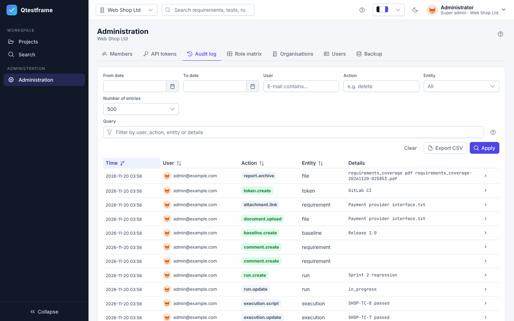

- Filter by user, action, entity or details with a query, for example `user:anna action:delete` or `entity:requirement created_at>=2026-09-01`.
- Limit the time range with **From date** and **To date**.
- **Number of entries** sets how many are shown (up to 5000).
- **Export CSV** downloads the filtered log for an auditor; **Export Markdown** downloads it as a Markdown document with the date range and filter.

## Organisations

*(Super admin)* **Administration → Organisations** lists all organisations.

- **New organisation**: a **Slug** (short name used at sign-in, for example `acme`) and a **Name**.
- **Rename organisation** (also allowed for an organisation's admins).
- **Switch** to an organisation to work in it.
- **Delete** removes the organisation with **all** its projects and data. This cannot be undone.

## Users

*(Super admin)* **Administration → Users** lists every account of the installation with its sign-in provider and flags.


- **New user**: e-mail, display name, password and optionally **Super administrator**.
- **Edit user**: change the display name, set a new password (**Reset password (optional)**), make the user a super administrator, or mark the account **Disabled**. Disabling an account or setting a password signs the user out everywhere. **Must change password** forces a new password at the next sign-in.
- You cannot remove your own super admin flag or disable yourself.

Users who sign in with OIDC or SAML single sign-on can be created automatically on their first sign-in, with their role taken from their identity provider groups; this is configured on the server (see the [administrator guide](https://github.com/rom/Qtestframe/blob/rom/docs/admin-guide/en/authentication.md#provisioning-of-single-sign-on-users)).

## Backup and restore

*(Super admin)* **Administration → Backup** saves and restores the whole installation.


- **Download backup** creates a ZIP file with all organisations, projects, items, history, comments and files (sessions are not included). Store it somewhere safe; it contains all data, including password hashes.
- **Restore**: choose the backup file, type `RESTORE` to confirm and select **Restore backup**. This **replaces all data** of the installation with the content of the file, in one step. The backup must come from the same version of the database schema. Everyone, including you, is signed out afterwards.

Restore is meant for disaster recovery and moving to a new server. To recover a single item, use its [history](#history-and-restore) instead. A backup also contains the system settings (below), including the secrets stored there; they apply as soon as the restore is done.

Secrets in a backup (authenticator-app secrets, webhook secrets, tracker tokens, secret test variables, the e-mail password and client secrets) stay **encrypted** in the file. A backup can only be restored on a server that has the same key as the server it came from (see [Encryption of stored secrets](#encryption-of-stored-secrets)); otherwise the restore is refused and nothing is changed. The server administrator keeps that key safe, apart from the backups.

## System settings

*(Super admin)* **Administration → System settings** changes the configuration of the server while it runs: single sign-on, logging and syslog, the e-mail server, sign-in security and the test runner. Organisation admins do not see this page: every setting applies to the whole installation.

Choose a section in the list on the left (on a phone: at the top). Each section has its own **Save** button; only the values you changed are sent. **Export configuration** downloads the effective configuration as a YAML file, with every secret replaced by `REDACTED`, for example to copy it into the server's configuration file.

### Where a value comes from

Every setting shows a badge with the source of its current value:

- **Default** – the built-in value.
- **Configuration file** – set in the server's configuration file.
- **Environment** – set by a `QTF_…` environment variable of the server.
- **Changed here** – changed on this page (stored in the database).

A value changed here wins over the configuration file and the default. **Reset to file value** removes your change, and the value of the configuration file (or the default) applies again.

Some settings cannot be changed here. They show a lock and say why:

- **Set by the environment** – an environment variable always wins; ask the server administrator to change it.
- **Locked by the server administrator** – the configuration file lists the setting under `system_settings.locked`.
- **Configuration file only** – shown for information (for example the listen address or the database), because they can only change with a restart of the server.

Most settings apply at once. Settings with the badge **Applies after restart** (the test runner) are saved now and take effect the next time the server starts; until then the page shows the value in use. If the stored settings ever become invalid (for example after a change of the configuration file), the server ignores them at start-up and the page shows a warning.

Every change is recorded in the [audit log](#audit-log) with the old and the new value; passwords and client secrets are never written there, only that they were set or changed.

### Single sign-on (OIDC)

The **Single sign-on (OIDC)** section lists the OpenID Connect providers that appear as buttons on the sign-in page.

- **Add provider** asks for a name (lower-case letters, digits, `-` and `_`; it is part of the callback address), the **Button label**, the **Issuer** URL, the **Client ID** and the **Client secret**, the **Scopes**, the claims that hold the e-mail address, the name and the groups, and how users are provisioned: **Create users on first sign-in**, the **Default role** and organisation, and a **Group → role** mapping.
- **Test connection** fetches the issuer's discovery document (`/.well-known/openid-configuration`) from the server and tells you whether it was found and lists its endpoints. A failure shows the reason, for example that the server cannot reach the address or that the issuer in the document does not match.
- Register the **Callback URL** shown for the provider in your identity provider.
- The client secret is write-only: it is never shown again. Leave the field empty to keep it; **Remove the stored secret** deletes it.
- The switch in the list turns a provider off without deleting it. Changes apply at once; people who are signing in at an unchanged provider are not interrupted.

Once you change the providers here, this list replaces the providers of the configuration file. Secrets of providers from the file stay in the file and are not copied. **Reset to file value** brings back the providers of the configuration file.

### Logging and syslog

Choose the **Log level** and **Log format** of the server log, and whether the log (including the audit trail) is also sent to a central **syslog** server: network (`udp`, `tcp`, `tls` or a local socket), address, message format, facility and tag. **Send test message** sends one message with the values in the form, before you save them; the result is shown and read out next to the button. Changes apply at once. Certificates for syslog over TLS are set in the configuration file.

### E-mail server

The SMTP server for notifications, invitations and reports: host, port, encryption (`starttls`, `tls` or `none`), user name, password, sender address and name, timeout and the hour of the daily digest. The password is write-only. **Send test e-mail** sends a message to your own address with the values in the form (and the stored password, unless you typed a new one). Turning e-mail off stops all outgoing mail.

### Security

The **session lifetime** (how long a sign-in lasts; applies to new sign-ins), the **minimum password length** of local accounts, the number of **failed sign-ins** after which further attempts from the same address for the same account are refused, and for how long. **Local sign-in** (e-mail and password) can only be turned off while at least one single sign-on provider is enabled.

### Encryption of stored secrets

The **Security** section also shows, read-only, how the secrets that the server must be able to read back are protected: the secrets of authenticator apps, webhook signing secrets, defect tracker tokens, secret test variables, and the e-mail password and client secrets entered on this page. They are stored **encrypted** (AES-256-GCM) in the database. Earlier versions stored them unencrypted; that no longer holds, and values saved by an earlier version are encrypted when the server starts. Passwords and access tokens were never stored as such: only their hashes are kept.

The page shows:

- **Key provider** – what protects the key: a **local key** (a key file on the server or an environment variable), the server's **TPM 2.0** chip, or a **hardware security module** (PKCS#11).
- The details of the provider, such as the key file or the TPM device, and the **key fingerprint**, which identifies the key without revealing it.
- The **active data key** and how many **stored secrets** are encrypted. If some are not encrypted yet, a note says so; they are encrypted at the next start of the server.

The key provider is chosen in the server's configuration file (section `secrets`) and cannot be changed here. Without its key, the stored secrets – and backups – cannot be read; ask the server administrator to keep it safe. The server administrator manages the keys on the command line, for example `qtestframe secrets status` and `qtestframe secrets rotate`; see the [administrator guide](https://github.com/rom/Qtestframe/blob/rom/docs/admin-guide/en/security.md#encryption-of-stored-secrets).

### Test runner

Whether automated scripts and web tests may run on the server, their timeouts and limits, and what web tests record as evidence. These settings **apply after a restart** of the server, because the runner and its sandbox are prepared when the server starts. Turning the runner on lets members with the right permission run code on the server; read the [security notes of the administrator guide](https://github.com/rom/Qtestframe/blob/rom/docs/admin-guide/en/security.md#the-script-and-web-test-sandbox) first.

Retention: deleted items stay in the [trash](#history-and-restore) for 30 days; this is not configurable. For backups, see [Backup and restore](#backup-and-restore). Multi-factor authentication has its own page, linked from the system settings.

The server administrator can do the same on the command line:

```bash
qtestframe backup --out qtestframe-backup.zip
qtestframe restore --in qtestframe-backup.zip --yes
```

## Command line

Server administrators can also manage organisations, users and members with the `qtestframe` command, for example to create the first organisation:

```bash
qtestframe tenant create --slug acme --name "Acme Corp"
echo 'Initial-pass-123' | qtestframe user create --email alice@example.com --name Alice --password-stdin
qtestframe member add --tenant acme --email alice@example.com --role manager
```

# Accessibility and languages

Qtestframe is designed to meet **WCAG 2.1 level AA**. It works with the keyboard alone, with screen readers, with browser zoom, on phones and tablets, in English and Swedish and in twenty-two colour themes.

## Keyboard

Everything can be done without a mouse.

| Key | Effect |
|---|---|
| <kbd>Tab</kbd> / <kbd>Shift</kbd>+<kbd>Tab</kbd> | Move to the next / previous control. The focused control has a clearly visible outline. |
| <kbd>Enter</kbd> / <kbd>Space</kbd> | Activate a button or link, tick a checkbox, toggle a cell in the traceability matrix. |
| <kbd>Esc</kbd> | Close a dialog, menu, drawer or the intro tour. Focus returns to where you were. |
| Arrow keys | Move within menus, lists, tabs, the folder tree and selection buttons. |
| <kbd>Ctrl</kbd>+<kbd>Enter</kbd> | Post a comment. |
| <kbd>Enter</kbd> in a filter field | Apply the query. |
| <kbd>?</kbd> | Open the user guide page for the current view (outside text fields). |
| <kbd>Ctrl</kbd>+<kbd>Z</kbd> / <kbd>Ctrl</kbd>+<kbd>Shift</kbd>+<kbd>Z</kbd> or <kbd>Ctrl</kbd>+<kbd>Y</kbd> | [Undo / redo](#undo-and-redo) the last change (outside text fields; on a Mac <kbd>⌘</kbd>). |

### Skip link

The first <kbd>Tab</kbd> on every page shows **Skip to main content**. Press <kbd>Enter</kbd> to jump past the sidebar and the top bar straight to the page content.

### Moving between pages

When you open another page, focus moves to its main heading and the page title is announced, so you know where you are without searching.

### Folder trees and tables

- In the folder tree, the arrow keys move between folders and open or close them. The **⋮** actions button of a folder offers everything that is otherwise done by dragging or right-clicking: new subfolder, rename, move, delete.
- Rows of the requirement and test tables open with <kbd>Enter</kbd> on the title. To move rows without dragging, select them and use **Move** in the bulk toolbar.

### Execution runner

The runner has single-key shortcuts (<kbd>P</kbd> pass, <kbd>F</kbd> fail, <kbd>B</kbd> blocked, <kbd>S</kbd> skip, <kbd>J</kbd>/<kbd>K</kbd> or arrows for next/previous step, <kbd>?</kbd> help). They only work while the focus is not in a text field, so typing an actual result never triggers them. See [Keyboard shortcuts](#keyboard-shortcuts).

## Screen readers

Qtestframe is built to be used with screen readers such as NVDA, JAWS, VoiceOver and TalkBack.

- Pages have **landmarks** (navigation, search, main) and a logical **heading structure**, so you can jump with your screen reader's heading and landmark commands.
- All buttons that only show an icon have a text label, for example *Delete SHOP-REQ-4* instead of just *bin*.
- **Status messages** (saved, deleted, failed) are announced politely; errors are announced immediately.
- Form fields have labels; required fields and errors are announced.
- In the language analysis, findings are announced with their severity (error, warning).
- On phones, tables become stacked cards; each value is read together with its column name.
- Screenshots in this guide have text alternatives that describe what they show.
- The **intro tour** is a modal dialog: its text is announced at each step, focus stays inside it, and <kbd>Esc</kbd> ends it.

## Themes

Pick a theme with the **Colour theme** picker in the top bar, or under **Profile → Preferences → Theme**. The choice is stored with your account and follows you to every device. The quick **Light mode / Dark mode** button next to it switches between the light and dark basic themes.

| Theme | Character |
|---|---|
| **Light** | the default: bright and neutral |
| **Dark** | dark surfaces, easier on the eyes in dim light |
| **Follow the operating system** | light or dark, as set on your computer or phone |
| **Spring**, **Autumn**, **Desert** | light themes with seasonal colours |
| **Ocean**, **Sunset**, **Nordic**, **Lavender**, **Rose** | light themes: sea blue, warm evening colours, calm grey-blue, soft violet, soft pink |
| **Camouflage**, **City camouflage** | dark themes with a camouflage pattern in the sidebar and top bar |
| **Arctic camouflage** | a light theme with a winter camouflage pattern in white, pale grey and blue-grey |
| **Navy blue**, **Midnight**, **Forest** | dark themes: navy with gold, deep blue-violet, dark green |
| **Green terminal**, **Amber terminal** | dark themes in a monospace font, like an old computer screen |
| **High contrast dark**, **High contrast light** | white on black (with yellow) or black on white (with blue), with visible borders and underlined links, for low vision; text meets the stricter AAA contrast of 7:1 |
| **Crazy** | a playful, colourful theme |

All themes meet the AA contrast requirements for text and controls. Qtestframe also respects your system's **reduced motion** setting.


## Languages

The user interface is available in **English** and **Swedish** (*Svenska*).

- Change it with **User menu → Language**, or under **Profile → Preferences → Language**. It applies immediately and is stored with your account.
- **Browser default** follows the language of your browser; if that is neither English nor Swedish, English is used.
- On the sign-in page, the language buttons apply before you sign in; after sign-in your preference wins.
- Dates and numbers follow the chosen language unless you set another **Date format** in your preferences.
- This user guide is available in both languages. If a page has not been translated yet, the English page is shown with a notice.
- [Reports](#standard-reports) are produced in the language you use when you create them; scheduled reports in the language of the person who scheduled them.
- Your data is not translated: requirements, tests and comments stay in the language they were written in. The RFC 2119 obligation levels (MUST, SHOULD, …) are always shown in English, also in the Swedish interface, where they are explained in Swedish (for example *MUST (SKA)*). The [language analysis](#the-language-analysis) checks requirement texts written in either English or Swedish, with Swedish keywords such as *SKA* and *BÖR*.

## Phones and tablets

Qtestframe adapts to the screen size; nothing needs to be installed.


- **Below 1024 pixels** (tablets, small windows) the sidebar becomes a drawer. Open it with the menu button (☰) at the top left; it closes when you choose a page, tap outside it or press <kbd>Esc</kbd>.
- **Below 768 pixels** the search field becomes a magnifier button that opens a search dialog.
- **Below 640 pixels** (phones) tables turn into stacked cards, forms use a single column and editors open full-screen.
- The folder tree of the requirements and tests pages opens with the **Folders** button on narrow screens.
- The execution runner works well on a tablet next to the system under test.
- Large tables such as the traceability matrix scroll sideways inside their frame; the **List** view of the matrix is easier to use on a phone.

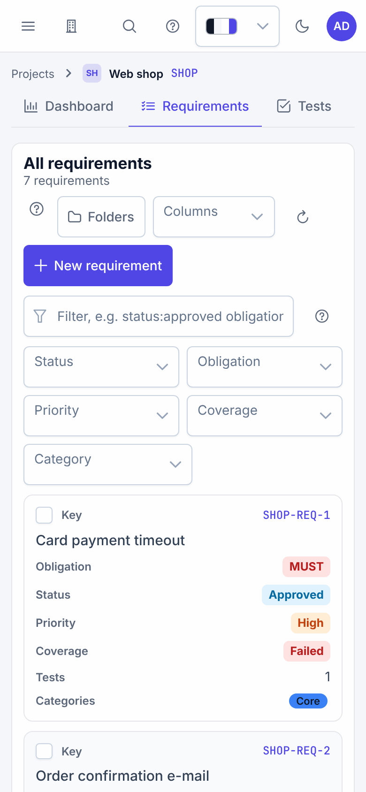

## Zoom and text size

When you zoom the browser, the layout reflows instead of scrolling sideways; at high zoom levels you get the tablet or phone layout described above. Text size settings of the browser or operating system are respected. **Compact tables** in your preferences show more rows if you prefer density over size.

# How Qtestframe works

This page explains how Qtestframe is built up and how its parts work together, without going into the source code. Read it when you want to understand why the tool behaves as it does, or to explain it to colleagues. The words in bold are explained in the [Glossary](#glossary); administrators find the details in the [administrator guide](https://github.com/rom/Qtestframe/blob/rom/docs/admin-guide/en/index.md).

## One program in your browser

Qtestframe is **one program** on a server. The same program contains the web application you use in the browser, the REST API that the web application, CI pipelines and other tools call, and the command line tools of the administrator. Nothing needs to be installed on your computer: a current browser is enough, on a desktop, tablet or phone.

- The web application is a single-page application: after the first load it only exchanges data with the server, so pages switch quickly and your unsaved input stays in the page while you move around.
- Everything you can do in the browser can also be done through the API, described as **[OpenAPI](#openapi)** at `/api/v1/openapi.json`. This is how [`qtestframe report`](runs.md#the-qtestframe-report-command), the JUnit upload, the Playwright reporter and other tools work.
- The user interface and this guide are in English and Swedish; the [language analysis](#the-language-analysis) understands requirement texts in both.

## Where your data lives

Everything is stored in **one database**: organisations, users, projects, requirements, tests, runs and their results, history, comments, the audit log and also uploaded files (attachments, documents, generated reports). There is no separate file share.

- The database is **SQLite** (a single file on the server, no database server needed) or **PostgreSQL** (for larger installations or several servers behind a load balancer). You see no difference; your administrator chooses.
- Secrets that the server must read back, such as tracker tokens or webhook secrets, are encrypted with a key that is kept outside the database (see [Security](#security-2)).
- Deleted items go to the trash for 30 days before they are removed for good.

## Organisations, projects and roles

An installation can host several **organisations** (tenants) that never see each other's data. You can be a member of several and switch between them in the top bar.

| Level | What belongs to it | Who manages it |
|---|---|---|
| Installation | users, organisations, system settings, backups | super admins |
| Organisation | members and their roles, projects, API tokens, test configurations, execution settings, the audit log | organisation admins |
| Project | requirements, tests, runs, test cycles, exploratory sessions, defects, risks, releases, waivers, baselines, documents, project settings | managers (and project roles) |

What you may do is decided by your **role** in the organisation: *Viewer*, *Reviewer*, *Tester*, *Test lead*, *Manager* or *Admin*, or a role your organisation created. A role is a set of permissions such as `requirement.write` or `run.execute`. A project can be restricted to some members and give someone a different role in that project only. The server checks every request against these permissions; buttons you may not use are hidden or disabled, and the reason is shown. See [Roles and permissions](#roles-and-permissions).

## The items and how they relate


Every item has a **key** made of the project key and a number, such as `SHOP-REQ-12` or `SHOP-TC-7`, a status, an owner and a **version history**. The most important relations:

| Item | What it is | Related to |
|---|---|---|
| [Requirement](#requirements) | what the product must, should or may do | its **evaluation criteria**; other requirements (*refines*, *derived from*, *depends on* …); the **risks** it addresses; the tests that verify it |
| [Test](#tests) | a manual test with steps or an automated test with a script | the requirements (and criteria) it **verifies** through trace links; tests it calls as shared steps or depends on |
| [Run](#test-runs-and-execution) | one round of testing in an environment and build | its **executions**: one per test (and configuration), each with a result, step results, evidence and defects |
| [Test cycle](#test-cycles) | the plan for a testing period | the tests, testers and estimates it plans; the run it creates |
| [Exploratory session](#exploratory-testing) | time-boxed exploratory testing with a charter | the requirements in its scope; the defects raised from its notes |
| [Defect](#defects-1) | a problem found | the executions, tests and requirements it is linked to; an issue in Jira, GitHub or GitLab |
| [Risk](#the-risk-register) | what could go wrong, by likelihood and impact | the requirements that address it; MITRE techniques |
| [Release](#releases-and-risks) | a version to deliver | its **scope** (requirements), its runs, its **exit criteria**, waivers |
| [Waiver](#waivers-residual-risk-and-the-statement-of-applicability) | a signed acceptance of unmet requirements | the requirements and the release it applies to, a risk |
| [Baseline](#baselines) | a frozen set of versions | the version of every requirement and test at that moment |
| [Document](#documents-1) | a file in the project archive | the items it is linked to |

Coverage, verification, staleness and release readiness are **never stored**: they are computed from these items every time you look, so they are always current.

## From requirement to release

A typical flow through a project, and what Qtestframe does at each step:

1. **Write requirements.** The language analysis checks the text as you type and detects the [obligation level](#obligation-levels) from MUST, SHOULD, MAY (or SKA, BÖR, FÅR). Add [evaluation criteria](#evaluation-criteria) that say how fulfilment is judged. A [review](#request-a-review) approves them.
2. **Design tests** and link them to the requirements. A new requirement can get a linked test automatically. The [traceability matrix](#the-traceability-matrix) and [traceability rules](#traceability-rules) show what is missing.
3. **Plan and run.** A [test cycle](#test-cycles) or a [run](#test-runs-and-execution) selects the tests; before a test is executed, the [execution rules](#when-can-a-test-be-executed) check that it is ready. Testers record results in the runner; CI uploads automated results.
4. **Follow up.** Failures become [defects](#defects-1); [coverage](#how-coverage-is-calculated) and [verification](#verification) are derived from the latest results; the [dashboard](#the-dashboard) shows the state.
5. **Change.** When a requirement or test changes in substance, its links become **suspect**, its results **stale**, and the [change impact](#change-impact) travels on to related items, documents and issues.
6. **Release.** A [release](#releases-and-risks) checks its exit criteria and shows go or no-go; [waivers](#waivers-residual-risk-and-the-statement-of-applicability) accept what is knowingly not met; a [baseline](#baselines) freezes the result, and [reports](#reports-and-export) document it.

## Versions, history and baselines

Every change of a requirement, test and most other items creates a new **revision**: the **History** tab shows who changed what and when, compares versions and restores an old one. **Undo** in the top bar takes back your last actions. Two people editing the same item do not overwrite each other: the second save is refused with the version it is based on (an [ETag](#etag-and-if-match)), and you choose how to merge (see [When someone else saved first](#when-someone-else-saved-first)).

A **baseline** records the revision of every item at one moment, for a release or an audit. The **audit log** records actions across the organisation: sign-ins, review decisions, signatures, imports, exports and settings.

## The query language

All lists, the traceability matrix, release scopes, test selection for runs, reports, traceability rules and the API use the same [query language](#search-and-filters): `status:approved priority=high`, `-has:tests`, `linked:SHOP-TC-7`, `updated_at>=2026-01-01`, `title~/login/i`. What you learn in one list works everywhere. Global search covers all projects of the current organisation that you can read.

## Background work

Some work happens on the server without you waiting for it:

- **Automated tests** that you start with **Run automated tests** run as jobs, a few at a time; results appear in the run as they finish.
- **Notifications** and **webhooks** are sent after the change that caused them is saved.
- **E-mail digests** and **scheduled reports** go out at the times you chose.
- A daily **snapshot** of each project's metrics feeds the trends on the dashboard.
- Expired sessions and trash entries older than 30 days are purged every hour.

## Notifications, webhooks and chat

You are told about what concerns you: review requests, mentions, items assigned to you, replies in your discussions, status changes of your defects. [Notifications](#notifications) appear in the app and, if you want, by e-mail at once or as a daily digest. [My work](#my-work) lists everything waiting for you across projects.

Projects can also send their events to other systems: **[webhooks](#webhooks)** deliver signed JSON requests to any receiver, and **[chat channels](#chat-notifications)** post readable messages to Slack, Microsoft Teams, Mattermost, Rocket.Chat, Google Chat, Matrix or Discord, filtered by event, priority and release.

## Integrations

| With | How | Read more |
|---|---|---|
| Defect and issue trackers (Jira, GitHub Issues, GitLab, Request Tracker) | push defects and requirements as issues, sync their status, import issues | [Defects](#connect-jira-github-or-gitlab) |
| Jira and Azure DevOps | import requirements, update them later | [Reports and export](#jira-and-azure-devops) |
| Code hosts (GitHub, GitLab) | webhooks link commits and merge requests that name an item key; builds record which commits were tested | [Variants and code](#code-links) |
| CI pipelines | `qtestframe report`, JUnit XML upload, Playwright reporter, with an API token | [Import results from CI](#import-results-from-ci) |
| Requirements and ALM tools (DOORS, DOORS Next, Polarion, Codebeamer, Jama, ProR) | ReqIF files in both directions; live OSLC links, selection and creation | [Interoperability](#interoperability-reqif-and-oslc) |
| Office tools | export to PDF, Word, Excel, CSV and Markdown; edit in Excel and import back | [Reports and export](#reports-and-export) |
| Identity providers | single sign-on with OpenID Connect or SAML 2.0, user provisioning with SCIM | [Administration](#provisioning-with-scim) |

The standards and formats behind these integrations are listed in the [Glossary](#entries-by-topic) and on the [References](#formats-protocols-and-frameworks) page.

## Security

### Sessions and CSRF protection

When you sign in, the server creates a **session** and your browser gets a random cookie that scripts in the page cannot read. Sessions end after a maximum age (12 hours by default), when you sign out, or when an administrator resets your password or disables your account; **Profile → Active sessions** lists yours. Every change you make sends a per-session **CSRF token** and passes an origin check, so another website cannot act in your name. Scripts and CI use **API tokens** instead, which are shown once and stored only as a hash.

### Single sign-on and multi-factor authentication

Your organisation can let you sign in with its identity provider through **OpenID Connect** or **SAML 2.0**; users and groups can be provisioned automatically with **SCIM**. Local accounts can, or must, add a second factor: a **TOTP** code from an authenticator app, with single-use recovery codes. See [Multi-factor authentication](#multi-factor-authentication).

### Secrets

Passwords and tokens that only need to be checked are stored as hashes. Secrets the server must use itself, such as authenticator secrets, webhook secrets, tracker tokens and secret test variables, are encrypted in the database with a key kept outside it (a key file, an environment variable, a TPM or an HSM). Secrets are **write-only**: once saved, no screen or API returns them, and project archives never contain them.

### The script sandbox

When your administrator enables it, automated test scripts and Playwright web tests run on the server. Each script runs in a separate, restricted process: limited CPU time, file sizes and open files, no new privileges, file access limited to its own job directory with **Landlock**, dangerous system calls blocked with **seccomp**, and optionally no network. The server restricts itself in the same way after start-up. Only people with the `script.execute` permission can run scripts.

## Backups and project archives

- A **backup** contains the whole installation: all organisations with their data and files. Super admins take it in the web client or on the server; a restore replaces everything and signs everyone out. See [Backup and restore](#backup-and-restore).
- A **project archive** contains one project, with history, results and attachments but without secrets, as a ZIP file. Load it as a new project on the same or another server. See [Save and load projects](#save-and-load-projects).
- **Exports** (PDF, Word, Excel, CSV, Markdown, ReqIF) take data out for other people and tools.

## For administrators

The [administrator guide](https://github.com/rom/Qtestframe/blob/rom/docs/admin-guide/en/index.md) describes how to run Qtestframe:

- the [overview and architecture](https://github.com/rom/Qtestframe/blob/rom/docs/admin-guide/en/overview.md): components, data stores, ports, outgoing connections and background tasks;
- [installation](https://github.com/rom/Qtestframe/blob/rom/docs/admin-guide/en/installation.md) and [configuration](https://github.com/rom/Qtestframe/blob/rom/docs/admin-guide/en/configuration.md), including the choice between SQLite and PostgreSQL;
- [authentication](https://github.com/rom/Qtestframe/blob/rom/docs/admin-guide/en/authentication.md) (passwords, MFA policies, OIDC, SAML, SCIM, API tokens, sessions) and [authorisation](https://github.com/rom/Qtestframe/blob/rom/docs/admin-guide/en/authorisation.md);
- [security](https://github.com/rom/Qtestframe/blob/rom/docs/admin-guide/en/security.md): TLS, hardening with Landlock and seccomp, the script sandbox, encryption of stored secrets and key rotation;
- [integrations](https://github.com/rom/Qtestframe/blob/rom/docs/admin-guide/en/integrations.md), [connecting other tools](https://github.com/rom/Qtestframe/blob/rom/docs/admin-guide/en/connecting-tools.md) over OSLC and ReqIF, [logging and monitoring](https://github.com/rom/Qtestframe/blob/rom/docs/admin-guide/en/logging-and-monitoring.md) with syslog;
- [backup, restore and migration](https://github.com/rom/Qtestframe/blob/rom/docs/admin-guide/en/backup-and-migration.md), the [runbook](https://github.com/rom/Qtestframe/blob/rom/docs/admin-guide/en/runbook.md) and the [command line reference](https://github.com/rom/Qtestframe/blob/rom/docs/admin-guide/en/cli-reference.md).

# FAQ

Answers to the questions users ask most often: first about using the tool, then, from [Testing concepts](#testing-concepts) on, about the concepts of testing and requirements engineering, the standards behind Qtestframe and how it works. Use the search field at the top of the guide to find a word on all pages; the [Glossary](#glossary) explains the terms one by one.

## Getting access

### I forgot my password. What do I do?

There is no self-service reset. Ask an **admin** of your organisation to [reset your password](#reset-a-password). You get a temporary password that you must change at the next sign-in. If you sign in with single sign-on (a button below *or continue with*), your password is managed by your company's identity provider; reset it there.

### Why was my session ended?

A session ends when:

- it reaches its maximum age (12 hours by default, set by your administrator) and you have to sign in again;
- you or someone with access to your account selected **Sign out** for it under **Profile → Active sessions**, or **Sign out all other sessions** on another device;
- an administrator reset your password, set a new one, or disabled your account;
- a super admin restored a backup, which signs everyone out;
- your browser deleted its cookies.

Sign in again. If you did not expect it, change your password and check your active sessions.

### I see "You have no current organisation". What now?

You are signed in but not working in an organisation. Choose one in the organisation switch in the top bar. If the list is empty, you are not a member of any organisation yet; ask an admin to add you.

### How do I switch to another organisation?

Use the organisation switch at the left of the top bar (on phones, the building icon). Qtestframe opens that organisation's project list. To start in a particular organisation every time, set **Default organisation** in your preferences.

### A colleague cannot see a project. Why?

The project is probably **restricted** (it shows a lock 🔒): only its project members and the organisation's admins see it. Someone who may change the project adds your colleague with **Share** in the project header; see [Project sharing](#project-sharing). The project role can also be lower than the organisation role, so a colleague may see a project but not be allowed to edit it.

## Editing

### How do I refer to a colleague in a requirement or comment?

Type `@` followed by the start of their name, then pick them from the list, see [Mention people](#mention-people). The list holds the users of the organisation and names already used as owner or assignee in the project. `mention:` in a filter finds what mentions someone.

### Where do the suggested tags come from?

From the title and description of the item. Tags the project already uses come first when the text mentions them, then abbreviations and frequent words. Common words and requirement keywords are never suggested. Select a suggestion to add it; ignore the others.

### Why can't I edit a requirement?

Writing requirements needs the **Manager** role in the current organisation. With **Viewer** or **Tester** the editor opens read-only, and buttons such as **New requirement** and **Save** are hidden. Check your role in the user menu; ask an admin if you need more rights. Testers can still link tests to requirements and comment on them.

### Why can't I see the Run script button?

Running scripts on the server needs the **Test lead** or **Manager** role (the permission *script.execute*), and the administrator must enable the script runner (`runner.enabled`). Without the role, the runner says that the *script.execute* permission is needed. If the runner is disabled on the server, use the [CI import](#import-results-from-ci) instead.

### How do I undo a change?

Select **Undo** (↶) in the top bar or press <kbd>Ctrl</kbd>+<kbd>Z</kbd> outside a text field; the **Undo history** (🕘) lists your recent changes. This works for edits, deletions, moves, bulk edits, links and more, see [Undo and redo](#undo-and-redo). A deleted requirement or test comes back with its key, links, comments and history.

For older changes, open the item, go to the **History** tab, select the version you want and choose **Restore this version**. This creates a new version with the old content; nothing is lost and you can restore again.

### Can Qtestframe write code or tests with AI?

In a **software** project, **AI prompts** builds a prompt from your requirements or tests (implement them, review them, design or automate test cases, plan a test type) that you copy into the AI assistant your organisation uses. Qtestframe itself does not call any AI service. See [AI prompts](#ai-prompts-software-projects).

### Why can't I approve a requirement or mark a test ready?

Approving or rejecting a requirement needs the permission *requirement.review*, marking a test **Ready** needs *test.review*. By default the **Reviewer** and **Manager** roles have both and the **Test lead** has *test.review*; a **Tester** can write tests but not mark them ready. Without the permission these statuses are greyed out in the editor. See [Roles and permissions](#roles-and-permissions).

### Can two people edit the same requirement at the same time?

Yes, but the last one to save wins: each save replaces the fields with what that person sees. Both versions are in the **History**, so nothing is lost; compare them there and restore if needed. Use **Comments** to coordinate.

### Why was the obligation not updated when I changed the text?

The obligation is detected automatically only when the requirement is **created** with **Auto-detect from text**. After that it is never changed behind your back. Use **Apply detected obligation** in the analysis box, or pick the level yourself.

### What happens when I move a requirement to another project?

It gets a **new key** in the target project (for example `SHOP-REQ-7` becomes `CORE-REQ-31`); categories are matched by dimension and name and dropped if the target has no such value; **links to tests are removed**, because links never cross projects; criteria and history move along. Within a project, moving only changes the folder. See [Move requirements and folders](#move-requirements-and-folders).

### Who can see my comments?

Everyone who can read the item, which means every member of the organisation with access to the project, whatever their role. Comments are not visible to other organisations. You can edit and remove your own comments; moderators (who may change the project's settings) can remove any comment, which then shows as removed. Comments are deleted together with their item. See [Discussions](#discussions).

### What does "auto-generated" mean on a test?

The test was created automatically together with a requirement (**Also create linked test**). It is an ordinary test: refine its steps, change its status and remove the tag if you like.

## Coverage and results

### How is coverage calculated?

From the **last result** of every test linked to the requirement: no linked test → *None*; any linked test failed or blocked → *Failed*; all passed → *Passed*; some passed and the rest not run, skipped or in progress → *Partial*; otherwise *Not run*. Only runs of the same project count. Details and examples are in [How coverage is calculated](#how-coverage-is-calculated).

### What does "Not run" mean?

For a **test** or **execution**: it has no result yet. For a **requirement's coverage**: tests are linked, but none of them has passed or failed in any run of this project yet. That is different from *None*, which means no test is linked at all.

### A test passed again; why is my requirement still "Failed"?

Coverage uses the latest result of **each** linked test. If another linked test is still failed or blocked, the requirement stays *Failed*. Open the requirement's **Linked tests** to see each test's last result. Also check that the new result was saved (in the runner, **Save**).

### Why does the dashboard say "covered" when the tests have not been run?

On the dashboard, *covered* means that at least one test is linked. Whether those tests passed is shown in **Requirement coverage** next to it.

### How do I import CI results?

Create an API token (**Administration → API tokens**, role Tester or higher), open the run and select **CI import** for a ready-made command, and post the results by test key from your pipeline. See [Import results from CI](#import-results-from-ci).

### A CI import reports "unknown" test keys. Why?

Those keys do not exist in the run's project. Check the spelling (case does not matter) and that the tests have not been moved to another project, which gives them new keys.

### Why are Pass and Fail disabled in the runner?

The test may not be executed yet: it is not **Ready**, a requirement it verifies is not approved, or a test it depends on has not passed. The red box above the steps lists each reason with what to do and the setting that decides: whether the **test** is not Ready (still Draft or in Review), a **requirement** it verifies does not have one of the statuses the execution settings require (for example it is Approved but the settings require Implemented), or a **prerequisite** has not passed. Fix them (or ask an admin or test lead to change the [test execution settings](#test-execution-settings)); meanwhile you can mark the test **Blocked** or **Skipped**.

### How do I create a role of my own?

*(Admin)* **Administration → Role matrix → New role**: give it a name, choose the role whose permissions it starts with, then tick and untick permissions in the matrix and save. See [Change roles and create your own](#change-roles-and-create-your-own).

### Can I change a result after saving it?

Yes. Open the execution in the runner, change the step results or the overall status, and save. The time and the person are updated. The test's execution history shows the latest state of each execution.

## Baselines and history

### What is the difference between a baseline and a revision?

A **revision** is one version of one item, created automatically on every change (the **History** tab). A **baseline** is a named snapshot of the versions of all (or filtered) items of a project at one moment, created by you, for example for a release. See [Baseline or revision?](#baseline-or-revision).

### Does deleting a baseline delete requirements?

No. A baseline only records versions. Deleting it leaves all items unchanged.

## Search and filters

### Why is my query invalid?

Usually a field that does not exist in that list (for example `coverage` in tests), a space after the operator (`status: approved`), an unclosed quote, parenthesis or regex, or a regex feature RE2 does not support. The field is marked and the message names the position. Open **Query help** (**?** next to the filter) for the fields. See [Why is my query invalid?](#why-is-my-query-invalid).

### How do I find requirements without tests?

Filter the requirements with `coverage:none`, or `-linked:*`. Combine it, for example `coverage:none obligation=must`.

### Does search cover all projects?

The search in the top bar covers all projects of the **current organisation** that you can read. Filters in a list only cover that list. Other organisations are never searched.

## Settings and devices

### What does a field mean?

Point at the small **i** next to it, or move the keyboard focus there: a short explanation appears, with a link to the section of this guide that describes the field. Press <kbd>?</kbd> to open the guide page of the current view. For the standards behind requirement levels and testing, see [References](#references).

### How do I change the language or theme?

Language: **User menu → Language** (English or Svenska). Theme: the **Colour theme** picker in the top bar, or the sun/moon button for light and dark. Both are also in **Profile → Preferences** and are stored with your account, so they follow you to every device.

### Can I use Qtestframe on a phone?

Yes. The interface adapts to phones and tablets: the sidebar becomes a drawer behind the menu button, tables become cards and editors open full-screen. Executing manual tests on a tablet works well. See [Phones and tablets](#phones-and-tablets).

### How do I restart the intro tour?

Select **Help** (the question mark in the top bar) → **Restart intro tour**.

### Can I change the key of a project?

No. The key is part of every item ID and cannot be changed after the project is created. You can change the project's name, description and colour in **Categories & settings** (or with ✎ on the project list). If you really need another key, use **Duplicate project** on the project list: the copy gets the new key, and all item keys follow it (see [Save and load projects](#save-and-load-projects)). Then delete the original.

## Files and data

### Where are files stored?

In the Qtestframe database, together with the rest of the data. Files are therefore included in backups, protected by the project's access rules, and deleted with the project. See [Documents](#where-are-files-stored).

### How large may an uploaded file be?

25 MB per file by default; your administrator can change the limit. Avatars and project icons may be at most 1 MB.

### Why does a file download instead of opening?

Only images (PNG, JPEG, GIF, WebP), PDF files and plain text are shown in the browser. All other types are downloaded, so that no file can run code in your browser.

### How do I restore a backup?

A **super admin** opens **Administration → Backup**, chooses the backup file under **Restore**, types `RESTORE` and selects **Restore backup**. All current data is replaced and everyone is signed out. The backup must come from the same schema version. Server administrators can use `qtestframe restore --in FILE.zip --yes`. To recover a single item, use its history instead.

### How do I move a project to another server?

Select **Save project** (the download button on the project list) and, on the other server, **Load project** with the file. The copy has everything in the project except secrets such as webhook secrets and the tracker token; see [Save and load projects](#save-and-load-projects). To move all organisations at once, a super admin uses a backup instead.

### Can I get my data out of Qtestframe?

Yes: **Export** downloads requirements, criteria, tests, traceability and runs as XLSX, CSV, PDF or DOCX, and every function is also available through the REST API with an API token.

## Testing concepts

### What is the difference between a test case, a test run and an execution?

A **test case** (in Qtestframe: a *test*) describes how to check something: preconditions, steps and expected results, or a script. A **test run** is one round of testing, such as *Sprint 12 regression*, in an environment and build. An **execution** is one test inside one run, with its result: the same test has a new execution in every run it is part of, and its history shows them all. A **test step** is one action of a manual test with its expected result. See [Test case](#test-case), [Test run](#test-run) and [Test execution](#test-execution).

### What is the difference between a test cycle, a test plan and a test suite?

A **test plan** is the document that says what will be tested, how, by whom and with which entry and exit criteria; Qtestframe can [generate one](#create-a-requirements-specification-or-a-test-plan) from the project. A **test cycle** is the operational plan of one testing period: which tests, which testers, which estimates; when it starts, it creates its run. A **test suite** is a group of tests for a purpose; Qtestframe has no separate suite object, so group tests with folders, categories or tags and create runs from a query. See [Test cycle](#test-cycle), [Test plan](#test-plan) and [Test suite](#test-suite).

### Which test levels and test types does Qtestframe support?

All of them: Qtestframe does not prescribe levels (unit, integration, system, acceptance, end-to-end) or types (functional, performance, security, usability, accessibility, regression …). Record them where you need them: as a category dimension such as *Level / System* or *Type / Security*, as tags, as folders, or as separate runs and cycles. Unit and integration results usually come from CI, system and acceptance results from manual runs. See [Test level](#test-level) and [Test type](#test-type).

### How do I apply test design techniques such as boundary values in Qtestframe?

Design the cases with the technique, then make them **test data**: one row per equivalence partition, boundary value, decision table rule or pairwise combination, with the parameters used as `{{name}}` in the steps. Each row becomes an iteration with its own result. Record the technique as a category if you want to report on it. See [Data-driven tests](#data-driven-tests) and [Test design technique](#test-design-technique).

### What is the difference between severity and priority?

**Severity** says how bad a defect's effect is (from *Critical* to *Trivial*); **priority** says how soon it should be fixed (from *Critical* to *Low*). A typo in the company name on the start page is trivial but urgent; a crash in a rarely used export can be critical but wait. Release exit criteria and blocking rules use severity. See [Statuses and severities](#statuses-and-severities).

### What is the difference between verification and validation?

**Verification** checks that the product meets its specified requirements ("built right"); **validation** checks that it meets its intended use ("the right product"). In Qtestframe, a requirement is *verified* when every evaluation criterion has passing evidence; validation is usually shown by acceptance tests, demonstrations and exploratory sessions with users against stakeholder requirements. See [Verification](#verification-1) and [Validation](#validation).

### What is a flaky test, and how does Qtestframe find them?

A test that passes and fails by turns without any change. Qtestframe counts the flips between passed and failed in the last 10 results of every test, manual and automated; two or more flips make it **Flaky**. Find them with `flaky:true`. See [Flaky tests](#flaky-tests).

### Does Qtestframe measure code coverage?

No. Code coverage is measured by your build and test tools. Qtestframe measures **requirement coverage**: which requirements have tests and what their latest results are. It also links commits and builds to requirements and tests, so you can see which changes were tested. See [Code coverage](#code-coverage) and [How coverage is calculated](#how-coverage-is-calculated).

### What are entry and exit criteria in Qtestframe?

**Entry criteria** decide when testing may start: per test, the [execution rules](#when-can-a-test-be-executed) require it to be *Ready*, its requirements approved and its prerequisites passed. **Exit criteria** decide when testing is done and a release may go: coverage, pass rate, mandatory requirements passed, no open defects, risks mitigated and more, on the release's [Exit criteria](#exit-criteria) tab.

### Can I do exploratory testing in Qtestframe?

Yes, with **session-based test management**: plan a session with a charter and scope, test with a timer and typed notes, raise defects from notes, and close it with a debrief. Debriefed sessions can count as verification evidence. See [Exploratory testing](#exploratory-testing).

### How does Qtestframe fit into CI/CD, TDD or BDD?

Your pipeline runs the automated tests and uploads the results with `qtestframe report`, as JUnit XML or with the Playwright reporter; they land in a run, count for coverage and release criteria, and record the build. Tests written in TDD or BDD style are linked to Qtestframe tests by their test key. See [Import results from CI](#import-results-from-ci), [Test-driven development](#test-driven-development) and [Behaviour-driven development](#behaviour-driven-development).

## Requirements concepts

### What is the difference between a requirement and a specification?

A **requirement** is one verifiable statement of what is needed. A **specification** is the organised whole: introduction, scope, definitions and the requirements, often for one system or delivery. In Qtestframe the project is the living specification, and **Create document → Requirements specification** turns it into a document. See [Specification](#specification).

### Should I write MUST or SHALL? And what about SKA and BÖR?

Both MUST and SHALL mark an absolute requirement under RFC 2119; choose one and use it consistently (many organisations use SHALL for contracts, MUST for technical specifications). Write the keywords in capitals: only upper-case keywords carry the normative meaning (RFC 8174). In Swedish, use **SKA** (shall), **BÖR** (should) and **FÅR** (may), and **FÅR INTE** for a prohibition; avoid *måste inte*, which means "need not". See [Obligation levels](#obligation-levels) and [SKA, BÖR and FÅR](#ska-bör-and-får).

### What is the difference between functional and non-functional requirements?

A **functional** requirement says what the system does ("sends an order confirmation"); a **non-functional** requirement says how well or under which conditions ("within 5 seconds for 99 % of orders"). Non-functional requirements need measurable thresholds; put them in an evaluation criterion. ISO/IEC 25010 is a good checklist of qualities. See [Non-functional requirement](#non-functional-requirement).

### What is the difference between acceptance criteria and evaluation criteria?

Acceptance criteria are the conditions for accepting a requirement or a story. Qtestframe calls them **evaluation criteria** and adds to each a method (test, inspection, analysis, demonstration, review) and a threshold, so that it is clear how each criterion will be shown. See [Evaluation criteria](#evaluation-criteria).

### Which verification method should I choose?

**Test** when the behaviour can be executed with defined inputs and expected results; **inspection** for documents, code, labels or configuration; **analysis** for calculations, simulations or measurements evaluated afterwards; **demonstration** to show a function to a reviewer without detailed measurement; **review** for a formal assessment by qualified people. Methods other than test are recorded as [verification records](#verification-records). See [Verification method](#verification-method).

### What does bidirectional traceability mean in Qtestframe?

Every trace link can be followed both ways: from a requirement to its tests (forward) and from a test to its requirements (backward), in the editors and in the traceability matrix. Relations do the same between requirements (*refines* / *refined by*). Traceability rules check both directions, for example "every approved requirement has a test" and "every test verifies a requirement". See [Traceability](#traceability).

### What is a suspect link, and how do I clear it?

A link becomes **suspect** when the requirement or test at one end changes in substance after the link was confirmed, because the other end may no longer fit. Review the other item, update it if needed, then confirm the link: with **Confirm suspect** in the traceability matrix, or **Confirm** on the requirement's **Impact** tab. See [Change impact](#change-impact).

### What is the difference between refines and derived from?

**Refines** is decomposition: the child requirement is a more detailed part of its parent, and the parent is verified only when its children are. **Derived from** says a requirement follows from another one or from a design decision without being part of it, such as a time budget for a component derived from a system response time. Both make the dependent requirement suspect when the other changes. See [Relations](#relations).

### When do I need a waiver and when a deviation?

A **waiver** accepts that a requirement is not met (failed, untested or not fulfilled) for a release or a period; a **deviation** accepts that it is met by a different solution than specified. Both need a signed approval and can expire. See [Waivers and deviations](#waivers-and-deviations).

### How do I write good requirements?

One requirement per statement, with a clear subject, an obligation keyword, measurable terms and no escape clauses; say what, not how; give the rationale and the source. The [language analysis](#the-language-analysis) checks many of these rules as you type, following the INCOSE guide; ISO/IEC/IEEE 29148 lists the characteristics of good requirements, and EARS gives sentence patterns. See [Requirement quality](#requirement-quality).

### How do I work risk-based?

Record the risks in the risk register, link the requirements that address them, and let the risk level drive what you specify and test first: build release scopes with `risk:high`, and add the exit criteria *Risks mitigated* and *Residual risk*. See [Risk-based testing](#risk-based-testing) and [How risks affect a release](#how-risks-affect-a-release).

## Standards and formats

### Which standards does Qtestframe follow?

For requirement wording RFC 2119 and RFC 8174 (and SIS usage in Swedish); for documents ISO/IEC/IEEE 29148 (requirements specification) and 29119-3 (test plan); for exchange ReqIF and OSLC; for results JUnit XML; for sign-in OpenID Connect, OAuth 2.0 with PKCE, SAML 2.0, SCIM 2.0 and TOTP; for the API HTTP semantics with ETag/If-Match and OpenAPI; for logs syslog; for the web client WCAG 2.1 AA. The [References](#references) page lists them with links; the [Glossary](#entries-by-topic) explains each.

### ReqIF or OSLC: which one should I use?

**ReqIF** moves whole specifications as files between tools, for hand-overs, supplier exchange and round trips. **OSLC** connects tools live: another tool links its items to Qtestframe's requirements and tests and can create and change them without a file. Many teams use both. See [Which one to use?](#which-one-to-use-1)

### Which test result formats can Qtestframe import?

**JUnit XML**, which almost every test framework writes, through the API or `qtestframe report`, and the results of the **Playwright reporter**. Manual results are recorded in the runner or many at once on the run page. See [Import results from CI](#import-results-from-ci).

### Which single sign-on standards are supported?

**OpenID Connect** (on OAuth 2.0, with PKCE) and **SAML 2.0**, with user provisioning through **SCIM 2.0**. Your administrator sets them up; see [Single sign-on (OIDC)](#single-sign-on-oidc) and [Provisioning with SCIM](#provisioning-with-scim).

### Does Qtestframe support passkeys or security keys?

Not for signing in to Qtestframe: it uses passwords or single sign-on, with TOTP as the second factor. With single sign-on, your identity provider can require passkeys or security keys. The catalogue has requirements and tests that cite WebAuthn for your own products. See [WebAuthn and FIDO2](#webauthn-and-fido2).

### Where does the MITRE ATT&CK data come from?

From MITRE's published data: the ATT&CK (Enterprise, ICS, Mobile), ATLAS and EMB3D lists in the catalogue are generated from their **STIX 2.1** bundles, and D3FEND from its published data, without revoked or deprecated entries. Names are shown in English, as at MITRE. See [MITRE ATT&CK](#mitre-attck).

### Can Qtestframe help with ISO/IEC 27001, the CRA or the AI Act?

Yes. The catalogue lets you choose the laws and standards a project must comply with and adds the requirements that cite them, with tests; the compliance analytics show how far each source is verified, and the **SoA** page covers the ISO/IEC 27001 Annex A controls. Qtestframe does not certify anything: it organises your evidence. See [Comply with laws, standards and best practices](#comply-with-laws-standards-and-best-practices).

### Is Qtestframe itself accessible?

The web client aims at WCAG 2.1 level AA: full keyboard use, screen reader support, high-contrast and other colour themes, browser zoom with a layout that reflows, and phone layouts, checked with automated accessibility tests. See [Accessibility and languages](#accessibility-and-languages).

## How Qtestframe works

### Where is my data stored?

In one database on your organisation's server, SQLite or PostgreSQL, including uploaded files. Secrets are encrypted with a key kept outside the database. See [Where your data lives](#where-your-data-lives).

### What happens in the background?

Automated tests run as jobs, notifications, webhooks and chat messages are delivered after a change is saved, e-mail digests and scheduled reports go out on time, dashboard trends are recorded daily, and old sessions and trash are purged. See [Background work](#background-work).

### How is my data protected?

Organisations are isolated from each other, every request is checked against your role's permissions, sessions are protected against cross-site request forgery, multi-factor authentication and single sign-on are available, secrets are encrypted and write-only, and the audit log records important actions. See [Security](#security-2).

### Can scripts on the server harm it?

Only people with the `script.execute` permission can run scripts, and only when the administrator has enabled the runner. Each script runs in a sandbox with resource limits, no new privileges, file access limited by Landlock and system calls limited by seccomp. Web tests need a browser and the network, so their sandbox is weaker; administrators should limit the server's outgoing connections. See [The script sandbox](#the-script-sandbox).

### What is the difference between a backup, a project archive and an export?

A **backup** holds the whole installation and is restored by a super admin. A **project archive** holds one project, without secrets, and is loaded as a new project. An **export** takes data out in a format for people or other tools (PDF, Word, Excel, CSV, Markdown, ReqIF). See [Backups and project archives](#backups-and-project-archives).

### How do I find a word I don't understand?

Look it up in the [Glossary](#glossary), or type it in the search field at the top of the guide: the search covers every page, the glossary included.

# Glossary

The words of testing, requirements engineering and the standards and formats behind Qtestframe, explained in a few sentences each, with what they mean in Qtestframe and where to read more. Definitions are written for this guide; where a term comes from a standard or a common vocabulary such as the ISTQB Glossary or ISO/IEC/IEEE 29119, the source is named and listed on the [References](#references) page. For the big picture, read [How Qtestframe works](#how-qtestframe-works).

**Jump to:** [A](#a) · [B](#b) · [C](#c) · [D](#d) · [E](#e) · [F](#f) · [G](#g) · [H](#h) · [I](#i) · [J](#j) · [K](#k) · [L](#l) · [M](#m) · [N](#n) · [O](#o) · [P](#p) · [Q](#q) · [R](#r) · [S](#s) · [T](#t) · [U](#u) · [V](#v) · [W](#w)

## Entries by topic

**Testing:** [Acceptance testing](#acceptance-testing) · [Accessibility testing](#accessibility-testing) · [Behaviour-driven development](#behaviour-driven-development) · [Black-box testing](#black-box-testing) · [Boundary value analysis](#boundary-value-analysis) · [Code coverage](#code-coverage) · [Continuous integration](#continuous-integration) · [Coverage](#coverage) · [Data-driven testing](#data-driven-testing) · [Decision table testing](#decision-table-testing) · [Defect](#defect) · [Defect lifecycle](#defect-lifecycle) · [End-to-end testing](#end-to-end-testing) · [Entry criteria](#entry-criteria) · [Equivalence partitioning](#equivalence-partitioning) · [Error guessing](#error-guessing) · [Exit criteria](#exit-criteria-1) · [Exploratory testing](#exploratory-testing-1) · [Flaky test](#flaky-test) · [Functional testing](#functional-testing) · [Grey-box testing](#grey-box-testing) · [Integration testing](#integration-testing) · [Load testing](#load-testing) · [Non-functional testing](#non-functional-testing) · [Pairwise testing](#pairwise-testing) · [Performance testing](#performance-testing) · [Priority](#priority) · [Regression testing](#regression-testing) · [Requirement coverage](#requirement-coverage) · [Security testing](#security-testing) · [Session-based test management](#session-based-test-management) · [Severity](#severity) · [Shift-left](#shift-left) · [Smoke and sanity testing](#smoke-and-sanity-testing) · [State transition testing](#state-transition-testing) · [Stress testing](#stress-testing) · [System testing](#system-testing) · [Test case](#test-case) · [Test configuration](#test-configuration) · [Test cycle](#test-cycle) · [Test data](#test-data) · [Test design technique](#test-design-technique) · [Test environment](#test-environment) · [Test execution](#test-execution) · [Test level](#test-level) · [Test oracle](#test-oracle) · [Test plan](#test-plan) · [Test result](#test-result) · [Test run](#test-run) · [Test step](#test-step) · [Test suite](#test-suite) · [Test type](#test-type) · [Test-driven development](#test-driven-development) · [Unit testing](#unit-testing) · [Usability testing](#usability-testing) · [V-model](#v-model) · [Validation](#validation) · [Verification](#verification-1) · [White-box testing](#white-box-testing)

**Requirements:** [Acceptance criteria](#acceptance-criteria) · [Backward traceability](#backward-traceability) · [Baseline](#baseline) · [Bidirectional traceability](#bidirectional-traceability) · [Business requirement](#business-requirement) · [Change impact](#change-impact-1) · [Constraint](#constraint) · [Derived requirement](#derived-requirement) · [Deviation](#deviation) · [EARS](#ears) · [Evaluation criterion](#evaluation-criterion) · [Forward traceability](#forward-traceability) · [Functional requirement](#functional-requirement) · [INCOSE rules](#incose-rules) · [Non-functional requirement](#non-functional-requirement) · [Obligation level](#obligation-level) · [Quality attribute](#quality-attribute) · [Refinement](#refinement) · [Requirement](#requirement) · [Requirement key words](#requirement-key-words) · [Requirement quality](#requirement-quality) · [Residual risk](#residual-risk-1) · [Risk](#risk) · [Risk-based testing](#risk-based-testing) · [SKA, BÖR and FÅR](#ska-bör-and-får) · [Software requirement](#software-requirement) · [Specification](#specification) · [Stakeholder](#stakeholder) · [Stakeholder requirement](#stakeholder-requirement) · [Statement of Applicability](#statement-of-applicability-1) · [Suspect link](#suspect-link) · [System requirement](#system-requirement) · [Trace link](#trace-link) · [Traceability](#traceability) · [Traceability matrix](#traceability-matrix) · [User requirement](#user-requirement) · [Verification method](#verification-method) · [Verification record](#verification-record) · [Waiver](#waiver)

**Standards, formats and frameworks:** [Bearer token](#bearer-token) · [CSV](#csv) · [CWE](#cwe) · [Cyber Resilience Act](#cyber-resilience-act) · [ETag and If-Match](#etag-and-if-match) · [EU AI Act](#eu-ai-act) · [HOTP](#hotp) · [HTTP semantics](#http-semantics) · [ISO/IEC 25010](#isoiec-25010) · [ISO/IEC 27001 Annex A](#isoiec-27001-annex-a) · [ISO/IEC/IEEE 29119](#isoiecieee-29119) · [ISO/IEC/IEEE 29148](#isoiecieee-29148) · [ISTQB](#istqb) · [JSON Web Token](#json-web-token) · [JUnit XML](#junit-xml-1) · [Landlock](#landlock) · [Markdown](#markdown) · [MITRE ATLAS](#mitre-atlas) · [MITRE ATT&CK](#mitre-attck-1) · [MITRE D3FEND](#mitre-d3fend) · [MITRE EMB3D](#mitre-emb3d) · [OAuth 2.0](#oauth-20) · [OpenAPI](#openapi) · [OpenID Connect](#openid-connect) · [OSLC](#oslc-2) · [PKCE](#pkce) · [Problem Details](#problem-details) · [ReqIF](#reqif) · [SAML 2.0](#saml-20) · [SCIM](#scim) · [seccomp](#seccomp) · [STIX](#stix) · [Syslog](#syslog) · [TOTP](#totp) · [WCAG](#wcag) · [WebAuthn and FIDO2](#webauthn-and-fido2)

**Qtestframe:** [API token](#api-token) · [Audit log](#audit-log-1) · [Background job](#background-job) · [Backup](#backup) · [Catalogue](#catalogue-1) · [Code link](#code-link) · [Consistency check](#consistency-check) · [CSRF protection](#csrf-protection) · [Database](#database) · [Discussion](#discussion-1) · [Issue tracker](#issue-tracker) · [Iteration](#iteration) · [Key](#key) · [Language analysis](#language-analysis) · [Multi-factor authentication](#multi-factor-authentication-2) · [Notification](#notification) · [Organisation](#organisation) · [Project](#project) · [Project archive](#project-archive) · [qtestframe report](#qtestframe-report) · [Query language](#query-language) · [Release](#release) · [Review](#review) · [Revision](#revision) · [Role and permission](#role-and-permission) · [Script runner](#script-runner) · [Secrets encryption](#secrets-encryption) · [Session](#session) · [Shared step](#shared-step) · [Stale result](#stale-result) · [System element](#system-element) · [Traceability rule](#traceability-rule) · [Trash](#trash) · [Variant](#variant) · [Web test](#web-test) · [Webhook](#webhook)

## A

### Acceptance criteria

The conditions a product or a requirement must meet to be accepted by the customer, a user or another authorised party. Good acceptance criteria are concrete and checkable, so that everyone agrees beforehand what "done" means. In agile work they are often written under a user story; in classic specifications they are the verification part of each requirement.

**In Qtestframe:** acceptance criteria are written as [evaluation criteria](#evaluation-criterion) of a requirement: a description, a method and an optional threshold. A requirement counts as verified only when every criterion has passing evidence.

**See also:** [Evaluation criterion](#evaluation-criterion), [Acceptance testing](#acceptance-testing), [Evaluation criteria](#evaluation-criteria)

### Acceptance testing

The test level that decides whether a system is ready to be accepted: by its users (user acceptance testing), by operations (operational acceptance), or against a contract or regulation. It answers "is this what we need?" rather than "does the code work?", so it is mostly a form of [validation](#validation). Acceptance tests are usually derived from [acceptance criteria](#acceptance-criteria) and business processes (ISTQB Glossary).

**In Qtestframe:** plan acceptance testing as a [test cycle](#test-cycle) or [run](#test-run) of its own, for example *Release 2.1 acceptance*, and tag or categorise the tests (`tag:acceptance`). The template for *Business* requirements suggests an acceptance test.

**See also:** [Test level](#test-level), [System testing](#system-testing), [Release](#release)

### Accessibility testing

Testing whether people with disabilities can use the product: with a keyboard only, a screen reader, magnification, high contrast, or without relying on colour. Automated checkers find part of the problems; the rest needs manual checks against a standard such as [WCAG](#wcag).

**In Qtestframe:** the catalogue has accessibility requirements and tests that cite WCAG 2.2. The web client itself aims at WCAG 2.1 AA and is checked with automated accessibility tests in light, dark and high-contrast themes.

**See also:** [WCAG](#wcag), [Non-functional testing](#non-functional-testing), [Accessibility and languages](#accessibility-and-languages)

### API token

A secret string that a script or a CI pipeline sends instead of a password to call the API. It belongs to a user and an organisation, has a role that can be lower than the user's, and can expire or be revoked.

**In Qtestframe:** tokens start with `qtf_`, are sent as a [bearer token](#bearer-token) and are shown only once, when you create them; the server stores only a hash. You need a token for [`qtestframe report`](#qtestframe-report), the JUnit upload and the Playwright reporter.

**See also:** [API tokens](#api-tokens), [Bearer token](#bearer-token), [Import results from CI](#import-results-from-ci)

### Audit log

A tamper-evident record of who did what and when, kept for security reviews and audits. Unlike the history of an item, it also records sign-ins, permission changes, exports and administrative actions.

**In Qtestframe:** the audit log of an organisation is under **Administration → Audit log** (needs `audit.read`); every review decision, waiver signature, import and setting change is recorded there. Administrators can also send it to a central [syslog](#syslog) server.

**See also:** [Audit log](#audit-log), [Revision](#revision), [Syslog](#syslog)

## B

### Background job

Work the server does on its own, outside a single click: purging expired sessions, recording daily metrics, sending e-mail digests and scheduled reports, delivering webhooks and running automated tests. Jobs run inside the server process; there is no separate job server.

**In Qtestframe:** you see the results, not the jobs: dashboard trends, digests in your mailbox, run results filling in while **Run automated tests** works through a run.

**See also:** [Background work](#background-work), [Webhook](#webhook), [Script runner](#script-runner)

### Backup

A copy of all data from which an installation can be restored after a failure. For Qtestframe a backup of the database plus the key of the stored secrets is a backup of the whole installation.

**In Qtestframe:** super admins take and restore backups under **Administration → Backup**, or with `qtestframe backup` and `restore` on the server. A restore signs everyone out. A single project is saved and moved with a [project archive](#project-archive) instead.

**See also:** [Backup and restore](#backup-and-restore), [Project archive](#project-archive), [Backup and migration](https://github.com/rom/Qtestframe/blob/rom/docs/admin-guide/en/backup-and-migration.md)

### Backward traceability

Tracing from a lower-level or later artefact back to its origin: from a test to the requirement it verifies, from a software requirement to the system or stakeholder requirement it was derived from. It shows why something exists and finds "orphans" without a reason.

**In Qtestframe:** the **Linked requirements** of a test, the *refines* and *derived from* relations of a requirement, and the [traceability rules](#traceability-rule) such as "every test verifies a requirement" check backward traceability.

**See also:** [Forward traceability](#forward-traceability), [Bidirectional traceability](#bidirectional-traceability), [Traceability rules](#traceability-rules)

### Baseline

An agreed, frozen state of a set of items that serves as the reference for further work and for changes. Typical baselines are the approved specification of a release or the test basis handed to a supplier. Changes after the baseline are made under change control and compared against it.

**In Qtestframe:** a baseline records which version of every requirement and test belonged to it; it copies nothing you can edit, so deleting it never changes the items. You can compare two baselines, see the [change impact](#change-impact-1) since one, sign it and export it as ReqIF.

**See also:** [Revision](#revision), [Baselines](#baselines), [Release](#release)

### Bearer token

An access token that is valid for whoever holds it, sent in the HTTP header `Authorization: Bearer <token>`. RFC 6750 defines this way of sending OAuth 2.0 access tokens; since anyone who has the token can use it, it must only travel over TLS and be kept secret.

**In Qtestframe:** [API tokens](#api-token) and SCIM tokens are sent in exactly this header. The web client does not use tokens but a [session](#session) cookie.

**See also:** [API token](#api-token), [OAuth 2.0](#oauth-20), [Other RFCs](#other-rfcs-that-qtestframe-implements)

### Behaviour-driven development

BDD: a way of working where the team describes the wanted behaviour as concrete examples in a structured language (*Given … When … Then …*) before it is built. The examples serve as requirements, as acceptance criteria and, when automated, as tests.

**In Qtestframe:** write a scenario as the steps of a test (Given as precondition, When as action, Then as expected result) and link it to the requirement. Automated scenarios report their results through JUnit XML like any other test.

**See also:** [Test-driven development](#test-driven-development), [Acceptance criteria](#acceptance-criteria), [JUnit XML](#junit-xml-1)

### Bidirectional traceability

Traceability in both directions at once: from every requirement to the tests and design that realise it, and from every test or design element back to its requirement. Many safety and quality standards ask for it, because it shows both that nothing is missing and that nothing is superfluous.

**In Qtestframe:** a [trace link](#trace-link) is stored once and shown from both ends: on the requirement as **Linked tests**, on the test as **Linked requirements**, and in the [traceability matrix](#traceability-matrix).

**See also:** [Forward traceability](#forward-traceability), [Backward traceability](#backward-traceability), [Traceability](#traceability)

### Black-box testing

Testing based on the specification only, without looking at the code or the inner structure: the tester knows what goes in and what should come out. [Equivalence partitioning](#equivalence-partitioning), [boundary values](#boundary-value-analysis), [decision tables](#decision-table-testing) and [state transitions](#state-transition-testing) are black-box techniques (ISO/IEC/IEEE 29119-4).

**In Qtestframe:** most manual tests are black-box tests derived from the requirement text and its evaluation criteria.

**See also:** [White-box testing](#white-box-testing), [Grey-box testing](#grey-box-testing), [Test design technique](#test-design-technique)

### Boundary value analysis

A test design technique that puts test values at the edges of [equivalence partitions](#equivalence-partitioning), because faults cluster there: "less than" written instead of "less than or equal", off-by-one loops. For a field that accepts 1 to 100, you test 0, 1, 100 and 101 (and with three-value boundaries also 2 and 99).

**In Qtestframe:** put the boundary values in the [test data](#test-data) of a data-driven test, one row per value, so that each becomes its own iteration with its own result.

**See also:** [Equivalence partitioning](#equivalence-partitioning), [Data-driven testing](#data-driven-testing), [Data-driven tests](#data-driven-tests)

### Business requirement

A requirement that states a goal or need of the organisation, such as "reduce manual order handling by half", rather than a function of a system. Business requirements explain why a project exists and are refined into stakeholder, user and system requirements.

**In Qtestframe:** choose the type **Business**. Relate the requirements that implement it with **refines**, so that the requirement hierarchy rolls their verification up to it.

**See also:** [Stakeholder requirement](#stakeholder-requirement), [Refinement](#refinement), [Requirement](#requirement)

## C

### Catalogue

A library of ready-made requirements, tests and risks for common needs, such as authentication, logging, privacy or accessibility, that cite the laws, standards and best practices they are based on.

**In Qtestframe:** the [catalogue](#catalogue) lets you choose the laws and standards a project has to comply with and adds the matching requirements with their tests and trace links. It also maps risks to MITRE ATT&CK, ATLAS, D3FEND and EMB3D.

**See also:** [Catalogue](#catalogue), [MITRE ATT&CK](#mitre-attck-1), [Statement of Applicability](#statement-of-applicability-1)

### Change impact

What a change may affect: the tests that verify a changed requirement, the requirements that refine or depend on it, their results, documents and open defects. Change impact analysis finds these before or after a change, so that nothing is left out of date unnoticed.

**In Qtestframe:** when the substance of a requirement or test changes, its links and relations become [suspect](#suspect-link), results become [stale](#stale-result), tracker issues and generated documents are marked out of date, and the impact travels on along the relations up to the project's impact depth. The **Impact** tab and the impact analysis show the paths.

**See also:** [Change impact](#change-impact), [Suspect link](#suspect-link), [Baseline](#baseline)

### Code coverage

The share of the code that tests execute, measured as statements, branches, conditions or paths. It shows untested code, but high code coverage alone says nothing about whether the requirements are met: code that does the wrong thing can be fully covered.

**In Qtestframe:** code coverage is measured by your build tools, not by Qtestframe. Qtestframe measures [requirement coverage](#requirement-coverage), and links code changes and builds to requirements and tests through [code links](#code-link).

**See also:** [Requirement coverage](#requirement-coverage), [White-box testing](#white-box-testing), [Coverage](#coverage)

### Code link

A link between an item and a change in a version control system: a commit, or a merge or pull request.

**In Qtestframe:** commits and merge requests that name an item key (`SHOP-REQ-12`) are linked automatically through GitHub and GitLab webhooks, or by hand in the **Code** tab. Builds uploaded by CI show which commits were tested, and the regression selection uses the links.

**See also:** [Code links](#code-links), [Continuous integration](#continuous-integration), [Regression testing](#regression-testing)

### Consistency check

An automatic check for problems across many items: requirements without tests, approved requirements with unapproved parents, suspected duplicates, possibly conflicting requirements.

**In Qtestframe:** built-in checks and your own [traceability rules](#traceability-rule) run on demand and in the analytics; each violation names the item and offers fixes such as **Mark as duplicate** or **Not a problem**.

**See also:** [Built-in consistency checks](#built-in-consistency-checks), [Duplicates and conflicts](#duplicates-and-conflicts), [Traceability rule](#traceability-rule)

### Constraint

A requirement that limits how a solution may be built instead of saying what it does: a mandated platform, a programming language, a standard interface, a law, a budget. Constraints narrow the design space and are often non-negotiable.

**In Qtestframe:** choose the type **Constraint**. Verify it by **Inspection** or **Analysis** when there is nothing to execute.

**See also:** [Non-functional requirement](#non-functional-requirement), [Verification method](#verification-method), [Requirement](#requirement)

### Continuous integration

CI: every change is merged often into a shared branch and automatically built and tested, so that problems show up within minutes. Continuous delivery and deployment (CD) extend the pipeline up to a releasable or released product. Testing in CI/CD relies on fast, reliable automated tests at several [test levels](#test-level).

**In Qtestframe:** CI pipelines upload their results with [`qtestframe report`](#qtestframe-report), as [JUnit XML](#junit-xml-1) or with the Playwright reporter. The results land in a run, count for coverage and release exit criteria, and record the build.

**See also:** [Import results from CI](#import-results-from-ci), [Shift-left](#shift-left), [Builds](#builds)

### Coverage

How much of something the tests reach. The "something" decides the kind of coverage: requirements, risks, code, configurations or data combinations. Coverage is always relative to a model and never proves the absence of defects.

**In Qtestframe:** "coverage" means [requirement coverage](#requirement-coverage): the verification state of each requirement derived from the latest results of its linked tests (*None*, *Not run*, *Passed*, *Failed*, *Partial*). Risk coverage is shown in the risk register.

**See also:** [How coverage is calculated](#how-coverage-is-calculated), [Code coverage](#code-coverage), [Requirement coverage](#requirement-coverage)

### CSRF protection

Cross-site request forgery is an attack in which another website makes your browser send a request to an application you are signed in to. The defence is a secret token per session that the page must send with every change, which a foreign site cannot know, and a check of the request's origin.

**In Qtestframe:** every change from the web client sends the session's CSRF token in a header and passes an origin check; the session cookie is also `SameSite=Lax`. API calls with a [bearer token](#bearer-token) need no CSRF token.

**See also:** [Session](#session), [Security](#security-2), [Sessions](https://github.com/rom/Qtestframe/blob/rom/docs/admin-guide/en/authentication.md#sessions)

### CSV

Comma-separated values: a plain text table with one record per line. RFC 4180 describes the common format, including quoting of fields that contain commas, quotes or line breaks.

**In Qtestframe:** the CSV export writes RFC 4180 files in UTF-8, one file per aspect or a ZIP with several. CSV files from DOORS or Polarion can be imported with a column mapping.

**See also:** [Export](#export), [Exchanging data with other tools](#exchanging-data-with-other-tools), [Other RFCs](#other-rfcs-that-qtestframe-implements)

### CWE

The Common Weakness Enumeration from MITRE: a numbered list of the kinds of weaknesses in software and hardware, such as *CWE-79 Cross-site scripting* or *CWE-521 Weak password requirements*. It gives security requirements and findings a shared vocabulary.

**In Qtestframe:** catalogue requirements, tests and risks cite CWE entries, and the search finds them by id (`CWE-79`).

**See also:** [MITRE ATT&CK](#mitre-attck-1), [Catalogue](#catalogue-1), [Sources cited in the catalogue](#sources-cited-in-the-catalogue)

### Cyber Resilience Act

The EU regulation (EU) 2024/2847 on cybersecurity requirements for products with digital elements: secure by design, without known exploitable vulnerabilities, with security updates and vulnerability handling over the support period. Most obligations apply from December 2027.

**In Qtestframe:** choose *Cyber Resilience Act* under **Comply with laws, standards and best practices** in the catalogue to add its essential requirements with tests; the compliance analytics then show how far they are verified.

**See also:** [EU AI Act](#eu-ai-act), [Compliance with laws and standards](#compliance-with-laws-and-standards), [Catalogue](#catalogue-1)

## D

### Data-driven testing

Writing a test once and running it with several sets of input and expected values taken from a table. It separates the test logic from the test data, so that adding a case means adding a row.

**In Qtestframe:** give a test parameters and rows under **Test data** and use them as `{{name}}` in steps. Each row becomes an **iteration** of the execution, with its own step results.

**See also:** [Data-driven tests](#data-driven-tests), [Iteration](#iteration), [Test data](#test-data)

### Database

Where an application keeps its data. Qtestframe keeps everything, uploaded files included, in one relational database.

**In Qtestframe:** SQLite (a single file, no database server, the default) or PostgreSQL (for larger installations and several server instances). Users see no difference; the administrator chooses at installation.

**See also:** [Where your data lives](#where-your-data-lives), [Backup](#backup), [SQLite or PostgreSQL](https://github.com/rom/Qtestframe/blob/rom/docs/admin-guide/en/installation.md#sqlite-or-postgresql)

### Decision table testing

A test design technique for rules that combine several conditions. Each column of the table is one combination of conditions with the expected actions, and each column becomes at least one test case. It makes missing or contradicting rules visible (ISO/IEC/IEEE 29119-4).

**In Qtestframe:** paste the decision table as [test data](#test-data): one row per rule, one parameter per condition and expected outcome.

**See also:** [Test design technique](#test-design-technique), [Pairwise testing](#pairwise-testing), [Data-driven testing](#data-driven-testing)

### Defect

A flaw in a work product that can make it fail to meet a requirement: in code, in a document, in a configuration. A failure is what you observe when a defect is executed; an error (mistake) is the human action that caused it (ISTQB Glossary). In daily speech defect, bug and fault are used for the same thing.

**In Qtestframe:** defects have a status, [severity](#severity), [priority](#priority) and the phase they were found in, and are linked to requirements, tests and executions. Open defects can block requirements and releases, and they can be pushed to Jira, GitHub or GitLab.

**See also:** [Defects](#defects-1), [Defect lifecycle](#defect-lifecycle), [Issue tracker](#issue-tracker)

### Defect lifecycle

The states a defect passes through from report to closure, and who moves it between them. A typical cycle is reported → in progress → resolved (fixed) → verified and closed, with rejection for duplicates and non-defects and reopening when the fix does not hold.

**In Qtestframe:** the statuses are *Open*, *In progress*, *Resolved*, *Closed* and *Rejected*; *Open* and *In progress* count as open. A defect that reappears after it was resolved is reported as a regression.

**See also:** [Statuses and severities](#statuses-and-severities), [Regressions](#regressions), [Defect](#defect)

### Derived requirement

A requirement that is not stated by a stakeholder but follows from another requirement or from a design decision. A response time for the whole system, for example, leads to derived time budgets for each component.

**In Qtestframe:** use the relation **derived from** / **source of**. A change of the source makes the derived requirement suspect, so it is reviewed.

**See also:** [Refinement](#refinement), [Relations](#relations), [Change impact](#change-impact-1)

### Deviation

An accepted departure from a requirement in which the requirement is met in a different way than specified, usually with compensating measures. Unlike a [waiver](#waiver), the intent of the requirement is still achieved.

**In Qtestframe:** a deviation is a waiver of type *Deviation*, with the solution chosen instead, signed approval and an optional expiry date.

**See also:** [Waiver](#waiver), [Waivers and deviations](#waivers-and-deviations), [Residual risk](#residual-risk-1)

### Discussion

A thread of comments attached to an item, where people ask questions, propose changes and decide.

**In Qtestframe:** requirements, tests, runs, defects, risks and review requests have discussions with Markdown, @mentions, reactions and resolving; the project's **Discussions** page collects the threads.

**See also:** [Discussions](#discussions), [Markdown](#markdown), [Notification](#notification)

## E

### EARS

The Easy Approach to Requirements Syntax: a small set of sentence patterns that make requirements less ambiguous. The patterns are *ubiquitous* (The system shall …), *event-driven* (When …, the system shall …), *state-driven* (While …, the system shall …), *unwanted behaviour* (If …, then the system shall …) and *optional feature* (Where …, the system shall …), and combinations of them (Mavin et al., 2009).

**In Qtestframe:** write the requirement text in an EARS pattern with an obligation keyword; the [language analysis](#language-analysis) still checks it for vague terms and escape clauses.

**See also:** [INCOSE rules](#incose-rules), [Requirement quality](#requirement-quality), [Requirement engineering standards](#requirement-engineering-standards-and-guides)

### End-to-end testing

Testing a complete flow through the whole system and its neighbours, as a user would go through it: from sign-in over ordering to the confirmation e-mail. End-to-end tests find integration problems that narrower tests miss but are slower and more fragile, so they are kept few.

**In Qtestframe:** end-to-end tests are typically [web tests](#web-test) (Playwright) or manual tests with many steps; use [dependencies](#dependencies) for flows that build on each other.

**See also:** [System testing](#system-testing), [Web test](#web-test), [Flaky test](#flaky-test)

### Entry criteria

The conditions that must hold before a test activity may start: the test basis is approved, the environment and data are ready, the build passed its smoke test. They avoid wasting effort on testing something that cannot pass yet (ISO/IEC/IEEE 29119-3).

**In Qtestframe:** the execution rules of your organisation are entry criteria per test: the test must be *Ready*, its requirements approved and its prerequisites passed. They appear as entry criteria in a generated test plan.

**See also:** [When can a test be executed?](#when-can-a-test-be-executed), [Exit criteria](#exit-criteria-1), [Test plan](#test-plan)

### Equivalence partitioning

A test design technique that divides the possible values of an input or output into groups (partitions) that the system should treat alike, then tests one value from each group. Partitions of invalid values are tested one at a time, so that one error does not hide another (ISO/IEC/IEEE 29119-4).

**In Qtestframe:** one row of [test data](#test-data) per partition keeps the cases together in one test; name each row after its partition.

**See also:** [Boundary value analysis](#boundary-value-analysis), [Test design technique](#test-design-technique), [Black-box testing](#black-box-testing)

### Error guessing

A test design technique in which the tester uses experience of typical mistakes to choose tests: empty input, very long input, special characters, time zones, double clicks, interrupted connections. It works best as a complement to systematic techniques, often guided by a list of past defects.

**In Qtestframe:** past defects (filter `found_in:production`) and [exploratory sessions](#exploratory-testing-1) are good sources; keep the resulting tests in a category of their own.

**See also:** [Exploratory testing](#exploratory-testing-1), [Test design technique](#test-design-technique), [Defect](#defect)

### ETag and If-Match

HTTP headers for optimistic concurrency (RFC 9110). The server sends a version tag (`ETag`) with a resource; a client that changes the resource sends the tag back in `If-Match`, and the server refuses the change with *412 Precondition Failed* if someone saved a newer version in the meantime. Nobody's work is overwritten silently, and nothing is locked.

**In Qtestframe:** the ETag of an item is its version. The web client sends it when you save, which is why you see **Someone else changed this** instead of losing a colleague's changes; OSLC and API clients use the same mechanism.

**See also:** [When someone else saved first](#when-someone-else-saved-first), [HTTP semantics](#http-semantics), [Connecting other tools](https://github.com/rom/Qtestframe/blob/rom/docs/admin-guide/en/connecting-tools.md)

### EU AI Act

Regulation (EU) 2024/1689 on artificial intelligence. It sorts AI systems by risk and sets requirements for high-risk systems, such as risk management, data governance, technical documentation, logging, human oversight, accuracy and robustness, and transparency obligations for some others.

**In Qtestframe:** the catalogue has AI Act requirements, tests and risks (the risks also cite MITRE ATLAS techniques); choose the AI Act under **Comply with laws, standards and best practices**.

**See also:** [MITRE ATLAS](#mitre-atlas), [Cyber Resilience Act](#cyber-resilience-act), [Catalogue](#catalogue-1)

### Evaluation criterion

A statement of how the fulfilment of a requirement will be judged: what is checked, by which [method](#verification-method), and the threshold that must be reached, such as "p95 response time below 2 s, measured under 200 parallel users".

**In Qtestframe:** each requirement can have several criteria, each with a method (test, inspection, analysis, demonstration, review) and a threshold. Tests are linked to a criterion, other methods record [verification records](#verification-record); the requirement is verified when every criterion is.

**See also:** [Evaluation criteria](#evaluation-criteria), [Acceptance criteria](#acceptance-criteria), [Verification](#verification)

### Exit criteria

The conditions that must hold to end a test activity or to release: a share of requirements covered and passed, no open critical defects, risks mitigated. They make "are we done?" a check instead of a feeling (ISO/IEC/IEEE 29119-3, ISTQB Glossary).

**In Qtestframe:** a [release](#release) has exit criteria such as *Coverage*, *Passed*, *Mandatory passed*, *No open defects*, *No suspect links*, *Risks mitigated* or *Residual risk*, and the **Status** tab shows go or no-go.

**See also:** [Exit criteria](#exit-criteria), [Entry criteria](#entry-criteria), [Waiver](#waiver)

### Exploratory testing

Test design and test execution at the same time: the tester learns about the product while testing it and chooses the next test from what they just saw. It finds problems that nobody thought to write a test for, and is most effective when it is structured with a goal and a time box.

**In Qtestframe:** exploratory testing is done in sessions with a charter, a timer, typed notes and a debrief; see [session-based test management](#session-based-test-management).

**See also:** [Exploratory testing](#exploratory-testing), [Session-based test management](#session-based-test-management), [Error guessing](#error-guessing)

## F

### Flaky test

A test whose result changes between passed and failed without any change in the test or the product: because of timing, shared test data, order dependencies or an unstable environment. Flaky tests hide real failures and erode trust in the whole suite.

**In Qtestframe:** a test with 2 or more flips among its last 10 passed or failed results gets a **Flaky** badge; `flaky:true` and `flakiness>=3` find them, and the dashboard lists the flakiest.

**See also:** [Flaky tests](#flaky-tests), [Continuous integration](#continuous-integration), [Test result](#test-result)

### Forward traceability

Tracing from a requirement to everything that realises and verifies it: lower-level requirements, design, code, tests and results. It answers "is every requirement implemented and tested?" and "what is affected if this changes?".

**In Qtestframe:** the **Linked tests** of a requirement, its children (*refined by*), its code links and the coverage column show forward traceability; `-has:tests` finds requirements that have none.

**See also:** [Backward traceability](#backward-traceability), [Change impact](#change-impact-1), [Traceability matrix](#traceability-matrix)

### Functional requirement

A requirement that states what the system does: a function, a behaviour, a reaction to an input, a calculation. "The system shall send an order confirmation by e-mail" is functional; how fast it does so is [non-functional](#non-functional-requirement).

**In Qtestframe:** choose the type **Functional** (the default). Functional requirements are usually verified by tests.

**See also:** [Non-functional requirement](#non-functional-requirement), [Functional testing](#functional-testing), [Fields](#fields)

### Functional testing

Testing what the system does against its functional requirements, regardless of how it is built. It can be done at every [test level](#test-level) and is mostly [black-box](#black-box-testing).

**In Qtestframe:** functional tests are the manual and automated tests linked to functional requirements; filter them with `linked:` and the requirement type, or with a category.

**See also:** [Non-functional testing](#non-functional-testing), [Test type](#test-type), [Functional requirement](#functional-requirement)

## G

### Grey-box testing

Testing with partial knowledge of the inside: the tester designs black-box tests but uses knowledge of the architecture, the database or the interfaces to choose them better, for example to check that an order is stored correctly after it was placed in the user interface.

**In Qtestframe:** grey-box tests often combine manual steps with an inspection of logs or data; record what was checked as notes and evidence in the execution.

**See also:** [Black-box testing](#black-box-testing), [White-box testing](#white-box-testing), [Evidence](#evidence)

## H

### HOTP

The HMAC-based One-Time Password algorithm (RFC 4226): a code computed from a shared secret and a counter. [TOTP](#totp) is HOTP with the current time step as the counter.

**In Qtestframe:** used only inside TOTP; the length of the stored secret follows the recommendation of RFC 4226.

**See also:** [TOTP](#totp), [Multi-factor authentication](#multi-factor-authentication-2), [Other RFCs](#other-rfcs-that-qtestframe-implements)

### HTTP semantics

RFC 9110 defines what HTTP methods, status codes and headers mean, independently of the HTTP version: that GET only reads, that PUT replaces, what 404 or 412 mean, and conditional requests with [ETag and If-Match](#etag-and-if-match).

**In Qtestframe:** the REST API, OSLC and SCIM follow it; error answers carry a status code and a machine-readable error code.

**See also:** [ETag and If-Match](#etag-and-if-match), [OpenAPI](#openapi), [Other RFCs](#other-rfcs-that-qtestframe-implements)

## I

### INCOSE rules

The *Guide to Writing Requirements* of the International Council on Systems Engineering: rules for well-formed requirements, such as active voice with a clear subject, one thought per requirement, no vague terms, no escape clauses, no open-ended lists, defined units and tolerances.

**In Qtestframe:** the [language analysis](#language-analysis) checks several of these rules (ambiguous terms, escape clauses, several obligations in one sentence, passive capability, placeholders) and gives the text a score.

**See also:** [Requirement quality](#requirement-quality), [EARS](#ears), [The language analysis](#the-language-analysis)

### Integration testing

The test level that checks the interaction between components or systems: interfaces, data passed between them, protocols and timing. Component integration testing looks inside one system, system integration testing at its connections to other systems.

**In Qtestframe:** link integration tests to *Interface* requirements and allocate both to [system elements](#system-element) to see coverage per component.

**See also:** [Test level](#test-level), [Unit testing](#unit-testing), [System testing](#system-testing)

### ISO/IEC 25010

The product quality model of the SQuaRE series. It divides software quality into characteristics such as functional suitability, performance efficiency, compatibility, interaction capability (usability), reliability, security, maintainability, flexibility (portability) and safety, each with sub-characteristics.

**In Qtestframe:** use the characteristics as a checklist for [non-functional requirements](#non-functional-requirement) and as a category dimension (for example *Quality / Security*); the requirement types cover the most common ones.

**See also:** [Quality attribute](#quality-attribute), [Non-functional testing](#non-functional-testing), [Requirement engineering standards](#requirement-engineering-standards-and-guides)

### ISO/IEC 27001 Annex A

ISO/IEC 27001 specifies an information security management system. Its Annex A lists 93 controls in four themes (organisational, people, physical, technological; 2022 edition). An organisation decides which controls apply and records this in a [Statement of Applicability](#statement-of-applicability-1).

**In Qtestframe:** the **SoA** page lists the Annex A controls with applicability, justification, owner, the requirements that cite each control and their evidence; the catalogue has ISO/IEC 27001 requirements to add.

**See also:** [Statement of Applicability](#statement-of-applicability), [Catalogue](#catalogue-1), [Sources cited in the catalogue](#sources-cited-in-the-catalogue)

### ISO/IEC/IEEE 29119

The international series of standards on software testing: concepts and vocabulary (part 1), test processes (part 2), test documentation such as test plans, test case specifications and test reports (part 3) and test design techniques (part 4).

**In Qtestframe:** the generated test plan follows the structure of part 3, and this glossary uses the vocabulary of parts 1 and 4.

**See also:** [ISTQB](#istqb), [Test plan](#test-plan), [Testing standards and guides](#testing-standards-and-guides)

### ISO/IEC/IEEE 29148

The international standard for requirements engineering: processes, the information items (stakeholder, system and software requirements specifications), and the characteristics of good individual requirements and of requirement sets.

**In Qtestframe:** the generated requirements specification is modelled on it, and the [requirement quality](#requirement-quality) entry summarises its characteristics.

**See also:** [Requirement quality](#requirement-quality), [Specification](#specification), [Requirement engineering standards](#requirement-engineering-standards-and-guides)

### Issue tracker

A tool where development teams manage bugs and tasks, such as Jira, GitHub Issues or GitLab.

**In Qtestframe:** a project can push defects and requirements to Jira, GitHub, GitLab or Request Tracker, synchronise their status and import issues; a changed requirement marks its issue as out of date.

**See also:** [Connect Jira, GitHub or GitLab](#connect-jira-github-or-gitlab), [Integrations](#integrations), [Defect](#defect)

### ISTQB

The International Software Testing Qualifications Board publishes the certified tester syllabi and the ISTQB Glossary, the most widely used vocabulary of testing.

**In Qtestframe:** this guide uses the ISTQB terms (test case, test run, defect, coverage …) wherever the user interface does.

**See also:** [ISO/IEC/IEEE 29119](#isoiecieee-29119), [Testing standards and guides](#testing-standards-and-guides)

### Iteration

One pass through a data-driven test with one row of test data.

**In Qtestframe:** each row of a test's test data becomes an iteration of its execution, with its own step results; the execution's result is derived from its iterations.

**See also:** [Data-driven tests: iterations](#data-driven-tests-iterations), [Data-driven testing](#data-driven-testing), [Test execution](#test-execution)

## J

### JSON Web Token

JWT (RFC 7519): a compact, signed set of claims, such as who a user is, who issued the token and when it expires, that a receiver can verify without asking the issuer.

**In Qtestframe:** the ID token of [OpenID Connect](#openid-connect) single sign-on is a JWT; Qtestframe checks its signature, issuer, audience, expiry and nonce. API tokens are not JWTs but random strings.

**See also:** [OpenID Connect](#openid-connect), [OAuth 2.0](#oauth-20), [API token](#api-token)

### JUnit XML

An XML format for test results, named after the Java framework JUnit, with test suites, test cases, durations, failures, errors and skipped tests. There is no formal standard, but almost every test tool can write it, which makes it the common language between CI and test management.

**In Qtestframe:** upload JUnit XML to a run (`POST /api/v1/runs/{id}/junit`) or with [`qtestframe report`](#qtestframe-report); test cases are matched to Qtestframe tests by their test key.

**See also:** [JUnit XML](#junit-xml), [Continuous integration](#continuous-integration), [Formats, protocols and frameworks](#formats-protocols-and-frameworks)

## K

### Key

A short, readable, unique identifier.

**In Qtestframe:** every project has a key such as `SHOP`, and every item a key made from it: `SHOP-REQ-12`, `SHOP-TC-7`, `SHOP-RISK-3`. Keys are never reused within a project. Mention a key in a commit message, a description or a CI test name to link to the item.

**See also:** [Project](#project), [Code link](#code-link), [Key concepts](#key-concepts)

## L

### Landlock

A Linux security module with which a program restricts its own access to files: after it has opened what it needs, it declares the directories it may still read and write, and the kernel refuses everything else, even if the program is later taken over.

**In Qtestframe:** on Linux the server restricts itself with Landlock after start-up, and every sandboxed script runs with a Landlock rule set that allows writing only in its job directory.

**See also:** [seccomp](#seccomp), [Script runner](#script-runner), [Hardening](https://github.com/rom/Qtestframe/blob/rom/docs/admin-guide/en/security.md#hardening)

### Language analysis

An automatic review of requirement text against writing rules.

**In Qtestframe:** while you type, the analysis detects the [obligation level](#obligation-level) from the keywords, highlights them, lists findings such as vague terms, escape clauses, placeholders or several obligations in one sentence, and gives a score from 0 to 100, in English and Swedish.

**See also:** [The language analysis](#the-language-analysis), [INCOSE rules](#incose-rules), [Requirement key words](#requirement-key-words)

### Load testing

A kind of [performance testing](#performance-testing) that checks behaviour under the expected load, such as the number of users or transactions at peak time, to confirm that response times and throughput meet their requirements.

**In Qtestframe:** state the load and the limits in the evaluation criterion (method *Analysis* or *Test*, threshold *p95 < 2 s at 500 users*) and attach the load test report as evidence.

**See also:** [Performance testing](#performance-testing), [Stress testing](#stress-testing), [Evaluation criterion](#evaluation-criterion)

## M

### Markdown

A light text format in which `**bold**`, lists, links and tables are written with plain characters. CommonMark is a precise specification of Markdown; GitHub Flavored Markdown adds tables and more.

**In Qtestframe:** comments in discussions are written in Markdown, this guide is Markdown, and the export can produce a Markdown document; the dependency graph can be saved as Markdown with a Mermaid diagram.

**See also:** [Discussion](#discussion-1), [Export](#export), [Formats, protocols and frameworks](#formats-protocols-and-frameworks)

### MITRE ATLAS

The Adversarial Threat Landscape for Artificial-Intelligence Systems: a knowledge base of tactics and techniques of attacks on AI and machine learning systems, such as prompt injection or poisoning of training data, in the style of ATT&CK.

**In Qtestframe:** AI risks in the catalogue list the ATLAS techniques that realise them (`AML.T0051`), next to the ATT&CK techniques.

**See also:** [MITRE ATT&CK](#mitre-attck-1), [EU AI Act](#eu-ai-act), [MITRE ATT&CK in the catalogue](#mitre-attck)

### MITRE ATT&CK

A knowledge base of how real attackers work: tactics (their goals, such as initial access or credential access) and techniques (how they reach them, such as *T1110 Brute Force*), in matrices for enterprise IT, industrial control systems and mobile devices.

**In Qtestframe:** catalogue risks caused by an attacker list their ATT&CK techniques; filter by tactic or technique, see the framework coverage, and keep the techniques on risks you add to a project.

**See also:** [MITRE D3FEND](#mitre-d3fend), [STIX](#stix), [MITRE ATT&CK in the catalogue](#mitre-attck)

### MITRE D3FEND

A knowledge graph of defensive cybersecurity techniques, grouped by tactics such as *Harden*, *Detect* and *Isolate*, and related to the ATT&CK techniques they counter.

**In Qtestframe:** requirements and tests list the D3FEND techniques they implement or verify (field **MITRE D3FEND techniques**, query `d3fend:`); for a risk, the catalogue shows the defences that counter its techniques and marks gaps.

**See also:** [MITRE ATT&CK](#mitre-attck-1), [MITRE EMB3D](#mitre-emb3d), [MITRE D3FEND and EMB3D](#mitre-d3fend-and-emb3d)

### MITRE EMB3D

A threat model for embedded devices: threats (*TID-…*) such as inadequate bootloader protection, and mitigations (*MID-…*) such as secure firmware update.

**In Qtestframe:** device and IoT requirements and tests list the EMB3D mitigations and threats they address (query `emb3d:`), and the catalogue shows which threats no requirement addresses.

**See also:** [MITRE D3FEND](#mitre-d3fend), [STIX](#stix), [MITRE D3FEND and EMB3D](#mitre-d3fend-and-emb3d)

### Multi-factor authentication

Signing in with more than one kind of proof: something you know (a password) and something you have (a phone with an authenticator app, a security key). A stolen password alone is then not enough.

**In Qtestframe:** the second factor is a [TOTP](#totp) code with ten single-use recovery codes. Server and organisation policies can require it for everyone or for some roles; with single sign-on your identity provider usually handles it.

**See also:** [Multi-factor authentication](#multi-factor-authentication), [TOTP](#totp), [WebAuthn and FIDO2](#webauthn-and-fido2)

## N

### Non-functional requirement

A requirement on how well the system does what it does, or under which conditions: performance, security, usability, reliability, maintainability, portability. Non-functional requirements need measurable thresholds, otherwise they cannot be verified ("fast" is not a requirement; "p95 below 2 s" is).

**In Qtestframe:** choose the type **Non-functional** or the more specific **Security**, **Performance** or **Usability**, and put the measurable threshold in an [evaluation criterion](#evaluation-criterion).

**See also:** [Quality attribute](#quality-attribute), [Functional requirement](#functional-requirement), [Non-functional testing](#non-functional-testing)

### Non-functional testing

Testing quality characteristics rather than functions: performance, load, security, usability, accessibility, reliability, compatibility. It often needs special tools, environments and measurements.

**In Qtestframe:** non-functional tests are linked to non-functional requirements like any other test; analyses and measurements that are not test executions are recorded as [verification records](#verification-record).

**See also:** [Functional testing](#functional-testing), [ISO/IEC 25010](#isoiec-25010), [Test type](#test-type)

### Notification

A message that tells you something happened that concerns you: a review request, a mention, an assignment, a result.

**In Qtestframe:** notifications appear in the app and, if you want, by e-mail at once or as a daily digest. Projects can also post events to chat channels (Slack, Microsoft Teams, Mattermost, Rocket.Chat, Google Chat, Matrix, Discord) and to [webhooks](#webhook).

**See also:** [Notifications](#notifications), [Chat notifications](#chat-notifications), [Webhook](#webhook)

## O

### OAuth 2.0

The authorisation framework of RFC 6749: an application obtains an access token from an authorisation server on behalf of a user, without seeing the user's password. It is the basis of [OpenID Connect](#openid-connect).

**In Qtestframe:** used for single sign-on through OpenID Connect, with the authorisation code flow and [PKCE](#pkce). Qtestframe itself is not an OAuth authorisation server; its API uses [API tokens](#api-token).

**See also:** [OpenID Connect](#openid-connect), [PKCE](#pkce), [Bearer token](#bearer-token)

### Obligation level

How binding a requirement is: mandatory, recommended, optional, or merely descriptive. It is expressed by keywords such as MUST, SHOULD and MAY and decides how a requirement is weighed in release decisions.

**In Qtestframe:** the levels are *Must*, *Shall*, *Must not*, *Shall not*, *Should*, *Should not*, *May*, *Optional*, *Will* and *Describe*. They are detected from the text when you create a requirement, highlighted in descriptions, and the exit criterion *Mandatory passed* checks every MUST and SHALL requirement.

**See also:** [Obligation levels](#obligation-levels), [Requirement key words](#requirement-key-words), [SKA, BÖR and FÅR](#ska-bör-and-får)

### OpenAPI

A machine-readable description format for HTTP APIs: endpoints, parameters, request and response bodies, authentication. Tools generate documentation, clients and tests from it.

**In Qtestframe:** the server publishes its REST API as OpenAPI 3.1 at `/api/v1/openapi.json`, without sign-in, so you can generate a client for your scripts.

**See also:** [HTTP semantics](#http-semantics), [API token](#api-token), [Overview](https://github.com/rom/Qtestframe/blob/rom/docs/admin-guide/en/overview.md)

### OpenID Connect

OIDC: an identity layer on top of [OAuth 2.0](#oauth-20). After the user signs in at the identity provider (such as Microsoft Entra ID, Okta or Keycloak), the application receives an ID token ([JWT](#json-web-token)) that says who the user is.

**In Qtestframe:** single sign-on with one or more OIDC providers, with PKCE and nonce; users can be created at first sign-in and get roles from groups.

**See also:** [Single sign-on (OIDC)](#single-sign-on-oidc), [SAML 2.0](#saml-20), [OpenID Connect](https://github.com/rom/Qtestframe/blob/rom/docs/admin-guide/en/authentication.md#openid-connect)

### Organisation

An isolated workspace in a shared installation (a tenant). Organisations do not see each other's data.

**In Qtestframe:** projects, members, roles, API tokens, settings and the audit log belong to an organisation. You can be a member of several and switch between them; your role can differ in each.

**See also:** [Organisations, projects and roles](#organisations-projects-and-roles), [Role and permission](#role-and-permission), [Project](#project)

### OSLC

Open Services for Lifecycle Collaboration: an OASIS open standard for linking items across lifecycle tools over HTTP, with domains for requirements management (RM) and quality management (QM). Tools discover each other's services, pick or create items in small dialogs, and store links instead of copies.

**In Qtestframe:** Qtestframe is an OSLC provider for RM 2.1 (requirements) and QM 2.1 (test cases): DOORS Next, Polarion, Codebeamer and other tools can pick, create, read and change items and link to them.

**See also:** [OSLC](#oslc), [ReqIF](#reqif), [Connecting other tools](https://github.com/rom/Qtestframe/blob/rom/docs/admin-guide/en/connecting-tools.md)

## P

### Pairwise testing

A combinatorial test design technique: instead of testing every combination of parameter values, choose a much smaller set of tests in which every pair of values occurs at least once. Most interaction faults involve two parameters, so few tests find most of them (NIST SP 800-142).

**In Qtestframe:** generate the pairwise combinations with a tool and paste them as [test data](#test-data), or use them to choose the [test configurations](#test-configuration) of a run.

**See also:** [Test configuration](#test-configuration), [Decision table testing](#decision-table-testing), [NIST publications](#nist-publications)

### Performance testing

Testing response times, throughput and resource use under a given load. [Load testing](#load-testing) checks the expected load, [stress testing](#stress-testing) goes beyond it, and endurance (soak) testing keeps a load for a long time to find leaks.

**In Qtestframe:** link performance tests to *Performance* requirements with thresholds; record measurement reports as evidence or as analysis records.

**See also:** [Load testing](#load-testing), [Stress testing](#stress-testing), [Non-functional testing](#non-functional-testing)

### PKCE

Proof Key for Code Exchange (RFC 7636): an extension of the OAuth authorisation code flow. The client sends a hashed random value with the sign-in request and the value itself when it exchanges the code, so an intercepted code is useless to anyone else.

**In Qtestframe:** OIDC sign-in always uses PKCE with the S256 method, and in addition a nonce in the ID token.

**See also:** [OAuth 2.0](#oauth-20), [OpenID Connect](#openid-connect), [Other RFCs](#other-rfcs-that-qtestframe-implements)

### Priority

How soon something should be dealt with, as a business decision. A cosmetic defect on the start page can have high priority; a crash in a rarely used admin function can have low priority. Priority is different from [severity](#severity).

**In Qtestframe:** requirements, tests and defects have a priority (*Critical*, *High*, *Medium*, *Low*). It orders work lists and filters, and chat channels can post only items of a minimum priority.

**See also:** [Severity](#severity), [Defect](#defect), [Statuses and severities](#statuses-and-severities)

### Problem Details

RFC 9457 defines a standard JSON format for error responses of HTTP APIs (`application/problem+json`) with the members type, title, status and detail.

**In Qtestframe:** the catalogue has API requirements and tests that cite RFC 9457 for systems you build. Qtestframe's own API answers errors with its own JSON error object and code.

**See also:** [HTTP semantics](#http-semantics), [OpenAPI](#openapi), [Catalogue](#catalogue-1)

### Project

A container for one product, system or delivery.

**In Qtestframe:** a project holds requirements, tests, runs, cycles, sessions, defects, risks, releases, baselines, documents and its settings. Its key prefixes all item keys. Projects can be restricted to the members who work on them, with a project role of their own, and saved as a [project archive](#project-archive) to be loaded elsewhere.

**See also:** [The items and how they relate](#the-items-and-how-they-relate), [Organisation](#organisation), [Key](#key)

### Project archive

A single file that contains a whole project, for handing it over, keeping a copy or starting a new project from it.

**In Qtestframe:** **Save project** writes a ZIP with everything in the project, including history, results and attachments, but never secrets; **Load project** creates a new project from it, on the same or another server, with new IDs and keys.

**See also:** [Save and load projects](#save-and-load-projects), [Backup](#backup), [Project](#project)

## Q

### qtestframe report

The command of the `qtestframe` program that uploads test results from a CI pipeline.

**In Qtestframe:** `qtestframe report --project SHOP --run "Nightly 412" --create-run --junit 'results/*.xml'` finds or creates the run, uploads JUnit XML and records build and environment; it authenticates with an [API token](#api-token) in `QTF_TOKEN`.

**See also:** [The qtestframe report command](#the-qtestframe-report-command), [JUnit XML](#junit-xml-1), [Continuous integration](#continuous-integration)

### Quality attribute

A measurable property of a system other than its functions, such as response time, availability, learnability or resistance to attack. [ISO/IEC 25010](#isoiec-25010) organises them into a quality model.

**In Qtestframe:** quality attributes are stated as non-functional requirements with an evaluation criterion and threshold; a category dimension such as *Quality* groups them.

**See also:** [Non-functional requirement](#non-functional-requirement), [ISO/IEC 25010](#isoiec-25010), [Evaluation criterion](#evaluation-criterion)

### Query language

A small text language for filtering lists.

**In Qtestframe:** the same language filters every list, the traceability matrix, release scopes, reports and the API: `status:approved priority=high`, `-has:tests`, `updated_at>=2026-01-01`, `title~/login/i`. An invalid query shows where the problem is.

**See also:** [Search and filters](#search-and-filters), [The query language](#the-query-language)

## R

### Refinement

Breaking a requirement down into more detailed requirements that together fulfil it: a stakeholder need into system requirements, a system requirement into software requirements. The detailed requirements refine the general one.

**In Qtestframe:** the relation **refines (parent)** / **refined by (child)** builds the requirement hierarchy; refines relations may not form a cycle, and a parent is verified only when its children are.

**See also:** [Requirement hierarchy and roll-up](#requirement-hierarchy-and-roll-up), [Derived requirement](#derived-requirement), [Relations](#relations)

### Regression testing

Testing again what worked before, after a change, to find out whether the change broke it. Regression suites grow over time, so they are usually automated and selected by risk and by what changed.

**In Qtestframe:** the **Regression selection** proposes tests from changed requirements and from commits since a build; a defect that reappears after being resolved is flagged as a regression.

**See also:** [Regression selection](#regression-selection), [Smoke and sanity testing](#smoke-and-sanity-testing), [Continuous integration](#continuous-integration)

### Release

A version of the product that is planned, tested and delivered as a whole.

**In Qtestframe:** a release has a scope (the requirements it must deliver), the runs that test it, [exit criteria](#exit-criteria-1) and a go/no-go status; waivers can accept requirements for one release, and a baseline usually freezes it.

**See also:** [Releases and risks](#releases-and-risks), [Exit criteria](#exit-criteria-1), [Baseline](#baseline)

### ReqIF

The Requirements Interchange Format of the Object Management Group (OMG): an XML format for exchanging requirement specifications between tools, with their attributes, hierarchy and relations. A `.reqifz` file is a ZIP with the ReqIF file and the attached files.

**In Qtestframe:** export requirements (optionally with tests, trace links, verification records or a baseline) as ReqIF 1.2 and import ReqIF from DOORS, Polarion, Codebeamer, Jama or ProR, also as a round trip.

**See also:** [ReqIF export](#reqif-export), [ReqIF import](#reqif-import), [OSLC](#oslc-2)

### Requirement

A statement of a need, capability or condition that a system must meet, written so that it can be agreed on and verified. A requirement says what is needed, not how to build it, and carries attributes such as priority, source and rationale.

**In Qtestframe:** a requirement has a key, title, description, [obligation level](#obligation-level), type, status, priority, owner, source, rationale, [evaluation criteria](#evaluation-criterion), relations and a version history; its coverage comes from its linked tests.

**See also:** [Requirements](#requirements), [Specification](#specification), [Requirement quality](#requirement-quality)

### Requirement coverage

The share of requirements that tests reach, and how far their results show the requirements to be met. It is the main coverage measure of test management, because it ties testing to what the product must do.

**In Qtestframe:** each requirement has a coverage state (*None*, *Not run*, *Passed*, *Failed*, *Partial*) from the latest results of its tests, per configuration; the dashboard and the release criteria *Coverage* and *Passed* add it up.

**See also:** [How coverage is calculated](#how-coverage-is-calculated), [Coverage](#coverage), [Code coverage](#code-coverage)

### Requirement key words

The words that mark how binding a sentence is. RFC 2119 defines MUST, MUST NOT, REQUIRED, SHALL, SHALL NOT, SHOULD, SHOULD NOT, RECOMMENDED, NOT RECOMMENDED, MAY and OPTIONAL; RFC 8174 adds that only the upper-case forms carry this meaning. Together they form BCP 14.

**In Qtestframe:** the keywords set the [obligation level](#obligation-level) and are highlighted; the language analysis flags lower-case keywords and several keywords in one sentence.

**See also:** [Requirement key words (RFCs)](#requirement-key-words-rfcs), [SKA, BÖR and FÅR](#ska-bör-and-får), [Obligation level](#obligation-level)

### Requirement quality

The properties that make a requirement good. ISO/IEC/IEEE 29148 asks of each requirement that it is necessary, appropriate (at the right level), unambiguous, complete, singular, feasible, verifiable, correct and conforming, and of a set that it is complete, consistent, feasible, comprehensible and able to be validated.

**In Qtestframe:** the [language analysis](#language-analysis) scores each text, the consistency checks find duplicates, conflicts and gaps, and the analytics show quality metrics for the whole project.

**See also:** [INCOSE rules](#incose-rules), [Requirement analytics](#requirement-analytics), [ISO/IEC/IEEE 29148](#isoiecieee-29148)

### Residual risk

The risk that remains after the mitigations are in place. It must be at or below what the organisation is willing to accept, or someone with the authority must accept it explicitly.

**In Qtestframe:** a risk has a residual likelihood and impact; above the project's risk acceptance threshold, its acceptance must be signed (`waiver.approve`), and the exit criterion *Residual risk* checks it.

**See also:** [Residual risk](#residual-risk), [Risk](#risk), [Waiver](#waiver)

### Review

A check of a work product by people other than its author, from an informal look to a formal inspection with roles and a protocol. In Qtestframe "review" also means the approval decision on an item.

**In Qtestframe:** request a review of requirements or tests; reviewers approve or reject requirements (`requirement.review`) and mark tests ready (`test.review`), and every decision is in the audit log. *Review* is also one of the [verification methods](#verification-method).

**See also:** [Request a review](#request-a-review), [Role and permission](#role-and-permission), [Verification method](#verification-method)

### Revision

One saved version of one item. Every change creates a new revision, so the history shows who changed what, when, and how.

**In Qtestframe:** the **History** tab compares and restores revisions; the version number in the editor header counts them. A [baseline](#baseline) records a revision of every item at one moment.

**See also:** [History and restore](#history-and-restore), [Baseline](#baseline), [Baseline or revision?](#baseline-or-revision)

### Risk

Something uncertain that, if it happens, harms the product, the project or its users, rated by likelihood and impact. Product risks concern quality and safety; project risks concern schedule, budget and staff.

**In Qtestframe:** the risk register rates each risk 1–5 for likelihood and impact (score 1–25, level *Low* to *Critical*), lists the requirements that address it and how far they are covered and verified; open risks affect release exit criteria.

**See also:** [The risk register](#the-risk-register), [Risk-based testing](#risk-based-testing), [Residual risk](#residual-risk-1)

### Risk-based testing

Choosing, ordering and dosing requirements and tests by risk: the higher the likelihood and impact of a failure, the earlier and more thoroughly it is specified and tested. It makes the most of limited test time and explains to stakeholders what was left out and why.

**In Qtestframe:** link requirements to the risks they address, build release scopes with `risk:high`, and use the exit criteria *Risks mitigated* and *Residual risk*. The risk report and heat map show where coverage is missing.

**See also:** [Risk](#risk), [How risks affect a release](#how-risks-affect-a-release), [Exit criteria](#exit-criteria-1)

### Role and permission

A named set of permissions given to a person.

**In Qtestframe:** every organisation has the roles *Viewer*, *Reviewer*, *Tester*, *Test lead*, *Manager* and *Admin*, and can change them or create its own; a project can give a member a different role. *Super admins* manage the whole installation.

**See also:** [Roles and permissions](#roles-and-permissions), [Organisation](#organisation), [Authorisation](https://github.com/rom/Qtestframe/blob/rom/docs/admin-guide/en/authorisation.md)

## S

### SAML 2.0

The Security Assertion Markup Language, an OASIS standard for single sign-on: the identity provider sends the application a signed XML assertion about the user.

**In Qtestframe:** single sign-on with a SAML identity provider such as Active Directory Federation Services (AD FS), as an alternative to OpenID Connect.

**See also:** [OpenID Connect](#openid-connect), [SCIM](#scim), [SAML 2.0](https://github.com/rom/Qtestframe/blob/rom/docs/admin-guide/en/authentication.md#saml-20)

### SCIM

The System for Cross-domain Identity Management (RFC 7643 for the data model, RFC 7644 for the protocol): a REST interface through which an identity provider creates, changes and removes user accounts and groups in an application automatically.

**In Qtestframe:** `/scim/v2` lets your identity provider provision users and group memberships of an organisation, with its own token; deactivating a user removes the membership and ends the user's sessions and API tokens in that organisation at once.

**See also:** [Provisioning with SCIM](#provisioning-with-scim), [SAML 2.0](#saml-20), [Other RFCs](#other-rfcs-that-qtestframe-implements)

### Script runner

The part of the server that runs the scripts of automated tests.

**In Qtestframe:** when an administrator turns it on, members with `script.execute` can run a test's script on the server. Each script runs in a sandboxed child process with resource limits, Landlock, seccomp and optionally no network; web tests run Playwright with a real browser.

**See also:** [Automated tests: scripts](#automated-tests-scripts), [Landlock](#landlock), [The script and web test sandbox](https://github.com/rom/Qtestframe/blob/rom/docs/admin-guide/en/security.md#the-script-and-web-test-sandbox)

### seccomp

Secure computing mode: a Linux kernel feature with which a process tells the kernel which system calls it will never make, so that they fail even if an attacker takes the process over.

**In Qtestframe:** the server and every sandboxed script install a deny-list of system calls that a server never needs; with `runner.deny_network` scripts also lose the socket calls.

**See also:** [Landlock](#landlock), [Script runner](#script-runner), [Hardening](https://github.com/rom/Qtestframe/blob/rom/docs/admin-guide/en/security.md#hardening)

### Secrets encryption

Protecting stored passwords, tokens and keys that the server must be able to read back.

**In Qtestframe:** TOTP secrets, webhook secrets, tracker tokens, secret test variables and similar secrets are encrypted in the database with a key that is never stored there: a key file, an environment variable, a TPM 2.0 or an HSM. Secrets are write-only: the API never returns them.

**See also:** [Encryption of stored secrets](#encryption-of-stored-secrets), [Backup](#backup), [Security](#security-2)

### Security testing

Testing whether the system protects data and functions against attacks and misuse: authentication, authorisation, input handling, session management, cryptography, logging. It ranges from checks of single requirements to penetration tests and fuzzing.

**In Qtestframe:** the catalogue has security requirements and tests that cite OWASP ASVS, NIST, CWE and ATT&CK; link findings as defects with severity *Critical* where needed.

**See also:** [CWE](#cwe), [MITRE ATT&CK](#mitre-attck-1), [Non-functional testing](#non-functional-testing)

### Session

1. A signed-in visit of a user, kept by a cookie until it expires or the user signs out. 2. In exploratory testing, a time-boxed period of testing with a charter (see [session-based test management](#session-based-test-management)).

**In Qtestframe:** sign-in sessions last 12 hours by default; you see and end yours under **Profile → Active sessions**. Exploratory sessions are under **Exploratory testing** in a project.

**See also:** [Why was my session ended?](#why-was-my-session-ended), [CSRF protection](#csrf-protection), [Session-based test management](#session-based-test-management)

### Session-based test management

SBTM: a way to plan, run and account for [exploratory testing](#exploratory-testing-1), described by Jonathan and James Bach in 2000. Testing happens in uninterrupted sessions of fixed length, each with a charter (the mission), notes taken while testing, and a debrief with a test lead afterwards; metrics show how session time was spent.

**In Qtestframe:** plan sessions with a charter and scope, run them with a timer and typed notes (bug, issue, question, idea …), raise defects from notes, and debrief with a result; debriefed sessions can count as verification evidence.

**See also:** [Exploratory testing](#exploratory-testing), [Exploratory testing](#exploratory-testing-1), [Session](#session)

### Severity

How serious the effect of a defect is on the system or its users, from a crash or data loss to a typo. Severity is a technical judgement; [priority](#priority) is the decision how soon to fix it.

**In Qtestframe:** defects have the severities *Critical*, *Major*, *Minor* and *Trivial*; the exit criterion *No open defects* and the blocking rules use a minimum severity.

**See also:** [Priority](#priority), [Blocking defects](#blocking-defects), [Defect](#defect)

### Shared step

A sequence of steps that many tests use, such as signing in, written once and called from other tests.

**In Qtestframe:** a test step can call another test of the project; when a run is created, the call is replaced by the called test's steps, resolved with the parameters of the calling test. A change of the called test reaches every caller in the next run.

**See also:** [Shared steps](#shared-steps), [Test step](#test-step), [Data-driven testing](#data-driven-testing)

### Shift-left

Moving testing and quality work earlier in the lifecycle: reviewing requirements before design, writing tests before or with the code, running automated tests on every change. Defects found early are much cheaper to fix than those found in production.

**In Qtestframe:** the language analysis and reviews check requirements while they are written, a linked test can be created with each requirement, and CI results arrive with every build.

**See also:** [Continuous integration](#continuous-integration), [Test-driven development](#test-driven-development), [V-model](#v-model)

### SKA, BÖR and FÅR

The Swedish obligation keywords. Swedish standards (SIS, following the ISO/IEC Directives) use *ska* for a requirement, *bör* for a recommendation, *får* for a permission and *kan* for a possibility; negations are *ska inte*, *bör inte* and *får inte*.

**In Qtestframe:** Swedish requirement text uses **SKA**/**SKALL** and **MÅSTE** (must), **BÖR** (should), **FÅR** (may), **FÅR INTE** and **SKA INTE** (must not), **BÖR INTE**, **BEHÖVER INTE** and **VALFRI** (optional), **KOMMER ATT** (will) and **BESKRIVER** (descriptive). The analysis warns about *måste inte*, which means "need not" but is often read as a prohibition.

**See also:** [The language analysis](#the-language-analysis), [Requirement key words](#requirement-key-words), [Requirement engineering standards](#requirement-engineering-standards-and-guides)

### Smoke and sanity testing

A smoke test is a small, quick set of tests that checks that a new build works at all (it starts, the main pages open, sign-in works) before more testing is spent on it. A sanity test is a quick, narrow check that a specific fix or change works as intended.

**In Qtestframe:** tag the tests `smoke` and create a run from `tag:smoke`, or let CI run them first; a failed smoke run tells everyone to wait for the next build.

**See also:** [Regression testing](#regression-testing), [Entry criteria](#entry-criteria), [Test run](#test-run)

### Software requirement

A requirement on a software item, derived from system requirements and the architecture: its functions, interfaces, data and quality. Software requirements are what developers implement and what unit and integration tests verify.

**In Qtestframe:** relate software requirements to their system requirements with **refines** or **derived from**, and allocate them to the software components under [system elements](#system-element).

**See also:** [System requirement](#system-requirement), [Refinement](#refinement), [Unit testing](#unit-testing)

### Specification

A document, or a structured set of items, that states requirements, design or behaviour completely and precisely. A requirement is a single statement; a specification is the organised whole, with an introduction, scope, definitions and the requirements themselves.

**In Qtestframe:** the project is the living specification; **Create document → Requirements specification** writes a complete document modelled on ISO/IEC/IEEE 29148 into the archive, and ReqIF exchanges the specification with other tools.

**See also:** [Create a requirements specification or a test plan](#create-a-requirements-specification-or-a-test-plan), [Requirement](#requirement), [ReqIF](#reqif)

### Stakeholder

A person or organisation with an interest in the system or affected by it: customers, users, operators, regulators, the development team.

**In Qtestframe:** record who asked for a requirement in **Source** (for example *Stakeholder* or *Customer spec §4.2*) and who is responsible in **Owner**.

**See also:** [Stakeholder requirement](#stakeholder-requirement), [Fields](#fields), [Requirement](#requirement)

### Stakeholder requirement

A requirement as a stakeholder states it, in their language: what they need from the system and under which conditions. Stakeholder requirements are validated with the stakeholders and transformed into [system requirements](#system-requirement) (ISO/IEC/IEEE 29148).

**In Qtestframe:** keep stakeholder requirements in a folder or category of their own and refine them into system requirements; their verification rolls up from the children.

**See also:** [User requirement](#user-requirement), [Business requirement](#business-requirement), [Validation](#validation)

### Stale result

A test result that may no longer be valid evidence: it is too old, or the test or a requirement it verifies changed after it was recorded.

**In Qtestframe:** stale results have a **Stale** badge, count as not run for coverage and do not verify a requirement; run the test again. The age limit and the rule for changes are project settings.

**See also:** [Stale results](#stale-results), [Change impact](#change-impact-1), [Suspect link](#suspect-link)

### State transition testing

A test design technique for systems whose behaviour depends on their state, such as an order (*created, paid, shipped, cancelled*) or a session. Tests cover the states, the valid transitions and the events that should be refused in a state (ISO/IEC/IEEE 29119-4).

**In Qtestframe:** one test per path or transition with the state in the preconditions; the test flow diagram helps to see the order of steps and dependencies.

**See also:** [Test design technique](#test-design-technique), [Test flow](#test-flow), [Decision table testing](#decision-table-testing)

### Statement of Applicability

SoA: the document in which an organisation states, for every control of a reference list such as ISO/IEC 27001 Annex A, whether it applies, why or why not, and whether it is implemented.

**In Qtestframe:** the **SoA** page lists the controls with applicability, justification and owner, derives the implementation from the requirements that cite each control and their tests, and the **Statement of Applicability** report prints it.

**See also:** [Statement of Applicability](#statement-of-applicability), [ISO/IEC 27001 Annex A](#isoiec-27001-annex-a), [Waiver](#waiver)

### STIX

Structured Threat Information Expression: an OASIS JSON format for exchanging cyber threat information, such as attack patterns, threat actors and mitigations, and the relations between them.

**In Qtestframe:** MITRE publishes ATT&CK, ATLAS and EMB3D as STIX 2.1 bundles; the technique, threat and mitigation lists of the catalogue are generated from them.

**See also:** [MITRE ATT&CK](#mitre-attck-1), [MITRE EMB3D](#mitre-emb3d), [Formats, protocols and frameworks](#formats-protocols-and-frameworks)

### Stress testing

A kind of [performance testing](#performance-testing) beyond the expected load or with reduced resources, to find the breaking point and to see whether the system fails gracefully and recovers.

**In Qtestframe:** state the expected behaviour at overload (for example "refuses new sessions with a message, keeps existing ones") as a requirement with criteria, so that the stress test has something to verify.

**See also:** [Performance testing](#performance-testing), [Load testing](#load-testing), [Non-functional testing](#non-functional-testing)

### Suspect link

A trace link or relation whose one end changed in substance after the link was made or last confirmed, so that the other end may no longer fit. A suspect link must be reviewed and then cleared or the item updated.

**In Qtestframe:** links and relations become suspect automatically when the title, description, obligation or criteria of a requirement, or the content of a test, change; they have an amber frame in the matrix, show in work lists, and the exit criterion *No suspect links* checks them.

**See also:** [Change impact](#change-impact-1), [The traceability matrix](#the-traceability-matrix), [Stale result](#stale-result)

### Syslog

The standard for sending log messages to a central log server. RFC 5424 defines the current message format, RFC 3164 the older BSD format.

**In Qtestframe:** the server can send its log and the audit log to syslog over UDP, TCP, TLS or a Unix socket, in RFC 5424 or RFC 3164 format.

**See also:** [Logging and syslog](#logging-and-syslog), [Audit log](#audit-log-1), [Central syslog](https://github.com/rom/Qtestframe/blob/rom/docs/admin-guide/en/logging-and-monitoring.md#central-syslog)

### System element

A part of the product breakdown: a system, subsystem, component, product or supplier delivery.

**In Qtestframe:** under **Verification → System elements** you build the breakdown as a tree and allocate requirements and tests to elements; each element shows how many of its requirements are verified, and `element:"Power unit"` filters by it.

**See also:** [System elements](#system-elements), [Integration testing](#integration-testing), [Software requirement](#software-requirement)

### System requirement

A requirement on the system as a whole, as seen from outside: what it must do and how well, in the language of engineers rather than stakeholders. System requirements are derived from stakeholder requirements and refined into requirements on subsystems, hardware and software.

**In Qtestframe:** relate them upward to stakeholder requirements and downward to software requirements with **refines**; system tests verify them.

**See also:** [Stakeholder requirement](#stakeholder-requirement), [Software requirement](#software-requirement), [System testing](#system-testing)

### System testing

The test level that checks the complete, integrated system against its system requirements, in an environment as close to production as possible. It includes functional and non-functional tests.

**In Qtestframe:** system test runs usually target several [test configurations](#test-configuration) and environments; their results count towards the release exit criteria.

**See also:** [Test level](#test-level), [Acceptance testing](#acceptance-testing), [System requirement](#system-requirement)

## T

### Test case

A set of preconditions, inputs, actions and expected results, designed to check one or more requirements or conditions. A good test case can be repeated by someone else with the same outcome.

**In Qtestframe:** a test (key `…-TC-n`) is manual, with [steps](#test-step), or automated, with a script or a Playwright web test. It has a status (*Draft*, *Ready*, *Review*, *Deprecated*), links to the requirements it verifies, test data and a version history.

**See also:** [Tests](#tests), [Test step](#test-step), [Test execution](#test-execution)

### Test configuration

A combination of the conditions a test is run under, such as browser, operating system, device or language. Running the same tests in several configurations finds problems that show only in one of them.

**In Qtestframe:** an organisation defines configurations (for example *Chrome / Windows*); a run with three configurations gets one execution per test and configuration, and a requirement passes only when its tests passed in every configuration they are planned in.

**See also:** [Configurations in a run](#configurations-in-a-run), [Test configurations](#test-configurations), [Pairwise testing](#pairwise-testing)

### Test cycle

A planned period of testing for one goal, such as a sprint regression or a release acceptance, with its tests, testers, estimates and dates.

**In Qtestframe:** a test cycle holds the plan (which tests, in which configurations, by whom, how long); when it starts it creates its [run](#test-run) and tracks planned against executed, a burndown and each tester's workload. Cycles can recur.

**See also:** [Test cycles](#test-cycles), [Test run](#test-run), [Test plan](#test-plan)

### Test data

The data a test needs: input values, expected values, accounts, files and the state of databases. Test data must be known, repeatable and safe (no real personal data without reason).

**In Qtestframe:** a test's **Test data** table holds parameters and rows for [data-driven testing](#data-driven-testing); larger data sets and files go into attachments or the document archive, and secret values into secret test variables.

**See also:** [Data-driven tests](#data-driven-tests), [Data-driven testing](#data-driven-testing), [Test environment](#test-environment)

### Test design technique

A systematic way to derive test cases and test data from a test basis, so that tests are chosen for a reason and their coverage can be stated. ISO/IEC/IEEE 29119-4 groups them into specification-based (black-box), structure-based (white-box) and experience-based techniques.

**In Qtestframe:** the technique is chosen by the author; record it as a category dimension (for example *Technique / Boundary values*) to report on it.

**See also:** [Equivalence partitioning](#equivalence-partitioning), [Boundary value analysis](#boundary-value-analysis), [Error guessing](#error-guessing)

### Test environment

The hardware, software, network, data and tools in which tests are executed, such as *staging* or a lab rack. Results only mean something together with the environment they were obtained in.

**In Qtestframe:** a run records its **Environment** and **Build**; combine with [test configurations](#test-configuration) for browsers or devices.

**See also:** [Create a run](#create-a-run), [Test configuration](#test-configuration), [Test run](#test-run)

### Test execution

Running a test case and recording what happened: the result, step results, observations, evidence and any defects.

**In Qtestframe:** an execution is one test inside a [run](#test-run) (per configuration), with its result, step results, iterations, notes, attachments, defects and duration. Steps are copied when the test is added, so later edits of the test do not change recorded results.

**See also:** [The execution runner](#the-execution-runner), [Test run](#test-run), [Test result](#test-result)

### Test level

A group of test activities that are organised together and aimed at one level of the system: [unit](#unit-testing) (component), [integration](#integration-testing), [system](#system-testing) and [acceptance](#acceptance-testing) testing, plus [end-to-end](#end-to-end-testing) testing across systems. Each level has its own test basis, objects, typical defects and responsibilities (ISTQB Glossary).

**In Qtestframe:** there is no fixed level field; use a category dimension such as *Level / System*, folders, or separate runs and cycles per level.

**See also:** [Test type](#test-type), [V-model](#v-model), [Categories](#categories)

### Test oracle

The source that tells whether a result is correct: the specification, a reference system, a previous version, a calculation by hand, or the judgement of an expert. Without an oracle a test can be run but not evaluated.

**In Qtestframe:** the expected result of each step and the overall expected result of a test are its oracle; for automated tests the assertions in the script are.

**See also:** [Test step](#test-step), [Test case](#test-case), [Manual tests: steps](#manual-tests-steps)

### Test plan

A document that describes the scope, approach, resources, schedule, entry and exit criteria and risks of testing (ISO/IEC/IEEE 29119-3). It is the agreement on what will be tested, how and by whom.

**In Qtestframe:** **Create document → Test plan** writes a test plan with its test specification from the project: features to be tested, approach with entry and exit criteria, environment, roles, schedule, every test with its steps and a coverage appendix. A [test cycle](#test-cycle) is the operational plan of one testing period.

**See also:** [Create a requirements specification or a test plan](#create-a-requirements-specification-or-a-test-plan), [Test cycle](#test-cycle), [Exit criteria](#exit-criteria-1)

### Test result

The outcome of executing a test, also called its verdict.

**In Qtestframe:** an execution is *Passed*, *Failed*, *Blocked* (could not be executed because of an obstacle), *Skipped* (deliberately left out), *In progress* or *Not run*. The latest result of each test decides the coverage of its requirements.

**See also:** [How coverage is calculated](#how-coverage-is-calculated), [Test execution](#test-execution), [Stale result](#stale-result)

### Test run

One round of executing a selected set of tests, in an environment and build, often called a test campaign.

**In Qtestframe:** a run (for example *Sprint 12 regression*) holds one [execution](#test-execution) per test (and configuration), shows progress and pass rate, and can belong to a release. Runs are created by hand, by a test cycle, from a query or by CI.

**See also:** [Test runs and execution](#test-runs-and-execution), [Test cycle](#test-cycle), [Test suite](#test-suite)

### Test step

One action within a manual test, with the expected result of that action.

**In Qtestframe:** steps have an action, an expected result and optionally test data placeholders; in the runner each step gets its own result, and a step can call another test as a [shared step](#shared-step).

**See also:** [Manual tests: steps](#manual-tests-steps), [Test case](#test-case), [Shared step](#shared-step)

### Test suite

A set of test cases grouped for a purpose, such as all tests of one feature or the nightly regression. In many tools a suite is a folder; in JUnit XML it is a group of test cases in a report.

**In Qtestframe:** there is no separate suite object: group tests with folders, categories or tags, save the query, and create a run from it.

**See also:** [Test run](#test-run), [Query language](#query-language), [JUnit XML](#junit-xml-1)

### Test type

A group of test activities aimed at one kind of quality: [functional](#functional-testing), [non-functional](#non-functional-testing) (performance, security, usability, accessibility …), change-related ([regression](#regression-testing), confirmation testing) and structural testing. Every test type can be performed at every [test level](#test-level).

**In Qtestframe:** use a category dimension (*Type / Security*) or tags; the requirement types and the catalogue categories follow the same division.

**See also:** [Test level](#test-level), [Categories](#categories), [Non-functional testing](#non-functional-testing)

### Test-driven development

TDD: a development practice in short cycles: write a failing automated test for the next small piece of behaviour, write just enough code to make it pass, then improve the code while the tests stay green.

**In Qtestframe:** unit tests written in TDD are reported through JUnit XML; link them to the software requirements they cover through their test keys.

**See also:** [Behaviour-driven development](#behaviour-driven-development), [Unit testing](#unit-testing), [Shift-left](#shift-left)

### TOTP

The Time-based One-Time Password algorithm (RFC 6238): a six-digit code derived from a shared secret and the current 30-second time step, shown by an authenticator app.

**In Qtestframe:** the second factor of [multi-factor authentication](#multi-factor-authentication-2): HMAC-SHA-1, 6 digits, 30-second steps, with one step of clock drift allowed and each code accepted only once.

**See also:** [HOTP](#hotp), [Multi-factor authentication](#multi-factor-authentication-2), [Multi-factor authentication](https://github.com/rom/Qtestframe/blob/rom/docs/admin-guide/en/authentication.md#multi-factor-authentication)

### Trace link

A recorded relationship between two items in the lifecycle, such as "test T verifies requirement R". Trace links are the raw material of [traceability](#traceability).

**In Qtestframe:** a trace link connects a test with a requirement it verifies, optionally with one evaluation criterion; it is the basis of coverage. Other links connect requirements with each other (relations), with code, runs and documents.

**See also:** [Linked tests](#linked-tests), [Traceability](#traceability), [Suspect link](#suspect-link)

### Traceability

The ability to follow the life of a requirement forwards and backwards: from its origin, through refinement, design and implementation, to its tests and their results. It supports impact analysis, completeness checks and audits.

**In Qtestframe:** trace links, relations, code links, the traceability matrix, dependency graphs, traceability rules and the impact analysis all serve traceability.

**See also:** [Traceability and coverage](#traceability-and-coverage), [Forward traceability](#forward-traceability), [Backward traceability](#backward-traceability)

### Traceability matrix

A table with requirements in one dimension and tests (or other items) in the other, marking which are linked. It shows at a glance which requirements have no tests and which tests verify nothing.

**In Qtestframe:** **Traceability** shows requirements as rows and tests as columns, each mark coloured by the test's latest result and framed when the link is suspect; you can link and unlink in the matrix.

**See also:** [The traceability matrix](#the-traceability-matrix), [Trace link](#trace-link), [Bidirectional traceability](#bidirectional-traceability)

### Traceability rule

A rule that items must follow in their links, such as "every approved MUST requirement has at least one test" or "every test verifies a requirement".

**In Qtestframe:** managers define rules with a query for the items, a condition and a severity; violations appear in the analytics and the work lists, and a release exit criterion can require that none are broken.

**See also:** [Traceability rules](#traceability-rules), [Consistency check](#consistency-check), [Exit criteria](#exit-criteria-1)

### Trash

Where deleted items wait before they are removed for good.

**In Qtestframe:** deleted items can be restored from the trash for 30 days; afterwards the server purges them.

**See also:** [How do I undo a change?](#how-do-i-undo-a-change), [Revision](#revision), [Background job](#background-job)

## U

### Unit testing

The test level for the smallest testable parts of the software, such as functions, classes or modules, in isolation from the rest. Unit tests are written by developers, run in seconds and form the base of the test pyramid (also called component testing).

**In Qtestframe:** unit test results arrive from CI as JUnit XML; a test with a test key links them to Qtestframe tests and requirements.

**See also:** [Test level](#test-level), [Test-driven development](#test-driven-development), [Link automated tests to test keys](#link-automated-tests-to-test-keys)

### Usability testing

Testing how easily, effectively and pleasantly real users reach their goals with the product, typically by watching representative users perform tasks and measuring success, time and errors.

**In Qtestframe:** state usability goals as *Usability* requirements with measurable criteria, and record observations from test sessions as exploratory sessions or as *Demonstration* records.

**See also:** [Accessibility testing](#accessibility-testing), [Non-functional testing](#non-functional-testing), [Exploratory testing](#exploratory-testing-1)

### User requirement

A requirement that describes what a user must be able to do with the system, often written as a use case or a user story ("As a customer I want to …"). It is a kind of stakeholder requirement, focused on the users' tasks.

**In Qtestframe:** write user stories as requirements and their acceptance criteria as evaluation criteria; refine them into system or software requirements where needed.

**See also:** [Stakeholder requirement](#stakeholder-requirement), [Acceptance criteria](#acceptance-criteria), [Behaviour-driven development](#behaviour-driven-development)

## V

### V-model

A lifecycle model drawn as a V: the left side goes down from requirements over architecture to detailed design and code, the right side goes up through unit, integration, system and acceptance testing, and each test level verifies the work product opposite it. It makes clear early which tests will verify which specification.

**In Qtestframe:** requirement levels connected by **refines** and the tests linked at each level reflect the V; the roll-up shows verification from the bottom of the V to the top.

**See also:** [Test level](#test-level), [Verification](#verification-1), [Refinement](#refinement)

### Validation

Confirming that the product fulfils its intended use in its intended environment: "are we building the right product?" Validation involves stakeholders and real use; a product can pass every verification and still fail validation (IEEE 1012, ISO/IEC/IEEE 29148).

**In Qtestframe:** acceptance tests, demonstrations to users and exploratory sessions with users provide validation evidence; record them against the stakeholder or user requirements.

**See also:** [Verification](#verification-1), [Acceptance testing](#acceptance-testing), [Stakeholder requirement](#stakeholder-requirement)

### Variant

One version of a product line that shares most requirements and tests with the others, such as a model for one market.

**In Qtestframe:** items can apply to all variants or only some; lists, coverage, releases, documents and release gates can be shown for one variant.

**See also:** [Variants](#variants), [Release](#release), [Test configuration](#test-configuration)

### Verification

Confirming, with objective evidence, that a work product meets its specified requirements: "are we building the product right?" Verification uses test, inspection, analysis, demonstration and review (IEEE 1012, ISTQB Glossary).

**In Qtestframe:** a requirement is verified when every evaluation criterion has passing evidence (test results, verification records, optionally exploratory sessions) and all its children are verified; **Verification** shows the tree and the gaps.

**See also:** [Verification](#verification), [Validation](#validation), [Verification method](#verification-method)

### Verification method

The way in which fulfilment of a requirement is shown. The classic methods are **test** (executing with defined inputs and expected results), **inspection** (examining code, documents or the product), **analysis** (calculation, simulation, modelling), **demonstration** (showing the function, without detailed measurement) and **review** (a formal assessment by qualified people).

**In Qtestframe:** each evaluation criterion has one of these five methods; *Test* is satisfied by linked tests, the others by [verification records](#verification-record).

**See also:** [Evaluation criteria](#evaluation-criteria), [Verification record](#verification-record), [Verification](#verification-1)

### Verification record

The evidence of a verification that is not a test execution: who inspected, analysed, demonstrated or reviewed what, when, with which result and documents.

**In Qtestframe:** a record has a method, a result (*Pass*, *Fail*, *Conditional pass*), performer, date, note, documents and validity; it can be signed off by a second person and becomes invalid when the requirement changes, if so chosen.

**See also:** [Verification records](#verification-records), [Verification method](#verification-method), [Evaluation criterion](#evaluation-criterion)

## W

### Waiver

A formal, signed acceptance that a requirement is not met (failed, untested or not fulfilled) for a release or a period, usually with conditions, compensating measures and an expiry date. Unlike a [deviation](#deviation), the requirement's intent is not achieved; the risk is accepted.

**In Qtestframe:** waivers are requested on the **Waivers** page or from a requirement, approved with an electronic signature by someone with `waiver.approve` (never the requester), and make the release exit criteria accept the waived requirements.

**See also:** [Waivers and deviations](#waivers-and-deviations), [Deviation](#deviation), [Residual risk](#residual-risk-1)

### WCAG

The Web Content Accessibility Guidelines of the W3C: testable success criteria, organised under the principles perceivable, operable, understandable and robust, at levels A, AA and AAA. Version 2.2 (2023) extends 2.1.

**In Qtestframe:** the web client aims at WCAG 2.1 AA, and the catalogue has requirements and tests that cite WCAG 2.2 for your own products.

**See also:** [Accessibility testing](#accessibility-testing), [Accessibility and languages](#accessibility-and-languages), [Testing standards and guides](#testing-standards-and-guides)

### Web test

An automated test that drives a real browser through a web application.

**In Qtestframe:** web tests are Playwright scripts (script language **Web test (Playwright)**), run on the server as background jobs when the administrator has enabled them, and store the output, screenshots and a trace as evidence.

**See also:** [Web tests (Playwright)](#web-tests-playwright), [End-to-end testing](#end-to-end-testing), [Script runner](#script-runner)

### WebAuthn and FIDO2

The W3C Web Authentication API and the FIDO2 standards: sign-in with a security key or a passkey, based on a key pair bound to the website, which resists phishing.

**In Qtestframe:** not a sign-in method of Qtestframe itself (it uses passwords, single sign-on and TOTP), but the catalogue has requirements and tests for passkeys and security keys that cite WebAuthn.

**See also:** [Multi-factor authentication](#multi-factor-authentication-2), [TOTP](#totp), [Catalogue](#catalogue-1)

### Webhook

An HTTP request that one application sends to another when something happens, so that the other does not have to ask repeatedly.

**In Qtestframe:** project webhooks send events such as `run.completed` or `defect.created` as signed JSON POST requests; incoming webhooks from GitHub and GitLab create [code links](#code-link). Webhook secrets are shown only once.

**See also:** [Webhooks](#webhooks), [Code links](#code-links), [Notification](#notification)

### White-box testing

Testing based on the internal structure of the code or system: tests are designed to execute statements, branches, conditions or paths, and [code coverage](#code-coverage) measures how far they do (ISO/IEC/IEEE 29119-4).

**In Qtestframe:** white-box tests are usually unit tests run in CI; their results are imported, their code coverage stays in your build tools.

**See also:** [Black-box testing](#black-box-testing), [Code coverage](#code-coverage), [Unit testing](#unit-testing)

# References

Standards, guidelines and other documents behind Qtestframe's way of writing requirements and tests. Use them when you set up a specification process, train authors or need to justify a rule to an auditor. Links go to the publisher. ISO and IEEE standards are not free to read, but their catalogue pages describe the scope.

## Requirement key words (RFCs)

These define the obligation levels and the [language analysis](#the-language-analysis) in Qtestframe.

| Document | What it says | Used in Qtestframe for |
|---|---|---|
| [RFC 2119](https://www.rfc-editor.org/rfc/rfc2119) – *Key words for use in RFCs to Indicate Requirement Levels* (S. Bradner, 1997) | Defines **MUST**, **MUST NOT**, **REQUIRED**, **SHALL**, **SHALL NOT**, **SHOULD**, **SHOULD NOT**, **RECOMMENDED**, **NOT RECOMMENDED**, **MAY** and **OPTIONAL**, and warns against using them where they are not needed. | The obligation levels (*must*, *shall*, *should*, *may*, *optional* and their negations) and keyword detection |
| [RFC 8174](https://www.rfc-editor.org/rfc/rfc8174) – *Ambiguity of Uppercase vs Lowercase in RFC 2119 Key Words* (B. Leiba, 2017) | Clarifies that only the **UPPERCASE** forms carry the RFC 2119 meaning; lowercase words have their normal English meaning. | The *Lower-case keyword* rule |
| [BCP 14](https://www.rfc-editor.org/info/bcp14) | The "best current practice" made up of RFC 2119 and RFC 8174. Specifications cite it with a standard sentence: *The key words "MUST", "MUST NOT", … are to be interpreted as described in BCP 14 [RFC2119] [RFC8174] when, and only when, they appear in all capitals, as shown here.* | Put this sentence in the introduction of your specification |
| [RFC 7322](https://www.rfc-editor.org/rfc/rfc7322) – *RFC Style Guide* (2014) | Editorial rules for RFCs, including how to cite BCP 14. | A model for a house style |
| [RFC 3552](https://www.rfc-editor.org/rfc/rfc3552) – *Guidelines for Writing RFC Text on Security Considerations* (BCP 72, 2003) | How to analyse and describe threats in a specification. | Writing *security* requirements |
| [RFC 6919](https://www.rfc-editor.org/rfc/rfc6919) – *Further Key Words for Use in RFCs to Indicate Requirement Levels* (2013) | An April Fools' RFC with key words such as *MUST (BUT WE KNOW YOU WON'T)*. | A humorous reminder of why ambiguous wording fails |

### Other RFCs that Qtestframe implements

| Document | Where |
|---|---|
| [RFC 9110](https://www.rfc-editor.org/rfc/rfc9110) – *HTTP Semantics* | The REST API, OSLC and SCIM, including conditional updates with `ETag` and `If-Match` |
| [RFC 8259](https://www.rfc-editor.org/rfc/rfc8259) – *JSON* | API requests and responses, backups |
| [RFC 3339](https://www.rfc-editor.org/rfc/rfc3339) – *Date and Time on the Internet: Timestamps* | Dates in the API, in queries (`updated_at>=2026-01-01`) and the audit log filter |
| [RFC 4180](https://www.rfc-editor.org/rfc/rfc4180) – *CSV Files* | CSV export |
| [RFC 5424](https://www.rfc-editor.org/rfc/rfc5424) – *The Syslog Protocol* and [RFC 3164](https://www.rfc-editor.org/rfc/rfc3164) – *The BSD syslog Protocol* | Server logging to syslog (both formats can be chosen) |
| [RFC 5280](https://www.rfc-editor.org/rfc/rfc5280) – *X.509 Certificate and CRL Profile* | TLS certificates and the certificate scripts |
| [RFC 6265](https://www.rfc-editor.org/rfc/rfc6265) – *HTTP State Management Mechanism* (cookies) | Session cookies |
| [RFC 6749](https://www.rfc-editor.org/rfc/rfc6749) – *OAuth 2.0* and [RFC 7519](https://www.rfc-editor.org/rfc/rfc7519) – *JSON Web Token* | Single sign-on with [OpenID Connect Core 1.0](https://openid.net/specs/openid-connect-core-1_0.html) |
| [RFC 7636](https://www.rfc-editor.org/rfc/rfc7636) – *Proof Key for Code Exchange by OAuth Public Clients* (PKCE) | OpenID Connect sign-in (method S256) |
| [RFC 6750](https://www.rfc-editor.org/rfc/rfc6750) – *OAuth 2.0 Bearer Token Usage* | The `Authorization: Bearer` header of API tokens and SCIM tokens |
| [SAML 2.0 Core](https://docs.oasis-open.org/security/saml/v2.0/saml-core-2.0-os.pdf) (OASIS) | Single sign-on with SAML |
| [RFC 7643](https://www.rfc-editor.org/rfc/rfc7643) – *SCIM: Core Schema* and [RFC 7644](https://www.rfc-editor.org/rfc/rfc7644) – *SCIM: Protocol* | User and group provisioning at `/scim/v2` |
| [RFC 6238](https://www.rfc-editor.org/rfc/rfc6238) – *TOTP: Time-Based One-Time Password Algorithm* and [RFC 4226](https://www.rfc-editor.org/rfc/rfc4226) – *HOTP* | The second factor of multi-factor authentication |

## NIST publications

The US National Institute of Standards and Technology publishes free guidance that many organisations use as requirement and test catalogues, especially for security.

| Document | Relevance |
|---|---|
| [NIST SP 800-53 Rev. 5](https://doi.org/10.6028/NIST.SP.800-53r5) – *Security and Privacy Controls for Information Systems and Organizations* (2020) | A catalogue of controls, often imported as security requirements. Use categories (for example *Control family / AC*) to keep track of them. |
| [NIST SP 800-53A Rev. 5](https://doi.org/10.6028/NIST.SP.800-53Ar5) – *Assessing Security and Privacy Controls in Information Systems and Organizations* (2022) | Assessment procedures per control, using the methods *examine*, *interview* and *test*; they map onto the [evaluation criteria](#evaluation-criteria) methods. |
| [NIST SP 800-115](https://doi.org/10.6028/NIST.SP.800-115) – *Technical Guide to Information Security Testing and Assessment* (2008) | Planning and running security tests: review, target identification, vulnerability validation. |
| [NIST SP 800-160 Vol. 1 Rev. 1](https://doi.org/10.6028/NIST.SP.800-160v1r1) – *Engineering Trustworthy Secure Systems* (2022) | Systems security engineering, including stakeholder needs, requirements definition and verification, aligned with ISO/IEC/IEEE 15288. |
| [NIST SP 800-218](https://doi.org/10.6028/NIST.SP.800-218) – *Secure Software Development Framework (SSDF) Version 1.1* (2022) | Practices for secure development, including defining security requirements and testing them. |
| [NIST IR 8397](https://doi.org/10.6028/NIST.IR.8397) – *Guidelines on Minimum Standards for Developer Verification of Software* (2021) | Minimum verification techniques: threat modelling, automated testing, static and dynamic analysis, fuzzing and more. |
| [NIST SP 800-142](https://doi.org/10.6028/NIST.SP.800-142) – *Practical Combinatorial Testing* (2010) | Designing a small number of tests that cover parameter interactions. |
| [NIST SP 800-63B-4](https://doi.org/10.6028/NIST.SP.800-63B-4) – *Digital Identity Guidelines: Authentication and Authenticator Management* (2025) | Requirements for passwords, multi-factor authentication and sessions. |
| [NIST SP 800-92](https://doi.org/10.6028/NIST.SP.800-92) – *Guide to Computer Security Log Management* (2006) | Requirements for audit and security logging. |
| [NIST CSWP 29](https://doi.org/10.6028/NIST.CSWP.29) – *The NIST Cybersecurity Framework (CSF) 2.0* (2024) | High-level outcomes that can be broken down into requirements. |
| [NIST Planning Report 02-3](https://www.nist.gov/system/files/documents/director/planning/report02-3.pdf) – *The Economic Impacts of Inadequate Infrastructure for Software Testing* (2002) | A classic study of the cost of finding defects late. |

## Requirement engineering standards and guides

| Document | Relevance |
|---|---|
| [ISO/IEC/IEEE 29148:2018](https://www.iso.org/standard/72089.html) – *Systems and software engineering — Life cycle processes — Requirements engineering* | The main international standard for requirements: characteristics of good requirements (necessary, unambiguous, complete, singular, feasible, verifiable, correct), requirement attributes and specification contents. Replaces IEEE 830. |
| [ISO/IEC Directives, Part 2](https://www.iso.org/sites/directives/current/part2/index.xhtml) – *Principles and rules for the structure and drafting of ISO and IEC documents* | Defines the verbal forms of international standards: **shall** (requirement), **should** (recommendation), **may** (permission), **can** (possibility). Swedish standards from [SIS](https://www.sis.se/) use *ska*, *bör*, *får* and *kan*, which Qtestframe's Swedish analysis follows. |
| [INCOSE Guide to Writing Requirements](https://www.incose.org/docs/default-source/working-groups/requirements-wg/guidetowritingrequirements/incose_rwg_gtwr_v4_summary_sheet.pdf) (version 4, 2023; link to the free summary sheet) | Rules for well-formed requirements: active voice, no vague terms, no escape clauses, avoid "not", one thought per requirement. The language analysis checks several of these rules. |
| [EARS – Easy Approach to Requirements Syntax](https://doi.org/10.1109/RE.2009.9) (A. Mavin et al., IEEE RE 2009) | Simple sentence patterns: *While …, when …, the system shall …*. |
| [IREB CPRE Foundation Level](https://www.ireb.org/en/cpre/foundation/) | Certification syllabus and glossary for requirements engineering. |
| [ISO/IEC 25010:2023](https://www.iso.org/standard/78176.html) – *Product quality model* | Quality characteristics (performance efficiency, usability, security, reliability …) that make a good checklist for non-functional requirement types. |

## Testing standards and guides

| Document | Relevance |
|---|---|
| [ISO/IEC/IEEE 29119](https://committee.iso.org/sites/jtc1sc7/home/projects/flagship-standards/isoiecieee-29119-series.html) – *Software testing* series, especially [Part 1: General concepts](https://www.iso.org/standard/81291.html) (2022) and [Part 3: Test documentation](https://www.iso.org/standard/79429.html) (2021) | Test processes, documentation templates (test plan, test case, test log, incident report) and techniques. Part 3 replaces IEEE 829. |
| [ISO/IEC/IEEE 29119-4:2021](https://www.iso.org/standard/79430.html) – *Test techniques* | Specification-, structure- and experience-based test design techniques such as equivalence partitioning, boundary value analysis, decision tables, state transitions and combinatorial testing; see the [Glossary](#test-design-technique). |
| [IEEE 1012-2016](https://standards.ieee.org/ieee/1012/5609/) – *System, Software, and Hardware Verification and Validation* | V&V activities and integrity levels. |
| [ISTQB Glossary](https://glossary.istqb.org/) and [Certified Tester Foundation Level v4.0](https://www.istqb.org/certifications/certified-tester-foundation-level-ctfl-v4-0/) | The common vocabulary of testing (test case, test run, defect, coverage …) used in this guide. |
| [OWASP Application Security Verification Standard (ASVS)](https://owasp.org/www-project-application-security-verification-standard/) | A ready-made list of testable security requirements for web applications, in three levels. |
| [OWASP Web Security Testing Guide](https://owasp.org/www-project-web-security-testing-guide/) | How to test the security of web applications; complements ASVS. |
| [WCAG 2.2](https://www.w3.org/TR/WCAG22/) (and [WCAG 2.1](https://www.w3.org/TR/WCAG21/)) – *Web Content Accessibility Guidelines* | Testable accessibility success criteria. Qtestframe itself aims at WCAG 2.1 AA, see [Accessibility and languages](#accessibility-and-languages). |

## Formats, protocols and frameworks

The exchange formats, interfaces and knowledge bases that Qtestframe reads, writes or is built on, with where they show up in the tool. The [Glossary](#entries-by-topic) explains each in a few sentences.

| Document | Used in Qtestframe for |
|---|---|
| [ReqIF 1.2](https://www.omg.org/spec/ReqIF/) – *Requirements Interchange Format* (OMG) | [ReqIF export and import](#interoperability-reqif-and-oslc) of requirements, tests, relations, trace links and attachments |
| [OSLC](https://open-services.net/) – *Open Services for Lifecycle Collaboration* (OASIS Open Project), Requirements Management 2.1 and Quality Management 2.1 | The [OSLC provider](#oslc) for DOORS Next, Polarion, Codebeamer and other tools |
| [OpenAPI Specification 3.1](https://spec.openapis.org/oas/v3.1.0) (OpenAPI Initiative) | The description of the REST API at `/api/v1/openapi.json` |
| JUnit XML (a de facto format without a formal specification, written by most test frameworks) | [Importing results from CI](#junit-xml) |
| [CommonMark](https://spec.commonmark.org/) – a specification of Markdown | Comments in [discussions](#discussions), this guide and the Markdown export |
| [STIX 2.1](https://docs.oasis-open.org/cti/stix/v2.1/stix-v2.1.html) – *Structured Threat Information Expression* (OASIS) | The format of MITRE's ATT&CK, ATLAS and EMB3D data, from which the catalogue's lists are generated |
| [MITRE ATT&CK](https://attack.mitre.org/), [MITRE ATLAS](https://atlas.mitre.org/), [MITRE D3FEND](https://d3fend.mitre.org/), [MITRE EMB3D](https://emb3d.mitre.org/) and [CWE](https://cwe.mitre.org/) | Techniques, defences, threats and weaknesses on [catalogue](#mitre-attck) risks, requirements and tests |
| [Landlock](https://docs.kernel.org/userspace-api/landlock.html) and [seccomp](https://docs.kernel.org/userspace-api/seccomp_filter.html) (Linux kernel documentation) | The [hardening](https://github.com/rom/Qtestframe/blob/rom/docs/admin-guide/en/security.md#hardening) of the server and the script sandbox |

## Domain-specific standards

Regulated domains add their own requirement and verification rules. Qtestframe's obligation levels, evaluation criteria, baselines, history and audit log are useful there, but check the standard of your domain, for example *DO-178C* (airborne software), *IEC 62304* (medical device software), *ISO 26262* (road vehicles), *IEC 61508* (functional safety) or *EN 50128* (railway software).

<!-- BEGIN generated sources: make refs-docs -->

## Sources cited in the catalogue

The [requirement catalogue](#catalogue) cites 371 laws, standards, best practices and guidelines. Each source has the number of catalogue requirements that cite it and of catalogue tests that cite it or verify such a requirement and, where there are any, of catalogue risks that cite it, the same numbers as when you choose sources to comply with in the catalogue. Where a source groups several documents, they are listed below it. This section is generated from the catalogue.

### Laws and regulations

#### Laws and regulations: International

- [UN Regulation No. 155 – Cyber security and cyber security management system](https://unece.org/transport/documents/2021/03/standards/un-regulation-no-155-cyber-security-and-cyber-security) (UN R155): 2 requirements, 2 tests, 1 risk
- [UN Regulation No. 156 – Software update and software update management system](https://unece.org/transport/documents/2021/03/standards/un-regulation-no-156-software-update-and-software-update) (UN R156): 4 requirements, 4 tests, 3 risks

#### Laws and regulations: European Union

- [Artificial Intelligence Act, Regulation (EU) 2024/1689](https://eur-lex.europa.eu/eli/reg/2024/1689/oj) (AI Act): 40 requirements, 29 tests, 10 risks
- [Batteries Regulation (EU) 2023/1542](https://eur-lex.europa.eu/eli/reg/2023/1542/oj): 3 requirements, 3 tests, 1 risk
- [CLP Regulation (EC) No 1272/2008 on classification, labelling and packaging](https://eur-lex.europa.eu/eli/reg/2008/1272/oj): 2 requirements, 2 tests, 1 risk
- [Commission Regulation (EU) 2019/1782, ecodesign requirements for external power supplies](https://eur-lex.europa.eu/eli/reg/2019/1782/oj): 1 requirement, 1 test
- [Commission Regulation (EU) 2023/826, ecodesign requirements for off mode, standby mode and networked standby](https://eur-lex.europa.eu/eli/reg/2023/826/oj): 1 requirement, 1 test
- [Cyber Resilience Act, Regulation (EU) 2024/2847](https://eur-lex.europa.eu/eli/reg/2024/2847/oj) (CRA): 134 requirements, 114 tests, 11 risks
- [Data Act, Regulation (EU) 2023/2854](https://eur-lex.europa.eu/eli/reg/2023/2854/oj): 9 requirements, 6 tests, 1 risk
- [Decision No 768/2008/EC on a common framework for the marketing of products](https://eur-lex.europa.eu/legal-content/EN/TXT/?uri=CELEX:32008D0768) (Decision 768/2008/EC): 4 requirements, 3 tests, 1 risk
- [Digital Omnibus on AI, Regulation (EU) 2026/1744 amending the AI Act](https://eur-lex.europa.eu/eli/reg/2026/1744/oj): 5 requirements, 4 tests
- [Digital Operational Resilience Act, Regulation (EU) 2022/2554](https://eur-lex.europa.eu/eli/reg/2022/2554/oj) (DORA): 50 requirements, 42 tests, 1 risk
- [Digital Services Act, Regulation (EU) 2022/2065](https://eur-lex.europa.eu/eli/reg/2022/2065/oj) (DSA): 1 requirement, 1 test
- [E-PRTR Regulation (EC) No 166/2006](https://eur-lex.europa.eu/eli/reg/2006/166/oj): 1 requirement, 1 test
- [Ecodesign for Sustainable Products Regulation, Regulation (EU) 2024/1781](https://eur-lex.europa.eu/eli/reg/2024/1781/oj) (ESPR): 5 requirements, 4 tests, 1 risk
- [eIDAS Regulation (EU) No 910/2014](https://eur-lex.europa.eu/eli/reg/2014/910/oj): 7 requirements, 7 tests, 2 risks
- [EU electricity network codes and guidelines (SO GL, EB GL, NC ER)](https://eur-lex.europa.eu/eli/reg/2017/1485/oj): 4 requirements, 4 tests
  - [Commission Regulation (EU) 2017/1485](https://eur-lex.europa.eu/eli/reg/2017/1485/oj) · [Commission Regulation (EU) 2017/2195](https://eur-lex.europa.eu/eli/reg/2017/2195/oj) · [Commission Regulation (EU) 2017/2196](https://eur-lex.europa.eu/eli/reg/2017/2196/oj)
- [EU ETS Monitoring and Reporting Regulation (EU) 2018/2066](https://eur-lex.europa.eu/eli/reg_impl/2018/2066/oj): 1 requirement, 1 test
- [General Data Protection Regulation (EU) 2016/679](https://eur-lex.europa.eu/eli/reg/2016/679/oj) (GDPR): 97 requirements, 95 tests, 31 risks
- [Interoperable Europe Act, Regulation (EU) 2024/903](https://eur-lex.europa.eu/eli/reg/2024/903/oj): 1 requirement, 1 test
- [Machinery Regulation (EU) 2023/1230](https://eur-lex.europa.eu/eli/reg/2023/1230/oj): 25 requirements, 21 tests, 10 risks
- [Medical Device Regulation (EU) 2017/745](https://eur-lex.europa.eu/eli/reg/2017/745/oj) (MDR): 6 requirements, 6 tests, 3 risks
- [Methane Emissions Regulation (EU) 2024/1787](https://eur-lex.europa.eu/eli/reg/2024/1787/oj): 3 requirements, 3 tests, 1 risk
- [Network Code on Cybersecurity, Delegated Regulation (EU) 2024/1366](https://eur-lex.europa.eu/eli/reg_del/2024/1366/oj) (NCCS): 2 requirements, 2 tests
- [NIS2 Implementing Regulation (EU) 2024/2690](https://eur-lex.europa.eu/eli/reg_impl/2024/2690/oj) (NIS2 IR): 13 requirements, 15 tests
- [Open Internet Regulation (EU) 2015/2120](https://eur-lex.europa.eu/eli/reg/2015/2120/oj): 1 requirement, 1 test
- [REACH, Regulation (EC) No 1907/2006](https://eur-lex.europa.eu/eli/reg/2006/1907/oj): 3 requirements, 3 tests, 1 risk
- [Regulation (EC) No 765/2008 on accreditation and CE marking](https://eur-lex.europa.eu/eli/reg/2008/765/oj): 1 requirement, 1 test, 1 risk
- [REMIT, Regulation (EU) No 1227/2011 on wholesale energy market integrity](https://eur-lex.europa.eu/eli/reg/2011/1227/oj): 1 requirement, 1 test
- [Single Digital Gateway Regulation (EU) 2018/1724](https://eur-lex.europa.eu/eli/reg/2018/1724/oj) (SDG): 5 requirements, 5 tests, 2 risks

#### Laws and regulations: Sweden

- [Act (2006:985) on energy performance certificates for buildings](https://lagen.nu/2006:985): 1 requirement, 1 test
- [Act on flammable and explosive goods (Lag 2010:1011)](https://www.riksdagen.se/sv/dokument-och-lagar/dokument/svensk-forfattningssamling/lag-20101011-om-brandfarliga-och-explosiva_sfs-2010-1011/): 1 requirement, 1 test
- [Archives Act (Arkivlag 1990:782)](https://www.riksdagen.se/sv/dokument-och-lagar/dokument/svensk-forfattningssamling/arkivlag-1990782_sfs-1990-782/): 2 requirements, 1 test
- [Boverket's building regulations (BFS 2024:4–2024:13, BFS 2026:4 and 2026:9), which replaced BBR (BFS 2011:6) and EKS](https://www.boverket.se/sv/byggande/regler-for-byggande/om-boverkets-nya-byggregler/): 9 requirements, 6 tests, 4 risks
- [Camera Surveillance Act (2018:1200)](https://lagen.nu/2018:1200): 1 requirement, 1 test
- [Civil Protection Act (2003:778)](https://lagen.nu/2003:778) (LSO): 5 requirements, 5 tests, 1 risk
- [Electrical Safety Act (Elsäkerhetslag 2016:732)](https://www.riksdagen.se/sv/dokument-och-lagar/dokument/svensk-forfattningssamling/elsakerhetslag-2016732_sfs-2016-732/): 2 requirements, 1 test, 1 risk
- [Inspection of lifts and other motor-driven devices: Plan- och byggförordning (2011:338) 5 kap. 8–11 §§ and Boverket BFS 2025:11 and 2025:12](https://www.boverket.se/sv/PBL-kunskapsbanken/regler-om-byggande/motordrivna-anordningar/hissar/): 1 requirement, 1 test
- [Language Act (2009:600)](https://lagen.nu/2009:600): 3 requirements, 3 tests
- [Public Access to Information and Secrecy Act (Offentlighets- och sekretesslag 2009:400)](https://www.riksdagen.se/sv/dokument-och-lagar/dokument/svensk-forfattningssamling/offentlighets-och-sekretesslag-2009400_sfs-2009-400/) (OSL): 2 requirements, 2 tests, 2 risks
- [Public Procurement Act (2016:1145)](https://lagen.nu/2016:1145) (LOU): 4 requirements, 3 tests, 1 risk
- [Swedish Act on accessibility of digital public services (2018:1937) and DIGG regulations](https://lagen.nu/2018:1937) (DOS-lagen): 4 requirements, 4 tests, 1 risk
  - [Lag (2018:1937)](https://lagen.nu/2018:1937) · [DIGG MDFFS 2019:2](https://www.digg.se/om-oss/forfattningssamling/foreskrifter-om-tillganglighet-till-digital-offentlig-service-mdffs-20192/grundforfattning-mdffs-20192)
- [Swedish Administrative Procedure Act (2017:900)](https://www.riksdagen.se/sv/dokument-och-lagar/dokument/svensk-forfattningssamling/forvaltningslag-2017900_sfs-2017-900/): 1 requirement, 1 test, 1 risk
- [Swedish Bookkeeping Act (1999:1078)](https://lagen.nu/1999:1078): 3 requirements, 3 tests, 1 risk
- [Swedish Cybersecurity Act (2025:1506), implementing NIS2](https://www.riksdagen.se/sv/dokument-och-lagar/dokument/svensk-forfattningssamling/cybersakerhetslag-20251506_sfs-2025-1506/) (Cybersäkerhetslag): 9 requirements, 7 tests, 3 risks
- [Swedish Data Protection Act (2018:218), supplementing the GDPR](https://www.riksdagen.se/sv/dokument-och-lagar/dokument/svensk-forfattningssamling/lag-2018218-med-kompletterande-bestammelser_sfs-2018-218/): 1 requirement, 1 test
- [Swedish Electricity Preparedness Act (1997:288)](https://lagen.nu/1997:288): 1 requirement, 1 test
- [Swedish Electronic Communications Act (2022:482)](https://lagen.nu/2022:482) (LEK): 2 requirements, 2 tests
- [Swedish Marketing Act (2008:486)](https://lagen.nu/2008:486): 2 requirements, 2 tests
- [Swedish Patient Data Act (2008:355)](https://lagen.nu/2008:355): 1 requirement, 1 test
- [Swedish Protective Security Act (2018:585), Ordinance (2021:955) and regulations](https://lagen.nu/2018:585) (Säkerhetsskydd): 20 requirements, 17 tests, 5 risks
  - [Säkerhetsskyddslag (2018:585)](https://lagen.nu/2018:585) · [Säkerhetsskyddsförordning (2021:955)](https://lagen.nu/2021:955)
- [Swedish Whistleblower Act (Lag 2021:890)](https://www.riksdagen.se/sv/dokument-och-lagar/dokument/svensk-forfattningssamling/lag-2021890-om-skydd-for-personer-som_sfs-2021-890/): 1 requirement, 1 test
- [Swedish Work Environment Authority regulations (AFS 2023:1–2023:15)](https://www.av.se/arbetsmiljoarbete-och-inspektioner/publikationer/foreskrifter/): 4 requirements, 3 tests, 1 risk
- [Ventilation inspection rules: Plan- och byggförordning (2011:338) 5 kap. 1–7 §§ and Boverket BFS 2011:16 (OVK)](https://www.boverket.se/sv/PBL-kunskapsbanken/regler-om-byggande/ovk/): 2 requirements, 2 tests

#### Laws and regulations: United States

- [HIPAA Security Rule (45 CFR Part 164)](https://www.ecfr.gov/current/title-45/subtitle-A/subchapter-C/part-164/subpart-C): 1 requirement, 1 test
- [OSHA Process Safety Management, 29 CFR 1910.119](https://www.osha.gov/laws-regs/regulations/standardnumber/1910/1910.119): 1 requirement, 1 test
- [US Code of Federal Regulations Title 47 (FCC), Parts 2 and 15](https://www.ecfr.gov/current/title-47) (FCC 47 CFR): 1 requirement, 1 test
- [US FDA 21 CFR Part 11 (electronic records and signatures)](https://www.ecfr.gov/current/title-21/chapter-I/subchapter-A/part-11): 15 requirements, 14 tests, 4 risks

### Directives

#### Directives: European Union

- [ATEX Workplace Directive 1999/92/EC](https://eur-lex.europa.eu/eli/dir/1999/92/oj) (ATEX 153): 1 requirement, 1 test
- [Common charger, Directive (EU) 2022/2380 amending the Radio Equipment Directive](https://eur-lex.europa.eu/eli/dir/2022/2380/oj): 1 requirement, 1 test
- [Consumer Rights Directive 2011/83/EU (as amended by Directive (EU) 2023/2673)](https://eur-lex.europa.eu/eli/dir/2011/83/oj): 11 requirements, 9 tests, 2 risks
  - [Directive 2011/83/EU](https://eur-lex.europa.eu/eli/dir/2011/83/oj) · [Directive (EU) 2023/2673](https://eur-lex.europa.eu/eli/dir/2023/2673/oj)
- [Critical Entities Resilience Directive (EU) 2022/2557](https://eur-lex.europa.eu/eli/dir/2022/2557/oj) (CER): 14 requirements, 12 tests, 1 risk
- [Electricity Market Directive (EU) 2019/944](https://eur-lex.europa.eu/eli/dir/2019/944/oj): 4 requirements, 4 tests
- [Electromagnetic Compatibility Directive 2014/30/EU](https://eur-lex.europa.eu/eli/dir/2014/30/oj) (EMC): 12 requirements, 9 tests, 1 risk
- [Energy Efficiency Directive (EU) 2023/1791](https://eur-lex.europa.eu/eli/dir/2023/1791/oj): 2 requirements, 2 tests
- [Energy Performance of Buildings Directive (EU) 2024/1275](https://eur-lex.europa.eu/eli/dir/2024/1275/oj) (EPBD): 3 requirements, 3 tests
- [ePrivacy Directive 2002/58/EC](https://eur-lex.europa.eu/eli/dir/2002/58/oj): 15 requirements, 15 tests, 4 risks
- [European Accessibility Act, Directive (EU) 2019/882](https://eur-lex.europa.eu/eli/dir/2019/882/oj) (EAA): 2 requirements, 2 tests, 1 risk
- [European Electronic Communications Code, Directive (EU) 2018/1972](https://eur-lex.europa.eu/eli/dir/2018/1972/oj) (EECC): 11 requirements, 9 tests, 3 risks
  - [Directive (EU) 2018/1972](https://eur-lex.europa.eu/eli/dir/2018/1972/oj) · [Commission Delegated Regulation (EU) 2023/444](https://eur-lex.europa.eu/eli/reg_del/2023/444/oj)
- [Industrial Emissions Directive 2010/75/EU](https://eur-lex.europa.eu/eli/dir/2010/75/oj) (IED): 2 requirements, 1 test
- [Lifts Directive 2014/33/EU](https://eur-lex.europa.eu/eli/dir/2014/33/oj): 1 requirement, 1 test, 1 risk
- [Low Voltage Directive 2014/35/EU](https://eur-lex.europa.eu/eli/dir/2014/35/oj) (LVD): 11 requirements, 8 tests
- [Measuring Instruments Directive 2014/32/EU](https://eur-lex.europa.eu/eli/dir/2014/32/oj) (MID): 2 requirements, 2 tests
- [NIS2 Directive (EU) 2022/2555](https://eur-lex.europa.eu/eli/dir/2022/2555/oj): 30 requirements, 29 tests, 6 risks
- [Noise at work, Directive 2003/10/EC on exposure of workers to the risks arising from noise](https://eur-lex.europa.eu/eli/dir/2003/10/oj): 1 requirement, 1 test
- [Payment Services Directive (EU) 2015/2366 (PSD2) with the RTS on strong customer authentication](https://eur-lex.europa.eu/eli/dir/2015/2366/oj): 2 requirements, 2 tests
  - [Directive (EU) 2015/2366](https://eur-lex.europa.eu/eli/dir/2015/2366/oj) · [Commission Delegated Regulation (EU) 2018/389](https://eur-lex.europa.eu/eli/reg_del/2018/389/oj)
- [Pressure Equipment Directive 2014/68/EU](https://eur-lex.europa.eu/eli/dir/2014/68/oj) (PED): 14 requirements, 9 tests, 4 risks
- [Price Indication Directive 98/6/EC (as amended by Directive (EU) 2019/2161)](https://eur-lex.europa.eu/eli/dir/1998/6/oj): 1 requirement, 1 test
- [Public Procurement Directive 2014/24/EU](https://eur-lex.europa.eu/eli/dir/2014/24/oj): 5 requirements, 4 tests, 1 risk
- [Radio Equipment Directive 2014/53/EU with Delegated Regulation (EU) 2022/30 and EN 18031](https://eur-lex.europa.eu/eli/dir/2014/53/oj) (RED): 37 requirements, 34 tests, 1 risk
  - [Directive 2014/53/EU](https://eur-lex.europa.eu/eli/dir/2014/53/oj) · [Commission Delegated Regulation (EU) 2022/30](https://eur-lex.europa.eu/eli/reg_del/2022/30/oj) · [EN 18031](https://single-market-economy.ec.europa.eu/single-market/goods/european-standards/harmonised-standards/radio-equipment_en)
- [RoHS Directive 2011/65/EU on hazardous substances in electrical and electronic equipment](https://eur-lex.europa.eu/eli/dir/2011/65/oj): 3 requirements, 2 tests, 1 risk
- [Seveso III Directive 2012/18/EU](https://eur-lex.europa.eu/eli/dir/2012/18/oj): 3 requirements, 2 tests, 1 risk
- [Unfair Commercial Practices Directive 2005/29/EC](https://eur-lex.europa.eu/eli/dir/2005/29/oj) (UCPD): 4 requirements, 4 tests, 2 risks
- [Unfair Contract Terms Directive 93/13/EEC](https://eur-lex.europa.eu/eli/dir/1993/13/oj): 1 requirement, 1 test
- [VAT Directive 2006/112/EC](https://eur-lex.europa.eu/eli/dir/2006/112/oj): 9 requirements, 8 tests, 2 risks
- [Waste Electrical and Electronic Equipment Directive 2012/19/EU](https://eur-lex.europa.eu/eli/dir/2012/19/oj) (WEEE): 6 requirements, 5 tests, 1 risk
- [Waste Framework Directive 2008/98/EC](https://eur-lex.europa.eu/eli/dir/2008/98/oj): 1 requirement, 1 test
- [Web Accessibility Directive (EU) 2016/2102](https://eur-lex.europa.eu/eli/dir/2016/2102/oj): 4 requirements, 4 tests, 2 risks
  - [Directive (EU) 2016/2102](https://eur-lex.europa.eu/eli/dir/2016/2102/oj) · [Commission Implementing Decision (EU) 2018/1523](https://eur-lex.europa.eu/eli/dec_impl/2018/1523/oj)
- [Whistleblower Protection Directive (EU) 2019/1937](https://eur-lex.europa.eu/eli/dir/2019/1937/oj) (Whistleblower Directive): 1 requirement, 1 test
- [Work Equipment Directive 2009/104/EC](https://eur-lex.europa.eu/eli/dir/2009/104/oj): 5 requirements, 4 tests

### Standards and specifications

#### Standards and specifications: International

- [3GPP technical specifications](https://www.3gpp.org/specifications-technologies): 19 requirements, 16 tests, 5 risks
  - [3GPP TS 22.179](https://www.3gpp.org/DynaReport/22179.htm) · [3GPP TS 22.280](https://www.3gpp.org/DynaReport/22280.htm) · [3GPP TS 23.167](https://www.3gpp.org/DynaReport/23167.htm) · [3GPP TS 23.283](https://www.3gpp.org/DynaReport/23283.htm) · [3GPP TS 23.501](https://www.3gpp.org/DynaReport/23501.htm) · [3GPP TS 23.682](https://www.3gpp.org/DynaReport/23682.htm) · [3GPP TS 28.552](https://www.3gpp.org/DynaReport/28552.htm) · [3GPP TS 32.240](https://www.3gpp.org/DynaReport/32240.htm) · [3GPP TS 32.298](https://www.3gpp.org/DynaReport/32298.htm) · [3GPP TS 32.401](https://www.3gpp.org/DynaReport/32401.htm) · [3GPP TS 33.126](https://www.3gpp.org/DynaReport/33126.htm) · [3GPP TS 33.127](https://www.3gpp.org/DynaReport/33127.htm) · [3GPP TS 33.180](https://www.3gpp.org/DynaReport/33180.htm) · [3GPP TS 33.501](https://www.3gpp.org/DynaReport/33501.htm)
- [ANSI/ISA-101.01 Human machine interfaces for process automation](https://www.isa.org/standards-and-publications/isa-standards/isa-101-standards): 3 requirements, 3 tests
- [C2PA content credentials specification](https://c2pa.org/specifications/specifications/2.1/specs/C2PA_Specification.html): 2 requirements, 2 tests
- [CycloneDX bill of materials standard](https://cyclonedx.org/specification/overview/): 4 requirements, 5 tests
- [ECMA-376 Office Open XML file formats](https://ecma-international.org/publications-and-standards/standards/ecma-376/): 2 requirements, 2 tests
- [ECSS space product assurance standards](https://ecss.nl/standards/): 2 requirements, 2 tests
  - [ECSS-Q-ST-30-11C](https://ecss.nl/standard/ecss-q-st-30-11c-rev-2-derating-eee-components-23-june-2021/)
- [EMC standards (EN 55032, EN 55035, IEC 61000-4)](https://webstore.iec.ch/en/publication/22046): 7 requirements, 7 tests
  - [CISPR 32 (EN 55032)](https://webstore.iec.ch/en/publication/22046) · [CISPR 35 (EN 55035)](https://webstore.iec.ch/en/publication/25667) · [IEC 61000-4-2](https://webstore.iec.ch/en/publication/68954) · [IEC 61000-4-11](https://webstore.iec.ch/en/publication/63503) · [IEC 61000-4-6](https://webstore.iec.ch/en/publication/65586)
- [Environmental testing and protection classes (IEC 60068, 60721-3, 60529, 62262)](https://webstore.iec.ch/en/publication/501): 11 requirements, 9 tests, 1 risk
  - [IEC 60068-1](https://webstore.iec.ch/en/publication/501) · [IEC 60529](https://webstore.iec.ch/en/publication/2452)
- [ETSI NFV specifications (network functions virtualisation)](https://www.etsi.org/technologies/nfv): 1 requirement, 1 test, 1 risk
  - [ETSI GS NFV-SEC 001](https://www.etsi.org/deliver/etsi_gs/NFV-SEC/001_099/001/) · [ETSI GS NFV-SEC 021](https://www.etsi.org/deliver/etsi_gs/NFV-SEC/001_099/021/) · [ETSI GS NFV-SOL 004](https://www.etsi.org/deliver/etsi_gs/NFV-SOL/001_099/004/)
- [ETSI technical specifications (lawful interception, retained data, emergency location)](https://www.etsi.org/standards) (ETSI TS): 7 requirements, 6 tests, 2 risks
  - [ETSI TS 102 232-1](https://www.etsi.org/deliver/etsi_ts/102200_102299/10223201/) · [ETSI TS 102 657](https://www.etsi.org/deliver/etsi_ts/102600_102699/102657/) · [ETSI TS 103 221-1](https://www.etsi.org/deliver/etsi_ts/103200_103299/10322101/) · [ETSI TS 103 221-2](https://www.etsi.org/deliver/etsi_ts/103200_103299/10322102/) · [ETSI TS 103 625](https://www.etsi.org/deliver/etsi_ts/103600_103699/103625/)
- [FIRST standards and guidelines (CVSS, EPSS, multi-party disclosure)](https://www.first.org/standards/): 4 requirements, 5 tests
  - [FIRST CVSS v4.0](https://www.first.org/cvss/v4.0/specification-document) · [FIRST EPSS](https://www.first.org/epss/) · [FIRST Guidelines and Practices for Multi-Party Vulnerability Coordination](https://www.first.org/global/sigs/vulnerability-coordination/multiparty/guidelines-v1.1)
- [Greenhouse Gas Protocol](https://ghgprotocol.org/) (GHG Protocol): 1 requirement, 2 tests, 1 risk
  - [GHG Protocol Scope 3 Standard](https://ghgprotocol.org/corporate-value-chain-scope-3-standard)
- [GS1 General Specifications](https://www.gs1.org/standards/barcodes-epcrfid-id-keys/gs1-general-specifications): 1 requirement, 1 test
- [IANA Time Zone Database](https://www.iana.org/time-zones) (tz): 6 requirements, 4 tests, 2 risks
- [IEC 60079 Explosive atmospheres](https://webstore.iec.ch/en/publication/63327): 1 requirement, 1 test
- [IEC 60118-4 Audio-frequency induction loop systems](https://webstore.iec.ch/en/publication/798): 1 requirement, 1 test
- [IEC 60870 Telecontrol equipment and systems](https://webstore.iec.ch/en/publication/3755): 1 requirement, 1 test
  - [IEC 60870-5-104](https://webstore.iec.ch/en/publication/3746)
- [IEC 61082 Preparation of documents used in electrotechnology](https://webstore.iec.ch/en/publication/4469): 2 requirements, 2 tests
- [IEC 61131-3 Programmable controller languages](https://webstore.iec.ch/en/publication/4552): 1 requirement, 1 test
- [IEC 61340 Electrostatics, protection of electronic devices from electrostatic phenomena](https://webstore.iec.ch/en/publication/74748): 1 requirement, 1 test
  - [IEC 61340-5-1](https://webstore.iec.ch/en/publication/74748)
- [IEC 61508 Functional safety of E/E/PE safety-related systems](https://webstore.iec.ch/en/publication/5515): 16 requirements, 13 tests, 11 risks
  - [IEC 61508-1](https://webstore.iec.ch/en/publication/5515) · [IEC 61508-2](https://webstore.iec.ch/en/publication/5516) · [IEC 61508-3](https://webstore.iec.ch/en/publication/5517) · [IEC 61508-5](https://webstore.iec.ch/en/publication/5519) · [IEC 61508-6](https://webstore.iec.ch/en/publication/5520)
- [IEC 61511 Functional safety for the process industry sector](https://webstore.iec.ch/en/publication/24241): 15 requirements, 13 tests, 6 risks
- [IEC 61850 Communication networks and systems for power utility automation](https://webstore.iec.ch/en/publication/6028): 5 requirements, 5 tests
  - [IEC 61850-5](https://webstore.iec.ch/en/publication/6012) · [IEC 61850-7-1](https://webstore.iec.ch/en/publication/6014) · [IEC 61850-10](https://webstore.iec.ch/en/publication/6008)
- [IEC 62056 Electricity metering data exchange (DLMS/COSEM)](https://webstore.iec.ch/en/publication/67915): 1 requirement, 1 test
- [IEC 62061 Functional safety of machinery control systems](https://webstore.iec.ch/en/publication/59927): 3 requirements, 3 tests, 1 risk
- [IEC 62304 Medical device software – Software life cycle processes](https://webstore.iec.ch/en/publication/22794): 6 requirements, 6 tests, 3 risks
- [IEC 62351 Power systems data and communications security](https://webstore.iec.ch/en/publication/6912): 4 requirements, 3 tests, 1 risk
  - [IEC 62351-5](https://webstore.iec.ch/en/publication/65511) · [IEC 62351-7](https://webstore.iec.ch/en/publication/30593)
- [IEC 62366-1 Medical devices – Application of usability engineering to medical devices](https://webstore.iec.ch/en/publication/67220): 1 requirement, 1 test, 1 risk
- [IEC 62402 Obsolescence management](https://webstore.iec.ch/en/publication/59531): 8 requirements, 6 tests, 1 risk
- [IEC 62443-2-1 Security programme requirements for asset owners](https://webstore.iec.ch/en/publication/62883): 4 requirements, 4 tests, 1 risk
- [IEC 62443-2-4 Security programme requirements for IACS service providers](https://webstore.iec.ch/en/publication/67631): 13 requirements, 12 tests, 3 risks
- [IEC 62443-3-2 Security risk assessment for system design](https://webstore.iec.ch/en/publication/30727): 6 requirements, 6 tests, 15 risks
- [IEC 62443-3-3 System security requirements and security levels](https://webstore.iec.ch/en/publication/7033): 170 requirements, 159 tests, 11 risks
- [IEC 62443-4-1 Secure product development lifecycle requirements](https://webstore.iec.ch/en/publication/33615): 54 requirements, 44 tests, 1 risk
- [IEC 62443-4-2 Technical security requirements for IACS components](https://webstore.iec.ch/en/publication/34421): 83 requirements, 73 tests, 2 risks
- [IEC 62541 OPC Unified Architecture](https://reference.opcfoundation.org/) (OPC UA): 3 requirements, 3 tests, 1 risk
- [IEC 62740 Root cause analysis (RCA)](https://webstore.iec.ch/en/publication/21810): 1 requirement, 1 test
- [IEC 81001-5-1 Health software and health IT systems safety, effectiveness and security – Security activities in the product life cycle](https://webstore.iec.ch/en/publication/33615): 1 requirement, 1 test
- [IEC 81346 Structuring principles and reference designations](https://www.iso.org/standard/82229.html): 2 requirements, 2 tests
- [IEC acceptance and commissioning of process equipment (IEC 62381, IEC 62337)](https://webstore.iec.ch/en/publication/6871): 6 requirements, 4 tests, 2 risks
  - [IEC 62337](https://webstore.iec.ch/en/publication/6871)
- [IEC Common Information Model (IEC 61968, 61970, 62325)](https://webstore.iec.ch/en/publication/62698) (IEC CIM): 3 requirements, 3 tests
  - [IEC 61970-301](https://webstore.iec.ch/en/publication/62698)
- [IEC dependability standards (IEC 60300, 60812, 61025, 61078, 61124, 61163, 61703, 61709, 62506, TR 63069)](https://webstore.iec.ch/en/publication/1293): 22 requirements, 18 tests, 2 risks
  - [IEC 60300-1](https://webstore.iec.ch/en/publication/1293) · [IEC 60812](https://webstore.iec.ch/en/publication/26359) · [IEC 61025](https://webstore.iec.ch/en/publication/4311) · [IEC 61703](https://webstore.iec.ch/en/publication/25646) · [IEC 61709](https://webstore.iec.ch/en/publication/28554)
- [IEC electrical product safety standards (IEC 62368-1, 60664-1, 60204-1, 60364-6)](https://webstore.iec.ch/en/publication/69308): 17 requirements, 15 tests, 3 risks
  - [IEC 62368-1](https://webstore.iec.ch/en/publication/69308) · [IEC 60664-1](https://webstore.iec.ch/en/publication/59671) · [IEC 60204-1](https://webstore.iec.ch/en/publication/26037) · [IEC 60364-6](https://webstore.iec.ch/en/publication/24656) · [IEC 60364-4-41](https://webstore.iec.ch/en/publication/60169)
- [IEC standards for secondary lithium cells and batteries (IEC 62133, 61960, 62619)](https://webstore.iec.ch/en/publication/32662): 5 requirements, 5 tests, 2 risks
- [IEC TR 62443-2-3 Patch management in the IACS environment](https://webstore.iec.ch/en/publication/22811) (IEC 62443-2-3): 1 requirement, 1 test
- [IEC/IEEE 60255-118-1 Synchrophasor measurements](https://webstore.iec.ch/en/publication/28722): 1 requirement, 1 test
- [IEC/IEEE 82079-1 Preparation of information for use (instructions for use)](https://www.iso.org/standard/71620.html): 10 requirements, 8 tests, 2 risks
- [IEEE 1149.1 Boundary scan (JTAG)](https://standards.ieee.org/ieee/1149.1/4484/): 1 requirement, 1 test
- [IEEE 1588 Precision Time Protocol](https://standards.ieee.org/ieee/1588/6825/): 2 requirements, 2 tests
- [IEEE 1815 Distributed Network Protocol (DNP3)](https://standards.ieee.org/ieee/1815/5414/): 1 requirement, 1 test
- [IEEE 802.11 Wireless LAN medium access control and physical layer specifications](https://standards.ieee.org/ieee/802.11/10548/): 3 requirements, 1 test
- [IEEE 802.1X Port-based network access control](https://standards.ieee.org/ieee/802.1X/7345/): 2 requirements, 2 tests, 2 risks
- [IEEE 9274.1.1 Experience API (xAPI)](https://standards.ieee.org/ieee/9274.1.1/7321/): 1 requirement, 1 test
- [IETF RFCs and Internet-Drafts](https://www.rfc-editor.org/): 104 requirements, 94 tests, 14 risks
  - [RFC 2104](https://www.rfc-editor.org/rfc/rfc2104) · [RFC 2369](https://www.rfc-editor.org/rfc/rfc2369) · [RFC 2474](https://www.rfc-editor.org/rfc/rfc2474) · [RFC 3161](https://www.rfc-editor.org/rfc/rfc3161) · [RFC 3207](https://www.rfc-editor.org/rfc/rfc3207) · [RFC 3246](https://www.rfc-editor.org/rfc/rfc3246) · [RFC 3261](https://www.rfc-editor.org/rfc/rfc3261) · [RFC 3339](https://www.rfc-editor.org/rfc/rfc3339) · [RFC 3414](https://www.rfc-editor.org/rfc/rfc3414) · [RFC 3464](https://www.rfc-editor.org/rfc/rfc3464) · [RFC 3629](https://www.rfc-editor.org/rfc/rfc3629) · [RFC 3711](https://www.rfc-editor.org/rfc/rfc3711) · [RFC 3986](https://www.rfc-editor.org/rfc/rfc3986) · [RFC 4035](https://www.rfc-editor.org/rfc/rfc4035) · [RFC 4180](https://www.rfc-editor.org/rfc/rfc4180) · [RFC 4594](https://www.rfc-editor.org/rfc/rfc4594) · [RFC 4647](https://www.rfc-editor.org/rfc/rfc4647) · [RFC 5321](https://www.rfc-editor.org/rfc/rfc5321) · [RFC 5322](https://www.rfc-editor.org/rfc/rfc5322) · [RFC 5424](https://www.rfc-editor.org/rfc/rfc5424) · [RFC 5545](https://www.rfc-editor.org/rfc/rfc5545) · [RFC 5546](https://www.rfc-editor.org/rfc/rfc5546) · [RFC 5853](https://www.rfc-editor.org/rfc/rfc5853) · [RFC 5880](https://www.rfc-editor.org/rfc/rfc5880) · [RFC 5905](https://www.rfc-editor.org/rfc/rfc5905) · [RFC 6047](https://www.rfc-editor.org/rfc/rfc6047) · [RFC 6238](https://www.rfc-editor.org/rfc/rfc6238) · [RFC 6241](https://www.rfc-editor.org/rfc/rfc6241) · [RFC 6266](https://www.rfc-editor.org/rfc/rfc6266) · [RFC 6376](https://www.rfc-editor.org/rfc/rfc6376) · [RFC 6455](https://www.rfc-editor.org/rfc/rfc6455) · [RFC 6585](https://www.rfc-editor.org/rfc/rfc6585) · [RFC 6716](https://www.rfc-editor.org/rfc/rfc6716) · [RFC 6749](https://www.rfc-editor.org/rfc/rfc6749) · [RFC 6797](https://www.rfc-editor.org/rfc/rfc6797) · [RFC 7208](https://www.rfc-editor.org/rfc/rfc7208) · [RFC 7519](https://www.rfc-editor.org/rfc/rfc7519) · [RFC 7643](https://www.rfc-editor.org/rfc/rfc7643) · [RFC 7644](https://www.rfc-editor.org/rfc/rfc7644) · [RFC 7932](https://www.rfc-editor.org/rfc/rfc7932) · [RFC 7986](https://www.rfc-editor.org/rfc/rfc7986) · [RFC 8058](https://www.rfc-editor.org/rfc/rfc8058) · [RFC 8246](https://www.rfc-editor.org/rfc/rfc8246) · [RFC 8259](https://www.rfc-editor.org/rfc/rfc8259) · [RFC 8288](https://www.rfc-editor.org/rfc/rfc8288) · [RFC 8301](https://www.rfc-editor.org/rfc/rfc8301) · [RFC 8460](https://www.rfc-editor.org/rfc/rfc8460) · [RFC 8461](https://www.rfc-editor.org/rfc/rfc8461) · [RFC 8594](https://www.rfc-editor.org/rfc/rfc8594) · [RFC 8613](https://www.rfc-editor.org/rfc/rfc8613) · [RFC 8641](https://www.rfc-editor.org/rfc/rfc8641) · [RFC 8705](https://www.rfc-editor.org/rfc/rfc8705) · [RFC 8725](https://www.rfc-editor.org/rfc/rfc8725) · [RFC 9068](https://www.rfc-editor.org/rfc/rfc9068) · [RFC 9106](https://www.rfc-editor.org/rfc/rfc9106) · [RFC 9110](https://www.rfc-editor.org/rfc/rfc9110) · [RFC 9111](https://www.rfc-editor.org/rfc/rfc9111) · [RFC 9116](https://www.rfc-editor.org/rfc/rfc9116) · [RFC 9147](https://www.rfc-editor.org/rfc/rfc9147) · [RFC 9413](https://www.rfc-editor.org/rfc/rfc9413) · [RFC 9449](https://www.rfc-editor.org/rfc/rfc9449) · [RFC 9457](https://www.rfc-editor.org/rfc/rfc9457) · [RFC 9700](https://www.rfc-editor.org/rfc/rfc9700) · [RFC 9745](https://www.rfc-editor.org/rfc/rfc9745) · [RFC 9989](https://www.rfc-editor.org/rfc/rfc9989) · [RFC 9990](https://www.rfc-editor.org/rfc/rfc9990) · [RFC 10024](https://www.rfc-editor.org/rfc/rfc10024) · [draft-ietf-httpapi-idempotency-key-header](https://datatracker.ietf.org/doc/draft-ietf-httpapi-idempotency-key-header/) · [draft-ietf-httpapi-ratelimit-headers](https://datatracker.ietf.org/doc/draft-ietf-httpapi-ratelimit-headers/)
- [IPC electronics assembly and board standards (IPC-2221, IPC-6012, IPC-A-610, J-STD-001)](https://www.electronics.org/ipc-standards): 5 requirements, 4 tests, 1 risk
- [ISA-18.2 / IEC 62682 Alarm management](https://webstore.iec.ch/en/publication/65543): 10 requirements, 9 tests, 2 risks
  - [IEC 62682](https://webstore.iec.ch/en/publication/65543)
- [ISA-88 / IEC 61512 Batch control](https://www.isa.org/standards-and-publications/isa-standards/isa-88-standards): 5 requirements, 5 tests
  - [IEC 61512-1](https://webstore.iec.ch/en/publication/75287)
- [ISA-95 / IEC 62264 Enterprise-control system integration](https://www.isa.org/standards-and-publications/isa-standards/isa-95-standard): 6 requirements, 5 tests
  - [IEC 62264-1](https://www.iso.org/standard/57308.html) · [IEC 62264-2](https://webstore.iec.ch/en/publication/75127) · [IEC 62264-3](https://webstore.iec.ch/en/publication/33511)
- [ISAE 3402 Assurance reports on controls at a service organisation](https://www.iaasb.org/consultations-projects/assurance-reports-service-organizations-controls): 1 requirement, 1 test
- [ISO 10002 Customer satisfaction: complaints handling](https://www.iso.org/standard/71580.html): 3 requirements, 2 tests
- [ISO 10004 Customer satisfaction: monitoring and measuring](https://www.iso.org/standard/71582.html): 3 requirements, 3 tests
- [ISO 10006 Quality management in projects](https://www.iso.org/standard/70376.html): 2 requirements, 2 tests
- [ISO 10007 Guidelines for configuration management](https://www.iso.org/standard/70400.html): 11 requirements, 8 tests
- [ISO 10015 Guidelines for competence management and people development](https://www.iso.org/standard/69459.html): 11 requirements, 9 tests, 3 risks
- [ISO 10075 Ergonomic principles related to mental workload](https://www.iso.org/standard/76686.html): 1 requirement, 1 test, 1 risk
- [ISO 11064 Ergonomic design of control centres](https://www.iso.org/standard/19042.html): 5 requirements, 3 tests, 3 risks
- [ISO 13485 Medical devices – Quality management systems](https://www.iso.org/standard/59752.html): 2 requirements, 2 tests
- [ISO 13702 Control and mitigation of fires and explosions on offshore installations](https://www.iso.org/standard/57416.html): 2 requirements, 2 tests, 1 risk
- [ISO 13849 Safety-related parts of machine control systems](https://www.iso.org/standard/73481.html): 3 requirements, 3 tests, 1 risk
  - [ISO 13849-1](https://www.iso.org/standard/73481.html) · [ISO 13849-2](https://www.iso.org/standard/53640.html)
- [ISO 14001 Environmental management systems](https://www.iso.org/standard/92300.html): 1 requirement, 1 test
- [ISO 14064 Greenhouse gas quantification and reporting](https://www.iso.org/standard/66453.html): 1 requirement, 1 test
- [ISO 14224 Reliability and maintenance data for petroleum and natural gas equipment](https://www.iso.org/standard/64076.html): 3 requirements, 3 tests
- [ISO 14289 PDF/UA accessible PDF](https://www.iso.org/standard/64599.html): 3 requirements, 3 tests, 1 risk
- [ISO 14721 Open archival information system (OAIS) reference model](https://www.iso.org/standard/87471.html): 1 requirement, 1 test
- [ISO 14971 Medical devices – Application of risk management to medical devices](https://www.iso.org/standard/72704.html): 2 requirements, 2 tests, 6 risks
- [ISO 15489 Records management](https://www.iso.org/standard/62542.html): 7 requirements, 6 tests, 3 risks
- [ISO 17100 Translation services](https://www.iso.org/standard/59149.html): 1 requirement, 1 test, 1 risk
- [ISO 17359 and ISO 13374 Condition monitoring of machines](https://www.iso.org/standard/71194.html): 3 requirements, 3 tests
  - [ISO 17359](https://www.iso.org/standard/71194.html) · [ISO 13374-1](https://www.iso.org/standard/21832.html)
- [ISO 19011 Guidelines for auditing management systems](https://www.iso.org/standard/88984.html): 4 requirements, 3 tests, 1 risk
- [ISO 20816 Mechanical vibration measurement](https://www.iso.org/standard/63180.html): 1 requirement, 1 test
- [ISO 21502, 21508 and 21511 Project, programme and portfolio management](https://www.iso.org/standard/74947.html): 30 requirements, 23 tests, 5 risks
  - [ISO 21502](https://www.iso.org/standard/74947.html) · [ISO 21508](https://www.iso.org/standard/63582.html) · [ISO 21511](https://www.iso.org/standard/69702.html)
- [ISO 21504 Project, programme and portfolio management: guidance on portfolio management](https://www.iso.org/standard/82867.html): 9 requirements, 6 tests, 3 risks
- [ISO 21542 Accessibility and usability of the built environment](https://www.iso.org/standard/71860.html): 2 requirements, 1 test
- [ISO 22301 Business continuity management systems](https://www.iso.org/standard/75106.html): 24 requirements, 19 tests, 9 risks
- [ISO 22400 Key performance indicators for manufacturing operations](https://www.iso.org/standard/54497.html): 3 requirements, 3 tests, 1 risk
- [ISO 22514 Statistical methods in process management (capability)](https://www.iso.org/standard/88883.html): 1 requirement, 1 test
- [ISO 24089 Road vehicles – Software update engineering](https://www.iso.org/standard/77796.html): 4 requirements, 4 tests
- [ISO 24495 Plain language](https://www.iso.org/standard/78907.html): 3 requirements, 3 tests
- [ISO 26262 Road vehicles – Functional safety](https://www.iso.org/standard/68383.html): 5 requirements, 5 tests, 5 risks
- [ISO 29993 Learning services outside formal education](https://www.iso.org/standard/70357.html): 6 requirements, 4 tests
- [ISO 31000 Risk management guidelines](https://www.iso.org/standard/65694.html): 14 requirements, 10 tests, 219 risks
- [ISO 32000 Portable Document Format (PDF)](https://www.iso.org/standard/75839.html): 1 requirement, 1 test
- [ISO 3382-3 Acoustics: measurement of room acoustic parameters in open plan offices](https://www.iso.org/standard/77437.html): 1 requirement, 1 test
- [ISO 37301 Compliance management systems: requirements with guidance for use](https://www.iso.org/standard/75080.html): 4 requirements, 2 tests, 1 risk
- [ISO 3864 Safety colours and safety signs](https://www.iso.org/standard/66836.html): 1 requirement, 1 test
- [ISO 41001 Facility management systems](https://www.iso.org/standard/68021.html): 2 requirements, 2 tests
- [ISO 4126 Safety devices for protection against excessive pressure](https://www.iso.org/standard/50826.html): 1 requirement, 1 test, 1 risk
- [ISO 4217 Currency codes](https://www.iso.org/standard/64758.html): 4 requirements, 4 tests, 1 risk
- [ISO 45001 Occupational health and safety management systems](https://www.iso.org/standard/63787.html): 2 requirements, 2 tests, 2 risks
- [ISO 50001 Energy management systems](https://www.iso.org/standard/69426.html): 2 requirements, 2 tests, 1 risk
- [ISO 55001 Asset management systems](https://www.iso.org/standard/83054.html): 11 requirements, 10 tests, 2 risks
- [ISO 639 Language codes](https://www.iso.org/standard/74575.html): 1 requirement, 1 test
- [ISO 7870 Control charts](https://www.iso.org/standard/78859.html): 1 requirement, 1 test
- [ISO 8000 Data quality](https://www.iso.org/standard/60805.html): 4 requirements, 4 tests
- [ISO 8601 Date and time representation](https://www.iso.org/standard/70907.html): 7 requirements, 7 tests, 1 risk
- [ISO 9001 Quality management systems](https://www.iso.org/standard/88464.html): 96 requirements, 77 tests, 13 risks
- [ISO 9241 Ergonomics of human-system interaction](https://www.iso.org/standard/63500.html): 114 requirements, 100 tests, 12 risks
  - [ISO 9241-11](https://www.iso.org/standard/63500.html) · [ISO 9241-110](https://www.iso.org/standard/75258.html) · [ISO 9241-143](https://www.iso.org/standard/53590.html) · [ISO 9241-303](https://www.iso.org/standard/57992.html)
- [ISO/IEC 15415 and 15416 Bar code print quality](https://www.iso.org/standard/76876.html): 1 requirement, 1 test
  - [ISO/IEC 15415](https://www.iso.org/standard/76876.html) · [ISO/IEC 15416](https://www.iso.org/standard/83390.html)
- [ISO/IEC 17025 Competence of testing and calibration laboratories](https://www.iso.org/standard/66912.html): 6 requirements, 6 tests
- [ISO/IEC 19941 Cloud computing interoperability and portability](https://www.iso.org/standard/66639.html): 2 requirements, 2 tests, 1 risk
- [ISO/IEC 20000-1 Service management systems](https://www.iso.org/standard/70636.html): 32 requirements, 30 tests, 10 risks
- [ISO/IEC 20889 Privacy enhancing data de-identification techniques](https://www.iso.org/standard/69373.html): 1 requirement, 1 test
- [ISO/IEC 21031 Software Carbon Intensity (SCI) specification](https://www.iso.org/standard/86612.html): 3 requirements, 3 tests, 1 risk
- [ISO/IEC 25000 series quality measurement and reporting (25022, 25023, 25062)](https://www.iso.org/standard/35746.html): 8 requirements, 8 tests
  - [ISO/IEC 25022](https://www.iso.org/standard/35746.html) · [ISO/IEC 25023](https://www.iso.org/standard/35747.html) · [ISO/IEC 25062](https://www.iso.org/standard/43046.html)
- [ISO/IEC 25010 Product quality model](https://www.iso.org/standard/78176.html): 179 requirements, 173 tests, 32 risks
- [ISO/IEC 25012 Data quality model](https://www.iso.org/standard/35736.html): 16 requirements, 15 tests, 9 risks
- [ISO/IEC 27001 Information security management systems](https://www.iso.org/standard/27001): 550 requirements, 499 tests, 53 risks
- [ISO/IEC 27002 Information security controls](https://www.iso.org/standard/75652.html): 4 requirements, 4 tests
- [ISO/IEC 27005 Information security risk management](https://www.iso.org/standard/80585.html): 3 requirements, 2 tests, 184 risks
- [ISO/IEC 27017 Information security controls for cloud services](https://www.iso.org/standard/82878.html): 8 requirements, 8 tests, 2 risks
- [ISO/IEC 27018 Protection of PII in public clouds](https://www.iso.org/standard/88150.html): 5 requirements, 6 tests
- [ISO/IEC 27019 Information security for the energy utility industry](https://www.iso.org/standard/85056.html): 7 requirements, 7 tests, 3 risks
- [ISO/IEC 27031 ICT readiness for business continuity](https://www.iso.org/standard/80975.html): 6 requirements, 5 tests, 4 risks
- [ISO/IEC 27033 Network security](https://www.iso.org/standard/63461.html): 15 requirements, 14 tests, 3 risks
  - [ISO/IEC 27033-1](https://www.iso.org/standard/63461.html) · [ISO/IEC 27033-2](https://www.iso.org/standard/51581.html) · [ISO/IEC 27033-4](https://www.iso.org/standard/51583.html) · [ISO/IEC 27033-5](https://www.iso.org/standard/51584.html) · [ISO/IEC 27033-6](https://www.iso.org/standard/51585.html)
- [ISO/IEC 27034 Application security](https://www.iso.org/standard/44378.html): 1 requirement, 1 test
- [ISO/IEC 27035 Information security incident management](https://www.iso.org/standard/78973.html): 10 requirements, 10 tests, 4 risks
  - [ISO/IEC 27035-1](https://www.iso.org/standard/78973.html) · [ISO/IEC 27035-2](https://www.iso.org/standard/78974.html)
- [ISO/IEC 27036 Information security for supplier relationships](https://www.iso.org/standard/82060.html): 11 requirements, 10 tests, 3 risks
  - [ISO/IEC 27036-2](https://www.iso.org/standard/82060.html) · [ISO/IEC 27036-3](https://www.iso.org/standard/82890.html)
- [ISO/IEC 27037 Handling of digital evidence](https://www.iso.org/standard/44381.html): 1 requirement, 1 test
- [ISO/IEC 27040 Storage security](https://www.iso.org/standard/80194.html): 4 requirements, 4 tests
- [ISO/IEC 27701 Privacy information management](https://www.iso.org/standard/85819.html): 23 requirements, 23 tests
- [ISO/IEC 29147 Vulnerability disclosure](https://www.iso.org/standard/72311.html): 18 requirements, 16 tests, 4 risks
- [ISO/IEC 30111 Vulnerability handling processes](https://www.iso.org/standard/69725.html): 15 requirements, 14 tests, 4 risks
- [ISO/IEC 42001 AI management systems](https://www.iso.org/standard/81230.html): 42 requirements, 35 tests, 9 risks
- [ISO/IEC AI standards (22989, 23894, 25059, 5259, 8183, TR 24027, TS 4213)](https://www.iso.org/standard/74296.html): 14 requirements, 11 tests, 19 risks
  - [ISO/IEC 22989](https://www.iso.org/standard/74296.html) · [ISO/IEC 23894](https://www.iso.org/standard/77304.html) · [ISO/IEC 25059](https://www.iso.org/standard/80655.html) · [ISO/IEC 5259-2](https://www.iso.org/standard/81860.html) · [ISO/IEC 8183](https://www.iso.org/standard/83002.html) · [ISO/IEC TR 24027](https://www.iso.org/standard/77607.html) · [ISO/IEC TS 4213](https://www.iso.org/standard/79799.html)
- [ISO/IEC/IEEE 12207 Software life cycle processes](https://www.iso.org/standard/63712.html): 1 requirement, 1 test
- [ISO/IEC/IEEE 15288 System life cycle processes](https://www.iso.org/standard/81702.html): 39 requirements, 30 tests, 10 risks
- [ISO/IEC/IEEE 15289 Content of life-cycle information items](https://www.iso.org/standard/74909.html): 11 requirements, 8 tests, 2 risks
- [ISO/IEC/IEEE 26514 Design and development of information for users](https://www.iso.org/standard/77451.html): 13 requirements, 10 tests, 2 risks
- [ISO/IEC/IEEE 29119 Software testing](https://www.iso.org/standard/79429.html): 11 requirements, 9 tests, 1 risk
  - [ISO/IEC/IEEE 29119-3](https://www.iso.org/standard/79429.html)
- [ISO/IEC/IEEE 29148 Requirements engineering](https://www.iso.org/standard/72089.html): 10 requirements, 7 tests, 2 risks
- [ISO/IEC/IEEE 42010 Architecture description](https://www.iso.org/standard/74393.html): 5 requirements, 5 tests, 2 risks
- [ISO/SAE 21434 Road vehicles – Cybersecurity engineering](https://www.iso.org/standard/70918.html): 3 requirements, 3 tests, 2 risks
- [ITU-R recommendations (radio propagation)](https://www.itu.int/pub/R-REC): 1 requirement, 1 test
  - [ITU-R P.530](https://www.itu.int/rec/R-REC-P.530) · [ITU-R P.837](https://www.itu.int/rec/R-REC-P.837)
- [ITU-T Recommendations](https://www.itu.int/en/ITU-T/publications/Pages/recs.aspx): 11 requirements, 10 tests, 3 risks
  - [ITU-T E.800](https://www.itu.int/rec/T-REC-E.800) · [ITU-T G.107](https://www.itu.int/rec/T-REC-G.107) · [ITU-T G.114](https://www.itu.int/rec/T-REC-G.114) · [ITU-T G.722](https://www.itu.int/rec/T-REC-G.722) · [ITU-T G.8271](https://www.itu.int/rec/T-REC-G.8271) · [ITU-T G.8275.1](https://www.itu.int/rec/T-REC-G.8275.1) · [ITU-T M.3400](https://www.itu.int/rec/T-REC-M.3400) · [ITU-T X.733](https://www.itu.int/rec/T-REC-X.733) · [ITU-T Y.1541](https://www.itu.int/rec/T-REC-Y.1541)
- [LoRa Alliance LoRaWAN specifications (link layer, regional parameters, application layer)](https://resources.lora-alliance.org/technical-specifications): 6 requirements, 4 tests, 3 risks
- [Machine safety standards (ISO 12100, 13850, 13855, 13857, 14118, 14119, 14120)](https://www.iso.org/standard/51528.html): 8 requirements, 7 tests, 9 risks
  - [ISO 12100](https://www.iso.org/standard/51528.html) · [ISO 13850](https://www.iso.org/standard/59970.html) · [ISO 13855](https://www.iso.org/standard/80590.html) · [ISO 13857](https://www.iso.org/standard/69569.html) · [ISO 14118](https://www.iso.org/standard/66460.html) · [ISO 14119](https://www.iso.org/standard/75942.html) · [ISO 14120](https://www.iso.org/standard/59545.html)
- [Material declaration and marking standards (EN IEC 63000, IEC 62474, EN 50419)](https://webstore.iec.ch/en/publication/29857): 2 requirements, 2 tests
  - [IEC 62474](https://webstore.iec.ch/en/publication/29857)
- [Metrology standards and guides (ISO 10012, JCGM 100 GUM, ILAC-G24)](https://www.iso.org/standard/26033.html): 5 requirements, 5 tests, 1 risk
  - [ISO 10012](https://www.iso.org/standard/26033.html) · [JCGM 100](https://www.bipm.org/en/doi/10.59161/JCGM100-2008E) · [ILAC-G24](https://ilac.org/publications-and-resources/ilac-guidance-series/)
- [MITRE Common Weakness Enumeration (CWE)](https://cwe.mitre.org/): 276 requirements, 249 tests, 115 risks
  - [CWE Top 25](https://cwe.mitre.org/top25/) · [CWE-16](https://cwe.mitre.org/data/definitions/16.html) · [CWE-20](https://cwe.mitre.org/data/definitions/20.html) · [CWE-22](https://cwe.mitre.org/data/definitions/22.html) · [CWE-59](https://cwe.mitre.org/data/definitions/59.html) · [CWE-78](https://cwe.mitre.org/data/definitions/78.html) · [CWE-79](https://cwe.mitre.org/data/definitions/79.html) · [CWE-89](https://cwe.mitre.org/data/definitions/89.html) · [CWE-90](https://cwe.mitre.org/data/definitions/90.html) · [CWE-93](https://cwe.mitre.org/data/definitions/93.html) · [CWE-113](https://cwe.mitre.org/data/definitions/113.html) · [CWE-116](https://cwe.mitre.org/data/definitions/116.html) · [CWE-117](https://cwe.mitre.org/data/definitions/117.html) · [CWE-119](https://cwe.mitre.org/data/definitions/119.html) · [CWE-121](https://cwe.mitre.org/data/definitions/121.html) · [CWE-125](https://cwe.mitre.org/data/definitions/125.html) · [CWE-180](https://cwe.mitre.org/data/definitions/180.html) · [CWE-190](https://cwe.mitre.org/data/definitions/190.html) · [CWE-200](https://cwe.mitre.org/data/definitions/200.html) · [CWE-204](https://cwe.mitre.org/data/definitions/204.html) · [CWE-208](https://cwe.mitre.org/data/definitions/208.html) · [CWE-209](https://cwe.mitre.org/data/definitions/209.html) · [CWE-212](https://cwe.mitre.org/data/definitions/212.html) · [CWE-214](https://cwe.mitre.org/data/definitions/214.html) · [CWE-223](https://cwe.mitre.org/data/definitions/223.html) · [CWE-226](https://cwe.mitre.org/data/definitions/226.html) · [CWE-250](https://cwe.mitre.org/data/definitions/250.html) · [CWE-256](https://cwe.mitre.org/data/definitions/256.html) · [CWE-257](https://cwe.mitre.org/data/definitions/257.html) · [CWE-260](https://cwe.mitre.org/data/definitions/260.html) · [CWE-262](https://cwe.mitre.org/data/definitions/262.html) · [CWE-266](https://cwe.mitre.org/data/definitions/266.html) · [CWE-269](https://cwe.mitre.org/data/definitions/269.html) · [CWE-276](https://cwe.mitre.org/data/definitions/276.html) · [CWE-290](https://cwe.mitre.org/data/definitions/290.html) · [CWE-294](https://cwe.mitre.org/data/definitions/294.html) · [CWE-295](https://cwe.mitre.org/data/definitions/295.html) · [CWE-297](https://cwe.mitre.org/data/definitions/297.html) · [CWE-306](https://cwe.mitre.org/data/definitions/306.html) · [CWE-307](https://cwe.mitre.org/data/definitions/307.html) · [CWE-308](https://cwe.mitre.org/data/definitions/308.html) · [CWE-311](https://cwe.mitre.org/data/definitions/311.html) · [CWE-312](https://cwe.mitre.org/data/definitions/312.html) · [CWE-319](https://cwe.mitre.org/data/definitions/319.html) · [CWE-321](https://cwe.mitre.org/data/definitions/321.html) · [CWE-324](https://cwe.mitre.org/data/definitions/324.html) · [CWE-326](https://cwe.mitre.org/data/definitions/326.html) · [CWE-327](https://cwe.mitre.org/data/definitions/327.html) · [CWE-328](https://cwe.mitre.org/data/definitions/328.html) · [CWE-330](https://cwe.mitre.org/data/definitions/330.html) · [CWE-331](https://cwe.mitre.org/data/definitions/331.html) · [CWE-338](https://cwe.mitre.org/data/definitions/338.html) · [CWE-345](https://cwe.mitre.org/data/definitions/345.html) · [CWE-346](https://cwe.mitre.org/data/definitions/346.html) · [CWE-347](https://cwe.mitre.org/data/definitions/347.html) · [CWE-352](https://cwe.mitre.org/data/definitions/352.html) · [CWE-353](https://cwe.mitre.org/data/definitions/353.html) · [CWE-359](https://cwe.mitre.org/data/definitions/359.html) · [CWE-384](https://cwe.mitre.org/data/definitions/384.html) · [CWE-400](https://cwe.mitre.org/data/definitions/400.html) · [CWE-409](https://cwe.mitre.org/data/definitions/409.html) · [CWE-416](https://cwe.mitre.org/data/definitions/416.html) · [CWE-427](https://cwe.mitre.org/data/definitions/427.html) · [CWE-434](https://cwe.mitre.org/data/definitions/434.html) · [CWE-459](https://cwe.mitre.org/data/definitions/459.html) · [CWE-489](https://cwe.mitre.org/data/definitions/489.html) · [CWE-494](https://cwe.mitre.org/data/definitions/494.html) · [CWE-497](https://cwe.mitre.org/data/definitions/497.html) · [CWE-502](https://cwe.mitre.org/data/definitions/502.html) · [CWE-506](https://cwe.mitre.org/data/definitions/506.html) · [CWE-521](https://cwe.mitre.org/data/definitions/521.html) · [CWE-522](https://cwe.mitre.org/data/definitions/522.html) · [CWE-524](https://cwe.mitre.org/data/definitions/524.html) · [CWE-525](https://cwe.mitre.org/data/definitions/525.html) · [CWE-526](https://cwe.mitre.org/data/definitions/526.html) · [CWE-532](https://cwe.mitre.org/data/definitions/532.html) · [CWE-540](https://cwe.mitre.org/data/definitions/540.html) · [CWE-552](https://cwe.mitre.org/data/definitions/552.html) · [CWE-565](https://cwe.mitre.org/data/definitions/565.html) · [CWE-598](https://cwe.mitre.org/data/definitions/598.html) · [CWE-601](https://cwe.mitre.org/data/definitions/601.html) · [CWE-602](https://cwe.mitre.org/data/definitions/602.html) · [CWE-611](https://cwe.mitre.org/data/definitions/611.html) · [CWE-613](https://cwe.mitre.org/data/definitions/613.html) · [CWE-614](https://cwe.mitre.org/data/definitions/614.html) · [CWE-620](https://cwe.mitre.org/data/definitions/620.html) · [CWE-636](https://cwe.mitre.org/data/definitions/636.html) · [CWE-639](https://cwe.mitre.org/data/definitions/639.html) · [CWE-640](https://cwe.mitre.org/data/definitions/640.html) · [CWE-646](https://cwe.mitre.org/data/definitions/646.html) · [CWE-653](https://cwe.mitre.org/data/definitions/653.html) · [CWE-749](https://cwe.mitre.org/data/definitions/749.html) · [CWE-770](https://cwe.mitre.org/data/definitions/770.html) · [CWE-776](https://cwe.mitre.org/data/definitions/776.html) · [CWE-778](https://cwe.mitre.org/data/definitions/778.html) · [CWE-787](https://cwe.mitre.org/data/definitions/787.html) · [CWE-798](https://cwe.mitre.org/data/definitions/798.html) · [CWE-799](https://cwe.mitre.org/data/definitions/799.html) · [CWE-807](https://cwe.mitre.org/data/definitions/807.html) · [CWE-829](https://cwe.mitre.org/data/definitions/829.html) · [CWE-837](https://cwe.mitre.org/data/definitions/837.html) · [CWE-840](https://cwe.mitre.org/data/definitions/840.html) · [CWE-841](https://cwe.mitre.org/data/definitions/841.html) · [CWE-862](https://cwe.mitre.org/data/definitions/862.html) · [CWE-863](https://cwe.mitre.org/data/definitions/863.html) · [CWE-912](https://cwe.mitre.org/data/definitions/912.html) · [CWE-915](https://cwe.mitre.org/data/definitions/915.html) · [CWE-916](https://cwe.mitre.org/data/definitions/916.html) · [CWE-918](https://cwe.mitre.org/data/definitions/918.html) · [CWE-922](https://cwe.mitre.org/data/definitions/922.html) · [CWE-926](https://cwe.mitre.org/data/definitions/926.html) · [CWE-939](https://cwe.mitre.org/data/definitions/939.html) · [CWE-942](https://cwe.mitre.org/data/definitions/942.html) · [CWE-1004](https://cwe.mitre.org/data/definitions/1004.html) · [CWE-1007](https://cwe.mitre.org/data/definitions/1007.html) · [CWE-1104](https://cwe.mitre.org/data/definitions/1104.html) · [CWE-1125](https://cwe.mitre.org/data/definitions/1125.html) · [CWE-1189](https://cwe.mitre.org/data/definitions/1189.html) · [CWE-1190](https://cwe.mitre.org/data/definitions/1190.html) · [CWE-1191](https://cwe.mitre.org/data/definitions/1191.html) · [CWE-1236](https://cwe.mitre.org/data/definitions/1236.html) · [CWE-1244](https://cwe.mitre.org/data/definitions/1244.html) · [CWE-1257](https://cwe.mitre.org/data/definitions/1257.html) · [CWE-1263](https://cwe.mitre.org/data/definitions/1263.html) · [CWE-1266](https://cwe.mitre.org/data/definitions/1266.html) · [CWE-1275](https://cwe.mitre.org/data/definitions/1275.html) · [CWE-1277](https://cwe.mitre.org/data/definitions/1277.html) · [CWE-1300](https://cwe.mitre.org/data/definitions/1300.html) · [CWE-1319](https://cwe.mitre.org/data/definitions/1319.html) · [CWE-1326](https://cwe.mitre.org/data/definitions/1326.html) · [CWE-1328](https://cwe.mitre.org/data/definitions/1328.html) · [CWE-1332](https://cwe.mitre.org/data/definitions/1332.html) · [CWE-1333](https://cwe.mitre.org/data/definitions/1333.html) · [CWE-1336](https://cwe.mitre.org/data/definitions/1336.html) · [CWE-1357](https://cwe.mitre.org/data/definitions/1357.html) · [CWE-1390](https://cwe.mitre.org/data/definitions/1390.html) · [CWE-1392](https://cwe.mitre.org/data/definitions/1392.html) · [CWE-1393](https://cwe.mitre.org/data/definitions/1393.html) · [CWE-1394](https://cwe.mitre.org/data/definitions/1394.html) · [CWE-1395](https://cwe.mitre.org/data/definitions/1395.html) · [CWE-1426](https://cwe.mitre.org/data/definitions/1426.html) · [CWE-1427](https://cwe.mitre.org/data/definitions/1427.html) · [CWE-1428](https://cwe.mitre.org/data/definitions/1428.html) · [CWE-1463](https://cwe.mitre.org/data/definitions/1463.html) · [CWE-1464](https://cwe.mitre.org/data/definitions/1464.html) · [CWE-1465](https://cwe.mitre.org/data/definitions/1465.html) · [CWE-1466](https://cwe.mitre.org/data/definitions/1466.html) · [CWE-1469](https://cwe.mitre.org/data/definitions/1469.html) · [CWE-1470](https://cwe.mitre.org/data/definitions/1470.html) · [CWE-1472](https://cwe.mitre.org/data/definitions/1472.html)
- [OASIS Common Security Advisory Framework (CSAF)](https://docs.oasis-open.org/csaf/csaf/v2.0/csaf-v2.0.html): 2 requirements, 2 tests, 1 risk
- [OASIS MQTT](https://docs.oasis-open.org/mqtt/mqtt/v5.0/mqtt-v5.0.html): 2 requirements, 2 tests, 1 risk
- [Offline web application specifications (W3C Service Workers, W3C Indexed Database API, WHATWG Storage)](https://www.w3.org/TR/service-workers/): 2 requirements, 2 tests
- [Open Container Initiative specifications](https://opencontainers.org/) (OCI): 1 requirement, 1 test
  - [Open Container Initiative Image Format Specification](https://github.com/opencontainers/image-spec)
- [OpenAPI Specification](https://spec.openapis.org/oas/v3.1.0): 5 requirements, 4 tests
- [OpenChain ISO/IEC 5230 Open source licence compliance](https://www.iso.org/standard/81039.html): 8 requirements, 7 tests, 3 risks
- [OpenFeature specification](https://openfeature.dev/specification/): 5 requirements, 5 tests
- [OpenID Connect](https://openid.net/specs/openid-connect-core-1_0.html) (OIDC): 2 requirements, 2 tests
- [OpenTelemetry specification](https://opentelemetry.io/docs/specs/otel/): 5 requirements, 5 tests
- [Operator interface standards (IEC 60073, 60447, 61310-1, EN 894-3, ISO 7010)](https://webstore.iec.ch/en/publication/5263): 4 requirements, 3 tests
  - [IEC 61310-1](https://webstore.iec.ch/en/publication/5263) · [ISO 7010](https://www.iso.org/standard/72424.html)
- [OWASP Application Security Verification Standard (ASVS)](https://owasp.org/www-project-application-security-verification-standard/) (OWASP ASVS): 127 requirements, 121 tests, 22 risks
- [OWASP Mobile Application Security Verification Standard (MASVS)](https://mas.owasp.org/MASVS/) (OWASP MASVS): 18 requirements, 18 tests, 8 risks
- [PCI Data Security Standard and PCI SSC guidance](https://www.pcisecuritystandards.org/) (PCI DSS): 26 requirements, 25 tests, 4 risks
- [Peppol BIS Billing](https://docs.peppol.eu/poacc/billing/3.0/): 1 requirement, 1 test
- [SAE EIA-649 Configuration management standard](https://www.sae.org/standards/content/eia649c/): 4 requirements, 3 tests, 1 risk
- [SCORM e-learning content packaging](https://www.adlnet.gov/research/scorm): 1 requirement, 1 test
- [Semantic Versioning](https://semver.org/spec/v2.0.0.html) (SemVer): 7 requirements, 7 tests, 1 risk
- [SPDX specification and licence list](https://spdx.dev/): 6 requirements, 7 tests, 1 risk
  - [SPDX Specification 2.3](https://spdx.github.io/spdx-spec/v2.3/) · [SPDX License List](https://spdx.org/licenses/)
- [Standard Webhooks specification](https://www.standardwebhooks.com/): 3 requirements, 3 tests, 1 risk
- [Systems and software life-cycle standards (ISO/IEC/IEEE 15939, 24748-1, IEEE 1012)](https://www.iso.org/standard/71197.html): 10 requirements, 10 tests, 3 risks
  - [ISO/IEC/IEEE 15939](https://www.iso.org/standard/71197.html) · [ISO/IEC/IEEE 24748-1](https://www.iso.org/standard/84709.html) · [IEEE 1012](https://standards.ieee.org/ieee/1012/5609/)
- [Technical product documentation: title blocks and drawing principles (ISO 7200, ISO 128)](https://www.iso.org/standard/35446.html): 2 requirements, 1 test
  - [ISO 7200](https://www.iso.org/standard/35446.html) · [ISO 128-1](https://www.iso.org/standard/65296.html)
- [The Unicode Standard, CLDR, ICU and ISO/IEC 10646](https://www.unicode.org/standard/standard.html): 20 requirements, 19 tests, 2 risks
  - [Unicode CLDR](https://cldr.unicode.org/) · [Unicode UAX #9](https://www.unicode.org/reports/tr9/) · [Unicode UAX #15](https://www.unicode.org/reports/tr15/) · [Unicode UTS #10](https://www.unicode.org/reports/tr10/) · [Unicode UTS #35](https://www.unicode.org/reports/tr35/) · [ICU MessageFormat](https://unicode-org.github.io/icu/userguide/format_parse/messages/) · [ISO/IEC 10646](https://www.iso.org/standard/76835.html)
- [TM Forum Open APIs](https://www.tmforum.org/oda/open-apis): 4 requirements, 4 tests
- [Universal Postal Union standards (S42 addressing)](https://www.upu.int/en/postal-solutions/programmes-services/addressing-solutions) (UPU): 1 requirement, 1 test
- [W3C Clear Site Data](https://www.w3.org/TR/clear-site-data/): 1 requirement, 1 test
- [W3C web standards (internationalisation, Trace Context, WebAuthn, CSP, Media Queries)](https://www.w3.org/TR/): 24 requirements, 21 tests, 1 risk
  - [W3C Character Model for the World Wide Web](https://www.w3.org/TR/charmod/) · [W3C Character Model: String Matching](https://www.w3.org/TR/charmod-norm/) · [W3C Content Security Policy Level 3](https://www.w3.org/TR/CSP3/) · [W3C Internationalization Best Practices](https://www.w3.org/International/techniques/authoring-html) · [W3C Internationalization: language negotiation](https://www.w3.org/International/questions/qa-accept-lang-locales) · [W3C Internationalization: text size in translation](https://www.w3.org/International/articles/article-text-size) · [W3C Personal names around the world](https://www.w3.org/International/questions/qa-personal-names) · [W3C Structural markup and right-to-left text in HTML](https://www.w3.org/International/questions/qa-html-dir) · [W3C Trace Context](https://www.w3.org/TR/trace-context/) · [W3C Web Authentication Level 2](https://www.w3.org/TR/webauthn-2/) · [Media Queries Level 5](https://www.w3.org/TR/mediaqueries-5/)
- [Web Content Accessibility Guidelines (WCAG) 2.2](https://www.w3.org/TR/WCAG22/) (WCAG 2.2): 71 requirements, 57 tests, 5 risks
- [WHATWG Living Standards (HTML, Fetch)](https://spec.whatwg.org/): 5 requirements, 5 tests
  - [HTML Living Standard](https://html.spec.whatwg.org/multipage/) · [Fetch Living Standard](https://fetch.spec.whatwg.org/)

#### Standards and specifications: European Union

- [EN 12464-1 Light and lighting: lighting of indoor work places](https://www.sis.se/en/produkter/construction-materials-and-building/lighting/interior-lighting/ss-en-12464-12021-f17a3ebb/): 1 requirement, 1 test
- [EN 12845 Fixed firefighting systems: automatic sprinkler systems](https://www.sis.se/en/produkter/environment-health-protection-safety/protection-against-fire/firefighting/ss-en-128452015a22026/): 1 requirement, 1 test
- [EN 13306 Maintenance terminology](https://www.sis.se/en/produkter/standardization/vocabularies/services/ss-en-133062017/): 11 requirements, 8 tests, 1 risk
- [EN 14181 and EN 17255 Automated emission monitoring](https://www.sis.se/en/produkter/environment-health-protection-safety/air-quality/ssen141812014/): 1 requirement, 1 test
  - [EN 14181](https://www.sis.se/en/produkter/environment-health-protection-safety/air-quality/ssen141812014/)
- [EN 16798-1 Energy performance of buildings: indoor environmental input parameters](https://www.sis.se/en/produkter/construction-materials-and-building/installations-in-buildings/general/ss-en-16798-12019/): 3 requirements, 2 tests, 1 risk
- [EN 16931 Electronic invoicing](https://ec.europa.eu/digital-building-blocks/sites/display/DIGITAL/Obtaining+a+copy+of+the+European+standard+on+eInvoicing): 1 requirement, 1 test
- [EN 1717 Protection against pollution of water intended for human consumption in potable water installations (backflow)](https://www.sis.se/en/produkter/fluid-systems-and-components-for-general-use/valves/general/ss-en-17172025/): 1 requirement, 1 test
- [EN 3 Portable fire extinguishers](https://www.sis.se/en/produkter/environment-health-protection-safety/protection-against-fire/firefighting/ssen372004a12007/): 1 requirement, 1 test
- [EN 301 549 Accessibility requirements for ICT products and services](https://www.etsi.org/deliver/etsi_en/301500_301599/301549/): 23 requirements, 19 tests
- [EN 50110-1 Operation of electrical installations](https://elstandard.se/standard/3246401): 3 requirements, 3 tests
- [EN 50126 and EN 50129 Railway RAMS and safety-related electronic systems](https://www.sis.se/en/produkter/electrical-engineering/electric-traction-equipment/ss-en-50126-1/): 12 requirements, 8 tests, 3 risks
- [EN 50518 Monitoring and alarm receiving centre](https://www.sis.se/en/produkter/environment-health-protection-safety/alarm-and-warning-systems/ss-en-50518/): 2 requirements, 2 tests, 1 risk
- [EN 50600 Data centre facilities and infrastructures](https://www.sis.se/en/produkter/information-technology-office-machines/general/ssen506001/): 16 requirements, 13 tests, 4 risks
  - [EN 50600-1](https://www.sis.se/en/produkter/information-technology-office-machines/general/ssen506001/) · [EN 50600-3-1](https://www.sis.se/en/produkter/information-technology-office-machines/general/ssen5060031/)
- [ETSI EN 300 220 Short Range Devices operating in the frequency range 25 MHz to 1 000 MHz](https://www.etsi.org/deliver/etsi_en/300200_300299/30022002/): 1 requirement, 1 test
- [ETSI EN 303 645 Cyber security for consumer IoT](https://www.etsi.org/deliver/etsi_en/303600_303699/303645/): 23 requirements, 19 tests, 4 risks
- [ETSI harmonised radio standards (EN 300 328, EN 300 396, EN 301 893)](https://www.etsi.org/deliver/etsi_en/300300_300399/300328/): 3 requirements, 2 tests, 2 risks
  - [ETSI EN 300 328](https://www.etsi.org/deliver/etsi_en/300300_300399/300328/) · [ETSI EN 301 893](https://www.etsi.org/deliver/etsi_en/301800_301899/301893/)
- [European accessibility standards for the built environment (EN 17210, EN 81-70)](https://www.sis.se/en/produkter/construction-materials-and-building/elements-of-buildings/elements-of-buildings-in-general/ss-en-172102021/): 3 requirements, 2 tests, 1 risk
  - [EN 17210](https://www.sis.se/en/produkter/construction-materials-and-building/elements-of-buildings/elements-of-buildings-in-general/ss-en-172102021/)
- [European fire and emergency standards (EN 54, EN 1155, EN 1838, EN 15004-1, EN 50172)](https://www.sis.se/en/produkter/environment-health-protection-safety/protection-against-fire/fire-protection/ss-en-54-120212/): 8 requirements, 7 tests, 3 risks
- [European maintenance standards (EN 13269, EN 13460, EN 15341, EN 17007)](https://www.sis.se/en/produkter/image-technology/graphic-technology/reproduction-equipment/ss-en-153412019a12022/): 15 requirements, 13 tests, 2 risks
  - [EN 15341](https://www.sis.se/en/produkter/image-technology/graphic-technology/reproduction-equipment/ss-en-153412019a12022/) · [EN 13460](https://www.sis.se/en/produkter/standardization/technical-product-documentation/ss-en-134602009/)
- [European security and safety standards for buildings (EN 1627, EN 50131, EN 60839-11-1, EN 62676-4)](https://www.sis.se/en/produkter/environment-health-protection-safety/protection-against-crime/ss-en-50131-1-6a7cf25e/): 6 requirements, 6 tests, 1 risk
  - [EN 50131-1](https://www.sis.se/en/produkter/environment-health-protection-safety/protection-against-crime/ss-en-50131-1-6a7cf25e/)
- [Safety rules for lifts and escalators (EN 81-20, EN 81-28, EN 115-1)](https://www.sis.se/en/produkter/maskinsakerhet-357f77b1/passenger-goods-and-service-lifts/ss-en-81-202020/): 2 requirements, 1 test, 1 risk
  - [EN 81-20](https://www.sis.se/en/produkter/maskinsakerhet-357f77b1/passenger-goods-and-service-lifts/ss-en-81-202020/) · [EN 115-1](https://www.sis.se/en/produkter/maskinsakerhet-357f77b1/passenger-goods-and-service-lifts/ss-en-115-12017/)

#### Standards and specifications: Norway

- [NORSOK standards (Norwegian petroleum industry)](https://standard.no/en/sectors/petroleum/): 2 requirements, 2 tests

#### Standards and specifications: Sweden

- [SS 436 40 00 Electrical low-voltage installations: rules for design and erection](https://www.sis.se/en/produkter/construction-materials-and-building/installations-in-buildings/electricity-supply-systems/ss-436-40-00-utg-42023r12024/): 4 requirements, 3 tests

#### Standards and specifications: United States

- [American Petroleum Institute standards and recommended practices](https://www.api.org/products-and-services/standards) (API): 7 requirements, 7 tests, 2 risks
- [NERC Critical Infrastructure Protection standards](https://www.nerc.com/standards/reliability-standards) (NERC CIP): 2 requirements, 2 tests
- [NIST cryptographic standards and guidelines (FIPS 180-4, SP 800-52, 800-57, 800-90A, 800-107, 800-131A)](https://csrc.nist.gov/projects/cryptographic-standards-and-guidelines): 15 requirements, 16 tests
  - [NIST FIPS 180-4](https://doi.org/10.6028/NIST.FIPS.180-4) · [NIST SP 800-52 Rev. 2](https://doi.org/10.6028/NIST.SP.800-52r2) · [NIST SP 800-57 Part 1 Rev. 5](https://doi.org/10.6028/NIST.SP.800-57pt1r5) · [NIST SP 800-90A Rev. 1](https://doi.org/10.6028/NIST.SP.800-90Ar1) · [NIST SP 800-107 Rev. 1](https://doi.org/10.6028/NIST.SP.800-107r1) · [NIST SP 800-131A Rev. 2](https://doi.org/10.6028/NIST.SP.800-131Ar2)
- [NIST SP 800-53 Security and privacy controls](https://doi.org/10.6028/NIST.SP.800-53r5): 59 requirements, 57 tests, 3 risks

### Best practices and frameworks

#### Best practices and frameworks: International

- [AWS Well-Architected Framework](https://aws.amazon.com/architecture/well-architected/): 4 requirements, 4 tests, 1 risk
  - [AWS Well-Architected Framework, Sustainability Pillar](https://docs.aws.amazon.com/wellarchitected/latest/sustainability-pillar/sustainability-pillar.html) · [AWS Well-Architected SaaS Lens](https://docs.aws.amazon.com/wellarchitected/latest/saas-lens/saas-lens.html)
- [CIS Benchmarks for containers (CIS Kubernetes Benchmark, CIS Docker Benchmark)](https://www.cisecurity.org/benchmark/kubernetes): 11 requirements, 11 tests
- [Continuous Delivery (Humble and Farley)](https://continuousdelivery.com/): 3 requirements, 3 tests
- [CSA Cloud Controls Matrix](https://cloudsecurityalliance.org/research/cloud-controls-matrix) (CSA CCM): 9 requirements, 8 tests, 1 risk
- [CVE Program](https://www.cve.org/): 1 requirement, 1 test
- [DORA State of DevOps research](https://dora.dev/research/): 5 requirements, 4 tests
- [Feature Toggles (Martin Fowler's site)](https://martinfowler.com/articles/feature-toggles.html): 7 requirements, 6 tests, 2 risks
- [Goal Structuring Notation (GSN) Community Standard, Safety-Critical Systems Club](https://scsc.uk/gsn): 1 requirement, 1 test
- [Google Site Reliability Engineering books](https://sre.google/books/) (Google SRE): 51 requirements, 49 tests, 8 risks
- [Green Software Foundation guidance](https://greensoftware.foundation/) (GSF): 6 requirements, 6 tests
  - [Green Software Foundation: Carbon Aware SDK](https://github.com/Green-Software-Foundation/carbon-aware-sdk) · [Green Software Foundation: SCI guidance](https://sci-guide.greensoftware.foundation/)
- [ISTQB syllabi](https://www.istqb.org/): 20 requirements, 21 tests, 4 risks
  - [ISTQB CTFL 4.0](https://www.istqb.org/certifications/certified-tester-foundation-level-ctfl-v4-0/)
- [ITIL 4 service management practices](https://www.axelos.com/certifications/itil-service-management): 96 requirements, 83 tests, 15 risks
- [Keep a Changelog](https://keepachangelog.com/en/1.1.0/): 4 requirements, 4 tests, 1 risk
- [Kubernetes security documentation (Pod Security Standards, RBAC good practices, auditing, encryption at rest)](https://kubernetes.io/docs/concepts/security/): 7 requirements, 7 tests
- [M3AAWG best practices for email](https://www.m3aawg.org/published-documents): 8 requirements, 8 tests, 1 risk
- [MITRE ATLAS adversarial threat landscape for AI systems](https://atlas.mitre.org/): 1 requirement, 1 test, 12 risks
  - [MITRE ATLAS AML.T0010.003](https://atlas.mitre.org/techniques/AML.T0010.003) · [MITRE ATLAS AML.T0015](https://atlas.mitre.org/techniques/AML.T0015) · [MITRE ATLAS AML.T0020](https://atlas.mitre.org/techniques/AML.T0020) · [MITRE ATLAS AML.T0024.000](https://atlas.mitre.org/techniques/AML.T0024.000) · [MITRE ATLAS AML.T0034](https://atlas.mitre.org/techniques/AML.T0034) · [MITRE ATLAS AML.T0043](https://atlas.mitre.org/techniques/AML.T0043) · [MITRE ATLAS AML.T0048.001](https://atlas.mitre.org/techniques/AML.T0048.001) · [MITRE ATLAS AML.T0051.000](https://atlas.mitre.org/techniques/AML.T0051.000) · [MITRE ATLAS AML.T0051.001](https://atlas.mitre.org/techniques/AML.T0051.001) · [MITRE ATLAS AML.T0053](https://atlas.mitre.org/techniques/AML.T0053) · [MITRE ATLAS AML.T0054](https://atlas.mitre.org/techniques/AML.T0054) · [MITRE ATLAS AML.T0056](https://atlas.mitre.org/techniques/AML.T0056) · [MITRE ATLAS AML.T0057](https://atlas.mitre.org/techniques/AML.T0057) · [MITRE ATLAS AML.T0058](https://atlas.mitre.org/techniques/AML.T0058) · [MITRE ATLAS AML.T0070](https://atlas.mitre.org/techniques/AML.T0070)
- [MITRE ATT&CK](https://attack.mitre.org/): 253 requirements, 234 tests, 208 risks
  - [MITRE ATT&CK Containers Matrix](https://attack.mitre.org/matrices/enterprise/containers/) · [MITRE ATT&CK M0930](https://attack.mitre.org/mitigations/M0930/) · [MITRE ATT&CK M0932](https://attack.mitre.org/mitigations/M0932/) · [MITRE ATT&CK M0934](https://attack.mitre.org/mitigations/M0934/) · [MITRE ATT&CK M0938](https://attack.mitre.org/mitigations/M0938/) · [MITRE ATT&CK M0942](https://attack.mitre.org/mitigations/M0942/) · [MITRE ATT&CK M0951](https://attack.mitre.org/mitigations/M0951/) · [MITRE ATT&CK M0953](https://attack.mitre.org/mitigations/M0953/) · [MITRE ATT&CK M1002](https://attack.mitre.org/mitigations/M1002/) · [MITRE ATT&CK M1013](https://attack.mitre.org/mitigations/M1013/) · [MITRE ATT&CK M1016](https://attack.mitre.org/mitigations/M1016/) · [MITRE ATT&CK M1017](https://attack.mitre.org/mitigations/M1017/) · [MITRE ATT&CK M1018](https://attack.mitre.org/mitigations/M1018/) · [MITRE ATT&CK M1021](https://attack.mitre.org/mitigations/M1021/) · [MITRE ATT&CK M1022](https://attack.mitre.org/mitigations/M1022/) · [MITRE ATT&CK M1026](https://attack.mitre.org/mitigations/M1026/) · [MITRE ATT&CK M1027](https://attack.mitre.org/mitigations/M1027/) · [MITRE ATT&CK M1029](https://attack.mitre.org/mitigations/M1029/) · [MITRE ATT&CK M1030](https://attack.mitre.org/mitigations/M1030/) · [MITRE ATT&CK M1032](https://attack.mitre.org/mitigations/M1032/) · [MITRE ATT&CK M1035](https://attack.mitre.org/mitigations/M1035/) · [MITRE ATT&CK M1037](https://attack.mitre.org/mitigations/M1037/) · [MITRE ATT&CK M1042](https://attack.mitre.org/mitigations/M1042/) · [MITRE ATT&CK M1045](https://attack.mitre.org/mitigations/M1045/) · [MITRE ATT&CK M1050](https://attack.mitre.org/mitigations/M1050/) · [MITRE ATT&CK M1051](https://attack.mitre.org/mitigations/M1051/) · [MITRE ATT&CK M1053](https://attack.mitre.org/mitigations/M1053/) · [MITRE ATT&CK M1054](https://attack.mitre.org/mitigations/M1054/) · [MITRE ATT&CK M1060](https://attack.mitre.org/mitigations/M1060/) · [MITRE ATT&CK T0809](https://attack.mitre.org/techniques/T0809/) · [MITRE ATT&CK T0814](https://attack.mitre.org/techniques/T0814/) · [MITRE ATT&CK T0822](https://attack.mitre.org/techniques/T0822/) · [MITRE ATT&CK T0828](https://attack.mitre.org/techniques/T0828/) · [MITRE ATT&CK T0830](https://attack.mitre.org/techniques/T0830/) · [MITRE ATT&CK T0831](https://attack.mitre.org/techniques/T0831/) · [MITRE ATT&CK T0832](https://attack.mitre.org/techniques/T0832/) · [MITRE ATT&CK T0843](https://attack.mitre.org/techniques/T0843/) · [MITRE ATT&CK T0846](https://attack.mitre.org/techniques/T0846/) · [MITRE ATT&CK T0847](https://attack.mitre.org/techniques/T0847/) · [MITRE ATT&CK T0858](https://attack.mitre.org/techniques/T0858/) · [MITRE ATT&CK T0863](https://attack.mitre.org/techniques/T0863/) · [MITRE ATT&CK T0866](https://attack.mitre.org/techniques/T0866/) · [MITRE ATT&CK T0880](https://attack.mitre.org/techniques/T0880/) · [MITRE ATT&CK T0886](https://attack.mitre.org/techniques/T0886/) · [MITRE ATT&CK T0889](https://attack.mitre.org/techniques/T0889/) · [MITRE ATT&CK T1005](https://attack.mitre.org/techniques/T1005/) · [MITRE ATT&CK T1021](https://attack.mitre.org/techniques/T1021/) · [MITRE ATT&CK T1036.010](https://attack.mitre.org/techniques/T1036/010/) · [MITRE ATT&CK T1040](https://attack.mitre.org/techniques/T1040/) · [MITRE ATT&CK T1046](https://attack.mitre.org/techniques/T1046/) · [MITRE ATT&CK T1048](https://attack.mitre.org/techniques/T1048/) · [MITRE ATT&CK T1052.001](https://attack.mitre.org/techniques/T1052/001/) · [MITRE ATT&CK T1056.003](https://attack.mitre.org/techniques/T1056/003/) · [MITRE ATT&CK T1059.004](https://attack.mitre.org/techniques/T1059/004/) · [MITRE ATT&CK T1059.007](https://attack.mitre.org/techniques/T1059/007/) · [MITRE ATT&CK T1068](https://attack.mitre.org/techniques/T1068/) · [MITRE ATT&CK T1070](https://attack.mitre.org/techniques/T1070/) · [MITRE ATT&CK T1071.004](https://attack.mitre.org/techniques/T1071/004/) · [MITRE ATT&CK T1078](https://attack.mitre.org/techniques/T1078/) · [MITRE ATT&CK T1078.001](https://attack.mitre.org/techniques/T1078/001/) · [MITRE ATT&CK T1078.003](https://attack.mitre.org/techniques/T1078/003/) · [MITRE ATT&CK T1078.004](https://attack.mitre.org/techniques/T1078/004/) · [MITRE ATT&CK T1080](https://attack.mitre.org/techniques/T1080/) · [MITRE ATT&CK T1091](https://attack.mitre.org/techniques/T1091/) · [MITRE ATT&CK T1098](https://attack.mitre.org/techniques/T1098/) · [MITRE ATT&CK T1098.004](https://attack.mitre.org/techniques/T1098/004/) · [MITRE ATT&CK T1098.006](https://attack.mitre.org/techniques/T1098/006/) · [MITRE ATT&CK T1105](https://attack.mitre.org/techniques/T1105/) · [MITRE ATT&CK T1110](https://attack.mitre.org/techniques/T1110/) · [MITRE ATT&CK T1110.001](https://attack.mitre.org/techniques/T1110/001/) · [MITRE ATT&CK T1110.002](https://attack.mitre.org/techniques/T1110/002/) · [MITRE ATT&CK T1110.003](https://attack.mitre.org/techniques/T1110/003/) · [MITRE ATT&CK T1110.004](https://attack.mitre.org/techniques/T1110/004/) · [MITRE ATT&CK T1111](https://attack.mitre.org/techniques/T1111/) · [MITRE ATT&CK T1114](https://attack.mitre.org/techniques/T1114/) · [MITRE ATT&CK T1123](https://attack.mitre.org/techniques/T1123/) · [MITRE ATT&CK T1125](https://attack.mitre.org/techniques/T1125/) · [MITRE ATT&CK T1133](https://attack.mitre.org/techniques/T1133/) · [MITRE ATT&CK T1136](https://attack.mitre.org/techniques/T1136/) · [MITRE ATT&CK T1185](https://attack.mitre.org/techniques/T1185/) · [MITRE ATT&CK T1190](https://attack.mitre.org/techniques/T1190/) · [MITRE ATT&CK T1195.001](https://attack.mitre.org/techniques/T1195/001/) · [MITRE ATT&CK T1195.002](https://attack.mitre.org/techniques/T1195/002/) · [MITRE ATT&CK T1199](https://attack.mitre.org/techniques/T1199/) · [MITRE ATT&CK T1200](https://attack.mitre.org/techniques/T1200/) · [MITRE ATT&CK T1204.001](https://attack.mitre.org/techniques/T1204/001/) · [MITRE ATT&CK T1204.002](https://attack.mitre.org/techniques/T1204/002/) · [MITRE ATT&CK T1210](https://attack.mitre.org/techniques/T1210/) · [MITRE ATT&CK T1213](https://attack.mitre.org/techniques/T1213/) · [MITRE ATT&CK T1409](https://attack.mitre.org/techniques/T1409/) · [MITRE ATT&CK T1430](https://attack.mitre.org/techniques/T1430/) · [MITRE ATT&CK T1474](https://attack.mitre.org/techniques/T1474/) · [MITRE ATT&CK T1486](https://attack.mitre.org/techniques/T1486/) · [MITRE ATT&CK T1490](https://attack.mitre.org/techniques/T1490/) · [MITRE ATT&CK T1496](https://attack.mitre.org/techniques/T1496/) · [MITRE ATT&CK T1496.001](https://attack.mitre.org/techniques/T1496/001/) · [MITRE ATT&CK T1498](https://attack.mitre.org/techniques/T1498/) · [MITRE ATT&CK T1499](https://attack.mitre.org/techniques/T1499/) · [MITRE ATT&CK T1499.002](https://attack.mitre.org/techniques/T1499/002/) · [MITRE ATT&CK T1499.003](https://attack.mitre.org/techniques/T1499/003/) · [MITRE ATT&CK T1499.004](https://attack.mitre.org/techniques/T1499/004/) · [MITRE ATT&CK T1505.003](https://attack.mitre.org/techniques/T1505/003/) · [MITRE ATT&CK T1513](https://attack.mitre.org/techniques/T1513/) · [MITRE ATT&CK T1525](https://attack.mitre.org/techniques/T1525/) · [MITRE ATT&CK T1528](https://attack.mitre.org/techniques/T1528/) · [MITRE ATT&CK T1530](https://attack.mitre.org/techniques/T1530/) · [MITRE ATT&CK T1539](https://attack.mitre.org/techniques/T1539/) · [MITRE ATT&CK T1542.001](https://attack.mitre.org/techniques/T1542/001/) · [MITRE ATT&CK T1542.003](https://attack.mitre.org/techniques/T1542/003/) · [MITRE ATT&CK T1550.001](https://attack.mitre.org/techniques/T1550/001/) · [MITRE ATT&CK T1550.004](https://attack.mitre.org/techniques/T1550/004/) · [MITRE ATT&CK T1552](https://attack.mitre.org/techniques/T1552/) · [MITRE ATT&CK T1552.001](https://attack.mitre.org/techniques/T1552/001/) · [MITRE ATT&CK T1552.004](https://attack.mitre.org/techniques/T1552/004/) · [MITRE ATT&CK T1552.005](https://attack.mitre.org/techniques/T1552/005/) · [MITRE ATT&CK T1552.007](https://attack.mitre.org/techniques/T1552/007/) · [MITRE ATT&CK T1553.002](https://attack.mitre.org/techniques/T1553/002/) · [MITRE ATT&CK T1555.006](https://attack.mitre.org/techniques/T1555/006/) · [MITRE ATT&CK T1557](https://attack.mitre.org/techniques/T1557/) · [MITRE ATT&CK T1557.004](https://attack.mitre.org/techniques/T1557/004/) · [MITRE ATT&CK T1565.001](https://attack.mitre.org/techniques/T1565/001/) · [MITRE ATT&CK T1565.002](https://attack.mitre.org/techniques/T1565/002/) · [MITRE ATT&CK T1566](https://attack.mitre.org/techniques/T1566/) · [MITRE ATT&CK T1566.002](https://attack.mitre.org/techniques/T1566/002/) · [MITRE ATT&CK T1566.003](https://attack.mitre.org/techniques/T1566/003/) · [MITRE ATT&CK T1567](https://attack.mitre.org/techniques/T1567/) · [MITRE ATT&CK T1568](https://attack.mitre.org/techniques/T1568/) · [MITRE ATT&CK T1577](https://attack.mitre.org/techniques/T1577/) · [MITRE ATT&CK T1580](https://attack.mitre.org/techniques/T1580/) · [MITRE ATT&CK T1584.001](https://attack.mitre.org/techniques/T1584/001/) · [MITRE ATT&CK T1585](https://attack.mitre.org/techniques/T1585/) · [MITRE ATT&CK T1588.006](https://attack.mitre.org/techniques/T1588/006/) · [MITRE ATT&CK T1589](https://attack.mitre.org/techniques/T1589/) · [MITRE ATT&CK T1595.003](https://attack.mitre.org/techniques/T1595/003/) · [MITRE ATT&CK T1598](https://attack.mitre.org/techniques/T1598/) · [MITRE ATT&CK T1598.003](https://attack.mitre.org/techniques/T1598/003/) · [MITRE ATT&CK T1601.001](https://attack.mitre.org/techniques/T1601/001/) · [MITRE ATT&CK T1601.002](https://attack.mitre.org/techniques/T1601/002/) · [MITRE ATT&CK T1606](https://attack.mitre.org/techniques/T1606/) · [MITRE ATT&CK T1606.002](https://attack.mitre.org/techniques/T1606/002/) · [MITRE ATT&CK T1609](https://attack.mitre.org/techniques/T1609/) · [MITRE ATT&CK T1610](https://attack.mitre.org/techniques/T1610/) · [MITRE ATT&CK T1611](https://attack.mitre.org/techniques/T1611/) · [MITRE ATT&CK T1617](https://attack.mitre.org/techniques/T1617/) · [MITRE ATT&CK T1621](https://attack.mitre.org/techniques/T1621/) · [MITRE ATT&CK T1635.001](https://attack.mitre.org/techniques/T1635/001/) · [MITRE ATT&CK T1638](https://attack.mitre.org/techniques/T1638/) · [MITRE ATT&CK T1657](https://attack.mitre.org/techniques/T1657/) · [MITRE ATT&CK T1658](https://attack.mitre.org/techniques/T1658/) · [MITRE ATT&CK T1664](https://attack.mitre.org/techniques/T1664/) · [MITRE ATT&CK T1669](https://attack.mitre.org/techniques/T1669/) · [MITRE ATT&CK T1677](https://attack.mitre.org/techniques/T1677/) · [MITRE ATT&CK T1684.001](https://attack.mitre.org/techniques/T1684/001/) · [MITRE ATT&CK T1684.002](https://attack.mitre.org/techniques/T1684/002/) · [MITRE ATT&CK T1685](https://attack.mitre.org/techniques/T1685/) · [MITRE ATT&CK T1685.002](https://attack.mitre.org/techniques/T1685/002/) · [MITRE ATT&CK T1689](https://attack.mitre.org/techniques/T1689/) · [MITRE ATT&CK T1692.001](https://attack.mitre.org/techniques/T1692/001/) · [MITRE ATT&CK T1693.001](https://attack.mitre.org/techniques/T1693/001/) · [MITRE ATT&CK T1693.002](https://attack.mitre.org/techniques/T1693/002/) · [MITRE ATT&CK T1694.001](https://attack.mitre.org/techniques/T1694/001/) · [MITRE ATT&CK T1698](https://attack.mitre.org/techniques/T1698/) · [MITRE ATT&CK T1699](https://attack.mitre.org/techniques/T1699/) · [MITRE ATT&CK TA0010](https://attack.mitre.org/tactics/TA0010/)
- [Nielsen's usability heuristics](https://www.nngroup.com/articles/ten-usability-heuristics/): 28 requirements, 25 tests
- [Oil and Gas Methane Partnership 2.0 reporting framework](https://ogmpartnership.org/) (OGMP 2.0): 1 requirement, 1 test
- [Open source and content licence conditions](https://opensource.org/licenses): 6 requirements, 7 tests, 1 risk
  - [Apache License 2.0](https://www.apache.org/licenses/LICENSE-2.0) · [BSD 3-Clause License](https://opensource.org/license/bsd-3-clause) · [MIT License](https://opensource.org/license/mit) · [GNU AGPL v3](https://www.gnu.org/licenses/agpl-3.0.html) · [GNU GPL v3](https://www.gnu.org/licenses/gpl-3.0.html) · [GNU LGPL v2.1](https://www.gnu.org/licenses/old-licenses/lgpl-2.1.html) · [Mozilla Public License 2.0](https://www.mozilla.org/en-US/MPL/2.0/) · [Server Side Public License v1](https://www.mongodb.com/legal/licensing/server-side-public-license) · [Creative Commons Attribution-ShareAlike 4.0](https://creativecommons.org/licenses/by-sa/4.0/) · [Creative Commons licences 4.0](https://creativecommons.org/licenses/) · [SIL Open Font License 1.1](https://openfontlicense.org/)
- [OpenSSF Scorecard](https://scorecard.dev/): 3 requirements, 3 tests, 1 risk
- [OWASP API Security Top 10](https://owasp.org/API-Security/editions/2023/en/0x11-t10/) (OWASP API Top 10): 13 requirements, 13 tests, 7 risks
- [OWASP Mobile Application Security Testing Guide (MASTG)](https://mas.owasp.org/MASTG/) (OWASP MASTG): 0 requirements, 1 test
- [OWASP Software Assurance Maturity Model (SAMM)](https://owaspsamm.org/) (OWASP SAMM): 3 requirements, 3 tests
- [OWASP Top 10 CI/CD Security Risks](https://owasp.org/www-project-top-10-ci-cd-security-risks/): 4 requirements, 4 tests, 2 risks
- [OWASP Top 10 for LLM applications](https://genai.owasp.org/llm-top-10/) (OWASP LLM Top 10): 14 requirements, 12 tests, 9 risks
- [OWASP Top 10 web application security risks](https://owasp.org/Top10/): 36 requirements, 37 tests, 23 risks
- [PMBOK Guide (Project Management Institute)](https://www.pmi.org/standards/pmbok): 6 requirements, 6 tests
- [PRINCE2 project management method](https://www.axelos.com/certifications/propath/prince2-project-management): 14 requirements, 12 tests, 1 risk
- RACI responsibility assignment matrix: 1 requirement, 1 test
- [REUSE Specification (licence and copyright information)](https://reuse.software/spec-3.2/): 1 requirement, 1 test
- [Scaled Agile Framework (SAFe)](https://framework.scaledagile.com/): 2 requirements, 1 test, 1 risk
- [SLSA supply-chain levels for software artifacts](https://slsa.dev/spec/v1.0/): 7 requirements, 7 tests, 1 risk
- System Usability Scale (SUS): 1 requirement, 1 test
- [The Scrum Guide (Schwaber and Sutherland)](https://scrumguides.org/scrum-guide.html): 6 requirements, 4 tests, 2 risks
- [The Twelve-Factor App](https://12factor.net/): 20 requirements, 20 tests
- Training design and evaluation models (ADDIE, Kirkpatrick): 9 requirements, 5 tests, 1 risk
  - [Kirkpatrick four-level training evaluation model](https://www.kirkpatrickpartners.com/the-kirkpatrick-model/)

#### Best practices and frameworks: United States

- [FEMA Incident Command System](https://training.fema.gov/emiweb/is/icsresource/) (ICS): 1 requirement, 1 test
- [NIST AI Risk Management Framework and Generative AI Profile](https://www.nist.gov/itl/ai-risk-management-framework) (NIST AI RMF): 26 requirements, 22 tests, 2 risks
  - [NIST AI RMF 1.0](https://doi.org/10.6028/NIST.AI.100-1) · [NIST AI 600-1](https://doi.org/10.6028/NIST.AI.600-1) · [NIST AI 100-2](https://doi.org/10.6028/NIST.AI.100-2e2025)
- [NIST SP 800-218 Secure Software Development Framework (SSDF)](https://doi.org/10.6028/NIST.SP.800-218) (NIST SSDF): 24 requirements, 21 tests, 3 risks

### Guidelines and guidance

#### Guidelines and guidance: International

- [ASHRAE TC 9.9 Thermal guidelines for data processing environments](https://tc0909.ashraetcs.org/): 2 requirements, 2 tests, 1 risk
- [CERT/CC Guide to Coordinated Vulnerability Disclosure](https://certcc.github.io/CERT-Guide-to-CVD/): 3 requirements, 3 tests
- [DNV-RP-G108 Cyber security in the oil and gas industry](https://www.dnv.com/cybersecurity/recommended-practices/dnv-rp-g108-cyber-security-in-the-oil-and-gas-industry-based-on-IEC-62443.html): 1 requirement, 1 test
- [EEMUA 191 Alarm systems guide](https://www.eemua.org/products/publications/digital/eemua-publication-191): 2 requirements, 2 tests
- [GSMA specifications and guidelines (FS, NG and SGP series, IoT Security Guidelines)](https://www.gsma.com/solutions-and-impact/technologies/security/cybersecurity-knowledge-base/interworking-security/): 5 requirements, 4 tests, 3 risks
  - [GSMA SGP.32](https://www.gsma.com/solutions-and-impact/technologies/esim/gsma_resources/sgp-32-v1-3) · [GSMA IoT Security Guidelines](https://www.gsma.com/solutions-and-impact/technologies/internet-of-things/introduction-gsma-iot-security-guidelines-assessment/)
- [IOGP reports](https://idms.iogp.org/): 1 requirement, 1 test
- [OWASP Cheat Sheet Series and guides](https://cheatsheetseries.owasp.org/) (OWASP Cheat Sheets): 71 requirements, 67 tests, 1 risk
- [OWASP Web Security Testing Guide](https://owasp.org/www-project-web-security-testing-guide/) (OWASP WSTG): 13 requirements, 31 tests, 1 risk
- [PIC/S guidance on data management and integrity](https://picscheme.org/en/publications): 2 requirements, 2 tests
- Platform design guidelines (Material Design, Apple Human Interface Guidelines): 11 requirements, 11 tests
  - [Material Design](https://m3.material.io/) · [Apple Human Interface Guidelines](https://developer.apple.com/design/human-interface-guidelines/)
- [UN Recommendations on the Transport of Dangerous Goods, Manual of Tests and Criteria](https://unece.org/transport/dangerous-goods/un-manual-tests-and-criteria): 1 requirement, 1 test, 1 risk
- [W3C Web Sustainability Guidelines (WSG)](https://www.w3.org/TR/web-sustainability-guidelines/): 6 requirements, 5 tests, 1 risk
- [Web performance guidance (web.dev, HTTP Archive, Google Web Fundamentals)](https://web.dev/): 7 requirements, 4 tests
  - [web.dev Core Web Vitals](https://web.dev/articles/vitals) · [web.dev Performance budgets](https://web.dev/articles/performance-budgets-101) · [HTTP Archive Web Almanac 2024, Page Weight chapter](https://almanac.httparchive.org/en/2024/page-weight)

#### Guidelines and guidance: European Union

- [CEN/TR 16355 Recommendations for prevention of Legionella growth in installations inside buildings conveying water for human consumption](https://www.din.de/en/wdc-beuth:din21:154167737): 1 requirement, 1 test
- [EDPB and Article 29 Working Party guidelines](https://www.edpb.europa.eu/documents_en): 16 requirements, 16 tests
  - [EDPB Guidelines 9/2022](https://www.edpb.europa.eu/documents/guideline/guidelines-92022-on-personal-data-breach-notification-under-gdpr_en)
- [ENISA guidance](https://www.enisa.europa.eu/publications): 3 requirements, 3 tests, 8 risks
- [EU Good Manufacturing Practice guidelines (EudraLex Volume 4)](https://health.ec.europa.eu/medicinal-products/eudralex/eudralex-volume-4_en) (EU GMP): 18 requirements, 18 tests, 2 risks
- [Medical Device Coordination Group (MDCG) guidance documents](https://health.ec.europa.eu/medical-devices-sector/new-regulations/guidance-mdcg-endorsed-documents-and-other-guidance_en): 1 requirement, 1 test
- [NIS Cooperation Group: Coordinated Implementation Roadmap for the Transition to Post-Quantum Cryptography (v1.1, 2025)](https://digital-strategy.ec.europa.eu/en/library/coordinated-implementation-roadmap-transition-post-quantum-cryptography): 3 requirements, 2 tests
- [The Blue Guide on the implementation of EU product rules (2022/C 247/01)](https://eur-lex.europa.eu/legal-content/EN/TXT/?uri=CELEX:52022XC0629%2804%29): 2 requirements, 2 tests

#### Guidelines and guidance: United Kingdom

- [UK HSE HSG250, Guidance on permit-to-work systems](https://www.hse.gov.uk/pubns/books/hsg250.htm): 3 requirements, 3 tests, 1 risk

#### Guidelines and guidance: United States

- [CISA guidance and catalogues (KEV, VEX)](https://www.cisa.gov/known-exploited-vulnerabilities-catalog): 9 requirements, 9 tests, 1 risk
  - [CISA Known Exploited Vulnerabilities Catalog](https://www.cisa.gov/known-exploited-vulnerabilities-catalog) · [CISA Minimum Requirements for VEX](https://www.cisa.gov/resources-tools/resources/minimum-requirements-vulnerability-exploitability-exchange-vex)
- [NIST IR 8259 series: IoT device cybersecurity for manufacturers (8259, 8259A)](https://doi.org/10.6028/NIST.IR.8259): 9 requirements, 7 tests
  - [NIST IR 8259A](https://doi.org/10.6028/NIST.IR.8259A) · [NIST IR 8259](https://doi.org/10.6028/NIST.IR.8259)
- [NIST IR 8547 Transition to Post-Quantum Cryptography Standards](https://doi.org/10.6028/NIST.IR.8547): 5 requirements, 4 tests, 1 risk
- [NIST SP 800-190 Application container security guide](https://doi.org/10.6028/NIST.SP.800-190): 15 requirements, 15 tests, 4 risks
- [NIST SP 800-204D Software supply chain security in DevSecOps CI/CD pipelines](https://csrc.nist.gov/pubs/sp/800/204/d/final): 3 requirements, 3 tests
- [NIST SP 800-207 Zero trust architecture](https://doi.org/10.6028/NIST.SP.800-207): 17 requirements, 17 tests, 6 risks
- [NIST SP 800-209 Security guidelines for storage infrastructure](https://doi.org/10.6028/NIST.SP.800-209): 1 requirement, 1 test
- [NIST SP 800-34 Contingency planning guide](https://doi.org/10.6028/NIST.SP.800-34r1): 2 requirements, 2 tests
- [NIST SP 800-61 Computer security incident handling guide](https://doi.org/10.6028/NIST.SP.800-61r2): 9 requirements, 9 tests, 2 risks
- [NIST SP 800-63-4 Digital Identity Guidelines (63A-4, 63B-4)](https://pages.nist.gov/800-63-4/): 27 requirements, 27 tests, 3 risks
  - [NIST SP 800-63A-4](https://doi.org/10.6028/NIST.SP.800-63A-4) · [NIST SP 800-63B-4](https://doi.org/10.6028/NIST.SP.800-63B-4)
- [NIST SP 800-63C Digital Identity Guidelines: Federation and Assertions](https://pages.nist.gov/800-63-4/sp800-63c.html): 1 requirement, 1 test
- [NIST SP 800-82 Guide to operational technology security](https://doi.org/10.6028/NIST.SP.800-82r3): 7 requirements, 6 tests
- [NIST SP 800-84 Test, training and exercise programmes](https://doi.org/10.6028/NIST.SP.800-84): 1 requirement, 3 tests
- [NIST SP 800-88 Guidelines for media sanitization](https://doi.org/10.6028/NIST.SP.800-88r2): 5 requirements, 5 tests, 1 risk
- [NIST system and platform security guidance (SP 800-160, 800-193, 800-90B)](https://doi.org/10.6028/NIST.SP.800-160v1r1): 10 requirements, 8 tests, 1 risk
  - [NIST SP 800-160 Vol. 1 Rev. 1](https://doi.org/10.6028/NIST.SP.800-160v1r1) · [NIST SP 800-193](https://doi.org/10.6028/NIST.SP.800-193) · [NIST SP 800-90B](https://doi.org/10.6028/NIST.SP.800-90B)
- [NTIA Minimum Elements for a Software Bill of Materials](https://www.ntia.gov/report/2021/minimum-elements-software-bill-materials-sbom) (NTIA SBOM): 1 requirement, 1 test

<!-- END generated sources -->
