# Användarhandbok för Qtestframe

Qtestframe är ett verktyg för att hantera **kravspecifikationer och tester** på ett ställe. Du skriver krav, utformar manuella och automatiserade testfall som verifierar dem, genomför testkörningar, registrerar utfall och defekter och visar täckningen med en spårbarhetsmatris, en översikt och rapporter. Flera organisationer kan dela en installation utan att se varandras data.

Handboken riktar sig till alla som arbetar i Qtestframe: kravförfattare, testare, testledare och administratörer. Den beskriver webbklienten så som du ser den. Du kan läsa den här i appen (**Hjälp → Användarhandbok** eller **?**-länken på många sidor) eller som Markdown-filer i mappen `docs/user-guide` i källkoden.

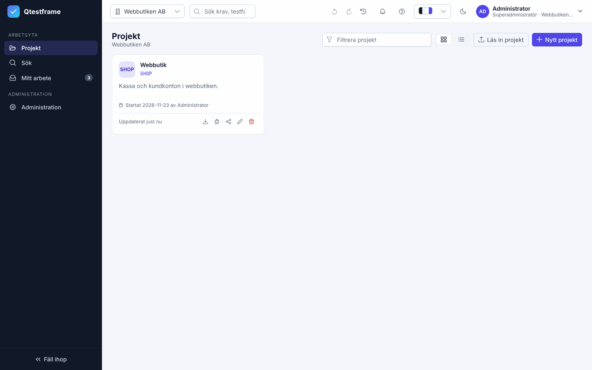

## Var börjar jag?

- **Ny i Qtestframe?** Läs [Kom igång](#kom-igång) och gå sedan igenom handledningen [Din första testkampanj](#handledning-din-första-testkampanj). Den tar ungefär 30 minuter och berör alla viktiga funktioner.
- **Letar du efter ett svar?** Titta i [Vanliga frågor](#vanliga-frågor) eller använd sökfältet högst upp i handboken. Okända ord förklaras i [Ordlistan](#ordlista).
- **Vill du se helheten?** [Så fungerar Qtestframe](#så-fungerar-qtestframe) förklarar hur verktyget är uppbyggt och hur objekten hänger ihop.
- **Administratör?** Gå direkt till [Administration](#administration).

## Innehåll

| Sida | Innehåll |
|---|---|
| [Kom igång](#kom-igång) | Inloggning, sidans uppbyggnad, organisationer, sökning, tema och språk, profil och inställningar |
| [Handledning: din första testkampanj](#handledning-din-första-testkampanj) | En komplett genomgång från ett tomt projekt till en rapport |
| [Krav](#krav) | Kravnivåer, språkanalysen, fält, utvärderingskriterier, relationer, kommentarer, versionshistorik, massändring, flytt och bilagor |
| [Testfall](#testfall) | Manuella steg, automatiserade skript, delade steg, kategorier, exekveringshistorik, kommentarer, versionshistorik och bilagor |
| [Katalog](#katalog) | Standardkrav och testfall att lägga till i ett projekt: bläddra, söka, förhandsvisa och lägga till med testfall och spårlänkar |
| [Testkörningar och exekvering](#testkörningar-och-exekvering) | Körningar, exekveringsvyn och dess kortkommandon, defekter, CI-import med API-nycklar, bilagor |
| [Utforskande test](#utforskande-test) | Sessionsbaserad utforskande testning: uppdrag, sessionens tidtagning, typade anteckningar med kortkommandon, defekter från anteckningar, utvärderingar, mått och sessionsrapporten |
| [Undantag, restrisk och SoA](#undantag-restrisk-och-uttalande-om-tillämplighet) | Undantag och avvikelser med signerade godkännanden, restrisk och dess acceptans, uttalandet om tillämplighet (ISO/IEC 27001 bilaga A) |
| [Ändringsbegäranden och ändringshantering](#ändringsbegäranden-och-ändringshantering) | Att föreslå ändringar av godkända krav och tester, bedömningen av påverkan, ändringsnämndens signerade beslut, att genomföra, verifiera och stänga; tvingande ändringshantering och nödåtgärden |
| [Spårbarhet och täckning](#spårbarhet-och-täckning) | Spårbarhetsmatrisen, hur täckningen beräknas, översikten |
| [Testcykler](#testcykler) | Planera testcykler: testfall, testare och uppskattningar, körningarna en cykel skapar, framsteg, nedbränning, arbetsbelastning, återkommande cykler |
| [Dubbletter och konflikter](#dubbletter-och-konflikter) | Liknande krav medan du skriver, misstänkt dubblerade krav och testfall, möjligen motstridiga krav, sammanslagning, gränsvärden |
| [AI-assistans](#ai-assistans) | Valfria AI-förslag: utkast till tester, bättre kravformuleringar, acceptanskriterier, ramverksmappningar, sammanfattningar av körningar med utkast till defekter; vad som skickas, och att slå på och av |
| [Varianter och kod](#varianter-och-kod) | Varianter och tillämplighet, täckning per variant, incheckningar, merge requests, byggen och regressionsurvalet |
| [CI/CD](#cicd) | Pipelinemallar för GitLab och GitHub, uppladdning av resultat, kvalitetsgrinden, commit-statusar och anteckningar i merge requests, testurval och underpipelines |
| [Baslinjer](#baslinjer) | Frysa en release och jämföra versioner |
| [Diskussioner](#diskussioner) | Kommentarstrådar på objekt med Markdown, @omnämnanden, reaktioner och lösta trådar, och projektets sida Diskussioner |
| [Sökning och filter](#sökning-och-filter) | Frågespråket med många exempel |
| [Rapporter och export](#rapporter-och-export) | Standardrapporter, den egna rapportbyggaren, exportformat och dokumentarkivet |
| [Samverkan](#samverkan-reqif-och-oslc) | ReqIF-export och -import med testfall, relationer och bilagor; OSLC-länkar, urval och skapande från DOORS Next, Polarion, Codebeamer |
| [Dokument](#dokument-1) | Projektets dokumentarkiv: uppladdning, förhandsvisning och länkar |
| [Administration](#administration) | Organisationer, användare, medlemmar och roller, delning av projekt, återställning av lösenord, API-nycklar, händelseloggen, säkerhetskopiering och återställning |
| [Tillgänglighet och språk](#tillgänglighet-och-språk) | Tangentbord, skärmläsare, teman, engelska och svenska, mobiler och surfplattor |
| [Så fungerar Qtestframe](#så-fungerar-qtestframe) | Programmet, var data finns, organisationer, projekt och roller, objekten och hur de hänger ihop (med ett diagram), frågespråket, arbete i bakgrunden, notiser, integrationer, säkerhet, säkerhetskopior och hänvisningar för administratörer |
| [Vanliga frågor](#vanliga-frågor) | Svar på vanliga frågor om hur verktyget används, begrepp inom test och kravhantering, standarder och format, och hur Qtestframe fungerar |
| [Ordlista](#ordlista) | Begrepp inom test, kravhantering, standarder och Qtestframe i bokstavsordning, vart och ett med vad det betyder i Qtestframe |
| [Referenser](#referenser) | RFC 2119, RFC 8174 och andra RFC:er, NIST-publikationer, standarder för krav och test samt de format, protokoll och ramverk som Qtestframe använder |

## Viktiga begrepp

| Begrepp | Betydelse |
|---|---|
| **Organisation** | En isolerad arbetsyta. Projekt, medlemmar och API-nycklar hör till en organisation. Du kan vara medlem i flera och byta mellan dem. |
| **Projekt** | En behållare för krav, testfall, körningar, baslinjer och dokument. Projektets **nyckel** (till exempel `SHOP`) inleder varje objekts id: `SHOP-REQ-12`, `SHOP-TC-7`. |
| **Krav** | Ett påstående om vad systemet ska, bör eller får göra, med kravnivå, status, prioritet, utvärderingskriterier med mera. |
| **Utvärderingskriterium** | Hur man bedömer att ett krav är uppfyllt: en metod (test, inspektion, analys, demonstration, granskning) och ett tröskelvärde. |
| **Testfall** | Ett manuellt testfall med steg eller ett automatiserat testfall med ett skript. |
| **Länk** (spårlänk) | Kopplar ett krav till ett testfall som verifierar det. Länkarna är grunden för täckningen. |
| **Körning** (testkörning) | En testkampanj, till exempel *Regressionstest sprint 12*, med en uppsättning testfall som ska exekveras i en viss miljö och ett visst bygge. |
| **Exekvering** | Ett testfall i en körning, med utfall, utfall per steg, anteckningar, defekter och utdata. |
| **Täckning** | Ett kravs verifieringsläge, härlett från de senaste utfallen för dess länkade testfall: *Ingen täckning*, *Ej körd*, *Godkänd*, *Underkänd* eller *Delvis*. |
| **Baslinje** | En fryst ögonblicksbild av versionerna av ett projekts krav och testfall, till exempel inför en release. |
| **Roll** | Vad du får göra i en organisation: *Läsare*, *Testare*, *Ansvarig* eller *Administratör*. *Superadministratörer* hanterar hela installationen. |

## Konventioner i handboken

- Namn på knappar, menyer och fält skrivs i **fetstil**, precis som de står i det svenska gränssnittet. Den engelska handboken använder de engelska etiketterna.
- Menyvägar skrivs med pilar: **Användarmeny → Profil och lösenord**.
- Tangenter skrivs som <kbd>Enter</kbd> och frågeexempel som `status:approved`.
- En anmärkning som *(Ansvarig)* efter en åtgärd anger den lägsta roll som får utföra den. Se [rollmatrisen](#roller-och-behörigheter).

# Kom igång

Den här sidan förklarar hur du loggar in, hittar rätt på skärmen och ställer in Qtestframe som du vill ha det.

## Logga in

Öppna adressen du har fått av din administratör (för en lokal testinstallation `http://localhost:8080`).

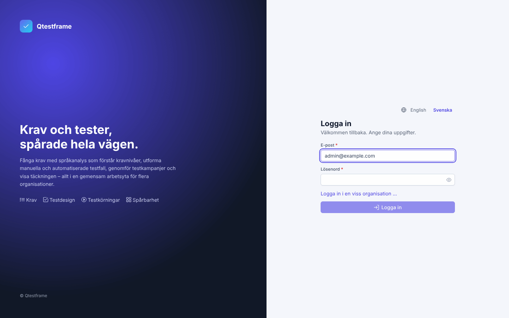

1. Ange **E-post** och **Lösenord** och välj **Logga in**.
2. Om du tillhör flera organisationer och vill börja i en viss, välj **Logga in i en viss organisation …** och ange dess kortnamn, till exempel `acme`. Utan kortnamn hamnar du i din standardorganisation (se [Inställningar](#inställningar)) eller den du använde senast.
3. Om din organisation använder enkel inloggning (SSO) visar sidan en knapp per leverantör under **eller fortsätt med**. Välj den och logga in hos identitetsleverantören; du kommer automatiskt tillbaka till Qtestframe.
4. Om du använder [tvåstegsverifiering](#tvåstegsverifiering) frågar sidan sedan efter **Verifieringskod**: öppna autentiseringsappen, ange den sexsiffriga kod den visar för Qtestframe och välj **Verifiera**. Varje kod fungerar en gång; om en kod nekas, vänta på nästa. Utan telefonen väljer du **Använd en återställningskod i stället** och anger en av dina återställningskoder. Om din organisation tillåter det hoppar **Kom ihåg den här enheten** över koden i den här webbläsaren under ett antal dagar.

Språkknapparna högst upp på inloggningssidan växlar mellan engelska och svenska innan du loggar in. Efter inloggningen gäller språket i dina inställningar.

> **Tips:** Efter tio misslyckade försök inom fem minuter spärras inloggningen en stund för den e-postadressen och nätverksadressen. Vänta några minuter och försök igen, eller be en administratör att [återställa ditt lösenord](#återställa-ett-lösenord).

### Det här ser du efter inloggningen

- **Introduktionsturen.** Första gången du loggar in visar en kort tur de viktigaste delarna av skärmen. Använd **Nästa** och **Tillbaka**, eller **Hoppa över turen** (eller <kbd>Esc</kbd>) för att stänga den. Du kan starta den igen när som helst med **Hjälp → Starta introduktionsturen igen**.

  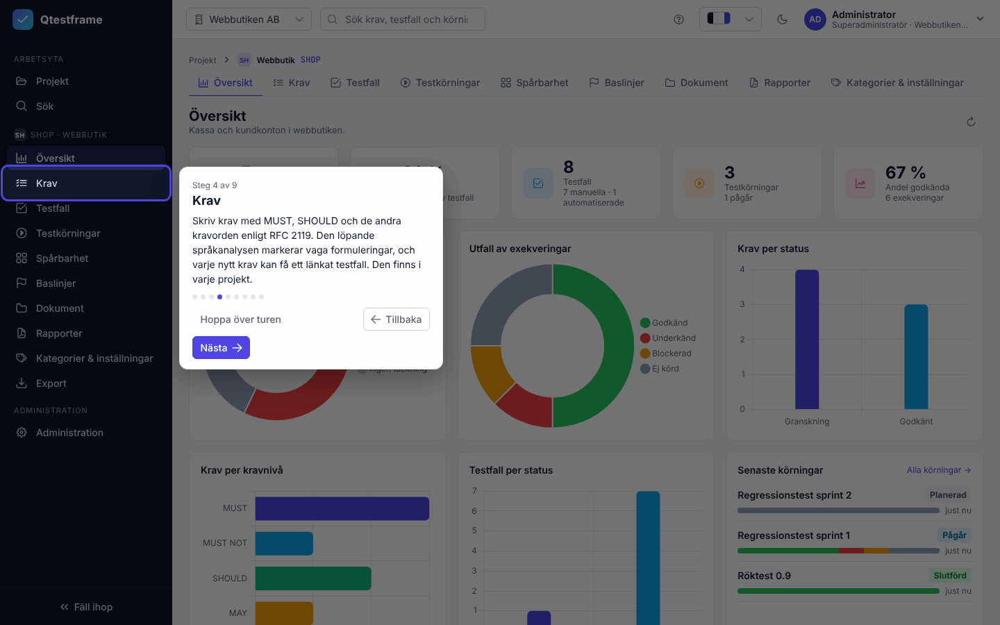
- **Information om inloggningen.** Vid senare inloggningar kan Qtestframe visa när och varifrån du loggade in förra gången och hur många misslyckade försök det har varit sedan dess. Om du inte känner igen en inloggning, byt lösenord och logga ut dina andra sessioner (se [Säkerhet](#säkerhet)).
- **Tvingat lösenordsbyte.** Om en administratör har återställt ditt lösenord måste du välja ett nytt innan du kan fortsätta.
- **Krav på tvåstegsverifiering.** Om din organisation kräver en andra faktor och du inte har konfigurerat någon, talar en påminnelse om till när; efter det datumet måste du [konfigurera en autentiseringsapp](#tvåstegsverifiering) vid inloggningen innan du kan fortsätta.

## Sidans uppbyggnad


### Sidopanelen

Det mörka fältet till vänster är huvudnavigeringen:

- **Arbetsyta:** **Projekt** (alla projekt i den aktuella organisationen) och **Sök** (sökning i alla projekt). Varje projektkort visar när projektet startades och av vem: den som skapade det, eller läste in eller kopierade det från en [projektfil](#rapporter-och-export). Vem som startade projektet utelämnas när det inte är känt (projekt från demodata eller kommandoraden, och projekt som är äldre än den här uppgiften). Tabellvyn har samma uppgifter som kolumner, och **Kategorier & inställningar → Projekt** visar dem också.
- **Det öppna projektet:** när du öppnar ett projekt visas dess nyckel och namn med projektets delar: **Översikt**, **Krav**, **Testfall**, **Testkörningar**, **Spårbarhet**, **Analys**, **Beroendegraf**, **Testflöde**, **AI-prompter** (mjukvaruprojekt), **Taggar**, **Baslinjer**, **Kategorier & inställningar**, **Export** och, där de finns, **Dokument** och **Rapporter**.
- **Administration**, om din roll tillåter det.

I ett projekt visas samma delar också som flikar högst upp på sidan, under sökvägen *Projekt › projektets namn*.

**Fäll ihop** längst ned krymper sidopanelen till ikoner; håll pekaren över en ikon för att se namnet. På skärmar smalare än 1024 bildpunkter är sidopanelen dold och öppnas med menyknappen (☰) i övre fältet; <kbd>Esc</kbd> eller stängningsknappen stänger den igen.

### Övre fältet

Från vänster till höger:

| Del | Användning |
|---|---|
| **Organisation** | Visar den aktuella organisationen och låter dig byta till en annan som du är medlem i. På mobiler är det en byggnadsikon. |
| **Sökfältet** | Söker bland krav, testfall och körningar i alla projekt i organisationen. Skriv text eller en [fråga](#sökning-och-filter) och tryck <kbd>Enter</kbd>. På mobiler är det en förstoringsglasknapp. |
| **Hjälp** (?) | Öppnar **Användarhandbok**, **Hjälp för den här sidan**, **Frågespråket**, **Referenser och standarder** och **Starta introduktionsturen igen**. |
| **Ångra / Gör om / Ångrahistorik** | Ångrar och gör om dina ändringar, se [Ångra och gör om](#ångra-och-gör-om). |
| **Färgtema** | Väljer ett av de tjugotvå temana, se [Teman](#teman). |
| **Ljust läge / Mörkt läge** | Växlar snabbt mellan ljust och mörkt. |
| **Användarmeny** | Ditt namn och din roll, **Profil och lösenord**, ljust/mörkt läge, **Språk** och **Logga ut**. |

### Ångra och gör om

De flesta ändringar kan ångras: att redigera, skapa, kopiera och ta bort krav och testfall, flytta dem, massändringar, länkar, relationer, beroenden, granskningsbeslut, att återställa en version, utfall i exekveringsvyn samt att skapa, byta namn på och flytta mappar.

- **Ångra** (↶, <kbd>Ctrl</kbd>+<kbd>Z</kbd>) återställer den senaste ändringen; välj den igen för att gå längre bakåt. Knappens tips namnger ändringen, till exempel *Ångra: Redigera SHOP-TC-4*.
- **Gör om** (↷, <kbd>Ctrl</kbd>+<kbd>Skift</kbd>+<kbd>Z</kbd> eller <kbd>Ctrl</kbd>+<kbd>Y</kbd>) gör en ångrad ändring igen. En ny ändring rensar det som kunde göras om.
- **Ångrahistorik** (🕘) listar dina senaste 50 ändringar, nyast först, med när de gjordes. Väljer du en ångras den och allt som gjordes efter den.

Kortkommandona fungerar utanför textfält; i ett textfält ångrar de som vanligt det du skrivit. Historiken hör till dig och din webbläsarflik: den rensas när du byter organisation, loggar ut eller laddar om sidan. Ett borttaget krav eller testfall kommer tillbaka med sin nyckel, sina länkar, relationer, kommentarer, versionshistorik, bilagor och utfall; borttagningar kan ångras i 30 dagar via API:t (se `GET /projects/{pid}/trash` i API-referensen). Ett ångra misslyckas om läget har ändrats under tiden, till exempel om någon annan har redigerat objektet eller om du inte längre har behörigheten; objektet lämnas då som det är och ett meddelande förklarar varför.

### Autokomplettering

Textfält där du ofta skriver samma sak föreslår det du har sparat i dem förut: rubriker på krav, testfall, defekter och risker, ett kravs källa, ägare och motivering, ett testfalls förutsättningar och förväntade resultat, åtgärd, förväntat resultat och data i teststeg, anteckningar och faktiska resultat vid utförande, kommentarer, granskningskommentarer, namn på körningar och releaser samt senaste sökningar. För ett kravs **Källa** och **Ägare** och en risks **Ägare** föreslås också värden som redan används i projektet.

- Börja skriva: efter en kort paus öppnas en lista med högst åtta förslag under fältet. Värden som börjar med det du skrivit kommer först, sedan värden med ett ord som börjar med det och sist värden som innehåller det; de du använder oftast och senast vinner vid lika.
- Inget väljs förrän du trycker på <kbd>↓</kbd> eller <kbd>↑</kbd>, så <kbd>Enter</kbd> och <kbd>Tab</kbd> fungerar som vanligt medan listan bara är öppen. På ett markerat förslag lägger <kbd>Enter</kbd> eller <kbd>Tab</kbd> in det i fältet (det ersätter texten); <kbd>Esc</kbd> stänger listan utan att stänga dialogen. Du kan också klicka eller trycka på ett förslag.
- I ett tomt enradigt fält visar <kbd>↓</kbd> dina mest använda senaste värden; i ett fält med flera rader använder du <kbd>Alt</kbd>+<kbd>↓</kbd>, eftersom piltangenterna flyttar markören där.
- Skärmläsare får höra hur många förslag det finns och vad som infogades. En klockikon visar din egen historik, en mappikon ett värde som används i projektet.

Din historik sparas med ditt konto när du sparar ett formulär (inte medan du skriver), så den följer med till alla webbläsare. Du ser bara din egen historik, och bara från projekt som du fortfarande kan öppna. Stäng av förslagen, eller begränsa dem till en källa, med **Autokompletteringsförslag** i dina [inställningar](#inställningar); **Rensa min autokompletteringshistorik** i profilen raderar allt som har sparats. Lösenord, nycklar och e-postadresser sparas aldrig.

### Hjälp där du behöver den

- Många fält och avsnitt har ett litet **i** bredvid namnet. Peka på det med musen, eller flytta tangentbordsfokus dit, så visas vad fältet betyder. Välj det (eller tryck på det på en mobil) för att låta förklaringen vara kvar, och välj **Läs mer i användarhandboken** för att öppna avsnittet som beskriver det. <kbd>Esc</kbd> stänger förklaringen.
- Tryck <kbd>?</kbd> var som helst utanför ett textfält för att öppna handbokens sida för den vy du är i (i exekveringsvyn visar <kbd>?</kbd> i stället vyns kortkommandon).
- **?** bredvid varje filterfält listar operatorerna och fälten i [frågespråket](#sökning-och-filter) för just den listan.

### Organisationer

En organisation är en separat arbetsyta med egna projekt, medlemmar och API-nycklar. När du byter organisation i övre fältet tar Qtestframe dig till organisationens projektlista. Din roll kan skilja sig mellan organisationer, så vad du får göra kan också ändras.

Om du ser meddelandet *Du har ingen aktuell organisation*, välj en i organisationsväljaren. Om du inte är medlem i någon organisation, be en administratör att lägga till dig.

### Sökning

Sökfältet i övre fältet söker överallt i den aktuella organisationen. Träffarna grupperas per typ med den matchande texten markerad; välj en träff för att öppna den. Alla detaljer finns i [Sökning och filter](#sökning-och-filter).

### Tema och språk

- Välj **färgtema** i övre fältet eller i dina inställningar. Valet sparas med ditt konto och följer med till alla enheter.
- Byt **språk** med **Användarmeny → Språk**: *English* eller *Svenska*. Ändringen gäller direkt och sparas som din inställning.

## Din profil

Öppna **Användarmeny → Profil och lösenord**.


### Konto

- **Visningsnamn**: namnet som andra ser i kommentarer, versionshistorik och händelseloggen.
- **Profilbild**: välj en bild för ditt konto: ladda upp en bild (PNG, JPEG, GIF eller WebP, högst 1 MB), välj en av de inbyggda bilderna eller använd dina initialer.
- **Inloggningsleverantör**, **Medlem sedan** och dina **Medlemskap**: organisationerna du tillhör och din roll i var och en.

### Inställningar

Inställningarna sparas med ditt konto och gäller på alla enheter. Ändra dem och välj **Spara inställningar**.

| Inställning | Effekt |
|---|---|
| **Språk** | Engelska eller svenska; *Webbläsarens språk* följer webbläsaren. |
| **Tema** | Färgtema. *Följ operativsystemet* växlar mellan ljust och mörkt enligt systemets inställning. |
| **Startsida** | Det du ser efter inloggningen: projektlistan, det senast öppnade projektet, ett standardprojekt, sökningen eller din [hempanel](#anpassa-översiktspaneler). |
| **Standardprojekt** | Projektet som öppnas när startsidan är *Standardprojekt*. |
| **Standardorganisation** | Organisationen som väljs vid inloggning när du inte anger någon. |
| **Rader per tabellsida** | 10, 25, 50 eller 100 rader i tabeller. |
| **Datumformat** | *Språkets format*, *ISO* (2026-03-14 09:30) eller *Relativt* (för 3 timmar sedan). |
| **Tidszon** | Tidszonen för alla tider; *Webbläsarens* använder datorns. |
| **Skapa även länkat testfall (nya krav)** | Ditt personliga standardval för kryssrutan i kravredigeraren. |
| **Kompakta tabeller** | Tätare tabellrader, så att du ser mer på en gång. |
| **Dölj den löpande språkanalysen av kraven** | Stänger av analysrutan i kravredigeraren. |
| **Markera nyckelord för kravnivå** | På från början: markerar SKA, BÖR, FÅR, MUST, SHOULD, MAY … i kravens beskrivningar och visar raden med nyckelord under beskrivningen i redigeraren. Se [Markerade nyckelord för kravnivå](#markerade-nyckelord-för-kravnivå). |
| **Autokompletteringsförslag** | Vad textfälten föreslår (se [Autokomplettering](#autokomplettering)): *På: min historik och värden som används i projektet* (standard), *Bara min egen historik*, *Bara värden som används i projektet* eller *Av*. Med *Av* visas inga förslag; med *Av* och *Bara värden som används i projektet* läggs inget som du sparar till i din historik. |

Under inställningen raderar **Rensa min autokompletteringshistorik** alla värden som dina textfält kommer ihåg åt dig, i alla organisationer, och visar hur många som är sparade.

### Säkerhet

- **Lösenord**: för lokala konton anger du **Nuvarande lösenord** och **Nytt lösenord** två gånger och väljer **Byt lösenord**. Om du loggar in med enkel inloggning hanteras lösenordet av din identitetsleverantör.
- **API-nycklar**: nycklar för CI-pipelines och skript skapas under **Administration → API-nycklar** (se [API-nycklar](#api-nycklar)).
- **Aktiva sessioner**: alla webbläsare och enheter som är inloggade med ditt konto, med webbläsare, IP-adress, inloggningstid och senaste aktivitet. **Logga ut** avslutar en session; **Logga ut alla andra sessioner** avslutar alla utom den du använder.
- **Inloggningshistorik**: dina senaste inloggningar och misslyckade försök, om de visas. Felaktiga koder för den andra faktorn visas som misslyckade försök med metoden *Andra faktor*.

### Tvåstegsverifiering

En andra faktor skyddar ditt konto även om någon får reda på ditt lösenord: efter lösenordet anger du en sexsiffrig kod från en **autentiseringsapp** i telefonen, till exempel Microsoft Authenticator, Google Authenticator, 1Password eller FreeOTP.

**Slå på**

1. I din profil, under **Tvåstegsverifiering**, väljer du **Konfigurera autentiseringsapp**.
2. Skanna QR-koden med appen. På en telefon lägger **Öppna i en autentiseringsapp på den här enheten** till kontot direkt; om det inte går att skanna väljer du **Går det inte att skanna? Ange nyckeln för hand** och skriver in konfigurationsnyckeln i appen.
3. Ange den sexsiffriga kod som appen visar och välj **Slå på**.
4. Qtestframe visar tio **återställningskoder**. Spara dem nu (**Kopiera** eller **Ladda ned**), till exempel i en lösenordshanterare: de visas bara den här gången. Varje kod fungerar en gång och låter dig logga in utan telefonen. Välj sedan **Jag har sparat koderna**.

Därefter frågar varje inloggning med lösenord efter en kod. API-nycklar påverkas inte.

**Senare**

- **Nya återställningskoder** skapar tio nya koder (de gamla slutar fungera). Gör det när bara några få finns kvar; profilen varnar dig.
- **Glöm ihågkomna enheter** gör att alla webbläsare där du valde *Kom ihåg den här enheten* frågar efter en kod igen.
- **Stäng av** tar bort autentiseringsappen och dina återställningskoder; båda kräver en aktuell kod (eller en återställningskod). Om din organisation kräver tvåstegsverifiering kan du inte stänga av den. Du får ett e-postmeddelande när den stängs av.
- **Ny eller borttappad telefon**: med en återställningskod kan du fortfarande logga in; stäng av tvåstegsverifieringen och konfigurera den igen med den nya telefonen. Utan telefon och återställningskoder ber du en administratör att [återställa din tvåstegsverifiering](#återställa-tvåstegsverifiering).

Om du loggar in med enkel inloggning frågar oftast identitetsleverantören efter den andra faktorn; Qtestframe frågar efter en egen kod bara om servern är konfigurerad för det.

## Nästa steg

- Följ [handledningen](#handledning-din-första-testkampanj) och bygg ett litet projekt från början.
- Lär dig [frågespråket](#sökning-och-filter); det fungerar i alla filterfält.

# Handledning: din första testkampanj

I den här handledningen bygger du ett litet projekt från början och tar det hela vägen till en rapport. Du skriver krav, låter Qtestframe skapa länkade testfall, förfinar dem, kör dem manuellt och automatiskt, registrerar en defekt, kontrollerar täckningen, fryser en baslinje och exporterar resultatet.

**Exempel:** kassan i en webbutik, projektnyckel `SHOP`.

**Du behöver:** rollen **Ansvarig** eller **Administratör** i din organisation (krav och projekt kräver rollen Ansvarig, se [roller](#roller-och-behörigheter)). För att köra skript på servern måste dessutom administratören ha slagit på skriptexekveringen (steg 9). Räkna med ungefär 30 minuter.

> **Vill du bara titta runt?** Din administratör kan läsa in ett färdigt demoprojekt (*Demo – Online Banking*) med `qtestframe seed-demo`. Stegen nedan fungerar även där, men du lär dig mer om du börjar med ett tomt projekt.

## Steg 1: Skapa ett projekt

1. Välj **Projekt** i sidopanelen.
2. Välj **Nytt projekt**.
3. Ange **Namn** `Webbutik`. Qtestframe föreslår en nyckel utifrån namnet när du lämnar fältet.
4. Ändra **Nyckel** till `SHOP`. Nyckeln inleder varje objekts id, till exempel `SHOP-REQ-1` och `SHOP-TC-1`. Den består av 2–16 versaler eller siffror, börjar med en bokstav och **kan inte ändras senare**. Lägg gärna till en **Beskrivning**.
5. Låt **Skapa standardkategorier (Polarity, Interface, Medium, Execution, Level, Area)** vara ikryssad. Kategoridimensionerna används senare för att klassificera testfall och krav.
6. Välj **Skapa**.


Öppna projektet genom att välja dess kort. Du hamnar på projektets **Översikt**, som ännu är tom. Projektets delar visas nu i sidopanelen.

## Steg 2: Skapa mappar

Mappar grupperar krav (och, separat, testfall) i ett träd, som kapitlen i en specifikation.

1. Välj **Krav** i sidopanelen. Mappträdet finns till vänster och kravtabellen till höger.
2. Välj knappen **+** (**Ny mapp**) ovanför trädet, skriv `Kassa` och välj **Spara**.
3. Skapa en undermapp: högerklicka på **Kassa** (eller använd dess åtgärdsknapp **⋮**) och välj **Ny undermapp**. Ge den namnet `Betalning`.
4. Skapa på samma sätt en andra mapp på översta nivån, `Konton`.

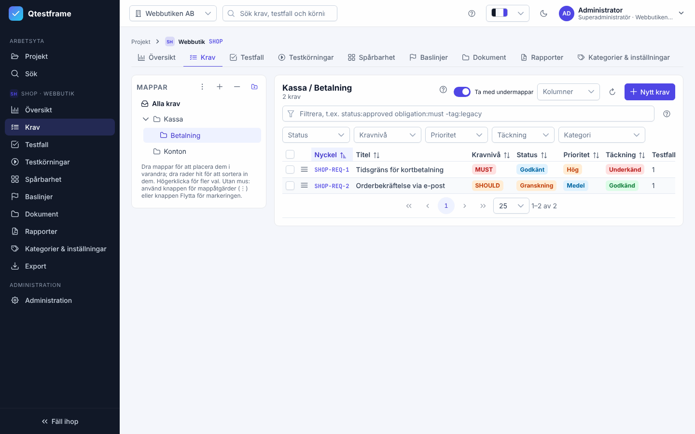

Du kan dra mappar för att placera dem i varandra eller ändra ordningen. Välj en mapp för att bara visa dess krav; **Ta med undermappar** avgör om krav i undermappar också visas.

## Steg 3: Skriv krav med MUST och SHOULD

1. Välj mappen **Betalning** och sedan **Nytt krav**. Redigeraren öppnas till höger med mappen redan ifylld.
2. Ange **Titel** `Tidsgräns för kortbetalning`.
3. Skriv först in ett medvetet svagt påstående i **Beskrivning**:

   `The system should respond fast and/or retry TBD.`

   Rutan **Språkanalys av kravet** visas under texten och uppdateras medan du skriver. Den hittar:

   - kravordet *should* med gemener (enligt RFC 8174 har bara `SHOULD` med versaler normativ betydelse),
   - det tvetydiga uttrycket *fast*, som inte går att verifiera,
   - *and/or*, som lämnar öppet om båda eller ett av alternativen krävs,
   - platshållaren *TBD*, som visar att kravet är ofullständigt.

   **Poängen** sjunker till 53 av 100.


4. Ersätt nu texten med en exakt formulering:

   `The system MUST cancel a card payment that is not confirmed by the payment provider within 30 seconds.`

   Analysen visar **Identifierad: MUST (SKA)** och poängen 100.

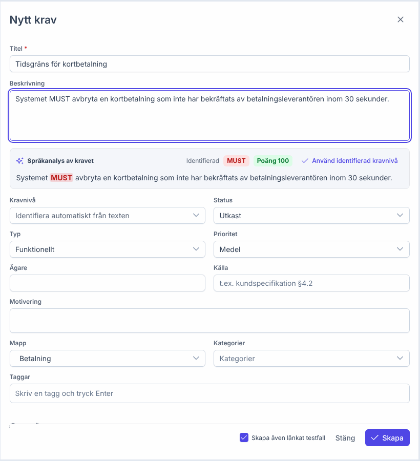

5. Låt **Kravnivå** stå på **Identifiera automatiskt från texten**: den identifierade nivån sparas när du skapar kravet. Du kan också välja en nivå själv; **Använd identifierad kravnivå** fyller i fältet med det analysen hittade.
6. Sätt **Prioritet** till **Hög** och välj **Area / Core** under **Kategorier**.
7. Sätt **Status** till **Godkänt**: i ett riktigt projekt gör du det när kravet har granskats. Som standard kan ett testfall bara exekveras när det är **Klart** och alla krav det verifierar är **Godkända**, **Implementerade** eller **Verifierade** (se [Inställningar för testexekvering](#inställningar-för-testexekvering)).

> **Om språket:** analysen förstår både svenska och engelska. Skriv du på svenska använder du de svenska kravorden: *Systemet SKA avbryta en kortbetalning …*; engelska kravord med versaler (MUST, SHALL …) fungerar också. Se [Språkanalysen](#språkanalysen).

Vilket kravord ska du använda?

| Kravord | Betydelse | Exempel |
|---|---|---|
| `MUST` / `SHALL` | Absolut krav (SKA) | Systemet MUST logga varje misslyckad inloggning. |
| `MUST NOT` / `SHALL NOT` | Absolut förbud (SKA INTE) | Systemet MUST NOT lagra kortnummer. |
| `SHOULD` | Rekommendation (BÖR); avvikelser kräver skäl | Systemet SHOULD skicka en orderbekräftelse inom 5 minuter. |
| `SHOULD NOT` | Avrådan (BÖR INTE) | Kassan SHOULD NOT kräva mer än tre sidor. |
| `MAY` / `OPTIONAL` | Verkligt valfritt (FÅR) | Kunden MAY spara kortet till senare köp. |
| `WILL` | Avsikt eller faktum (KOMMER ATT) | Betalningsleverantören WILL skicka ett återanrop. |

Skriv en skyldighet per mening. Om analysen rapporterar *flera kravord* i meningen, dela upp den i två krav. Fler regler förklaras under [Krav](#språkanalysen).

## Steg 4: Lägg till utvärderingskriterier

Utvärderingskriterierna anger **hur** du bedömer att kravet är uppfyllt. De blir också stegen i det länkade testfallet.

1. Välj **Lägg till kriterium** under **Utvärderingskriterier** i redigeraren.
2. Skriv `Obekräftad betalning avbryts`, behåll metoden **Test** och ange tröskelvärdet `≤ 30 s`.
3. Lägg till ett andra kriterium, `Avbrottet skrivs till granskningsloggen`, med metoden **Inspektion**.
4. Kontrollera att **Skapa även länkat testfall** längst ned är ikryssad.
5. Välj **Skapa**.

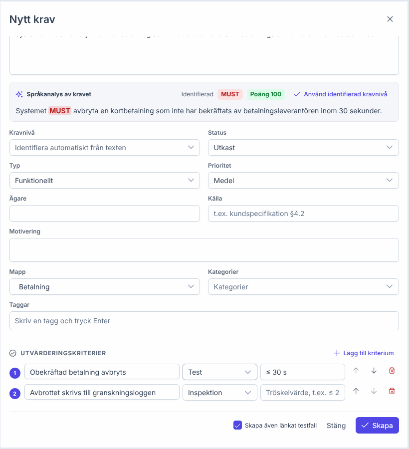

Ett meddelande bekräftar *SHOP-REQ-1 med länkat testfall SHOP-TC-1*. I tabellen är kravets **Täckning** **Ej körd**: det har ett testfall, men testfallet har inte exekverats än.

Lägg gärna till ytterligare ett krav i samma mapp för att öva:

`The system SHOULD send an order confirmation by e-mail within 5 minutes after payment.`

## Steg 5: Förfina det automatiskt länkade testfallet

1. Välj **Testfall** i sidopanelen. Testmappsträdet speglar dina kravmappar: där finns mappen **Kassa / Betalning** som Qtestframe har skapat åt dig.
2. Öppna **SHOP-TC-1 Verify SHOP-REQ-1: Tidsgräns för kortbetalning**. Det är ett manuellt testfall med status **Utkast** och taggen `auto-generated`, med ett steg per kriterium, till exempel *Verify (test): Obekräftad betalning avbryts* med det förväntade resultatet *≤ 30 s*.
3. Gör stegen konkreta. Klicka i ett steg för att redigera **Åtgärd**, **Förväntat resultat** och **Data**:

   | Nr | Åtgärd | Förväntat resultat | Data |
   |---|---|---|---|
   | 1 | Lägg en vara i varukorgen och starta kortbetalningen | Leverantörens betalningssida öppnas | testkort 4111 1111 1111 1111 |
   | 2 | Bekräfta inte betalningen; vänta 30 sekunder | Ordern visar *Betalningen avbruten* | |
   | 3 | Öppna granskningsloggen | Det finns en post *betalning avbruten* för ordern | |

4. Använd **Lägg till steg** för att lägga till ett steg sist, **+** på en rad för att infoga ett steg nedanför och pilarna för att ändra ordningen.
5. Sätt **Status** till **Klart** och lägg till kategorierna **Polarity / Negative** och **Interface / External**.
6. Välj **Spara**.

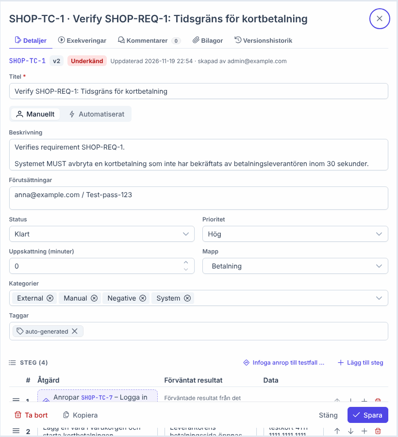

Under **Länkade krav** längst ned ser du SHOP-REQ-1. Med **Länka krav** länkar du fler krav till samma testfall.

## Steg 6: Lägg till ett delat steg

Många testfall börjar på samma sätt, till exempel med en inloggning. Skriv sådana steg en gång och anropa dem från andra testfall.

1. Välj **Nytt testfall** och skapa testfallet `Logga in som kund` med två steg: *Öppna butiken och välj Logga in* → *Inloggningsformuläret visas* och *Ange kundens e-post och lösenord* → *Kontosidan visas*. Sätt status till **Klart** och välj **Skapa**.
2. Öppna SHOP-TC-1 igen och välj **Infoga anrop till testfall …** ovanför stegen.
3. Välj **Logga in som kund** och sedan **Infoga anrop**. Det nya steget visar **Anropar SHOP-TC-…**.
4. Flytta anropssteget överst med uppåtpilen och välj **Spara**.


När en körning skapas infogas det anropade testfallets steg i stället för anropet, markerade med det anropade testfallets nyckel. Om du förbättrar det delade testfallet senare får nya körningar förbättringen. Det delade testfallet visar var det används under **Används av:**.

## Steg 7: Skapa en körning

1. Välj **Testkörningar** i sidopanelen och sedan **Ny körning**.
2. Ange **Namn** `Regressionstest sprint 1`, **Miljö** `staging` och **Bygge** `1.0.0`.
3. Välj vilka testfall som ska ingå. Körningen får unionen av alla tre flikarna:
   - **Testfall**: **Välj testfall …** och välj enskilda testfall;
   - **Mappar**: kryssa i **Kassa**; testfall i undermappar tas med;
   - **Fråga**: ett filter som `status:ready`; **Förhandsgranska** visar hur många testfall som matchar.
4. Välj **Skapa körning**.

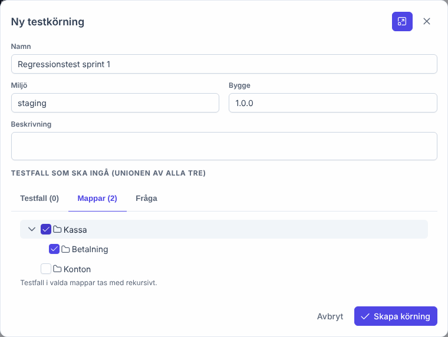

Körningen öppnas med en **exekvering** per testfall, alla **Ej körd**. Stegen i varje testfall, inklusive de infogade delade stegen, kopieras nu in i körningen, så senare ändringar av testfallen påverkar inte den här körningen.

## Steg 8: Exekvera manuellt och registrera en defekt

1. Välj **Exekvera** i körningen (eller uppspelningsknappen för en exekvering). Exekveringsvyn öppnas.
2. Den vänstra kolumnen listar stegen; till höger visas det aktuella steget med **Åtgärd**, **Förväntat resultat** och **Testdata**.
3. Gör det steget beskriver och jämför resultatet:
   - om det stämmer, välj **Godkänn** eller tryck <kbd>P</kbd>;
   - om inte, skriv vad som hände i **Faktiskt resultat** och välj **Underkänn** eller tryck <kbd>F</kbd>.

   **Blockerad** (<kbd>B</kbd>) och **Hoppa över** (<kbd>S</kbd>) finns också. Vyn går automatiskt vidare till nästa steg. Tryck <kbd>?</kbd> för att se alla kortkommandon.
4. Låt steg 3 underkännas: posten i granskningsloggen saknas. Skriv `SHOP-101` (id:t i ditt ärendehanteringssystem) under **Defekter** och tryck <kbd>Enter</kbd>. Skriv en kommentar under **Anteckningar**.
5. **Samlat utfall** härleds från stegen: ett underkänt steg gör exekveringen **Underkänd**. Välj **Spara och nästa** för att spara och gå till nästa exekvering.

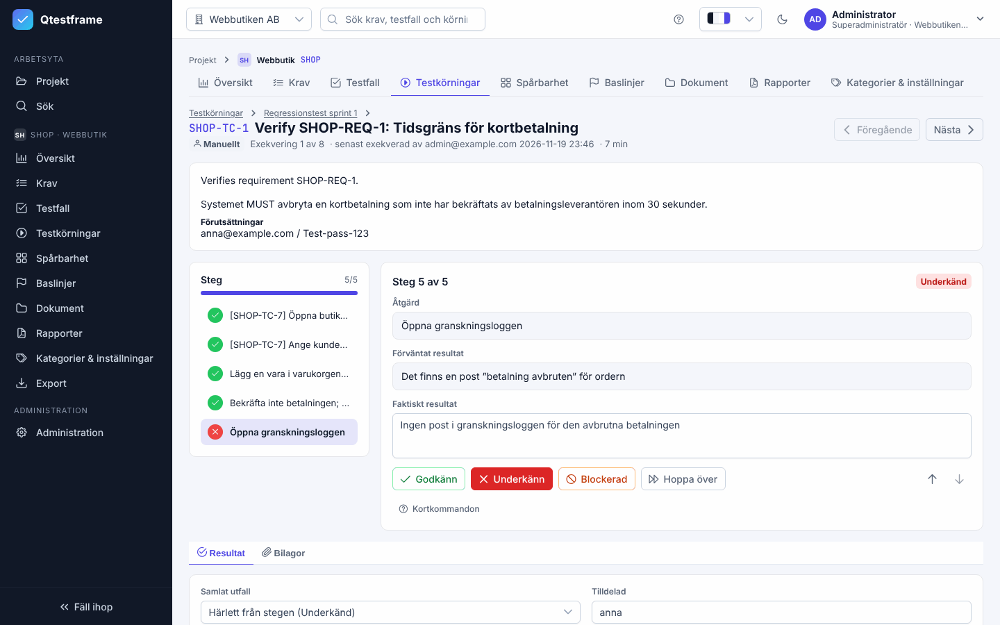

**Gör defekt-id:n till länkar:** ange en **URL-mall för felhanteringssystem** under **Kategorier & inställningar**, till exempel `https://jira.example.com/browse/{id}`. Därefter länkar `SHOP-101` till ditt system.

## Steg 9: Kör ett automatiserat skript

Automatiserade testfall är skript som körs på servern. Slutkod 0 betyder *godkänt*, allt annat *underkänt*.

1. Välj **Nytt testfall** under **Testfall**, skriv `Beräkning av ordersumma` och växla exekveringstypen till **Automatiserat**.
2. Välj skriptspråket **sh** under **Skript** och skriv:

   ```sh
   #!/bin/sh
   # slutkod 0 = godkänt, annat = underkänt
   total=$((2 * 15 + 5))
   echo "ordersumma: $total"
   [ "$total" -eq 35 ] || { echo "oväntad summa"; exit 1; }
   ```

3. Välj **Skapa**.
4. Öppna körningen *Regressionstest sprint 1*, välj **Lägg till testfall**, välj det nya testfallet och bekräfta.
5. Öppna dess exekvering och välj **Kör skript**. Efter en stund visar **Utdata** skriptets utskrifter och exekveringen är **Godkänd**, med tidsåtgången.

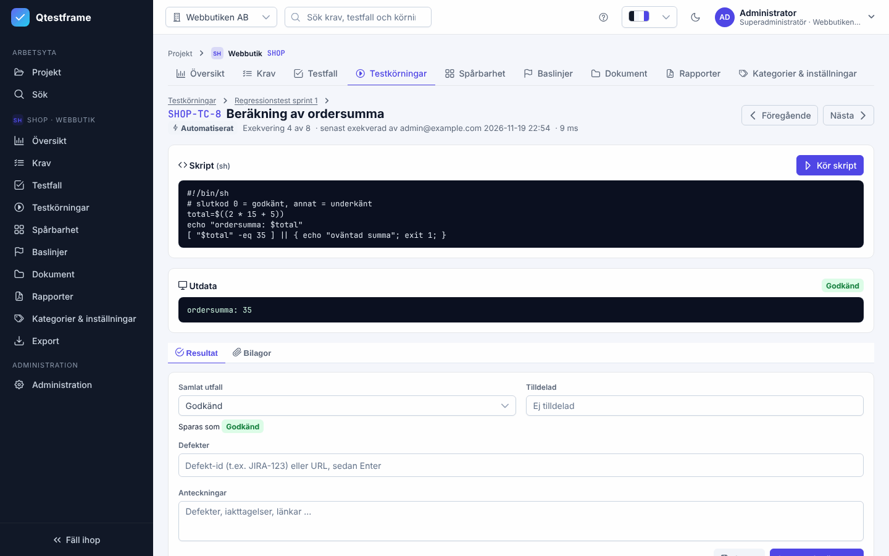

**Kör skript** kräver rollen **Ansvarig** (behörigheten `script.execute`) och serverinställningen `runner.enabled: true`. Om knappen saknas eller meddelar att exekveraren är avstängd, kontakta din administratör. CI-pipelines kan i stället rapportera utfall via API:et; se [CI-import](#importera-utfall-från-ci).

## Steg 10: Kontrollera spårbarheten och översikten

1. Välj **Spårbarhet**. Kraven är rader, testfallen kolumner och en markerad cell betyder *länkad*. Det färgade fältet först på varje rad visar täckningen (se förklaringen): SHOP-REQ-1 är nu **Underkänd** eftersom dess testfall underkändes. Kravlistan visar samma sak i kolumnen **Täckning**.
2. Klicka på en tom cell för att länka ett krav till ett testfall, eller på en markerad cell för att ta bort länken. **Bara länkade testfall** döljer testfall utan länkar.
3. Välj **Översikt**. Den sammanfattar kravtäckning, utfall av exekveringar, krav per status och kravnivå, testfall per status och de senaste körningarna.

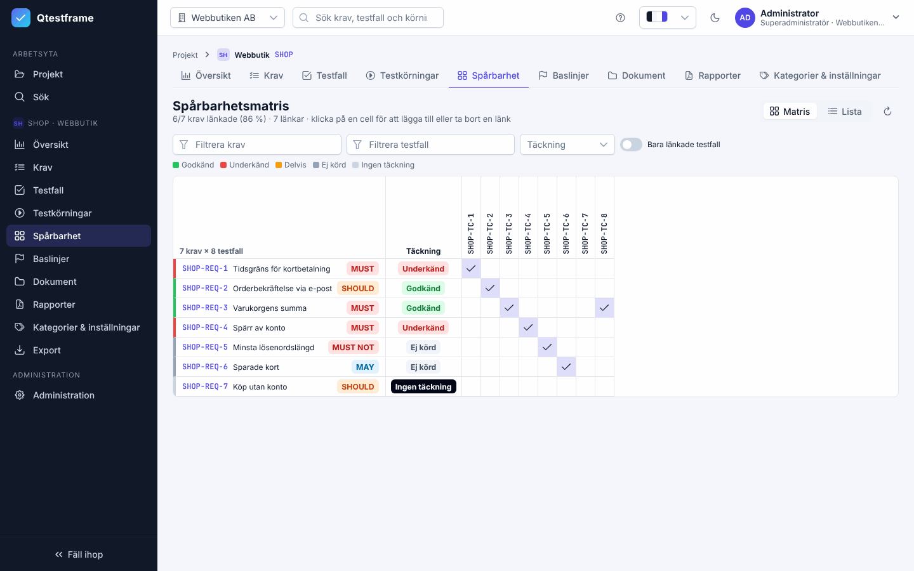


Hur täckningen beräknas förklaras under [Spårbarhet och täckning](#så-beräknas-täckningen).

## Steg 11: Skapa en baslinje

Frys de aktuella versionerna av alla krav och testfall inför en release.

1. Välj **Baslinjer** och sedan **Ny baslinje**.
2. Ange **Namn** `Release 1.0`. Lämna **Filter (valfritt)** tomt för att ta med allt.
3. Välj **Skapa baslinje**.

Ändra nu något, till exempel tröskelvärdet för ett kriterium i SHOP-REQ-1. Gå tillbaka till **Baslinjer**, välj **Jämför** för *Release 1.0* och jämför med **Nuläget**: SHOP-REQ-1 visas under **Ändrade**, med de ändrade fälten och båda versionsnumren.

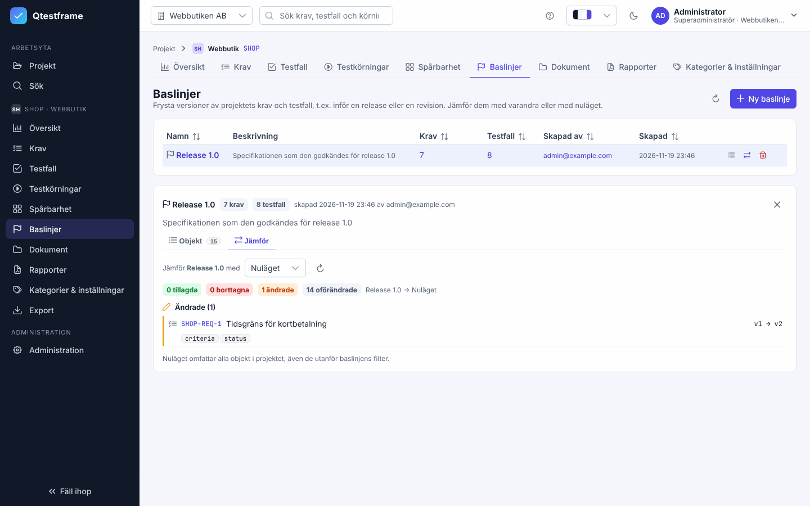

## Steg 12: Exportera eller ta fram en rapport

**Exportera data:**

1. Välj **Export**.
2. Välj **Format**: **XLSX** (ett blad per del), **CSV** (ett ZIP-arkiv när du väljer flera delar), **PDF** (utskriftsvänlig) eller **DOCX** (redigerbart dokument).
3. Kryssa i det **Innehåll** du behöver: krav, utvärderingskriterier, testfall med steg, spårbarhetsmatris, körningar och exekveringar.
4. Ange eventuellt ett filter som `folder:Kassa` och välj **Ladda ned**.

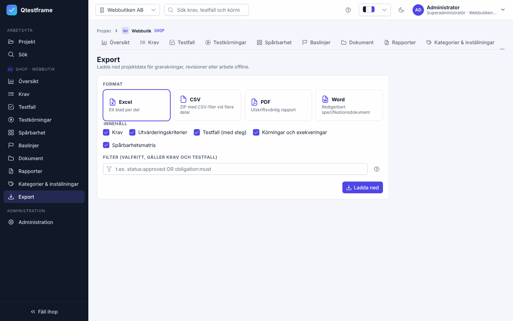

**Ta fram en rapport:** välj en standardrapport under **Rapporter**, till exempel **Kravtäckning** eller **Sammanfattning av körning** (för *Regressionstest sprint 1*), välj PDF, Word, Excel eller CSV och ladda ner den, eller spara den i projektets dokumentarkiv så att hela teamet hittar den under **Dokument**. Under **Anpassad rapport** väljer du själv objekttyp, filter, kolumner, gruppering och sortering. Se [Rapporter och export](#rapporter-och-export).

## Det här har du lärt dig

Du har skapat ett projekt med mappar, skrivit verifierbara krav med hjälp av språkanalysen, lagt till utvärderingskriterier, förfinat det automatiskt skapade testfallet, återanvänt steg, genomfört en körning manuellt och automatiskt, registrerat en defekt, kontrollerat täckningen, fryst en baslinje och exporterat resultatet.

Läs sedan mer om [krav](#krav) och [testfall](#testfall), eller lär dig [frågespråket](#sökning-och-filter) för att snabbt hitta vad som helst.

# Krav

Projektets del **Krav** innehåller specifikationen: varje krav med kravnivå, status, utvärderingskriterier, länkar till testfall, relationer till andra krav, kommentarer, versionshistorik och bilagor.

Att läsa krav kräver rollen **Läsare**; att skapa och ändra dem kräver **Ansvarig**. Att länka testfall till ett krav kräver **Testare**.

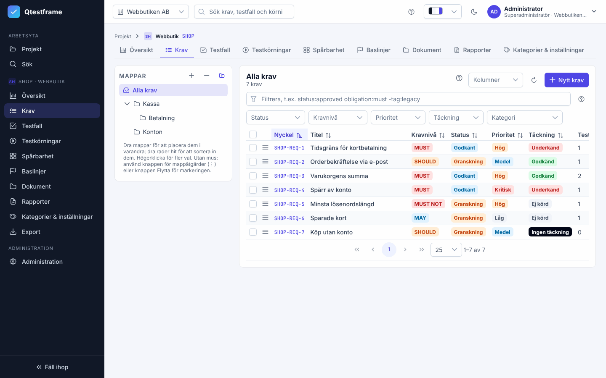

## Kravsidan

- **Mappträdet** (till vänster): välj **Alla krav** eller en mapp. **Ta med undermappar** avgör om objekt i undermappar listas. På smala skärmar öppnas trädet med knappen **Mappar**.
- **Filterfältet**: ett fält för [frågor](#sökning-och-filter) och snabbfilter för **Status**, **Kravnivå**, **Prioritet**, **Täckning** och **Kategori**. Snabbfiltren sätts ihop till en fråga som visas under fältet (`q = …`). **Rensa** återställer alla filter.
- **Kolumner**: välj vilka kolumner tabellen visar: kravnivå, status, prioritet, typ, täckning, länkade testfall, kategorier, mapp, ägare, källa, taggar, **relationer**, antal relationer, kriterier, version, kommentarer, skapad av, skapad och uppdaterad. Kolumnen **Relationer** listar relaterade objekt grupperade per relation, åt båda hållen, till exempel *beror på SHOP-REQ-2*, *tillhandahålls av SHOP-REQ-3* och *verifieras av SHOP-TC-1*; välj en nyckel för att öppna objektet. Flytta kolumner genom att dra i rubriken, eller med pilknapparna under **Kolumner**; **Återställ** ger standardkolumnerna tillbaka. Valet sparas i webbläsaren, även för tabellerna över körningar, exekveringar och dokument.
- **Tabellen**: sortera genom att klicka på en kolumnrubrik; välj en rad (eller dess titel) för att öppna redigeraren. Id:t (till exempel `SHOP-REQ-12`) tilldelas automatiskt.
- **Lista** / **Kalkylblad**: växla mellan tabellen och [kalkylbladsvyn](#kalkylbladsvy), där du redigerar många krav direkt som i Excel.

Den valda mappen, filtret och det öppna kravet ingår i sidans adress, så du kan bokmärka eller dela en filtrerad vy.

## Kravnivåer

Varje krav har en **kravnivå** enligt [RFC 2119 och RFC 8174](#kravord-rfc):

| Nivå | Betydelse |
|---|---|
| **MUST (SKA)**, **SHALL (SKA)** | Absolut krav |
| **MUST NOT (SKA INTE)**, **SHALL NOT (SKA INTE)** | Absolut förbud |
| **SHOULD (BÖR)** | Rekommendation: det kan finnas giltiga skäl att avvika, men konsekvenserna måste vara kända |
| **SHOULD NOT (BÖR INTE)** | Avrådan |
| **MAY (FÅR)**, **OPTIONAL (VALFRITT)** | Verkligt valfritt |
| **WILL (KOMMER ATT)** | Avsikt eller faktum (inget kravord enligt RFC 2119) |
| **Beskrivande** | Text utan kravnivå, till exempel en inledning eller en anmärkning |

När du skapar ett krav med **Kravnivå** satt till **Identifiera automatiskt från texten** identifieras nivån från titeln och beskrivningen. Om flera kravord förekommer vinner det starkaste (MUST NOT före MUST före SHALL NOT … före Beskrivande). Text utan kravord får ingen kravnivå och räknas som *ospecificerad* på översikten. Senare ändringar ändrar aldrig kravnivån automatiskt; använd **Använd identifierad kravnivå** i analysrutan eller välj nivån själv.

Bara kravord med VERSALER har normativ betydelse (RFC 8174). Skriv `MUST`, inte `must`. I krav som är skrivna på svenska används i stället de svenska kravorden (SKA, BÖR, FÅR …) som beskrivs under [Språkanalysen](#språkanalysen). Sidan [Referenser](#referenser) listar dessa och andra standarder för krav och test.

Medan du skriver visar **Hjälp: kravnivåer** under beskrivningen (öppen för nya krav) nyckelorden för varje nivå på gränssnittets språk, vad de betyder och ett exempel, med tips om hur de skrivs. [Analys](#kravanalys) visar hur nivåerna och nyckelorden fördelar sig i projektet.

### Markerade nyckelord för kravnivå

Där ett kravs beskrivning visas skrivskyddad markeras nyckelorden för kravnivå: i kravredigeraren när du bara får läsa kravet, i förhandsvisningen i [katalogen](#katalog) och i förhandsvisningen i [Importera krav](#importera-krav). Varje nivå har en egen stil, och nivåerna skiljer sig inte bara i färg utan också i tjocklek och understrykning, så att de syns i alla teman, även hög kontrast:

| Nivå | Nyckelord | Understrykning |
|---|---|---|
| Ska | SKA, SKALL, MÅSTE, MUST, SHALL, REQUIRED | heldragen, extra fet |
| Ska inte | SKA INTE, FÅR INTE, MUST NOT, SHALL NOT | dubbel, extra fet |
| Bör | BÖR, REKOMMENDERAS, SHOULD | streckad, fet |
| Bör inte | BÖR INTE, SHOULD NOT, NOT RECOMMENDED | dubbel, fet |
| Får | FÅR, VALFRI, MAY, OPTIONAL | prickad |

Negationer som `SKA INTE` och `MUST NOT` är ett nyckelord. Bara nyckelord skrivna med versaler markeras, bara hela ord (`FÅRA` är inte `FÅR`), och aldrig i länkar eller i kod mellan bakåtapostrofer (`` `SKA` ``). Peka på ett nyckelord för att se vad det betyder; skärmläsare läser nivån efter nyckelordet, till exempel "SKA INTE – kravnivå: SHALL NOT (SKA INTE)". Nyckelorden är desamma som [språkanalysen](#språkanalysen) känner till.

När du redigerar beskrivningen visar raden **Nyckelord för kravnivå** under den nyckelorden som hittas medan du skriver, med deras nivå. Den säger till när nyckelordet inte stämmer med fältet **Kravnivå** (med en knapp som sätter fältet till den hittade nivån), när texten har mer än ett nyckelord och när ett nyckelord är skrivet med gemener. **Vad betyder nyckelorden?** öppnar **Hjälp: kravnivåer**.

Vill du stänga av markeringen och raden, avmarkera **Markera nyckelord för kravnivå** i dina [inställningar](#inställningar).

## Språkanalysen

Medan du skriver beskrivningen visar rutan **Språkanalys av kravet** den identifierade kravnivån, en **Poäng** från 0 till 100, kravorden markerade i texten och en lista med **Anmärkningar**.

Analysen förstår **svenska** och **engelska**. Som standard (**Identifiera språk**) avgör den vilket språk texten är skriven på och visar det bredvid väljaren, till exempel *Identifierat: Svenska*; välj **Svenska** eller **Engelska** i väljaren för att tvinga fram ett språk. Valet sparas i webbläsaren. Anmärkningarna visas alltid på ditt gränssnittsspråk, oavsett vilket språk kravet är skrivet på.

På svenska är kravorden:

| Kravord | Kravnivå |
|---|---|
| **SKA**, **SKALL** | Ska (shall) |
| **MÅSTE**, **OBLIGATORISK** | Måste (must) |
| **BÖR**, **REKOMMENDERAS** | Bör (should) |
| **FÅR** | Får (may) |
| **FÅR INTE**, **FÅR EJ** | Får inte (must not) |
| **SKA INTE**, **SKALL INTE** | Ska inte (shall not) |
| **BÖR INTE**, **REKOMMENDERAS INTE** | Bör inte (should not) |
| **BEHÖVER INTE**, **MÅSTE INTE**, **VALFRI** | Valfritt (optional) |
| **KOMMER ATT** | Kommer att (will) |
| **BESKRIVER**, **NOT:**, **ANMÄRKNING:** | Beskrivande |

Engelska kravord med versaler (MUST, SHALL …) räknas också. Svenskan har ingen konvention om versaler, så regeln om kravord med gemener gäller bara engelska. Tänk på att *får* även betyder "tar emot": i *användaren får ett mejl* tolkas *får* som ett tillåtande kravord.

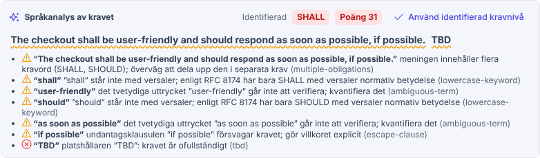

| Regel | Allvarlighet | Upptäcks när |
|---|---|---|
| Kravord saknas | Varning | det finns inget kravord (MUST, SHALL, SHOULD, MAY …) |
| Kravord med gemener | Info | ett kravord inte står med versaler, till exempel `must` |
| Negativt krav | Info | `MUST NOT` eller `SHALL NOT`: svårare att verifiera; ange hellre vad systemet gör |
| Flera kravord | Varning | en mening innehåller mer än ett kravord; dela upp den |
| Lång mening | Info | en mening har fler än 40 ord |
| Tvetydigt uttryck | Varning | vaga ord som *fast, easy, user-friendly, simple, efficient, adequate, appropriate, approximately, flexible, robust, reliable, intuitive, sufficient, as needed, normally, usually, seamless, scalable, optimal, several, many, few, reasonable, timely, acceptable, as soon as possible, suitable* |
| Platshållare | Fel | `TBD`, `TBC`, `TODO`, `XXX`, `???`: kravet är ofullständigt |
| Obegränsat uttryck | Info | *all, always, never, every, any, none*: kontrollera att det verkligen ska gälla generellt |
| And/or | Varning | `and/or`: ange om båda eller något av alternativen krävs |
| Passiv förmåga | Info | *be able to*, *be capable of*: beskriv beteendet i stället |
| Undantagsklausul | Varning | *if possible, where applicable, unless, except*: gör villkoret explicit |
| Tvetydig negation | Varning | bara svenska: *måste inte* läses ofta som ett förbud men betyder "behöver inte"; skriv *får inte* eller *behöver inte* |

Tabellen visar de engelska orden. I svensk text letar reglerna efter motsvarande svenska ord, till exempel *snabb, enkel, användarvänlig, effektiv, tillräcklig, lämplig, ungefär, flexibel, robust, intuitiv, osv, vid behov, normalt, vanligtvis, skalbar, optimal, flera, många, rimlig, så snart som möjligt* (tvetydiga), *bestäms senare* (platshållare), *alla, alltid, aldrig, varje, ingen* (obegränsade), *och/eller*, *kunna, ha möjlighet att* (passiv förmåga) och *om möjligt, där tillämpligt, om inte, utom, förutom* (undantag).

**Poäng** = 100 − 25 per fel − 10 per varning − 2 per info, aldrig under 0. Till exempel får *The system shall respond fast and/or retry TBD.* poängen 53: kravord med gemener (info), *fast* (varning), *and/or* (varning) och *TBD* (fel).

Om du inte vill se rutan kan du stänga av den i din profil: **Dölj den löpande språkanalysen av kraven**.

## Fält

| Fält | Användning |
|---|---|
| **Titel** | Ett kort namn (obligatoriskt). |
| **Beskrivning** | Själva kravformuleringen, som analyseras medan du skriver. |
| **Kravnivå** | Se ovan. |
| **Status** | Utkast, Granskning, Godkänt, Implementerat, Verifierat, Avvisat eller Inaktuellt. *Godkänt* och *Avvisat* är granskningsbeslut: de kräver behörigheten *requirement.review* (Granskare eller Ansvarig) och är gråade utan den. Granskare ser knapparna **Godkänn** och **Avvisa** överst i redigeraren. |
| **Typ** | Funktionellt, Icke-funktionellt, Säkerhet, Prestanda, Användbarhet, Gränssnitt, Begränsning, Verksamhet eller Regelverk. |
| **Prioritet** | Kritisk, Hög, Medel eller Låg. |
| **Ägare** | Vem som ansvarar för kravet. Skriv `@` för att välja en person, se [Nämn personer](#nämn-personer). |
| **Källa** | Var kravet kommer ifrån. Välj i listan (▾), som erbjuder projektets källor och de källor som andra krav redan använder, eller skriv en egen, till exempel *kundspecifikation §4.2*. Projektets lista redigeras under **Kategorier & inställningar → Kravkällor** (en per rad; tom betyder standardlistan: Customer, Contract, Standard, Regulation, Stakeholder …). |
| **Motivering** | Varför kravet finns. |
| **Mapp** | Var kravet är placerat. |
| **Kategorier** | Värden i projektets kravkategorier, till exempel *Area / Security*. |
| **Taggar** | Fria nyckelord; skriv en tagg och tryck <kbd>Enter</kbd>, eller välj en av de **föreslagna taggarna** under fältet. Förslagen kommer från titeln och beskrivningen: taggar som projektet redan använder och som texten nämner kommer först (heldragen ram), sedan förkortningar som *GDPR* och ord i titeln eller ord som förekommer mer än en gång (streckad ram). Varje tagg får en egen färg, samma överallt (tabeller, taggmolnet, dokument), så att lika taggar är lätta att se. |
| **MITRE D3FEND-tekniker** | De försvarstekniker som kravet genomför, valda ur listan i [MITRE D3FEND](#mitre-d3fend-och-emb3d) (skriv *D3-MFA* eller en del av ett namn). Krav från katalogen tar med sig dem. I frågor hittar `d3fend:D3-AA` kraven med tekniken eller någon av dess undertekniker (*D3-MFA*) och `d3fend:harden` de med en härdningsteknik. |
| **MITRE EMB3D-åtgärder och hot** | För inbyggda enheter: de åtgärder (*MID-026*) i [MITRE EMB3D](#mitre-d3fend-och-emb3d) som kravet genomför och de hot (*TID-201*) det hanterar. `emb3d:TID-201` hittar även de krav som anger en åtgärd mot hotet. |

Bara id:n i listorna kan sparas; ett id som ramverket inte längre har markeras och måste tas bort. Testfall har samma två fält för de tekniker, åtgärder och hot som de verifierar. Båda ingår i exporter (kolumnerna **D3FEND** och **EMB3D**), projektarkiv, säkerhetskopior och, med fältet **MITRE D3FEND och EMB3D**, genererade dokument.

Redigerarens huvud visar id:t, **versionen** (till exempel *v3*), täckningen och vem som ändrade kravet senast. Versionen ökar vid varje ändring.

## Utvärderingskriterier

Under **Utvärderingskriterier** anger du hur uppfyllelsen bedöms. Varje kriterium har en beskrivning, en **metod** och ett valfritt **tröskelvärde**:

| Metod | Typisk användning |
|---|---|
| **Test** | exekvering av ett testfall (standard) |
| **Inspektion** | granskning av kod, dokument eller konfiguration |
| **Analys** | beräkning, simulering eller utvärdering av mätningar, till exempel *p95 < 2 s* |
| **Demonstration** | funktionen visas för en granskare |
| **Granskning** | en formell granskning |

Välj **Lägg till kriterium** för att lägga till ett; använd pilarna för att ändra ordningen och papperskorgen för att ta bort. När du sparar ersätts listan. När du länkar ett testfall kan du välja vilket kriterium det verifierar under **Kriterium för nya länkar**. Fliken **Verifiering** visar beläggen för varje kriterium, kopplar testfall (och teststeg) till kriterier och registrerar inspektioner, analyser, demonstrationer och granskningar; ett krav är verifierat först när varje kriterium har godkända belägg (se [Verifiering](#verifiering)).

## Länkade testfall

**Skapa även länkat testfall** (ikryssad som standard; ditt personliga standardval finns i profilen) skapar ett manuellt testfall som utkast när du skapar ett krav:

- med titeln *Verify SHOP-REQ-n: …*, kravets prioritet och taggen `auto-generated`;
- med ett steg per utvärderingskriterium, eller ett steg som härleds från texten om det inte finns några;
- i testmappen med samma sökväg som kravets mapp (saknade mappar skapas);
- länkat till kravet, så att täckningen börjar som **Ej körd** i stället för **Ingen täckning**.

Avsnittet **Länkade testfall** i redigeraren listar alla länkade testfall med deras senaste utfall. **Länka testfall** lägger till fler (Testare); **×** på en rad tar bort en länk. Länkar kan också sättas i [spårbarhetsmatrisen](#spårbarhet-och-täckning).

## Relationer

Fliken **Relationer** kopplar ihop krav i samma projekt:

| Relation | Betydelse |
|---|---|
| **förfinar (överordnat)** / **förfinas av (underordnat)** | nedbrytning: kravet är en mer detaljerad del av det andra |
| **beror på** / **krävs av** | kravet behöver det andra |
| **tillhandahåller** / **tillhandahålls av** | kravet levererar något (en förmåga, ett gränssnitt, data) som det andra behöver |
| **härlett från** / **källa till** | kravet har härletts ur det andra |
| **står i konflikt med** | båda kan inte uppfyllas samtidigt |
| **duplicerar** / **dupliceras av** | samma innehåll två gånger |
| **relaterar till** | en informell relation |

Välj **Lägg till relation …**, välj typen och sedan kraven. Ett krav kan inte relatera till sig självt, och *förfinar*-relationer får inte bilda en cykel. I frågor hittar `parent:`, `child:` och `related:` krav utifrån deras relationer, till exempel `child:*` för krav som har brutits ned.

### Relationer för många krav på en gång

För att relatera många krav i ett steg markerar du dem i listan och väljer **Relationer** i verktygsfältet (kräver **Ansvarig**):

- **Lägg till:** välj relationen som **varje markerat krav** ska ha, till exempel *förfinar (överordnat)*, och **Välj krav …** för den andra änden. Varje markerat krav får relationen till varje valt krav, så du kan göra tio krav till barn till en förälder på en gång. Relationer som redan finns, som skulle relatera ett krav till sig självt eller som skulle bilda en cykel av *förfinar* hoppas över och räknas i meddelandet.
- **Ta bort:** välj relationen som ska tas bort, eller **Alla relationer**, och eventuellt kraven i den andra änden; utan valda krav tas de matchande relationerna till alla krav bort.

Dialogen visar hur många relationer som läggs till eller tas bort innan du bekräftar. På ett kravs flik **Relationer** kan du kryssa i flera relationer (eller **Markera alla**) och välja **Ta bort** för att ta bort dem tillsammans. Båda kan ångras med **Ångra**.

## Nämn personer

Skriv `@` i **Ägare**, **Beskrivning**, **Motivering**, en kommentar, eller i ett testfalls beskrivning och förutsättningar och en exekverings **Tilldelad** och anteckningar: en lista med personer visas. Den innehåller organisationens användare (med avatar) och namn som redan används som ägare eller tilldelad i projektet men saknar konto (*inget konto*). Skriv vidare för att begränsa listan, använd piltangenterna och <kbd>Enter</kbd> eller <kbd>Tabb</kbd> för att infoga, eller <kbd>Esc</kbd> för att stänga listan.

Ett omnämnande skrivs som `@namn`: för användare delen av e-postadressen före `@` (`@anna.berg` för *anna.berg@example.com*), för andra personer namnet med punkter i stället för mellanslag (`@carl.carlsson`). Omnämnanden av kända personer visas som en etikett med avatar och namn, i kommentarerna och i kolumnen **Ägare**. En ägare som är medlem i organisationen sparas med sin e-postadress, hur du än anger personen (`@anna.berg`, *Anna Berg* eller *anna.berg@example.com*), så att posten visas i personens [arbetslista](#mitt-arbete) och personen får en notis; en medlem som inte ser projektet kan inte vara ägare. Andra namn (till exempel någon utanför organisationen) sparas som vanlig text. **Ange ägare** i verktygsfältet för massändring ger många krav eller testfall samma ägare (tomt tar bort den); filtret `owner:me` hittar dina egna poster.

Filtrera med `mention:anna.berg` (eller `mention:@anna.berg`) för att hitta allt som nämner en person.

## Diskussion

Fliken **Diskussion** innehåller kravets [diskussion](#diskussioner): trådar med kommentarer i Markdown, med svar, @omnämnanden, reaktioner och **Markera som löst**. Siffran på fliken är antalet öppna trådar; kolumnen **Kommentarer** räknar kommentarerna. Alla som kan läsa kravet kan läsa diskussionen; att skriva i den kräver `comment.create` (alla roller utom Läsare). Du kan redigera och ta bort dina egna kommentarer; moderatorer kan ta bort alla kommentarer.

## När någon annan har sparat först

Om någon sparar ett krav medan du redigerar det skriver din **Spara** inte över deras arbete. Dialogen **Någon annan har ändrat det här** visar vem som sparade den nyare versionen och när, och listar fälten som den andra ändrade bredvid dina osparade värden; fält som du också har ändrat är markerade. Välj:

- **Fortsätt redigera**: stäng dialogen och fortsätt (till exempel för att först kopiera din text);
- **Släng mina, läs in deras**: läs in den sparade versionen och släng dina ändringar;
- **Spara mina ändringar**: spara bara fälten som du har ändrat ovanpå deras version. Fält som bara den andra ändrade behåller sina värden; där ni båda har ändrat ett fält sparas ditt. Den nyare versionen finns kvar på fliken **Versionshistorik**, så du kan fortfarande jämföra eller återställa den.

Detsamma gäller för testfall.

## Versionshistorik och återställning

Varje ändring skapar en ny **version**. Fliken **Versionshistorik** listar versionerna med vem som gjorde ändringen (med avatar), när och vilken sorts ändring det var (skapad, ändrad, återställd, flyttad, massändring). Välj en version för att se en jämförelse fält för fält med den föregående.

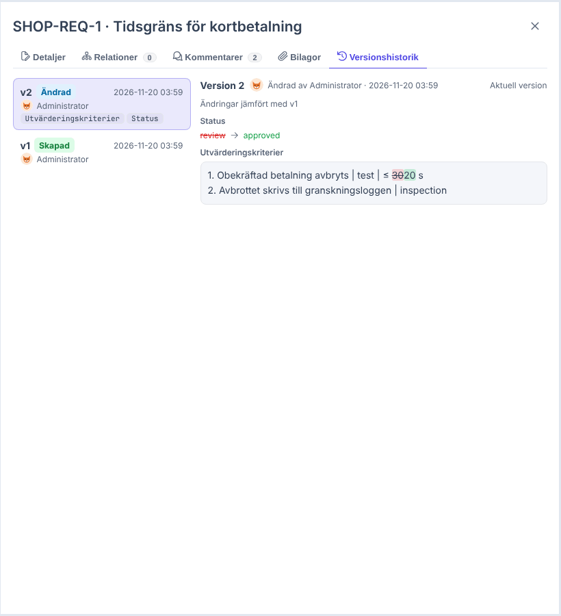

**Återställ den här versionen** kopierar tillbaka innehållet i en gammal version som en **ny** version: titel, beskrivning, kravnivå, typ, prioritet, status, källa, motivering, ägare, taggar, kategorier och kriterier. Inget går förlorat; de nyare versionerna finns kvar i historiken. Mapp och projekt ändras inte. Kategorier som inte längre finns tas bort.

## Godkänn många krav på en gång

Den som har granskningsbehörighet (`requirement.review`) kan godkänna eller avslå många krav i ett steg. Kryssa i kraven och välj **Godkänn eller avslå…** i verktygsfältet, eller välj **Massgranskning** ovanför listan när inget är markerat. Välj sedan:

- **Vilka poster**: de markerade, alla som visas i listan (aktuell mapp och filter, så filtrera först för ett urval, t.ex. `folder:Betalningar obligation:must`) eller alla krav i projektet.
- **Beslut**: godkänn eller avslå.
- **Bara poster med status**: som standard bara krav i *Granskning*. Lägg till *Utkast* för att godkänna utkast direkt.
- **Ta med ändå, trots**: se nedan.
- **Kommentar**: läggs till på varje krav som ändras, till exempel "Godkänt på granskningsmötet 12 mars".
- **Slutför också mina öppna granskningsförfrågningar**: visas när [granskningsförfrågningar](#granskningar-och-notiser) till dig är öppna för några av kraven; påslaget som standard. Dina förfrågningar beslutas då tillsammans med kraven (*Godkänd* när du godkänner, *Ändringar begärda* när du avslår), och de som frågade får en notis. Checklistorna bockas inte för; granskningen sparar att den beslutades i en massgranskning. Förfrågningar till andra granskare håller fortfarande kravet utanför.

Förhandsgranskningen visar vilka krav som ändras och vilka som hoppas över, grupperade efter orsak:

| Orsak | Betydelse |
|---|---|
| Har redan den här statusen | inget att göra |
| Statusen är inte vald ovan | statusen är inte en av dem du valde |
| Den senaste granskningen begärde ändringar | en [granskningsförfrågan](#granskningar-och-notiser) besvarades med *Begär ändringar* |
| Granskningsförfrågningar är fortfarande öppna | någon har inte granskat klart |
| Har misstänkta länkar | ett länkat test har ändrats sedan länken bekräftades |
| Saknar kravnivå | för att godkänna krävs en kravnivå (inte för att avslå) |

Välj en kontroll under **Ta med ändå, trots** för att godkänna de kraven ändå. Inget sparas förrän du väljer knappen längst ner. Varje ändring registreras i kravets versionshistorik och i granskningsloggen, och hela steget kan ångras med ångra-knappen i övre fältet (för att ångra krävs skrivbehörighet; slutförda granskningsförfrågningar förblir beslutade).

## Massändring

Kryssa i rutorna för flera krav (eller rubrikens kryssruta för hela sidan). Ett verktygsfält visas:

- **Ange status**, **Ange prioritet**, **Ange kravnivå**: tillämpas direkt på alla markerade krav;
- **Kategorier +** / **Kategorier −**: lägg till eller ta bort kategorivärden;
- **Taggar +** / **Taggar −**: lägg till eller ta bort taggar (vid borttagning spelar stora och små bokstäver ingen roll);
- **Flytta**: flytta dem till en mapp;
- **Ta bort**: ta bort dem efter bekräftelse;
- **×**: rensa markeringen.

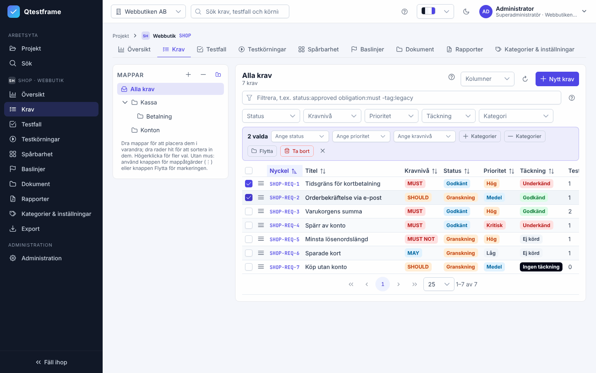

Varje massändring registreras i varje kravs versionshistorik.

## Kalkylbladsvy

Välj **Kalkylblad** bredvid knappen för att läsa in igen för att se kraven som ett kalkylblad: en rad per krav och en kolumn per fält (**Nyckel**, **Titel**, **Beskrivning**, **Typ**, **Prioritet**, **Status**, **Kravnivå**, **Kategorier**, **Taggar**, **Ägare**, **Källa**, **Mapp** och de skrivskyddade **Täckning**, **Testfall** och **Version**). Valet sparas i webbläsaren och ingår i sidans adress (`?view=sheet`), så en delad länk öppnar kalkylbladet. Mappträdet, filtren och verktygsfältet för massändring fungerar som i listan.

- **Kolumner**: visa, dölj och ordna kolumnerna med **Kolumner**; dra i kanten på en kolumnrubrik för att göra den bredare eller smalare (eller tryck **Alt+Skift+←/→**). Bredder och kolumner sparas i webbläsaren. Nyckelkolumnen och rubrikraden står kvar när du rullar.
- **Sortera**: klicka på en kolumnrubrik, eller välj kolumnen under **Sortera** och riktningen bredvid.
- **Förflytta dig**: piltangenterna, **Tab** och **Skift+Tab**, **Home** och **End** (första och sista kolumnen), **Ctrl+Home** och **Ctrl+End** (första och sista cellen), **Page Up** och **Page Down**. Den aktiva cellen har en ram.
- **Markera**: **Skift** med pilarna eller ett klick markerar ett område, **Ctrl+A** (**Cmd+A** på Mac) markerar alla celler. **Mellanslag** kryssar i den aktiva cellens rad och **Skift+Mellanslag** områdets rader; ikryssade rader använder verktygsfältet för massändring ovanför bladet.
- **Redigera**: tryck **F2** eller **Enter**, eller börja bara skriva, för att redigera den aktiva cellen. **Enter** sparar och flyttar nedåt, **Tab** sparar och flyttar åt höger, **Escape** avbryter. Fält som **Status** och **Prioritet** öppnar en lista med sina värden; **Taggar** och **Kategorier** tar flera värden åtskilda med kommatecken (kategorier som *Dimension/Namn*); fält med flera rader som **Beskrivning** får en radbrytning med **Alt+Enter** eller **Skift+Enter**. Grå celler med ett lås i rubriken (nyckeln, beräknade värden) kan inte redigeras, och inte heller celler du saknar behörighet för: utan skrivbehörighet kan bara en granskares statusbeslut göras.
- **Kopiera och klistra in**: **Ctrl+C** kopierar de markerade cellerna som tabbseparerad text som går att klistra in i Excel eller LibreOffice; kryssa i **Kopiera med rubrikrad** för att ta med kolumnnamnen. **Ctrl+V** klistrar in ett block som kopierats från ett kalkylblad vid den aktiva cellen (ett enda värde fyller hela markeringen; en första rad som upprepar kolumnnamnen hoppas över). Varje inklistrat värde kontrolleras först: om något inte är giltigt, till exempel en prioritet som inte finns, sparas ingenting och ett meddelande anger cellen och de tillåtna värdena. **Ctrl+X** klipper ut.
- **Fyll nedåt och töm**: **Ctrl+D** kopierar markeringens översta värde till cellerna under det; **Delete** eller **Backsteg** tömmer de markerade celler som får vara tomma.
- **Nya krav**: skriv en titel i sista raden (**Skriv en titel för att lägga till ett krav**) och tryck **Enter**; kravet skapas i den valda mappen och nästa tomma rad är redo för nästa. Värden du först skriver i radens andra celler används också.
- **Öppna ett krav**: dubbelklicka på nyckeln eller tryck **Ctrl+Enter** för att öppna det i redigeraren.

Varje ändring sparas direkt, alla celler i en inklistring eller fyllning i ett steg: en cell visar en snurra medan den sparas, en bock när den är sparad och en röd ram med orsaken när den inte sparades. Om någon annan har ändrat ett krav sedan du läste in bladet sparas ingenting, raden markeras och **Läs in raden igen** visar den andras version så att du kan göra din ändring på nytt. En redigering, inklistring, fyllning eller tömning är ett steg för **Ångra** (**Ctrl+Z**). Skärmläsare läser upp sparade ändringar och fel.

**Exportera vyn** sparar exakt det bladet visar, med kolumnerna i sin ordning, sorterat och filtrerat, som **Excel (XLSX)**, **CSV** eller **Markdown** (kräver exportbehörighet).

På en mobil rullar bladet i sidled inom sin ram; där är listan lättare att läsa.

## Flytta krav och mappar

- **Inom projektet:** dra rader i deras handtag (☰) till en mapp i trädet, eller markera dem och använd **Flytta**. Nycklar, länkar, kategorier och historik förblir oförändrade.
- **Mappar:** dra en mapp till en annan för att placera den där, eller använd **⋮ → Flytta till översta nivån**. En mapp kan inte flyttas in i sig själv eller sina egna undermappar.
- **Till ett annat projekt:** högerklicka på en mapp och välj **Flytta till projekt …**. Mappen med alla undermappar och krav flyttas till målprojektet i samma organisation. Där gäller:
  - varje krav får en **ny nyckel** i målprojektet (till exempel `CORE-REQ-17`); den gamla nyckeln återanvänds inte;
  - kategorier matchas på dimension och namn; värden som målprojektet saknar tas bort;
  - **länkar till testfall tas bort**, eftersom länkar aldrig går mellan projekt;
  - kriterier och historik följer med.

Utan mus använder du mappens åtgärdsknapp **⋮** eller knappen **Flytta** för markeringen.

**Flera mappar på en gång:** välj **Markera flera mappar** (☑) ovanför trädet. Varje mapp får en kryssruta; en ikryssad mapp omfattar sina undermappar. Verktygsfältet flyttar sedan de ikryssade mapparna **till** en annan mapp, till **översta nivån** eller till **ett annat projekt** (med allt innehåll, som ovan), eller **tar bort** dem (och behåller deras krav i den överordnade mappen, eller tar bort dem också). En flytt in i någon av de ikryssade mapparna nekas innan något ändras. **Klar** återgår till det vanliga trädet.

**Mappfärg:** högerklicka på en mapp (eller använd **⋮**) och välj **Redigera…** för att ge den en färg. Alla krav i mappen, och i undermappar utan egen färg, får ett färgat fält först på raden och en färgruta bredvid mappsökvägen, så att krav i samma mapp är lätta att se. Mappträdet visar färgen som en prick (en smal prick när den är ärvd). Välj **Ingen färg** för att ta bort den. Testfallsmappar fungerar på samma sätt, och en testfallsmapp som skapas som spegel av en kravmapp får dess färg.

**När du tar bort en mapp** frågar Qtestframe vad som ska hända med innehållet: **Ta bort, behåll innehållet** flyttar undermappar och krav till den överordnade mappen; **Ta bort allt** tar bort hela delträdet med alla krav i det.

## Länkar

Fliken **Länkar** för ett krav, ett testfall och en körning listar länkar till annat, både i verktyget och utanför. **Lägg till länk** erbjuder:

| Länka till | Välj |
|---|---|
| **Krav**, **Testfall** | ett eller flera objekt i projektet med objektväljaren |
| **Körning** | en testkörning i projektet |
| **Arkivfil** | ett dokument eller en sparad rapport i projektets [dokumentarkiv](#dokument-1) |
| **Rapport** | en sparad rapportdefinition; länken öppnar den under **Rapporter** |
| **Webbadress** | en adress som börjar med `https://`, `http://` eller `mailto:`, till exempel en designspecifikation, ett ärende eller en wikisida |

En **etikett** (valfri) säger vad länken är, till exempel *Designspecifikation* eller *Jira-ärende*. Länkar till objekt i verktyget öppnar dem; filer och webbadresser öppnas i en ny flik. Under **Länkas från** ser du de krav, testfall och körningar som länkar till objektet, så länkarna fungerar åt båda hållen.

Länkar kan bara peka på objekt i samma projekt. När ett länkat objekt tas bort försvinner dess länkar (och kommer tillbaka om du ångrar borttagningen); när ett objekt flyttas till ett annat projekt tas dess länkar till objekt i det gamla projektet bort medan webblänkarna följer med. Att lägga till och ta bort länkar kräver behörighet att redigera objektet som bär dem, och du ser bara länkar till sådana objekt du får läsa. Att lägga till och ta bort en länk kan ångras.

### Länkar för många objekt på en gång

Markera krav eller testfall i deras lista, eller körningar på sidan **Testkörningar**, och välj **Länkar** i verktygsfältet:

- **Lägg till:** välj vad som ska länkas till och målen (flera krav, testfall, körningar eller filer på en gång, eller en webbadress) och en valfri etikett. Varje markerat objekt får en länk till varje mål; befintliga länkar och länkar från ett objekt till sig självt hoppas över.
- **Ta bort:** välj en sorts länk, eller **Alla länkar**, och eventuellt målen; utan valda mål tas alla länkar av den sorten bort från de markerade objekten.

Dialogen visar hur många länkar som läggs till eller tas bort innan du bekräftar; objekt du inte får ändra hoppas över och räknas i meddelandet. På ett objekts flik **Länkar** kan du kryssa i flera länkar (eller **Markera alla**) och välja **Ta bort** för att ta bort dem tillsammans. Båda kan ångras.

**Nycklar och adresser i texter.** I kommentarer blir en objektnyckel som `SHOP-REQ-12` eller `SHOP-TC-3` en länk till objektet, och en webbadress blir en länk som öppnas i en ny flik. Adressen `/go/SHOP-TC-3` i verktyget öppnar alltid det objektet, vilket är praktiskt i e-post och chattar.

## Ärenden i GitLab, GitHub eller Jira

När projektet är anslutet till en ärendehanterare (se [Anslut Jira, GitHub eller GitLab](#anslut-jira-github-eller-gitlab)) kan ett krav lämnas över till utvecklarna som ett ärende (i Request Tracker en ticket). Kravets flik **Länkar** börjar då med **Ärende i GitLab** (eller GitHub, Jira):

- **Skapa GitLab-ärende** visar en förhandsvisning av ärendet och skapar det. Ärendet får:
  - titeln `[SHOP-REQ-12] <titel>`;
  - en beskrivning med kravtexten, motiveringen, acceptanskriterierna, typ, prioritet, kravnivå, status, ägare, källa, taggar och version, de länkade testfallen med deras senaste resultat och länkar tillbaka till kravet och testfallen i Qtestframe (när serverns adress, `server.base_url`, är inställd);
  - etiketter: ärendehanterarens standardetiketter plus etiketter från kravets fält (se nedan);
  - milstolpen och den tilldelade från inställningarna, om de är angivna.

  Ärendet läggs till bland kravets länkar som en webblänk, med sin nyckel och sitt läge (**Öppet** eller **Stängt**).
- Ett krav har högst ett ärende i ärendehanteraren. Om det redan har ett erbjuder Qtestframe **Öppna ärendet** och **Uppdatera ärendet** i stället för att skapa ett till.
- **Uppdatera ärendet** för in kravets aktuella titel och text i ärendet, till exempel efter att kravet ändrats eller testfallen körts. I GitLab och GitHub ersätts bara den del som Qtestframe skrivit (den är markerad med dolda kommentarer); anteckningar som utvecklarna lagt till ovanför eller nedanför behålls. I Jira ersätts hela beskrivningen.
- **Läs om status** läser tillbaka ärendets läge. Läget läses inte om automatiskt: läs om det här eller med **Ärenden** i listan.

Med **Kommentera ärendet när alla länkade tester har godkänts** i inställningarna lägger en omläsning av ett öppet ärende, vars länkade testfall alla har godkänts, till en kommentar om det med en länk till kravet. Om testerna slutar godkännas och sedan godkänns igen kommenterar nästa omläsning på nytt.

**Etiketter från kravets fält** i inställningarna översätter fält till etiketter: mallar separerade med komma, där `{type}`, `{priority}`, `{obligation}`, `{status}` och `{tags}` (en etikett per tagg) ersätts med kravets värden. Standard är `requirement, type::{type}, priority::{priority}, {tags}`, vilket ger till exempel `requirement`, `type::functional`, `priority::high` och `login`; GitLab visar `type::functional` som en etikett med omfång (scoped label). Ange `none` för inga sådana etiketter. I Jira blir mellanslag i etiketter `_`, och ärendetypen för krav anges med **Ärendetyp för krav** (standard *Task*).

### Ärenden för många krav på en gång

Markera krav i listan och välj **Ärenden** i verktygsfältet:

- **Skapa ärenden** skapar ett ärende för varje markerat krav som saknar ett. Krav som har ett hoppas över, så inget får två; kryssa i **Uppdatera de ärenden som finns** för att uppdatera dem i stället.
- **Läs om status** läser läget för de markerade kravens ärenden.

Resultatet listar varje krav med sitt ärende, och de krav som ärendehanteraren avvisade med orsaken. Upp till 100 krav kan hanteras åt gången.

Att skapa, uppdatera och läsa om ärenden kräver behörigheten att redigera krav (`requirement.write`, som standard Ansvarig); alla som kan läsa krav ser ärendet och dess läge. Varje skapande, uppdatering och omläsning registreras i [händelseloggen](#händelselogg). Ärendehanterarens token visas aldrig.

## Bilagor

Fliken **Bilagor** i redigeraren innehåller filer som hör till kravet: ritningar, specifikationer, e-post, skärmbilder. Dra filer till fliken eller välj dem för att ladda upp (upp till 25 MB per fil om administratören inte har angett en annan gräns); flera filer laddas upp efter varandra med förloppsvisning. Bilder, PDF-filer och vanlig text kan förhandsvisas; andra filer laddas ned.

Du kan också välja **Bifoga från arkivet**: en fil som redan finns i projektets [dokumentarkiv](#dokument-1) länkas i stället för att kopieras, så att en specifikation kan bifogas till många krav. Att ta bort en bilaga tar bara bort länken; en uppladdad bilaga som inte längre är länkad någonstans tas bort.

Att ladda upp och ta bort bilagor kräver rollen **Ansvarig** (samma som att redigera kravet); att läsa dem kräver **Läsare**.

## Importera krav

Kunder skickar ofta sina krav som ett kalkylark, en ReqIF-export från sitt kravverktyg eller ett Word-dokument. **Importera → Från en fil** i sidhuvudet på kravsidan läser en sådan fil och skapar alla krav på en gång. För att uppdatera krav från ett DOORS- eller Polarion-dokument gång på gång, importera dem från Jira eller Azure DevOps, eller redigera krav i Excel och hämta tillbaka ändringarna, se [Utbyta data med andra verktyg](#utbyta-data-med-andra-verktyg). Import kräver behörighet att redigera krav (**Manager** som standard).

1. Dra filen till dialogrutan eller välj den. Filformat som stöds är **CSV** (separerad med komma, semikolon eller tabb; UTF-8 med eller utan BOM, UTF-16 och Windows-1252), **Excel** (`.xlsx`), **ReqIF 1.x** (`.reqif` och den zippade `.reqifz`) och **Word** (`.docx`), högst 20 MB och 5 000 krav per fil.
2. Granska **förhandsvisningen**: det upptäckta formatet, hur varje kolumn läses och de första 50 kraven med anmärkningar (härledd rubrik, okänt värde, dubblett). Inget har sparats än.
3. Byt fält för en kolumn om gissningen blev fel, eller välj *ignorera*. Avmarkera **Importera** för rader du inte vill ha.
4. Välj alternativ och klicka på **Importera**. Listan laddas om och dialogrutan visar hur många krav, mappar och tester som skapades och vad som hoppades över.

**Kolumner (CSV, Excel och tabeller i Word).** Den första av de inledande raderna som namnger en rubrik- eller beskrivningskolumn är rubrikraden; rader ovanför den ignoreras. Kolumnnamn känns igen på svenska och engelska, oavsett versaler:

| Fält | Kolumnnamn |
|---|---|
| Rubrik | Titel, Namn, Rubrik · Title, Name, Heading, Summary |
| Beskrivning | Beskrivning, Krav, Kravtext · Description, Text, Requirement, Statement |
| ID | Nyckel, Referens, Nummer, Krav-ID · ID, Key, Ref, Number |
| Kravnivå | Kravnivå, Nivå · Obligation, Level |
| Typ | Typ, Kravtyp · Type |
| Prioritet | Prioritet · Priority |
| Status | Status, Tillstånd · State |
| Källa | Källa, Ursprung · Source, Origin |
| Motivering | Motivering, Kommentar · Rationale, Justification, Comment |
| Ägare | Ägare, Ansvarig · Owner, Responsible |
| Taggar | Taggar, Etiketter · Tags, Labels (separerade med komma) |
| Mapp | Mapp, Avsnitt, Kapitel · Folder, Section, Chapter (en sökväg som `Säkerhet / Inloggning`) |
| Acceptanskriterier | Kriterier, Acceptanskriterier · Criteria, Acceptance criteria (ett per rad; en rad kan börja med en metod, t.ex. `inspektion: …`) |

Värden för typ, prioritet, status och kravnivå kan skrivas på svenska eller engelska (*Hög*/*High*, *Godkänd*/*Approved*, *Säkerhet*/*Security*). Ett okänt värde noteras och standardvärdet används. En rad utan rubrik får en av de första orden i beskrivningen. En fil som exporterats från Qtestframe (krav som CSV eller Excel) kan importeras igen; från en Excel-export följer utvärderingskriterierna på kriteriebladet med.

**ReqIF.** Varje SPEC-OBJECT blir ett krav: *ReqIF.Name* (eller ett attribut som heter title eller name) ger rubriken, *ReqIF.Text* beskrivningen och *ReqIF.ForeignID* ID:t; övriga attribut matchas på namn som kolumner. Formaterad text (XHTML) importeras som ren text med sina radbrytningar; i en ReqIF-fil som Qtestframe har exporterat läses den tillbaka med sin formatering (stycken, listor, fetstil …), så att en [export](#reqif-för-kravverktyg) kommer tillbaka oförändrad. Objekt som bara har ett *ReqIF.ChapterName* är rubriker: specifikationshierarkin under dem blir mappar.

**Word.** Rubriker (formatmallarna *Rubrik 1*, *Rubrik 2* … eller *Heading 1* …) blir mappar. Varje annat stycke eller listpunkt som innehåller ett kravord blir ett krav: stycket blir beskrivningen och rubriken dess första åtta ord. En inledande beteckning som `REQ-12:` eller `[SRS-7]` blir ID:t. Listpunkter direkt efter ett krav som slutar med kolon läggs till i kravet. Tabeller med en rubrikrad läses som ett kalkylark. Om dokumentet skriver sina engelska kravord med versaler (MUST, SHALL) räknas inte gemena *may* eller *should* i löptext som krav.

**Kravnivåer.** En kravnivåkolumn (SKA, BÖR, FÅR, FÅR INTE, MUST, SHALL …) har företräde; annars upptäcks nivån i rubriken och beskrivningen som i redigeraren, se [Kravnivåer](#kravnivåer).

**Alternativ.**

- **Målmapp:** dit kraven hamnar (mappen som är vald i trädet, eller översta nivån).
- **Skapa mappar från filen:** mappsökvägar, avsnitt och rubriker skapas under målmappen; befintliga mappar med samma namn återanvänds. Utan alternativet hamnar allt i målmappen.
- **Status:** för krav som saknar status i filen (standard *Utkast*). *Godkänd* och *Avvisad* kräver granskningsbehörighet.
- **Skapa ett länkat test för varje krav**, som i redigeraren (kräver behörighet att redigera tester).
- **Hoppa över dubbletter:** en rad hoppas över när dess ID redan finns registrerat i ett krav i projektet, eller när ett krav med samma rubrik (oavsett versaler) finns; rader som upprepas i filen räknas också.

Ett importerat kravs ID sparas i fältet **Källa** som `ID: REQ-12` (efter filens källa, om den finns), och det är så dubbletter hittas nästa gång. Importen är allt eller inget: kan ett krav inte sparas, sparas inget. Varje import loggas i granskningsloggen.

## Egna fält

Ett projekt kan ha egna fält för krav, testfall, defekter, risker och körningar, till exempel *Leverantör*, *Massa (kg)* eller *Avtalsklausul*. De definieras under **Kategorier & inställningar → Egna fält** *(Manager och Admin, eller en roll med `project.update`)*:

- **Nytt fält**: en **Etikett**, **Nyckel** (härleds från etiketten; används i sökningar som `cf.<nyckel>`, i exporter och importer, och kan inte ändras senare) och **Typ**: **Text**, **Lång text**, **Tal** (med en valfri **Enhet**), **Datum**, **Enkelval**, **Flerval** (ett alternativ per rad), **Kryssruta**, **Användare** (en medlem i organisationen) eller **Länk**.
- **Obligatoriskt**, ett **Standardvärde** för nya objekt, en **Hjälptext** som visas under fältet, ordningen (pilarna) och **Visa i listor** (fältet är en kolumn i listan från början).
- **Tillämpa fältuppsättning** kopierar organisationens [fältuppsättning](#fältuppsättningar-och-mallar) för en projekttyp till projektet; fält som projektet redan har hoppas över. Ett nytt projekt får automatiskt fältuppsättningen för sin typ.
- **Ta bort** ber om en bekräftelse och visar hur många objekt som har ett värde. Värdena försvinner inte: de flyttas till fältarkivet, som visas längst ned på sidan.

Fälten visas i redigeraren för varje objekt under **Egna fält**. Servern kontrollerar varje värde mot sitt fält (ett tal, ett datum, ett av alternativen, en befintlig medlem, en http(s)-länk); ett obligatoriskt fält måste fyllas i när ett objekt skapas och kan inte tömmas senare. Objekt som skapades innan ett fält blev obligatoriskt kan fortfarande sparas utan det.

Egna fält är kolumner i listorna (**Kolumner**) och i [kalkylbladsvyn](#kalkylbladsvy), där de kan redigeras, klistras in och fyllas nedåt. De ingår i CSV- och Excel-exporterna (en kolumn per fält, enheten i rubriken), i ReqIF-exporten (som attribut i kravtypen), i egna rapporter (som kolumner), i genererade dokument (alternativet **Egna fält**), i baslinjer och deras jämförelse, i historiken (en ändring per fält), i projektarkiv och i säkerhetskopior. En import från CSV, Excel eller ReqIF fyller ett eget fält från en kolumn som heter som etiketten, *Etikett (enhet)* eller nyckeln; värden som inte passar hoppas över med en varning. I [frågespråket](#fält-2) filtrerar `cf.supplier:"Acme"` och `cf.mass>2` på egna fält och `sort:-cf.mass` sorterar efter dem.

## Mallar

**Nytt krav** och **Nytt testfall** erbjuder en **Mall** som fyller i det nya objektet: titel, ett beskrivningsskelett, prioritet, status, kravnivå och typ, acceptanskriterier eller steg, taggar och värden i egna fält. Fält som mallen inte anger lämnas som de är, och allt kan ändras innan du sparar.

Väljaren visar projektets mallar, organisationens mallar för projekttypen och de inbyggda, på svenska eller engelska efter ditt språk:

| Projekttyp | Inbyggda mallar |
|---|---|
| Allmänt | Krav med acceptanskriterier; Manuellt test |
| Mjukvara | Funktionellt krav (användarberättelse); Icke-funktionellt krav (mätbart); API-test (anrop/svar) |
| Hårdvara | Konstruktionskrav med tolerans; Miljötest (enligt IEC 60068); EMC-test |
| System | Gränssnittskrav; Integrationstest |
| Verksamhet | Affärsregel; Acceptanstest |

Mallar hanteras under **Kategorier & inställningar → Mallar** *(Manager och Admin)*: **Ny mall**, redigera eller ta bort projektets egna, kopiera vilken mall som helst (även en inbyggd) till en ny, och stjärnan gör en mall till projektets **standardmall**, som väljs så fort ett nytt objekt öppnas.

## Kopiera ett krav

**Kopiera** i redigeraren skapar ett nytt krav med det här som grund: med titeln *Copy of …*, en ny nyckel i samma mapp och beskrivning, kravnivå, typ, prioritet, källa, motivering, ägare, taggar, kategorier och utvärderingskriterier. Kopian börjar som **Utkast** och öppnas i redigeraren så att du kan anpassa den. **▾ → Kopiera och relatera som härlett från** registrerar också relationen *härlett från* originalet. Länkar till testfall, kommentarer och versionshistorik kopieras inte.

## AI-prompter (mjukvaruprojekt)

I ett projekt vars **projekttyp** är **Mjukvara** (ange den när du skapar projektet, eller under **Kategorier & inställningar → Projekt**) finns **AI-prompter** i projektets navigering. Där byggs en färdig prompt för en AI-assistent (till exempel en kodassistent) från projektets krav eller testfall. Qtestframe skriver bara texten; du kopierar den till den assistent som din organisation tillåter. Inget skickas till någon AI-tjänst.

1. Välj vad prompten ska användas till:

   | Från | Prompt | Vad assistenten ombeds göra |
   |---|---|---|
   | krav | **Implementera krav** | skriva koden, spårbar till kravnycklarna, med tester; lista öppna frågor |
   | krav | **Granska krav** | kontrollera dem mot ISO/IEC/IEEE 29148 och RFC 2119; föreslå omformuleringar och mätbara kriterier |
   | krav | **Ta fram testfall** | härleda testfall av en **testtyp**, som JSON som kan importeras via API:t |
   | testfall | **Automatisera testfall** | skriva automatiserade tester i ert **testramverk**, ett per testfall, namngivna efter nyckeln |
   | testfall | **Granska testfall** | kontrollera kvalitet och täckning mot kraven de verifierar |
   | testfall | **Planera en testtyp** | en testplan för en testtyp: omfattning, verktyg, in- och utgångskriterier, tester att lägga till |

2. Välj objekten: **alla**, de som **matchar ett filter** ([frågespråket](#sökning-och-filter)) eller **valda**. Du kan också utgå från ett krav eller testfall: **AI-prompt** längst ned i redigeraren, eller **AI-prompt** i verktygsfältet för massändring för de markerade raderna.
3. Välj **testtyp** (enhets-, integrations-, system-, acceptans-, end-to-end-, API-, regressions-, rök-, prestanda-, säkerhets-, användbarhets- eller tillgänglighetstester), **testramverk eller verktyg** (förslag som pytest, Playwright, JUnit 5 eller Go testing; valfri text fungerar), **promptens språk** (engelska eller svenska) och eventuella **ytterligare instruktioner**.
4. Välj **Bygg prompt** och sedan **Kopiera** eller **Ladda ned (.md)**.

En prompt innehåller projektets **tekniska beskrivning**, objekten med kravnivå, status, beskrivning, motivering, kriterier med gränsvärden, relationer, länkade testfall eller krav, steg med testdata och förväntade resultat, förutsättande test och, vid automatisering, det nuvarande skriptet, följt av instruktioner och svarets form. Beskriv projektets språk, ramverk, arkitektur och konventioner en gång under **Kategorier & inställningar → Projekt → Teknisk beskrivning**; varje prompt tar med den.

Det räcker att kunna läsa objekten för att bygga en prompt. En prompt rymmer högst 200 objekt. Klistra bara in prompter i AI-tjänster som din organisation tillåter för den här informationen.

## Ta bort ett krav

Öppna kravet och välj **Ta bort**, eller markera flera och använd **Ta bort** i verktygsfältet för massändring. Borttagningen tar även bort kravets länkar, relationer, kommentarer och historik. Välj **Ångra** (<kbd>Ctrl</kbd>+<kbd>Z</kbd>) direkt efteråt för att få tillbaka det med allt, se [Ångra och gör om](#ångra-och-gör-om).

# Testfall

Delen **Testfall** innehåller projektets testfall. Ett testfall är antingen **manuellt** och utförs steg för steg av en person, eller **automatiserat**, ett skript som servern kör. Testfall ordnas i mappar, klassificeras med kategorier, länkas till de krav de verifierar och återanvänds i många körningar.

Att läsa testfall kräver **Läsare**; att skapa, redigera, länka och kopiera testfall kräver **Testare**.

Sidan fungerar som [kravsidan](#kravsidan): mappträd, filterfält med snabbfilter (**Status**, **Exekvering**, **Prioritet**, **Senaste utfall**, **Kategori**), valbara kolumner (bland annat exekveringstyp, senaste utfall, länkade krav, språk, steg, taggar, **relationer** — *verifierar*, *anropar* och *anropas av* — defekter, skapad av och datum) och en tabell. Massändring, flytt och borttagning fungerar på samma sätt; verktygsfältet för massändring har **Ange exekvering** i stället för *Ange kravnivå*.

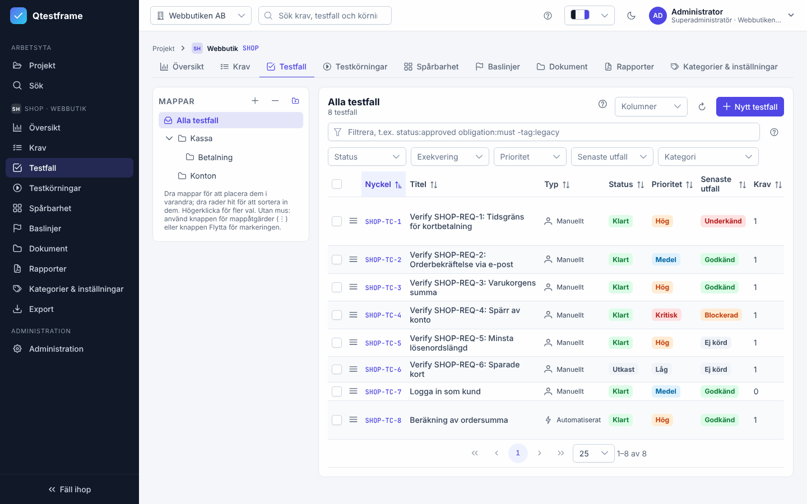

## Fält

| Fält | Användning |
|---|---|
| **Titel** | Ett kort namn (obligatoriskt). |
| **Exekveringstyp** | **Manuellt** eller **Automatiserat**. |
| **Beskrivning** | Vad testfallet handlar om. |
| **Förutsättningar** | Vad som måste gälla innan testet börjar, till exempel *ett kundkonto finns*. Visas för testaren i exekveringsvyn. |
| **Status** | Utkast, Klart, Granskning eller Utfasat. |
| **Prioritet** | Kritisk, Hög, Medel eller Låg. |
| **Uppskattning (minuter)** | Förväntad tidsåtgång. |
| **Ägare** | Den projektmedlem som ansvarar för testfallet. Skriv `@` för att välja en person; testfallet visas då i personens [arbetslista](#mitt-arbete) medan det är utkast eller under granskning, eller när det blir misstänkt eller får inaktuella resultat. |
| **Mapp**, **Kategorier**, **Taggar** | Placering och klassificering. **Föreslagna taggar** under taggfältet kommer från titeln, beskrivningen, förutsättningarna och stegen, som för [krav](#fält). |
| **Förväntat slutresultat** | Det förväntade utfallet av testfallet som helhet. |

## Manuella testfall: steg

Varje steg har en **Åtgärd** (vad som ska göras), ett **Förväntat resultat** (vad som ska hända) och valfri **Data** (indata, konton, filer).


- **Lägg till steg** lägger till ett steg sist; **+** på en rad infogar ett steg nedanför.
- Pilarna flyttar ett steg uppåt eller nedåt; papperskorgen tar bort det.
- När du sparar ersätter steglistan den gamla. Att spara samma steg igen räknas inte som en ändring.

När ett testfall läggs till i en körning kopieras stegen in i körningen. Senare ändringar av testfallet påverkar inte befintliga körningar, bara nya.

## Automatiserade testfall: skript

Växla **Exekveringstyp** till **Automatiserat** för att visa fältet **Skript**. Välj **Skriptspråk**: **sh**, **Bash**, **Python**, **JavaScript** (Node.js) eller **Webbtest (Playwright)** (se [Webbtester](#webbtester-playwright)).

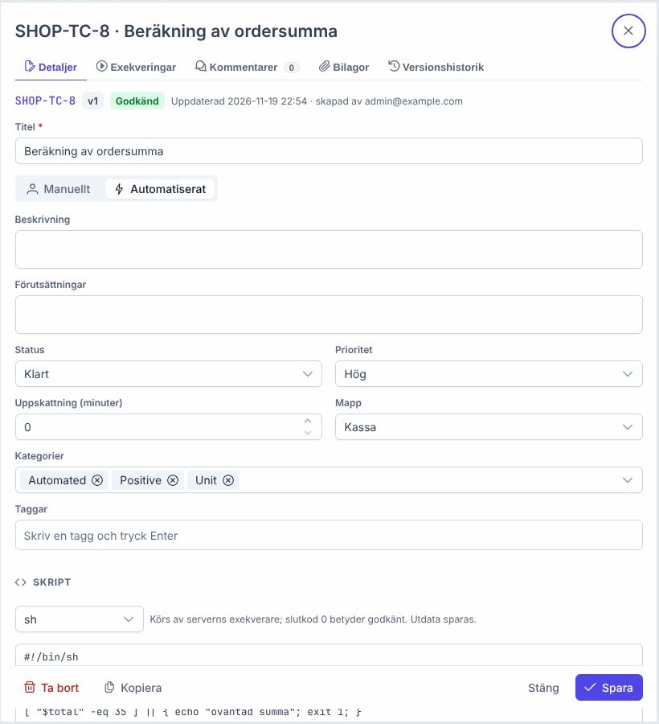

- Skriptet körs på servern i en sandlåda när någon väljer **Kör skript** i exekveringsvyn.
- Slutkod **0** betyder **Godkänd**; alla andra slutkoder, eller en överskriden tidsgräns, betyder **Underkänd**.
- Standardutdata och fel sparas som exekveringens **Utdata**, tillsammans med tidsåtgången.
- Skriptet kan läsa miljövariablerna `QTF_TEST_KEY`, `QTF_RUN_ID`, `QTF_RUN_NAME`, `QTF_ENVIRONMENT`, `QTF_BUILD` och `QTF_BASE_URL`, så att ett skript kan testa den miljö och det bygge som körningen anger. Projektets [testvariabler](#webbtester) finns som `QTF_VAR_<NAMN>`, till exempel `QTF_VAR_USERNAME`; värdena för hemliga variabler maskeras som `***` i sparade utdata.

Att köra skript kräver rollen **Ansvarig** och måste ha aktiverats av administratören (`runner.enabled`). Om dina skript körs någon annanstans, till exempel i en CI-pipeline, lämna skriptet tomt och [importera utfallen](#importera-utfall-från-ci) i stället. **Generera testkod** i listan skriver kodstubbar för sådana testfall för pytest, Playwright, Go, JUnit 5, Jest, Vitest, Robot Framework eller Cucumber, namngivna så att resultaten hittar tillbaka (se [Generera testkod](#generera-testkod)). Steg är valfria för automatiserade testfall.

## Webbtester (Playwright)

Ett **webbtest** styr en riktig webbläsare med [Playwright](https://playwright.dev): välj skriptspråket **Webbtest (Playwright)**. Redigeraren erbjuder en **startmall**; välj **Infoga startmall** när skriptet är tomt.

Skriv skriptet på ett av två sätt:

- **Innehållet i ett test** (det vanliga). Qtestframe lägger in det i ett Playwright-test med testfallets namn, med `page`, `context`, `request` och `baseURL` till hands och `test` och `expect` importerade:

  ```js
  await page.goto('/login');
  await expect(page.getByRole('heading', { level: 1 })).toHaveText('Logga in');
  await page.getByLabel('E-post').fill(process.env.QTF_VAR_USERNAME);
  ```

- **En hel spec-fil**: när skriptet själv anropar `test(` (till exempel `test('…', async ({ page }) => { … })` eller `test.describe(…)`) används det som det är. Importera då `test` och `expect` från `@playwright/test` själv. Alla tester i filen måste gå igenom för att exekveringen ska bli godkänd.

Sökvägar som `page.goto('/login')` är relativa till projektets **bas-URL** (en administratör anger den under **Inställningar → Webbtester**, även en per körningsmiljö). En [testkonfiguration](#testkonfigurationer) med dimensionen **Webbläsare** (eller **Browser**) väljer webbläsare: *Chrome*, *Chromium* eller *Edge* körs i Chromium, *Firefox* i Firefox, *Safari* eller *WebKit* i WebKit; en dimension **Bas-URL** ersätter bas-URL:en.

**Spela in skriptet i stället för att skriva det**: kör `npx playwright codegen https://din-app.example.com` på en dator med Node.js, klicka igenom scenariot i webbläsaren som öppnas och kopiera raderna inuti det genererade `test(…)` till skriptet (eller klistra in hela filen).

Webbtester körs på servern i bakgrunden när någon väljer **Kör skript** eller [Kör automatiserade tester](#kör-alla-automatiserade-tester); utfallet, utdata, skärmbilder och ett spår (trace) sparas med exekveringen (se [Webbtester och deras bevis](#webbtester-och-deras-bevis)). Servern måste ha Playwright installerat och webbtester aktiverade (se [Webbtester](#webbtester)).

## Delade steg

Ett steg kan **anropa** ett annat testfall i samma projekt i stället för att ha en egen åtgärd. Använd det för sekvenser som många testfall har gemensamt, till exempel inloggning.

1. Välj **Infoga anrop till testfall …** bland stegen i ett testfall.
2. Välj testfallet som ska anropas och välj **Infoga anrop**. Steget visar **Anropar** med det anropade testfallets nyckel.
3. Flytta anropssteget till rätt plats och spara.

När en körning skapas ersätts anropet med det anropade testfallets steg (markerade `[NYCKEL]`). Anrop kan nästlas i upp till fem nivåer. Ett testfall kan inte anropa sig självt, och anrop får inte bilda en cykel. Det anropade testfallet visar **Används av:** med alla testfall som anropar det. Om du tar bort ett anropat testfall blir anropet ett tomt steg.

## Datadrivna testfall

Ett datadrivet (parametriserat) testfall skrivs en gång och körs med flera uppsättningar data, till exempel samma inloggning med ett kundkonto, ett företagskonto och ett administratörskonto.

1. Öppna avsnittet **Testdata** under stegen i testfallsredigeraren och välj **Lägg till parameter**. Namnge parametern, till exempel `username` (bokstäver, siffror, `_`, `.` och `-`, inte först en siffra; högst 50 parametrar).
2. Välj **Lägg till rad** för varje uppsättning data och fyll i värdena. En rad kan ha ett namn (*Kund*); utan namn heter den *Rad 1*, *Rad 2* … Pilarna flyttar rader och papperskorgen tar bort en (högst 500 rader).
3. Använd parametrarna i stegen, förutsättningarna, beskrivningen och de förväntade resultaten som `{{username}}` (mellanslag innanför klamrarna går bra: `{{ username }}`).

**Klistra in tabell** tar emot celler som kopierats från Excel, LibreOffice eller Google Kalkylark (eller text åtskild med komma eller semikolon). Ange om första raden namnger parametrarna, om första kolumnen innehåller radnamnen och om de inklistrade raderna ska ersätta testdatan eller läggas till. **Kopiera tabell** kopierar testdatan som en tabell som du kan klistra in i ett kalkylark. En platshållare som inte är en parameter lämnas som den är; redigeraren varnar för sådana platshållare, eftersom de oftast är stavfel.

När testfallet läggs till i en körning blir varje rad en **iteration** av exekveringen, med en egen kopia av stegen där platshållarna har ersatts med radens värden. Ändringar i testdatan efteråt påverkar inte befintliga körningar, bara nya. Ett testfall utan rader exekveras en gång, som tidigare. Under [Datadrivna testfall: iterationer](#datadrivna-testfall-iterationer) beskrivs hur iterationer exekveras och hur det samlade utfallet härleds.

**Delade steg och parametrar:** steg som anropas från ett annat testfall ([delade steg](#delade-steg)) fylls i med parametrarna i det **anropande** testfallet, så ett delat *Logga in som {{username}}* fungerar med varje rad i alla testfall som anropar det. Det anropade testfallets egen testdata används inte när det anropas; den gäller bara när testfallet självt exekveras. Platshållare som det anropande testfallet inte definierar lämnas oförändrade.

Testdatan ingår i testfallets versionshistorik och i exporten (**Exportera → Testdata**: en rad per datarad och parameter).

## Kategorier

Kategorier klassificerar testfall och krav längs **dimensioner**. Nya projekt får dessa standardvärden:

| Gäller | Dimension | Värden |
|---|---|---|
| Testfall | Polarity | Positive, Negative |
| Testfall | Interface | External, Internal |
| Testfall | Medium | File based, Network based |
| Testfall | Execution | Manual, Automated |
| Testfall | Level | Unit, Integration, System, Acceptance |
| Krav | Area | Core, UI, Security, Operations |

Ett objekt kan ha hur många kategorivärden som helst, även flera i samma dimension. Hantera dem under **Kategorier & inställningar**:

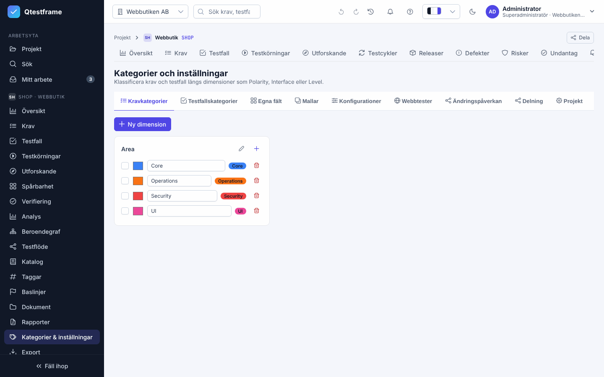

- **Ny dimension** skapar en dimension med dess första värde; **Lägg till värde** lägger till fler.
- Välj en färgruta för att ändra ett värdes färg; värdet visas i den färgen överallt.
- **Byt namn på dimension** flyttar alla värden till ett nytt dimensionsnamn. Om måldimensionen redan har ett värde med samma namn slås de ihop.
- När du tar bort ett värde tas det bort från alla objekt.
- Kryssa i värden (i alla dimensioner på en flik) för att ändra flera på en gång: **Flytta till dimension** (en befintlig eller ett nytt namn; ett värde med samma namn där tar över det flyttade), **Färg**, **Slå ihop** (välj värdet som ska behållas; poster med de andra får det och de andra tas bort, till exempel för att städa bort dubbletter som *UI* och *User interface*), **Kopiera till testfall** / **Kopiera till krav** (värden som redan finns där hoppas över) och **Ta bort**. Varje ändring görs helt eller inte alls; färgändringar kan ångras.

I frågor matchar `category:Negative` värdets namn och `dimension:Polarity/Negative` den fullständiga formen.

På samma sida finns projektets **Namn**, **Beskrivning**, **URL-mall för felhanteringssystem** (se [Defekter](#defekter)), avsnittet [Spara och läs in](#spara-och-läs-in-projekt) (**Spara projekt**, **Duplicera projekt**, **Läs in projekt**) och, för administratörer, **Ta bort projekt**. Att redigera kategorier kräver **Ansvarig** (eller skrivbehörighet för deras område, Testare för testfallskategorier).

## Markera många tester som klara på en gång

Den som har `test.review` kan markera många tester som *Klart* i ett steg: kryssa i testerna och välj **Markera som klara…**, eller välj **Massgranskning** ovanför listan när inget är markerat. Precis som för krav (se [Godkänn många krav på en gång](#godkänn-många-krav-på-en-gång)) väljer du tester (markerade, de som visas i listan eller alla), vilka statusar de får komma från (som standard *Granskning*; lägg till *Utkast* för att ta med utkast) och en valfri kommentar, och en förhandsgranskning visar vad som ändras.

Utöver kontrollerna för krav (den senaste granskningen begärde ändringar, öppna granskningsförfrågningar, misstänkta länkar) hoppas ett test över när det inte kan köras som det är skrivet: ett **manuellt test utan steg** eller ett **automatiserat test utan skript**. Välj kontrollen under **Ta med ändå, trots** för att markera dem som klara ändå.

## Kalkylbladsvy

Välj **Kalkylblad** för att redigera testfall som i ett kalkylblad; det fungerar som för [krav](#kalkylbladsvy) (tangentbord, kopiera och klistra in från Excel, fyll nedåt, nya rader, sparande, konflikter, ångra och **Exportera vyn**). Kolumnerna är **Nyckel**, **Titel**, **Beskrivning**, **Prioritet**, **Status**, **Exekvering**, **Förutsättningar**, **Förväntat resultat**, **Uppskattning (min)**, **Kategorier**, **Taggar**, **Mapp** och de skrivskyddade **Steg** (antalet steg), **Senaste utfall**, **Krav**, **Skapad av** och **Version**. Steg, skript och testdata redigeras i redigeraren (dubbelklicka på nyckeln eller tryck **Ctrl+Enter**). Att sätta ett testfall till *Klart* är ett granskningsbeslut och kräver `test.review`, i bladet som i redigeraren.

## Kopiera ett testfall

**Kopiera** i redigeraren skapar en kopia med titeln *Copy of …* och en ny nyckel i samma mapp, med steg, kategorier och taggar. Kopian börjar som **Utkast** och granskas alltså på nytt. Länkar till krav kopieras inte.

Ett testfall blir **Klart** genom en granskning: att sätta den statusen kräver behörigheten *test.review* (Granskare, Testledare eller Ansvarig); granskare ser knappen **Markera som klart** överst i redigeraren.

## Länkade krav

Avsnittet **Länkade krav** visar vilka krav testfallet verifierar. **Länka krav** lägger till länkar; **×** tar bort en. Testfall utan länkar bidrar inte till täckningen.

## Beroenden

Ett testfall kan **bero på** andra testfall: de är dess förutsättningar och måste ha godkänts innan det får startas. Till exempel beror *Ändra leveransadress* på *Logga in*.

I testfallsredigeraren listar avsnittet **Beror på** förutsättningarna med deras senaste utfall. Välj **Lägg till förutsättning** för att välja testfall i samma projekt, och **×** för att ta bort en *(Testare)*. **Krävs av** listar de testfall som väntar på det här. Ett testfall kan inte bero på sig självt, och beroenden får inte bilda en cykel.

När testfallet exekveras räknas en förutsättning som godkänd när dess exekvering i samma körning har godkänts; när förutsättningen inte ingår i körningen räknas dess senaste utfall. Fram till dess visar exekveringsvyn varför testfallet inte kan startas, om inte [inställningarna för testexekvering](#inställningar-för-testexekvering) tillåter det. Kolumnen **Relationer** i testfallslistan visar *beror på* och *krävs av*, [beroendegrafen](#beroendegrafer) ritar dem, och filtret `depends_on:SHOP-TC-1` (eller `depends:`) hittar testfallen som beror på SHOP-TC-1.

## Testflöde

**Testflöde** i projektets navigering (eller **Flödesschema** längst ned i testfallsredigeraren) ritar ett testfall som ett flödesschema:

- **Start**, sedan kontrollen **Förutsättande test godkända?** när testfallet har [beroenden](#beroenden) (nej → *Blockerat*), sedan **Förutsättningarna**;
- varje steg som en ruta med nummer, åtgärd och testdata; ett steg med förväntat resultat följs av beslutet **Som förväntat?** vars *nej*-gren slutar i **Underkänt**;
- ett [delat steg](#delade-steg) som en ruta med dubbla sidokanter (*Kör stegen i TC-…*). Välj det, eller dess knapp under **Delade steg**, för att visa det anropade testfallets steg på plats, numrerade 3.1, 3.2 …, inom en streckad ram; **Fäll ut alla** och **Fäll ihop alla** gör det för alla anrop. Ett testfall som anropar sig självt markeras och fälls inte ut;
- ett automatiserat testfall som **Kör skriptet** följt av **Slutkod 0?**;
- det övergripande **förväntade resultatet** som en sista kontroll, och **Godkänt** i slutet.

**Lista** visar samma flöde som en numrerad textlista, med utfallet *annars* för varje kontroll. Använd zoomknapparna för stora testfall.

**Körordning** visar en testkörning i **etapper**: ett testfall placeras efter alla testfall i körningen som det beror på, så etapp 1 innehåller testfallen utan förutsättande test i körningen. Testfallen i en etapp kan exekveras i valfri ordning eller parallellt. Varje kort visar det senaste utfallet i körningen, vilka testfall det väntar på och länkar till exekveringsvyn och till dess flödesschema. Förutsättande test som inte ingår i körningen visas som varningar.

## Exekveringshistorik

Fliken **Exekveringar** listar alla exekveringar av testfallet i alla körningar, nyast först, med körning, miljö och bygge, utfall, vem som exekverade, när, tidsåtgång och eventuella defekter. Använd den för att se om ett testfall är instabilt eller när det började underkännas.


I körningar med [konfigurationer](#konfigurationer-i-en-körning) visas varje exekverings konfiguration under körningen, och en datadriven exekvering länkar till sina iterationer i exekveringsvyn.

Kolumnen **Senaste utfall** visar det senaste utfallet (i vilken konfiguration som helst). I frågor hittar `last_result:failed` testfall vars senaste utfall är underkänt och `defect:SHOP-*` testfall med en sådan defekt.

Ett utfall markerat med **Växling** skiljer sig från testfallets föregående godkända eller underkända utfall: där började testfallet underkännas, eller blev godkänt igen.

## Instabila testfall

Ett testfall är *instabilt* när utfallet växlar fram och tillbaka mellan godkänt och underkänt utan att testfallet eller produkten har ändrats däremellan. Qtestframe tittar på de 10 senaste godkända eller underkända utfallen för varje testfall, från alla körningar – manuella utfall och automatiserade utfall från JUnit-importer, uppladdaren `qtestframe report` och Playwright-rapportören. Blockerade, överhoppade och ej körda utfall räknas inte, eftersom de inte säger något om själva testfallet.

Testfallets *instabilitet* är antalet växlingar bland de utfallen: ett godkänt utfall efter ett underkänt, eller tvärtom. Ett testfall med **2 eller fler växlingar** räknas som instabilt. Ett testfall som gick sönder en gång och lagades har högst två växlingar utspridda över lång tid; ett testfall som växlar hela tiden når gränsen snabbt.

- I listan över testfall har instabila testfall märket **Instabilt** bredvid det senaste utfallet (håll pekaren över det för att se antalet växlingar).
- Frågan `flaky:true` listar de instabila testfallen; `flakiness>=3` (eller `flips>=3`) dem med minst tre växlingar.
- Fliken **Kvalitet** på [översikten](#översikten) visar de tio mest instabila testfallen med deras senaste utfall.
- Fliken **Exekveringar** för ett testfall markerar varje växling.

Ett instabilt testfall döljer verkliga fel och kostar tid i omkörningar: hitta orsaken (tidsberoenden, testdata, ordningen, miljön) eller lägg testfallet åt sidan tills det är åtgärdat.

## Kommentarer och versionshistorik

Fliken **Diskussion** och **Versionshistorik** fungerar precis som för [krav](#diskussion) (se [Diskussioner](#diskussioner)). När du återställer en version av ett testfall återställs fälten och stegen som en ny version; stegen får nya id:n och anrop till borttagna testfall tas bort. Om någon annan sparar ett testfall medan du redigerar det kan du jämföra och välja i stället för att skriva över den andras ändringar, se [När någon annan har sparat först](#när-någon-annan-har-sparat-först).

## Länkar

Fliken **Länkar** för ett testfall länkar det till andra testfall, krav, körningar, dokument och sparade rapporter i arkivet, rapportdefinitioner och webbadresser, se [Länkar](#länkar).

## Bilagor

Fliken **Bilagor** innehåller filer för testfallet: testdata, förväntade skärmbilder, konfigurationsfiler. Ladda upp genom att dra och släppa eller välja filer, eller använd **Bifoga från arkivet**. Att ladda upp och ta bort kräver **Testare**. Se [Krav → Bilagor](#bilagor) för detaljer.

# Katalog

**Katalogen** är ett inbyggt bibliotek med standardkrav och testfall för programvaruutveckling: säkerhet, integritet och regelefterlevnad, prestanda och tillförlitlighet, drift och underhåll, användbarhet och tillgänglighet (även formulär, användarinställningar och mobilappar), vanlig funktionalitet (även arbetsflöde och godkännanden, samarbete, filer, schemaläggning) samt domänspecifik funktionalitet som kassa i e-handel, fakturering, industriella automations- och styrsystem, elenergi, olja och gas, telekom, kemisk industri samt industriell tillverkning. I stället för att skriva *"Lösenord ska vara minst 12 tecken"* och dess testfall i varje projekt väljer du de poster som passar och lägger till dem i projektet på en gång, med testfall och spårlänkar. Katalogen beskriver också de typiska **riskerna** inom varje område (se [Risker i katalogen](#risker-i-katalogen)), var och en kopplad till de krav som åtgärdar den.

För att bläddra i katalogen behövs behörighet att läsa krav eller testfall (alla roller har den). Att lägga till krav och risker kräver **Ansvarig** (`requirement.write`), att lägga till testfall **Testare** (`test.write`).

## Varifrån texterna kommer

Katalogens texter är skrivna för Qtestframe, på engelska och svenska. Varje post bygger på erkända standarder och god praxis, till exempel OWASP ASVS och OWASP Top 10, WCAG 2.2, ISO/IEC 25010, NIST SP 800-63B, ISO/IEC 27001 och andra standarder i ISO/IEC 27000-serien (27002, 27005, 27017, 27018, 27019, 27035, 27701 …), IEC 62443, PCI DSS och EU-lagstiftning: dataskyddsförordningen (GDPR), cyberresiliensförordningen (CRA), DORA, NIS2, direktivet om kritiska entiteters motståndskraft (CER), radioutrustningsdirektivet (RED, med EN 18031) och AI-förordningen. Den **hänvisar** till dem under **Baserad på** med namn och avsnitt. Katalogen kopierar inte texten i någon standard: läs standarden när du behöver dess exakta lydelse.

För svenska organisationer omfattar gruppen *Integritet och regelefterlevnad* även säkerhetsskydd enligt säkerhetsskyddslagen (2018:585) och cybersäkerhetslagen, som genomför NIS2-direktivet, och grupperna *Säkerhet* samt *Drift och underhåll* omfattar samordnat offentliggörande av sårbarheter (ISO/IEC 29147, RFC 9116, CSAF) och sårbarhetshantering (ISO/IEC 30111, IEC 62443-4-1, EU:s cyberresiliensförordning). Posterna hänvisar till lagar och förordningar med namn och avsnitt; de hjälper er att planera och kontrollera men är inte juridisk rådgivning.

Varje krav är ett verifierbart påstående med exakt ett förpliktelseord (SKA, BÖR, FÅR … på svenska; MUST, SHOULD, MAY … på engelska, se [Krav](#krav)), utvärderingskriterier och en motivering. Varje testfall har förutsättningar, numrerade steg med ett förväntat resultat vardera och ett samlat förväntat resultat. Värden som ett team brukar justera (12 tecken, 2 sekunder, 99,9 %) står i texten, så att du kan ändra dem när posten har lagts till.

Varje krav anger minst ett testfall i katalogen som verifierar det, och varje testfall verifierar minst ett krav, så när du lägger till ett krav med dess testfall har du alltid ett sätt att kontrollera det. Varje post är komplett på både engelska och svenska, med samma kriterier och steg på båda språken.

## Bläddra och sök

Öppna **Katalog** i projektets sidomeny eller välj **Lägg till från katalogen** överst i listan med krav eller testfall.

- Växla mellan **Krav**, **Testfall** och **Risker** överst.
- Välj **English** eller **Svenska** som språk för texterna. Posterna läggs till på det språket.
- **Katalogtyp** begränsar katalogen till ett slags arbete: *Programvara*, *Hårdvara*, *Utrustning*, *System*, *Kommunikationslösningar*, *Projekt*, *Tjänster*, *Byggnader och anläggningar*, *Styrning*, *Dokumentation* eller *Utbildning* (bara typer med innehåll visas). Den börjar med typen som passar projektet: programvaruprojekt visar *Programvara*, hårdvaruprojekt *Hårdvara*, systemprojekt *System* och verksamhetsprojekt *Styrning*; allmänna projekt visar **Alla typer**. Trädet, listorna och lagarna och standarderna följer valet.
- Till vänster visar **Grupper och områden** katalogens grupper (till exempel *Säkerhet*) och deras områden (till exempel *Autentisering*) med antalet poster som matchar sökningen och filtren. Välj **Allt** för att se alla områden. Flytta i trädet med piltangenterna och välj med Enter. På en smal skärm öppnas trädet med knappen **Områden**.
- **Sökfältet** hittar poster vars titel, ID, taggar, standarder eller beskrivning innehåller alla ord du skriver (skriv till exempel `62443` eller `27001` för att lista posterna som hänvisar till den standarden). De bästa träffarna kommer först: ett exakt ID som `AUTH-01`, sedan orden i titeln, sedan de andra fälten.
- Begränsa listan med **Typ**, **Förpliktelse** och **Prioritet** (krav), **Utförande** (testfall), **Kategori** och **Risknivå** (risker) och **Taggar**. **Dölj poster som redan finns i projektet** visar inte det du har lagt till tidigare.

Varje rad visar ID, titel, förpliktelse och prioritet, hur många testfall i katalogen som verifierar kravet och hur många risker i katalogen det åtgärdar (eller hur många krav testfallet verifierar). **I projektet** markerar poster som projektet redan har; håll pekaren över märket för att se deras nycklar.

## Uppfyll lagar, standarder och bästa praxis

När projektet ska uppfylla ett regelverk eller en standard kan katalogen ta fram kraven för det:

1. Under **Uppfyll lagar, standarder och bästa praxis** väljer du **Välj lagar och standarder…**.
2. Dialogen visar alla lagar, förordningar, direktiv, standarder, bästa praxis och vägledningar som katalogen hänvisar till, grupperade efter slag (*Lagar och förordningar*, *Direktiv*, *Standarder och specifikationer*, *Bästa praxis och ramverk*, *Riktlinjer och vägledningar*). Varje källa visar sin förkortning, sin jurisdiktion (EU, Sverige, internationell …) och hur många katalogkrav som hänvisar till den och hur många testfall som verifierar dem, räknat i den valda katalogtypen. Skriv i sökfältet för att hitta en källa på namn, förkortning eller jurisdiktion (`CRA`, `27001`, `Sverige`). Kryssa i källorna en och en, eller ett helt slag med rutan vid rubriken; länkikonen öppnar källans text där den är känd.
3. Välj **Visa kraven**. Båda flikarna visar nu bara posterna för de valda källorna: kraven som hänvisar till någon av dem och, under varje krav, katalogens testfall som verifierar det (**Verifieras av:**; välj ett testfall för att förhandsvisa det). En etikett på varje krav visar vilka av de valda källorna det hänvisar till.
4. Rutan sammanfattar hur många krav som hänvisar till källorna, hur många testfall som verifierar dem och hur många projektet redan har. **Lägg till de N saknade kraven med deras testfall** kryssar i de krav som projektet inte har ännu och öppnar den vanliga dialogen (se nedan), som lägger till dem med testfall och spårlänkar, hoppar över dubbletter och skapar de mappar du väljer.

Ta bort en källa med × på dess etikett, eller välj **Rensa valet** för att se hela katalogen igen. Valet ingår i sidans adress, så du kan spara eller dela det. Bland källorna finns EU:s förordningar och direktiv (GDPR, CRA, NIS2 och dess genomförandeförordning, DORA, CER, RED med EN 18031, AI-förordningen, ePrivacy, eIDAS …), svensk lag (cybersäkerhetslagen, säkerhetsskyddslagen och säkerhetsskyddsförordningen, lagen om tillgänglighet till digital offentlig service …), standarder (ISO/IEC 27001, 27002 och övriga delar av 27000-serien, IEC 62443-2-1 till 4-2, ISO/IEC 29147 och 30111, ISO/IEC 25010, WCAG 2.2, IEC 61508, 61511, 61850 …) och bästa praxis (OWASP ASVS och Top 10, NIST SP 800-63, ITIL 4, Google SRE …). Hur väl projektet uppfyller dem visas under [Efterlevnad av lagar och standarder](#efterlevnad-av-lagar-och-standarder) i kravanalysen.

## Förhandsvisa en post

Välj en rad för att se hela texten till höger (på en mobil öppnas den som en panel): beskrivningen med förpliktelseordet markerat, motiveringen, utvärderingskriterierna med gränsvärden, standarderna och katalogens testfall som verifierar kravet. För ett testfall ser du förutsättningarna, stegen, det förväntade resultatet och kraven det verifierar. Ett krav visar även de risker i katalogen som det åtgärdar. Välj ett ID under *Verifieras av*, *Verifierar* eller *Åtgärdar* för att gå till den posten.

## Lägg till poster i projektet

1. Markera de poster du vill ha. **Markera alla som visas** markerar allt i listan, så välj först området i trädet om du vill ta ett helt område. Du kan markera krav och testfall på båda flikarna; listen längst ned räknar dem.
2. Välj **Lägg till N krav (+ M testfall)**. M omfattar testfallen som verifierar de valda kraven.
3. Välj i dialogen:
   - **Språk** för texterna.
   - **Mapp för kraven** och **Mapp för testfallen** (översta nivån som standard).
   - **Undermappar**: inga, *en mapp per område* (till exempel *Autentisering*) eller *mappar för grupp och område* (*Säkerhet / Autentisering*). Befintliga mappar med samma namn återanvänds.
   - **Status** för kraven och testfallen (*Utkast* som standard, så att de granskas som andra nya poster).
   - **Källa för kraven**: de angivna standarderna (standard) eller en av projektets källor.
   - **Lägg även till testfallen som verifierar de valda kraven** (på som standard).
   - **Lägg till kopior av poster som redan finns i projektet**: av som standard, så att poster som projektet redan har hoppas över.
4. Sammanfattningen visar hur många krav och testfall som läggs till och hur många som hoppas över. När några av de valda kraven säger samma sak som krav som projektet redan har (skrivna för hand eller från en annan katalogpost) listas de med det mest lika projektkravet och dess likhet, och **Hoppa över kraven som liknar befintliga** hoppar över dem (orsak *similar*). Se [Dubbletter och konflikter](#dubbletter-och-konflikter).
5. Välj **Lägg till**.

Högst 500 poster kan läggas till åt gången. Importen sker helt eller inte alls: om något misslyckas läggs ingenting till.

Qtestframe skapar kraven och testfallen som om du hade skrivit dem, med en första version i historiken, och skapar **spårlänkar** mellan varje krav och testfallen som verifierar det, även till motsvarande poster som lagts till i projektet tidigare. Det automatiska länkade testfallsutkastet som ett nytt krav annars får skapas inte: katalogens testfall ersätter det.

## Risker i katalogen

Fliken **Risker** listar typiska risker inom områdena: vad som kan gå fel, till exempel *Konton tas över med läckta lösenord* eller *Tryckkärl brister*. Det finns risker för informationssäkerhet, integritet, AI, tillgänglighet och drift, data, leverantörskedjan, hårdvara, utrustning och byggnader (personsäkerhet), tjänster, styrning och projekt. Varje risk har:

- en **kategori** (informationssäkerhet, integritet, personsäkerhet, tillgänglighet, data, regelefterlevnad, leverantörskedja, AI, drift, kvalitet, projekt eller miljö);
- en beskrivning av hotet eller faran och dess konsekvens;
- en **typisk sannolikhet och konsekvens** på samma skala 1–5 som i [riskregistret](#riskregistret), och den nivå de ger (låg, medel, hög, kritisk);
- en **föreslagen åtgärd**;
- de krav i katalogen som **åtgärdar** den (minst ett, från vilket område som helst), och ibland testfall i katalogen som kontrollerar den direkt;
- källorna den bygger på under **Baserad på**: standarder för riskhantering (ISO 31000, ISO/IEC 27005, ISO/IEC 23894 för AI, ISO 14971 för medicintekniska produkter, ISO 26262 för fordon, ISO 12100 för maskiner, IEC 62443-3-2 för industriella system), AI-förordningens riskhantering (art. 9), dataskyddsförordningens konsekvensbedömning (art. 35), hotkataloger (OWASP Top 10, ENISA Threat Landscape) och CWE-svagheterna i de åtgärdande kraven;
- för risker som orsakas av en angripare, de **MITRE ATT&CK-tekniker** som förverkligar dem (se [MITRE ATT&CK](#mitre-attck)).

Filtrera riskerna på **Kategori**, **Risknivå**, **ATT&CK-taktik** och **ATT&CK-teknik**, på område i trädet, på tagg eller på de lagar och standarder som ska uppfyllas (en risk räknas för en källa när den själv eller något av dess åtgärdande krav hänvisar till källan). Förhandsvisningen visar beskrivningen, den föreslagna åtgärden och de åtgärdande kraven; välj ett för att öppna det.

**Lägg till en risk med dess åtgärder.** Markera risker och välj **Lägg till N risker (+ krav, testfall)**. Dialogen lägger till:

- riskerna som risker i projektet, med titel, beskrivning, kategori, föreslagen åtgärd och den typiska sannolikheten och konsekvensen (justera dem efter er egen bedömning efteråt), med statusen *Identifierad* eller *Åtgärdas*;
- med **Lägg även till de krav som åtgärdar de valda riskerna** (på som standard) de åtgärdande kraven, och med **Lägg även till testfallen som verifierar de valda kraven** deras testfall;
- kopplingar mellan varje ny risk och de krav i projektet som åtgärdar den, både de nya och de som lagts till tidigare.

**Lägg till krav med deras risker.** När du lägger till krav som åtgärdar risker i katalogen erbjuder dialogen **Lägg även till de N risker som kraven åtgärdar**. Krav som du lägger till senare kopplas till de risker från katalogen som projektet redan har, så ordningen spelar ingen roll.

Risker som projektet redan har från katalogen hoppas över, precis som krav och testfall, om du inte väljer **Lägg till kopior av poster som redan finns i projektet**.

## MITRE ATT&CK

[MITRE ATT&CK](https://attack.mitre.org/) beskriver hur angripare arbetar: **taktiker** är deras mål (initial åtkomst, åtkomst till inloggningsuppgifter, påverkan …) och **tekniker** sätten att nå dem, till exempel *T1110.004 Brute Force: Credential Stuffing*. Katalogen känner till teknikerna i matriserna Enterprise, ICS (industriella styrsystem) och Mobile, utan återkallade eller utfasade, och [MITRE ATLAS](https://atlas.mitre.org/)-teknikerna för angrepp mot AI-system (*AML.T0051 LLM Prompt Injection*). Namnen på taktiker och tekniker visas på engelska, som hos MITRE.

- Varje risk i katalogen som orsakas av en angripare anger de tekniker som förverkligar den: alla informationssäkerhetsrisker, och risker för integritet, AI, tillgänglighet, data och leverantörskedjan när en angripare orsakar dem. Faror, fel och skyldigheter (risker för personsäkerhet, kvalitet, projekt, miljö och regelefterlevnad) har inga.
- **Förhandsvisningen** av en risk visar varje teknik med namn, matris och taktiker, med en länk till dess sida på attack.mitre.org eller atlas.mitre.org. **visa risker med tekniken** filtrerar listan på den.
- **ATT&CK-taktik** och **ATT&CK-teknik** filtrerar riskerna; en teknik hittar även sina undertekniker (*T1110* hittar *T1110.004*). Sökningen hittar också tekniknummer.
- **Täckning av ramverk** högst upp på sidan (fliken **ATT&CK**) visar för varje matris taktikerna med antalet risker i katalogen som anger någon av deras tekniker och antalet krav som hänvisar till en eller åtgärdar en sådan risk, och en matris över de tekniker som används, mörkare med fler risker. Välj ett antal eller en teknik för att öppna de risker det gäller.

En risk som du lägger till i projektet behåller sina tekniker: riskdialogen visar dem under **MITRE ATT&CK-tekniker**, där du kan ändra dem (se [Riskregistret](#riskregistret)).

## MITRE D3FEND och EMB3D

Två ramverk till från MITRE kopplar katalogen till försvaret och till inbyggda enheter:

- [MITRE D3FEND](https://d3fend.mitre.org/) är en kunskapsgraf över **försvarstekniker**, grupperade efter taktikerna *Model*, *Harden*, *Detect*, *Isolate*, *Deceive*, *Evict* och *Restore* (till exempel *D3-MFA Multi-factor Authentication* eller *D3-BA Bootloader Authentication*). Säkerhetskrav och testfall anger de tekniker som de genomför eller verifierar.
- [MITRE EMB3D](https://emb3d.mitre.org/) är en hotmodell för **inbyggda enheter**: hot som *TID-201 Inadequate Bootloader Protection and Verification* och åtgärder som *MID-026 Secure Firmware Update*. Krav och testfall för enheter, industriella system och sakernas internet anger de åtgärder och hot de hanterar, och risker de hot som förverkligar dem.

Katalogen använder de publicerade data för D3FEND och EMB3D; id:n som ramverken inte längre har går inte att använda. Namnen visas på engelska, som hos MITRE.

- **Förhandsvisningen** visar teknikerna, åtgärderna och hoten med länkar till deras sidor; **visa poster med den** filtrerar listan på en av dem.
- **D3FEND-teknik** och **EMB3D-id** filtrerar krav och testfall (risker: **EMB3D-id**). Ett valt hot hittar även de krav som anger någon av dess åtgärder. Sökningen hittar också id:na.
- **Försvar (D3FEND)** i förhandsvisningen av en risk visar för var och en av dess ATT&CK-tekniker de D3FEND-tekniker som motverkar den (så som D3FEND kopplar försvars- och angreppstekniker) och de krav i katalogen som genomför dem, med riskens egna åtgärdande krav först. En teknik som inget av riskens krav motverkar markeras som en **lucka**: överväg att lägga till något av de listade kraven.
- **Täckning av ramverk** högst upp på sidan har en flik per ramverk: **ATT&CK** (se ovan), **D3FEND** (per taktik de försvarstekniker som krav och testfall genomför, och hur många risker som är helt motverkade) och **EMB3D** (per hotkategori varje hot med de risker, krav och testfall som hanterar det; **Bara luckor** visar de hot som inget krav hanterar).

Poster som du lägger till i projektet behåller sina kopplingar: krav och testfall sina D3FEND-tekniker och EMB3D-id, risker sina EMB3D-hot (se [Fält](#fält) och [Riskregistret](#riskregistret)).

Området **Säkerhet i inbyggd firmware och mikrokontroller** (katalogtyp *Hårdvara*) samlar krav, testfall och risker för firmware i mikrokontroller och resurssnåla enheter: hårdvarubaserad förtroendekälla, mätt uppstart och attestering, härdning av startladdare och uppdateringar, skydd mot utläsning och felsökning, nyckellagring, motståndskraft mot sidokanals- och felinjiceringsattacker, minnesskydd och härdning av realtidsoperativsystem, säker kommunikation i resurssnåla nät, materialförteckning för firmware och sårbarhetshantering. Det kompletterar **Säkerhet i inbyggda enheter** och är kopplat till EMB3D genomgående.

## Efteråt

En ruta överst på sidan sammanfattar vad som lades till, och hur många av de tillagda kraven som liknar krav som projektet hade, med en länk till **Granska dubbletter**. **Öppna de tillagda kraven**, **Öppna de tillagda testfallen** och **Öppna de tillagda riskerna** öppnar listorna filtrerade på de nya posterna. **Ångra** (eller Ctrl+Z) flyttar dem till papperskorgen (risker tas bort); gör om tar tillbaka dem med sina länkar. Mappar som importen skapade finns kvar.

De tillagda posterna är vanliga poster i projektet: anpassa texterna och värdena till ert system. Redigeraren visar **Från katalogen: AUTH-01 · …** med standarderna, och **Visa i katalogen** öppnar originalposten. Ursprunget behålls när du redigerar, kopierar, flyttar eller återställer posten. I filter hittar `catalog:AUTH-01` posterna som kopierats från en katalogpost, `catalog:AUTH-*` ett områdes poster och `has:catalog` alla poster från katalogen (se [Sökning och filter](#sökning-och-filter)). En risk från katalogen visar sitt ID under kategorin i registret; registret kan visa riskerna inom ett område i katalogen.

## Tips

- Starta ett nytt projekt från katalogen: lägg till de grupper som gäller och ta sedan bort eller anpassa det som inte passar.
- Använd statusen **Utkast** och en [massgranskning](#krav) för att enas om de anpassade posterna i teamet.
- Katalogen är en del av Qtestframe och växer med nya versioner. Poster som du har lagt till ändras inte när katalogen ändras.

# Testkörningar och exekvering

En **körning** (testkörning, kampanj) är en uppsättning testfall som du exekverar tillsammans, till exempel *Regressionstest sprint 12* i miljön *staging* med bygget *1.4.2*. Varje testfall i en körning är en **exekvering** med ett eget utfall. Körningarna finns under **Testkörningar** i projektets sidopanel.

| Åtgärd | Roll som krävs |
|---|---|
| Visa körningar och utfall | Läsare |
| Skapa, redigera och ta bort körningar, lägga till testfall | Testare |
| Registrera utfall, importera utfall från CI | Testare |
| Köra automatiserade skript på servern | Testledare |
| Ändra [inställningarna för testexekvering](#inställningar-för-testexekvering) | Testledare |

## Listan över körningar

**Testkörningar** listar projektets körningar med status, miljö, bygge, förloppsstapel och andel godkända. Filtrera med frågespråket, till exempel `status:in_progress env:staging`. Välj en körning för att öppna den.

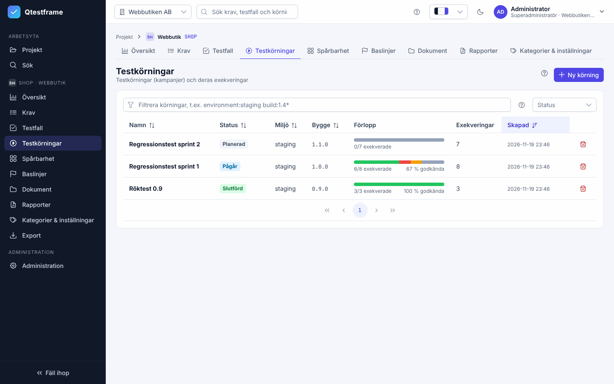

## Ändra många körningar på en gång

Kryssa i körningarna i listan (eller rubrikens kryssruta för hela sidan). Verktygsfältet som visas ändrar alla på en gång (behörighet att ändra körningar):

- **Ange status**: till exempel avbryta gamla körningar, eller avsluta körningar som i praktiken är klara.
- **Ange release**: lägg körningarna i en [release](#releaser-och-risker), eller ta bort dem ur en.
- **Miljö / bygge**: ange miljö, bygge eller båda (ett tomt fält rensar).
- **Ta bort**: ta bort körningarna med alla resultat, efter bekräftelse.

Ändringar av status, release, miljö och bygge kan ångras med ångra-knappen i övre fältet; borttagning kan inte ångras.

## Skapa en körning

Välj **Ny körning** och fyll i:

- **Namn**, till exempel *Regressionstest sprint 12* (ett namn med datum föreslås);
- **Beskrivning**, **Miljö** (t.ex. *staging*) och **Bygge** (t.ex. *1.4.2+sha*): fri text som visas med utfallen och skickas till automatiserade skript;
- **Konfigurationer** (när projektet har [testkonfigurationer](#testkonfigurationer)): de konfigurationer som körningen gäller, till exempel *Chrome / Windows* och *Firefox / Linux*. Varje testfall exekveras då en gång per konfiguration; se [Konfigurationer i en körning](#konfigurationer-i-en-körning). Utan konfigurationer exekveras varje testfall en gång;
- **Testfall som ska ingå**: unionen av tre flikar:
  - **Testfall**: **Välj testfall …** för att välja enskilda testfall;
  - **Mappar**: testfallen i de valda mapparna, inklusive undermappar;
  - **Fråga**: alla testfall som matchar ett filter som `status:ready category:Negative`; **Förhandsgranska** räknar träffarna.

Välj **Skapa körning**. Ett testfall finns bara en gång i en körning även om flera flikar väljer det. Utan testfall startar körningen tom och du lägger till testfall senare.

När ett testfall läggs till kopieras dess aktuella steg (med delade steg utvecklade) in i exekveringen. Senare ändringar av testfallet påverkar inte den här körningen.

## Körningens sida

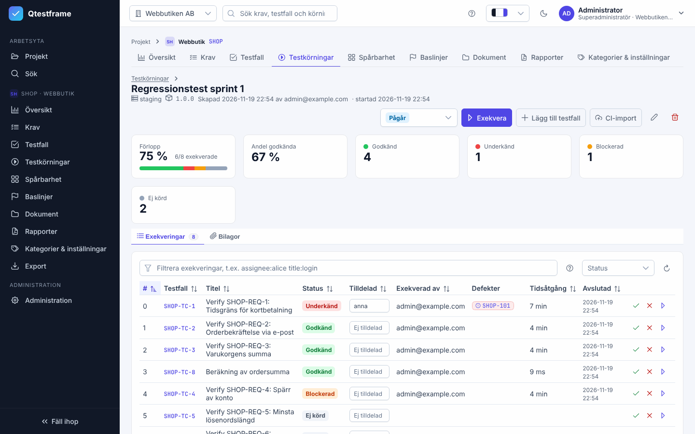

- **Körningens status**: **Planerad**, **Pågår**, **Slutförd** eller **Avbruten**. Starttiden sätts när körningen första gången får status *Pågår* (även automatiskt när det första utfallet registreras), sluttiden när den blir *Slutförd* eller *Avbruten*. En körning blir **Slutförd av sig själv** när varje testfall i den har ett slutligt utfall (godkänt, underkänt, blockerat eller överhoppat), även en körning med ett enda testfall. Den går tillbaka till *Pågår* när ett utfall återställs till *Ej kört* eller *Pågår*, eller när testfall läggs till. Du kan fortfarande ändra statusen för hand; en *Avbruten* körning ändras aldrig automatiskt.
- **Förlopp** och **Andel godkända** sammanfattar exekveringarna.
- **Exekvera** öppnar exekveringsvyn vid den första exekveringen som ännu inte har körts.
- **Lägg till testfall** lägger till fler testfall; **CI-import** visar hur en pipeline rapporterar utfall; **Redigera körning** ändrar namn, beskrivning, miljö och bygge; **Ta bort** tar bort körningen med alla dess utfall.
- Tabellen listar varje exekvering med testfall, utfall, **Tilldelad**, **Exekverad av**, **Defekter**, tidpunkten **Avslutad** och tidsåtgången. Filtrera den, till exempel `status:failed` eller `assignee:anna`.
- Per rad: **Markera som godkänd** och **Markera som underkänd** registrerar ett utfall direkt; uppspelningsknappen öppnar exekveringen i exekveringsvyn.

## Konfigurationer i en körning

En körning kan gälla en eller flera [testkonfigurationer](#testkonfigurationer). När ett testfall läggs till skapas då **en exekvering per testfall och konfiguration**: en körning med 10 testfall och 3 konfigurationer har 30 exekveringar.

- Listan över körningar visar varje körnings konfigurationer i kolumnen **Konfigurationer**; filtret `configuration:Chrome` (eller `config:`) hittar körningar som gäller en konfiguration.
- På körningens sida visar **Utfall per konfiguration** framsteg och andel godkända för varje konfiguration; välj en konfigurations namn för att bara se dess exekveringar, eller använd **Visa konfiguration** ovanför tabellen. Kolumnen **Konfiguration** anger varje exekverings konfiguration, och filtret `configuration:"Chrome / Windows"` fungerar även i exekveringstabellen.
- **Redigera körning → Konfigurationer** ändrar konfigurationerna i efterhand. En tillagd konfiguration får en exekvering för varje testfall i körningen. En borttagen konfigurations exekveringar tas bort, vilket nekas så länge någon av dem har ett utfall (sätt dem först tillbaka till *Ej körd*). Den första konfigurationen som läggs till i en körning utan konfigurationer tar över de befintliga exekveringarna; tas den sista bort blir dess exekveringar kvar som exekveringar utan konfiguration.
- Förutsättningar ([beroenden](#beroenden)) räknas per konfiguration: i en körning räknas en förutsättning som godkänd när den har godkänts i **samma konfiguration**.
- Exekveringsvyn visar konfigurationen i sidhuvudet, och ett testfalls [exekveringshistorik](#exekveringshistorik) visar varje exekverings konfiguration.

Körningar utan konfigurationer fungerar precis som tidigare. Hur utfall i flera konfigurationer räknas för krav beskrivs under [Så beräknas täckningen](#så-beräknas-täckningen).

## Spara många utfall på en gång

På körningens sida kryssar du i tester i exekveringstabellen (rubrikens kryssruta markerar hela sidan). Verktygsfältet erbjuder då:

- **Ange resultat**: *Godkänd*, *Underkänd*, *Blockerad*, *Överhoppad* eller *Ej körd* för alla markerade tester.
- **Resultat, ansvarig, anteckning…**: en dialog för att i ett steg ange resultat, tilldela testerna till någon (tomt tar bort tilldelningen) och lägga till en anteckning under de anteckningar de redan har. **Bara tester som inte har körts än** lämnar tester som redan har ett utfall orörda, till exempel för att markera resten *Överhoppad* i slutet av en körning.
- **Ta bort ur körningen** (behörighet att ändra körningar): tar ut testerna ur körningen, med utfall, stegresultat och bevis, efter bekräftelse.

Samma [exekveringsinställningar](#administration) gäller som för ett test i taget: *Godkänd* och *Underkänd* sparas bara för tester som får köras. Tester som inte får det listas med orsaken, och resten sparas. Förutsättningar i samma urval hanteras: när du markerar ett test och dess förutsättning *Godkänd* samtidigt sparas förutsättningen först. *Blockerad*, *Överhoppad*, *Ej körd*, tilldelningar och anteckningar går alltid.

Stegresultaten ändras inte: ett massresultat är varje tests samlade utfall. Körningen avslutas av sig själv när alla tester har ett slutligt utfall, och krav vars status följer bevisen uppdateras. Resultat, tilldelningar och anteckningar kan ångras med ångra-knappen; att ta bort tester kan inte ångras.

## Exekveringsvyn

Exekveringsvyn visar en exekvering i taget. Rubriken anger vilken exekvering i körningen det är (*Exekvering 3 av 12*) och vem som exekverade den senast.


### Manuella testfall

1. Läs **Förutsättningar** högst upp.
2. Den vänstra kolumnen listar stegen med deras status; välj ett steg för att hoppa dit.
3. Utför stegets **Åtgärd** med **Testdata** och jämför med **Förväntat resultat**.
4. Registrera utfallet med **Godkänn**, **Underkänn**, **Blockerad** eller **Hoppa över**. Skriv vad som hände i **Faktiskt resultat** för allt annat än godkänt. Vyn går vidare till nästa steg.
5. Under stegen:
   - **Samlat utfall** härleds från stegen (*Sparas som …*): något underkänt steg → **Underkänd**; annars något blockerat steg → **Blockerad**; alla godkända eller överhoppade med minst ett godkänt → **Godkänd**; alla överhoppade → **Överhoppad**; delvis utfört → **Pågår**. Du kan också ange det uttryckligen.
   - **Tilldelad**: vem som ska exekvera testfallet. Skriv `@` för att välja en person ([omnämnanden](#nämn-personer)).
   - **Defekter**: defekt-id:n eller URL:er, var och en följd av <kbd>Enter</kbd>.
   - **Anteckningar**: iakttagelser, länkar, allt som är värt att spara.
6. Välj **Spara**, eller **Spara och nästa** för att spara och öppna nästa exekvering. På den sista exekveringen heter knappen **Spara och avsluta**: den sparar och går tillbaka till körningens sida, där körningen blir slutförd när alla testfall har ett utfall; saknar några fortfarande utfall säger den hur många och öppnar det första av dem. **Föregående** och **Nästa** växlar mellan exekveringar. *Osparade ändringar* påminner dig om att spara.

Ett testfall utan steg visar bara samlat utfall, anteckningar och defekter.

### Datadrivna testfall: iterationer

Ett [datadrivet testfall](#datadrivna-testfall) har en **iteration** per rad i sin testdata. Exekveringsvyn listar iterationerna ovanför stegen, var och en med sitt utfall; välj en för att arbeta med den. Vyn visar värdena i iterationens rad, och stegen, förutsättningarna och de förväntade resultaten med platshållarna ersatta av dessa värden.

- Med steg har varje iteration egna stegutfall, bevis och faktiska resultat. Dess utfall härleds från stegen precis som utfallet för ett testfall. När du markerar det sista steget i en iteration går vyn vidare till första steget i nästa.
- Utan steg markerar du varje iteration **Godkänn**, **Underkänn**, **Blockerad** eller **Hoppa över** med knapparna under värdena (eller tangenterna P, F, B och S).
- Varje iteration har egna anteckningar.

Exekveringens **samlade utfall** följer iterationerna, utvärderat uppifrån och ned: **Underkänd** om en iteration är underkänd; annars **Blockerad** om en är blockerad; **Godkänd** när alla iterationer är godkända eller överhoppade (minst en godkänd); **Överhoppad** när alla är överhoppade; **Ej körd** när ingen har något utfall; annars **Pågår**. Precis som för steg kan du välja ett annat samlat utfall för hand. Ett utfall som anges direkt på exekveringen (med **Markera som godkänd** i körningen, ett utfall för många på en gång eller en CI-import) sparas som det samlade utfallet; iterationerna behåller sina utfall, och nästa ändring av en iteration härleder det samlade utfallet på nytt.

Körningens sida visar antalet iterationer bredvid utfallet för en datadriven exekvering.

### Kortkommandon

Kortkommandona fungerar när fokus inte står i ett textfält. Tryck <kbd>?</kbd> i exekveringsvyn för att visa dem.

| Tangent | Åtgärd |
|---|---|
| <kbd>P</kbd> | Markera steget som godkänt |
| <kbd>F</kbd> | Markera steget som underkänt |
| <kbd>B</kbd> | Markera steget som blockerat |
| <kbd>S</kbd> | Hoppa över steget |
| <kbd>J</kbd> eller <kbd>↓</kbd> | Nästa steg |
| <kbd>K</kbd> eller <kbd>↑</kbd> | Föregående steg |
| <kbd>?</kbd> | Visa eller dölj hjälpen för kortkommandon |

Tangenterna är desamma på svenska och engelska (P som i *pass*, F som i *fail*).

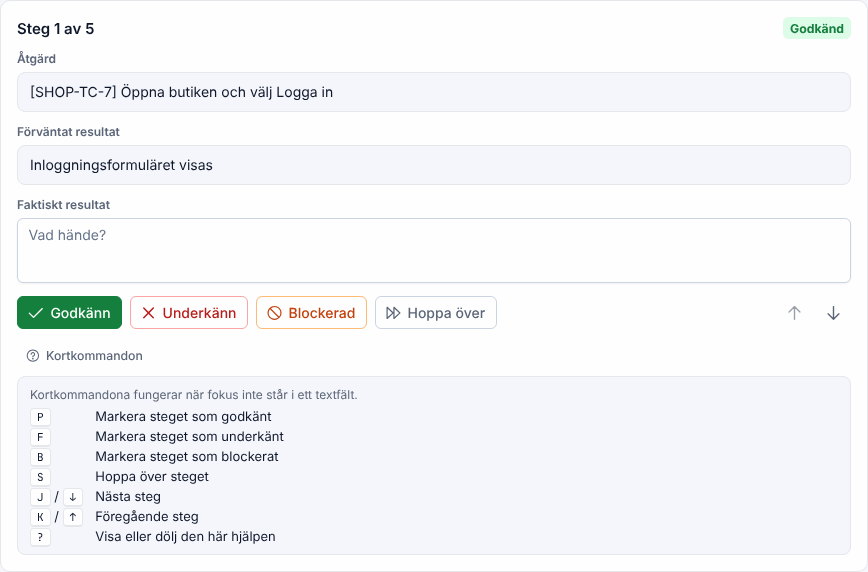

### Automatiserade testfall

För ett automatiserat testfall visar exekveringsvyn **Skript** och **Utdata**. Välj **Kör skript** för att köra det på servern: exekveringen får status *Pågår*, skriptet körs och utfallet blir **Godkänd** vid slutkod 0 och annars **Underkänd** (även när tidsgränsen överskrids). Utdata och tidsåtgång sparas.

Knappen kräver rollen **Testledare** eller **Ansvarig** (behörigheten *script.execute*). Om administratören inte har aktiverat skriptexekveringen svarar servern att den är avstängd; utfallen kommer då från CI.

### Webbtester och deras bevis

Ett [webbtest](#webbtester-playwright) tar sekunder till minuter, så **Kör skript** lägger det i en kö och svarar direkt: exekveringen visar *I kö* eller *Körs* (med **Avbryt**), du kan fortsätta med andra testfall och sidan uppdaterar sig själv när utfallet finns. Servern kör några webbtester samtidigt (administratören bestämmer hur många); de andra väntar i kön.

När testet är klart visar exekveringsvyn utfallet, Playwrights **Utdata** (stegen och felmeddelandet; värden för hemliga variabler visas som `***`) och **Bevis från webbtestet**:

- **Skärmbilder** — som standard bara när testet underkänns, och de visar sidan i felögonblicket. Välj en skärmbild för att förstora den.
- **Spår** (`trace.zip`, som standard när testet underkänns) — en inspelning av varje åtgärd med sidan före och efter, nätverksanropen och konsolen. Ladda ned det och öppna det med `npx playwright show-trace trace.zip`, eller släpp filen på [trace.playwright.dev](https://trace.playwright.dev) (filen öppnas i din webbläsare och laddas inte upp).
- **Video** — när administratören har slagit på videor.

Filerna finns också under **Bilagor** för exekveringen. När webbtestet körs igen ersätts de (andra bilagor finns kvar).

### Kör alla automatiserade tester

På körningens sida lägger **Kör automatiserade tester** alla automatiserade testfall i körningen som inte är godkända ännu i kön, vart och ett i sina konfigurationer; markera exekveringar och använd **Kör automatiserat** i verktygsraden för att köra bara dem (även godkända). Testfall som inte får exekveras ännu (se [När kan ett testfall exekveras?](#när-kan-ett-testfall-exekveras)) hoppas över och listas. En förutsättning som också finns i körningen körs först, och testfallen som beror på den väntar — underkänns den exekveras de inte.

Medan testfall står i kö eller körs visar en panel förloppet (*i kö*, *körs*, *klara*, godkända och underkända) och testfallen i kön; **Avbryt köade** tar bort testfallen som inte har startat (deras exekveringar behåller sitt tidigare utfall). Exekveringarna och utfallen uppdateras när jobben blir klara. Skript i de andra språken körs också på det här sättet.

Jobben överlever inte en omstart av servern: testfall som fortfarande står i kö eller körs får då tillbaka sitt tidigare utfall, med en anteckning i utdata.

### Bevis

Varje steg i ett manuellt testfall har ett avsnitt **Bevis** under *Faktiskt resultat*: öppna det för att registrera vad som visar utfallet. Skriv iakttagelser, värden eller länkar i textfältet (till exempel *svarstid 120 ms, order 4711*), och lägg till filer som skärmbilder eller loggutdrag *(Testare)*. Filer kan släppas på ytan eller väljas ur arkivet, som andra [bilagor](#bilagor-till-körningar-och-exekveringar). Stegets rubrik visar hur mycket bevis det har.

Bevisen sparas med exekveringen (välj **Spara**), stannar kvar i körningen även om testfallet ändras senare, och visas i dokumentarkivet som *Bevis för ett teststeg*, länkade till steget. När körningen tas bort tas även bevisfilerna bort.

### När kan ett testfall exekveras?

Innan ett testfall exekveras kontrollerar Qtestframe att det är klart: testfallet har status **Klar**, kraven det verifierar är godkända (eller implementerade eller verifierade), och testfallen det [beror på](#beroenden) har godkänts. Vad som händer när en kontroll inte går igenom ställs in under [inställningar för testexekvering](#inställningar-för-testexekvering):

- **blockerat** (standard): exekveringsvyn visar en röd ruta med orsaker och länkar; **Godkänd**, **Underkänd** och **Kör skript** är avstängda, och servern avvisar sådana utfall. Du kan fortfarande markera testfallet som **Blockerat** eller **Överhoppat**;
- **tillåtet**: orsakerna visas som en gul varning, och du kan exekvera testfallet.

Varje orsak säger exakt vad som är fel, vad du kan göra åt det och vilken inställning som avgör, till exempel:

- *SHOP-TC-4 har status Utkast; bara testfall med status Klart kan exekveras.* — **Gör så här:** gör klart testfallet och låt det granskas och markeras som Klart (kräver *test.review*). *Blockeras av exekveringsinställningen ”Tillåt exekvering av testfall som inte är Klara”, som är avslagen.*
- *Det verifierar SHOP-REQ-2, som har status Godkänt; inställningarna för exekvering kräver att länkade krav är Implementerat eller Verifierat.* — **Gör så här:** flytta kravet vidare när det har implementerats, eller be en administratör lägga till dess status bland de klara statusarna.
- *Det beror på SHOP-TC-1, som är Underkänt i den här körningen; ett förutsättande test måste ha godkänts först.* — **Gör så här:** exekvera SHOP-TC-1 först så att det godkänns, eller lägg till det i körningen.

Så ser du om det är testfallet självt, ett krav, ett förutsättande test eller en inställning i organisationen som stoppar det. Körningens sida visar samma sak i kolumnen **Redo** (välj posten för att se hela förklaringen), med en sammanfattning ovanför tabellen; knappbeskrivningarna för de avstängda knapparna Godkänd och Underkänd och ett avvisat utfall anger också orsakerna, och dialogen **Ny körning** markerar valda testfall som inte är klara.

## Defekter

Registrera en defekt när ett testfall underkänns: i exekveringsvyn under **Defekter** (ett id som `JIRA-123` eller en fullständig URL). Defekterna visas på körningens sida, på fliken **Exekveringar** för testfallet och i rapporter.

För att göra id:n klickbara anger du en **URL-mall för felhanteringssystem** under **Kategorier & inställningar**, till exempel `https://jira.example.com/browse/{id}`. `{id}` ersätts med defektens id; utan `{id}` läggs id:t till sist. Värden som redan är URL:er länkas direkt.

Hitta defekter med frågor: `defect:JIRA-*` i körningens filter hittar exekveringar med en JIRA-defekt; i testfallslistan hittar frågan testfall med en sådan defekt i de senaste exekveringarna.

## Importera utfall från CI

Automatiserade pipelines (GitLab CI, GitHub Actions, Jenkins …) kan rapportera utfall till en körning per testnyckel. Färdiga pipelinemallar, kvalitetsgrinden, commit-statusar i GitLab och testurval beskrivs i [CI/CD](#cicd).

1. Skapa en API-nyckel: **Administration → API-nycklar → Ny API-nyckel**, roll **Testare** eller högre (se [API-nycklar](#api-nycklar)). Kopiera nyckeln; den visas bara en gång och börjar med `qtf_`.
2. Öppna körningen och välj **CI-import**. Dialogen visar slutpunkten med körningens id och ett färdigt kommando.


3. Skicka utfallen från din pipeline:

```bash
curl -X POST "https://qtf.example.com/api/v1/runs/$RUN_ID/results" \
  -H "Authorization: Bearer $QTF_TOKEN" \
  -H "Content-Type: application/json" \
  -d '{"results":[
        {"test_key":"SHOP-TC-7","status":"passed","duration_ms":1234,"output":"ok"},
        {"test_key":"SHOP-TC-9","status":"failed","duration_ms":877,"output":"expected 35, got 34"}
      ]}'
```

- `status` är något av `passed`, `failed`, `blocked`, `skipped`, `in_progress` eller `not_run`.
- Testnycklarna matchas utan hänsyn till versaler och gemener inom körningens projekt. Testfall som ännu inte ingår i körningen läggs till.
- Svaret anger hur många exekveringar som uppdaterades (`updated`) och listar okända nycklar (`unknown`), som hoppades över.
- En ogiltig status stoppar importen med ett fel; utfall före den förblir sparade.
- **Konfigurationer:** när körningen gäller [konfigurationer](#konfigurationer-i-en-körning) anger du utfallens konfiguration med `?configuration=NAMN` i adressen (`.../results?configuration=Chrome%20%2F%20Windows`) eller per utfall med fältet `"configuration": "Chrome / Windows"` (namn eller ID). En konfiguration som körningen inte gäller än läggs till i den. Utan konfiguration används den enda konfigurationen i en körning som har exakt en, och en körning utan konfigurationer sparar utfallen utan konfiguration, som tidigare; en körning med flera konfigurationer svarar med ett fel.

Förvara nyckeln i CI-systemets hemlighetslager, aldrig i kodförrådet. En API-nyckel är knuten till en organisation och har aldrig fler rättigheter än sin ägare.

Utöver det här JSON-formatet finns tre enklare vägar för testverktyg som redan skriver rapporter: JUnit XML, kommandot `qtestframe report` och Playwright-rapportören.

### Koppla automatiserade tester till testnycklar

Varje automatiserat test måste ange vilket testfall i Qtestframe det exekverar. Skriv testnyckeln (till exempel `SHOP-TC-12`) på något av följande ställen:

- **i testets namn**, till exempel `test_login[SHOP-TC-12]`, `TestCart/SHOP-TC-12_add` eller `SHOP-TC-12 betalar med kort`. Där ett namn inte får innehålla bindestreck fungerar även `SHOP_TC_12`. Nyckeln kan också stå i klassnamnet.
- **som egenskap på testfallet** i JUnit-rapporten, med namnet `qtestframe.key` eller `test_key`. Med pytest: `record_property("test_key", "SHOP-TC-12")`.
- **med Playwright** som taggen `@SHOP-TC-12` eller annoteringen `{ type: 'qtestframe', description: 'SHOP-TC-12' }`.

Flera testfall med samma nyckel (till exempel samma test i två webbläsare) ger ett gemensamt utfall: *underkänt* går före *godkänt*, och tiderna summeras.

### JUnit XML

Nästan alla testverktyg skriver JUnit XML: Playwright (rapportören `junit`), pytest (`--junitxml`), Go (med go-junit-report), Maven Surefire och Gradle, Jest (jest-junit) och Vitest (`--reporter=junit`). Skicka filen till körningen:

```bash
curl -X POST "https://qtf.example.com/api/v1/runs/$RUN_ID/junit" \
  -H "Authorization: Bearer $QTF_TOKEN" \
  -H "Content-Type: application/xml" \
  --data-binary @results/junit.xml
```

- Ett testfall med `<failure>` eller `<error>` registreras som *underkänt*, ett med `<skipped>` som *överhoppat* och alla andra som *godkända*. Tiden hämtas från `time`; utdata innehåller felmeddelandet och `system-out`/`system-err`.
- Svaret listar, förutom `updated`, `unknown` och `rejected`, namnen på testfall utan nyckel under `unmapped`.
- Lägg till `?create_missing=true` för att skapa ett automatiserat testfall i utkastläge för varje testfall utan nyckel (med testfallets namn som titel) och registrera dess utfall. Vid nästa import hittas testfallet igen via titeln. Det kräver behörighet att skriva testfall.
- Flera filer kan skickas samtidigt som en multipart-uppladdning (`-F file=@a.xml -F file=@b.xml`); tillsammans får de vara högst 20 MB.
- `?configuration=NAMN` sparar utfallen i den konfigurationen, som för JSON-formatet.

### Kommandot qtestframe report

Programmet `qtestframe` kan själv ladda upp rapporter. Det hittar körningen via namnet i projektet, eller skapar den:

```bash
export QTF_URL=https://qtf.example.com QTF_TOKEN=qtf_…
qtestframe report --project SHOP --run "Nattlig $BUILD_NUMBER" --create-run \
  --build "$BUILD_NUMBER" --environment staging \
  --junit 'results/*.xml'
```

- `--run-id ID` rapporterar till en känd körning i stället för `--project`/`--run`.
- `--junit` och `--json` (JSON-formatet ovan) tar filer eller mönster och kan anges flera gånger.
- `--create-missing` skapar testfall för testfall utan nyckel, som ovan.
- `--configuration NAMN` (eller `QTF_CONFIGURATION`) sparar utfallen i den konfigurationen; körningen får konfigurationen om den inte redan gäller den. Kör kommandot en gång per konfiguration, till exempel en gång per webbläsare.
- Kommandot skriver ut hur många utfall som registrerades och listar okända nycklar, testfall utan nyckel och avvisade utfall med orsaken. Det avslutas med en felkod när uppladdningen misslyckas, och med `--fail-on-unknown` även när utfall inte matchade något testfall.

### Playwright-rapportören

För Playwright finns en rapportör (`@qtestframe/playwright-reporter`, i `integrations/playwright-reporter` i Qtestframes källkod) som rapporterar medan testerna körs, utan någon JUnit-fil:

```ts
// playwright.config.ts
reporter: [
  ['list'],
  ['@qtestframe/playwright-reporter', { project: 'SHOP', run: 'Nattlig', createRun: true }],
],
```

Den läser serverns adress och API-nyckeln från `QTF_URL` och `QTF_TOKEN`; inställningen `configuration` (eller `QTF_CONFIGURATION`) anger utfallens [konfiguration](#konfigurationer-i-en-körning). Den hämtar nyckeln från annoteringen, taggen eller titeln, skriver felet och rubrikerna från `test.step()` med deras utfall i utdata och laddar upp skärmbilder, spår (traces) och andra bilagor från underkända tester som bilagor till exekveringen. Om rapporteringen misslyckas loggas bara ett meddelande; testkörningen påverkas inte.

## Länkar för en körning

Fliken **Länkar** på körningens sida länkar körningen till krav, testfall, andra körningar, arkivfiler, rapporter och webbadresser, till exempel CI-bygget eller versionsinformationen, se [Länkar](#länkar).

## Bilagor till körningar och exekveringar

Även körningar och exekveringar har **Bilagor**: loggfiler, skärmbilder av ett fel, testrapporter från andra verktyg. I exekveringsvyn öppnar du fliken **Bilagor** bredvid **Resultat** och drar filer dit eller väljer **Välj filer**; på körningens sida hör bilagorna till körningen som helhet. Du kan också bifoga en fil från projektets [dokumentarkiv](#dokument-1). Att ladda upp och ta bort bilagor för körningar och exekveringar kräver **Testare** (rätten att registrera utfall).

# Utforskande test

Utforskande test är testdesign och testutförande på samma gång: testaren lär sig produkten medan hen testar den och bestämmer vad som ska prövas härnäst utifrån det hen just såg. Qtestframe stöder **sessionsbaserad testledning** (SBTM): arbetet görs i **sessioner** med en bestämd längd, var och en med ett **uppdrag**, och varje session avslutas med en **utvärdering**.

| Åtgärd | Roll som krävs |
|---|---|
| Se sessioner, anteckningar, mått och historik | Läsare (`run.read`) |
| Planera, ändra och ta bort sessioner; öppna en utvärdering igen | Testare (`run.write`) |
| Genomföra en session: tidtagningen, anteckningar, filer, defekter från anteckningar, utvärderingen | Testare (`run.execute`) |
| Exportera sessionsrapporten | Läsare (`export`) |
| Låta sessioner räknas som verifieringsbevis | Förvaltare (`project.update`) |

Bara sessionens **testare** genomför den, antecknar och utvärderar den. Någon annan behöver dessutom `run.write`: en testledare som stoppar en bortglömd session, eller en granskare som utvärderar den. En session utan testare tillhör den som startar den.

## Planera en session

Öppna **Utforskande** i projektets navigering och välj **Ny session**.

- **Uppdrag**: ett kort namn på uppdraget, till exempel *Utforska kassan med utgångna kort*.
- **Mål**: vad som ska utforskas, med vilka resurser, för att upptäcka vad (*Utforska … med … för att upptäcka …*).
- **Testare**: vem som gör sessionen (som standard du).
- **Tidsram**: den planerade längden, oftast 30, 60 eller 90 minuter; alla längder från 5 till 480 minuter godtas.
- **Områden**: de krav- och testmappar som sessionen utforskar. Måtten räknar sessioner och buggar per område.
- **Krav** och **Testfall** i omfattningen: det sessionen handlar om. En defekt som skapas i sessionen länkas till dessa krav, och en utvärderad session kan vara bevis för dem (se nedan).

En ny session är **planerad**. Listan visar alla sessioner med uppdrag, testare, status, utfall, sessionstid mot tidsramen, antal anteckningar och buggar. Filtrera på text, status och område, eller välj **Mina sessioner**.

## Genomföra en session

Öppna en session för att se **sessionsvyn**: tidtagningen överst, anteckningsfältet, anteckningarna hittills och vid sidan uppdraget med dess omfattning, skärmbilder och filer samt historiken.

### Tidtagningen

**Starta** startar tidtagningen, **Pausa** pausar den (en paus räknas inte) och **Fortsätt** fortsätter. **Stoppa** avslutar sessionen för gott. Tiden hålls av servern, inte av webbläsaren: du kan ladda om sidan, stänga webbläsaren eller fortsätta på en annan dator, och sessionstiden stämmer ändå. Stapeln under klockan visar hur mycket av tidsramen som har använts; efter tidsramen blir den orange, men tidtagningen fortsätter.

| Status | Betydelse |
|---|---|
| Planerad | Inte startad än |
| Pågår | Tidtagningen går |
| Pausad | Startad, tidtagningen är pausad |
| Avslutad | Stoppad, väntar på utvärdering |
| Utvärderad | Utvärderad; sessionen är stängd |

### Anteckningar

Anteckningar görs från sessionens start till dess utvärdering. Varje anteckning har en **typ** och stämplas med den sessionstid då den gjordes:

- **Observation**: vad du såg, även förberedelser och det som fungerar.
- **Fråga**: något att fråga produktägaren eller utvecklarna.
- **Problem**: något som är fel eller oklart men kanske inte en bugg.
- **Idé**: en testidé för senare, eller en förbättring.
- **Bugg**: ett fel i produkten.

Skriv anteckningen och välj **Lägg till anteckning**, eller tryck **Ctrl+Enter**. Välj **Sessionens filer** för att hänvisa till skärmbilder som du laddat upp under **Skärmbilder och filer** (filerna lagras som alla bilagor och syns i projektets [dokument](#dokument-1)).

### Kortkommandon

Sessionsvyn är gjord för att användas utan mus. Utanför anteckningsfältet:

| Tangent | Åtgärd |
|---|---|
| O, Q, I, D, B | Välj typ av anteckning (Observation, fråga/Question, problem/Issue, iDé, Bugg) och gå till anteckningsfältet |
| N | Gå till anteckningsfältet och behåll typen |
| T | Starta eller pausa tidtagningen |
| ? | Visa eller dölj kortkommandona |

Tangenterna är desamma på alla språk. I anteckningsfältet lägger **Ctrl+Enter** (⌘+Enter på Mac) till anteckningen och **Esc** lämnar fältet så att bokstäverna fungerar som kortkommandon igen. Skärmläsare läser upp vald typ och varje tillagd anteckning.

### Skapa en defekt från en anteckning

Välj **Skapa defekt** vid en anteckning. Defekten är förifylld: titeln är anteckningens första rad, beskrivningen anteckningen med sessionens nyckel, sessionstiden och uppdraget, och *hittad i* är *test*. Ändra det som behövs och bekräfta. Defekten länkas till sessionen och till kraven i dess omfattning, anteckningen visar defektens nyckel och blir en bugganteckning. Se [Defekter](#defekter-1).

## Utvärdering

När sessionen stoppas öppnas utvärderingen. I SBTM är utvärderingen ett kort samtal mellan testaren och en testledare; registrera resultatet här:

- **Sammanfattning**: vad som täcktes, vad som hittades, vad som återstår.
- **Utfall**: *Godkänd* (omfattningen fungerar som krävs), *Underkänd* (problem hittades som underkänner den) eller *Ofullständig* (den kunde inte bedömas, till exempel för att den var blockerad).
- **Täckning av uppdraget**: din uppskattning i procent av hur mycket av uppdraget sessionen täckte.
- **Tidsfördelning**: andelen av sessionen som gick åt till **förberedelse** (miljö och testdata), **testning** (testdesign och utförande) och **felutredning** (utreda och rapportera fel). De tre blir tillsammans 100 %. Formuläret föreslår en fördelning utifrån anteckningarna.
- **Granskarens kommentar**: det en granskare lägger till.

Testaren utvärderar sin egen session. Någon annan med `run.write` kan utvärdera den som **granskare**: sessionen visar då *Granskad av*. En utvärdering kan ändras senare; **Öppna igen** (med `run.write`) tar bort den och gör sessionen avslutad igen. En utvärderad session och dess anteckningar kan inte ändras.

## Sessioner som verifieringsbevis

Som standard är utforskande sessioner inte verifieringsbevis. Under **Inställningar → Projekt → Verifiering** kan en förvaltare slå på **Utforskande sessioner är verifieringsbevis**. Då räknas en utvärderad session som bevis av typen *utforskande* för kraven i dess omfattning, för kravet som helhet:

- *Godkänd* godkänner, *Underkänd* underkänner, *Ofullständig* räknas inte;
- för varje krav räknas bara den senast utvärderade sessionen; äldre visas som *ersatta*;
- en session verifierar aldrig ett [utvärderingskriterium](#krav) ensam, så ensam verifierar den bara ett krav utan kriterier. Med kriterier bidrar den till bevisen: en underkänd session underkänner kravet.

Kravens status följer verifieringen när projektet låter statusen följa bevisen. Se [Spårbarhet och täckning](#spårbarhet-och-täckning).

## Mått

Ovanför listan visar **Mått** antal sessioner, sessionstimmar, buggar (bugganteckningar och anteckningar som en defekt skapats från) och **buggar per sessionstimme**, utvärderingarnas genomsnittliga tidsfördelning och täckning, samt detsamma per **område** och per **testare**.

## Rapport, historik och händelselogg

**Markdown** och **PDF** överst i sessionsvyn exporterar **sessionsrapporten**: uppdraget och omfattningen, sessionstiden, utvärderingen, alla anteckningar i den ordning de gjordes och de defekter som skapats. Samma rapport, och sammanställningen av alla sessioner (*Utforskande test*), är standardrapporter på sidan **Rapporter**, där de också kan sparas i dokumentarkivet eller skickas med e-post ([Rapporter och export](#rapporter-och-export)).

**Historik** listar sessionens versioner: när den planerades, ändrades, stoppades, utvärderades och öppnades igen, med de ändrade fälten. Varje åtgärd (planering, tidtagning, anteckningar, defekter, utvärdering) registreras i organisationens händelselogg. Sessioner, deras omfattning och anteckningar ingår i projektarkivet (**Spara projekt**) och i säkerhetskopian.

# Testcykler

En **testcykel** planerar testningen för ett mål, till exempel *Regression sprint 14* eller *Acceptanstest release 2.1*. Den anger vilka testfall som ska köras (dess **plan**), i vilka konfigurationer, av vem och hur lång tid de bör ta. När cykeln startar skapar den sin [testkörning](#testkörningar-och-exekvering) och följer sedan resultaten: planerade mot utförda, godkända, underkända och blockerade, uppskattad mot faktisk tid, en nedbränning och arbetsbelastningen för varje testare.

Välj **Testcykler** i projektets sidofält.

| Uppgift | Roll (behörighet) |
|---|---|
| Se cykler, deras plan och framsteg | alla roller som ser körningar (`run.read`) |
| Skapa och ändra cykler, planera testfall, tilldela testare, starta och avsluta cykler, återkommande cykler | **Testledare**, **Ansvarig**, **Administratör** (`cycle.plan`) |
| Skapa cykelns körningar | även `run.write` |
| Utföra de planerade testfallen | **Testare** och högre (`run.execute`), i cykelns körning som vanligt |

## Skapa en cykel

Välj **Ny cykel** och ange:

- ett **namn**, unikt i projektet, och gärna ett **mål**;
- **ägaren**, oftast testledaren (du själv som standard);
- **startdatum** och **slutdatum**; de avgränsar också nedbränningen;
- valfritt den **release**, **variant** och det **bygge** som cykeln testar, och dess **miljö**. Cykelns körningar får dem, så att resultaten räknas för den releasen och varianten;
- de **konfigurationer** som ska testas. Varje planerat testfall utförs då en gång per konfiguration, och varje konfiguration kan ha en egen testare;
- valfritt en tid då cykeln **startar automatiskt**: då startar den av sig själv och dess körning skapas;
- eller välj **Kopiera en tidigare cykel**: den nya cykeln får den cykelns plan, testare, uppskattningar, release, variant och konfigurationer. Det är det snabbaste sättet att få nästa sprints regression.

En ny cykel är **Planerad**.

## Planera testfall

Välj **Planera testfall** på fliken **Plan** och välj hur testfallen ska läggas till:

| Genom | Vad som läggs till |
|---|---|
| **Urval** | testfallen du väljer i testfallsväljaren |
| **Fråga** | alla testfall som matchar en [fråga](#sökning-och-filter), till exempel `tag:regression priority:high` |
| **Mapp** | testfallen i en mapp, och om du vill i mapparna under den |
| **Regressionsurval** | testfallen som verifierar ändrade krav (och om du vill kraven som beror på, förfinar eller härleds från dem) med deras förutsättningar, som [regressionsurvalet](#varianter-och-kod) på sidan Kod; för cykelns variant |
| **Tidigare cykel** | en annan cykels plan med testare, uppskattningar och konfigurationer |

Du kan välja en **testare** och en **uppskattning** för testfallen du lägger till, och konfigurationerna (utan val planeras ett testfall i alla cykelns konfigurationer). Testfall som redan är planerade i en konfiguration hoppas över.

**Uppskattningar.** Utan en egen uppskattning får ett planerat testfall testfallets **Uppskattade minuter** (ett fält i testfallet), annars medeltiden för dess tidigare exekveringar med ett utfall. Ändra uppskattningar och testare senare genom att markera rader i planen och välja **Tilldela** eller **Ange uppskattning**; **Ta bort** tar rader ur planen (utfall som redan är registrerade finns kvar i körningen).

Planen visar varje rad med konfiguration, testare, uppskattning, det senaste utfallet i cykelns körningar (välj det för att öppna exekveringen) och den faktiska tiden.

## Köra cykeln

Välj **Starta cykeln**. Cykeln blir **Pågår** och skapar sin körning: en exekvering per planerat testfall och konfiguration, tilldelad testaren, med cykelns release, variant, bygge och miljö. Testarna får en avisering och utför som vanligt i [exekveringsvyn](#testkörningar-och-exekvering). Byter du testare i planen ändras också de exekveringar som ännu saknar utfall.

Testfall som planeras efter starten finns inte i någon körning ännu; knappen **Skapa körning för n nya testfall** skapar ytterligare en körning av cykeln för dem. **Avsluta cykeln** avslutar den; **Öppna igen** gör den pågående igen.

Ett planerat testfall räknas som **utfört** när det har ett slutligt utfall (godkänt, underkänt, blockerat eller överhoppat) i någon av cykelns körningar. Har ett testfall körts flera gånger räknas det senaste slutliga utfallet.

## Tavla per testare

Fliken **Tavla per testare** har en kolumn per testare (och en för testfall som ingen är tilldelad) med de öppna testfallen, uppskattad tid kvar och de utförda testfallen hopfällda. Välj ett testfall för att öppna dess exekvering.

## Framsteg

Nyckeltalen överst visar de planerade testfallen (och hur många som saknar testare), andelen utförda, utfallen, den uppskattade tiden med tiden kvar, och den faktiska tiden för de utförda testfallen mot deras uppskattningar.

Fliken **Framsteg** har:

- **nedbränningen**: per dag från startdatum till slutdatum de planerade testfall (eller den uppskattade tid) som inte var utförda vid dagens slut, mot den **ideala** linjen från hela planen den första dagen till ingenting den sista. Texten ovanför anger hur långt efter eller före den ideala linjen cykeln ligger i dag. Testfall som planerats senare syns från den dag de lades till;
- **arbetsbelastningen per testare**: planerade, utförda (per utfall) och öppna testfall per testare, med uppskattad tid, tid kvar och faktisk tid.

## Återkommande cykler

På fliken **Återkommande** i cykellistan skapar en **återkommande cykel** en ny cykel enligt ett schema – dagligen, varje vecka på en veckodag eller varje månad på en dag, vid en tid i en tidszon, som [schemalagda rapporter via e-post](#rapporter-och-export). Varje ny cykel får:

- sitt **namn** från ett mönster: `{date}` blir startdatumet och `{n}` cykelns nummer, till exempel *Nattlig regression {date}*;
- fälten, planen, testarna och uppskattningarna från en **mallcykel**, och/eller testfallen som matchar en **fråga**;
- dagens datum som startdatum och den **längd** du anger;
- med **Starta varje ny cykel direkt** sin körning med en gång.

Cyklerna skapas som den återkommande cykelns **ägare**, som fortfarande måste få planera cykler i projektet. **Skapa nästa cykel nu** (spelaknappen) skapar en direkt. En återkommande cykel vars senaste körning misslyckades visar felet.

## Tidslinje

Fliken **Tidslinje** visar cyklerna med datum som staplar på en gemensam tidsaxel, färgade efter status.

## Filtrera cykler

Filterfältet i cykellistan tar [frågespråket](#sökning-och-filter) med dessa fält:

| Fält | Matchar |
|---|---|
| `name`, `goal`, `description`, `environment` | cykelns text |
| `status` | `planned`, `active`, `closed` |
| `owner`, `assignee` | ägaren, någon testare (e-post eller namn) |
| `release`, `variant`, `build`, `configuration` | det cykeln testar |
| `start`, `end` | datumen, t.ex. `start>=2027-03-01` |
| `planned`, `executed`, `passed`, `failed`, `blocked`, `unassigned` | antal, t.ex. `failed>0` |
| `progress` | procent utförda, t.ex. `progress<50` |
| `test` | nyckeln till ett planerat testfall |

I testfallslistan hittar `cycle:"Sprint 14"` testfallen som är planerade i en cykel; i körningslistan hittar `cycle:` en cykels körningar.

## Releaser och rapporter

En release kan vänta på en cykel: utgångskriteriet **Testcykel genomförd** (se [utgångskriterier](#utgångskriterier)) är uppfyllt när minst tröskeln – 100 % som standard – av cykelns planerade testfall har ett utfall.

**Testcykelrapporten** på sidan [Rapporter](#rapporter-och-export) visar en cykels nyckeltal, arbetsbelastningen per testare, nedbränningen och hela planen med utfall, som PDF, Word, Excel, CSV eller Markdown.

## Historik och granskningslogg

Fliken **Historik** listar cykelns versioner – fälten och planen – med vem som ändrade vad. Att skapa, ändra, planera och ta bort cykler och återkommande cykler registreras i granskningsloggen. Cykler och återkommande cykler ingår i projektarkiv och säkerhetskopior; i ett inläst projekt är de återkommande cyklerna avstängda tills någon slår på dem.

# Releaser och risker

En **release** är en version av produkten som du planerar, testar och levererar, till exempel *Vår 2027* eller *2.1.0*. Den samlar de krav som ska levereras (releasens **omfattning**), de testkörningar som testar den och de **utgångskriterier** som avgör om den får släppas. **Riskregistret** listar vad som kan gå fel, hur sannolikt det är, hur allvarlig konsekvensen blir och vilka krav som hanterar varje risk. Öppna risker påverkar direkt en releases utgångskriterier.

Releaser och risker finns i projektets sidopanel.

| Åtgärd | Roll som krävs |
|---|---|
| Visa releaser, deras status och riskregistret | Läsare |
| Skapa, redigera och ta bort releaser, ändra omfattning och utgångskriterier, markera som släppt | Ansvarig |
| Skapa, redigera och ta bort risker och länka krav till dem | Ansvarig |
| Lägga en körning i en release | Testare |

## Listan över releaser

**Releaser** listar projektets releaser med version, status (*Planerad*, *Aktiv*, *Släppt* eller *Inställd*), måldatum, antal krav och körningar och en etikett **Go** eller **No-go**. Välj en release för att öppna detaljerna under listan.

Skapa en release med **Ny release**. Ange ett namn och gärna version, status, måldatum och beskrivning. En ny release får standardkriterierna:

- täckning minst 100 %,
- varje MUST- och SHALL-krav har klarat sina testfall,
- minst 95 % av kraven har klarat alla sina testfall,
- inga underkända testfall,
- inga misstänkta länkar.

## Omfattning

Fliken **Omfattning** listar de krav som releasen ska leverera, med status, täckning och risknivå.

- Välj **Lägg till krav** för att välja krav i en lista.
- Eller skriv ett filter i frågespråket, till exempel `tag:kassa` eller `risk:high`, och välj **Lägg till matchande**: alla krav som matchar läggs till. Syntaxen beskrivs i [Sökning och filter](#sökning-och-filter).
- Välj **×** på en rad för att ta bort kravet ur omfattningen.

Ett krav kan ingå i flera releaser.

## Körningar i en release

En körning hör till en release när du väljer releasen under **Release** i dialogen **Ny testkörning** eller i **Redigera körning** på körningens sida. Välj **Ingen release** för att ta bort den igen. Listan **Testkörningar** visar varje körnings release i kolumnen **Release**, och körningens sida visar den bredvid miljö och bygge.

Bara utfallen i releasens egna körningar räknas för utgångskriterierna: ett testfall som blev godkänt i en körning för en annan release gör inte den här releasen godkänd.

Fliken **Körningar** listar releasens körningar med status och förlopp; välj en körning för att öppna den.

## Utgångskriterier

Fliken **Utgångskriterier** listar de villkor som releasen måste uppfylla. Välj **Lägg till kriterium**, välj en typ och, om typen har en sådan, en tröskel eller nivå; välj papperskorgen för att ta bort ett kriterium. Välj **Spara kriterier** för att behålla ändringarna.

| Kriterium | Uppfyllt när | Parameter |
|---|---|---|
| Täckning | minst tröskeln av kraven i omfattningen har ett testfall | tröskel i % |
| Klarade testfall | minst tröskeln av kraven har klarat alla sina testfall i releasens körningar | tröskel i % |
| Obligatoriska krav klarade | varje MUST- och SHALL-krav i omfattningen har klarat sina testfall | — |
| Exekverat | minst tröskeln av exekveringarna i releasens körningar har ett utfall | tröskel i % |
| Inga underkända testfall | inget testfall är underkänt eller blockerat i releasens körningar | — |
| Godkända krav | minst tröskeln av kraven är godkända, implementerade eller verifierade | tröskel i % |
| Inga misstänkta länkar | inget krav i omfattningen har en [misstänkt länk](#spårbarhet-och-täckning) | — |
| Inga öppna defekter | ingen öppen defekt med minst den valda allvarlighetsgraden är länkad till ett krav i omfattningen eller dess testfall | lägsta allvarlighetsgrad |
| Risker hanterade | varje risk på minst den valda nivån som ett krav i omfattningen hanterar är åtgärdad, accepterad eller stängd | lägsta risknivå |
| Spårbarhetsregler | inget krav i omfattningen och inget testfall som är länkat till ett sådant bryter mot en påslagen [spårbarhetsregel](#spårbarhetsregler) med den valda allvarligheten; statusfliken listar objekten med reglerna de bryter mot | bara fel, eller fel och varningar |
| Inga blockerande defekter | inget krav i omfattningen [blockeras av en öppen defekt](#blockerande-defekter) enligt projektets regler för allvarlighetsgrad; ett inaktuellt godkänt utfall räknas inte för **Klarade testfall** och **Obligatoriska krav klarade** | — |
| Restrisk | ingen risk kopplad till omfattningen som inte är stängd har en [restnivå](#restrisk) över gränsen, om inte accepteringen är signerad | projektets gräns för riskacceptans, eller en nivå |
| Testcykel genomförd | minst tröskeln av de planerade testfallen i den valda [testcykeln](#testcykler) har ett utfall i cykelns körningar; 100 % betyder att cykeln är helt genomförd | tröskel i % och testcykeln |

En release utan utgångskriterier är alltid go.

Ett godkänt [undantag](#undantag-och-avvikelser) för releasen eller för hela projektet gör att kriterierna accepterar dess krav: de listas under varje kriterium som *undantagna* i stället för att stoppa det. Fliken **Status** listar också gällande undantag och de risker i omfattningen som ligger över gränsen för riskacceptans.

## Go eller no-go

Fliken **Status** utvärderar utgångskriterierna just nu. Den visar **Go** när alla kriterier är uppfyllda och annars **No-go**, hur många kriterier som är uppfyllda och en sammanfattning av omfattningen (krav, hur många som har testfall, godkända, underkända och ej körda) och körningarna.

Varje kriterium visar om det är uppfyllt, det faktiska värdet bredvid målet (till exempel *80 % (mål ≥ 95 %)*) och det som blockerar kriteriet: krav utan testfall, underkända testfall, öppna defekter eller risker som fortfarande kräver åtgärd. Varje objekt är en länk som öppnar det.

Etiketten i listan över releaser bygger på samma utvärdering, så att du direkt ser vilka releaser som är klara.

I ett projekt med [varianter](#varianter-och-kod) kan en release rikta sig mot varianter: utgångskriterierna utvärderas då för var och en av dem, fliken **Status** visar en matris med kriterier × varianter, och releasen är go först när varje målvariant är det (se [releasegrindar per variant](#releasegrindar-per-variant)).

Ett procentkriterium utan något att mäta är **inte uppfyllt**: en release utan krav i omfattningen, eller utan exekveringar för *exekverade*, visar *Inget att mäta än* och får no-go. En release helt utan utgångskriterier får alltid go.

## Markera en release som släppt

Välj **Markera som släppt** på en öppen release.

- Är releasen **go** bekräftar du, och releasen markeras som släppt.
- Är den **no-go** listar dialogen de kriterier som inte är uppfyllda. Du kan ändå släppa releasen genom att **åsidosätta** kriterierna: skriv varför i **Varför släppa ändå?** (minst 3 tecken) och välj **Släpp ändå**. Motiveringen sparas med releasen och i händelseloggen.

När en release markeras som släppt skapar Qtestframe [baslinjen](#baslinjer) *Release* följt av releasens namn: den fryser kraven i omfattningen och deras testfall i de versioner de hade. Releasen visar sedan när och av vem den släpptes, eventuell motivering och en länk till baslinjen.

## Ändra många releaser på en gång

Kryssa i releaser i listan. Verktygsfältet erbjuder då:

- **Ange status**. Väljer du **Släppt** släpps bara de markerade releaser som har go, var och en med sin baslinje; releaser med no-go hoppas över och listas. För att släppa trots no-go använder du **Markera som släppt** på den releasen, som frågar efter skälet.
- **Måldatum** för alla (tomt rensar).
- **Kopiera utgångskriterier** från en annan release; de ersätter kriterierna för de markerade releaserna.
- **Lägg till krav** (välj dem) eller **Lägg till med filter** (till exempel `obligation:must tag:payments`) i omfattningen för varje markerad release.
- **Ta bort**, efter bekräftelse; körningarna behåller sina resultat.

Alla releaser kontrolleras innan någon ändras. Ändringar av status (utom *Släppt*), måldatum och utgångskriterier kan ångras med ångra-knappen.

## Riskregistret

**Risker** listar projektets risker. Varje risk har en nyckel som *SHOP-RISK-3*, en titel, en kategori, en ägare (en projektmedlem — skriv `@` för att välja — eller ett vanligt namn), en **sannolikhet** och en **konsekvens** från 1 till 5, en status och en **åtgärd**: det ni gör för att göra risken mindre sannolik eller mindre skadlig.

| Sannolikhet | | Konsekvens | |
|---|---|---|---|
| 1 | Sällsynt | 1 | Försumbar |
| 2 | Osannolik | 2 | Liten |
| 3 | Möjlig | 3 | Måttlig |
| 4 | Trolig | 4 | Stor |
| 5 | Nästan säker | 5 | Allvarlig |

Registret visar varje risks poäng och nivå, status, ägare, de krav som hanterar risken och hur många av dem som är **täckta** (har testfall) och **verifierade** (alla testfall godkända). Filtrera på text, nivå eller status. Stängda risker döljs om du inte väljer **Ta med stängda risker** eller filtrerar på statusen *Stängd*.

Lägg till en risk med **Ny risk**. Välj sannolikhet och konsekvens (dialogen visar poäng och nivå medan du väljer), beskriv åtgärden och välj **Länka krav** för att välja de krav som hanterar risken. Välj en risk i registret för att ändra den. Du kan också utgå från de typiska riskerna i [katalogen](#risker-i-katalogen): de kommer med en föreslagen åtgärd och de krav som åtgärdar dem, redan kopplade.

**MITRE ATT&CK-tekniker** anger hur en angripare skulle förverkliga risken: välj tekniker ur listan över matriserna Enterprise, ICS och Mobile i [MITRE ATT&CK](#mitre-attck) och MITRE ATLAS (skriv ett nummer som `T1110` eller en del av ett namn för att hitta en). Dialogen visar deras taktiker och länkar till deras sidor. Risker från katalogen tar med sig sina tekniker; lämna fältet tomt för faror och fel. Bara tekniker i listan kan sparas: ett nummer som återkallats eller fasats ut i en senare ATT&CK-version markeras och måste tas bort. Registret visar teknikerna under titeln, textfiltret hittar dem, och i frågor hittar `attack:T1110` riskerna med tekniken eller någon av dess undertekniker (även `attack:"credential stuffing"`) och `tactic:TA0006` eller `tactic:"credential access"` de med en teknik för taktiken. Teknikerna ingår i exporter, projektarkiv och säkerhetskopior.

**MITRE EMB3D-hot** anger de hot mot en inbyggd enhet som förverkligar risken (se [MITRE D3FEND och EMB3D](#mitre-d3fend-och-emb3d)); välj dem ur EMB3D-listan (*TID-201* eller en del av ett namn). Risker från katalogen tar med sig sina hot, och bara hot i listan kan sparas. I frågor hittar `emb3d:TID-201` (alias `threat:`) riskerna med hotet och `emb3d:hardware` de med ett hårdvaruhot.

Kravredigeraren visar under **Åtgärdar risker** de risker som kravet åtgärdar. Välj **Koppla en risk** för att välja en risk i projektet som kravet åtgärdar, eller **×** vid en risk för att ta bort kopplingen; riskens krav ändras samtidigt. Kravlistan har de valfria kolumnerna **Risk** och **Öppna defekter** (se **Kolumner**).

### Ändra många risker på en gång

Kryssa i risker i registret. Verktygsfältet anger **status**, **sannolikhet** eller **konsekvens** för alla, **Ägare / kategori** anger det ena eller båda (tomt rensar), **Länka krav** länkar samma krav till varje markerad risk, och **Ta bort** tar bort dem efter bekräftelse. Bara rader som visas förblir markerade, så när du filtrerar registret eller väljer en ruta i värmekartan blir inga dolda risker kvar i urvalet. Alla risker kontrolleras innan någon ändras. Andra ändringar än länkning och borttagning kan ångras med ångra-knappen.

## Värmekartan

Värmekartan räknar riskerna i ett rutnät med 5 × 5 rutor: sannolikhet från 5 överst till 1 nederst, konsekvens från 1 till vänster till 5 till höger. Rutans färg är nivån för dess poäng. Välj en ruta för att bara visa riskerna med den sannolikheten och konsekvensen i registret; välj den igen, eller **×** på filteretiketten, för att visa alla.

Bredvid värmekartan räknar **Öppna risker per nivå** de risker som inte är stängda, per nivå; välj en nivå för att filtrera registret.

När projektet har risker från katalogen visar **Område i katalogen** ovanför värmekartan bara riskerna inom ett område (till exempel *Autentisering* eller *Brandskydd*), eller de som inte kommer från katalogen. Värmekartan, antalen per nivå och registret följer valet, och området ingår i sidans adress. API:ets risklista tar samma val som frågefälten `catalog_area` (alias `area`) och `catalog`, till exempel `area:authentication` eller `catalog:AUTH-R01`.

## Risknivåer

En risks **poäng** är sannolikhet × konsekvens, från 1 till 25. Poängen ger **nivån**:

| Nivå | Poäng |
|---|---|
| Låg | 1–4 |
| Medel | 5–9 |
| Hög | 10–16 |
| Kritisk | 17–25 |

Statusarna *Identifierad* och *Åtgärdas* betyder att risken fortfarande kräver åtgärd; *Åtgärdad*, *Accepterad* och *Stängd* betyder att den inte gör det.

## Hur risker påverkar en release

Ett krav får nivån för den högsta **öppna** risk som det hanterar. Du kan filtrera krav på den med `risk:critical` eller `risk:high`, och på öppna defekter med `defects>0`.

Utgångskriteriet **Risker hanterade** med nivån *Hög* blockerar en release så länge ett krav i omfattningen hanterar en risk på nivå hög eller kritisk som fortfarande är *Identifierad* eller *Åtgärdas*. Statusfliken listar de riskerna; åtgärda (eller acceptera) dem och ändra deras status, så blir kriteriet uppfyllt. Ett typiskt arbetssätt:

1. Registrera riskerna och länka de krav som hanterar dem.
2. Lägg kraven i releasens omfattning.
3. Lägg till **Risker hanterade** med den nivå ni kan acceptera i utgångskriterierna.
4. Testa kraven i releasens körningar; när åtgärderna fungerar sätter du riskerna till *Åtgärdad*.

## Riskrapporten

**Riskrapport** under **Rapporter** sammanfattar registret inför ett granskningsmöte eller en revision: nyckeltal, risker per nivå och status, värmekartan, de största riskerna, registret, spårbarheten från varje risk till dess krav, deras testfall och senaste utfall, de öppna risker vars åtgärd ännu inte är testad, och riskernas **MITRE ATT&CK-tekniker** med deras taktiker, de risker som anger dem och en länk till varje teknik, och riskernas **MITRE EMB3D-hot** på samma sätt. Se [Standardrapporter](#standardrapporter). [Översikten](#översikten) visar de öppna riskerna per nivå och en liten värmekarta.

# Undantag, restrisk och uttalande om tillämplighet

Alla krav uppfylls inte i tid, och alla risker kan inte tas bort. Den här sidan beskriver tre sätt att dokumentera sådana beslut formellt, så att de syns, är godkända och tidsbegränsade:

- ett **undantag** accepterar att krav inte uppfylls tills vidare; en **avvikelse** accepterar att de uppfylls med en annan lösning;
- en risks **restrisk** är det som återstår efter åtgärden, jämförs med en **gräns för riskacceptans** och accepteras med en signering;
- **uttalandet om tillämplighet** (SoA, Statement of Applicability) anger för varje åtgärd i en standard som ISO/IEC 27001 om den är tillämplig, varför, vem som äger den och hur långt den är införd.

| Åtgärd | Roll som krävs |
|---|---|
| Visa undantag, restrisker och uttalandet om tillämplighet | Läsare |
| Skapa, redigera, begära och dra tillbaka undantag; ange restrisk; redigera uttalandet | Ansvarig (`requirement.write`) |
| Godkänna, avslå och återkalla undantag; acceptera en restrisk | Ansvarig (`waiver.approve`) |
| Ändra projektets gräns för riskacceptans | Ansvarig (`project.update`) |

## Undantag och avvikelser

**Undantag** i projektets sidofält listar alla undantag och avvikelser med typ, status, vad de gäller för (en release eller hela projektet), kraven och slutdatumet. Filtrera på text, status, typ och release, eller kryssa i **Endast gällande**. Siffrorna ovanför listan visar hur många undantag som gäller, hur många som väntar på godkännande och hur många som går ut inom 30 dagar.

Välj **Nytt undantag** (eller **Begär ett undantag** vid ett krav eller på fliken Status för en release) och fyll i:

- **Typ**: *Undantag* (kraven är underkända, otestade eller inte uppfyllda, och det accepteras tills vidare) eller *Avvikelse* (de uppfylls med en annan lösning).
- **Gäller för**: en release, eller hela projektet.
- **Krav**: de krav som undantaget accepterar.
- **Motivering**, **Kompenserande åtgärder** (för en avvikelse: lösningen som används i stället) och **Villkor**.
- **Kopplad risk**: en befintlig risk, eller **Skapa en ny risk** med sannolikhet och konsekvens; den nya risken kopplas till samma krav.
- **Går ut**: den sista dag som undantaget gäller. Lämna tomt för inget slutdatum.
- **Godkännare**: e-postadresserna till de personer som alla måste godkänna. Lämna tomt så räcker det att en person med behörigheten `waiver.approve` beslutar.

Ett nytt undantag är ett **utkast**. **Begär godkännande** gör det **begärt** och meddelar godkännarna. Tills beslutet är fattat kan du fortfarande redigera det eller **Dra tillbaka** det till ett utkast.

### Godkänna eller avslå

Öppna ett begärt undantag och välj **Godkänn eller avslå**. Välj beslut, skriv en kommentar (krävs vid avslag) och bekräfta med ditt lösenord: det är en **elektronisk signatur** över undantagets exakta innehåll, som [signeringen av en baslinje](#baslinjer). Om undantaget ändras efteråt räknas tidigare signaturer inte längre och visas som *ogiltiga*. Du kan inte besluta om ett undantag som du själv har begärt, och API-token kan inte signera.

Undantaget **godkänns** när alla angivna godkännare har godkänt det (eller, utan godkännare, efter ett godkännande) och **avslås** vid första avslaget. Den som begärde det och godkännarna får ett meddelande.

### Vad ett godkänt undantag gör

Så länge ett undantag är godkänt och slutdatumet inte har passerats **gäller** det:

- **Releaseberedskap**: [utgångskriterierna](#utgångskriterier) behandlar dess krav som accepterade. *Täckning* och *Godkända* räknar dem som uppfyllda, *MUST- och SHALL-krav godkända* listar dem inte, och ett underkänt testfall som bara verifierar undantagna krav räknas inte för *Inga underkända testfall*. De listas separat under varje kriterium som *undantagna*, och fliken **Status** för releasen visar de gällande undantagen.
- **Analys och efterlevnad**: krav som omfattas av ett undantag för hela projektet visas separat (iakttagelsen *Krav som accepteras genom ett undantag*, och *Undantaget* i efterlevnadsanalysen) och räknas varken som luckor eller som uppfyllda.
- **Rapporter och dokument**: efterlevnadsrapporten och rapporten om releaseberedskap har ett avsnitt om undantag, och [kravspecifikationen](#dokument-1) markerar undantagna krav (**Undantaget genom**) och listar undantagen i en bilaga.

Ett krav visar sina undantag under sina risker i kravredigeraren.

I ett projekt med [varianter](#varianter-och-kod) kan ett undantag begränsas till varianter med **Endast för varianter**. I en release som riktar sig mot varianter accepterar det då sina krav bara i de varianterna och varianterna under dem; en release som utvärderas utan varianter räknar bara undantag för alla varianter (se [releasegrindar per variant](#releasegrindar-per-variant)).

### Utgång och återkallelse

Dagen efter slutdatumet blir ett godkänt undantag **utgånget**: dess krav accepteras inte längre, och den som begärde det och godkännarna får ett meddelande. En godkännare kan också när som helst **Återkalla** ett godkänt undantag, med en motivering. Ett godkänt undantag kan inte redigeras eller tas bort; återkalla det och begär ett nytt i stället. Varje steg loggas i granskningsloggen.

## Restrisk

[Riskregistret](#riskregistret) ger varje risk ett värde som sannolikhet × konsekvens. Under **Restrisk efter åtgärder** i riskdialogen anger du den sannolikhet och konsekvens du räknar med när åtgärden fungerar:

- Restrisken börjar gälla när åtgärden är **verifierad**: varje krav som är kopplat till risken har klarat alla sina testfall. Till dess gäller det ursprungliga värdet.
- Kryssa i **Ange restrisken för hand** och skriv en **motivering** för att den ska gälla direkt, till exempel när åtgärden är organisatorisk.
- **Granskningsdatum** och **Ansvarig för granskning** planerar nästa granskning; en risk vars granskningsdatum har passerats markeras.

Kolumnen **Restrisk** i registret visar värdet och nivån som gäller, med en ikon för en verifierad eller handinmatad restrisk. Växla värmekartan mellan **Före åtgärder** och **Efter åtgärder**; en vald ruta filtrerar registret på den vyn.

### Gräns för riskacceptans och att acceptera en risk

**Gräns för riskacceptans** under värmekartan är den högsta restnivå som projektet accepterar utan signering (som standard *Medel*). Risker vars restnivå ligger över gränsen markeras med en varningsikon.

För att acceptera en sådan risk öppnar du den och väljer **Acceptera risken** *(waiver.approve)*: bekräfta med ditt lösenord för att signera. Risken blir *Accepterad*. Signaturen gäller restrisken så som den är bedömd: när bedömningen ändras visas acceptansen som *inaktuell* och räknas inte längre. **Dra tillbaka acceptansen** tar bort den.

En release markerar de risker i omfattningen vars restnivå ligger över gränsen på fliken **Status**. Lägg till utgångskriteriet **Restrisk** för att de ska stoppa releasen om de inte är accepterade; kriteriet kan använda projektets gräns eller en egen nivå. [Riskrapporten](#rapporter-och-export) visar värmekartan före och efter åtgärder och listar riskerna över gränsen.

## Uttalande om tillämplighet

**SoA** i projektets sidofält listar varje åtgärd i en referenskälla. Välj källa högst upp: **ISO/IEC 27001:2022 bilaga A** har sina 93 åtgärder (A.5.1–A.5.37, A.6.1–A.6.8, A.7.1–A.7.14 och A.8.1–A.8.34, med korta namn). För andra lagar och standarder bland [katalogens källor](#katalog) är åtgärderna de avsnitt som katalogen och era krav hänvisar till.

För varje åtgärd visar tabellen:

- **Tillämplig**: *Tillämplig*, *Undantagen* eller *Ej beslutad*, med **Motivering** till varför den ingår eller inte (krävs för en undantagen åtgärd) och **Ägare**;
- **Införande**, som härleds från de krav som hänvisar till åtgärden: *Införd* (alla har klarat sina testfall), *Delvis införd* (några har klarat dem eller accepteras genom ett undantag), *Planerad* (det finns krav, inget har klarat sina testfall än) eller *Inte införd* (inget krav hänvisar till den);
- **Krav** och **Belägg** (testfallen som verifierar kraven).

Ett krav hänvisar till en åtgärd när det har lagts till från ett katalogkrav vars referenser anger åtgärden (till exempel `ISO/IEC 27001:2022 A.8.5`), eller när kravets eget fält **Källa** anger den.

Tabellen fungerar som [kalkylbladsvyn](#krav): skriv i cellerna **Tillämplig**, **Motivering** och **Ägare**, klistra in ett block från ett kalkylblad eller fyll nedåt med <kbd>Ctrl</kbd>+<kbd>D</kbd>. Varje ändring sparas direkt. Tryck <kbd>Ctrl</kbd>+<kbd>Enter</kbd> på en åtgärd (eller dubbelklicka på den i första kolumnen) för att se dess krav och belägg. Filtrera på text, tillämplighet, införande och grupp; siffrorna ovanför tabellen räknar åtgärderna.

**Ladda ned** skapar uttalandet som PDF, Word, Excel eller Markdown; **Spara i arkivet** lägger det i [dokumentarkivet](#dokument-1). Det finns också som standardrapporten **Uttalande om tillämplighet** på sidan **Rapporter**.

# Ändringsbegäranden och ändringshantering

När ett krav är godkänt, eller fryst i en signerad baslinje, bör en ändring vara ett beslut och inte en redigering. **Ändringshantering** gör den till det: en **ändringsbegäran** föreslår nya värden för ett eller flera krav och tester, säger varför, visar vad mer ändringen påverkar, beslutas av projektets **ändringsnämnd** med elektroniska signaturer och genomförs sedan i ett steg, med vanliga versioner och historik.

| Åtgärd | Roll som krävs |
|---|---|
| Se ändringsbegäranden | Läsare |
| Föreslå ändringar; redigera, skicka in, bedöma, skicka till nämnden, genomföra, verifiera och stänga ändringsbegäranden | Ämnesexpert, Testledare, Förvaltare (`change.create`) |
| Besluta om ändringsbegäranden som nämndmedlem; nödåtgärd | Testledare, Förvaltare (`change.approve`) |
| Ändra projektets inställningar för ändringshantering | Förvaltare (`project.update`) |

För att genomföra en ändringsbegäran krävs också behörighet att redigera posterna den ändrar (`requirement.write`, `test.write`, och granskningsbehörigheten för en granskningsstatus).

## Ändringshantering i ett projekt

Under **Inställningar → Projekt → Ändringshantering** väljer du hur strikt projektet hanterar ändringar:

- **Av** (standard): poster ändras direkt, som utan ändringshantering. Ändringsbegäranden kan ändå användas.
- **Varna**: skyddade poster kan fortfarande ändras direkt, men redigeraren säger att de omfattas av ändringshantering och ändringen flaggas.
- **Tvinga**: skyddade poster kan inte ändras direkt. Att spara dem, en massändring, kalkylbladsvyn, en Excel- eller ReqIF-import, att återställa en äldre version eller en baslinje och att ta bort avvisas med *Inte sparat: posten omfattas av ändringshantering*, och redigeraren erbjuder att **föreslå ändringen** i stället.

En post är **skyddad** när dess status är en av de **skyddade statusarna** (standard *Godkänt*, *Implementerat*, *Verifierat* och, för tester, *Klar*) eller, med **Signerade baslinjer låser sina poster**, när den finns i en baslinje som har en [signatur](#baslinjer). Granskningsbeslut och statusen som följer bevisen påverkas inte.

**Ändringsnämnden** är en lista med medlemmar (e-postadresser) och roller. Bara de beslutar om ändringsbegäranden, och bara om de också har `change.approve`; om ingen anges beslutar alla med `change.approve`. **Beslutsförheten** anger hur många godkännanden som behövs: *all* (varje angiven medlem och en innehavare av varje angiven roll), *any* (en medlem) eller ett antal. **Signaturens betydelse** är meningen en nämndmedlem signerar, till exempel *Godkänd för release av ändringsnämnden*. **Att stänga en ändringsbegäran skapar en baslinje som standard** förväljer det valet när en ändringsbegäran stängs.

### Nödåtgärd

När en rättning inte kan vänta på nämnden kan den som har `change.approve` spara en skyddad post direkt med en **nödåtgärd** och en motivering på minst tio tecken (i API:t `?change_override=<motivering>`). Ändringen sparas som vanligt, och granskningsloggen registrerar `change_control.override` med posten, varför den var skyddad och motiveringen.

## Föreslå en ändring

Det finns tre sätt att lägga en ändring i en ändringsbegäran:

- **I redigeraren**: öppna ett krav eller test, ändra fälten som vanligt och välj **Föreslå ändring** under formuläret i stället för **Spara**. Fälten du ändrade (titel, beskrivning, förpliktelse, typ, prioritet, status, källa, motivering, ägare, taggar och egna fält; för tester också förutsättningar, förväntat resultat, utförande och uppskattning) blir förslaget. Ingenting sparas på posten.
- **För flera**: markera poster i listan och välj **Föreslå ändring** i markeringsraden, sedan ny status, prioritet, förpliktelse eller utförande och ägare för alla.
- **Efter ett avvisat sparande**: med *tvinga* öppnar ett sparande av en skyddad post samma dialog med dina ändringar.

I dialogen väljer du **En ny ändringsbegäran** (titel, motivering, kategori och prioritet) eller **Ett av mina utkast** för att lägga ändringen i ett utkast du fortfarande skriver. Dialogen visar varje ändring som en skillnad: borttagen text överstruken, tillagd text markerad.

Poster med öppna ändringsbegäranden har en **ÄB**-märkning i listorna, och redigeraren visar deras öppna ändringsbegäranden. I [frågespråket](#sökning-och-filter) hittar `cr:open` (eller `has:cr`) poster med en öppen ändringsbegäran och `cr:DEMO-CR-3` posterna i en.

## Arbetsflödet

**Ändringsbegäranden** i projektets sidomeny listar dem med nyckel (*PROJ-CR-n*), status, kategori, prioritet, poster och den som begärde. Öppna en för att se de föreslagna ändringarna post för post och fält för fält, påverkan, signaturerna och tidslinjen.

1. **Utkast**: den som begär skriver ändringsbegäran. **Kategori** är en av *Rättelse*, *Förbättring*, *Regelkrav*, *Defektdriven*, *Riskdriven* och *Övrigt*. Koppla defekterna, riskerna och ärendena ändringen kommer från, välj vad genomförandet gör med [ändringspåverkan](#spårbarhet-och-täckning) (*Markera misstänkta*, *Meddela ägare* eller *Ingetdera*) och om stängning skapar en baslinje.
2. **Skicka in**: kräver minst en post och en motivering. Den transitiva ändringspåverkan av de föreslagna ändringarna beräknas och **sparas på ändringsbegäran** som en ögonblicksbild, med vägen till varje påverkad post, så att nämnden beslutar om det som bedömdes.
3. **Bedöm påverkan**: en bedömare lägger till anteckningar och en uppskattad insats; påverkan beräknas igen. *Skicka sedan till ändringsnämnden* för den vidare direkt.
4. **Under beslut**: nämndens medlemmar meddelas, och den visas i deras [Mitt arbete](#granskningar-och-notiser) som *Ändringsbeslut*.
5. **Besluta**: en nämndmedlem väljer **Besluta…**, väljer *Godkänn*, *Avslå* eller *Skjut upp*, skriver en kommentar (krävs för avslag och uppskjutande) och bekräftar med sitt lösenord. Det är en **elektronisk signatur** över ändringsbegärans exakta innehåll med projektets signaturbetydelse. Ett avslag eller uppskjutande beslutar direkt; godkännanden beslutar när beslutsförheten nås. Den som begärde ändringen kan inte besluta om den och meddelas om beslutet.
6. **Genomför**: en godkänd ändringsbegäran genomförs i ett steg. Varje post får de föreslagna värdena genom det vanliga sparandet, så validering, behörigheter, versioner, historik och granskningsloggen är desamma som vid en redigering; sedan hanteras påverkan en gång, med det valda alternativet. Om en post inte kan sparas sparas ingenting. Om en post har ändrats sedan ändringen föreslogs är ändringsbegäran *inaktuell* och kan varken beslutas eller genomföras: återta den och föreslå ändringen igen.
7. **Verifiera** och **Stäng**: någon bekräftar att ändringen fungerar som avsett och stänger den sedan, om man vill med en ny baslinje av projektet.

En avslagen eller uppskjuten ändringsbegäran kan **återtas** till utkast och skickas in igen, eller stängas. Utkast och avslagna ändringsbegäranden kan tas bort. Varje steg finns på **tidslinjen** med vem, när och varför.

## Rapporter, aviseringar och integrationer

- Rapportmallen **Ändringsbegäranden** (under **Rapporter**) ger en ändringsbegäran (de föreslagna ändringarna fält för fält, påverkan, signaturerna och tidslinjen) eller registret över alla; **PDF-rapport** i ändringsbegäran gör detsamma för den.
- Webhooks och chattkanaler kan prenumerera på `change_request.submitted`, `change_request.review`, `change_request.approved`, `change_request.rejected`, `change_request.deferred`, `change_request.implemented` och `change_request.closed`.
- Ändringsbegäranden ingår i projektarkiv och säkerhetskopior.

## I demot

Demoprojektet har ändringshanteringen *varna*, med administratören och förvaltarna som nämnd. Saras ändringsbegäran *Lock accounts for 30 minutes instead of 15* väntar på administratörens beslut i Mitt arbete; det finns också en stängd ändringsbegäran vars ändring har genomförts, en uppskjuten och ett utkast.

# Defekter

En **defekt** (bugg) är ett problem som hittats vid testning. Varje defekt har en nyckel som `SHOP-BUG-3`, en titel, en beskrivning, en status, en allvarlighetsgrad, en prioritet och en tilldelad person, och den kopplas till de krav, testfall och exekveringar den gäller. Defekterna finns under **Defekter** i projektets sidomeny.

Defekter kan speglas i **Jira**, **GitHub Issues**, **GitLab** eller **Request Tracker (RT)**: Qtestframe skapar ärendet åt dig och läser tillbaka dess status, så att utvecklarna arbetar i sin ärendehanterare medan testteamet ser varje defekts läge bredvid testfallen.

| Åtgärd | Roll som krävs |
|---|---|
| Visa defekter | Läsare |
| Rapportera och redigera defekter, koppla dem, skicka, synkronisera och importera ärenden | Testare |
| Ta bort defekter, ansluta ärendehanteraren | Ansvarig |

## Listan över defekter

**Defekter** listar projektets defekter, öppna först och de allvarligaste överst. Kolumnerna visar nyckel, titel, status, allvarlighetsgrad, tilldelad person, de kopplade objekten och ärendet i ärendehanteraren med dess egen status.

Filtrera med snabbfiltren **Status** och **Allvarlighetsgrad**, eller med [frågespråket](#sökning-och-filter), till exempel `open:true severity:critical`, `assignee:anna*` eller `linked:SHOP-REQ-12`. Fälten är `key`, `title`, `description`, `status`, `severity`, `priority`, `assignee`, `external` (ärendets nyckel i ärendehanteraren), `created_by`, `open` (`true` för *Öppen* och *Pågår*) och `linked` (nycklar för kopplade krav och testfall).

Välj en defekt för att öppna och redigera den. Välj **Ny defekt** för att rapportera en.

## Ändra många defekter på en gång

Kryssa i defekter i listan (rubrikens kryssruta markerar hela sidan). Verktygsfältet ändrar alla på en gång:

- **Ange status** och **Ange allvarlighetsgrad**, samt **Tilldela…** för att ge dem till någon (tomt tar bort tilldelningen). Den nya ansvariga får en notis. Kräver behörighet att spara utfall (`run.execute`).
- **Skicka till Jira/GitHub/GitLab** skapar ett ärende för varje markerad defekt som saknar ett; defekter som redan har ett ärende lämnas orörda. **Synkronisera** läser status för de markerade defekternas ärenden. Båda visas när en ärendehanterare är ansluten.
- **Ta bort** (behörighet att ändra projektet), efter bekräftelse.

Alla defekter kontrolleras innan någon ändras, så ett felaktigt värde ändrar ingenting. Ändringar av status, allvarlighetsgrad och tilldelning kan ångras med ångra-knappen i övre fältet.

## Statusar och allvarlighetsgrader

| Status | Betydelse |
|---|---|
| **Öppen** | Rapporterad, ingen arbetar med den än |
| **Pågår** | Någon åtgärdar den |
| **Åtgärdad** | Rättad, väntar på att verifieras av ett nytt test |
| **Stängd** | Verifierad eller klar |
| **Avvisad** | Ingen defekt, en dubblett eller kommer inte att åtgärdas |

*Öppen* och *Pågår* räknas som **öppna**. Öppna defekter visas på krav och testfall och stoppar en release (se [Öppna defekter och releaser](#öppna-defekter-och-releaser)).

| Allvarlighetsgrad | Typisk användning |
|---|---|
| **Kritisk** | Krasch, dataförlust, säkerhetsproblem, ingen tillfällig lösning |
| **Allvarlig** | En viktig funktion fungerar inte (standard) |
| **Mindre** | Fungerar med en tillfällig lösning, eller en liten funktion påverkas |
| **Obetydlig** | Kosmetiskt, t.ex. ett stavfel |

Allvarlighetsgraden säger hur illa problemet är; **prioriteten** (kritisk, hög, medel, låg) säger hur snart det ska åtgärdas.

**Upptäckt i** anger i vilken fas defekten hittades: *Krav*, *Design*, *Utveckling*, *Test*, *Acceptans* eller *Produktion* (tomt när det är okänt). Defekter som hittats i produktion räknas som läckta i [kvalitetsmåtten](#kvalitetsmått); filtrera med `found_in:production`.

## Koppla defekter till objekt

En defekt kan kopplas till valfritt antal **krav**, **testfall** och **exekveringar** i projektet. I defektdialogen, under **Kopplade objekt**, väljer du **Koppla krav** eller **Koppla testfall** för att välja objekt, eller **Koppla exekvering** för att välja en körning och en av dess exekveringar. Ta bort en koppling med ×.

Fliken **Defekter** för ett krav eller testfall visar dess defekter:

- ett **testfall** visar defekterna som är kopplade till det och till dess exekveringar i alla körningar (*via en exekvering*);
- ett **krav** visar defekterna som är kopplade till det, till dess testfall och till deras exekveringar (*via ett testfall*).

Där kan du välja **Rapportera defekt** (en ny defekt som redan är kopplad till objektet) eller **Koppla befintlig** (välj en defekt i projektet). × tar bort en direkt koppling. Ett krav med öppna defekter visar en röd markering som *2 öppna defekter* bredvid nyckeln; välj den för att öppna fliken.

Defektnycklar fungerar som andra nycklar: `SHOP-BUG-3` i en beskrivning eller kommentar blir en länk, och `/go/SHOP-BUG-3` öppnar defekten.

Defekt-id:n som skrivs i fältet **Defekter** för en exekvering (den äldre fritextlistan, se [Defekter i exekveringsvyn](#defekter)) fungerar som förut. När ett sådant id är en defektnyckel i verktyget, till exempel `SHOP-BUG-3`, länkar det till själva defekten.

## Rapportera en defekt från en misslyckad exekvering

När ett testfall misslyckas i [exekveringsvyn](#exekveringsvyn) visas en notis med **Rapportera defekt** vid utfallet. Den öppnar defektdialogen ifylld med:

- testfallets nyckel och titel som titel;
- körningen, de misslyckade stegen med förväntat och faktiskt resultat samt exekveringens anteckningar som beskrivning;
- en koppling till exekveringen (och därmed till testfallet och dess krav).

Justera texten, ange allvarlighetsgrad och välj **Rapportera defekt**. Den nya defekten visas på fliken **Defekter** i exekveringsvyn, och testfallet och dess krav visar den också. Fliken har även **Koppla befintlig** för en defekt som redan är känd.

## Anslut Jira, GitHub eller GitLab

En användare med rollen **Ansvarig** ansluter projektet till en ärendehanterare under **Kategorier & inställningar**, fliken **Projekt**, kortet **Ärendehanterare**. Samma anslutning används för defekter och för [ärenden som skapas från krav](#ärenden-i-gitlab-github-eller-jira). Välj **Ärendehanterare** och fyll i fälten; **Testa anslutningen** sparar inställningarna och kontrollerar adressen, projektet eller repot och token.

### Jira

- **Jira-webbplatsens adress**: webbplatsens adress, t.ex. `https://example.atlassian.net`, eller adressen till er Jira Server eller Data Center.
- **Jira-projektnyckel**, t.ex. `SHOP`, och **Ärendetyp** för nya ärenden (standard *Bug*).
- **Jira-kontots e-postadress** och **Token**: för Jira Cloud kontots e-postadress och en **API-token** som skapas på id.atlassian.com under *Säkerhet, API-tokens*. För Jira Server eller Data Center lämnar du e-postadressen tom och använder en **personlig åtkomsttoken**.

Kontot behöver behörighet att bläddra i projektet och skapa ärenden i det.

### GitHub Issues

- **Repo** som `ägare/repo`.
- **API-adress**: tom för github.com; för GitHub Enterprise Server t.ex. `https://github.example.com/api/v3`.
- **Etiketter** som läggs till på nya ärenden, separerade med komma, t.ex. `bug, qtestframe`.
- **Token**: en **finkornig personlig åtkomsttoken** (fine-grained) med åtkomst till repot och repobehörigheten **Issues: Read and write** (*Metadata: Read* ingår automatiskt).
- **Milstolpe** och **Tilldelad** (valfria): sätts på nya ärenden; milstolpen med nummer eller titel, den tilldelade med sitt användarnamn.

### GitLab

- **GitLab-adress**: tom för gitlab.com; för en egen installation (self-managed) dess adress, t.ex. `https://gitlab.example.com`. Bara `https`-adresser godtas.
- **Projekt**: projektets numeriska id (visas på projektets översiktssida) eller dess sökväg, t.ex. `grupp/undergrupp/projekt`. Du kan också klistra in projektets adress; den kortas till sökvägen.
- **Etiketter** som läggs till på nya ärenden, separerade med komma. GitLab skapar etiketter som inte finns än.
- **Milstolpe** (valfri): numret som GitLab visar som `%3`, eller titeln. Milstolpar i projektets grupper fungerar också.
- **Tilldelad** (valfri): GitLab-användarnamnet för den som ska få nya ärenden.
- **Token**: en åtkomsttoken med behörigheten (scope) **`api`**, den minsta som kan skapa och ändra ärenden. Skapa en av dessa:
  - en **projekttoken** (project access token, rekommenderas eftersom den bara når det här projektet): i GitLab-projektet **Settings → Access tokens → Add new token**, ge den ett namn och ett utgångsdatum, rollen **Reporter** (eller högre) och behörigheten **api**;
  - en **grupptoken** (group access token), på samma sätt under gruppens **Settings → Access tokens**, när flera projekt i gruppen delar den;
  - en **personlig token** (personal access token): **Edit profile → Access tokens → Add new token** med behörigheten **api**; den agerar som du i alla projekt du når, så välj hellre en av de andra.

  Kopiera token när GitLab visar den (den visas bara en gång) och klistra in den i **Token**. Med Reporter kan ärenden skapas med etiketter, milstolpe och tilldelad; med Guest behålls bara titel och beskrivning. Qtestframe skickar token i huvudet `PRIVATE-TOKEN`.

Ett GitLab-ärendes status är *opened* eller *closed*; se tabellen under [Skicka, synkronisera och importera](#skicka-synkronisera-och-importera).

### Request Tracker (RT)

Qtestframe arbetar med RT 5 via dess REST2-API.

- **RT-adress**: adressen till RT-instansen, t.ex. `https://rt.example.com` (utan `/REST/2.0`).
- **Kö**: kön som nya ärenden hamnar i, med namn (t.ex. `General`) eller nummer.
- **Anpassat fält för etiketter** (valfritt): RT har inga etiketter. Om kön har ett anpassat fält för dem, till exempel ett flervärdesfält *Tags*, anger du dess namn: etiketterna för nya ärenden (fältet **Etiketter** och etiketterna för [ärenden från krav](#ärenden-i-gitlab-github-eller-jira)) skrivs till det. Tomt skickar inga etiketter.
- **Token**: en autentiseringstoken för den RT-användare som Qtestframe agerar som. Logga in i RT som den användaren, öppna **Logged in as → Settings → Auth Tokens**, skapa en token och klistra in den. Användaren behöver rättigheterna *CreateTicket*, *ShowTicket*, *ModifyTicket* och *CommentOnTicket* i kön. Qtestframe skickar den som `Authorization: token …`.

Ett ärende anges med sitt nummer: `#123` (även `123` eller `RT#123`). Ett RT-ärendes beskrivning är dess första meddelande, som RT inte låter någon ersätta: **Uppdatera ärende** på ett krav ändrar därför ämnet och lägger till den nya texten som en kommentar. Ärenden skapas och kommenteras som vanlig text.

### Token

Token kan **bara skrivas, aldrig läsas**: när den väl är sparad visas den aldrig och skickas aldrig tillbaka till webbläsaren, kortet säger bara **Token sparad**. Lämna fältet tomt när du ändrar andra inställningar för att behålla den. Skriv en ny och spara för att byta. **Ta bort token** raderar den. Om du sätter ärendehanteraren till **Ingen** tas hela anslutningen bort.

## Skicka, synkronisera och importera

När en ärendehanterare är ansluten har listan över defekter tre åtgärder till:

- **Skicka till ärendehanteraren** (uppladdningsknappen för en defekt) skapar ett ärende från defekten: titeln med defektens nyckel, beskrivningen, allvarlighetsgraden och prioriteten samt nycklarna för de kopplade objekten. Defekten visar sedan ärendets nyckel, en länk till det och dess status i ärendehanteraren. En defekt som redan har ett ärende kan inte skickas igen.
- **Synkronisera** (synkknappen för en defekt) läser ärendets status och uppdaterar defektens status; **Synkronisera alla** gör det för varje defekt med ett ärende i den anslutna ärendehanteraren och visar hur många som ändrades. Statusarna översätts så här:

  | Jira | GitHub | GitLab | RT | Defektens status |
  |---|---|---|---|---|
  | statuskategori *To Do* | open | opened | new | Öppen |
  | statuskategori *In Progress* | | | open, stalled | Pågår |
  | *Done* | closed (completed) | closed | resolved | Stängd |
  | *Done* med lösningen *Won't Do*, *Duplicate* eller liknande | closed (not planned) | | rejected, deleted | Avvisad |

  Statusar i en egen RT-livscykel som inte finns i tabellen lämnar defektens status som den är; RT-statusen visas ändå.

- **Importera ärende** skapar en defekt från ett ärende som redan finns i ärendehanteraren: ange dess nyckel (`SHOP-123` i Jira, `#123` eller `ägare/repo#123` i GitHub, `#123` eller `grupp/projekt#123` i GitLab, `#123` i RT) och allvarlighetsgraden. Titel och status hämtas från ärendet.

Synkronisering läser bara; den ändrar aldrig ärendet. Ändringar du gör i en defekt i Qtestframe skrivs inte till ärendehanteraren.

Om ärendehanteraren inte kan nås eller avvisar en begäran, till exempel för att token har gått ut eller saknar en behörighet, visar en röd notis överst i listan ärendehanterarens eget svar. Kontrollera inställningarna med **Testa anslutningen**. Notisen förklarar de vanliga svaren: **401** token avvisades (fel, utgången eller återkallad), **403** token saknar en behörighet eller roll, **404** projektet, repot eller ärendet finns inte eller syns inte för token, **422** ärendehanteraren avvisade innehållet (till exempel en okänd etikett eller milstolpe). När ärendehanteraren begränsar antalet anrop väntar Qtestframe och försöker igen om den ber om en kort väntan, och säger annars hur länge du ska vänta.

Qtestframe når ärendehanteraren från servern, via serverns utgående proxy (`HTTPS_PROXY`, `NO_PROXY`) om en sådan är inställd, och litar på de certifikat som serverns system litar på. För en egen GitLab- eller Jira-installation med ett certifikat från er egen CA installerar du den CA:n på servern.

## Regressioner

När ett testfall som verifierade åtgärden av en defekt underkänns igen har defekten kommit tillbaka. Ett testfall verifierade åtgärden när defekten är **Åtgärdad** eller **Stängd**, den är länkad till testfallet eller till en av dess körningar, och testfallet godkändes efter att defekten lösts. När ett sådant testfall underkänns (för hand, flera på en gång, från ett skript eller från importerade resultat) **öppnar** Qtestframe som standard defekten igen och länkar den till den underkända körningen. **Kategorier & inställningar → Ändringspåverkan → Regressioner** kan i stället **skapa en länkad regressionsdefekt** (”Regression: …”, med samma allvarlighetsgrad, prioritet och tilldelade person) eller inte göra något.

Den som defekten är tilldelad (eller, om ingen är det, den som skapade den) får en avisering, och webhooks får händelsen `defect.regression`. Varje underkänd körning räknas en gång per defekt.

Defektdialogen visar en defekts **Regressionshistorik**, och fliken **Påverkan** för ett testfall visar testfallets: när testfallet underkändes igen, i vilken körning, och om defekten öppnades igen eller en regressionsdefekt skapades.

## Öppna defekter och releaser

Öppna defekter (status *Öppen* eller *Pågår*) som är kopplade till ett krav, till dess testfall eller till deras exekveringar räknas för kravet. De visas:

- som markeringen på kravet och antalet på fliken **Defekter**;
- i kravlistan som kolumnen *Öppna defekter* (`open_defects`);
- i [releasens](#releaser-och-risker) slutkriterium **Inga öppna defekter** (`no_open_defects`): en release är inte klar så länge ett krav i dess omfattning har en öppen defekt. Kriteriet kan begränsas till en lägsta allvarlighetsgrad, t.ex. att bara *kritiska* och *allvarliga* defekter stoppar releasen. Releasens sida listar defekterna som stoppar den.

Åtgärda eller stäng defekterna (i Qtestframe eller i ärendehanteraren följt av **Synkronisera**) för att uppfylla kriteriet.

# Granskningar och notiser

Qtestframe säger till när något behöver din uppmärksamhet, låter dig be kollegor granska ett krav eller ett test och sparar elektroniska signeringar av baslinjer. Webhooks och chattkanaler skickar samma händelser vidare till andra system och till Slack, Teams och andra chattverktyg.

## Mitt arbete

**Mitt arbete** i huvudnavigeringen (under **Projekt** och **Sök**) är din personliga arbetslista: allt som väntar på dig, i alla projekt som du ser, även dina granskningar. Siffran bredvid visar hur många poster som behöver dig; den blir röd när några av dem är försenade. Varje rad länkar till posten och visar varför den finns med. En post visas en gång, med alla sina orsaker: ett krav som du äger och som någon har bett dig granska är en rad med **Ägare** och **Granskning begärd**.

| Orsak | Posten finns med eftersom |
|---|---|
| **Ägare** | du äger ett krav med status utkast, granskning, godkänt eller implementerat, ett testfall med status utkast eller granskning, eller en öppen risk (identifierad eller under åtgärd) |
| **Tilldelad** | en öppen defekt eller en testexekvering som inte har körts än (i en planerad eller pågående körning) är tilldelad dig |
| **Granskning begärd** | någon har bett dig granska ett krav eller ett testfall. Välj **Granska** på raden för att öppna granskningen direkt (se [Granska](#granska)) |
| **Ändringar begärda** | en granskare som du frågade har begärt ändringar, och du har inte ändrat posten sedan dess. När du ändrar posten, eller frågar granskaren igen, försvinner orsaken |
| **Väntar på granskning** | en granskning som du har begärt väntar fortfarande (på någon annan) |
| **Under granskning** | ett krav eller testfall med status **Granskning** som du äger, skrev eller har ombetts granska (väntar på någon annan om du inte själv är granskare) |
| **Godkännande** | ett begärt undantag eller en avvikelse väntar på din signatur: du är en av godkännarna, eller inga godkännare anges och du får godkänna undantag. Dina egna begäranden visas inte. |
| **Riskaccept** | en åtgärdad eller accepterad risk ligger över projektets acceptansnivå och saknar en giltig signerad accept, och du får signera den |
| **Riskgenomgång** | du äger nästa genomgång av en risk och den infaller inom en vecka |
| **Försenad** | förfallodatumet har passerat: en granskningsförfrågans förfallodatum eller en risks genomgångsdatum |
| **Misstänkt**, **Inaktuella resultat**, **Blockerad** | ett krav eller testfall som du äger har blivit misstänkt (något länkat eller relaterat har ändrats), har inaktuella testresultat eller blockeras av en öppen defekt — även när det annars är klart |

Rader som bara väntar på någon annan (**Väntar på granskning**, **Under granskning**) visas men räknas inte i siffran; raden ovanför listan anger hur många som väntar på andra. Försenade poster kommer först, sedan efter förfallodatum, sedan de senast ändrade. Välj ett projekt för att bara se dess poster, eller en orsak för att bara se de raderna. Projektets översikt visar samma lista för projektet i widgeten **Mitt arbete**, med antalet poster per orsak; välj en orsak för att öppna den filtrerade listan.

Arbetslistan beräknas när du öppnar den; när arbetet är gjort (granskningen godkänd, defekten stängd, testet kört, statusen ändrad) försvinner raden.

### Granskningar i Mitt arbete

Växla **Mitt arbete** från **Allt arbete** till **Granskningar** för att se allt om granskningar på ett ställe (siffran är hur många granskningar som väntar på dig):

- **Att granska**: granskningsförfrågningarna till dig. Välj **Granska** för att öppna en.
- **Begärda av mig**: förfrågningarna som du har skickat, med vem som granskar och vad de beslutade.
- **Status Granskning**: de krav och testfall med status Granskning som berör dig (se [Poster med status Granskning](#poster-med-status-granskning)).

**Väntande** visar de öppna förfrågningarna, **Alla** även de beslutade och avbrutna. Länkar till en granskningsförfrågan (i en notis, en diskussion eller ett äldre bokmärke till **Mina granskningar**) öppnar den här.

## Notiser

Klockan i övre fältet visar hur många notiser du inte har läst. Öppna den för att se de senaste; välj en för att gå till posten den gäller. **Alla notiser** visar allt, med ett filter för olästa.

Du får en notis när någon annan:

- gör dig till ägare av ett krav, ett testfall eller en risk (även vid en massändring), eller tilldelar dig en exekvering eller en defekt,
- nämner dig med `@handle` i en beskrivning, en kommentar eller anteckningar vid exekvering,
- svarar i eller löser en [diskussionstråd](#diskussioner) som du har skrivit i, eller startar en tråd om ett objekt du är ansvarig för eller en granskning du deltar i,
- ber dig granska något, eller har granskat det du bad om,
- ändrar status på en defekt som är tilldelad dig.

Du får aldrig notiser om dina egna ändringar. Lästa notiser rensas bort efter en tid.

På **Alla notiser** kryssar du i notiser (eller **Markera alla som visas**) för att **Markera som läst**, **Markera som oläst** eller **Ta bort** dem tillsammans. **Ta bort lästa** tar bort alla notiser som du redan har läst.

### Notiser med e-post

När servern kan skicka e-post kan du också få dina notiser med e-post. Välj under **Profil → Notiser med e-post** (eller **Notiser med e-post** på notissidan):

- **Av** (standard): notiserna visas bara i appen.
- **Direkt**: varje notis skickas till dig med e-post, med en länk till posten.
- **Daglig sammanfattning**: en gång om dagen får du ett e-postmeddelande med de notiser som du inte har läst än och som inte har skickats tidigare. Inget skickas de dagar då inga nya notiser har kommit.

Du får aldrig e-post om det du själv har gjort. Varje e-postmeddelande med notiser har en länk tillbaka till den här inställningen, så att du när som helst kan ändra eller stänga av den.

## Liveuppdateringar

Qtestframe visar andras ändringar när de görs, utan att du behöver läsa om sidan:

- **Listor** med krav, tester, körningar, defekter, risker, testcykler, diskussioner och *Mitt arbete* uppdateras en stund efter att någon annan har ändrat ett objekt i dem. Det du har markerat, sidan du är på och var du har scrollat stannar som de var.
- Siffrorna på **översikten** och **notisklockan** uppdateras av sig själva.
- I en **körning** syns andra testares resultat medan du kör dina egna tester.
- Ett **öppet objekt** visar vem mer som tittar på eller redigerar det: deras avatarer och till exempel *Bea redigerar också det här* ovanför objektet. Någon räknas som redigerande så fort de har ändringar som inte är sparade.
- När någon sparar en nyare version av objektet du har öppet visas *Bea har ändrat objektet (version 4).* **Läs om** läser in deras version. Har du ändringar som inte är sparade visar **Jämför** fälten de har ändrat bredvid dina, som när sparandet krockar; du kan då fortsätta redigera, ta deras version eller spara dina ändringar ovanpå deras. Inget går förlorat eller skrivs över utan att du väljer det, och meddelandet hindrar inte ditt arbete: **Stäng** döljer det.

Skärmläsare meddelar ändringarna artigt och högst varje halvminut, så att de inte avbryter dig; meddelandet om en nyare version av objektet du har öppet läses upp en gång.

Du får bara höra om objekt som du får se. Om anslutningen bryts (till exempel på ett tåg) ansluter Qtestframe igen av sig själv och kommer ikapp; i en flik i bakgrunden pausar den efter en minut och kommer ikapp när du kommer tillbaka.

För att stänga av liveuppdateringar öppnar du **Profil → Inställningar → Liveuppdateringar**. Listor uppdateras då när du öppnar dem och klockan kontrollerar varje minut; andra ser inte längre att du tittar på eller redigerar något. En administratör kan också stänga av liveuppdateringar för hela servern.

## Begär granskning

Öppna ett krav eller ett test. Under granskningsfältet visar **Granskningsförfrågningar** vilka som har tillfrågats och vad de beslutade. Välj **Begär granskning** (du behöver skrivbehörighet för posten):

1. Välj en eller flera granskare.
2. Skriv ett meddelande och, om du vill, ett datum då det ska vara klart.
3. Justera checklistan: en punkt per rad. Varje sorts post har en standardlista (till exempel "Verifierbart (kan testas)" för krav).

Varje granskare får en egen förfrågan och en notis. Den som redan har en öppen förfrågan för posten tillfrågas inte igen. Du kan avbryta en öppen förfrågan med krysset bredvid den.

## Granska

Förfrågningarna till dig finns i **Mitt arbete**: som rader med orsaken **Granskning begärd**, och under **Granskningar → Att granska**, där försenade är markerade. Välj **Granska** för att öppna en. Dialogen länkar till posten (**Öppna** och dess nyckel) om du vill läsa den i sin helhet först:

- Bocka för varje punkt i checklistan. En punkt som inte gäller behöver i stället en kort anteckning.
- Skriv en kommentar.
- **Godkänn** kräver att alla punkter är förbockade eller förklarade. **Begär ändringar** kräver en kommentar om vad som ska ändras.
- **Spara** sparar ditt arbete utan beslut.

Om posten ändras efter att förfrågan skickades markeras granskningen "ändrad sedan dess", så att alla ser att beslutet gällde en äldre version.

### Poster med status Granskning

**Mitt arbete → Granskningar → Status Granskning** visar de krav och testfall som har status **Granskning** och som berör dig, i alla projekt, även när ingen har skickat en förfrågan till dig. **Varför du ser det** anger hur de berör dig:

- **du äger det**: kravets **Ägare** anger dig (ditt namn, din e-postadress eller ditt @namn);
- **du skrev det**: du skapade kravet eller testfallet;
- **granskning begärd**: någon har bett dig granska det;
- **du får granska**: din roll får granska krav eller testfall.

De som har väntat längst kommer först. Slå på **Bara sådant jag äger, skrev eller ombetts granska** för att dölja dem du bara ser på grund av din roll. Öppna en post för att granska den: godkänn den, avvisa den eller sätt tillbaka den till **Utkast**. När statusen inte längre är **Granskning** försvinner den från listan.

Många granskningar på en gång: när du godkänner eller avslår krav, eller markerar tester som klara, i en [massgranskning](#godkänn-många-krav-på-en-gång) kan du slutföra dina öppna förfrågningar för de posterna i samma steg. De beslutas då utan checklistan och markeras som beslutade i en massgranskning.

En granskningsförfrågan sparar ett beslut; den ändrar inte postens status. Den som har granskningsbehörighet godkänner fortfarande ett krav eller markerar ett test som klart med granskningsfältet.

## Många granskningsförfrågningar på en gång

I **Mitt arbete → Granskningar** visar **Att granska** förfrågningarna till dig och **Begärda av mig** förfrågningarna du har skickat. Kryssa i förfrågningar i någon av listorna för att få ett verktygsfält; bara väntande förfrågningar ändras.

- **Att granska**: **Godkänn** flera på en gång (med en kommentar, och efter att du bekräftat att checklistorna inte bockas för; varje granskning sparar att den godkändes i en massgranskning), eller **Begär ändringar** med en kommentar för alla. De som frågade får en notis.
- **Begärda av mig**: **Påminn** granskarna (de får en ny notis, med ditt meddelande), ange **Klart senast** (tomt tar bort datumet), eller **Avbryt** förfrågningarna.

## Signera en baslinje

Öppna en baslinje under **Baslinjer**. **Signeringar** visar de elektroniska signaturerna: vem som signerade, i vilken roll (författare, granskare, godkännare eller release), när, och ett fingeravtryck av innehållet.

För att signera behöver du granskningsbehörighet för krav eller tester. Välj **Signera**, välj vad din signatur betyder och bekräfta med ditt lösenord. Om du loggar in med enkel inloggning måste inloggningen vara mindre än 15 minuter gammal. API-token kan inte signera.

Varje signatur sparar ett SHA-256-fingeravtryck av baslinjens poster. **Giltig** betyder att innehållet är exakt det som signerades. En signerad baslinje kan inte tas bort, och varje signatur skrivs i granskningsloggen.

## Webhooks

Under **Kategorier & inställningar** kan projektets administratörer (behörighet att ändra projektet) lägga till webhooks. En webhook skickar händelser som HTTP POST-anrop med JSON-innehåll:

```json
{ "id": "…", "event": "defect.created", "project_id": "…", "actor": "anna@example.com", "time": "…", "data": { … } }
```

- Välj händelser, eller **Alla händelser**. Exempel är `requirement.updated`, `run.completed`, `defect.status`, `release.released`, `review.completed` och `baseline.signed`.
- Signeringshemligheten visas bara en gång, när du skapar webhooken eller väljer **Ny hemlighet**.
- Varje anrop har huvudet `X-Qtestframe-Signature: sha256=<hex>`, HMAC-SHA256 av innehållet med hemligheten. Kontrollera det innan du litar på ett anrop.
- **Skicka test** skickar en `ping`-händelse direkt. Tabellen visar resultatet av den senaste leveransen.

Leveranser görs inte om och omdirigeringar följs inte.

Kryssa i webhooks i listan för att **Slå på** eller **Stäng av** flera på en gång, **Lägg till händelser** eller **Ta bort händelser** (varje webhook måste ha minst en händelse kvar, annars ändras ingenting), **Skicka test** till alla (resultatet för varje visas) eller **Ta bort** dem. Andra ändringar än borttagning kan ångras med ångra-knappen.

## Chattaviseringar

Under **Kategorier & inställningar** kan projektets administratörer (behörighet att ändra projektet) skicka projektets händelser till en chattkanal i **Slack**, **Microsoft Teams**, **Mattermost**, **Rocket.Chat**, **Google Chat**, **Matrix** eller **Discord**. Välj **Lägg till chattkanal**, välj chattverktyg och klistra in den webhook-URL som verktyget ger dig (Matrix: hemservern, rummet och åtkomsttoken för en botanvändare). Administratörshandboken beskriver hur du får fram URL:en i varje verktyg.

Varje meddelande anger händelsen, länkar objektets nyckel och titel till objektet i Qtestframe och visar dess status (i ord och färg), prioritet, vem som gjorde det och en kort sammanfattning, till exempel ”9 passed, 2 failed” för en avslutad körning eller början av en ny defekts beskrivning. Meddelandena skrivs på det språk du väljer för kanalen (engelska eller svenska) och hålls inom varje chattverktygs längdgränser.

För varje kanal väljer du:

- **Händelser**: **Alla händelser** (även händelser som senare versioner av Qtestframe lägger till) eller ett urval, grupperat i testkörningar, defekter, krav och tester, granskningar, releaser, undantag och risker.
- **Filter**: **bara underkända** testkörningar och resultat; en **lägsta prioritet** (till exempel *Hög*: bara objekt med hög eller kritisk prioritet; defekter använder sin prioritet eller allvarlighetsgrad, risker sin nivå; händelser utan prioritet, som en avslutad körning, släpps ändå igenom); en **release** (bara releasen själv, dess körningar och resultat och dess undantag).
- **Sammandrag**: 0 skickar varje händelse direkt. Med till exempel 60 minuter samlas händelserna och skickas som ett meddelande varje timme (”12 händelser i BANK …”, med de första händelserna och ”… och 4 till”).
- **Aktiv**: stäng av kanalen utan att förlora dess inställningar.

Webhook-URL:en och token är hemligheter: de lagras krypterade och visas aldrig igen; listan visar bara vart kanalen skickar (till exempel `hooks.slack.com`). Ange en ny för att byta; lämna fältet tomt för att behålla den sparade.

**Skicka testmeddelande** skickar ett testmeddelande direkt, även till en avstängd kanal, och visar om det kom fram. **Leveranslogg** listar de senaste 50 meddelandena med HTTP-status och fel. Ett meddelande som misslyckas försöks igen efter 1, 2, 4, 8 och 16 minuter (en URL eller token som chattverktyget vägrar försöks inte igen). Efter 5 misslyckade meddelanden i rad stänger kanalen av sig själv, listan visar varför och projektets administratörer får en avisering. Rätta URL:en, skicka ett testmeddelande och slå på kanalen igen.

I ett **begränsat** projekt visar meddelandena bara händelse, objektets nyckel, status och länk, så att titlar och beskrivningar inte hamnar i en chatt som personer utanför projektet kan läsa. En organisationsadministratör kan tillåta att en kanal visar hela innehållet.

# Diskussioner

Varje krav, testfall, defekt, risk, testkörning och granskningsbegäran har en **diskussion**: trådar med kommentarer där ni ställer frågor, kommer överens om ändringar och nämner kollegor. En tråd är öppen tills någon markerar den som löst, så att öppna frågor inte glöms bort.

## Var du hittar en diskussion

- **Krav och testfall**: fliken **Diskussion** i redigeraren. Siffran på fliken är antalet öppna (olösta) trådar.
- **Testkörningar**: körningens flik **Diskussion**, bredvid exekveringarna, filerna och länkarna.
- **Defekter och risker**: under formuläret när du öppnar en defekt eller en risk.
- **Granskningsbegäranden**: i granskningsdialogen, under checklistan och granskningskommentaren. Granskaren, den som bad om granskningen och alla som kan läsa det granskade objektet deltar.
- **Alla trådar i ett projekt**: projektets sida **Diskussioner** (se [Sidan Diskussioner](#sidan-diskussioner)).

## Skriva en kommentar

Skriv i fältet längst ned och välj **Starta tråd** (eller tryck <kbd>Ctrl</kbd>+<kbd>Enter</kbd>). Varje ny kommentar som skrivs där startar en tråd. För att svara i en tråd väljer du **Svara** under den. Svar finns i en nivå: ett svar på ett svar hamnar i samma tråd.

Kommentarer skrivs i **Markdown**:

| Du skriver | Du får |
|---|---|
| `**fetstil**`, `*kursiv*`, `~~överstruken~~` | **fetstil**, *kursiv*, ~~överstruken~~ |
| `` `kod` `` och block mellan rader med ```` ``` ```` | kod |
| rader som börjar med `-` eller `1.` | listor |
| `> text` | ett citat |
| `[text](https://example.com)` eller en ensam adress | en länk (öppnas i en ny flik) |
| `SHOP-REQ-12`, `SHOP-TC-3`, `SHOP-BUG-4` | en länk till objektet |

HTML som skrivs i en kommentar visas som text, och bilder visas inte, så en kommentar kan inte hämta något från andra webbplatser.

## Nämna personer

Skriv `@` så visas en lista med projektets personer, som i de andra textfälten (se [Nämn personer](requirements.md#nämn-personer)). Använd piltangenterna och <kbd>Enter</kbd> eller <kbd>Tab</kbd> för att infoga någon. Medlemmar som nämns får en notis, och ett e-postmeddelande om de har valt notiser via e-post (se [Notiser](reviews-and-notifications.md#notiser)). Ingen får höra om ett projekt som de inte kan se.

Vilka som också får veta:

- de som har skrivit i en tråd, om nya svar och när tråden markeras som löst;
- objektets ansvarige (kravets ägare, defektens tilldelade, riskens ägare, granskaren och den som begärde en granskning), om en ny tråd.

Var och en får veta det en gång per kommentar, och aldrig om sina egna kommentarer.

## Redigera, ta bort, reagera

- **Redigera** (pennan) ändrar din egen kommentar; den markeras sedan *(redigerad)*. Personer som du nämner i den nya texten får en notis.
- **Ta bort** (papperskorgen) tar bort din egen kommentar. Den finns kvar i tråden som *Kommentaren har tagits bort*, så att svaren fortfarande går att förstå; texten är borta. En **moderator** (den som får ändra projektets inställningar, `project.update`, eller hantera medlemmar) kan ta bort allas kommentarer; händelseloggen visar att den modererades.
- **Lägg till reaktion** (smileyn) lägger till tummen upp, tummen ner, hjärta, hurra, *tittar på det* eller *klart*. Välj en reaktion under en kommentar för att lägga till eller ta tillbaka din.

## Markera som löst och öppna igen

När en fråga är besvarad väljer du **Markera som löst** under tråden. Lösta trådar fälls ihop: slå på **Visa lösta** för att se dem, markerade *Löst* (peka på markeringen för att se vem som löste den och när). **Öppna igen** öppnar en tråd på nytt. Alla som får skriva i diskussionen kan lösa och öppna trådar.

## Sidan Diskussioner

Projektets sida **Diskussioner** listar trådarna för alla dess objekt, den senaste aktiviteten först: objektet (med sin typ), vem som startade tråden och hur, antalet svar och vem som skrev senast. Välj ett objekt för att öppna det med dess diskussion.

Begränsa listan med:

- **Öppna**, **Lösta** eller **Alla** trådar;
- **Alla trådar**, **Jag deltar i** (trådar du har skrivit i) eller **Nämner mig**;
- typ av objekt (krav, testfall, defekter, risker, testkörningar, granskningsbegäranden);
- **Sök i kommentarerna** efter ett ord i någon av trådens kommentarer.

Filtren är en del av sidans adress, så du kan spara *Öppna trådar som nämner mig* som bokmärke.

## Hitta objekt med öppna diskussioner

I listorna över krav och testfall filtrerar du med:

- `has:open-discussion`: objekt med minst en olöst tråd (`open_discussions>2` för fler än två);
- `mentions:me`: objekt som nämner dig, i texterna eller i diskussionen; `mention:anna.berg` för någon annan.

Se [Sökning och filter](search-and-filters.md).

## Behörigheter

| För att | Behöver du |
|---|---|
| läsa en diskussion | läsbehörigheten för objektet (till exempel `requirement.read`, `run.read`) |
| kommentera, svara, redigera dina kommentarer, lösa, öppna igen och reagera | `comment.create` (alla roller utom **Läsare** som standard) |
| ta bort dina egna kommentarer | `comment.create` |
| ta bort allas kommentarer | `project.update` i projektet, eller `member.manage` |

`comment.create` är en projektbehörighet: en projektroll kan ge eller ta bort den i ett enskilt projekt. Varje kommentar, ändring, borttagning, lösning och återöppning registreras i händelseloggen (`comment.create`, `comment.update`, `comment.delete`, `comment.resolve`, `comment.reopen`).

## Diskussioner på andra ställen

- **Skapade dokument**: markera **Diskussioner om objekten** under *Bilagor* när du skapar en kravspecifikation eller en testplan för att lägga till en bilaga med trådarna för dess krav eller testfall (se [Skapa en kravspecifikation eller en testplan](documents.md#skapa-en-kravspecifikation-eller-en-testplan)).
- **Sparade projekt, säkerhetskopior och papperskorgen**: diskussioner ingår i ett sparat projekt och i en säkerhetskopia, och ett borttaget krav eller testfall kommer tillbaka från papperskorgen med sin diskussion. När en defekt, en risk eller en körning tas bort tas dess diskussion bort.
- **Webhooks**: händelserna `comment.created`, `comment.mentioned` och `comment.resolved` skickar nya kommentarer, omnämnanden och lösta trådar till andra system.

# Spårbarhet och täckning

Spårbarheten besvarar två frågor: *vilka testfall verifierar det här kravet?* och *har det verifierats med godkänt resultat?* Qtestframe besvarar dem med **länkar** mellan krav och testfall och med **täckningen** som härleds från testutfallen.

## Spårbarhetsmatrisen

Välj **Spårbarhet** i projektets sidopanel.


- Kraven är **rader** och testfallen **kolumner**. En markerad (nedtryckt) cell betyder *länkad*.
- Varje markering färgas efter det länkade testfallets senaste utfall och har en egen symbol: ✓ Godkänd (grön), ✕ Underkänd (röd), ⊘ Blockerad (gul), » Överhoppad (lila), klocka Pågår (blå), – Ej körd (grå). En misstänkt länk har en gul ram och en varningstriangel. Förklaringen **Markeringar** beskriver dem; skärmläsare läser upp utfallet för varje cell. Vyn **Lista** färgar de länkade testfallen på samma sätt.
- Det färgade fältet först på varje rad visar kravets täckning; **Förklaring av täckning** förklarar färgerna. Peka på ett testfalls kolumnrubrik för att se nyckel, titel och senaste utfall.
- Sammanfattningen anger hur många krav som är länkade, till exempel *14/20 krav länkade (70 %)*.
- **Filtrera krav** och **Filtrera testfall** tar emot [frågor](#sökning-och-filter), till exempel `folder:Kassa` och `type=automated`.
- **Bara länkade testfall** döljer testfall som inte är länkade till något av de visade kraven.
- **Vy** växlar mellan **Matris** och **Lista**. Listan visar varje krav med dess länkade testfall och är lättare att läsa på en mobil. **Regler** visar [spårbarhetsreglerna](#spårbarhetsregler).

**Länka och ta bort länkar:** klicka på (eller flytta fokus till och tryck <kbd>Enter</kbd> eller <kbd>Blanksteg</kbd> på) en tom cell för att länka kravet och testfallet; klicka på en markerad cell för att ta bort länken. Det kräver rollen **Testare**. Länkar kan också hanteras i kravredigeraren (**Länka testfall**) och testfallsredigeraren (**Länka krav**).

Matrisen rullar i båda riktningarna; kravkolumnen förblir synlig.

### Länka flera på en gång

Med rollen **Testare** finns ett verktygsfält ovanför matrisen (och listan) som arbetar med många länkar på en gång:

1. Kryssa i krav med kryssrutan först på raden, eller **Markera alla visade krav** (använd filtren först för att avgränsa).
2. Välj eventuellt testfall i **Testfall för de markerade kraven**; utan valda testfall gäller åtgärderna alla testfall.
3. Välj en åtgärd; talet på varje knapp anger hur många länkar den påverkar:
   - **Länka** länkar varje markerat krav till varje valt testfall; befintliga länkar behålls.
   - **Ta bort länkar** tar bort länkarna mellan de markerade kraven och de valda testfallen (efter en bekräftelse).
   - **Bekräfta misstänkta** bekräftar de misstänkta länkarna bland dem (celler med en varningssymbol: kravet eller testfallet har ändrats sedan länken bekräftades).

Väljer du bara testfall (inga krav) gäller **Ta bort länkar** och **Bekräfta misstänkta** alla länkar för de testfallen. Att länka och ta bort länkar kan ångras med **Ångra**; statusen som följer bevisen uppdateras en gång för alla berörda krav.

## Spårbarhetsregler

Regler anger hur ett projekts objekt ska spåras, så att luckor syns långt före en revision eller en release. En regel säger: *de objekt som matchar en fråga måste ha minst N spår av ett visst slag*, till exempel *varje MUST-krav verifieras av minst ett testfall*.

Välj **Spårbarhet** i projektets sidofält och **Vy → Regler**. Varje regel visar:

- en grön bock när inget objekt bryter mot den, ett rött kryss för ett brutet **fel** och ett gult för en bruten **varning**;
- vilka objekt den gäller och vad de behöver, till exempel *Krav som matchar obligation:must behöver minst 1 länkat testfall (inte misstänkta)*;
- hur många objekt som matchar och hur många av dem som bryter mot den. **Visa överträdelser** listar objekten som bryter mot regeln och vad som saknas (*har 0, behöver 1*, eller *1 av 2 räknas, behöver 1* när några spår inte uppfyller villkoren); välj en nyckel för att öppna objektet.

**Bara överträdelser** döljer regler som uppfylls och regler som är avstängda; **Filtrera regler och objekt** hittar en regel efter namn eller ett objekt efter nyckel eller titel. Kravens och testfallens redigerare visar reglerna som objektet bryter mot ovanför fälten, med en länk till reglerna.

### Skapa och redigera regler

Regler hanteras av användare som får ändra projektinställningarna (behörigheten `project.update`, som standard **Ansvarig** och **Administratör**); alla andra ser resultaten. Välj **Ny regel**, välj eventuellt en förinställning under **Utgå från** och fyll i:

| Fält | Betydelse |
|---|---|
| **Namn**, **Beskrivning** | vad regeln är till för |
| **Allvarlighet** | **Fel** eller **Varning**. Fel gör att reglerna inte uppfylls; utgångskriterier för releaser kan räkna bara fel eller även varningar |
| **Regeln är på** | avstängda regler listas men räknas inte |
| **Gäller** | krav eller testfall |
| **Objekt som regeln gäller** | en [fråga](#sökning-och-filter), till exempel `obligation:must type:security` eller `folder:Payments`; tomt låter regeln gälla alla objekt |
| **Måste ha** | slaget av spår: **Testfall som verifierar det** (ett kravs spårlänkar), **Krav som det verifierar** (ett testfalls spårlänkar), **Relationer till krav** eller **Objektlänkar** |
| **Minst** | hur många spår ett objekt behöver (standard 1) |
| **Relationstyp**, **Riktning** | för relationer: till exempel *Förfinar* och *inkommande* betyder *förfinas av underordnade krav*; *valfri relation* och *båda riktningarna* räknar alla relationer |
| **Länk till**, **Riktning** | för objektlänkar: vad länken ska peka på (ett krav, testfall, en körning, fil, rapport, webbadress eller vad som helst) |
| **Bara … som matchar** | en fråga på objektet i andra änden, till exempel `type:functional` för att bara räkna funktionella underordnade krav |
| **Bara länkar som inte är misstänkta** | misstänkta länkar räknas inte |
| **Bara testfall vars senaste utfall är godkänt** | testfall som inte är godkända räknas inte |
| **Varje spår måste uppfylla villkoren** | ett objekt bryter mot regeln så fort ett av dess spår inte uppfyller villkoren (till exempel har en misstänkt länk). Då får **Minst** vara 0 |

**Prova** utvärderar regeln utan att spara den och visar hur många objekt som matchar och bryter mot den. Använd ögat för att stänga av och slå på en regel, pennan för att redigera den och papperskorgen för att ta bort den; allt detta kan ångras.

Förinställningarna:

| Förinställning | Regel |
|---|---|
| Varje MUST-krav verifieras av ett testfall | krav som matchar `obligation:must OR obligation:shall` behöver minst 1 länkat testfall (fel) |
| Varje MUST-krav har ett godkänt testfall | som ovan, men testfallet får inte vara misstänkt och dess senaste utfall måste vara godkänt (fel) |
| Inga misstänkta länkar på MUST-krav | ingen länk för ett MUST- eller SHALL-krav får vara misstänkt, minst 0 (varning) |
| Varje testfall verifierar ett krav | varje testfall är länkat till minst 1 krav (varning) |
| Verksamhetskrav förfinas av minst ett krav | krav som matchar `type:business` har minst 1 inkommande *förfinar*-relation (varning) |
| Säkerhetskrav verifieras av två testfall | krav som matchar `type:security` behöver minst 2 länkade testfall (varning) |

Reglerna utvärderas också på en releases omfattning av utgångskriteriet [Spårbarhetsregler](#utgångskriterier), och rapporten **Spårbarhet** listar varje påslagen regel med resultat och de objekt som bryter mot den.

### Inbyggda konsistenskontroller

Utöver de regler du skriver har Qtestframe **inbyggda kontroller** med fasta villkor. De hittar objekt vars tillstånd motsäger deras relationer, länkar eller release:

| Kontroll | Ett objekt bryter mot den när |
|---|---|
| Motstridiga krav i en release | två krav med relationen *står i konflikt med* är båda godkända (eller implementerade eller verifierade) och i samma release |
| Godkänt krav med ouppfyllt beroende | ett godkänt krav *beror på* ett krav som är avvisat, föråldrat eller borttaget (finns kvar i papperskorgen) |
| Aktivt krav med föråldrad förälder | ett krav som *förfinar* eller är *härlett från* ett föråldrat krav är inte själv avvisat eller föråldrat |
| Testfall verifierar ett inaktivt krav | ett testfall verifierar ett avvisat eller föråldrat krav |
| Trasig testförutsättning | en förutsättning för ett testfall är borttagen, underkändes senast, eller förutsättningarna bildar en cykel |
| SKA-krav i en release utan godkänt belägg | ett MUST- eller SHALL-krav i en planerad eller aktiv release har inget länkat testfall som inte är misstänkt och som godkändes senast |
| Hög risk utan verifierad åtgärd | en hög eller kritisk risk (inte stängd eller accepterad) saknar länkat krav, eller har krav som inte är verifierade (en risk vars krav alla är verifierade räknas som åtgärdad) |
| Regelverkskrav avvisat utan motivering | ett krav som lagts till från ett regelverk i [katalogen](#katalog) (en lag eller ett direktiv) är avvisat och har ingen kommentar och ingen egen motivering |
| Misstänkt dubblerade krav | två aktiva krav säger samma sak: titel, beskrivning och kriterier liknar varandra (minst 0,68 som standard, synonymer och böjningsformer på svenska och engelska inräknade) och de har ingen relation *dubblerar*. Se [Dubbletter och konflikter](#dubbletter-och-konflikter) |
| Möjligen motstridiga krav | två aktiva krav motsäger troligen varandra: samma påstående med motsatta förpliktelser (SKA och FÅR INTE), gränsvärden för samma storhet som inte kan gälla samtidigt (≤ 2 s och ≥ 5 s) eller olika värden ur en uppsättning som utesluter varandra (aktiverad och avstängd), med en säkerhet på minst 0,6 som standard, och de har ingen relation *står i konflikt med* |
| Misstänkt dubblerade testfall | två aktiva testfall säger samma sak (titel, beskrivning, förutsättningar och steg) och är inte länkade som dubbletter |

Ett projekt får dem med **Lägg till inbyggda kontroller** (bland reglerna eller under **Analys**): de läggs till som regler med allvarligheten *varning*, så de syns i utgångskriteriet [Spårbarhetsregler](#utgångskriterier) först när det räknar varningar, eller när du höjer en kontroll till *fel*. En inbyggd kontroll är märkt **Inbyggd**; du kan byta namn, ändra allvarlighet, stänga av den, begränsa den med en fråga och, för dubblettkontrollerna, ange **Likhetsgräns** (0,5 till 1), för konfliktkontrollen **Lägsta säkerhet** (0,5 till 1) eller, för riskkontrollen, **Lägsta risknivå**.

Varje överträdelse visar de andra berörda objekten (det motstridiga kravet och releasen, den föråldrade föräldern, förutsättningen som underkändes …), var och en som länk, och föreslår en åtgärd där det finns en självklar: **Ta bort relationen**, **Ta bort länken**, **Ta bort förutsättningen**, **Ta bort från** releasen, **Markera som föråldrat**, **Registrera en motivering**, **Länka en åtgärd**, för en misstänkt dubblett **Markera som dubblett** (lägger till relationen *dubblerar*; för testfall en objektlänk med etiketten *duplicates*), för en möjlig konflikt **Markera som motstridiga** (lägger till relationen *står i konflikt med*) och **Inget problem** (paret rapporteras inte igen). [Dubbletter och konflikter](#dubbletter-och-konflikter) visar beläggen och kan också slå ihop dubbletter. **Inget problem** kvitterar också ett beroende på ett borttaget objekt.

## Ändringspåverkan

En ändring av ett krav stannar sällan hos det kravet. När **innehållet** i ett krav ändras (titel, beskrivning, kravnivå eller kriterier) markerar Qtestframe det som kanske inte längre stämmer:

- testfallen som verifierar det: deras länkar blir [misstänkta](#spårbarhetsmatrisen);
- kraven som är relaterade till det: som standard de som **förfinar**, är **härledda från** eller **beror på** det. Deras relation blir misstänkt, liksom länkarna till deras testfall;
- dess ärende i ärendehanteraren: det markeras som **inaktuellt** tills du uppdaterar ärendet från kravet (**Uppdatera ärendet**) eller väljer **Ärendet stämmer fortfarande**;
- de genererade dokumenten i arkivet som innehåller det: de visas som **Inaktuellt** i **Dokument**, med objekten som ändrats sedan;
- de senaste utfallen för dess testfall: de blir [inaktuella](#inaktuella-utfall).

En ändring av ett testfalls titel, beskrivning, förutsättningar, steg, förväntade resultat, skript eller körningstyp gör dess länkar misstänkta och dess senaste utfall inaktuellt.

### En ändring sprids vidare

Det som en ändring gör misstänkt kan i sin tur ändras, så påverkan sprids vidare: när A ändras blir B (som förfinar A) misstänkt, sedan C (som förfinar B) och så vidare, upp till projektets **påverkansdjup** (3 som standard, högst 10; se [Hur långt en ändring sprids](#hur-långt-en-ändring-sprids)). Varje post nås en gång, längs den kortaste vägen, även när relationerna bildar en cykel, och dialogerna visar **vägen** dit: *A → förfinas av → B → förfinas av → C → verifieras av → T-12*.

Utöver kravrelationerna och testfallen når en ändring, som **Granskning rekommenderas**:

- **riskerna** som ett ändrat krav hanterar (och, från en risk, de andra krav som hanterar den);
- de **öppna defekterna** för ett påverkat krav eller testfall;
- krav och testfall som är kopplade med **länkar**, och länkade körningar;
- testfall som **anropar** ett ändrat testfall som delade steg eller **beror på** det;
- **varianterna** som en påverkad post gäller (när de är valda uttryckligen) och **kodändringarna** (commits, merge requests) som hänvisar till den.

De markeras inte; deras ägare kan aviseras. Ett testfall som ändras påverkar kraven som det verifierar, inte det som ligger bortom dem. En ändring av bara **statusen** (till exempel i en statusändring för flera) rekommenderar bara granskningar. Ärenden, dokument och utfall hör till den ändrade posten själv.

### Innan du sparar

Varje ändring går igenom samma förhandsgranskning: när du sparar ett krav eller testfall, gör en **massredigering** eller **statusändring för flera** i listan, en **Excel**- eller **ReqIF**-import, **återställer en version** från historiken eller **återställer poster från en baslinje**. När något skulle påverkas visar en dialog det som ett träd grupperat per typ och djup, med antalen per typ och per djup, och för varje post om den **Blir misstänkt** eller bara **Granskning rekommenderas**, och vägen som ändringen når den längs. Välj vad som ska göras:

| Val | Vad som händer |
|---|---|
| **Markera misstänkt** (standard) | Markerar det som projektets regler markerar misstänkt, markerar ärendena som inaktuella och aviserar ägarna till posterna som rekommenderas för granskning |
| **Avisera bara ägarna** | Markerar ingenting; ägarna (kravens och riskernas ägare, defekternas tilldelade, testfallens författare) får en avisering var med sina påverkade poster |
| **Hoppa över** | Markerar ingenting och aviserar ingen. Utfall som registrerats före ändringen blir ändå inaktuella och dokument blir ändå inaktuella: det följer av själva ändringen |

Välj **Spara** för att spara med ditt val, eller **Avbryt** för att inte ändra något. Poster som redan är markerade visas som sådana och räknas inte igen.

Via API:t tar varje ändrande anrop `?dry_run=impact` (ändringen görs i en transaktion, dess påverkan returneras och allt rullas tillbaka) och `?impact=suspect|notify|skip`.

### Fliken Påverkan

Fliken **Påverkan** för ett krav eller testfall visar samma lista när som helst, under **Om kravet ändras** (eller **Om testfallet ändras**). För ett krav visar den också:

- **Blockerande defekter**: de öppna defekter som blockerar det eller varnar för det (se [Blockerande defekter](#blockerande-defekter));
- **Misstänkt nu**: dess misstänkta relationer, med **Bekräfta** för var och en (och **Bekräfta alla**), och de länkade testfall vars utfall är inaktuellt.

Märkena bredvid kravets nyckel (**Blockeras av 1 defekt**, **1 inaktuellt utfall**, **1 misstänkt relation**) öppnar fliken. För ett testfall visar fliken också dess **Regressionshistorik** (se [Defekter](#regressioner)). **Påverkansanalys** öppnar posten i [påverkansanalysen](#påverkansanalys).

### Påverkan sedan en baslinje

Under **Baslinjer**, jämför en baslinje med nuläget och välj **Påverkan**. Dialogen listar varje krav och testfall vars innehåll ändrats sedan baslinjen, med störst påverkan först, och summan av de objekt som påverkas. Öppna ett objekt för att se vad dess ändring gör misstänkt eller inaktuellt.

### Påverkansanalys

**Påverkansanalys** (bland projektets avsnitt) visar påverkan av en eller flera poster, eller av allt som ändrats sedan en baslinje, utan att ändra något. Välj **Krav** eller **Testfall** för att välja poster, eller välj en baslinje under **Ändringar sedan en baslinje**, ange **Påverkansdjup** och välj **Analysera**. Resultatet visar antalen per typ och djup och antingen en **Graf** (de ändrade posterna till vänster, varje påverkad post till höger om posten den nås från; streckad: granskning rekommenderas) eller en **Tabell** med typ, djup, effekt, ägare och väg för varje post. **CSV** och **PDF** exporterar analysen. Sidans adress behåller valet, så du kan skicka en analys som en länk.

### Genom vilka relationer

**Kategorier & inställningar → Ändringspåverkan** avgör, per relationstyp, vilket krav som blir misstänkt när kravet i andra änden ändras, och om det blir **misstänkt** eller bara får en **rekommenderad granskning**:

| Inställning | Betydelse |
|---|---|
| **Inkommande (kravet som pekar på det)** | A *förfinar* B: när B ändras blir A misstänkt (standard för förfinar, härlett från och beror på) |
| **Utgående (kravet det pekar på)** | A *tillhandahåller* B: när A ändras blir B misstänkt |
| **Båda riktningarna** | en ändring i endera änden gör den andra misstänkt |
| **Av** | ändringar sprids inte genom typen (standard för övriga typer) |

Läget bredvid varje typ (**Blir misstänkt** eller **Granskning rekommenderas**) gäller allt som nås genom den: en post är misstänkt bara när varje steg på vägen markerar misstänkt.

**Markera ärendena för ett ändrat krav som inaktuella** kan stängas av.

### Hur långt en ändring sprids

**Påverkansdjup** (1 till 10, standard 3) är antalet steg mellan krav, testfall och risker som en ändring sprids. Djup 1 är bara den direkta påverkan: kraven som är relaterade till det ändrade och testfallen för båda. De verifierande testfallen för ett påverkat krav och defekter, varianter och kodändringar för en påverkad post räknas inte som ett steg.

**Andra kopplingar** slår på eller av de andra slagen av koppling: spårlänkar (de kan markera misstänkt eller bara rekommendera granskning), delade steg, testberoenden, länkar, risker, defekter, varianter och kodändringar (de rekommenderar bara granskning).

## Inaktuella utfall

Ett testutfall blir **inaktuellt** när

- det är äldre än projektet tillåter (som standard 90 dagar; **Utfall blir inaktuella efter** kan ändras eller stängas av), eller
- testfallet, eller ett krav som det verifierar, ändrades i innehållet efter att utfallet registrerades (**Utfall blir inaktuella när testfallet eller ett krav det verifierar ändras**).

Ett inaktuellt utfall räknas inte som godkänt underlag. Ett krav blir inte **Verifierat** på grund av det (och ett verifierat krav går tillbaka till **Implementerat**), täckningen räknar det som ej kört, och releasens utgångskriterier **Klarade testfall** och **Obligatoriska krav klarade** listar kravet med *inaktuellt utfall*. Inaktuella utfall har märket **Inaktuellt** i testfallslistan, i täckningskolumnen i kravlistan, i spårbarhetsmatrisen och i rapporter. Kör testfallet igen för att få ett färskt utfall.

I sökningen hittar `stale:true` testfall med ett inaktuellt senaste utfall och `stale>0` krav med ett sådant.

## Blockerande defekter

En öppen defekt som är länkad till ett krav, till ett testfall som verifierar det eller till en körning av ett sådant testfall **blockerar** kravet, eller **varnar** bara för det, beroende på allvarlighetsgraden. Som standard blockerar kritiska och större defekter, mindre varnar och triviala gör ingetdera; **Kategorier & inställningar → Ändringspåverkan → Defekter som blockerar krav** ändrar detta per projekt.

Blockerade krav visar **Blockerat** i kravlistan och i spårbarhetsmatrisen, kravet visar **Blockeras av 1 defekt** bredvid nyckeln, och avsnittet **Kvalitet** i översikten räknar blockerade krav, krav med varningar, inaktuella utfall och misstänkta relationer. I sökningen hittar `blocked>0` blockerade krav. Releasens utgångskriterium **Inga blockerande defekter** är inte uppfyllt så länge ett krav i omfattningen är blockerat.

## Så beräknas täckningen

Täckningen härleds från det **senaste utfallet** för varje länkat testfall. Den beräknas varje gång du tittar på den och sparas aldrig, så den är alltid aktuell.

**Senaste utfall för ett testfall:** bland testfallets exekveringar i körningar i det här projektet som inte är *Ej körd*, den med den senaste tidpunkten (avslutad, annars startad, annars körningens skapandetid). Ett testfall utan någon sådan exekvering har senaste utfall **Ej körd**.

**Täckning för ett krav**, utvärderat uppifrån och ned:

| Täckning | När |
|---|---|
| **Ingen täckning** | inget testfall är länkat |
| **Underkänd** | minst ett länkat testfall är *Underkänd* eller *Blockerad* |
| **Godkänd** | alla länkade testfall är *Godkänd* |
| **Delvis** | minst ett länkat testfall är *Godkänd*, de övriga är *Ej körd*, *Överhoppad* eller *Pågår* |
| **Ej körd** | annars: testfall är länkade, men inget har godkänts eller underkänts än |

Exempel:

- REQ-1 är länkat till TC-1 (godkänd) och TC-2 (godkänd) → **Godkänd**.
- REQ-2 är länkat till TC-1 (godkänd) och TC-3 (ej körd) → **Delvis**.
- REQ-3 är länkat till TC-1 (godkänd) och TC-4 (blockerad) → **Underkänd**.
- REQ-4 har ett länkat testfall som aldrig har exekverats → **Ej körd**.
- REQ-5 har inga länkar → **Ingen täckning**.

**Konfigurationer:** när testfall exekveras i [konfigurationer](#konfigurationer-i-en-körning) räknas varje konfiguration som ett testfall är planerat i **som ett eget utfall**: testfallets senaste utfall *i den konfigurationen* (en exekvering utan konfiguration räknas som ytterligare en konfiguration). Reglerna ovan tillämpas sedan på alla dessa utfall tillsammans. Ett krav blir alltså **Godkänd** bara när vart och ett av dess testfall har godkänts i **varje konfiguration** det är planerat i; en underkänd eller blockerad konfiguration gör det **Underkänd**; ett testfall som har godkänts i Chrome men inte körts i Firefox än gör det **Delvis**. En konfiguration räknas som planerad så snart testfallet har en exekvering i den i någon körning i projektet, även en som inte har körts än.

- REQ-6 är länkat till TC-5, planerat i *Chrome* (godkänd) och *Firefox* (godkänd) → **Godkänd**.
- REQ-7 är länkat till TC-6, planerat i *Chrome* (godkänd) och *Firefox* (ej körd) → **Delvis**.
- REQ-8 är länkat till TC-7, planerat i *Chrome* (godkänd) och *Safari* (underkänd) → **Underkänd**.

Utan konfigurationer ändras ingenting: varje testfall har ett utfall, sitt senaste utfall. En release räknar ett testfall som godkänt bara när det har godkänts i varje konfiguration i releasens körningar.

**Täckning per konfiguration:** kravredigeraren visar under de länkade testfallen en tabell med det senaste utfallet för varje länkat testfall i varje konfiguration och täckningen **i varje konfiguration** (där bara testfall som är planerade i den räknas). I spårbarhetsmatrisen visar **Täckning i konfiguration** täckningen och testfallens utfall i en enda konfiguration, eller för exekveringarna utan konfiguration.

Tänk på följande:

- Täckningen beräknas per krav, inte per utvärderingskriterium; alla länkar räknas lika. Vilka kriterier testfallen och andra belägg verifierar visas under [Verifiering](#verifiering).
- Bara körningar i samma projekt räknas. Ett testfall som har flyttats från ett annat projekt behåller sina gamla exekveringar, men de räknas inte längre.
- Ett nyare utfall *Godkänd* ersätter ett äldre *Underkänd*; du behöver inte ta bort gamla körningar.

Täckningen visas som kolumn och snabbfilter i kravlistan, som frågefältet `coverage` (till exempel `coverage:failed` eller `coverage:none category:Security`), i matrisen, i exporter, i rapporter och på översikten.

## Verifiering

Täckningen visar om de länkade testfallen är godkända. **Verifiering** går ett steg längre: ett krav räknas som **verifierat** först när **varje utvärderingskriterium har godkända belägg**, och – i en hierarki – när varje krav som förfinar det också är verifierat. Belägg är ett godkänt testfall, ett godkänt teststeg eller en **verifieringspost** för en inspektion, analys, demonstration eller granskning. Därmed kan även krav på hårdvara, lokaler och styrning som inget testfall kan verifiera bli verifierade.

Öppna ett krav och välj fliken **Verifiering**. Den visar läget med skälen när kravet inte är verifierat (till exempel *Kriterium 2 saknar belägg.*), beläggen för varje kriterium, kraven som förfinar det, verifieringsposterna, kriterierna för de länkade testfallen och systemelementen kravet är allokerat till. Märket bredvid täckningen i redigerarens sidhuvud öppnar fliken.

| Läge | När |
|---|---|
| **Verifierat** | varje kriterium (och varje underkrav) har godkända belägg |
| **Delvis verifierat** | en del är verifierat, inte allt |
| **Underkänt** | något belägg underkändes: ett testfall underkändes eller blockerades, en post har utfallet *Underkänd* |
| **Inte godkänt än** | det finns belägg, men inget är godkänt än (ej kört, en misstänkt länk, ett steg som inte körts) |
| **Inga belägg** | inget testfall och ingen verifieringspost |

### Testfall för kriterier och teststeg

Ett testfall som är länkat till ett krav kan kopplas till de kriterier det verifierar. Välj **Koppla kriterier** bredvid testfallet på fliken **Verifiering**, kryssa i kriterierna och, om du vill, det **steg** i testfallet som visar det. Ett kriterium som är kopplat till ett steg är godkänt när det steget godkändes i testfallets senaste exekvering. När du länkar ett testfall kan du också välja ett kriterium direkt (väljaren bredvid **Länka testfall**).

En länk **utan** kriterier räknas för hela kravet, som tidigare: för varje kriterium som saknar egna belägg. Ett projekt som vill att varje kriterium har egna belägg slår på **strikt kriterietäckning** under **Inställningar → Projekt → Verifiering**. Ett underkänt testfall underkänner alltid kravet, kopplat eller inte. Där kan ett projekt också låta utvärderade [utforskande sessioner](#sessioner-som-verifieringsbevis) räknas som belägg för kraven i deras omfattning (avstängt som standard).

### Verifieringsposter

För ett kriterium som verifieras genom inspektion, analys, demonstration eller granskning väljer du **Registrera belägg för kriterium n** (eller **Registrera belägg** för hela kravet) och fyller i:

- **Metod** och **Utfall**: *Godkänd*, *Underkänd* eller *Godkänd med villkor* (räknas som godkänd och visas med villkor);
- **Utförd av** och **Datum**;
- en **Anteckning** och **Dokument från arkivet** (till exempel inspektionsprotokollet som laddats upp under [Dokument](#dokument-1));
- **Giltig till**: posten räknas inte efter den dagen; **Giltig tills kravet ändras**: när titel, beskrivning, kravnivå eller kriterier ändras ogiltigförklaras posten (som en misstänkt länk) och behöver registreras igen.

För varje kriterium räknas bara den nyaste giltiga posten; äldre visas som ersatta. En andra person kan **kontrasignera** en post (den som har behörighet att granska eller exekvera, utom postens författare och den som utförde den). En ändring av metod, utfall, kriterium, datum eller utförare tar bort kontrasigneringen.

### Kravhierarki och sammanräkning

Hierarkin byggs av relationen **förfinar**: ett krav som förfinar ett annat är dess underkrav (se [Relationer](#krav)). Ett överordnat krav är verifierat först när dess egna kriterier är verifierade och alla underkrav (utom avvisade och inaktuella) är det. Ett överordnat krav utan egna kriterier och belägg är verifierat när alla dess underkrav är det.

**Verifiering** i projektets navigering visar hierarkin som ett träd med märken: läget, verifierade kriterier (*2/3 kriterier*) och verifierade underkrav (*1/2 underkrav*). **Bara ej verifierade** behåller grenarna som fortfarande behöver arbete.

Med standardinställningen följer statusen beläggen (**Administration → Testexekvering**, se [Inställningar för testexekvering](#inställningar-för-testexekvering)): ett implementerat krav blir verifierat när det är verifierat, och ett verifierat krav går tillbaka till implementerat när ett underkrav eller kriterium inte längre är det – så ett verifierat överordnat krav med ett underkrav som inte är verifierat kan inte bli kvar. När organisationen verifierar manuellt listas ett sådant krav under **Verifiering → Inkonsekvenser** och i [kravanalysen](#kravanalys) (*Verifierade krav med underkrav som inte är verifierade*).

### Systemelement

**Verifiering → Systemelement** innehåller projektets produktuppdelning: system, delsystem, komponenter, produkter och leverantörer, som ett träd. Krav och testfall allokeras till element på fliken **Verifiering** i ett krav (och via API:t). Varje element visar hur många av kraven som är allokerade till det **eller till ett element under det** som är verifierade (*42/50 verifierade*), hur många som har belägg eller är underkända, och hur många av dess testfall som är godkända. Siffrorna länkar till listorna filtrerade på elementet.

I frågespråket hittar `element:"Kraftenhet"` kraven och testfallen som är allokerade till *Kraftenhet* eller till ett element under det, och `verification:verified`, `verification:none` … filtrerar på verifieringsläget.

Rapporten **Verifiering** och kravspecifikationen visar samma sak: rapporten har beläggen per kriterium, kraven som inte är verifierade och varför, posterna, sammanräkningen, inkonsekvenserna och täckningen per element; specifikationen visar verifieringen av varje krav och kriterium.

## Översikten

**Översikt** är den första sidan i varje projekt. Den börjar med tre översiktspaneler som visas som flikar: **Översikt** med läget i dag, **Trender** med hur det har förändrats och **Kvalitet** med det som behöver åtgärdas. Varje översiktspanel är ett rutnät av widgetar som du kan ordna om och bygga ut, och ett projekt kan ha fler översiktspaneler (se [Anpassa översiktspaneler](#anpassa-översiktspaneler)). Fliken ingår i adressen, så en länk kan öppna översikten på en viss flik. På en mobil visas widgetarna under varandra.

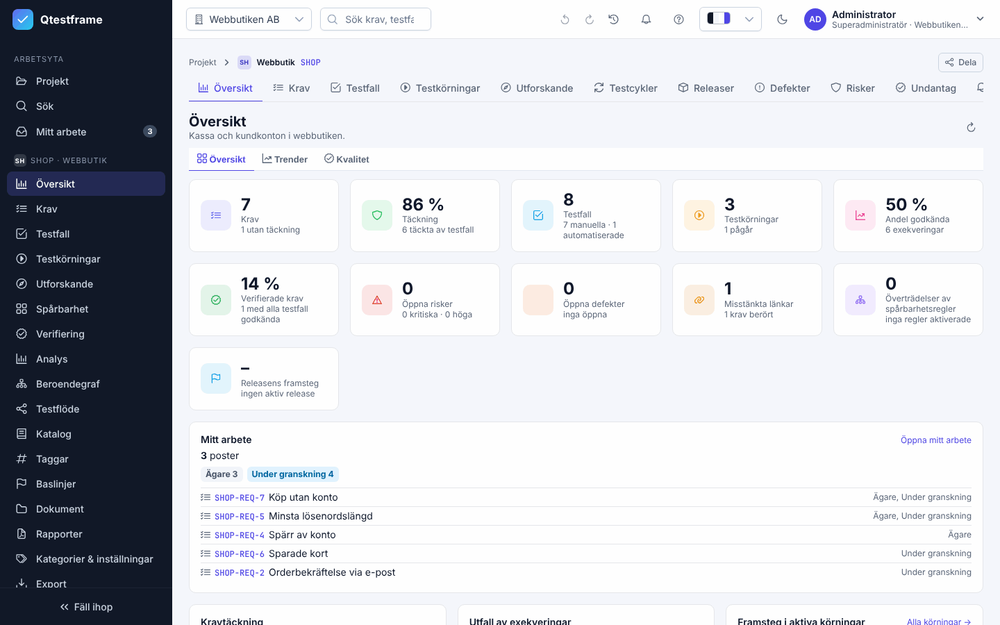

**Översikt**

- **Nyckeltal**: antal krav (och hur många som saknar täckning), täckning (hur många som täcks av testfall), antal testfall (manuella och automatiserade), testkörningar (som pågår) och andelen godkända av alla exekveringar.
- **Kravtäckning**: hur många krav som är *Godkänd*, *Underkänd*, *Delvis*, *Ej körd* och *Ingen täckning*.
- **Utfall av exekveringar**: alla utfall i alla körningar.
- **Framsteg i aktiva körningar**: en stapel per planerad eller pågående körning (de åtta nyaste), uppdelad i godkända, underkända, blockerade, överhoppade och ej körda.
- **Senaste körningar**: de fem nyaste körningarna med förlopp; **Alla körningar →** öppnar listan över körningar.
- **Krav per status** och **Krav per kravnivå** (krav utan kravord räknas som *ospecificerade*).
- **Testfall per status**.
- **Fler nyckeltal** (under de första): **Verifierade krav** (andelen krav vars länkade testfall alla är godkända), **Öppna risker** (med hur många som är kritiska och höga), **Öppna defekter** (med deras medelålder), **Misstänkta länkar** (länkar vars krav eller testfall har ändrats sedan dess, och hur många krav som har en, se [spårbarhetsmatrisen](#spårbarhetsmatrisen)), **Överträdelser av spårbarhetsregler** (objekt som bryter mot de aktiverade [spårbarhetsreglerna](#spårbarhetsregler), och hur många regler som bryts) och **Releasens framsteg** (andelen exekveringar med utfall i den aktuella releasen).
- **Manuella och automatiserade testfall per senaste utfall**: en stapel för manuella och en för automatiserade testfall, uppdelade i godkända, underkända, blockerade, överhoppade och ej körda.
- **Kravens granskningsstatus**: kraven efter status på sin senaste granskningsbegäran: *Inte granskat*, *Granskning pågår*, *Ändringar begärda* eller *Godkänt* (avbrutna begäranden räknas inte). Se [Granskningar](#granskningar-och-notiser).
- **Releasens exekveringsframsteg**: för den aktuella releasen (den aktiva, annars den planerade med tidigast måldatum) utfallen av alla exekveringar i dess körningar, och hur många som har utfall och är godkända. Releasens namn öppnar den.

På översikten räknas ett krav som *täckt* så snart minst ett testfall är länkat, oavsett utfall. *Verifierade* krav är de vars länkade testfall alla är godkända.

**Trender**

- **Täckning och andel godkända över tid**: täckningen (andelen krav med länkade testfall) och andelen godkända (andelen exekverade testfall vars senaste utfall är godkänt) per dag. Välj period ovanför diagrammet: 30, 90 eller 365 dagar.
- **Öppnade och stängda defekter per vecka**: nya defekter och defekter som har lösts, stängts eller avvisats, per vecka (måndag till söndag).
- **Aktivitet de senaste 30 dagarna**: per dag ändringarna av krav och testfall (varje sparad version), de avslutade exekveringarna och de rapporterade defekterna. Diagrammet visar alltid de senaste 30 dagarna, oavsett vald period.
- **Burn-up för release**: för den release som är vald i listan visas kraven i omfattningen, hur många av dem som har länkade testfall och hur många vars testfall alla är godkända i releasens körningar, dag för dag från det att releasen skapades. Releasens måldatum står ovanför diagrammet. Se [Releaser](#releaser-och-risker).

Trenderna bygger på en ögonblicksbild av siffrorna som Qtestframe sparar en gång om dagen för varje projekt (och när översikten öppnas och dagens bild saknas). Ett nytt projekt, eller ett projekt från tiden före funktionen, börjar inte tomt: vid den första ögonblicksbilden återskapas de tidigare dagarna utifrån det som har datum – när krav, testfall och länkar skapades, utfallen i körningarna och när defekter rapporterades och löstes (upp till ett år bakåt). Dagar utan ögonblicksbild överbryggas av linjen.

**Kvalitet**

- **Instabila testfall**: de tio testfall vars utfall oftast växlar mellan godkänt och underkänt, med de senaste utfallen (äldst först; en ring markerar varje växling) och när utfallet senast växlade. Klicka på ett testfall för att öppna det. Se [Instabila testfall](#instabila-testfall).
- **Öppna defekter per allvarlighetsgrad**: öppna och påbörjade defekter per allvarlighetsgrad.
- **Kravtäckning per grupp**: täckningen per mapp på översta nivån (krav i undermappar räknas till den översta mappen) eller, med **Kategori**, per kravkategori; de tolv största grupperna.
- **Öppna risker per nivå**: öppna risker (*Identifierad* eller *Åtgärdas*) per nivå; **Riskregister →** öppnar [riskregistret](#riskregistret).
- **Värmekarta för risker**: en liten tabell 5 × 5 med de risker som inte är stängda, per sannolikhet (rader, 5 överst) och konsekvens (kolumner). Utöver färgen har varje nivå en egen kantlinje (prickad för medel, streckad för hög, heldragen med ränder för kritisk), förklarad under tabellen.
- **Åtgärder för öppna risker**: de öppna riskerna efter hur långt kraven som hanterar dem är testade: *Inga krav*, *Otestad*, *Delvis testad*, *Testad, inte alla godkända* och *Verifierad* (som i [riskrapporten](#standardrapporter)).
- **Ålder på öppna defekter**: öppna och påbörjade defekter efter ålder (under 7 dagar, 7–30, 30–90, över 90 dagar), uppdelade per allvarlighetsgrad, med medelåldern och den äldsta.
- **Spårbarhetsregler**: om alla aktiverade regler med allvarlighet *fel* är uppfyllda, hur många regler som är aktiverade, hur många som bryts (fel och varningar) och antalet överträdelser. **Spårbarhet →** öppnar matrisen med reglerna.
- **Kvalitetsmått** och **Konsistenskontroller** (de som hittar problem): samma som under [Analys](#kvalitetsmått).

De extra nyckeltalen och diagrammen räknas fram på servern i en enda begäran, som läses in samtidigt med resten av översikten.

Varje diagram har ett textalternativ med siffrorna för skärmläsare, och förklaringen namnger varje färg. Värmekartan är en tabell med rubrik, och varje ruta anger sin sannolikhet, konsekvens, nivå och antal risker.

### Anpassa översiktspaneler

Varje widget i en översiktspanel kan flyttas, ändras i storlek, ställas in och tas bort, och du kan lägga till widgetar och översiktspaneler.

- **Delade översiktspaneler** syns för alla som får läsa projektet. De inbyggda **Översikt**, **Trender** och **Kvalitet** är delade; projektets administratörer (behörigheten *project.update*) kan ändra dem, lägga till fler delade översiktspaneler och välja den som projektet öppnas med (**⋮ → Gör till projektets standard**, markerad med en stjärna).
- **Personliga översiktspaneler** är bara dina. Välj **⋮ → Ny översiktspanel** (om du vill med en kopia av den som visas som start), eller anpassa en delad översiktspanel som du inte får ändra: **Spara som min översiktspanel** sparar dina ändringar som en personlig kopia.
- **Hem** i sidomenyn är din personliga **hempanel** över alla projekt: från början **Mitt arbete**, dina diskussioner och en anteckning. En widget som gäller ett projekt anger projektet i sina inställningar. Du kan göra den till din startsida under **Profil → Startsida**.

Välj **Anpassa** för att redigera översiktspanelen som visas:

- **Lägg till widget** listar de widgettyper du får se, med en kort beskrivning. Bland dem: nyckeltal, kravtäckning, verifieringsstatus, antal per status, allvarlighet eller nivå (som stapeldiagram, liggande staplar, ringdiagram eller tabell), trend för testresultat, instabila tester, defekter, riskvärmekartan, releaseberedskap (go / no-go per slutkriterium och per variant), burn-up för release, burn-down för cykel, kvalitetsmått, konsistenskontroller, Mitt arbete, diskussioner, senaste aktivitet, luckor i spårbarheten (krav utan tester och tester utan krav), utforskande testning, täckning av MITRE ATT&CK, D3FEND och EMB3D, en **sparad fråga** – valfri fråga i [frågespråket](#sökning-och-filter), som en tabell med de första objekten eller som ett antal – och en **anteckning** i Markdown.
- Dra en widget i dess **flytthandtag** (pilarna bredvid rubriken) och ändra storleken med handtaget i nedre högra hörnet. Widgetar som är i vägen flyttas nedåt; **Städa upp** tar bort luckorna.
- Med tangentbordet: ge flytt- eller storlekshandtaget fokus och använd **piltangenterna** (en cell per tryck; med **Skift** på flytthandtaget ändras storleken). **Home** och **End** går till första eller sista kolumnen (på storlekshandtaget: smalast och full bredd). **Enter** eller **blanksteg** tar upp widgeten och släpper den igen, **Escape** lägger tillbaka den där den var. Varje ändring läses upp för skärmläsare, till exempel ”Kravtäckning: kolumn 7, rad 1”.
- **Inställningar** (kugghjulet) anger rubriken, bredden (1–12 kolumner) och höjden (rader på ungefär 80 pixlar) och widgetens inställningar: release, cykel eller variant, frågan, diagramtypen, perioden och så vidare. **Ta bort** (×) tar bort widgeten från översiktspanelen.
- **Spara** sparar layouten; **Avbryt** kastar ändringarna.

En del widgetar har egna snabbval, till exempel perioden för en trend eller releasen för en burn-up; de ändrar bara visningen tills du lämnar sidan.

Menyn **⋮** har också **Byt namn**, **Exportera som JSON** och **Importera från JSON** (en översiktspanel som exporterats här eller från en annan server; widgetar av okända typer utelämnas), **Återställ till standard** (en inbyggd översiktspanel får tillbaka sin ursprungliga layout, en kopia layouten den kopierades från) och **Ta bort översiktspanelen**.

Widgetar visar bara det du får se: en widget vars data kräver en behörighet du saknar, eller som gäller ett projekt du inte kan öppna, säger det i stället. Widgetarna på skärmen läser in sina data tillsammans i en begäran, och widgetar längre ned läses in när du rullar dit; **Uppdatera** läser in alla igen.

## Beroendegrafer

**Beroendegraf** i projektets sidopanel ritar hur objekten bygger på varandra. Välj **Krav** eller **Testfall** överst:

- **Krav**: relationerna mellan krav, som *beror på*, *tillhandahåller*, *förfinar*, *härlett från*, *står i konflikt med*, *duplicerar* och *relaterar till* (se [Relationer](#relationer));
- **Testfall**: [beroendena](#beroenden) mellan testfall (*beror på*) och de delade stegen (*anropar*).

Grafen läses från vänster till höger: förutsättningar, överordnade krav och källor står till vänster, det som bygger på dem till höger. Varje ruta visar nyckel, titel och täckning (krav) eller senaste utfall (testfall), med en färgad list i samma färger som i resten av appen. Varje relationstyp har en egen färg och linjestil, förklarad vid dess kryssruta.

- Kryssa ur en relationstyp för att dölja de linjerna; objekt som då saknar relationer försvinner om inte **Visa objekt utan relationer** är på.
- Skriv i **Markera objekt…** för att markera matchande objekt.
- Högerklicka på ett objekt (eller ge det fokus och tryck <kbd>Blanksteg</kbd>) för att markera dess grannar; **Visa alla** avslutar det.
- Välj ett objekt (eller tryck <kbd>Enter</kbd>) för att öppna det. Zooma med förstoringsknapparna; rulla för att flytta dig.
- **Rotera 90°** (knappen med den vridna pilen bredvid zoomen) ritar grafen uppifrån och ned i stället för från vänster till höger: förutsättningar och överordnade krav hamnar då överst. Valet sparas i adressen (`dir=vertical`) och i din webbläsare.
- **Skriv ut eller spara** skriver ut grafen på en egen sida (liggande när den är bred) eller sparar den som **SVG**-bild (skarp i alla storlekar, behåller länkarna till posterna), **PNG**-bild eller **Markdown** med ett Mermaid-diagram (ritas av GitHub, GitLab och många redigerare) och en tabell med posterna och deras relationer. De sparade filerna visar det som syns på skärmen: valda relationstyper, riktning och poster.
- **Lista** visar samma relationer som en tabell, ett objekt per rad, vilket är lättare att läsa med skärmläsare eller att skriva ut.

Cykler (till exempel två krav som beror på varandra) ritas, men en av linjerna visas utan pil.

## Kravanalys

**Analys** i projektets navigering analyserar alla krav i projektet på en gång (öppna den igen eller välj **Analysera igen** efter ändringar). Överst: **hälsan** (andelen krav utan problem eller varningar), antalet krav och testfall, andelen **täckta av testfall** (avvisade och inaktuella krav räknas inte) och den genomsnittliga **språkpoängen**.

- **Kravnivåer** visar hur många krav som har varje nivå, inklusive de som **saknar kravnivå**.
- **Nyckelord per betydelse** grupperar nyckelord som betyder samma sak (MUST, SHALL och REQUIRED; MAY och OPTIONAL …) och visar hur de används, så att du direkt ser projektets konvention.

**Anmärkningar** listar vad analysen har lagt märke till, problem först, var och en med en förklaring, **vad du kan göra** och de krav (eller testfall) det gäller; välj en nyckel för att öppna objektet. Filtrera på allvarlighet eller kategori:

| Kategori | Anmärkningar |
|---|---|
| Kravnivåer | nyckelord som inte skrivs med versaler som RFC 2119 och RFC 8174 kräver ("must", "Should"), och krav vars nyckelord *bara* står med gemener och därför saknar normativt nyckelord; WILL använt som kravnivå (det är inget nyckelord i RFC 2119); krav utan kravnivå; nivå i fältet men inget nyckelord i texten; fältet och texten säger olika; flera nivåer i ett krav; fördelningen: nästan allt obligatoriskt, inga obligatoriska krav, många valfria (MAY) eller många BÖR- eller beskrivande krav |
| Konsekvens | krav på mer än ett språk (till exempel mest engelska med några svenska), ett krav vars titel och meningar är på olika språk, och engelska nyckelord i ett krav skrivet på ett annat språk (MUST i en svensk mening); ett nyckelord som används i några få krav medan ett annat med samma betydelse dominerar, till exempel *SHALL används i 1 krav, medan MUST används i 95 %*; nyckelord med samma betydelse som används ungefär lika mycket |
| Täckning | obligatoriska och andra krav utan testfall; underkända eller ännu inte körda testfall; krav utan acceptanskriterier |
| Testfall | testfall som inte verifierar något krav; godkända krav utan testfall som är Klart |
| Kvalitet | tomma beskrivningar, dubblerade titlar, krav i konflikt, låg språkpoäng, många utkast, krav utan ägare |
| Språk | [språkanalysens](#språkanalysen) anmärkningar summerade per regel: vaga ord, TBD, undanflykter … |

**Kravens språk** visar hur många krav som är skrivna på varje språk. Bara texter som är tillräckligt långa för att avgöra språket räknas; en titel på ett eller två ord räcker inte.

**Språk** väljer analysens språk (identifieras per krav som standard). Anmärkningar om testfall visas när du får läsa testfall.

### Konsistenskontroller

**Konsistenskontroller** under **Analys** utvärderar varje [inbyggd konsistenskontroll](#inbyggda-konsistenskontroller) på projektet, även de som inte lagts till som regler än (märkta **Standard**; de räknas inte för releaser förrän de lagts till). **Visa överträdelser** listar objekten med de berörda objekten och åtgärderna.

### Kvalitetsmått

**Kvalitetsmått** under **Analys** (och på översiktens flik **Kvalitet**) mäter projektet ur dess historik. Välj period (30, 90, 180 eller 365 dagar) och efter hur många dagar ett senaste resultat räknas som inaktuellt. Trenderna är per vecka, eller per månad för perioder över 120 dagar.

| Mått | Vad det mäter |
|---|---|
| **Kravens föränderlighet** | ändringarna av krav efter att de skapades (varje sparad version; flyttar räknas inte), per period, som ändringar per krav och period, och de mest ändrade kraven |
| **Defekttäthet** | defekter per aktivt krav, per mapp och per kategori; en defekt räknas för ett krav när den är länkad till kravet, till ett testfall som verifierar det eller till en körning av ett sådant testfall |
| **Läckta defekter** | defekter som hittats i produktion (defektens fält **Upptäckt i**, se [Defekter](#defekter-1)) eller rapporterats efter att en release de berör släppts; andelen av alla defekter, per upptäcktsfas och per release |
| **Testeffektivitet** | defekter hittade av test (länkade till ett testfall eller en av dess körningar) per kört testfall och per körtimme; körningar utan tidsåtgång räknas inte i timmarna |
| **Resultatens ålder** | hur gammalt varje testfalls senaste resultat är (0–7, 8–30, 31–90, 91–180 och fler dagar, aldrig körda) och hur många som är äldre än gränsen |
| **Granskningstid** | tiden från en granskningsbegäran till beslutet (median, medel och 90:e percentilen), och de väntande begärandena |
| **Tid till rättning av defekter** | tiden från att en defekt rapporteras tills den är löst, per allvarlighet (avvisade defekter räknas inte) |
| **Kravkvalitet** | andelen aktiva krav vars text har varningar från språkanalysen; trenden spelar upp varje kravs text ur dess historik |

Varje diagram har ett textalternativ och **Visa som tabell** visar siffrorna i en tabell. **Exportera som rapport** öppnar rapporterna: standardrapporten **Kvalitetsmått** innehåller samma siffror.

### Efterlevnad av lagar och standarder

Längst ned i **Analys** visar **Efterlevnad av lagar, standarder och bästa praxis** hur väl projektet uppfyller regelverken och standarderna i [katalogen](#uppfyll-lagar-standarder-och-bästa-praxis). Utan val visas alla källor som projektet använder; välj andra i listan (grupperad efter slag, med sökfält) för att se vad som saknas även för dem.

För varje källa:

- **Katalogkrav** är de krav i katalogen som hänvisar till den. Ett katalogkrav är **infört** när projektet har ett krav som lagts till från det och som inte är avvisat eller inaktuellt; annars **saknas** det. **Egna** krav är projektets krav som inte lagts till från de posterna men som nämner källan i fältet **Källa**, till exempel `GDPR Art. 32; ISO/IEC 27001:2022 A.8.5` (skrivet som under *Baserat på* i katalogen; stora och små bokstäver spelar ingen roll).
- **Uppfyllelse**: ett krav är *uppfyllt* när det har testfall och det senaste utfallet för vart och ett är godkänt, *underkänt* när något är underkänt, *blockerat* när något är blockerat, och *ej testat* annars. När projektet har flera kopior av samma katalogpost räknas det sämsta läget.
- **Efterlevnad** är andelen uppfyllda krav av alla katalogkrav och egna krav för källan; **Infört** är andelen katalogkrav som projektet har; **MUST-krav (SKA)** är efterlevnaden för de obligatoriska kraven. Stapeln visar uppfyllda, underkända, blockerade, ej testade och saknade krav.
- **Per kravnivå** delar upp siffrorna på MUST (även MUST NOT), SHOULD och MAY. **Per avsnitt** visar efterlevnaden per artikel, bilaga eller grupp av åtgärder, hämtat ur hänvisningarna (`Art. 32`, `A.8`, `Annex I Part I`, `SR 1` …; *(allmänt)* för hänvisningar till källan som helhet).
- **Saknade krav** listar luckorna, MUST först: välj ett för att öppna det i katalogen, eller **Lägg till det som saknas från katalogen** för att öppna katalogen med källan vald. **Infört men inte uppfyllt** listar projektets krav som fortfarande är underkända eller saknar godkända testfall; välj en nyckel för att öppna kravet.

Standardrapporten **Efterlevnad** (se [Rapporter och export](#rapporter-och-export)) innehåller samma siffror, per källa och avsnitt, med luckorna. Analysen hjälper dig att planera och följa upp; den är ingen juridisk bedömning.

# Dubbletter och konflikter

I stora kravmängder hamnar samma krav ofta två gånger (skrivet av två personer, importerat både från ett kunddokument och från [katalogen](#katalog)), och en del krav motsäger varandra (*lösenord minst 12 tecken* och *högst 8*). Qtestframe letar efter båda: medan du skriver, i de [inbyggda konsistenskontrollerna](#inbyggda-konsistenskontroller) och på sidan **Dubbletter och konflikter**, där du bestämmer vad som ska göras med varje par.

Allt beräknas på Qtestframe-servern. Ingen text lämnar den om inte en administratör har slagit på en [tjänst för inbäddningar](#tjänst-för-inbäddningar).

## Liknande krav medan du skriver

När du skapar eller redigerar ett krav visar **Liknande krav** under beskrivningen de fem krav i projektet som liknar det mest, vart och ett med likheten i procent, en stund efter att du slutat skriva. En likhet på eller över projektets dubblettgräns (68 % som standard) markeras: kravet finns troligen redan. Öppna det i en ny flik, eller fortsätt skriva om ditt säger något annat.

Testfallsredigeraren har samma panel, **Liknande testfall**, som jämför titel, beskrivning, förutsättningar och steg.

Avvisade och föråldrade krav och utfasade testfall jämförs inte. Panelen visas bara för den som får ändra objektet.

## Hur likheten mäts

Två krav liknar varandra när de använder samma viktiga ord, inte när de ser lika ut bokstav för bokstav:

- **Normalisering och böjningsformer.** Texterna jämförs med små bokstäver och utan skiljetecken; orden förkortas till sin stam på svenska och engelska (*användaren*, *användarna* → *använd*; *users*, *user* → *user*), så böjningar spelar ingen roll.
- **Stoppord.** Ord utan egen betydelse (*och*, *ska*, *the*, *shall* …) räknas inte. Förpliktelseorden jämförs i stället av konfliktsökningen.
- **Synonymer och förkortningar** inom området räknas som samma ord, även mellan språken: *logga in*, *inloggning*, *log in* och *sign in*; *användare*, *brukare*, *user* och *end user*; *e-post*, *mejl* och *e-mail*; *2FA*, *tvåfaktorsautentisering* och *two-factor*; *radera*, *ta bort*, *delete* och *remove*, med flera.
- **Sammansättningar.** Svenska sammansatta ord delas när en del är ett känt ord (*användarkonto* = *användare* + *konto*), och bitar om fyra bokstäver gör *lösenordsbyte* och *byte av lösenord* lika.
- **Ovanliga ord väger tyngre.** Ett ord som finns i några få krav i projektet säger mer än ett som finns i de flesta (TF-IDF över projektet).
- **Fältvikter.** Titeln väger mest, sedan beskrivningen och sist acceptanskriterierna (för testfall: förutsättningar, steg och förväntat resultat).

Resultatet är en likhet från 0 till 1 (visas i procent). Texter som bara skiljer sig i versaler och skiljetecken är 100 %.

## Möjliga konflikter

Två krav är **möjligen motstridiga** när de handlar om samma sak (de har tillräckligt många viktiga ord gemensamt) och:

| Slag | Exempel |
|---|---|
| **Motsatt förpliktelse** | *Användaren ska kunna exportera rapporter som PDF.* och *Användaren får inte kunna exportera rapporter som PDF.* (även *MUST* och *MUST NOT*, *ska* och *ska aldrig*) |
| **Gränsvärden** som inte kan gälla samtidigt | *svara inom 2 sekunder* och *en svarstid på minst 5 sekunder*; *minst 12 tecken* och *högst 8 tecken*; *at least 12 characters* och *at most 8 characters*. Enheter räknas om (2000 ms = 2 s, 15 minuters = 900 s), och en negativ förpliktelse vänder jämförelsen (*får inte överstiga 2 s* = högst 2 s) |
| **Uteslutande värden** | *aktiverad* och *avstängd* som standard, *obligatorisk* och *frivillig*, *krypterad* och *okrypterad*, *offentlig* och *privat*, *automatisk* och *manuell*, *enabled* och *disabled* … |

Varje konflikt har en **säkerhet** från 0 till 1, högre när de två påståendena har mer innehåll gemensamt. Förpliktelseorden känns igen som i [språkanalysen](#krav) (svenska och engelska). Ett par som är motstridigt rapporteras inte också som dubblett.

## Sidan Dubbletter och konflikter

Öppna **Dubbletter och konflikter** i projektets sidomeny. Välj **Krav** eller **Testfall** överst.

- **Möjliga konflikter** (krav) visar varje par med slag, säkerhet och de avgörande orden, och meningen i vart och ett av kraven med **beläggen markerade**: förpliktelseorden, gränsvärdena eller de uteslutande värdena.
- **Misstänkt dubblerade krav** (eller testfall) visar varje par med likheten och antalet spårlänkar för varje objekt.

**Likhet från** och **Säkerhet för konflikt från** ändrar vad som visas; de börjar på projektets gränser (de inbyggda kontrollerna). **Visa avfärdade** visar också paren du har avfärdat, så att du kan visa dem igen.

För varje par kan du:

| Åtgärd | Vad som händer |
|---|---|
| **A dubblerar B** | lägger till relationen *A dubblerar B* (för testfall: en objektlänk med etiketten *duplicates*). Paret är inte längre misstänkt. |
| **Slå ihop…** | välj vilket objekt som ska **behållas**; det andra slås ihop med det: dess spårlänkar, relationer (testfall: förutsättningar) och objektlänkar flyttas till objektet du behåller, det får statusen *Inaktuellt* (testfall: *Utfasat*) och markeras som dubblett av det behållna objektet. Båda får en kommentar om sammanslagningen, och statusändringen syns i historiken. Länkar som det behållna objektet redan har dubbleras inte. |
| **Markera som motstridiga** | lägger till relationen *står i konflikt med*. Därefter bevakas paret av kontrollen [Motstridiga krav i en release](#inbyggda-konsistenskontroller). |
| **Ingen dubblett** / **Ingen konflikt** | avfärdar fyndet: paret visas inte igen på sidan eller i de inbyggda kontrollerna (det sparas per par och kontroll, även i säkerhetskopior och projektarkiv). **Visa igen** ångrar det. |

Att markera och slå ihop kräver behörighet att ändra krav (`requirement.write`) eller testfall (`test.write`). Alla som kan läsa objekten kan öppna sidan.

## Inbyggda kontroller

Sidan använder samma sökning som tre [inbyggda konsistenskontroller](#inbyggda-konsistenskontroller): **Misstänkt dubblerade krav**, **Möjligen motstridiga krav** och **Misstänkt dubblerade testfall**. En överträdelse rapporteras på det nyare objektet i paret; åtgärderna är **Markera som dubblett**, **Markera som motstridiga** och **Inget problem**.

## Gränsvärden

| Inställning | Standard | Var |
|---|---|---|
| Likhet för en misstänkt dubblett | 0,68 | kontrollens regel (**Likhetsgräns**, 0,5 till 1) |
| Säkerhet för en möjlig konflikt | 0,6 | konfliktkontrollens regel (**Lägsta säkerhet**, 0,5 till 1) |
| Lägsta likhet som visas medan du skriver | 0,25 | fast |

Standardvärdena valdes på en märkt uppsättning svenska och engelska krav (omformulerade dubbletter, motsägelser av varje slag och närliggande krav som är varken eller, som *spärra kontot* och *låsa upp ett konto*): med dem hittas varje märkt dubblett och konflikt, och inget orelaterat par rapporteras. Höj dubblettgränsen till omkring 0,8 när kontrollen rapporterar krav som bara har samma ämne; sänk den mot 0,6 för att hitta omformuleringar med färre gemensamma ord. Likheten beror på projektet: ett ord som är ovanligt i ett litet projekt väger tyngre än i ett stort.

## Import från katalogen

Innan du lägger till krav från [katalogen](#katalog) varnar dialogen för de valda krav som liknar krav som projektet redan har, och kan hoppa över dem. Efteråt visar resultatet hur många nya krav som liknar befintliga.

## Tjänst för inbäddningar

En administratör kan låta en extern **tjänst för inbäddningar** (en OpenAI-kompatibel slutpunkt `/v1/embeddings`) beräkna likheten i stället (**Administration → Systeminställningar → Likhet**; se administratörsguiden). Sidan och panelen visar då *Tjänst för inbäddningar*. Titel, beskrivning och kriterier eller steg för krav och testfall **skickas då till tjänsten**. Vektorerna cachas per objektversion, så oförändrade objekt skickas inte igen. Konfliktsökningen körs alltid på servern. När tjänsten inte svarar används den lokala likheten.

# AI-assistans

Qtestframe kan be en språkmodelltjänst om **förslag**: utkast till tester för ett krav, en bättre formulering av ett krav, en sammanfattning av en underkänd körning med utkast till defekter, ramverksmappningar och acceptanskriterier. Du granskar och redigerar varje förslag; **ingenting sparas förrän du godkänner det**.

AI-assistansen är valfri och **av som standard**. Den kräver en tjänst som en superadministratör ställer in, organisationen måste slå på den, och ett projekt kan stänga av den (se [Slå på och av](#slå-på-och-av)).

## Knappen Assistera

Sidor som kan använda AI-assistans har knappen **Assistera** med en gnistrande ikon:

| Var | Åtgärder |
|---|---|
| Kravredigeraren | **Förbättra formuleringen**, **Föreslå acceptanskriterier**, **Föreslå ramverksmappningar**, **Utkast till tester** |
| Testredigeraren | **Gör ett utkast till testet från** det första länkade kravet |
| Körningssidan | **Sammanfatta fel** |
| Riskdialogen | **Föreslå ramverksmappningar** |

**Assistera** öppnar en liten meny med åtgärderna. När en åtgärd inte kan användas syns den ändå, avstängd, med orsaken under: AI-assistansen är inte inställd eller avstängd, funktionen är avstängd, objektet är inte sparat ännu, körningen har inga fel, eller du har använt alla förfrågningar för den här timmen. Menyn visar också vilken tjänst texten skickas till och hur många förfrågningar du har kvar.

En åtgärd öppnar en dialog som frågar tjänsten direkt. Medan den skriver visar dialogen hur långt den har kommit; **Avbryt begäran** stoppar den. Sedan ser du förslagen, modellen, antalet token, tiden och, när administratören har angett priser, en uppskattad kostnad. **Fråga igen** skickar begäran en gång till.

Förslagen och promptarna är på användargränssnittets språk (engelska eller svenska).

## Utkast till tester från ett krav

**Utkast till tester** i ett sparat krav skickar dess titel, beskrivning och acceptanskriterier och föreslår upp till åtta manuella tester: titel, beskrivning, förutsättningar, testdata, förväntat resultat och steg med åtgärder, data och förväntade resultat, och vilka acceptanskriterier varje test täcker.

Varje test kan redigeras i dialogen: öppna detaljerna för att ändra texterna, redigera, lägga till eller ta bort steg. Bocka ur de tester du inte vill ha. **Skapa testutkast** skapar de markerade testerna med status *Utkast* och länkar vart och ett till kravet och till kriterierna det täcker. Testdatan läggs till förutsättningarna. De nya testerna syns i kravets [spårbarhet](#spårbarhet-och-täckning); granska dem som andra utkast innan du sätter dem till *Klar*.

I **testredigeraren** ber **Gör ett utkast till testet från** *NYCKEL* om utkast från testets första länkade krav. Välj ett utkast och **Använd det här utkastet**: dess titel (om testet saknar en), beskrivning, förutsättningar, förväntade resultat och steg läggs in i formuläret. Spara testet för att behålla dem.

## Förbättra ett krav

**Förbättra formuleringen** skickar kravets aktuella text (även när det inte är sparat ännu) tillsammans med fynden från [kravkontrollerna](#krav) och ber om en omskrivning som följer reglerna som kontrollerna letar efter: en förpliktelse med ett nyckelord i versaler (SKA, BÖR, KAN … eller MUST, SHOULD, MAY …), ett EARS-mönster där det passar (*När* … *SKA systemet* …), inga vaga ord, inga TBD, inga öppna listor eller undanflykter, aktiv form och mätbara värden.

Dialogen visar:

- **ändringarna** som en ordvis skillnad (tillagda ord understrukna, borttagna överstrukna) och förklaringen;
- de **åtgärdade fynden**: servern kontrollerar omskrivningen igen med samma kontroller, så listan visar vad omskrivningen verkligen åtgärdar, inte vad tjänsten påstår;
- de **fynd som finns kvar** och eventuella **nya fynd**, och kvalitetspoängen före och efter.

Redigera titeln och texten vid behov och välj sedan **Använd den här texten**: den ersätter texten i redigeraren. Den sparas när du sparar kravet, så du kan fortfarande jämföra och ångra. En platshållare som *[värde]* betyder att tjänsten behövde ett värde som den inte kunde veta.

## Acceptanskriterier

**Föreslå acceptanskriterier** föreslår verifierbara kriterier med en metod (test, inspektion, analys, demonstration, granskning) och, där kravet antyder en kvalitet, ett gränsvärde med enhet. Kriterier som kravet redan har utelämnas. Redigera eller bocka ur dem och välj **Lägg till kriterier**: de läggs till formulärets kriterier.

## Ramverksmappningar

**Föreslå ramverksmappningar** föreslår id i säkerhetsramverk med ett skäl för varje:

- för ett **krav**: MITRE D3FEND-tekniker och EMB3D-mitigeringar eller -hot, och CWE-svagheter;
- för en **risk**: MITRE ATT&CK- och ATLAS-tekniker och EMB3D-hot.

Varje id kontrolleras mot listorna som är inbyggda i Qtestframe; id som inte finns där tas bort, och dialogen säger hur många. Id som redan är mappade utelämnas. **Lägg till mappningar** lägger till de markerade id:na i formulärets fält för D3FEND, EMB3D eller ATT&CK; CWE-id läggs till kravets taggar (*CWE-79*), eftersom krav saknar ett CWE-fält. CWE-id är kända när [katalogen](#katalog) hänvisar till dem.

## Sammanfatta en underkänd körning

**Sammanfatta fel** på en körningssida skickar de underkända och blockerade utförandena (test, anteckningar, slutet av felutskriften, underkända steg; högst 40) och defekterna som är länkade till körningen. Du får en kort sammanfattning, troliga gemensamma orsaker (hypoteser utifrån datan) och utkast till defekter för misslyckanden som inget länkat fel täcker ännu.

Redigera utkastens titel, beskrivning och allvarlighetsgrad, bocka ur det du inte vill ha och välj **Skapa defekter**: varje defekt skapas och länkas till körningen och till utförandena av dess tester. Hantera dem sedan enligt [Defekter](#defekter-1).

## Integritet och vad som skickas

När du klickar på en åtgärd skickas texten i **det objektet** till AI-tjänsten som administratören har konfigurerat — ingenting annat, och ingenting i bakgrunden:

| Åtgärd | Vad som skickas |
|---|---|
| Utkast till tester, acceptanskriterier, förbättra formuleringen | kravets nyckel, titel, beskrivning, typ, förpliktelse, motivering och acceptanskriterier (vid förbättring: fynden från kontrollerna) |
| Sammanfatta fel | körningens namn, miljö och bygge, de underkända och blockerade utförandena med anteckningar, felutskrift och underkända steg, och de länkade defekterna |
| Ramverksmappningar | kravets eller riskens titel och beskrivning (risker: även kategori och åtgärd) och de id som redan är mappade |

Varje begäran registreras i organisationens händelselogg (funktion, användare, objekt, token) utan innehållet. Tjänsten svarar bara med text: den kan inte ändra något i Qtestframe, och objekttexten skickas till den som data, inte som instruktioner. Förslag kan ändå vara fel eller ofullständiga: granska dem som arbetet av en ny kollega.

## Slå på och av

- **Server:** en superadministratör konfigurerar tjänsten (Anthropic, eller en OpenAI-kompatibel tjänst som Azure OpenAI eller en lokal server) under **Administration → Systeminställningar → AI-assistans** och kan stänga av enskilda funktioner (se administratörshandboken).
- **Organisation:** en administratör (*settings.manage*) slår på den under **Administration → AI-assistans**.
- **Projekt:** en projektansvarig (*project.update*) kan stänga av den för ett projekt under **Inställningar → Projekt → AI-assistans**, till exempel när projektets data inte får lämna servern.

En gräns per användare och timme skyddar mot skenande kostnader; menyn Assistera visar hur många förfrågningar som finns kvar.

# Varianter och kod

En produkt byggs ofta i flera **varianter**: modeller, marknader eller kundkonfigurationer. Alla krav gäller inte alla varianter, och en testkörning på en variant säger ingenting om en annan. Qtestframe håller reda på vilka krav och testfall som gäller vilka varianter och beräknar täckningen per variant.

Den andra halvan av sidan handlar om **kod**: incheckningarna, merge requests och pull requests som hänvisar till krav och testfall, de **byggen** i CI vars resultat laddats upp och **regressionsurvalet** som föreslår vilka testfall som ska köras efter en ändring.

## Varianter

Välj **Varianter** i projektets sidomeny och sedan fliken **Varianter**. Med rollen **Förvaltare** (behörigheten `project.update`) kan du lägga till, ändra och ta bort varianter.

Varje variant har:

- ett **namn**, unikt i projektet, till exempel *EU-modell*;
- eventuellt en plats **under** en annan variant: varianterna bildar en hierarki, till exempel *EU* → *EU-modell DE*;
- en **typ**: produktvariant, marknad, kundkonfiguration eller annan;
- **egenskaper**: namn och värden som `region = EU` eller `voltage = 230V`. En variant ärver egenskaperna från varianterna över den; dess egna värden gäller före dem;
- de **testkonfigurationer** den testas i. Väljer du några räknas bara resultat i de konfigurationerna (och resultat utan konfiguration) för varianten. Lämna fältet tomt för att räkna alla konfigurationer. Se [testkonfigurationer](#testkörningar-och-exekvering).

När en variant tas bort flyttas varianterna under den upp en nivå. Dess körningar blir variantneutrala, och krav och testfall som bara gällde den gäller alla varianter igen.

## Tillämplighet

Ett krav eller testfall **gäller** alla varianter tills du anger något annat. Öppna det och välj **Ändra** i avsnittet **Varianter** bland detaljerna:

- **Alla varianter**: standardvalet; det omfattar även varianter som läggs till senare.
- **Valda varianter**: objektet gäller de valda varianterna och varianterna under dem. Väljer du *EU* ingår även *EU-modell DE*.
- **Uttryck**: en [fråga](#sökning-och-filter) som prövas mot varje variant. Fälten är `name` och `variant` (varianten och de över den), `kind` och egenskaperna. Exempel: `region:EU`, `region:EU AND NOT voltage:110V`, `kind:customer OR variant:"EU-modell"`.

För att ange tillämpligheten för många objekt på en gång markerar du dem i listan och väljer **Gäller** i verktygsfältet.

### Historik, ångra och baslinjer

En ändring av tillämpligheten finns i objektets **Historik** (som *Tillämplighet*, med varianterna före och efter) och i granskningsloggen. **Ångra** (Ctrl+Z) tar tillbaka den, även en ändring av många objekt på en gång: varje objekt får det det hade. När du återställer en äldre version från historiken återställs också den versionens tillämplighet.

[Baslinjer](#baslinjer) sparar tillämpligheten för varje objekt. **Jämför** visar *Gäller för (varianter)* bland de ändrade fälten när den skiljer sig, och **Återställ** från en baslinje ger objekten den tillämplighet de hade, även när inget annat ändrats. Varianter som tagits bort sedan dess lämnas utanför. Ett borttaget objekt behåller sin tillämplighet i papperskorgen, och projektarkiv och säkerhetskopior innehåller den.

### Visa för en variant

Välj en variant i **Visa för variant** i krav- och testfallslistorna och på sidan **Spårbarhet**. Listan visar då bara objekten som gäller den, med den täckning och de senaste resultat som räknas för varianten. Frågespråket känner också till varianter, och API:et tar `?variant=` för spårbarhetsmatrisen, exporter, ReqIF och rapporter:

| Fråga | Hittar |
|---|---|
| `variant:"EU-modell"` | objekt som gäller varianten *EU-modell* |
| `applicability:selected` | objekt som bara gäller vissa varianter |
| `applicability:all` | objekt som gäller alla varianter |
| `variant:US` (körningar) | körningar för varianten *US* |

## Täckning per variant

Täckningen beräknas per **variant × testkonfiguration**:

1. Ett krav räknas i en variant när det gäller den. Annars är dess täckning där **Ej tillämplig**.
2. Bara de länkade testfall som gäller varianten räknas.
3. Bara resultat som räknas för varianten används: resultat av körningar för varianten eller en variant över den, och resultat av **variantneutrala** körningar. Resultat i konfigurationer som varianten inte testas i lämnas utanför.

När du skapar en körning väljer du vilken **Variant** den testar, eller låter den vara variantneutral. Uppladdningar från CI kan också ange varianten (se [byggen](#byggen)).

Fliken **Täckningsmatris** visar alla krav mot alla varianter, med hur många av de tillämpliga kraven som godkänts. Filtrera kraven med en fråga och välj **I konfiguration** för att se en enda testkonfiguration. I ett kravs detaljer visar avsnittet **Varianter** dess täckning i varje variant och, per variant, i varje konfiguration.

### Releaser och dokument för en variant

Välj en variant i **Status för variant** på sidan **Releaser** för att utvärdera utgångskriterierna för den: bara releasens krav som gäller varianten, testfallen som gäller den och resultaten som räknas.

### Releasegrindar per variant

En release kan **rikta sig mot** en eller flera varianter: redigera releasen och välj dem i **Målvarianter**. Utgångskriterierna utvärderas då för varje målvariant, med reglerna för [täckning per variant](#täckning-per-variant):

- bara releasens krav som gäller varianten, och bara deras länkade testfall som gäller den, räknas;
- bara resultat från releasens körningar för varianten eller en variant över den, och från **variantneutrala** körningar, räknas, i de konfigurationer varianten testas i. En variantneutral körning räknas för varje målvariant.

Fliken **Status** visar matrisen **Utgångskriterier per variant**: en rad per kriterium, en kolumn per variant, varje cell *Uppfyllt*, *Undantaget* (uppfyllt eftersom undantag eller signerade riskacceptanser accepterar det som saknas) eller *Ej uppfyllt*, och go / no-go för varje variant längst ned. Releasen är **go först när varje målvariant är go**; för att markera den som släppt krävs detta go eller en releaseanteckning för att släppa ändå. I listan med kriterier under matrisen är ett kriterium uppfyllt när det är uppfyllt i alla varianter, och varje blockerande objekt anger i vilka varianter det blockerar. [Rapporten om releaseberedskap](#rapporter-och-export) innehåller samma matris.

Ett [undantag](#undantag-restrisk-och-uttalande-om-tillämplighet) kan begränsas till varianter (**Endast för varianter**): det accepterar då sina krav bara i de varianterna och varianterna under dem. En release utan målvarianter räknar bara undantag för alla varianter. En release utan målvarianter, och ett projekt utan varianter, utvärderas som tidigare.

När du [skapar ett dokument](#dokument-1) väljer du **För variant**: kravspecifikationen eller testplanen innehåller då bara det som gäller varianten, med dess täckning och resultat, och anger varianten på titelsidan.

## Kodlänkar

Krav och testfall kan länkas till **incheckningar** och **merge- eller pull requests**. Öppna ett objekt och välj fliken **Kod**. Den visar de länkade ändringarna med status (öppen, sammanfogad eller stängd), kodförråd, gren, författare och byggena av varje incheckning.

Länkarna skapas på två sätt:

- **Automatiskt**: när ett incheckningsmeddelande, eller titeln, beskrivningen eller grennamnet för en merge- eller pull request, nämner en objektnyckel länkas ändringen till objektet. Både hela nycklar (`DEMO-REQ-12`) och korta nycklar (`REQ-12`, `TC-3`, som avser det här projektet) fungerar. En nyckel från ett annat projekt (`OTHER-REQ-1`) hoppas över.
- **För hand**: välj **Länka incheckning eller MR** på fliken **Kod** och ange SHA eller nummer, adressen och en titel.

### Webhookar

De automatiska länkarna kommer från webhookar. Med rollen **Förvaltare** öppnar du **Inställningar → Projekt → Kodintegration**:

1. Välj **Skapa** (eller skriv en hemlighet på 16 till 200 tecken) och **Spara**. Kopiera hemligheten nu: den visas aldrig igen.
2. I **GitLab** öppnar du kodförrådets *Settings → Webhooks*, anger **Webhookadress för GitLab**, lägger hemligheten i *Secret token* och kryssar i *Push events* och *Merge request events*.
3. I **GitHub** öppnar du *Settings → Webhooks → Add webhook*, anger **Webhookadress för GitHub**, väljer *application/json*, lägger hemligheten i *Secret* och väljer händelserna *Pushes* och *Pull requests*.

Qtestframe kontrollerar varje leverans: GitLab måste skicka hemligheten, GitHub måste signera innehållet med hemligheten (HMAC-SHA256). Leveranser utan giltig signatur avvisas. **Ta bort hemligheten** stänger av webhookarna.

## Byggen

Ett **bygge** är ett bygge i CI som testresultat laddats upp för. CI anger det när [JUnit-resultat](#testkörningar-och-exekvering) eller JSON-resultat laddas upp, som frågeparametrar:

```
POST /api/v1/runs/{run}/junit?build_id=4711&build_number=1.4.41&commit=3f2c9e1&branch=main&pipeline_url=https://ci.example.org/p/4711&variant=EU-modell
```

`qtestframe report` skickar dem själv i GitLab CI, GitHub Actions och Jenkins (se [CI/CD](#cicd)). `build_id` är CI:s eget id (unikt per projekt); `build_number`, `commit`, `branch` och `pipeline_url` är valfria, och `variant` gör körningen till en körning för den varianten. Körningen kopplas sedan till bygget.

- **Verifierat i bygge**: fliken **Kod** för ett krav visar det senaste bygget där alla länkade testfall godkändes, och de byggen där dess testfall kördes med täckningen i varje.
- **Byggen** för ett testfall: fliken **Kod** för ett testfall visar byggena det kördes i, nyast först, med resultatet i varje.
- **Kod → Byggen** visar alla byggen med körningar och andel godkända.

## Regressionsurval

Välj **Kod → Regressionsurval** för att hitta testfallen som ska köras efter ändringar:

- **Ändrade krav**: nycklar till krav som ändrats;
- **Incheckningar sedan bygge**: incheckningarna efter byggets egen incheckning (på byggets gren), och de krav och testfall de nämner;
- **Variant**: bara krav och testfall som gäller den;
- **Ta med krav som beror på, förfinar eller härleds från dem**: ett steg längs dessa [relationer](#krav);
- **Ta med testfall som är förutsättningar**: testfallen som de valda testfallen beror på.

**Föreslå testfall** visar testfallen och varför vart och ett är med. Utfasade testfall lämnas utanför. **Skapa körning** gör en körning av dem (för den valda varianten), med byggets namn när du utgår från ett bygge. CI kan göra samma sak med `POST /api/v1/projects/{pid}/regression/run`.

# CI/CD

Qtestframe samarbetar med din **CI/CD-pipeline** (i första hand GitLab CI/CD, men också GitHub Actions och andra CI-system): pipelinen laddar upp sina automatiserade testresultat, en **kvalitetsgrind** avgör om ändringen får gå vidare, resultatet kommer tillbaka till GitLab som en **commit-status** och en **anteckning i merge requesten**, och **testurvalet** kör bara de testfall en ändring behöver. Allt görs med kommandot `qtestframe` i pipelinens jobb och en API-nyckel; servern behöver ingen extra konfiguration.

Sidan bygger på [testkörningar och CI-importen](#testkörningar-och-exekvering), [releaser och deras slutkriterier](#releaser-och-risker) och [kodlänkar, byggen och regressionsurvalet](#kodlänkar).

## Koppla en pipeline

Öppna **Inställningar → Projekt** och bläddra ned till **CI-uppsättning**. Där visas, för det här projektet och den här servern:

1. **En API-nyckel.** Skapa en med rollen **testare** under **Administration → API-nycklar**, helst för en egen CI-användare som är medlem i projektet med rollen testare. En nyckel får aldrig mer än användarens egen roll. Se [API-nycklar](#api-nycklar).
2. **CI/CD-variablerna** att lägga in i GitLab under *Settings → CI/CD → Variables*:

   | Variabel | Värde |
   |---|---|
   | `QTF_URL` | serverns adress (redan ifylld i mallarna) |
   | `QTF_PROJECT` | projektnyckeln (redan ifylld i mallarna) |
   | `QTF_TOKEN` | API-nyckeln; markera den som **masked** (och **protected** om bara skyddade grenar rapporterar) |
   | `QTF_CLI_IMAGE` | en containeravbildning som innehåller programmet `qtestframe` |
   | `QTF_GITLAB_TOKEN` | valfri: en projektåtkomsttoken i GitLab med rollen *Developer* och behörigheten `api`, för commit-statusar och anteckningar från pipelinen (masked) |
   | `QTF_RELEASE` | valfri: den release vars slutkriterier är grinden |

3. **En mall.** Välj en och **Kopiera** eller **Ladda ned** den:
   - **GitLab**: dina egna testjobb skriver JUnit XML till `qtf-results/`; ett sista jobb laddar upp den och kontrollerar grinden.
   - **GitLab med testurval**: ett första jobb väljer ändringens testfall och startar en genererad underpipeline som kör dem (se [Testurval](#testurval)).
   - **GitLab-komponent**: samma sak som en [CI/CD-komponent](https://docs.gitlab.com/ee/ci/components/) med indata, för ett komponentprojekt.
   - **GitHub Actions**: ett arbetsflöde som gör detsamma.

   I stället för att kopiera kan en `.gitlab-ci.yml` inkludera mallen från servern: `include: - remote: 'https://<server>/api/v1/ci/templates/gitlab-ci.yml'`. Samma filer finns i källkoden under `examples/ci/`.

Alla som kan läsa projektet ser CI-uppsättningen; nycklar och tokens visas aldrig där.

## Namnge automatiserade testfall efter nyckeln

Qtestframe kopplar ett automatiserat resultat till ett testfall genom dess **testnyckel**, till exempel `SHOP-TC-12`. Lägg in nyckeln i testet (eller [generera testkoden](#generera-testkod) med nyckeln redan på plats):

- i **testnamnet** eller **klassnamnet** i JUnit-rapporten, till exempel `test_SHOP_TC_12_checkout` eller `SHOP-TC-12 kassa`. Understreck står för bindestreck, eftersom de flesta språk inte tillåter bindestreck i namn; nyckeln måste skrivas ut helt och med versaler (`ShopTc12` känns inte igen);
- eller som en **egenskap** (property) på testfallet: `qtestframe.key`, `test_key` eller `qtestframe`.

Samma identifierare är det testurvalet filtrerar på (`SHOP_TC_12`). Resultat utan nyckel kan skapa automatiserade testfall i utkast med `--create-missing` (se [körningar](#testkörningar-och-exekvering)). För att dela upp testfallen på jobben i en genererad underpipeline taggar du dem `runner:pytest`, `runner:go`, `runner:playwright` eller `runner:maven` (eller ett eget namn); utan en sådan tagg hamnar testfall med skriptspråket *playwright* i `playwright` och *python* i `pytest`, övriga i `default`.

## Generera testkod

I stället för att namnge testen för hand kan Qtestframe skriva en **stubbe** för varje testfall: en källfil för ditt testramverk som redan är namngiven efter nyckeln, beskriver testfallet och rapporteras som *överhoppad* (skipped) tills någon implementerar den. Resultaten hittar sedan tillbaka utan mer arbete.

**I webbklienten.** Markera testfall (eller filtrera listan) under **Testfall** och välj **Generera testkod**. Välj ramverk, testens katalog i förrådet (och paketet för Go och Java), titta på förhandsvisningen av varje fil och välj **Ladda ned zip** (eller den enda filen). Med rätt att ändra testfall kan du också kryssa i **Sätt skriptet för testfall utan skript till stubbens sökväg** (se nedan). Under *Kommandorad* visar dialogen kommandot `qtestframe stubs` som skriver samma filer.

**På kommandoraden**, i förrådet:

```
qtestframe stubs --framework pytest --query 'execution_type:automated has:!script' --out tests/
```

`--query` väljer testfallen ([frågespråket](#sökning-och-filter); standard är `execution_type:automated`, `""` är alla testfall), `--ids` anger testfall med nyckel, `--package` sätter Go- eller Java-paketet (Go: katalogens namn som standard), `--dry-run` listar bara vad som skulle ändras. `QTF_URL`, `QTF_TOKEN` och `QTF_PROJECT` läses som för `report`; en token med rollen *läsare* räcker för att generera.

**Ramverk:**

| `--framework` | Fil | Nyckeln finns i | Inte implementerad | Testdata |
|---|---|---|---|---|
| `pytest` | `test_SHOP_TC_12.py` | `def test_SHOP_TC_12_checkout…()` | `@pytest.mark.skip` | `@pytest.mark.parametrize` |
| `playwright` | `SHOP-TC-12.spec.ts` | titeln, `tag: '@SHOP-TC-12'` och annoteringen `qtestframe` | `test.fixme()` | ett test per rad |
| `go` | `shop_tc_12_test.go` | `func TestSHOP_TC_12_Checkout…` | `t.Skip` | en tabell med deltester |
| `junit5` | `SHOP_TC_12Test.java` | klass- och metodnamnen, `@Tag("SHOP-TC-12")` | `@Disabled` | `@ParameterizedTest` med `@CsvSource` |
| `jest`, `vitest` | `SHOP-TC-12.test.ts` | testnamnet | `test.skip` | `test.skip.each` |
| `robot` | `SHOP-TC-12.robot` | testnamnet och taggen `SHOP-TC-12` | `Skip` | ett testfall per rad som anropar ett nyckelord |
| `cucumber` | `SHOP-TC-12.feature` | feature- och scenarionamnen, taggen `@SHOP-TC-12` | stegen saknar ännu definitioner; taggen `@qtestframe-stub` | en Scenario Outline med Examples |

Varje stubbe innehåller titeln, en länk till testfallet, kraven det verifierar, prioritet och taggar, beskrivningen, förutsättningarna och det förväntade resultatet, och **stegen som numrerade TODO-kommentarer** med data och förväntade resultat (Cucumber: som Given-, When- och Then-steg). Parametrarna i [testdatat](#testfall) blir parametrar i det parametriserade testet; platshållarna `{{namn}}` står kvar i kommentarerna (Cucumber: `<namn>`). För Playwright låter du JUnit-rapporteraren skriva ut annoteringen (`embedAnnotationsAsProperties: true`); namnet räcker också. JUnit 5 behöver `junit-jupiter-params` för datadrivna test. Cucumber har ingen markering för överhoppade test: stubbens steg saknar definitioner tills du skriver dem; i strikt läge rapporterar Cucumber dem som underkända, så uteslut stubbarna med `--tags 'not @qtestframe-stub'` tills de är implementerade (då har de inget resultat, och aldrig ett godkänt).

**Generera igen.** Varje fil börjar med ett block mellan kommentarraderna `qtestframe:begin SHOP-TC-12 pytest body=…` och `qtestframe:end`. Behåll de två raderna. När du kör `qtestframe stubs` igen:

- en fil som inte finns **skapas**;
- en fil vars kod under blocket fortfarande är den genererade stubben **genereras om** helt (nya steg, testdata eller titel tas med);
- en fil vars kod du har ändrat (implementerat) behåller den: bara **huvudblocket** skrivs om (titel, krav, förutsättningar …). Stegen i koden rörs inte igen;
- en fil utan markeringsraderna (eller med ett annat testfalls) **lämnas orörd**.

Radslut och avslutande blanksteg räknas inte som ändringar. Nedladdningen från webbklienten innehåller alltid hela stubbar: slå ihop den med ett förråd med kommandoraden i stället.

**Markera skripten.** Med `--mark-script` (eller kryssrutan i dialogen) får varje valt testfall som saknar skript skriptet `qtestframe:stub tests/test_SHOP_TC_12.py`, blir automatiserat, får ramverkets skriptspråk (python, playwright eller javascript, där det finns ett) och taggen `runner:<namn>` för [underpipelinen](#testurval) (pytest, playwright, go, maven, jest, vitest, robot, cucumber) om det inte redan har en runner-tagg. Servern kör aldrig ett sådant skript (*Kör automatiserade tester* hoppar över det): resultaten kommer från CI. Eftersom skriptet inte längre är tomt utesluter `has:!script` de här testfallen nästa gång. `--script-dir` sätter katalogen som skrivs i skriptet när `--out` inte är sökvägen i förrådet. Att markera kräver rätt att ändra testfall och syns i varje testfalls historik.

## Ladda upp resultat

```
qtestframe report --run "Pipeline $CI_PIPELINE_IID" --create-run --junit 'qtf-results/*.xml'
```

I GitLab CI, GitHub Actions och Jenkins läser kommandot CI-variablerna och registrerar pipelinen som resultatens **bygge**: dess id och nummer, commit, gren, pipelinens adress och merge requesten. Kravet visar då *verifierat i bygge* (se [Byggen](#byggen)). Vilket som helst av dem kan ersättas med `--build-id`, `--build-number`, `--commit`, `--branch`, `--pipeline-url` och `--merge-request`, eller stängas av med `--ci none`. `QTF_URL`, `QTF_TOKEN` och `QTF_PROJECT` är standardvärden för `--url`, `--token` och `--project`.

## Kvalitetsgrind

`qtestframe gate` kontrollerar om resultaten är tillräckligt bra, skriver i jobbloggen en sammanfattning av det som inte uppfylls (med länkar) och avslutar med slutkod **0** när grinden passeras, **1** när den inte gör det och **2** när den inte kan utvärderas (fel nyckel, okänd release). Ett jobb som misslyckas stoppar pipelinen.

```
qtestframe gate --run "Pipeline $CI_PIPELINE_IID" --release 1.0 --format junit --output qtf-gate.xml
```

**Vad som kontrolleras:**

- Med `--release`: releasens [slutkriterier](#releaser-och-risker) på dess omfattning, som på releasens flik *Status*. En release som riktar sig till varianter kontrolleras för varje variant (`--variant` kontrollerar en).
- Utan release: villkoren i `--require` på projektets krav (alla utom avvisade och utgångna). Utan `--require` är de: alla MUST/SHALL-krav godkända, inga underkända testfall, inga inaktuella resultat och inget krav blockerat av en defekt.
- `--require` ersätter också releasens kriterier. Det kan upprepas och tar kommaseparerade listor.
- `--run` (namn eller id) eller `--build` (CI-id eller nummer) begränsar resultaten till den körningen eller till byggets körningar; med en release till dess körningar i bygget.
- `--scope affected` kontrollerar bara de krav som merge requesten eller commiten hänvisar till (från [kodlänkarna](#kodlänkar)); en [fråga](#sökning-och-filter) som `--scope "tag:kassa"` kontrollerar de krav den hittar.

**Villkor** (`TYP[:ARGUMENT][>=PROCENT]`):

| Villkor | Uppfyllt när |
|---|---|
| `must` (`mandatory_passed`) | varje MUST- och SHALL-krav har alla sina testfall godkända |
| `no_failed` | inget testfall är underkänt eller blockerat |
| `no_stale` | inget testfall har bara ett inaktuellt godkänt utfall (se [inaktualitet](#ändringspåverkan-inaktualitet-och-defekter)) |
| `no_blocking_defects` (`blocking`) | inget krav blockeras av en öppen defekt |
| `coverage>=80` | minst 80 % av kraven har testfall |
| `passed>=95` | minst 95 % av kraven har alla sina testfall godkända |
| `executed>=100` | varje exekvering i körningarna har ett utfall |
| `approved>=90` | minst 90 % av kraven är godkända, implementerade eller verifierade |
| `no_suspect` | inga misstänkta spårlänkar |
| `no_open_defects:major` | ingen öppen defekt med allvarlighet major eller högre är länkad |
| `risks_mitigated:high`, `residual_risk:medium` | releasernas riskvillkor |
| `trace_rules` (`trace_rules:warning`) | [spårbarhetsreglerna](#spårbarhet-och-täckning) uppfylls |
| `cycle_executed:"Sprint 3">=90` | 90 % av testcykelns planerade testfall har ett utfall |

**Undantag** (waivers) räknas som i releasestatusen: ett godkänt undantag för releasen, eller för hela projektet, accepterar sina krav, och sammanfattningen visar dem som *undantagna*.

**Utdata.** `--format text` (standard) skriver sammanfattningen; `json`, `junit` (ett testfall per villkor, så att GitLabs testrapport visar grinden) och `markdown` (även för GitHubs jobbsammanfattning) skrivs till filen i `--output`, och sammanfattningen skrivs ändå. Samma kontroll finns som `POST /api/v1/projects/{pid}/gate` (se API-beskrivningen).

## Resultat tillbaka i GitLab

Resultatet av en pipeline kan synas där utvecklarna tittar:

- en **commit-status** på commiten: `qtestframe/tests` (misslyckad när ett testfall är underkänt eller blockerat) och `qtestframe/gate` (grindens utslag), med en länk till körningen eller releasen och en kort sammanfattning;
- en **anteckning i merge requesten** med resultaten, täckningen av ändringens krav, de underkända testfallen och grindens utslag. Qtestframe håller **en** anteckning per projekt och merge request och uppdaterar den vid varje uppladdning (den hittar sin egen anteckning genom en dold markör), så att merge requesten inte fylls av upprepningar.

Det finns två sätt, och du behöver bara ett.

### Från pipelinen

Lägg till `--post-status` och `--post-comment` till `qtestframe report` och `qtestframe gate`, eller sätt CI/CD-variablerna `QTF_POST_STATUS` och `QTF_POST_COMMENT` till `true` (det gör mallarna). Kommandot läser `CI_API_V4_URL`, `CI_PROJECT_ID`, `CI_COMMIT_SHA` och `CI_MERGE_REQUEST_IID` och autentiserar med `QTF_GITLAB_TOKEN`: en projektåtkomsttoken med rollen **Developer** (commit-statusar kräver Developer) och behörigheten `api`, sparad som en maskerad variabel.

Jobbets egen token (`CI_JOB_TOKEN`) prövas när det inte finns någon `QTF_GITLAB_TOKEN`, men GitLab godtar den i dag inte för commit-statusar och anteckningar i merge requests; jobbloggen säger det då. En misslyckad rapport är en varning och får inte jobbet att misslyckas.

### Från servern

Med rollen **Manager** öppnar du **Inställningar → Projekt → Resultat tillbaka till GitLab**:

1. Kryssa i **Skicka commit-statusar och anteckningar i merge requests till GitLab**.
2. Ange **GitLabs API-adress** (tom för gitlab.com), **GitLab-projektet** (dess numeriska id eller `grupp/projekt`) och en **åtkomsttoken** (en projektåtkomsttoken med rollen Developer och behörigheten `api`). Token lagras krypterad och visas aldrig igen.
3. Välj vad som ska skickas och, för `qtestframe/gate`, en **release för grinden** eller **villkor för grinden** (till exempel `must, no_failed`). Utan något av dem skickas bara `qtestframe/tests`.

Från och med då skickar servern statusen och anteckningen i bakgrunden när resultat kommer in med en commit (som `qtestframe report` skickar dem i en pipeline). När GitLab inte svarar försöker den igen efter 1, 2, 4, 8 och 16 minuter; en token som GitLab avvisar försöks inte igen. **Senaste rapporter** i samma kort visar vad som skickades, eller varför inte. Merge requesten är den som pipelinen anger, annars grenens öppna merge request (från [webhookarna](#webhookar)).

## Testurval

`qtestframe select` svarar på frågan "vilka testfall behöver den här ändringen?":

```
pytest -k "$(qtestframe select --format pytest)"
```

Det samlar in **ändringen**: i en pipeline för en merge request commitarna mellan `CI_MERGE_REQUEST_DIFF_BASE_SHA` och `CI_COMMIT_SHA` (med `git log`), filerna de ändrar (`git diff`) och merge requesten; annars commitarna sedan `--since REV`, eller `--commits` och `--files` angivna för hand. Sedan väljer det:

- de krav och testfall som commitarna och merge requesten är länkade till ([kodlänkar](#kodlänkar)), och nycklarna som nämns i commit-meddelandena (`SHOP-REQ-4`, `REQ-4`, `TC-7`);
- testfallen i en **sökvägskarta**: en fil `qtestframe-map.yml` i förrådet som kopplar filmönster till testfall, taggar och krav (ett exempel finns i `examples/ci/qtestframe-map.yml`):

  ```yaml
  - paths: ["src/cart/**", "api/cart.go"]
    tests: [SHOP-TC-3]
    tags: [cart]
  - paths: ["src/payment/"]
    requirements: [SHOP-REQ-4]
  ```

- [regressionsurvalet](#regressionsurval) av dem: testfallen som verifierar kraven, krav med `--include-related` och förutsättande testfall;
- testfallen med en tagg som anges med `--tag` (till exempel `--tag always-run` för röktester);
- med `--variant` bara det som gäller varianten.

Bara **automatiserade** testfall väljs (manuella räknas i loggen; `--include-manual` tar med dem). När ändringen är okänd (inga commits, filer, nycklar eller merge request) väljs bara de taggade testfallen, om inte `--fallback all`. Okända nycklar listas.

**Utdata** (`--format`):

| Format | Utdata | Användning |
|---|---|---|
| `keys` | en nyckel per rad | egna skript |
| `pytest` | `SHOP_TC_3 or SHOP_TC_7` | `pytest -k "…"` |
| `go` | `(SHOP_TC_3\|SHOP_TC_7)([^0-9]\|$)` | `go test -run '…'` |
| `playwright` | `(SHOP[-_]TC[-_]3\|…)(?![0-9])` | `npx playwright test --grep '…'` |
| `maven` | `*SHOP_TC_3*,*SHOP_TC_7*` | `mvn test -Dtest='…'` (träffar också `SHOP_TC_31`; hellre fler än färre) |
| `json` | urvalet med skälen | |
| `gitlab-child-pipeline` | en underpipeline | se nedan |

Ett tomt urval skriver ingenting: kör då inte testerna, eftersom ett tomt filter väljer alla testfall i de flesta testkörare.

**En genererad underpipeline.** `--format gitlab-child-pipeline --output qtestframe-pipeline.yml` skriver en pipeline med ett jobb per testkörargrupp, vart och ett med de valda testfallen i `$QTF_TESTS` och sitt filter i `$QTF_FILTER`, och ett sista jobb som kör `qtestframe report` och `qtestframe gate` även när testfall misslyckades. Ett föräldrajobb sparar filen som en artefakt och startar den med `trigger: include: - artifact: qtestframe-pipeline.yml`; mallen *GitLab med testurval* gör det. Ange varje testkörares avbildning och kommando med `--image pytest=python:3.13` och `--job pytest='pytest -k "$QTF_FILTER" --junitxml="$QTF_RESULTS/pytest.xml"'`; standardvärdena använder pytest, gotestsum, Playwright och Maven. `--create-run --run NAMN` skapar urvalets körning först, så att resultaten hamnar i den; `--gate-release` och `--gate-require` ställer in grinden i slutet.

Urvalet finns också som `POST /api/v1/projects/{pid}/ci/select`.

## GitHub Actions och andra CI-system

- **GitHub Actions**: mallen använder arbetsflödets `GITHUB_TOKEN` (med `statuses: write` och `pull-requests: write`) som `QTF_GITHUB_TOKEN`; `--post-status` och `--post-comment` skickar då en commit-status och en kommentar i pull requesten som hålls aktuell. `--format markdown --output "$GITHUB_STEP_SUMMARY"` visar grinden i jobbsammanfattningen.
- **Jenkins** och andra: `qtestframe report` läser Jenkins variabler (`BUILD_TAG`, `BUILD_NUMBER`, `GIT_COMMIT`, `BRANCH_NAME`, `CHANGE_ID`); på andra ställen sätter du `QTF_BUILD_ID`, `QTF_BUILD_NUMBER`, `QTF_COMMIT`, `QTF_BRANCH`, `QTF_MERGE_REQUEST` eller anger flaggorna. `gate` och `select` fungerar överallt; att skicka statusar fungerar för GitLab och GitHub.

## Begränsningar

- GitLabs jobbtoken (`CI_JOB_TOKEN`) kan inte skicka commit-statusar eller anteckningar i merge requests: använd en projektåtkomsttoken, eller låt servern skicka.
- Servern skickar bara till GitLab; statusar i GitHub kommer från pipelinen.
- Testurvalet är aldrig bättre än länkarna: commits och merge requests blir kända genom [webhookarna](#webhookar) eller nycklarna i commit-meddelandena, och filer bara genom sökvägskartan.
- Genererade stubbar använder mallar som är inbyggda i servern; de kan ännu inte anpassas per organisation. Projektets konfigurationer blir inte parametrar: kör stubbarna en gång per konfiguration i CI (`qtestframe report --configuration`).
- API-nycklar begränsas av roller, inte av finare behörigheter: ge CI-användaren rollen testare, eller en egen roll med bara `project.read`, `test.read`, `run.read`, `run.execute` och `run.write`.

# Baslinjer

En **baslinje** fryser den aktuella versionen av projektets krav och testfall under ett namn, till exempel *Release 2.0* eller *Revision 2026-Q3*. Senare kan du jämföra baslinjen med nuläget eller med en annan baslinje och se exakt vad som har lagts till, tagits bort eller ändrats.

Att visa och jämföra baslinjer kräver **Läsare**; att skapa och ta bort dem kräver **Ansvarig**.

## Baslinje eller version?

| | Version (versionshistorik) | Baslinje |
|---|---|---|
| Vad | en version av **ett** objekt | versionerna av **alla** (eller filtrerade) objekt vid ett tillfälle |
| Skapas | automatiskt vid varje ändring | av dig, när du behöver det |
| Används för | att se och ångra ändringar av ett objekt | releaser, revisioner, godkännanden, jämförelser mellan releaser |
| Var | fliken **Versionshistorik** i redigeraren | **Baslinjer** i projektets sidopanel |

En baslinje kopierar inget som du kan redigera; den registrerar vilken version av varje objekt som hörde till den. Att ta bort en baslinje ändrar aldrig objekten.

## Skapa en baslinje

1. Välj **Baslinjer** och sedan **Ny baslinje**.
2. Ange ett **Namn**, till exempel *Release 2.0*, och gärna en beskrivning.
3. Ange eventuellt ett **Filter**, till exempel `folder:Kassa` eller `status:approved`. Det tillämpas på krav och testfall på samma sätt som exportfiltret. Tomt betyder alla krav och testfall.
4. Välj **Skapa baslinje**. Listan visar hur många krav och testfall den innehåller.


## Titta i en baslinje

Välj en baslinje för att se dess **Objekt**: varje krav och testfall med den version det hade. Filtrera på **Krav** eller **Testfall**.

## Jämför

1. Välj **Jämför** för en baslinje.
2. Välj **Nuläget** eller en annan baslinje i projektet under **Jämför med**.
3. Resultatet listar:
   - **Tillagda**: objekt som finns nu (eller i den andra baslinjen) men inte i den första;
   - **Borttagna**: objekt som fanns i den första baslinjen men inte längre finns;
   - **Ändrade**: objekt vars version skiljer sig, med båda versionsnumren och de ändrade fälten;
   - antalet oförändrade objekt.

Objekten matchas på sin identitet, inte på nyckeln: ett krav som har flyttats eller fått en ny nyckel visas som *ändrat*, inte som borttaget och tillagt.

**Nuläget** omfattar alla objekt i projektet, även de utanför baslinjens filter. Använd **Jämför igen** efter fler ändringar.

### Återställ baslinjens version

När du jämför med nuläget och får ändra krav eller testfall har varje ändrad post en kryssruta. Kryssa i posterna som ska rullas tillbaka (eller **Markera alla ändrade poster**) och välj **Återställ baslinjens version**. Varje markerad post får innehållet den hade i baslinjen (titel, text, fält, status, kategorier) som en ny version; versionshistoriken visar en *återställning*, så ändringen kan i sin tur ångras.

Poster hoppas över, med orsaken angiven, när de inte längre finns i baslinjen, har tagits bort, redan har baslinjens version, du inte får ändra dem, eller när återställningen skulle sätta en granskningsstatus (som *Godkänd*) utan att du har granskningsbehörighet.

För att se detaljerna i en ändring öppnar du objektet och tittar på fliken **Versionshistorik**; den visar skillnaden fält för fält för varje version.

## Signera eller ta bort många baslinjer

Kryssa i baslinjer i listan:

- **Signera…** signerar varje markerad baslinje med en bekräftelse: välj vad din signatur betyder, skriv en kommentar och ange ditt lösenord en gång. Varje signatur sparar fingeravtrycket av sin egen baslinje. Baslinjer som du redan har signerat med den betydelsen hoppas över. Att signera kräver granskningsbehörighet; se [Signera en baslinje](#signera-en-baslinje).
- **Ta bort** tar bort de markerade baslinjerna efter bekräftelse. **Signerade baslinjer behålls**: de listas i stället för att tas bort.

## Typiska användningsfall

- **Release:** skapa *Release 1.0* när specifikationen är godkänd; under nästa release jämför du med nuläget för att skriva release notes.
- **Revision:** en revisor kan se exakt vilken version av varje krav som gällde vid ett visst datum.
- **Två releaser:** jämför *Release 1.0* med *Release 2.0* för att se vad som ändrades mellan dem.

# Sökning och filter

Alla listor i Qtestframe kan filtreras med samma **frågespråk**: krav, testfall, körningar, exekveringar, spårbarhetsmatrisen, händelseloggen och dokumentarkivet. Samma språk används av den **globala sökningen** i övre fältet, fliken Fråga när du skapar en körning, filter för baslinjer, exportfilter och rapporter.

Fältnamn, nyckelord och värden som status och kravnivå skrivs på engelska, även i det svenska gränssnittet: `status:approved`, inte `status:godkänt`.

## Global sökning

Skriv i sökfältet i övre fältet och tryck <kbd>Enter</kbd> (på mobiler väljer du först förstoringsglaset). Sidan **Sök** listar matchande krav, testfall och körningar i **alla projekt i den aktuella organisationen**, med den matchande texten markerad och de fält som matchade.


- **Sök i** begränsar resultatet till krav, testfall eller körningar.
- **Projekt** begränsar det till ett projekt.
- Utöver objektens fält kan du använda `project:` (nyckel eller namn) och `kind:` (`requirement`, `test`, `run`), till exempel `kind=requirement project:SHOP coverage:none`.

## Filter i listor

Filterfältet ovanför en tabell tar emot en fråga. Tryck <kbd>Enter</kbd> för att tillämpa den. Om frågan innehåller ett fel markeras fältet och meddelandet anger var problemet finns. Knappen **?** (**Hjälp för frågespråket**) bredvid fältet listar operatorerna och alla fält i listan.

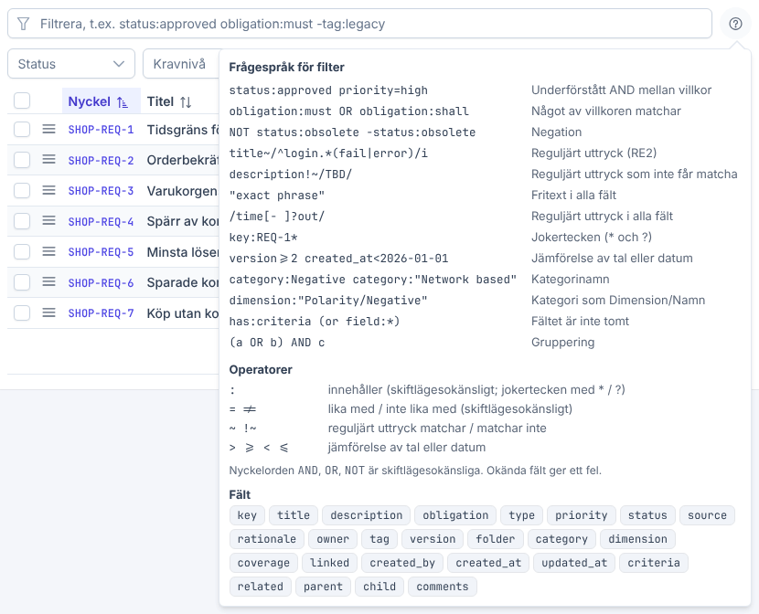

Snabbfiltren (status, prioritet och så vidare) görs om till en fråga åt dig och visas under filterfältet som `q = …`. Kopiera den om du vill återanvända eller bygga ut den.

## Taggmoln

**Taggar** i projektets sidopanel visar alla taggar på projektets krav, testfall och dokument; ju oftare en tagg används, desto större är den. Håll muspekaren över en tagg för att se hur många objekt av varje slag som har den. Filtrera molnet på namn och sortera det **Efter användning** eller **A–Ö**.

Välj en eller flera taggar för att lista objekten som har dem, grupperade i krav, testfall och dokument. Med flera taggar väljer du om objekten ska ha **Alla taggar** eller **Någon tagg**. **Öppna som filtrerad lista** öppnar kravsidan eller testfallssidan med samma fråga (till exempel `tag=gdpr AND tag=login`), och sidans adress behåller urvalet, så att du kan bokmärka det.

Med behörighet att redigera både krav och testfall kan de valda taggarna också ändras i hela projektet: **Byt namn** (en tagg), **Slå ihop** (flera taggar till en, som kan vara en av dem eller ett nytt namn, till exempel för att städa upp *gdpr*, *GDPR* och *privacy*) eller **Ta bort från alla poster**. Dokument ändras också om du får ändra projektet. Varje ändring sparas i versionshistoriken för de krav och testfall den berör.

## Syntaxen på fem minuter

| Du skriver | Det hittar |
|---|---|
| `login` | *login* var som helst i något fält (versaler och gemener spelar ingen roll) |
| `"session timeout"` | exakt den frasen var som helst |
| `status:approved` | objekt vars status innehåller *approved* |
| `priority=high` | prioritet exakt *high* |
| `status:approved priority=high` | båda: villkor bredvid varandra kombineras med AND |
| `obligation=must OR obligation=shall` | något av dem |
| `NOT status:obsolete` eller `-status:obsolete` | allt utom inaktuella objekt |
| `(tag:smoke OR tag:regression) -status:deprecated` | gruppering med parenteser |
| `title~/^login.*(fail\|error)/i` | ett reguljärt uttryck; `/i` ignorerar versaler och gemener |
| `description!~/TBD/` | beskrivningen matchar inte |
| `key:*-REQ-1?` | jokertecken: `*` valfria tecken, `?` ett tecken, matchas mot hela värdet |
| `version>=2` | jämförelse av tal |
| `updated_at>=2026-01-01` | jämförelse av datum |
| `has:criteria` eller `criteria:*` | fältet är inte tomt |
| `has:!script` eller `-has:script` | fältet är tomt |

### Operatorer

| Operator | Betydelse |
|---|---|
| `fält:värde` | innehåller (skiftlägesokänsligt); med `*` eller `?` ett jokerteckenmönster mot hela värdet |
| `fält=värde` | lika med (skiftlägesokänsligt); `fält=""` matchar tomma fält |
| `fält!=värde` | lika med inget av värdena |
| `fält~/regex/` | det reguljära uttrycket matchar (RE2-syntax, skiftlägeskänsligt utom med `/i`) |
| `fält!~/regex/` | det reguljära uttrycket matchar inget värde |
| `fält>v`, `>=`, `<`, `<=` | jämför tal numeriskt, allt annat (till exempel datum) som text |
| `/regex/` | reguljärt uttryck i alla fält |
| `AND`, `OR`, `NOT` (även `&&`, `\|\|`, `!`, `-`) | logik; NOT binder starkare än AND, AND starkare än OR |

Nyckelord och fältnamn är skiftlägesokänsliga. Värden med blanksteg behöver citattecken: `category:"Network based"`. Inom citattecken skriver du `\"` för ett citattecken. En tom fråga matchar allt.

**Fält med flera värden** (taggar, kategorier, kriterier, steg, länkade objekt): ett positivt villkor gäller om **något** värde matchar; ett negativt (`!=`, `!~`) bara om **inget** värde matchar.

## Fält

### Krav

`id`, `key`, `title`, `description` (`desc`), `obligation`, `type`, `priority`, `status`, `source`, `rationale`, `owner`, `tag` (`tags`), `version`, `folder` (mappens sökväg, t.ex. `Kassa / Betalning`), `category` (`categories`, värdenas namn), `dimension` (`Dimension/Namn`), `coverage`, `linked` (nycklar för länkade testfall), `related`, `parent`, `child` (nycklar för relaterade, överordnade och underordnade krav), `comments`, `open_discussions` (`open-discussion`: olösta trådar, `has:open-discussion`), `mention` (`mentions`: [@-namn](#nämn-personer) i ägare, titel, beskrivning, motivering och källa, och personerna som nämns i diskussionen; `mentions:me` för dig själv), `created_by`, `created_at`, `updated_at`, `criteria` (`criterion`: beskrivning, metod och tröskelvärde), `risk` (högsta nivån bland de öppna [risker](#risknivåer) som kravet hanterar: `risk:high`), `defects` (antal öppna defekter på kravet eller dess testfall: `defects>0`), `catalog` ([katalogposten](#katalog) kravet kopierades från: `catalog:AUTH-01`, `has:catalog`), `verification` (`verified`: [verifieringsläget](#verifiering), `verification:failed`), `element` (`elements`: ett [systemelement](#systemelement) som kravet är allokerat till, eller ett över det: `element:"Kraftenhet"`), `variant` (`variants`: [varianterna](#varianter-och-kod) kravet gäller: `variant:"EU-modell"`), `applicability` (`all` eller `selected`).

### Testfall

`id`, `key`, `title`, `description` (`desc`), `preconditions`, `execution_type` (`type`), `script_language` (`language`), `script`, `expected`, `step` (`steps`: åtgärd, förväntat resultat och data för alla steg), `priority`, `status`, `estimate`, `owner`, `tag` (`tags`), `folder`, `category`, `dimension`, `linked` (nycklar för länkade krav), `last_result` (`result`), `defect` (`defects`), `calls` (nycklar för anropade testfall), `depends_on` (`depends`: nycklar för förutsättningar), `comments`, `open_discussions` (`open-discussion`: olösta trådar, `has:open-discussion`), `mention` (@-namn i texterna och stegen, och personerna som nämns i diskussionen; `mentions:me` för dig själv), `version`, `created_by`, `created_at`, `updated_at`, `flaky` (`true` för [instabila testfall](#instabila-testfall): `flaky:true`), `flakiness` (`flips`: antalet växlingar mellan godkänt och underkänt bland de senaste utfallen: `flakiness>=3`), `catalog` (katalogposten testfallet kopierades från), `variant` (`variants`: varianterna testfallet gäller), `applicability` (`all` eller `selected`).

### Ägare och tilldelade

`owner:me` hittar kraven, testfallen och riskerna som du äger, `assignee:me` defekterna och exekveringarna som är tilldelade dig, `review_owner:me` riskerna vars genomgång du äger — hur du än anges i fältet, och bara dig (inte alla namn som innehåller *me*). `owner:anna@example.com` hittar en medlems poster; `-owner:me` eller `owner!=me` de övriga.

### Körningar och exekveringar

Körningar: `id`, `name`, `description`, `status`, `environment` (`env`), `build`, `created_by`, `created_at`.
Exekveringar (filtret på en körnings sida): `id`, `key`, `title`, `status`, `assignee`, `executed_by`, `notes`, `output`, `defect`, `mention` (@-namn i tilldelad och anteckningar).


### Egna fält och sortering

Varje [eget fält](#egna-fält) i projektet är ett fält `cf.<nyckel>` i sin lista (krav, testfall, körningar, defekter och risker): `cf.supplier:"Acme"`, `cf.mass>2` (tal jämförs som tal), `cf.due<2026-07-01`, `cf.coating=zinc` (ett av de valda alternativen), `cf.reviewed=true` (en kryssruta) och `has:cf.supplier`. En nyckel som projektet inte har matchar inget.

`sort:<fält>` sorterar resultatet, `sort:-<fält>` (eller `sort:<fält>:desc`) i fallande ordning, till exempel `status:draft sort:-cf.mass sort:title`. Objekt utan värde hamnar sist. En sorteringsterm kan inte negeras eller användas inuti `OR`.

### Andra listor

- **Händelselogg:** `action`, `entity`, `entity_id`, `user`, `details`, `created_at`.
- **Dokumentarkiv:** `name`, `description`, `tag`, `kind`, `type` (innehållstyp), `uploaded_by`, `created_at`, `size`, `linked` (nycklar för länkade objekt).

Ett fält som inte finns i en lista ger ett fel, så `coverage:none` fungerar för krav men inte för testfall.

## Exempel

**Krav**

```text
obligation=must status!=approved               MUST-krav som ännu inte är godkända
coverage:none category:Security                säkerhetskrav utan testfall
coverage:failed priority=critical              kritiska krav vars testfall underkänns
has:criteria coverage:none                     kriterier finns, men inget testfall är länkat
-has:criteria status:approved                  godkända, men utan utvärderingskriterier
description~/\b(fast|easy|TBD)\b/i             svaga formuleringar, som språkanalysen ser dem
folder:"Kassa / Betalning"                     en mapp och dess undermappar (sökvägen innehåller)
child:*                                        krav som har brutits ned
parent:SHOP-REQ-4                              underordnade krav till SHOP-REQ-4
linked:SHOP-TC-3                               krav som verifieras av SHOP-TC-3
version>=3 updated_at>=2026-06-01              ofta och nyligen ändrade
owner:anna OR owner:ben                        ägs av Anna eller Ben
dimension:Area/UI                              krav i kategorin Area / UI
tag:gdpr -status:obsolete                      gällande GDPR-krav
```

**Testfall**

```text
type=automated last_result:failed              underkända automatiserade testfall
status:ready category:Negative                 klara negativa testfall
dimension:Level/System execution_type=manual   manuella systemtester
-linked:*                                      testfall som inte är länkade till något krav
step~/lösenord/i                               testfall med ett steg om lösenord
defect:JIRA-*                                  testfall med en JIRA-defekt i de senaste exekveringarna
estimate>30                                    testfall som beräknas ta mer än 30 minuter
language=python                                Python-skript
```

**Körningar och exekveringar**

```text
status:in_progress env:staging                 pågående körningar i staging
build:1.4.*                                    alla 1.4-byggen
created_at>=2026-09-01                         körningar sedan september
status:failed                                  (på en körnings sida) underkända exekveringar
assignee:anna -status:passed                   Annas exekveringar som inte är godkända
output~/timeout/i                              automatiserade exekveringar vars utdata nämner timeout
```

**Global sökning**

```text
"orderbekräftelse"                             frasen i alla projekt
kind=test project:SHOP betalning               testfall i projektet SHOP om betalning
kind=requirement coverage:none                 krav utan täckning i alla projekt
```

## Varför är min fråga ogiltig?

De vanligaste orsakerna:

- **Okänt fält**: fältet finns inte i den här listan (till exempel `coverage` för testfall). Öppna **Hjälp för frågespråket** för att se fälten.
- **Ett citattecken, en parentes eller ett reguljärt uttryck som inte avslutas**: `title:"login`, `(a OR b`, `title~/abc`.
- **Ett blanksteg efter operatorn**: skriv `status:approved`, inte `status: approved`.
- **Ett ogiltigt reguljärt uttryck**: uttrycken använder RE2-syntax, som saknar framåtblick (`(?=…)`) och bakåtreferenser.
- **Gränser**: högst 4096 tecken, 64 reguljära uttryck eller jokerteckenmönster och 128 nästlingsnivåer.

Ett `-` negerar bara när det står direkt före villkoret: `-status:obsolete`, inte `- status:obsolete`.

# Rapporter och export

Qtestframe tar ut data på två sätt (ett helt projekt kan också [sparas som fil och läsas in igen](#spara-och-läs-in-projekt)):

- **Export** laddar ned projektets rådata (krav, kriterier, testfall, spårbarhet, körningar) som kalkylblad, dokument eller Markdown, för granskningar, revisioner, arbete offline eller andra verktyg.
- **Rapporter** tar fram formaterade dokument för människor: en statusrapport för projektet, en täckningsrapport, en sammanfattning av en körning, en defektlista eller en rapport som du utformar själv. Rapporter kan laddas ned eller sparas i projektets [dokumentarkiv](#dokument-1).

Alla med rollen **Läsare** eller högre får exportera och ta fram rapporter. Att spara en egen rapportdefinition kräver **Testare** (testfall) eller **Ansvarig** (krav); att spara en framtagen rapport i arkivet får alla som får ta fram den.

## Export

Välj **Export** i projektets sidopanel.


1. Välj **Format**:

   | Format | Resultat |
   |---|---|
   | **PDF** | En utskriftsvänlig rapport i liggande format med en tabell per del och sidnummer. |
   | **DOCX** | Ett redigerbart Word-dokument med en rubrik och en tabell per del, till exempel som grund för ett specifikationsdokument. |
   | **XLSX** | En Excel-arbetsbok med bladet *Summary* och ett blad per del; fet rubrikrad, låst första rad, autofilter och lämpliga kolumnbredder. |
   | **CSV** | En `.csv`-fil för en del; ett `.zip`-arkiv med en CSV-fil per del när du väljer flera. UTF-8, kommaavgränsad. |
   | **Markdown** | En `.md`-fil med alla delar: en rubrik, projektet, filtret och tidpunkten och en tabell per del. Ren text som läses bra i en wiki, ett Git-förråd eller vilken textredigerare som helst; nycklar länkar till Qtestframe när serverns adress är inställd. |
   | **ReqIF** | Kraven som en ReqIF 1.2-fil (`.reqif`) för kravverktyg som IBM DOORS, Polarion, Codebeamer, Jama eller ProR, om du vill med testfallen och deras spårlänkar, verifieringsposterna eller som en baslinje frös dem. Se [ReqIF för kravverktyg](#reqif-för-kravverktyg). |
   | **ReqIF (med bilagor)** | Ett `.reqifz`-arkiv: ReqIF-filen och posternas bilagor och bilder. |

2. Välj **Innehåll**:

   | Del | Kolumner |
   |---|---|
   | **Krav** | nyckel, titel, kravnivå, typ, prioritet, status, mapp, kategorier, taggar, beskrivning, motivering, källa, ägare, version, länkade testfall, täckning |
   | **Utvärderingskriterier** | krav, nummer, kriterium, metod, tröskelvärde |
   | **Testfall (med steg)** | nyckel, titel, exekvering, status, prioritet, mapp, kategorier, taggar, förutsättningar, steg, förväntat resultat, skriptspråk, länkade krav, senaste utfall |
   | **Spårbarhetsmatris** | en rad per länk mellan krav och testfall med täckning och senaste utfall; krav utan länkar får en rad |
   | **Körningar och exekveringar** | en rad per exekvering med körning, status, miljö, bygge, utfall, exekverad av, tidsåtgång och anteckningar |

   Kolumnrubrikerna i de exporterade filerna är på engelska.

   Valet av innehåll används inte för ReqIF; formatet har egna val under **Innehåll i ReqIF** (testfall, verifieringsposter, en baslinje), se [Samverkan](#reqif-export).

3. Ange eventuellt ett **Filter**. Det gäller krav om det är en giltig fråga för krav och testfall om det är en giltig fråga för testfall: `obligation=must` filtrerar bara krav, `type=automated` bara testfall, `folder:Kassa` båda.
4. Välj **Ladda ned**. Filen namnges efter projektnyckeln och tidpunkten, till exempel `SHOP-20261119-143000.xlsx`.

**Säkert för kalkylblad:** värden som börjar med `=`, `+`, `-` eller `@` får ett prefix i CSV-filer, och celler i XLSX är alltid text, så inget i dina data körs som en formel.

### ReqIF för kravverktyg

ReqIF (Requirements Interchange Format) är standardformatet för att utbyta krav mellan verktyg. Använd det för att lämna dina krav till en kund eller leverantör i deras eget verktyg, eller för att hämta tillbaka krav som har bearbetats där.

Det här innehåller ReqIF-filen:

- **Ett objekt per krav** med nyckel (*ReqIF.ForeignID*), rubrik (*ReqIF.Name*), beskrivning som formaterad text (*ReqIF.Text*), kravnivå, typ, prioritet och status som värdelistor, källa, motivering, ägare, taggar, kategorier, acceptanskriterier (en rad per kriterium: metod, text och tröskelvärde), version, upphovsperson och när kravet skapades.
- **Mapparna som rubriker.** Varje mapp blir ett rubrikobjekt (*ReqIF.ChapterName*); mappens krav och sedan dess undermappar ligger under rubriken, så att kravverktyget visar samma kapitel som kravträdet. Med ett filter tas bara mappar med exporterade krav med.
- **Relationer** mellan de exporterade kraven (*förfinar*, *beror på* och de andra) som ReqIF-relationer.
- **Formatering.** Stycken, radbrytningar, listor, rubriker, kodblock, fetstil, kursiv, länkar och bilder i beskrivningar blir formaterad text. I en `.reqifz`-fil ligger bilder och andra bilagor som filer i arkivet och listas i attributet *Attachments*.
- **Stabila identifierare.** Varje objekt får samma identifierare i varje export, så att ett verktyg känner igen krav som det redan har och kan uppdatera dem.

**Importera igen.** En ReqIF-fil från Qtestframe kan [importeras](#importera-krav) i vilket projekt som helst. Rubriker, beskrivningar med sin formatering, kravnivå, typ, prioritet, status, källa, motivering, ägare, taggar, kriterier och mappar kommer tillbaka; den ursprungliga nyckeln sparas som externt ID (*ID: SHOP-REQ-12* i källan), och de nya kraven får nycklar i målprojektet. Kategorier och bilagor importeras inte. För att hämta tillbaka en redigerad version till **samma** projekt som uppdateringar, med relationer, använder du [ReqIF-importen med uppdateringar](#reqif-från-doors-och-polarion).

## Standardrapporter

Välj **Rapporter** i projektets sidopanel. Standardrapporterna är färdiga upplägg:

| Rapport | Innehåll | Parametrar |
|---|---|---|
| **Projektstatus** | nyckeltal, krav per status och kravnivå, täckning, senaste körningar | – |
| **Kravtäckning** | varje krav med länkade testfall, deras senaste utfall och täckningen | valfritt filter |
| **Spårbarhet** | länkarna mellan krav och testfall, och [spårbarhetsreglerna](#spårbarhetsregler) med resultat och överträdelser | valfritt filter |
| **Sammanfattning av körning** | en körning: summor, exekveringar, defekter och tidsåtgång | körningen (obligatorisk) |
| **Defekter** | alla defekter som registrerats på exekveringar, grupperade per defekt | – |
| **Testförteckning** | testfall per mapp, typ, status och kategori | valfritt filter |
| **Riskrapport** | [riskerna](#releaser-och-risker) med nyckeltal, värmekartan före och efter åtgärder, riskerna över acceptansgränsen, riskregistret med [restrisken](#restrisk), spårbarhet till krav och testfall, otestade åtgärder och de största riskerna | – |
| **Efterlevnad** | efterlevnad av lagar, standarder och bästa praxis: per källa, per avsnitt, de katalogkrav som saknas och de krav som inte är uppfyllda (se [Efterlevnad av lagar och standarder](#efterlevnad-av-lagar-och-standarder)) | valfria lagar, standarder och bästa praxis (standard: de som projektet använder) |
| **Uttalande om tillämplighet** | varje åtgärd i en standard med tillämplighet, motivering, införande, ägare, krav och belägg (se [Uttalande om tillämplighet](#uttalande-om-tillämplighet)) | standarden (standard: ISO/IEC 27001:2022 bilaga A) |
| **Releaseberedskap** | en release: go / no-go, varje utgångskriterium med vad som stoppar det och vad ett [undantag](#undantag-och-avvikelser) eller en signerad risk accepterar, gällande undantag och riskerna över acceptansgränsen | releasen (standard: den aktuella) |
| **Testcykelrapport** | en [testcykel](#testcykler): planerade mot utförda, godkända, underkända och blockerade testfall, uppskattad mot faktisk tid, arbetsbelastningen per testare, nedbränningen och planen med varje utfall | cykeln (standard: den aktuella) |
| **Kvalitetsmått** | kravens föränderlighet, defekttäthet, läckta defekter, testeffektivitet, resultatens ålder, granskningstid, tid till rättning och kravkvalitet, med trender (se [Kvalitetsmått](#kvalitetsmått)) | valfri historik i dagar (30, 90, 180 eller 365) och efter hur många dagar ett resultat är inaktuellt |
| **Utforskande testsession** | en [utforskande session](#utforskande-test): uppdrag och omfattning, sessionstid, utvärderingen med täckning, tidsfördelning och utfall, alla anteckningar och skapade defekter | sessionen (standard: den senast utvärderade) |
| **Utforskande test** | alla utforskande sessioner: nyckeltal, sessioner och buggar per sessionstimme per område och testare, genomsnittlig tidsfördelning och varje session med sitt utfall | – |

**Riskrapporten** innehåller:

- **Nyckeltal**: alla risker; öppna risker (*Identifierad* eller *Åtgärdas*); åtgärdade, accepterade och stängda risker; öppna risker per nivå; öppna risker utan krav, med otestad åtgärd och med verifierad åtgärd; och öppna risker som inte har ändrats på 90 dagar eller mer.
- **Risker per nivå och status**: en tabell med en rad per nivå och en kolumn per status.
- **Öppna risker per åtgärdsstatus** (se nedan).
- **Värmekarta**: sannolikhet (rader, 5 överst) × konsekvens (kolumner). Varje ruta anger antalet risker som inte är stängda och rutans nivå, till exempel *2 · Hög*, så att tabellen kan läsas utan färger.
- **Största öppna risker**: de tio öppna riskerna med högst poäng.
- **Riskregister**: varje risk med nyckel, titel, kategori, ägare, sannolikhet, konsekvens, poäng, nivå, status, åtgärd, kraven som hanterar den, åtgärdens status och när den senast ändrades.
- **Spårbarhet**: en rad per risk, krav och länkat testfall, med kravets täckning och testfallets senaste utfall.
- **Öppna risker med otestad åtgärd**: öppna risker utan krav, eller med krav som saknar testfall, och vilka av deras krav som saknar testfall eller inte är godkända.
- **Öppna risker som inte uppdaterats på 90 dagar eller mer**: en påminnelse om att se över dem.

**Åtgärdens status** för en risk kommer från kraven som hanterar den: *Inga krav*, *Otestad* (inget av dem har länkade testfall), *Delvis testad* (några har), *Testad, inte alla godkända* (alla har testfall, men alla testfall är inte godkända) eller *Verifierad* (alla länkade testfall för alla dess krav är godkända). En risk har en poäng för sannolikhet × konsekvens; rapporten visar poängen och nivån, och hur långt åtgärden är verifierad av tester.


1. Välj en rapport.
2. Fyll i parametrarna, till exempel körningen för **Sammanfattning av körning**.
3. Välj **Format**: **PDF**, **Word** (DOCX), **Excel** (XLSX), **CSV** eller **Markdown** (`.md`, text med tabeller för wikis, Git-förråd och chattverktyg; flera avsnitt blir ett dokument).
4. Välj **Ladda ner**, eller **Spara i arkivet**. En sparad rapport blir ett dokument av typen *rapport* under **Dokument**, där hela teamet kan hitta, förhandsvisa och ladda ned den senare.

Rapporter tas fram på det språk du just nu använder i Qtestframe (**Användarmeny → Språk**, se [Språk](#språk)). Med det svenska gränssnittet är rapportens rubrik, avsnitt, kolumnrubriker, nyckeltal och värden som status, utfall, täckning och kravnivå (till exempel *Godkänt*, *Underkänd*, *MUST (SKA)*) på svenska, med samma ord som i appen. Ditt eget innehåll, som titlar, namn, beskrivningar, taggar och anteckningar, översätts aldrig. Det gäller nedladdningar, rapporter som sparas i arkivet, egna rapporter, flera rapporter på en gång och rapporter som skickas med e-post.

### Dokument

Under standardrapporterna finns **Dokument** med två kompletta dokument: en **kravspecifikation** och en **testplan** med testspecifikation. **Skapa …** öppnar verktyget i [dokumentarkivet](#skapa-en-kravspecifikation-eller-en-testplan), där dokumentet sparas.

## Egna rapporter

Under **Anpassad rapport** utformar du en rapport själv:

1. **Rapport över**: krav, testfall, testkörningar eller exekveringarna i en körning (välj då körningen).
2. **Filter**: valfri [fråga](#sökning-och-filter), till exempel `status:approved obligation=must`.
3. **Kolumner**: välj kolumnerna och ordna dem under kolumnordningen.
4. **Gruppera efter**: gruppera eventuellt raderna, till exempel per status eller mapp, med ett antal per grupp.
5. **Sortera efter**, eventuellt **Fallande**.
6. **Ta med sammanfattning**: summor överst.
7. Rapportens **Rubrik**.

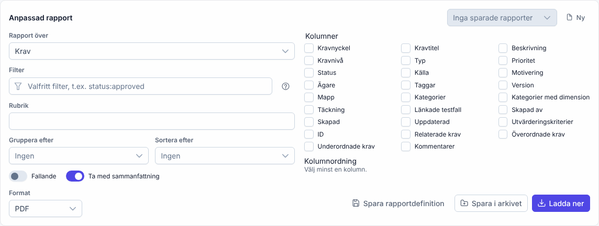

Ta fram rapporten i valfritt format, som ovan. För att återanvända den väljer du **Spara rapportdefinition** och ger den ett namn: med **Läs in sparad rapport** hämtar du den när som helst för att ta fram den igen med aktuella data, ändra den eller ta bort den.

**Exempel:**

- *Öppna MUST-krav*: krav, filter `obligation=must -status:verified`, kolumnerna nyckel, titel, status, ägare, täckning, grupperade per ägare.
- *Underkända testfall i sprinten*: exekveringar i körningen *Sprint 12*, filter `status:failed`, kolumnerna nyckel, titel, exekverad av, defekter, anteckningar.
- *Automatiseringsgrad*: testfall, grupperade per exekveringstyp, kolumnerna nyckel, titel, status, senaste utfall.

## Flera rapporter på en gång

**Flera rapporter på en gång**, längst ner på sidan Rapporter, listar standardrapporterna och dina sparade egna rapporter. Kryssa i dem du behöver, till exempel ett veckopaket med *Projektstatus*, *Sammanfattning av körning* och två sparade rapporter, och sedan:

- välj **format** (bara format som alla markerade rapporter stöder visas),
- för *Sammanfattning av körning*, välj **körning**,
- **Ladda ner som ZIP** för att få alla i en fil, eller **Spara i arkivet** för att lägga var och en i [dokumentarkivet](#dokument-1) (taggad *report*). När du sparar listas en rapport som inte kan skapas med orsaken, och de andra sparas ändå.

**Ta bort sparade rapporter** tar bort de markerade sparade egna rapporterna (standardrapporter kan inte tas bort). Att spara i arkivet och att ta bort kräver behörighet att redigera krav eller testfall; att ladda ner kräver exportbehörighet.

## Skicka en rapport med e-post

När servern kan skicka e-post har varje standardrapport en kuvertknapp (**Skicka med e-post**), och verktyget för egna rapporter har också **Skicka med e-post**. Välj:

- **Medlemmar**: personer i din organisation som får läsa projektet. En medlem som inte får läsa det rapporten visar (till exempel testkörningar) hoppas över, och meddelandet säger vem.
- **Andra adresser**, åtskilda med kommatecken: personer utanför organisationen. Det kräver behörighet att ändra projektet, så att Qtestframe inte kan användas för att skicka e-post till vem som helst.
- ett **Meddelande** om du vill och **Format**.

Rapporten tas fram med dina behörigheter och bifogas e-postmeddelandet; rapporten och e-posttexten är på ditt nuvarande gränssnittsspråk. Om det inte kan levereras får du en [notis](#notiser).

## Schemalagda rapporter

**Schemalagda rapporter**, längst ned på sidan Rapporter, skickar [sparade egna rapporter](#egna-rapporter) med e-post enligt ett schema. *(Kräver behörighet att redigera krav eller tester.)* Välj **Schemalägg en rapport** och välj sedan den sparade rapporten, **Hur ofta** (varje dag, varje vecka på en veckodag eller varje månad på en dag från 1 till 28), **Tid** och **Tidszon**, **Format**, mottagarna och ett meddelande om du vill.

Listan visar varje schema med dess mottagare, när det **Senast skickades** (eller felet vid senaste försöket) och **Nästa utskick**. Stäng av **Aktiv** för att pausa ett schema, välj **Skicka nu** för att skicka direkt (schemat ändras inte), eller ändra och ta bort det. Bara den som schemalade rapporten, eller någon som får ändra projektet, kan ändra schemat.

Bra att veta:

- Rapporten tas fram med behörigheterna hos den som schemalade den, vid den tidpunkt den skickas. Om personen inte längre är medlem eller inte längre får exportera visar schemat ett fel i stället för att skicka.
- Rapporten och e-postmeddelandet är på gränssnittsspråket hos den som schemalade rapporten eller senast ändrade schemat. Byt språk och spara schemat igen för att ändra det.
- Medlemmar som inte längre får läsa rapporten hoppas över.
- Om servern var nere när en rapport skulle skickas skickas den en gång när servern är igång igen, inte en gång för varje missat tillfälle.
- När den sparade rapporten tas bort försvinner även dess scheman.

## Spara och läs in projekt

Ett helt projekt kan sparas som en fil och läsas in igen som ett **nytt** projekt, på samma server eller en annan: för att lämna över ett projekt, behålla en kopia utanför servern eller starta ett nytt projekt från en mall.

- **Spara projekt**: i projektlistan (nedladdningsknappen för ett projekt) eller under **Kategorier & inställningar → Projekt → Spara och läs in**. Filen (`<nyckel>-project-<datum>.zip`) innehåller allt i projektet: krav med kriterier och mappar, testfall med steg och testdata, spårbarhetslänkar och relationer, länkar, körningar med alla resultat, iterationer och bevis, defekter, risker, releaser, baslinjer och signeringar, granskningar, kommentarer, versionshistorik, dokument och bilagor med innehåll, kategorier, konfigurationer, spårbarhetsregler, sparade rapporter, webhooks och projektets inställningar. Det kräver behörighet att ändra projektet och att exportera (som standard **Ansvarig** och **Administratör**).
- **Läs in projekt**: i projektlistan eller i samma avsnitt av inställningarna. Välj filen; Qtestframe kontrollerar den och visar vad den innehåller. Välj sedan det nya projektets **Nyckel** och **Namn** (en ledig nyckel föreslås om den ursprungliga är upptagen) och välj **Läs in projekt**. Du behöver behörighet att skapa projekt. Det nya projektet öppnas när det är klart.
- **Duplicera projekt** gör båda i ett steg: det skapar en kopia med en ny nyckel i samma organisation.

Bra att veta om inlästa projekt:

- Det nya projektet får nya id:n överallt, och objektnycklarna följer den nya projektnyckeln (`DEMO-REQ-1` blir `COPY-REQ-1`, även där en beskrivning nämner den). Nya objekt fortsätter originalets numrering.
- Personer förblir desamma: *skapad av*, ägare och tilldelade behålls som text, och kommentarer och granskningar hänvisar till samma konton. En granskningsbegäran vars granskare inte har något konto på servern utelämnas; resultatet visar hur många poster som utelämnades.
- **Hemligheter sparas aldrig**: webhooks läses in avstängda och utan hemlighet, och felhanteringssystemet utan sin token. Ange dem igen under **Kategorier & inställningar → Projekt** innan du slår på dem.
- Medlemmar, roller, API-nycklar, aviseringar, schemalagda e-postrapporter, händelseloggen och papperskorgen ingår inte i filen. Åtkomsten till det nya projektet följer organisationens roller, som för alla projekt.
- En fil som sparats av en nyare version av Qtestframe kan inte läsas in; uppdatera servern först. Filer från äldre versioner går att läsa in.

Filen innehåller projektets data i klartext. Förvara den lika omsorgsfullt som själva projektet.

## Utbyta data med andra verktyg

Krav finns ofta på mer än ett ställe: en kund håller dem i IBM DOORS eller Siemens Polarion, en kollega vill granska dem i Excel och ett ALM-verktyg vill länka till dem. Qtestframe utbyter data på fem sätt, alla under **Importera** på krav- och testsidorna och via API:et:

| Sätt | Riktning | Passar för |
|---|---|---|
| [Excel fram och tillbaka](#redigera-i-excel-och-importera-tillbaka) | ut och in igen | redigera många poster på en gång i Excel, även offline |
| [ReqIF-import med uppdateringar](#reqif-från-doors-och-polarion) | in, gång på gång | en specifikation som förvaltas i DOORS, DOORS Next eller Polarion |
| [Jira och Azure DevOps](#jira-och-azure-devops) | in, gång på gång | krav som förvaltas som Jira-ärenden eller arbetsobjekt i Azure DevOps |
| [CSV- och Excel-exporter från DOORS och Polarion](#csv-och-excel-från-doors-och-polarion) | in, en gång | en första import när ReqIF inte finns |
| [OSLC](#oslc-länkar-från-alm-verktyg) | läses av andra verktyg | länkar från IBM ELM, Polarion, Codebeamer och andra OSLC-klienter |

Varje import visar först en **förhandsgranskning** och sparar ingenting förrän du väljer **Spara**. Förhandsgranskningen jämför filen med projektet, rad för rad:

- **Ny**: en post som inte finns och som skapas.
- **Ändrad**: en post som filen ändrar; varje ändrat fält visas med gammalt och nytt värde.
- **Oförändrad**: inget att göra.
- **Konflikt**: någon har sparat posten i Qtestframe efter att filen gjordes, och filen har andra värden. En konflikt sparas inte om du inte väljer **Skriv över konflikterna med filen**. Öppna posten för att se vad som ändrades, eller exportera igen.
- **Fel**: ett värde som inte kan importeras, med cellen (till exempel `F12`) och orsaken: en okänd prioritet, en okänd kravnyckel, en tom titel, en status du inte får sätta.

Använd statusknapparna ovanför tabellen för att bara visa vissa rader, och avmarkera rader du inte vill ha. **Spara** lagrar alla valda rader på en gång: om en av dem inte kan sparas sparas ingenting. Varje sparad post får en ny version i historiken, ändrade länkar blir misstänkta som vid en vanlig ändring, och importen registreras i händelseloggen.

### Redigera i Excel och importera tillbaka

1. Välj **Importera → Exportera för redigering i Excel** på krav- eller testsidan. Arbetsboken innehåller posterna i den aktuella listan (med dess filter och mapp) *(Läsare med exportbehörighet)*.
2. Redigera arbetsboken i Excel eller ett annat kalkylprogram. Behåll kolumnerna **ID** och **Version**: de talar om för Qtestframe vilken post en rad är och vilken version du utgick från.
3. Välj **Importera → Importera en redigerad Excel-arbetsbok**, välj filen, kontrollera förhandsgranskningen och välj **Spara** *(Manager)*.

Det här innehåller arbetsboken:

- **En rad per post** med *ID*, *Key*, *Version* och en kolumn per fält: mapp, titel, beskrivning, kravnivå, typ, prioritet, status, källa, motivering, ägare, taggar, acceptanskriterier (ett per rad, till exempel `test: Inloggning fungerar (threshold: 2 s)`) och en kolumn per relationstyp (*Refines*, *Depends on* …) med nycklarna till de relaterade kraven. Tester har i stället förutsättningar, förväntat resultat, exekveringstyp, uppskattade minuter och *Verifies* (nycklarna till de krav som testet verifierar).
- **Teststeg** på bladet *Steps*, en rad per steg: testet, stegnumret, åtgärd, data, förväntat resultat och, för ett delat steg, nyckeln till det anropade testet. Stegen i ett test som finns på bladet *Tests* ersätts av dess rader på bladet *Steps*.
- **Listrutor** för fälten med fasta värden, grå kolumner som bara är information (*Verified by*) och ett blad *Instructions*.

Kolumnrubrikerna är på engelska; svenska rubriker som *Titel*, *Prioritet* och *Mapp* känns också igen.

Tips:

- **Nya poster:** lägg till en rad och lämna *ID* tomt. För att ge ett nytt test steg skriver du en tillfällig nyckel som `NY-1` i *Key* och använder den på bladet *Steps*.
- **Mappar:** skriv en sökväg som `Säkerhet/Inloggning`; mappar som saknas skapas.
- **Kolumner** får tas bort eller flyttas: en kolumn som saknas ändrar ingenting. Kolumner som Qtestframe inte känner till listas och ignoreras.
- **Ett annat projekt:** rader med ID för en post i ett annat projekt är fel; töm ID-kolumnen för att skapa posterna i det här projektet.

### ReqIF från DOORS och Polarion

ReqIF är formatet som IBM DOORS, DOORS Next, Siemens Polarion och de flesta kravverktyg exporterar. **Importera → ReqIF från DOORS eller Polarion, med uppdateringar** importerar en sådan fil (`.reqif` eller `.reqifz`) och kommer ihåg var varje krav kom ifrån, så att en import av en nyare version av samma dokument **uppdaterar** kraven i stället för att skapa dem igen *(Manager)*.

1. Välj filen. Förhandsgranskningen listar dokumentets **attribut** med typ, ett exempelvärde och fältet som vart och ett läses in i.
2. Kontrollera fälten. Qtestframe känner igen ReqIF-standardnamnen (*ReqIF.Name*, *ReqIF.Text*, *ReqIF.ChapterName*, *ReqIF.ForeignID*) och vanliga namn i DOORS och Polarion (*Title*, *Description*, *Status*, *Priority*, *Severity* som kravnivå, *Assignee* som ägare, *ID*). Välj ett annat fält eller *ignorera* för valfritt attribut; förhandsgranskningen uppdateras direkt. **Rubrik (mapp)** markerar attributet med kapitelnamn; **ID i det andra verktyget** sparas i källan för nya krav (*ID: BRK-12*).
3. Välj **Målmapp** och om **Rubriker blir mappar**: kapitlen i dokumentets hierarki blir mappar under målmappen (i DOORS objekt med kapitelnamn och utan text, i Polarion arbetsposter av typen *Heading*).
4. Kontrollera raderna och **relationerna** och välj **Spara**.

Det här händer:

- **Relationer** mellan de importerade kraven (länkmoduler i DOORS, länkroller i Polarion) blir kravrelationer. Typen tas från namnet: *refines*, *satisfies* och *has parent* blir *förfinar*, *derived from* blir *härledd från*, *depends on* och *requires* blir *beror på* och så vidare; övriga blir *relaterar till*.
- **Formaterad text** (XHTML) blir Markdown med sina stycken, listor, tabeller och betoningar; bilder och andra filer som är inbäddade i en `.reqifz` blir bilagor.
- **Testfall, spårlänkar och mer.** Samma import läser testfall (med steg) och spårlänkarna mellan testfall och krav, översätter det andra verktygets objekt- och relationstyper och kan låta nästlade krav *förfina* sitt överordnade krav. Se [Samverkan](#reqif-import).
- **En ny import** uppdaterar kraven som skapades av tidigare importer av samma dokument och lägger till nya. Ett krav som har ändrats i Qtestframe sedan förra importen visas som en konflikt när dokumentet har andra värden. Relationer som har tagits bort i det andra verktyget tas bort här också; relationer som du har skapat i Qtestframe finns kvar. En import tar aldrig bort krav.
- Ett krav utan titel i dokumentet får de första orden i sin text när det skapas; senare importer behåller titeln du har gett det.
- En ReqIF-fil som har **exporterats från samma projekt** (se [ovan](#reqif-för-kravverktyg)) matchas mot sina krav, så att du kan skicka en specifikation till en leverantör och importera deras redigerade version tillbaka med samma förhandsgranskning.

### Jira och Azure DevOps

När kraven förvaltas som ärenden i **Jira** eller som arbetsobjekt i **Azure DevOps** (user stories, krav, features) hämtar **Importera → Från Jira** eller **Från Azure DevOps** in dem, och hämtar in dem igen när de ändras där *(Manager)*. En projektansvarig ställer in anslutningen en gång under **Kategorier & inställningar → Projekt → Importkällor** (se nedan).

1. Ange **vad som ska importeras**:
   - **Jira**: en **JQL-fråga**, till exempel `project = SHOP AND issuetype = Story ORDER BY key`. Dialogen börjar med importkällans standardfråga eller med ärendehanterarens projekt.
   - **Azure DevOps**: en **Områdessökväg** (till exempel `Shop\Web`; arbetsobjekt under den ingår) och **Typer av arbetsobjekt** (till exempel `User Story, Requirement`), eller en egen **WIQL-fråga** som ersätter båda, t.ex. `SELECT [System.Id] FROM WorkItems WHERE [System.TeamProject] = @project AND [System.State] <> 'Removed'`.
2. Välj **Målmapp** för nya krav och om **länkar mellan objekten ska importeras som relationer**, och välj sedan **Förhandsvisa**. Högst 1 000 objekt läses åt gången; avgränsa frågan om förhandsvisningen säger att det finns fler.
3. Kontrollera **fälten**: varje fält i ärendehanteraren som har ett värde visas med ett exempel och det kravfält det hamnar i. De vanliga är förinställda: *Summary* / *Title* → titel, *Description* → beskrivning, *Priority* → prioritet, *Labels* / *Tags* → taggar, *Status* / *State* → status och ett fält som heter *Acceptance Criteria* → acceptanskriterier (ett kriterium per rad eller listpunkt). Välj ett fält för vilket annat fält som helst, även ett [eget fält](#egna-fält) i projektet, eller *ignorera*. Förhandsvisningen uppdateras direkt.
4. Kontrollera raderna (nya, ändrade, oförändrade, konflikter) och relationerna, avmarkera rader du inte vill ha och välj **Spara**.

Det här händer:

- **Text**: beskrivningar i Jira (wiki-markup) och HTML-fälten i Azure DevOps blir Markdown: rubriker, listor, fetstil, länkar, tabeller och kod behålls.
- **Värden**: prioriteter som *Highest*, *High* … eller Azure DevOps-prioriteterna 1 till 4 blir *kritisk* … *låg*. Statusar matchas på namn (*To Do* och *New* → utkast, *In Progress*, *Active* och *Approved* → godkänd, *Done*, *Resolved* och *Closed* → implementerad, *Removed* → föråldrad) och i Jira annars på statuskategorin. Ett värde utan motsvarighet utelämnas med en anteckning på raden; kravet behåller sitt värde.
- **Ny import**: nyckeln för varje ärende (`SHOP-12`) eller id:t för varje arbetsobjekt sparas med kravet det blev. En ny import **uppdaterar** det kravet i stället för att skapa ett till, och visar en konflikt när kravet också har ändrats i Qtestframe. Nya krav får *Jira SHOP-12* eller *Azure DevOps 1234* som källa. En import tar aldrig bort krav, och befintliga krav stannar i sin mapp.
- **Relationer**: länkar mellan importerade objekt blir kravrelationer: i Jira *blocks* (det blockerade ärendet *beror på* det andra), *duplicates*, *clones* (*härledd från*), *relates to* och föräldern till en deluppgift eller ett barnärende (*förfinar*); i Azure DevOps *Parent* (*förfinar*), *Predecessor* (*beror på*), *Duplicate of* och *Related*. En länk som tas bort i ärendehanteraren tar bort relationen vid nästa import med relationer. Länkar till objekt utanför frågan utelämnas.
- Det räcker med läsrätt: importen ändrar aldrig något i Jira eller Azure DevOps. För att hålla båda sidor i takt finns [tvåvägssynken](#tvåvägssynk-med-jira-och-azure-devops).

#### Importkällor

**Kategorier & inställningar → Projekt → Importkällor** *(Manager)* innehåller anslutningarna:

- **Jira**: utan en egen adress använder importen [ärendehanteraren](#anslut-jira-github-eller-gitlab) när den är Jira. Ange **Jira-webbplatsens adress**, **e-post för Jira-kontot** och **Token** när kraven finns i en annan Jira. **Standardfråga** är JQL-frågan som dialogen börjar med.
- **Azure DevOps**: **Organisationens adress** (`https://dev.azure.com/organisation`, eller samlingens adress i Azure DevOps Server), **Projekt**, en **Personlig åtkomsttoken** med behörigheten *Work Items (Read)* och eventuellt standardvärden för **Områdessökväg** och **Typer av arbetsobjekt**.

Token kan bara skrivas, som för ärendehanteraren. **Testa anslutningen** provar den sparade anslutningen.

### Tvåvägssynk med Jira och Azure DevOps

Importen hämtar ändringar från ärendesystemet när du kör den. **Tvåvägssynken** håller kraven och deras Jira-ärenden eller Azure DevOps-arbetsobjekt i takt av sig själv, åt båda hållen: **Ärendesynk** i projektets navigering. Den använder anslutningarna och tokens från [importkällorna](#importkällor); token behöver då skrivbehörighet (se nedan). Krav som importerats tidigare är redan länkade och är med direkt.

**Inställningar** *(Manager)*, per källa:

- **Synka med Jira / Azure DevOps** slår på den; **Var (minuter)** schemalägger den (0: bara för hand och via webhooken). En synk som misslyckas väntar dubbelt så länge för varje gång, högst ett dygn; ett ärendesystem som begränsar takten får vara i fred så länge det ber om.
- **Objekt från ärendesystemet**: **JQL-** eller **WIQL-frågan** för de objekt som är med (tom: importkällans standardfråga). Med **Skapa krav för objekt som frågan hittar och som inte är länkade ännu** blir nya ärenden krav i den valda mappen. Länkade objekt fortsätter att synkas när frågan inte längre hittar dem.
- **Krav till ärendesystemet**: **Skapa objekt för krav som skapats här** ger kraven i en **mapp**, med en **tagg** eller som matchar en **fråga** (minst en av dem) ett nytt ärende eller arbetsobjekt av **ärendetypen** / **typen av arbetsobjekt** (Jira behöver också **projektnyckeln**, som standard ärendesystemets). Det nya objektet länkas direkt.
- **Fältmappning**: vilket kravfält (titel, beskrivning, status, prioritet, taggar, acceptanskriterier, motivering) som går till vilket fält i ärendesystemet, angivet med sitt id (`summary`, `customfield_10050`, `System.Title`, `Microsoft.VSTS.Common.AcceptanceCriteria`), och **riktningen**: *Åt båda hållen*, *Ärendesystem → Qtestframe*, *Qtestframe → ärendesystem* eller *Synkas inte*. Status och prioritet har en **värdemappning** för varje riktning, en `värde = värde` per rad, t.ex. `In Progress = approved` och `approved = In Progress`. En Jira-status sätts genom arbetsflödet: ärendet måste ha en övergång till den.
- **När båda sidor ändrat ett fält**: *Fråga* (en konflikt, se nedan), *Ärendesystemet vinner* eller *Qtestframe vinner*.
- **Påverkan av ändringar från ärendesystemet**: som för alla redigeringar *Markera länkar som misstänkta*, *Avisera bara ägarna* eller *Gör ingenting* ([påverkan](#spårbarhet-och-täckning)).
- **Synka kommentarer** kopierar nya kommentarer i ärendet till kravets diskussion och nya diskussionskommentarer till ärendet, var och en med sin författare. Bara kommentarer som skrivits efter att detta slogs på synkas.
- **Synka länkar** gör ärendesystemets länkar mellan synkade objekt till relationer och tvärtom (*relaterar till*, *beror på*, *duplicerar*; i Jira också *härlett från*, i Azure DevOps också *förfinar*). Länkar och relationer läggs bara till, de tas aldrig bort.
- **Skrivningar per minut** sprider ut ändringarna som skickas till ärendesystemet.
- **Webhook**: ärendesystemet kan tala om för Qtestframe direkt att ett objekt ändrats (se administratörshandboken). Kopiera **webhook-adressen**, **Generera** en delad hemlighet, ange båda i ärendesystemet och **Spara**; hemligheten visas inte igen.

Schemalagda synkar och webhooks körs med behörigheterna för den som senast sparade inställningarna.

**Så avgör synken.** Efter varje synk kommer Qtestframe ihåg de mappade värdena på båda sidor. Vid nästa synk har en sida vars värde skiljer sig från det ändrats: ett fält som ändrats på en sida går till den andra (så långt riktningen tillåter); ett fält som ändrats på båda avgörs av inställningen ovan. En ändring från ärendesystemet sparas som en redigering här, med historik, granskningslogg, granskningsreglerna och *If-Match*: ett krav som någon redigerat medan synken pågick lämnas till nästa synk. En ändring till ärendesystemet kontrolleras på samma sätt: Azure DevOps vägrar den när arbetsobjektet ändrats efter att det lästes, och synken försöker igen nästa gång. Synken tar aldrig bort krav eller objekt i ärendesystemet.

**Översikt.** **Synka nu** synkar direkt; **Förhandsgranska** visar vad en synk skulle göra (hämta, skicka, nya krav och objekt, konflikter, kommentarer, länkar) utan att spara något. Kortet visar de länkade kraven, senaste och nästa synk, öppna konflikter och det senaste felet.

**Konflikter.** Med *Fråga* väntar ett fält som ändrats på båda sidor under **Konflikter**: per fält värdet **vid senaste synken**, **Qtestframe nu** och **ärendesystemet nu**. Välj per fält *Behåll Qtestframe*, *Ta Jira* (*Ta Azure DevOps*) eller *Lämna båda* och **Verkställ besluten**, eller bestäm för alla fält på en gång. Beslutet verkställs direkt (skrivs till ärendesystemet eller sparas här). Objektets övriga fält fortsätter att synkas under tiden; en konflikt stängs av sig själv när båda sidor är överens igen.

**Synklogg.** Varje synk (för hand, schemalagd, webhook, ett konfliktbeslut) med vad den gjorde per objekt och felen; de 100 senaste per källa sparas. Synkar finns också i granskningsloggen (`req_sync.run`).

### CSV och Excel från DOORS och Polarion

När bara en CSV- eller Excel-export finns använder du **Importera → Från en fil** och väljer **Exporterad från: IBM DOORS** eller **Siemens Polarion**. Förvalet läser de vanliga kolumnerna i sådana exporter: från DOORS *Absolute Number*, *Object Heading*, *Object Text*, *Object Level* och *Object Number*; från Polarion *ID*, *Title*, *Description*, *Status*, *Type*, *Priority*, *Severity*, *Assignee* och *Outline Number*. Rubrikrader blir mappar, nästlade efter sin nivå. Du kan fortfarande byta fält för varje kolumn. Den här importen skapar kraven en gång; använd ReqIF för upprepade uppdateringar.

### OSLC: länkar från ALM-verktyg

Med OSLC (Open Services for Lifecycle Collaboration) kan andra verktyg hitta Qtestframes krav och testfall, länka till dem och skapa och ändra dem. Qtestframe är en OSLC-leverantör för Requirements Management 2.1 och Quality Management 2.1, med urvals- och skapafönster som andra verktyg visar för sina användare. Se [Samverkan](#oslc); din administratör kopplar in verktygen (administratörshandboken, *Koppla ihop med andra verktyg*).

## Vilket ska jag välja?

| Behov | Använd |
|---|---|
| Arbeta med data i Excel eller ett annat verktyg | **Export**, XLSX eller CSV |
| Lägga in data eller en rapport i en wiki, en pull request eller ett Git-förråd | **Export** eller **Rapporter**, Markdown |
| Lämna över krav till ett kravverktyg (DOORS, Polarion …) eller en annan Qtestframe | **Export**, ReqIF |
| Redigera många krav eller tester i Excel och hämta tillbaka ändringarna | **Importera → Exportera för redigering i Excel** och **Importera en redigerad Excel-arbetsbok** |
| Hålla krav som förvaltas i DOORS eller Polarion aktuella | **Importera → ReqIF från DOORS eller Polarion, med uppdateringar** |
| Låta ett ALM-verktyg länka till krav och tester | [OSLC](#oslc-länkar-från-alm-verktyg) |
| Ett specifikationsdokument för granskning eller underskrift | **Dokument → Skapa dokument → Kravspecifikation** (PDF eller Word, från en baslinje om den ska signeras); för en enkel tabell **Export**, DOCX |
| En testplan med testspecifikation | **Dokument → Skapa dokument → Testplan** |
| En statusrapport till ett styrgruppsmöte | **Rapporter → Projektstatus**, PDF |
| Underlag för en revision eller en release | **Rapporter → Kravtäckning** eller **Sammanfattning av körning**, sparad i arkivet, tillsammans med en [baslinje](#baslinjer) |
| En återkommande lista med egna kolumner | En sparad **anpassad rapport** |
| Samma rapport i mottagarnas inkorg varje vecka | En sparad anpassad rapport under **Schemalagda rapporter** |
| Lämna över ett helt projekt, behålla en kopia eller utgå från en mall | **Spara projekt** och **Läs in projekt** (se [ovan](#spara-och-läs-in-projekt)) |

# Samverkan: ReqIF och OSLC

Qtestframe fungerar tillsammans med krav- och ALM-verktyg som IBM DOORS och DOORS Next (IBM Engineering Lifecycle Management), Siemens Polarion, Codebeamer, Jama och ProR på två sätt:

- **ReqIF-filer** flyttar hela specifikationer mellan verktyg: krav, testfall, mappar, relationer, spårlänkar och bilagor. Du exporterar en fil här och importerar den där, eller tvärtom, så ofta du vill.
- **OSLC** kopplar ihop verktygen direkt: ett annat verktyg hittar Qtestframes krav och testfall, länkar sina egna poster till dem och kan skapa och ändra dem utan någon fil.

Den här sidan förklarar båda. Excel fram och tillbaka och de andra exportformaten beskrivs i [Rapporter och export](#utbyta-data-med-andra-verktyg); din administratör kopplar ihop verktygen enligt administratörshandboken (*Koppla ihop med andra verktyg*).

## ReqIF-export

**Export** (i projektet) har **ReqIF** och **ReqIF (med bilagor)**. En ReqIF-fil innehåller alltid kraven med sina mappar (som kapitelrubriker), egna fält, acceptanskriterier och relationer. Under **Innehåll i ReqIF** lägger du till mer:

| Val | Det här tillkommer |
|---|---|
| **Testfall med steg och spårlänkar** | Varje testfall som ett objekt av typen *Test case* (titel, beskrivning, förutsättningar, stegen som en tabell, förväntat resultat, exekveringstyp, prioritet, status, uppskattning, taggar, egna fält), testmapparna som ett andra kapitelträd och en relation *Verifies* från varje testfall till varje krav som det verifierar. |
| **Verifieringsposter** | Granskningar, analyser, demonstrationer och genomgångar som har registrerats för kraven, var och en relaterad till sitt krav (*Verification record of*). De är till för att läsas i det andra verktyget; en import av filen hoppar över dem. |
| **Version** | *Nuvarande läge*, eller en av projektets [baslinjer](#baslinjer): kraven och testfallen exakt som baslinjen frös dem. Filtret gäller inte för en baslinje; relationer, länkar och poster är dagens mellan dess poster. |

Filtret begränsar kraven som för de andra formaten; med testfall tas bara de testfall med som verifierar ett exporterat krav. **ReqIF (med bilagor)** är ett `.reqifz`-arkiv med bilagorna och bilderna i beskrivningarna som filer.

Filen använder ReqIF-standardnamnen (*ReqIF.Name*, *ReqIF.Text*, *ReqIF.ChapterName*, *ReqIF.ForeignID*) som DOORS, DOORS Next, Polarion och Codebeamer känner igen, och värdelistor (uppräkningar) för kravnivå, typ, prioritet, status och egna fält med val. Varje objekt behåller samma identifierare i varje export, så att ett verktyg som har importerat den tidigare uppdaterar sin kopia.

## ReqIF-import

**Importera → ReqIF från DOORS eller Polarion, med uppdateringar** (i krav- eller testfallslistan) läser en `.reqif`- eller `.reqifz`-fil och visar vad som skulle ändras innan något sparas *(Manager)*.

1. **Välj filen.** Förhandsgranskningen visar dokumentets objekttyper, attribut och relationstyper med vad Qtestframe gör av dem, och ändringarna.
2. **Objekttyper.** Varje typ av objekt i dokumentet blir **Krav**, **Testfall**, **Rubrik (mapp)** eller hoppas över. Qtestframes egen typ *Test case* och typer med *test* i namnet gissas som testfall, allt annat som krav; välj annorlunda för det andra verktygets typer (till exempel artefakter av typen *Test Case* i DOORS Next, arbetsposter av typen *Test Case* i Polarion eller trackers av typen *Test Case* i Codebeamer). Att importera testfall kräver behörighet att skriva testfall.
3. **Attribut.** För krav och testfall var för sig läses varje attribut in i fältet som visas: inbyggda fält och projektets [egna fält](#egna-fält) (som matchas på sin etikett; värdelistor matchas på valens namn). **Teststeg** läser en tabell (åtgärd, data, förväntat resultat) eller en lista. **Rubrik (mapp)** markerar kapitelnamnen, **ID i det andra verktyget** sparas i källan för nya krav. Välj ett annat fält eller *ignorera*; förhandsgranskningen uppdateras direkt.
4. **Relationstyper.** Varje relationstyp blir en relationstyp i Qtestframe (*förfinar*, *beror på* …), en **spårlänk** (ett testfall verifierar ett krav) eller hoppas över. En relation mellan ett testfall och ett krav blir alltid en spårlänk, oavsett riktning.
5. **Var posterna hamnar.** Välj målmapparna för krav och för testfall, och om **rubriker blir mappar**. Med **Krav som ligger under ett krav förfinar det** får ett krav som ligger under ett annat krav i dokumentets hierarki (som i DOORS) en relation *förfinar* till det.
6. **Kontrollera ändringarna** för krav och för testfall (nya, ändrade, oförändrade, konflikter, fel, cell för cell), relationerna och spårlänkarna som läggs till eller tas bort och de inbäddade filerna, och välj **Spara**. Allt sparas på en gång, eller ingenting.

Det här händer:

- **Formaterad text** (XHTML) blir Markdown med sina stycken, listor, tabeller, fet och kursiv text och länkar.
- **Inbäddade filer** i en `.reqifz` (bilder och andra objekt i texten, *Attachments* i en export från Qtestframe) blir bilagor till posten, och texten visar bilden från bilagan. En fil som posten redan har bifogas inte igen.
- **En ny import av samma dokument** uppdaterar kraven, testfallen, relationerna och spårlänkarna som det skapade och lägger till nya. En post som har ändrats i Qtestframe sedan förra importen visas som en konflikt när dokumentet har andra värden. Relationer och spårlänkar som har tagits bort i det andra verktyget tas bort här också; de som du har skapat i Qtestframe finns kvar. En import tar aldrig bort poster.
- Ett teststeg som anropar ett testfall som är nytt i samma import importeras som ett vanligt steg; importera dokumentet en gång till för att göra det till ett anrop.

### Fram och tillbaka

En ReqIF-fil som har exporterats från Qtestframe med testfall kan importeras till ett annat projekt (eller ett annat Qtestframe) och innehåller sedan samma poster: krav och testfall med fält, egna fält (skapa samma egna fält i målprojektet först), kriterier, steg, mappar, relationer, spårlänkar och bilagor. De ursprungliga nycklarna sparas som ID i det andra verktyget; posterna får nycklar i målprojektet. Om du importerar filen till **samma** projekt matchas varje post, så att du kan skicka en specifikation till en leverantör och importera deras redigerade version tillbaka med samma förhandsgranskning.

## OSLC

OSLC (Open Services for Lifecycle Collaboration) är standarden som ALM-verktyg använder för att länka poster mellan verktyg. Qtestframe är en OSLC-leverantör för **Requirements Management 2.1** (krav) och **Quality Management 2.1** (testfall). När din administratör har kopplat in ett verktyg kan dess användare:

- **Välja** krav eller testfall i Qtestframe i ett litet urvalsfönster i sitt eget verktyg, söka på text och länka till dem: till exempel länka ett krav i DOORS Next till testfallet i Qtestframe som validerar det, eller en arbetspost i Polarion till kravet som den implementerar.
- **Skapa** ett krav eller testfall i Qtestframe från sitt verktyg, i ett kort formulär, och länka det i samma steg.
- **Läsa** posterna med egenskaper och länkar (vilka testfall som verifierar ett krav, vilka krav det förfinar, vilka arbetsposter som implementerar det), söka i dem och följa länkarna till sidan i Qtestframe.
- **Ändra och ta bort** poster via OSLC, med samma regler som i Qtestframe: kontroller, granskningsbehörigheter, historik och granskningsloggen. Om någon har ändrat posten under tiden får verktyget veta att det ska läsa den igen i stället för att skriva över den andra ändringen.

Urvals- och skapafönstren använder din session i Qtestframe i webbläsaren. Om du inte är inloggad visas en länk för att logga in i en annan flik; välj sedan **Försök igen**.

**Länkar.** OSLC-länkar motsvarar Qtestframes egna länkar:

| OSLC-länk | I Qtestframe |
|---|---|
| *validatedBy* (krav), *validatesRequirement* (testfall) | spårlänk: testfallet verifierar kravet |
| *elaborates* / *elaboratedBy* | relationen *förfinar* |
| *constrainedBy* / *constrains* | relationen *beror på* |
| *satisfies* / *satisfiedBy* | relationen *härledd från* |
| *relation* | relationen *relaterar till* |
| *implementedBy*, *trackedBy*, *affectedBy*, *testsChangeRequest* och länkar till poster i det andra verktyget | en [länk](#länkar) till postens adress, med länkens namn som etikett |

Varje verktyg ansluter med en [API-nyckel](#api-nycklar) för en person eller ett tjänstekonto; verktyget kan göra det som nyckelns roll tillåter och ser bara projekt som den personen får se.

## Vilket ska jag välja?

| Du vill … | Använd |
|---|---|
| Lämna en hel specifikation till en leverantör eller kund, eller ta emot deras | ReqIF-export och -import |
| Hålla en specifikation som underhålls i DOORS, DOORS Next, Polarion eller Codebeamer aktuell i Qtestframe | ReqIF-import, igen efter varje ändring där |
| Kopiera ett projekt med testfall till ett annat Qtestframe | ReqIF med testfall (eller [Spara och läs in projekt](#spara-och-läs-in-projekt)) |
| Frysa det som lämnades över | ReqIF-export av en baslinje |
| Länka poster i ett ALM-verktyg till krav och testfall medan du arbetar | OSLC |

# Dokument

Varje projekt har ett **dokumentarkiv**: en samlad plats för alla filer i projektet. Det innehåller

- **dokument** som du laddar upp direkt till arkivet, till exempel specifikationer, avtal, testplaner eller mötesanteckningar;
- **bilagor** som har laddats upp till ett krav, ett testfall, en körning eller en exekvering;
- **rapporter** som har tagits fram och sparats i arkivet (se [Rapporter](#standardrapporter));
- **skapade dokument**: en kravspecifikation eller en testplan som Qtestframe skriver åt dig (se [nedan](#skapa-en-kravspecifikation-eller-en-testplan)).

Välj **Dokument** i projektets sidopanel. Alla som kan läsa projektet kan se och ladda ned dess filer.

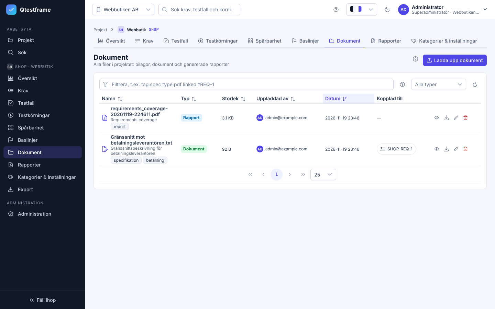

## Hitta filer

- Tabellen visar varje fils **namn**, **typ** (dokument, bilaga eller rapport), **storlek**, vem som laddade upp den, när, dess taggar och de objekt den är **Kopplad till**.
- Filtrera på **Typ**, eller med en [fråga](#sökning-och-filter) på fälten `name`, `description`, `tag`, `kind`, `type` (innehållstyp), `uploaded_by`, `created_at`, `size` och `linked`:

```text
kind=report                                    bara framtagna rapporter
type:pdf created_at>=2026-09-01                PDF-filer sedan september
linked:SHOP-REQ-12                             filer som är bifogade till SHOP-REQ-12
tag:avtal -kind=attachment                     avtalsdokument
size>5000000                                   filer större än ungefär 5 MB
```

## Ladda upp

1. Välj **Ladda upp dokument**, eller dra filer från datorn till sidan.
2. Flera filer laddas upp efter varandra; en förloppslista visar varje fil och rapporterar fel (till exempel en fil som är för stor).
3. Lägg till en beskrivning och taggar, åtskilda med kommatecken, så att filerna blir lättare att hitta. Du kan ändra dem senare med **Redigera**.

Den största tillåtna storleken är 25 MB per fil om administratören inte har angett en annan gräns. Att ladda upp dokument till arkivet kräver rollen **Testare** eller **Ansvarig** (rätten att redigera testfall eller krav).

## Skapa en kravspecifikation eller en testplan

Qtestframe kan skriva två kompletta dokument åt dig och spara dem i arkivet:

- en **kravspecifikation** enligt ISO/IEC/IEEE 29148: titelsida, dokumentinformation med revisionshistorik, innehållsförteckning, en inledning (syfte, projektets beskrivning som omfattning och vad nyckelorden SKA, BÖR och FÅR betyder), kraven grupperade efter mapp, kategori eller typ, en spårbarhetsmatris, en [beroendegraf](#bilagan-beroendegraf) över relationerna mellan kraven och en ordlista med referenser;
- en **testplan** med **testspecifikation** enligt ISO/IEC/IEEE 29119-3: egenskaperna som ska testas (kraven som testfallen verifierar), testansatsen med startkriterier (organisationens [regler för körning](#när-kan-ett-testfall-exekveras)) och slutkriterier (era [releasers](#releaser-och-risker)), testmiljön (konfigurationer och körningarnas miljöer), roller, tidplanen (releaser och körningar), därefter varje testfall med sina steg, och en bilaga om täckning med de krav som saknar testfall.

1. Välj **Skapa dokument** och välj **Kravspecifikation** eller **Testplan**. (Sidan **Rapporter** har samma två dokument under **Dokument**.)
2. Välj i dialogen:
   - **Titel**, **Version** och **Författare**. Lämnas de tomma är titeln dokumentets namn, versionen en mer än den senaste versionen av samma typ i arkivet (*1.0*, *2.0* …) och författaren du.
   - **Dokumentets språk**: engelska eller svenska, ditt språk som standard. En svensk specifikation förklarar nyckelorden **SKA**, **BÖR** och **FÅR** och hur de motsvarar MUST, SHOULD och MAY.
   - **Format**: PDF, Word (DOCX) eller Markdown. PDF och Word har titelsida, sidnummer och innehållsförteckning; i Word får innehållsförteckningen sina sidnummer när Word uppdaterar fältet (det frågar när filen öppnas).
   - **Innehåll**: aktuella krav och testfall, eller en [baslinje](#baslinjer). Med en baslinje visar dokumentet de frysta texterna, och dess signaturer listas som godkännanden.
   - **Filter**: en [fråga](#sökning-och-filter) på kraven (specifikation) eller testfallen (testplan), till exempel `status:approved` eller `folder:Kassa`.
   - **Ta med avvisade och inaktuella krav** (och, för en testplan, utfasade testfall). De utelämnas som standard.
   - **Gruppera kraven efter** mapp, kategori (en dimension) eller typ (bara specifikation; en testplan grupperas alltid efter mapp).
   - **Varje krav på en ny sida** (bara specifikation, påslaget som standard): i PDF och Word börjar varje krav överst på en sida. En mapp- eller grupprubrik direkt före ett krav (med mappens beskrivning) flyttas med till den nya sidan, så att en rubrik aldrig blir ensam längst ned på en sida och ingen sida blir tom. Stäng av för kompakt utskrift: kraven följer då direkt på varandra. Se [Sidlayout](#sidlayout).
   - Vilka **fält** som visas för varje krav eller testfall, och vilka **bilagor**. *Senaste utfall* är avstängt som standard: en specifikation beskriver, den rapporterar inte. **Diskussioner om objekten** lägger till en bilaga med trådarna i kravens eller testfallens [diskussioner](#diskussioner) (borttagna kommentarer utelämnas; lösta trådar är markerade). **Beroendegraf över kraven** (bara specifikation, påslaget som standard) lägger till [bilagan Beroendegraf](#bilagan-beroendegraf).
3. Välj **Skapa**. En förloppsindikator visas medan dokumentet skrivs; ett projekt med tusentals krav tar några sekunder.

Det nya dokumentet visas överst i arkivet, markerat, med **Öppna** (PDF) och **Ladda ner**. Det är ett *dokument* med taggarna `generated`, `requirements-specification` eller `test-plan` och versionen (till exempel `v2.0`); de tidigare versionerna av samma typ utgör dess revisionshistorik. Nyckelord i kravtexterna (MUST, SHALL, SKA …) skrivs i fetstil.

### Sidlayout

I PDF och Word delas ett krav eller testfall aldrig på två sidor när det får plats på en: om det inte får plats på resten av sidan börjar det på nästa, tillsammans med mapprubrikerna direkt före. Bara ett objekt som är längre än en sida fortsätter på nästa sida. I en specifikation med **Varje krav på en ny sida** börjar ändå varje krav på en ny sida. Word håller ihop objekten med styckeinställningarna *håll ihop med nästa* och *sidbrytning före*, så att layouten stämmer även när du redigerar filen. Markdown har inga sidor och ser likadan ut i båda fallen.

### Bilagan Beroendegraf

Bilagan Beroendegraf i en kravspecifikation ritar [relationerna](#relationer) mellan kraven (*förfinar*, *beror på*, *tillhandahåller*, *härlett från*, *står i konflikt med*, *duplicerar*, *relaterar till*), placerade som i appens [beroendegraf](#beroendegrafer): krav som bygger på andra till höger om (eller under) det de bygger på, en pil från ett krav till det krav det förfinar, beror på, tillhandahåller något åt eller är härlett från, och linjer utan pil för relationer utan riktning. Varje relationstyp har sin egen färg och linjestil, varje ruta visar nyckeln, statusen (också som färgen till vänster) och den förkortade titeln, och varje figur har en teckenförklaring.

- Figurerna är vektorgrafik i alla format: ritade direkt i PDF, som SVG i Markdown och i Word som SVG med en bild för ordbehandlare som inte kan visa SVG. Zooma in så långt du behöver.
- Bara krav med relationer ritas. En stor specifikation får flera figurer med högst 24 krav: sammanhängande grupper av krav läggs ihop, och en grupp som är för stor för en figur delas upp efter mapp på översta nivån (och sedan i delar). Ett krav som är relaterat till ett krav i en annan figur ritas som en grå hänvisning till den figuren.
- Efter figurerna listar en tabell varje relation som text ("REQ-1 beror på REQ-3"), med de figurer som de två kraven finns i; relationer till krav som inte finns i specifikationen listas också där. Skärmläsare och textsökning använder tabellen; varje figur har också en textbeskrivning.
- Utan några relationer utelämnas bilagan.

Att skapa dokument kräver rätten att exportera, att läsa krav (och testfall för en testplan) och att ladda upp dokument (**Testare** eller **Ansvarig**).

## Förhandsvisa och ladda ned

- **Förhandsvisa** visar bilder (PNG, JPEG, GIF, WebP), PDF-filer och vanlig text direkt i webbläsaren.
- **Ladda ner** sparar filen. Andra filtyper laddas alltid ned i stället för att visas, av säkerhetsskäl.

## Arbeta med många filer på en gång

Kryssa i filer i listan (rubrikens kryssruta markerar hela sidan). Verktygsfältet erbjuder:

- **Ladda ner som ZIP**: ett arkiv med alla markerade filer (högst 512 MB tillsammans). Filer med samma namn numreras, till exempel *plan (2).pdf*. Alla som kan se arkivet kan ladda ner.
- **Lägg till taggar** / **Ta bort taggar** för alla markerade filer.
- **Beskrivning**: ersätter beskrivningen av varje fil (tomt rensar den).
- **Ta bort**, efter bekräftelse.

Ändringar och borttagning gäller de filer du får ändra: dina egna uppladdningar, eller alla filer om du har behörighet att ändra projektet. Om urvalet också innehåller andra filer visar verktygsfältet hur många av dem du kan ändra, och bara de ändras. Ändringar av taggar och beskrivning kan ångras med ångra-knappen.

## Länka dokument till objekt

En fil i arkivet kan bifogas till hur många krav, testfall, körningar och exekveringar som helst i samma projekt, utan att kopieras. På fliken **Bilagor** för ett objekt väljer du **Bifoga från arkivet** och väljer filerna. Arkivet listar sedan objektet under **Kopplad till**.

- **Att ta bort en bilaga** från ett objekt tar bara bort länken.
- En fil av typen *bilaga* som inte längre är länkad till något tas bort automatiskt; *dokument* och *rapporter* finns kvar i arkivet.
- **Att ta bort en fil** i arkivet tar bort den tillsammans med alla dess länkar, efter en bekräftelse som namnger de länkade objekten.

Den som laddade upp en fil samt projektets ansvariga och administratörer får redigera och ta bort den.

## Var lagras filerna?

Filerna lagras i Qtestframes databas, inte på en separat filserver. Det betyder att de ingår i varje [säkerhetskopia](#säkerhetskopiering-och-återställning), skyddas av samma behörighetsregler som projektet och tas bort tillsammans med projektet. Varje nedladdning kontrolleras mot dina behörigheter.

# Administration

**Administration** i sidopanelen visas för alla som får se minst en av dess delar. Vilka delar du ser beror på din roll:

| Del | Vem ser den |
|---|---|
| **Medlemmar** | alla (Läsare och uppåt) ser medlemslistan; **Administratörer** hanterar den |
| **Rollmatris** (roller och behörigheter) | alla |
| **API-nycklar** | Testare och uppåt (dina egna nycklar) |
| **Provisionering (SCIM)** | Administratörer |
| **Tvåstegsverifiering** | Administratörer (organisationens policy); superadministratörer ställer också in serverpolicyn |
| **Händelselogg** | Testledare och uppåt |
| **Elektroniska poster** | Testledare och uppåt (administratörer ändrar inställningarna) |
| **Organisationer** | Superadministratörer |
| **Användare** | Superadministratörer |
| **Säkerhetskopiering** | Superadministratörer |
| **Systeminställningar** | Superadministratörer |

## Organisationer och roller

En **organisation** är en isolerad arbetsyta: dess projekt, medlemmar, API-nycklar och händelselogg är osynliga för andra organisationer. En person har ett användarkonto för hela installationen och kan vara **medlem** i flera organisationer, med **en eller flera roller i var och en**.

### Roller och behörigheter

Varje organisation börjar med sju inbyggda roller. Som standard kan varje roll i tabellen allt som rollen ovanför kan, utom **Granskare** och **Ämnesexpert**, som står vid sidan av Testare:

| Roll | Kan dessutom (standard) |
|---|---|
| **Läsare** | läsa alla projekt, krav, testfall, körningar, dokument och medlemslistan; söka; exportera och ta fram rapporter |
| **Granskare** | godkänna och avvisa krav och markera testfall som klara (*requirement.review*, *test.review*), utan att redigera innehållet; skriva i [diskussioner](#diskussioner) (*comment.create*, som alla roller nedan utom Läsare) |
| **Ämnesexpert** | delta i att skriva krav: skapa och redigera krav med kriterier, motivering, källor, relationer, länkar och bilagor (*requirement.write*); granska krav (*requirement.review*) och diskutera dem; läsa testfall, körningar, defekter och risker. Inga testfall, körningar, cykler, undantag, inställningar eller medlemmar |
| **Testare** | skriva och länka testfall, hantera testmappar och testfallskategorier, skapa och redigera körningar, registrera utfall, importera utfall från CI, ladda upp bilagor till testfall, körningar och exekveringar, skapa egna API-nycklar |
| **Testledare** | planera [testcykler](#testcykler) (*cycle.plan*), markera testfall som klara (*test.review*), köra automatiserade skript på servern, läsa händelseloggen, ändra [inställningarna för testexekvering](#inställningar-för-testexekvering) |
| **Ansvarig** | godkänna och avvisa krav (*requirement.review*), skriva krav och kravmappar, skapa och redigera projekt, alla kategorier och [spårbarhetsreglerna](#spårbarhetsregler), skapa baslinjer |
| **Administratör** | allt: ta bort projekt, hantera medlemmar och roller, byta namn på organisationen, återställa medlemmars lösenord, ta bort alla kommentarer |
| **Superadministratör** | allt i alla organisationer; hantera organisationer och användare; säkerhetskopiering och återställning |

**Flera roller.** En medlem kan ha flera roller samtidigt – till exempel *Ämnesexpert* och *Testare* för den som skriver krav inom sitt område och även testar. Hen har då alla rollernas behörigheter tillsammans; roller lägger bara till rättigheter. Den som har **Administratör** bland sina roller är administratör för organisationen.

Standardmatrisen med behörigheter:

| Behörighet | Läsare | Granskare | Ämnesexpert | Testare | Testledare | Ansvarig | Administratör |
|---|:-:|:-:|:-:|:-:|:-:|:-:|:-:|
| `project.read`, `requirement.read`, `test.read`, `run.read`, `member.read`, `export` | ✔ | ✔ | ✔ | ✔ | ✔ | ✔ | ✔ |
| `test.review` | | ✔ | | | ✔ | ✔ | ✔ |
| `requirement.review` | | ✔ | ✔ | | | ✔ | ✔ |
| `comment.create` | | ✔ | ✔ | ✔ | ✔ | ✔ | ✔ |
| `requirement.write` | | | ✔ | | | ✔ | ✔ |
| `change.create` | | | ✔ | | ✔ | ✔ | ✔ |
| `change.approve` | | | | | ✔ | ✔ | ✔ |
| `test.write`, `run.write`, `run.execute`, `token.manage` | | | | ✔ | ✔ | ✔ | ✔ |
| `cycle.plan`, `script.execute`, `audit.read`, `settings.manage` | | | | | ✔ | ✔ | ✔ |
| `waiver.approve`, `project.create`, `project.update` | | | | | | ✔ | ✔ |
| `project.delete`, `member.manage`, `role.manage`, `tenant.manage` | | | | | | | ✔ |

**Undantag och riskacceptans.** Att godkänna, avslå och återkalla [undantag och avvikelser](#undantag-restrisk-och-uttalande-om-tillämplighet) och att signera acceptansen av en restrisk kräver `waiver.approve` (en projektbehörighet, så en projektroll kan ge den i ett enskilt projekt). Varje beslut är en elektronisk signatur (lösenord, eller en nyligen gjord enkel inloggning) och registreras i händelseloggen; den som begärt ett undantag kan inte besluta om det. Ge `waiver.approve` bara till personer som får acceptera att krav inte uppfylls.

**Ändringsbegäranden.** Att föreslå ändringar i [ändringsbegäranden](#ändringsbegäranden-och-ändringshantering) (och bedöma, genomföra, verifiera och stänga dem) kräver `change.create`; att besluta om dem som medlem i projektets ändringsnämnd, och nödåtgärden förbi tvingande ändringshantering, kräver `change.approve`. Båda är projektbehörigheter. Varje beslut är en elektronisk signatur, och den som begärt en ändring kan inte besluta om den.

**Granskningsbeslut.** Att sätta ett krav till *Godkänt* eller *Avvisat* kräver `requirement.review`; att sätta ett testfall till *Klart* kräver `test.review`. Detsamma gäller massändringar, att skapa ett objekt med den statusen och att återställa en version som har den. En granskare utan skrivbehörighet får bara ändra statusen; att redigera något annat kräver fortfarande `requirement.write` eller `test.write`. Varje beslut registreras i händelseloggen som `requirement.review` eller `test.review`. Ett kopierat krav eller testfall börjar som *Utkast* och granskas alltså på nytt.

**Ärendehanterare.** Att ansluta ett projekt till Jira, GitHub eller GitLab kräver `project.update`; token anges där en gång och visas aldrig igen (se [Anslut Jira, GitHub eller GitLab](#anslut-jira-github-eller-gitlab), som också beskriver hur du skapar en GitLab-token med den minsta behörigheten, `api`). Att skicka och synkronisera defekter kräver `run.execute`; att skapa, uppdatera och läsa om [ärenden från krav](#ärenden-i-gitlab-github-eller-jira) kräver `requirement.write`. De registreras i händelseloggen (`defect.push`, `defect.sync` när en status ändras, `requirement.issue.create`, `requirement.issue.update`, `requirement.issue.sync`).

### Ändra roller och skapa egna

*(Administratör, eller en roll med `role.manage`)* **Administration → Rollmatris** visar organisationens matris. Kryssa i eller ur en behörighet för alla roller utom **Administratör**; ändrade celler markeras och en rad visar hur många roller som har osparade ändringar. Välj **Spara** för att tillämpa dem; medlemmar med rollen får de nya behörigheterna direkt. Du kan bara ge behörigheter som du själv har.

- En inbyggd roll vars behörigheter skiljer sig från standard markeras *ändrad*; knappen **Återställ till standard** (↺) återställer dem.
- **Ny roll** skapar en egen roll: ange ett **Visningsnamn** (till exempel *Revisor*), ett **Tekniskt namn** (gemener, siffror och `_`, används i API:t och i SSO-gruppmappningar) och gärna en beskrivning, och välj vilken roll den ska börja med behörigheterna från. Justera sedan behörigheterna i matrisen.
- Egna roller markeras *egen*. Du kan byta namn på dem (✎) och ta bort dem (🗑) när ingen medlem eller API-nyckel använder dem.
- Nya roller kan väljas under **Medlemmar**, för API-nycklar och i gruppmappningen från identitetsleverantören.

**Administratör** har alltid alla behörigheter, så en organisation kan inte låsa ute sig själv.

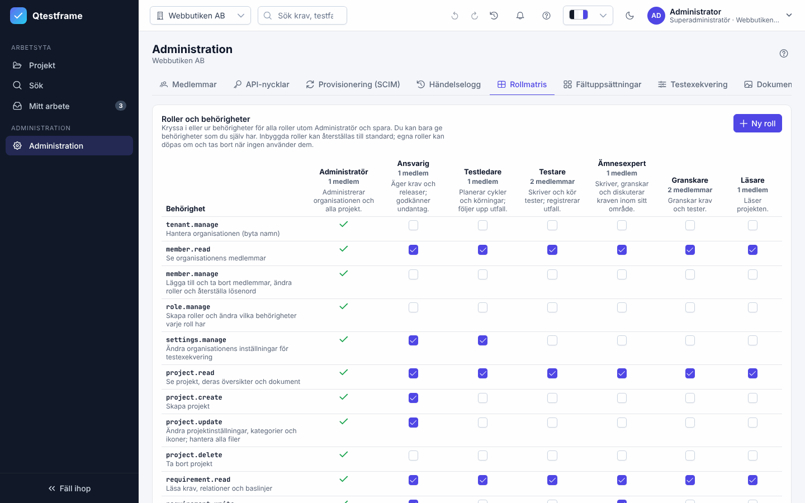

Knappar för åtgärder som du inte får utföra döljs. Om du saknar en knapp som beskrivs i handboken, kontrollera din roll i användarmenyn.

## Medlemmar

**Administration → Medlemmar** listar medlemmarna i den aktuella organisationen med roll och sedan när de är medlemmar.

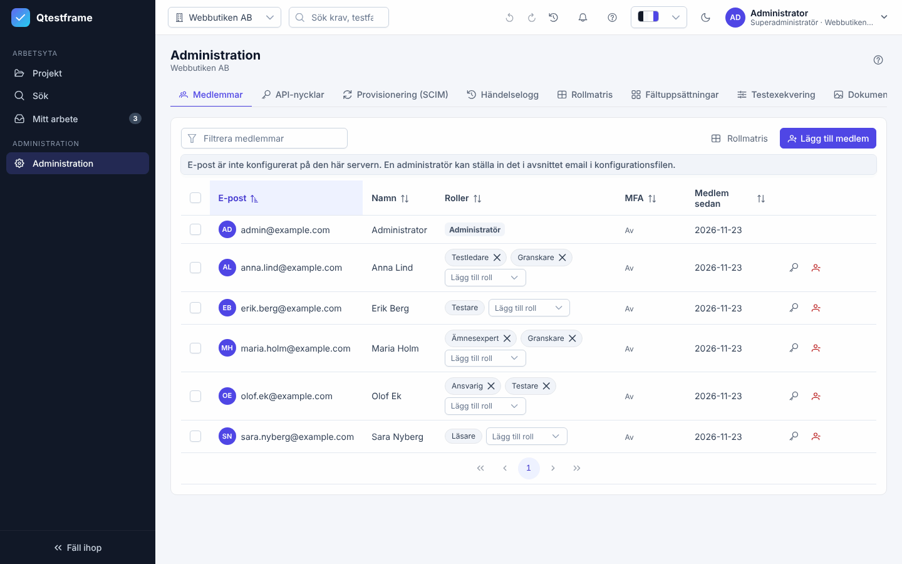

- **Lägg till medlem** *(Administratör)*: ange **E-post** och välj en eller flera **Roller**. Om personen redan har ett konto läggs hon eller han till med de rollerna. Om e-postadressen är okänd skapas ett lokalt konto: när servern kan skicka e-post låter du **Skicka en inbjudan med e-post** vara påslaget (se [Bjuda in med e-post](#bjuda-in-med-e-post)); annars anger du ett **Visningsnamn** och ett **Första lösenord**, och ber personen att byta det efter första inloggningen.
- **Ändra roller** *(Administratör)*: öppna rollerna på medlemmens rad och kryssa i eller ur roller; varje roll visas som en bricka, och en medlem har alltid minst en roll. Ändringen gäller direkt, även för personens API-nycklar. Organisationen har alltid minst en medlem med rollen **Administratör**.
- **Ta bort** *(Administratör)*: tar bort medlemskapet; själva kontot finns kvar.
- **Flera medlemmar på en gång** *(Administratör)*: kryssa i medlemmar (eller rutan i rubriken för alla visade), välj sedan en roll under **Ange roll** (de får exakt den rollen), **Lägg till roll** eller **Ta bort roll** (övriga roller finns kvar), eller välj **Ta bort**, och bekräfta. Ditt eget medlemskap lämnas som det är, liksom medlemmar vars roller inte skulle ändras eller som skulle stå utan roll; meddelandet visar vilka som hoppades över. Båda kan ångras (borttagna medlemmar läggs tillbaka med sina tidigare roller).
- En organisation måste ha minst **en administratör**: den sista administratören kan inte nedgraderas eller tas bort, och en ändring av flera medlemmar som skulle lämna organisationen utan administratör avvisas i sin helhet.
- Medlemmar märkta **SCIM** [provisioneras av er identitetsleverantör](#provisionering-med-scim): deras roller följer grupperna där, så rollerna kan inte ändras och de kan inte tas bort här (en ändring av flera medlemmar hoppar över dem).

### Bjuda in med e-post

*(Administratör, när e-post är inställt)* Med **Skicka en inbjudan med e-post** påslaget skickar **Lägg till och bjud in** ett e-postmeddelande med en länk till personen i stället för ett första lösenord. Länken leder till en sida där personen väljer namn och lösenord och loggas in direkt. Den kan användas **en gång** och gäller i **7 dagar**. För personer som loggar in med enkel inloggning (OIDC eller SAML) slår du också på **Använder enkel inloggning**; deras länk ber dem i stället att logga in med organisationens konto.

Tills inbjudan har antagits visar medlemmen etiketten **Inbjuden** (eller **Inbjudan har gått ut**); håll pekaren över den för att se när den skickades och hur länge den gäller. På medlemmens rad finns:

- **Skicka inbjudan igen**, som skickar en ny länk; den gamla slutar fungera. Använd den när inbjudan har gått ut eller kommit bort.
- **Återkalla inbjudan**, som gör länken oanvändbar och tar bort personen från organisationen.

Om personen redan har ett konto läggs hon eller han till direkt och får ett e-postmeddelande om det. Varje inbjudan, nytt utskick, återkallelse och antagen inbjudan sparas i [händelseloggen](#händelselogg).

### Återställa ett lösenord

*(Administratör, för lokala konton)*: välj **Återställ lösenord** på medlemmens rad. Qtestframe tar fram ett **tillfälligt lösenord** och visar det **en gång**; kopiera det och lämna det till personen på ett säkert sätt. Personen loggas ut överallt och måste välja ett nytt lösenord vid nästa inloggning.

Administratörer kan bara återställa lösenord för personer som enbart tillhör deras egen organisation; för superadministratörer och personer som även är medlemmar i andra organisationer måste en superadministratör göra det. Konton som loggar in med enkel inloggning har inget lösenord i Qtestframe.

### Återställa tvåstegsverifiering

Kolumnen **MFA** visar vem som använder tvåstegsverifiering: **På**, *Av*, eller **Saknas** när [MFA-policyn](#tvåstegsverifiering-1) kräver den för medlemmen men hen inte har konfigurerat den än.

*(Administratör)* När någon har tappat bort både telefonen och återställningskoderna väljer du **Återställ MFA** (skölden) på hens rad och bekräftar. Autentiseringsappen, återställningskoderna och ihågkomna enheter tas bort, personen loggas ut överallt och får en notis och ett e-postmeddelande. Därefter loggar hen in med bara lösenordet, eller, om MFA krävs för hen, konfigurerar en ny autentiseringsapp vid nästa inloggning. Försäkra dig om att begäran verkligen kommer från personen innan du återställer. Precis som för lösenord kan administratörer bara återställa personer som enbart tillhör deras organisation; superadministratörer kan återställa vem som helst, även under [Användare](#användare). Varje återställning registreras i [händelseloggen](#händelselogg).

## Tvåstegsverifiering

**Administration → Tvåstegsverifiering** bestämmer vem som måste använda en andra faktor (en autentiseringsapp, se [din profil](#tvåstegsverifiering)) vid inloggning med lösenord. Sidan visar hur många medlemmar som redan använder den.

- **Policy för organisationen** *(Administratör)*: **Valfritt** (standard: alla får, ingen måste), **Krävs för alla** eller **Krävs för vissa roller**, till exempel bara för administratörer. Den gäller medlemmarna utifrån deras roll i den här organisationen.
- **Serverpolicy** *(Superadministratör)*: samma val för alla användare i installationen; en roll räknas i vilken organisation som helst, och *Superadministratör* kan väljas som roll. En organisation kan kräva mer än servern, aldrig mindre.
- **Övergångsperiod**: personer som policyn börjar gälla för kan fortsätta logga in utan andra faktor i så här många dagar; de ser en påminnelse med datumet. Därefter måste de konfigurera den vid nästa inloggning innan de kan göra något annat. **0** betyder vid nästa inloggning.
- **Kom ihåg enheten** *(Superadministratör, serverpolicy)*: antalet dagar en webbläsare får hoppa över koden efter att användaren valt *Kom ihåg den här enheten*; **0** (standard) stänger av alternativet.

API-nycklar påverkas inte. Den som loggar in med enkel inloggning får normalt sin andra faktor från identitetsleverantören; om Qtestframe också ska fråga efter en egen kod ställs in per leverantör i serverkonfigurationen (`local_mfa`). Varje ändring av policyn registreras i [händelseloggen](#händelselogg).

## Delning av projekt

Normalt ser alla medlemmar i organisationen alla projekt, med sin organisationsroll. **Delning** ändrar det per projekt: du kan begränsa ett projekt till dem som arbetar med det och ge någon en annan roll i ett projekt än i organisationen.

Öppna det med **Dela** i projektets sidhuvud (eller dela-knappen för ett projekt på sidan **Projekt**) eller under **Kategorier & inställningar → Delning**. Du behöver `project.update` i projektet *(Ansvarig, eller en projektroll som har det)*.

**Åtkomst** har två val:

- **Alla i organisationen** (standard): alla medlemmar ser projektet med sin organisationsroll. Projektmedlemmar får i stället sin projektroll.
- **Begränsat till projektmedlemmar**: bara projektmedlemmarna (och organisationens administratörer) ser projektet. För alla andra finns det inte: det saknas i projektlistan, sökningen, granskningar och notiser, och länkar till det visar *hittades inte*. Begränsade projekt visas med ett lås (🔒) i projektlistan och sidhuvudet.

**Projektmedlemmar** är personer i organisationen eller grupper från din [identitetsleverantör (SCIM)](#provisionering-med-scim), var och en med en eller flera **projektroller**: vilka roller som helst i organisationen, även egna. I projektet **ersätter** projektrollerna organisationsrollerna, så den kan höja eller sänka någons rättigheter där: en Testare i organisationen kan vara Ansvarig i ett projekt, en Ansvarig bara Läsare i ett annat. En persons eget medlemskap går före en grupps; flera grupper läggs ihop. Organisationens administratörer har alltid full åtkomst till alla projekt.

- **Lägg till**: sök efter en person eller grupp på namn eller e-post, välj projektroller och välj **Lägg till**. Bara medlemmar i organisationen kan läggas till (lägg först till nya personer under [Medlemmar](#medlemmar)). Personen får en notis (och ett e-postmeddelande om hen vill ha notiser via e-post).
- **Ändra roller**: kryssa i eller ur roller i medlemmens rad. Roller som du inte får ge visas men kan inte tas bort.
- **Ta bort** tar bort någon från projektet; medlemmar kan också själva lämna ett projekt. **Flera medlemmar på en gång**: markera dem och välj sedan **Sätt projektroll**, **Lägg till projektroll**, **Ta bort projektroll** eller **Ta bort**.
- Du kan bara ge, ändra eller ta bort roller vars projektbehörigheter du själv har i projektet, så ingen kan ge mer än hen har.
- När du begränsar ett projekt som du ser genom dina organisationsroller läggs du till som projektmedlem med de rollerna, så att du inte stänger ute dig själv.
- Behörigheter för hela organisationen – medlemmar, roller, API-nycklar, händelseloggen, att skapa projekt – följer alltid organisationsrollerna. API-nycklar går aldrig utöver sina egna roller, inte heller i ett projekt.

Varje ändring av åtkomsten eller medlemmarna registreras i [händelseloggen](#händelselogg). Tar du bort någon från organisationen tas även hens projektmedlemskap bort. Ett duplicerat projekt behåller originalets medlemmar.

## E-post

Notiser med e-post, inbjudningar och [rapporter med e-post](#skicka-en-rapport-med-e-post) kräver en server för utgående e-post, som serveradministratören ställer in i avsnittet `email` i konfigurationsfilen. Utan den döljs funktionerna och profilen förklarar att notiserna bara visas i appen.

*(Administratör)* **Administration → Medlemmar → Skicka testmeddelande** skickar ett testmeddelande till din egen adress. Om det misslyckas visar meddelandet e-postserverns svar, till exempel ett felaktigt lösenord eller en nekad anslutning; lämna det till serveradministratören.

## Inställningar för testexekvering

*(Administratör och Testledare, eller en roll med `settings.manage`)* **Administration → Testexekvering** avgör när ett testfall får exekveras. Som standard kan ett testfall bara exekveras när:

- testfallet har status **Klar**,
- alla krav det verifierar har någon av de **klara statusarna** (standard **Godkänt**, **Implementerat** och **Verifierat**), och
- alla testfall det [beror på](#beroenden) har godkänts: i samma körning när det testfallet ingår i körningen, annars dess senaste utfall.

Varje regel kan lättas upp för sig: **Tillåt exekvering av testfall som inte är Klara**, **Tillåt exekvering av testfall för krav som inte är klara** och **Tillåt att testfall startas innan deras förutsättningar har godkänts**. Du kan också välja vilka kravstatusar som räknas som klara.

Det en regel förbjuder avvisas av servern, även för API-klienter och CI-importer. I appen ser du det direkt:

- i dialogen **Ny körning** markeras valda testfall som inte är klara, med en varning;
- på körningens sida visar kolumnen **Redo** och en sammanfattning vilka exekveringar som inte kan startas än;
- i exekveringsvyn listar en röd ruta orsakerna, med länkar till testfallet, kravet eller förutsättningen, och **Godkänd**, **Underkänd** och **Kör skript** är avstängda. Du kan fortfarande markera testfallet som **Blockerat** eller **Överhoppat**, tilldela det och skriva anteckningar;
- när en regel är upplättad visas samma orsaker som en gul varning, och testfallet kan exekveras.

**Kravstatus följer testutfallen** (på som standard) gör att ett implementerat krav blir **Verifierat** när det är [verifierat](#verifiering) – varje kriterium har godkända belägg och varje underkrav är verifierat – och går tillbaka till **Implementerat** när det inte längre gäller. Avstängd ändras statusen bara för hand, och avvikelser listas under **Verifiering → Inkonsekvenser**. Om varje kriterium behöver egna belägg är en projektinställning (**Inställningar → Projekt → Verifiering**).

## Fältuppsättningar och mallar

*(Admin och Testledare, eller en roll med `settings.manage`)* **Administration → Fältuppsättningar** håller, per **projekttyp**, de [egna fält](#egna-fält) som ett nytt projekt av den typen får och organisationens [mallar](#mallar) för nya krav och testfall. En ändring i en fältuppsättning ändrar inte befintliga projekt: de behåller sina egna kopior och kan tillämpa uppsättningen igen under **Kategorier & inställningar → Egna fält → Tillämpa fältuppsättning** (fält som de redan har hoppas över). Organisationens mallar erbjuds i varje projekt av typen, bredvid de inbyggda. Alla i organisationen kan läsa fältuppsättningarna.

## Testkonfigurationer

*(Ansvarig och Administratör, eller en roll med `project.update`)* **Kategorier & inställningar → Konfigurationer** innehåller projektets testkonfigurationer: namngivna kombinationer av **dimensionsvärden** som *Webbläsare = Chrome* och *OS = Windows*, en hårdvaruversion eller en firmwareversion. En [körning](#konfigurationer-i-en-körning) som gäller konfigurationer exekverar vart och ett av sina testfall en gång per konfiguration. Alla som kan läsa projektet ser konfigurationerna.

- **Ny konfiguration**: lägg till dimensionsvärden (dimension och värde, varje dimension högst en gång) och eventuellt ett namn och en beskrivning. Utan namn får konfigurationen namn efter sina värden, till exempel *Chrome / Windows*. Namnen är unika i projektet, oavsett versaler och gemener.
- **Skapa kombinationer**: ange värdena för varje dimension åtskilda med komman (*Webbläsare*: Chrome, Firefox, Safari; *OS*: Windows, macOS), så visar dialogen alla kombinationer i förväg. **Skapa** lägger till alla på en gång (högst 200); med **Hoppa över kombinationer som redan finns** utelämnas befintliga namn.
- Pilarna ändrar i vilken ordning konfigurationerna listas och erbjuds; pennan redigerar en. Byter en konfiguration namn ändras namnet även i befintliga körningar.
- **Ta bort** (även för flera markerade konfigurationer) tar bort konfigurationer som ingen körning gäller. En konfiguration som används kan inte tas bort; ta först bort den från körningarna, eller ta bort de körningarna.

Kolumnen **Körningar** visar hur många körningar som gäller varje konfiguration. Att skapa konfigurationer kan ångras med ångraknappen.

## Ändringspåverkan, inaktualitet och defekter

*(Ansvarig och Administratör, eller en roll med `project.update`)* **Kategorier & inställningar → Ändringspåverkan** innehåller projektets regler för [ändringspåverkan](#ändringspåverkan), [inaktuella utfall](#inaktuella-utfall), [blockerande defekter](#blockerande-defekter) och [regressioner](#regressioner). Alla som kan läsa projektet ser dem. Ändringar gäller från och med då: det som redan markerats förblir markerat.

## Varianter och kodintegration

*(Förvaltare och Administratör, eller en roll med `project.update`)* **Varianter** innehåller projektets produktvarianter, marknader och kundkonfigurationer; **Inställningar → Projekt → Kodintegration** innehåller den gemensamma hemligheten för projektets webhookar från GitLab och GitHub. Hemligheten lagras krypterad med de andra hemligheterna, kan bara skrivas och ingår inte i projektarkiv: ange en ny efter att ett projekt lästs in. Leveranser kontrolleras med hemligheten (GitLab) eller signaturen HMAC-SHA256 (GitHub), och varje leverans skrivs i granskningsloggen som `code.webhook`. CI-token behöver `run.execute` för att ladda upp resultat för ett bygge och `run.write` för att skapa en regressionskörning. Se [Varianter och kod](#varianter-och-kod).

## Webbtester

[Webbtester](#webbtester-playwright) körs i en riktig webbläsare på servern. Serveradministratören slår på dem i konfigurationsfilen (`runner.web`, se nedan), och de ställs in per projekt under **Inställningar → Webbtester** *(Ansvarig; behörigheten project.update)*:

- **Bas-URL** — adressen till applikationen som testas, t.ex. `https://staging.example.com`. `page.goto('/login')` i ett webbtest öppnar då `https://staging.example.com/login`.
- **Bas-URL per miljö** — en körning vars **Miljö** stämmer med namnet (oavsett versaler) använder den här URL:en i stället, t.ex. *production* → `https://www.example.com`. En testkonfiguration med dimensionen **Bas-URL** går före båda.
- **Testvariabler** — namn och värde, som skickas till alla automatiserade skript i projektet som `QTF_VAR_<NAMN>` (i ett webbtest `process.env.QTF_VAR_USERNAME`). Markera lösenord och nycklar som **Hemlig**: värdet kan bara skrivas — det visas aldrig igen, inte ens för administratörer (lämna fältet tomt för att behålla det), och det ersätts av `***` i sparade utdata och felmeddelanden. Skärmbilder och spår kan ändå visa en hemlighet som sidan visar.

Bara medlemmar med behörigheten *script.execute* (som standard **Testledare** och **Ansvarig**) kan köra skript och webbtester. Skripten körs på servern med serverns rättigheter, begränsade bara av sandlådan; webbtester har alltid nätverksåtkomst, så se **Kör skript** som att köra kod på servern.

**Installation på servern** (serveradministratören):

1. Installera Node.js och Playwright i en katalog, t.ex. `/opt/qtestframe-playwright`: `npm i @playwright/test`, och sedan webbläsarna med `npx playwright install --with-deps chromium` (lägg till `firefox webkit` för de webbläsarna).
2. Sätt `runner.enabled: true` i konfigurationsfilen och:

   ```yaml
   runner:
     web:
       enabled: true
       node: /usr/bin/node
       playwright_dir: /opt/qtestframe-playwright   # innehåller node_modules/@playwright/test
       browsers_path: /opt/qtestframe-playwright/browsers  # PLAYWRIGHT_BROWSERS_PATH, om inte standard
       browser: chromium          # standardwebbläsare: chromium, firefox eller webkit
       headless: true
       timeout: 60s               # per test
       screenshots: on_failure    # on_failure, always eller off
       trace: on_failure          # on_failure, always eller off
       video: off                 # off, on_failure eller always
       max_parallel: 2            # webbtester som körs samtidigt
   ```

3. Starta om servern. **Kör skript** fungerar nu för webbtester; demoprojektet från `qtestframe seed-demo` har ett (*Login page shows the sign-in form*) som öppnar serverns egen inloggningssida — sätt `server.base_url` till adressen servern nås på.

## Konsistenskontroller

Projekt får inte de [inbyggda konsistenskontrollerna](#inbyggda-konsistenskontroller) som regler automatiskt: en förvaltare lägger till dem med **Lägg till inbyggda kontroller** (de börjar som varningar, så releasernas beredskap ändras inte). Avfärdade fynd (*ingen dubblett*, *ingen konflikt*) ingår i säkerhetskopior och projektarkiv; de cachade vektorerna från den valfria tjänsten för inbäddningar gör det inte (se [Dubbletter och konflikter](#dubbletter-och-konflikter)).

## API-nycklar

Med API-nycklar kan skript och CI-pipelines använda REST-API:et utan lösenord, till exempel för [CI-importen](#importera-utfall-från-ci).

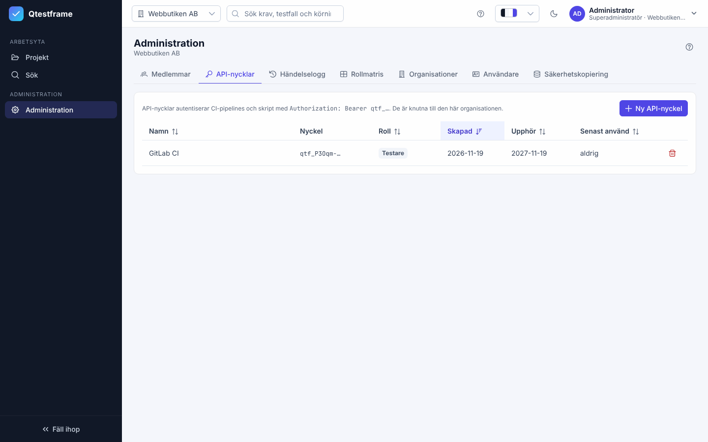

1. Öppna **Administration → API-nycklar** och välj **Ny API-nyckel** *(Testare)*.
2. Ange ett **Namn** som säger var den används, till exempel *GitLab CI*.
3. Välj **Roller** (som standard alla dina). En API-nyckel kan aldrig ha fler behörigheter än du.
4. Ange eventuellt **Upphör efter (dagar)**; tomt betyder att den aldrig upphör.
5. Välj **Skapa** och **kopiera nyckeln nu**: den börjar med `qtf_` och visas bara en gång.

Använd den som bearer-token: `Authorization: Bearer qtf_…`. En nyckel hör till en organisation och begränsas vid varje anrop till de roller du har där just då: om du förlorar en roll gör nyckeln det också. API-nycklar kan inte skapa nya nycklar. **Återkalla** en nyckel så snart den inte längre behövs eller kan ha läckt; klienter som använder den förlorar åtkomsten direkt. Listan visar när varje nyckel **Senast användes**.

## Provisionering med SCIM

*(Administratör)* Med SCIM 2.0 skapar, uppdaterar och inaktiverar er identitetsleverantör (Microsoft Entra ID, Okta, OneLogin, JumpCloud med flera) organisationens medlemmar åt dig: när någon tilldelas Qtestframe-appen hos leverantören blir personen medlem här, och när personen slutar försvinner åtkomsten.

Så fungerar det:

- **Användare.** En provisionerad användare matchas på e-postadress. Nya användare får ett konto **utan lösenord**: de loggar in med organisationens enkla inloggning (OpenID Connect eller SAML), som kopplar ihop kontot vid första inloggningen. Ett befintligt konto med samma e-postadress (till exempel en medlem som du har lagt till för hand) tas över.
- **Inaktivering.** När leverantören inaktiverar en användare tas medlemskapet bort, och personens sessioner och API-nycklar i den här organisationen upphör direkt. När leverantören aktiverar användaren igen kommer medlemskapet tillbaka med rollen från grupperna. Tar leverantören bort användaren försvinner medlemskapet; själva kontot finns kvar.
- **Roller från grupper.** Leverantören kan också skicka över grupper. Under **Roller för provisionerade medlemmar** väljer du för varje grupp vilken roll dess medlemmar får, eller **Ingen roll**. En medlem i flera kopplade grupper får rollerna för alla. Medlemmar utan kopplad grupp får **Standardrollen** (*Läsare* om du inte ändrar den), eller ingenting med **Ingen åtkomst**.
- **Skyddade regler.** SCIM gör aldrig någon till superadministratör och tar aldrig bort den statusen, och organisationen har alltid kvar en administratör: en ändring som skulle ta bort den sista administratören avvisas. E-postadress och namn för en person som även hör till andra organisationer ändras inte av den här organisationens leverantör.
- **Medlemslistan.** Provisionerade medlemmar är märkta **SCIM** under **Administration → Medlemmar**. Ändra deras roll via grupperna hos leverantören (eller gruppkopplingen här); rollen kan inte ändras och de kan inte tas bort för hand, eftersom nästa synkronisering skulle ångra det.

### Anslut identitetsleverantören

1. Öppna **Administration → Provisionering (SCIM)** och välj **Ny SCIM-nyckel**. Ge den ett **Namn**, till exempel *Entra ID*, eventuellt en giltighetstid, och välj **Skapa**.
2. **Kopiera nyckeln nu**: den börjar med `qtfscim_` och visas bara en gång. En SCIM-nyckel fungerar bara för provisionering av den här organisationen; den är ingen API-nyckel, och API-nycklar fungerar inte för provisionering.
3. Kopiera **Bas-URL för SCIM** från samma sida (den slutar med `/scim/v2`).
4. Ställ in provisioneringen hos leverantören:
   - **Microsoft Entra ID**: öppna **Provisioning** i företagsprogrammet för Qtestframe, sätt läget till **Automatic**, ange bas-URL:en som **Tenant URL** och nyckeln som **Secret Token**, välj **Test Connection** och spara. Tilldela användare och grupper till programmet och starta provisioneringen. Entra ID matchar användare på `userName` (användarens UPN eller e-postadress) och synkroniserar ungefär var 40:e minut.
   - **Okta**: aktivera **SCIM provisioning** i appintegrationen för Qtestframe, ange bas-URL:en som **SCIM connector base URL**, välj `email` som **Unique identifier field for users**, välj **Push New Users**, **Push Profile Updates** och **Push Groups**, och välj autentiseringen **HTTP Header** med nyckeln. Aktivera *Create Users*, *Update User Attributes* och *Deactivate Users* under **To App**, tilldela sedan personer och skicka över grupper.
   - Andra leverantörer fungerar på samma sätt: bas-URL, bearer-token och de användare och grupper som ska skickas över.
5. När de första grupperna har kommit kopplar du dem till roller under **Roller för provisionerade medlemmar** och väljer **Standardroll**.

**Senaste provisioneringshändelser** på samma sida visar de senaste ändringarna; varje ändring finns också i [händelseloggen](#händelselogg), med utföraren *SCIM: nyckelns namn*. **Återkalla** en nyckel när du byter ut den eller om den kan ha läckt; leverantören slutar då provisionera tills den får en ny. Alla ändringar i ett anrop sparas tillsammans eller inte alls, och en leverantör som skickar för många anrop bromsas (HTTP 429).

## OSLC

Qtestframe har en OSLC-leverantör (Requirements Management 2.1 och Quality Management 2.1) under `/api/v1/oslc/`, så att ALM-verktyg som IBM Engineering Lifecycle Management (DOORS Next, ETM), Polarion eller Codebeamer kan hitta, länka, skapa och ändra krav och testfall. Den är alltid på; vad användarna kan göra med den beskrivs i [Samverkan](#oslc).

- **Adresser:** katalogen `/api/v1/oslc/catalog` (en tjänsteleverantör per projekt), en katalog per projekt `/api/v1/oslc/projects/<id>/catalog`, upptäcktsdokumentet `/api/v1/oslc/rootservices` (öppet, innehåller inga data). Ställ in **Bas-URL** under [Systeminställningar](#systeminställningar) (`server.base_url`) så att resursadresserna är de som klienterna når.
- **Konton:** klienter loggar in med en [API-nyckel](#api-nycklar) som `Authorization: Bearer …`; klienter som bara har användarnamn och lösenord kan skicka nyckeln som lösenord (valfritt användarnamn). Skapa nyckeln för en person eller ett tjänstekonto vars roll tillåter det som verktyget ska göra: **Läsare** för att läsa och länka från andra hållet, en roll med skrivbehörighet för att skapa och ändra poster. Projektdelning gäller: begränsade projekt listas bara för sina medlemmar.
- **Stöds:** RDF/XML, Turtle och JSON-LD åt båda hållen; creation factories, uppdateringar med `If-Match` (en inaktuell uppdatering nekas), borttagning till papperskorgen; frågor med `oslc.where` på valfri egenskap, `oslc.select`, `oslc.orderBy`, `oslc.searchTerms` och sidindelning; länkegenskaper som spårlänkar, relationer och länkar till det andra verktygets poster; delegerade urvals- och skapadialoger; resource shapes.
- **Dialoger i en ram:** urvals- och skapadialogerna öppnas i ett eget fönster. För verktyg som visar dem inne på sin sida lägger serverns operatör in verktygets adress i `server.frame_ancestors` (administratörshandboken, *Koppla ihop med andra verktyg*).
- **Stöds inte:** OAuth 1.0a (använd API-nycklar), förhandsvisningar, tracked resource sets och konfigurationshantering.

API-referensen (`docs/api.md`, avsnittet *OSLC*) listar egenskaperna och frågesyntaxen.

## Händelselogg

*(Testledare och uppåt)* **Administration → Händelselogg** registrerar vem som gjorde vad och när i organisationen: skapande, ändring och borttagning av objekt, inloggningar, ändringar av medlemskap med mera. De nyaste posterna visas först. Varje post visar avataren för den som utförde händelsen.

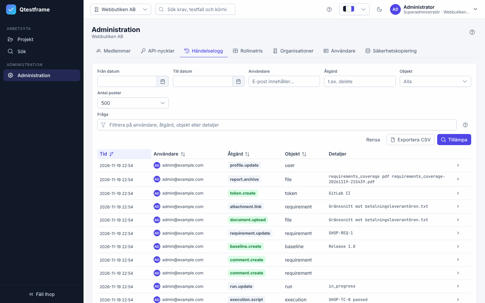

- Filtrera på användare, åtgärd, objekt eller detaljer med en fråga, till exempel `user:anna action:delete` eller `entity:requirement created_at>=2026-09-01`.
- Begränsa tidsperioden med **Från datum** och **Till datum**.
- **Antal poster** anger hur många som visas (upp till 5000).
- **Exportera CSV** laddar ner den filtrerade loggen till en revisor; **Exportera Markdown** laddar ner den som ett Markdown-dokument med datumintervallet och filtret.


### Verifiera händelseloggen

Händelseloggen kan inte ändras i programmet, och varje post är kopplad till posten före med en hash (ett fingeravtryck av innehållet), så en ändring som görs direkt i databasen syns. **Verifiera granskningsloggen** högst upp på sidan kontrollerar hela kedjan och visar antingen *Granskningsloggen är intakt* (med antalet poster och signerade kontrollpunkter) eller den **första brutna länken**: postens nummer och vad som är fel – posten har ändrats, poster saknas eller har tagits bort i slutet, eller kedjan har skrivits om. Spara beläggen och rapportera enligt era rutiner.

**Exportera med hashar (JSON)** och **(CSV)** laddar ner hela loggen med varje posts nummer, hash och hashen av posten före, för arkivering utanför Qtestframe. *Detaljer* för en post visar också dess nummer, hash och, i läget för elektroniska poster, orsaken till ändringen.

## Läge för elektroniska poster

*(Administratörer ändrar det; testledare och uppåt kan läsa det och skapa rapporten)* **Administration → Elektroniska poster** slår på de kontroller som reglerade organisationer behöver för elektroniska poster och signaturer (21 CFR Part 11, EU GMP Annex 11). Läget är **av** tills en administratör slår på det. När det är på:

- **Varje signatur kräver att du bekräftar vem du är**: ditt lösenord och, om du använder en autentiseringsapp, en kod från den. Du väljer signaturens **innebörd** (till exempel *Godkänd* eller *Granskad*) från organisationens lista. Loggar du in med enkel inloggning signerar du strax efter inloggningen.
- **Vissa åtgärder kräver signatur**: administratören väljer bland att godkänna ett krav, godkänna ett test (status *Klar*), release go (*Frisläppt*) och att skapa en baslinje. När du gör någon av dem – i redigeraren, en massändring, kalkylbladsvyn eller en massgranskning – öppnas signaturdialogen; ändringen sparas när du har signerat. Avbryter du sparas ingenting.
- **Vissa ändringar kräver en orsak**: när du sparar en sådan ändring frågar en dialog varför (till exempel numret på en ändringsbegäran). Orsaken sparas i händelseloggen tillsammans med ändringen.
- **Du loggas ut efter en tid utan aktivitet** (standard 15 minuter). Uppdateringar i bakgrunden, som antalet aviseringar, håller dig inte inloggad.

Signerade poster visar sina **Elektroniska signaturer**: namn och e-post för den som signerade, datum och tid i UTC och i den personens tidszon, innebörden, vad som signerades och hur personen bekräftade sig. När posten ändras efter signeringen visar signaturen *Posten ändrad efter signeringen*. Du hittar dem under **Historik** för ett krav eller test, bland en baslinjes signeringar, i ett undantag, vid acceptansen av en risk och i en release.

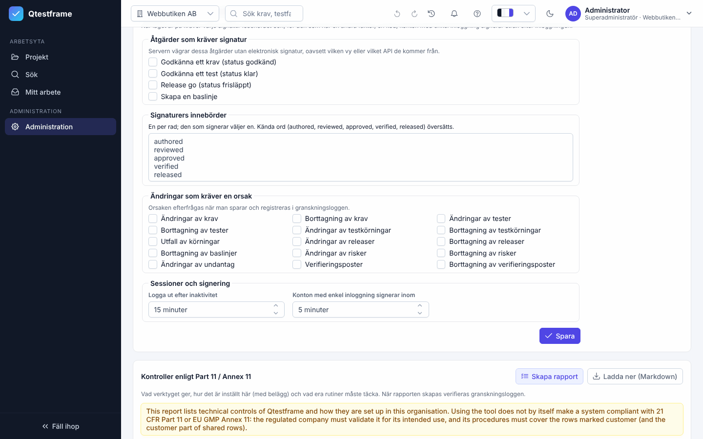

Administratören anger på samma sida vilka åtgärder som kräver signatur, innebörderna (en per rad), vilka ändringar som kräver en orsak, tiden för inaktivitet och hur snart efter inloggningen konton med enkel inloggning får signera. **Skapa rapport** visar **Kontroller enligt Part 11 / Annex 11**: för varje krav i regelverken vad Qtestframe gör, vad organisationens rutiner måste täcka och belägg från den här installationen; **Ladda ner (Markdown)** sparar den. Qtestframe ger tekniska kontroller – validering, utbildning, skriftliga policyer och kontroll av identiteten innan någon får ett konto är fortfarande organisationens ansvar, och rapporten säger det.

## Organisationer

*(Superadministratör)* **Administration → Organisationer** listar alla organisationer.

- **Ny organisation**: ett **Kortnamn** (används vid inloggning, till exempel `acme`) och ett **Namn**.
- **Byt namn på organisation** (får även göras av organisationens administratörer).
- **Byt** till en organisation för att arbeta i den.
- **Ta bort** tar bort organisationen med **alla** dess projekt och data. Det går inte att ångra.

## Användare

*(Superadministratör)* **Administration → Användare** listar alla konton i installationen med inloggningsleverantör och flaggor.

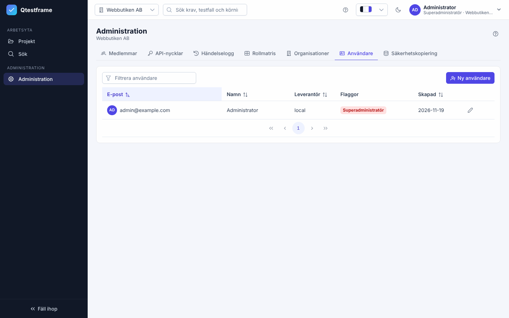

- **Ny användare**: e-post, visningsnamn, lösenord och eventuellt **Superadministratör**.
- **Redigera användare**: ändra visningsnamnet, ange ett nytt lösenord (**Återställ lösenord (valfritt)**), gör användaren till superadministratör eller markera kontot som **Inaktiverad**. Att inaktivera ett konto eller ange ett lösenord loggar ut användaren överallt. **Måste byta lösenord** tvingar fram ett nytt lösenord vid nästa inloggning.
- Du kan inte ta bort din egen superadministratörsflagga eller inaktivera dig själv.

Användare som loggar in med enkel inloggning via OIDC eller SAML kan skapas automatiskt vid första inloggningen, med en roll som hämtas från grupperna hos identitetsleverantören; det konfigureras på servern (se [administratörshandboken](https://github.com/rom/Qtestframe/blob/rom/docs/admin-guide/sv/authentication.md#provisionering-av-anv%C3%A4ndare-med-single-sign-on)).

## Säkerhetskopiering och återställning

*(Superadministratör)* **Administration → Säkerhetskopiering** sparar och återställer hela installationen.

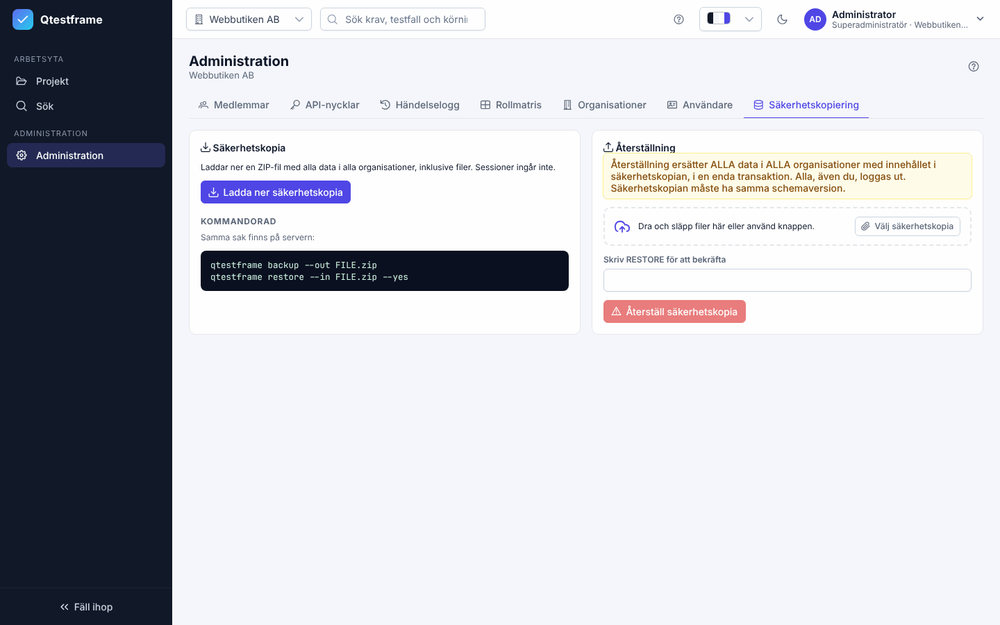

- **Ladda ner säkerhetskopia** skapar en ZIP-fil med alla organisationer, projekt, objekt, versionshistorik, kommentarer och filer (sessioner ingår inte). Förvara den säkert; den innehåller alla data, även lösenordshashar.
- **Återställning**: välj filen med säkerhetskopian, skriv `RESTORE` för att bekräfta och välj **Återställ säkerhetskopia**. Det **ersätter alla data** i installationen med filens innehåll, i ett enda steg. Säkerhetskopian måste komma från samma version av databasschemat. Alla, även du, loggas ut efteråt.

Återställningen är avsedd för katastrofåterställning och flytt till en ny server. För att få tillbaka ett enskilt objekt använder du i stället dess [versionshistorik](#versionshistorik-och-återställning). En säkerhetskopia innehåller även systeminställningarna (nedan), med de hemligheter som sparats där; de gäller så snart återställningen är klar.

Hemligheter i en säkerhetskopia (hemligheter för autentiseringsappar, webhook-hemligheter, ärendesystemets token, hemliga testvariabler, e-postlösenordet och klienthemligheter) förblir **krypterade** i filen. En säkerhetskopia kan bara återställas på en server som har samma nyckel som servern den kommer från (se [Kryptering av lagrade hemligheter](#kryptering-av-lagrade-hemligheter)); annars nekas återställningen och ingenting ändras. Serveradministratören förvarar nyckeln säkert, skild från säkerhetskopiorna.

## Systeminställningar

*(Superadministratör)* **Administration → Systeminställningar** ändrar serverns konfiguration medan den kör: enkel inloggning, loggning och syslog, e-postservern, inloggningssäkerhet och testkörningen. Organisationsadministratörer ser inte sidan: varje inställning gäller hela installationen.

Välj en del i listan till vänster (på en telefon: överst). Varje del har en egen **Spara**-knapp; bara de värden du ändrat skickas. **Exportera konfiguration** laddar ner den gällande konfigurationen som en YAML-fil där alla hemligheter är utbytta mot `REDACTED`, till exempel för att föra in den i serverns konfigurationsfil.

### Var ett värde kommer ifrån

Varje inställning har en etikett som visar var det nuvarande värdet kommer ifrån:

- **Standard** – det inbyggda värdet.
- **Konfigurationsfil** – satt i serverns konfigurationsfil.
- **Miljövariabel** – satt med en `QTF_…`-miljövariabel på servern.
- **Ändrad här** – ändrad på den här sidan (sparad i databasen).

Ett värde som ändrats här går före konfigurationsfilen och standardvärdet. **Återställ till filens värde** tar bort din ändring, så att värdet i konfigurationsfilen (eller standardvärdet) gäller igen.

Vissa inställningar kan inte ändras här. De har ett lås och en förklaring:

- **Satt med miljövariabel** – en miljövariabel vinner alltid; be serveradministratören ändra den.
- **Låst av serveradministratören** – konfigurationsfilen listar inställningen under `system_settings.locked`.
- **Bara i konfigurationsfilen** – visas som information (till exempel lyssningsadressen eller databasen), eftersom de bara kan ändras med en omstart av servern.

De flesta inställningar gäller direkt. Inställningar med etiketten **Gäller efter omstart** (testkörningen) sparas nu och börjar gälla nästa gång servern startar; till dess visar sidan värdet som används. Om de sparade inställningarna någon gång blir ogiltiga (till exempel efter en ändring i konfigurationsfilen) bortser servern från dem vid start och sidan visar en varning.

Varje ändring registreras i [händelseloggen](#händelselogg) med gammalt och nytt värde; lösenord och klienthemligheter skrivs aldrig dit, bara att de satts eller ändrats.

### Enkel inloggning (OIDC)

Delen **Enkel inloggning (OIDC)** listar de OpenID Connect-leverantörer som visas som knappar på inloggningssidan.

- **Lägg till leverantör** frågar efter ett namn (gemener, siffror, `-` och `_`; det ingår i återanropsadressen), **Knapptext**, **Utfärdare** (issuer-URL), **Klient-id** och **Klienthemlighet**, **Scopes**, vilka claims som innehåller e-postadress, namn och grupper, och hur användare skapas: **Skapa användare vid första inloggningen**, **Standardroll** och organisation, och en koppling **Grupp → roll**.
- **Testa anslutningen** hämtar utfärdarens discovery-dokument (`/.well-known/openid-configuration`) från servern och berättar om det hittades och vilka adresser det anger. Om det misslyckas visas orsaken, till exempel att servern inte når adressen eller att utfärdaren i dokumentet inte stämmer.
- Registrera **Återanrops-URL** som visas för leverantören i din identitetsleverantör.
- Klienthemligheten kan bara skrivas: den visas aldrig igen. Lämna fältet tomt för att behålla den; **Ta bort den sparade hemligheten** raderar den.
- Reglaget i listan stänger av en leverantör utan att ta bort den. Ändringar gäller direkt; den som håller på att logga in hos en oförändrad leverantör avbryts inte.

När du ändrat leverantörerna här ersätter den här listan leverantörerna i konfigurationsfilen. Hemligheter för leverantörer från filen stannar i filen och kopieras inte. **Återställ till filens värde** tar tillbaka leverantörerna från konfigurationsfilen.

### Loggning och syslog

Välj **Loggnivå** och **Loggformat** för serverloggen, och om loggen (även händelseloggen) också ska skickas till en central **syslog**-server: nätverk (`udp`, `tcp`, `tls` eller en lokal socket), adress, meddelandeformat, facility och tagg. **Skicka testmeddelande** skickar ett meddelande med värdena i formuläret, innan du sparar dem; resultatet visas och läses upp vid knappen. Ändringar gäller direkt. Certifikat för syslog över TLS anges i konfigurationsfilen.

### E-postserver

SMTP-servern för aviseringar, inbjudningar och rapporter: värd, port, kryptering (`starttls`, `tls` eller `none`), användarnamn, lösenord, avsändaradress och avsändarnamn, tidsgräns och timmen för den dagliga sammanfattningen. Lösenordet kan bara skrivas. **Skicka testmejl** skickar ett meddelande till din egen adress med värdena i formuläret (och det sparade lösenordet, om du inte skrivit ett nytt). Stänger du av e-post skickas ingen e-post alls.

### Säkerhet

**Sessionens livslängd** (hur länge en inloggning varar; gäller nya inloggningar), **minsta lösenordslängd** för lokala konton, antalet **misslyckade inloggningar** efter vilka fler försök från samma adress för samma konto nekas, och hur länge. **Lokal inloggning** (e-post och lösenord) kan bara stängas av när minst en leverantör för enkel inloggning är aktiv.

### Kryptering av lagrade hemligheter

Delen **Säkerhet** visar också, skrivskyddat, hur de hemligheter som servern måste kunna läsa tillbaka skyddas: hemligheter för autentiseringsappar, webhookarnas signeringshemligheter, ärendesystemets token, hemliga testvariabler samt e-postlösenordet och klienthemligheterna som anges på den här sidan. De lagras **krypterade** (AES-256-GCM) i databasen. Tidigare versioner lagrade dem okrypterade; det gäller inte längre, och värden som sparats av en tidigare version krypteras när servern startar. Lösenord och åtkomstnycklar har aldrig lagrats som de är: bara deras hashvärden sparas.

Sidan visar:

- **Nyckelleverantör** – vad som skyddar nyckeln: en **lokal nyckel** (en nyckelfil på servern eller en miljövariabel), serverns **TPM 2.0**-krets eller en **hårdvarusäkerhetsmodul** (PKCS#11).
- Leverantörens uppgifter, till exempel nyckelfilen eller TPM-enheten, och **nyckelns fingeravtryck**, som identifierar nyckeln utan att avslöja den.
- Den **aktiva datanyckeln** och hur många **lagrade hemligheter** som är krypterade. Om några inte är krypterade ännu visas ett meddelande; de krypteras nästa gång servern startar.

Nyckelleverantören väljs i serverns konfigurationsfil (avsnittet `secrets`) och kan inte ändras här. Utan dess nyckel går de lagrade hemligheterna – och säkerhetskopiorna – inte att läsa; be serveradministratören att förvara den säkert. Serveradministratören hanterar nycklarna på kommandoraden, till exempel `qtestframe secrets status` och `qtestframe secrets rotate`; se [administratörshandboken](https://github.com/rom/Qtestframe/blob/rom/docs/admin-guide/sv/security.md#kryptering-av-lagrade-hemligheter).

### Testkörning

Om automatiserade skript och webbtester får köras på servern, deras tidsgränser och begränsningar, och vad webbtester sparar som bevis. Inställningarna **gäller efter omstart** av servern, eftersom körningen och dess sandlåda förbereds när servern startar. Slår du på körningen kan medlemmar med rätt behörighet köra kod på servern; läs [säkerhetsavsnitten i administratörshandboken](https://github.com/rom/Qtestframe/blob/rom/docs/admin-guide/sv/security.md#sandl%C3%A5dan-f%C3%B6r-skript-och-webbtester) först.

Gallring: borttagna objekt ligger i [papperskorgen](#versionshistorik-och-återställning) i 30 dagar; det går inte att ändra. Om säkerhetskopior, se [Säkerhetskopiering och återställning](#säkerhetskopiering-och-återställning). Flerfaktorsautentisering har en egen sida som länkas från systeminställningarna.

Serveradministratören kan göra samma sak på kommandoraden:

```bash
qtestframe backup --out qtestframe-backup.zip
qtestframe restore --in qtestframe-backup.zip --yes
```

## Kommandoraden

Serveradministratörer kan också hantera organisationer, användare och medlemmar med kommandot `qtestframe`, till exempel för att skapa den första organisationen:

```bash
qtestframe tenant create --slug acme --name "Acme AB"
echo 'Initial-pass-123' | qtestframe user create --email alice@example.com --name Alice --password-stdin
qtestframe member add --tenant acme --email alice@example.com --role manager
```

# Tillgänglighet och språk

Qtestframe är utformat för att uppfylla **WCAG 2.1 nivå AA**. Det fungerar med enbart tangentbord, med skärmläsare, med webbläsarens zoom, på mobiler och surfplattor, på engelska och svenska och i tjugotvå färgteman.

## Tangentbord

Allt kan göras utan mus.

| Tangent | Effekt |
|---|---|
| <kbd>Tabb</kbd> / <kbd>Skift</kbd>+<kbd>Tabb</kbd> | Gå till nästa / föregående kontroll. Kontrollen med fokus har en tydlig ram. |
| <kbd>Enter</kbd> / <kbd>Blanksteg</kbd> | Aktivera en knapp eller länk, kryssa i en kryssruta, växla en cell i spårbarhetsmatrisen. |
| <kbd>Esc</kbd> | Stäng en dialog, meny, utfällbar panel eller introduktionsturen. Fokus återgår dit du var. |
| Piltangenter | Flytta inom menyer, listor, flikar, mappträdet och valknappar. |
| <kbd>Ctrl</kbd>+<kbd>Enter</kbd> | Skicka en kommentar. |
| <kbd>Enter</kbd> i ett filterfält | Tillämpa frågan. |
| <kbd>?</kbd> | Öppna handbokens sida för den aktuella vyn (utanför textfält). |
| <kbd>Ctrl</kbd>+<kbd>Z</kbd> / <kbd>Ctrl</kbd>+<kbd>Skift</kbd>+<kbd>Z</kbd> eller <kbd>Ctrl</kbd>+<kbd>Y</kbd> | [Ångra / gör om](#ångra-och-gör-om) den senaste ändringen (utanför textfält; på Mac <kbd>⌘</kbd>). |

### Hopplänk

Första <kbd>Tabb</kbd> på varje sida visar **Hoppa till huvudinnehållet**. Tryck <kbd>Enter</kbd> för att hoppa förbi sidopanelen och övre fältet direkt till sidans innehåll.

### Byta sida

När du öppnar en annan sida flyttas fokus till dess huvudrubrik och sidans titel läses upp, så att du vet var du är utan att leta.

### Mappträd och tabeller

- I mappträdet flyttar piltangenterna mellan mappar och öppnar eller stänger dem. Mappens åtgärdsknapp **⋮** erbjuder allt som annars görs genom att dra eller högerklicka: ny undermapp, byt namn, flytta, ta bort.
- Rader i krav- och testfallstabellerna öppnas med <kbd>Enter</kbd> på titeln. För att flytta rader utan att dra markerar du dem och använder **Flytta** i verktygsfältet för massändring.

### Exekveringsvyn

Exekveringsvyn har kortkommandon med en tangent (<kbd>P</kbd> godkänn, <kbd>F</kbd> underkänn, <kbd>B</kbd> blockerad, <kbd>S</kbd> hoppa över, <kbd>J</kbd>/<kbd>K</kbd> eller pilarna för nästa/föregående steg, <kbd>?</kbd> hjälp). De fungerar bara när fokus inte står i ett textfält, så att skriva ett faktiskt resultat aldrig utlöser dem. Se [Kortkommandon](#kortkommandon).

## Skärmläsare

Qtestframe är byggt för att användas med skärmläsare som NVDA, JAWS, VoiceOver och TalkBack.

- Sidorna har **landmärken** (navigering, sökning, huvudinnehåll) och en logisk **rubrikstruktur**, så att du kan hoppa med skärmläsarens kommandon för rubriker och landmärken.
- Alla knappar som bara visar en ikon har en textetikett, till exempel *Ta bort SHOP-REQ-4* i stället för bara *papperskorg*.
- **Statusmeddelanden** (sparat, borttaget, misslyckat) läses upp artigt; fel läses upp direkt.
- Formulärfält har etiketter; obligatoriska fält och fel läses upp.
- I språkanalysen läses anmärkningarna upp med sin allvarlighetsgrad (fel, varning).
- På mobiler visas tabeller som staplade kort; varje värde läses upp tillsammans med sitt kolumnnamn.
- Skärmbilderna i handboken har textalternativ som beskriver vad de visar.
- **Introduktionsturen** är en modal dialog: texten läses upp vid varje steg, fokus stannar i dialogen och <kbd>Esc</kbd> avslutar den.

## Teman

Välj tema med **Färgtema** i övre fältet eller under **Profil → Inställningar → Tema**. Valet sparas med ditt konto och följer med till alla enheter. Knappen **Ljust läge / Mörkt läge** bredvid växlar snabbt mellan de ljusa och mörka grundtemana.

| Tema | Karaktär |
|---|---|
| **Ljust** | standard: ljust och neutralt |
| **Mörkt** | mörka ytor, skonsamt för ögonen i svagt ljus |
| **Följ operativsystemet** | ljust eller mörkt, enligt inställningen i din dator eller mobil |
| **Vår**, **Höst**, **Öken** | ljusa teman med årstidsfärger |
| **Hav**, **Solnedgång**, **Nordisk**, **Lavendel**, **Ros** | ljusa teman: havsblått, varma kvällsfärger, lugnt gråblått, mjukt violett, mjukt rosa |
| **Kamouflage**, **Stadskamouflage** | mörka teman med kamouflagemönster i sidopanelen och övre fältet |
| **Arktiskt kamouflage** | ett ljust tema med vinterkamouflage i vitt, ljusgrått och blågrått |
| **Marinblått**, **Midnatt**, **Skog** | mörka teman: marinblått med guld, djupt blåviolett, mörkgrönt |
| **Grön terminal**, **Bärnstensterminal** | mörka teman med jämnbreda tecken, som en gammal datorskärm |
| **Hög kontrast mörkt**, **Hög kontrast ljust** | vitt på svart (med gult) eller svart på vitt (med blått), med tydliga ramar och understrukna länkar, för nedsatt syn; texten uppfyller den strängare AAA-kontrasten 7:1 |
| **Galet** | ett lekfullt, färgstarkt tema |

Alla teman uppfyller AA-kraven på kontrast för text och kontroller. Qtestframe respekterar också systemets inställning för **minskad rörelse**.


## Språk

Användargränssnittet finns på **engelska** (*English*) och **svenska**.

- Byt språk med **Användarmeny → Språk** eller under **Profil → Inställningar → Språk**. Ändringen gäller direkt och sparas med ditt konto.
- **Webbläsarens språk** följer språket i din webbläsare; om det varken är engelska eller svenska används engelska.
- På inloggningssidan gäller språkknapparna innan du loggar in; efter inloggningen gäller din inställning.
- Datum och tal följer det valda språket om du inte anger ett annat **Datumformat** i dina inställningar.
- Den här handboken finns på båda språken. Om en sida ännu inte är översatt visas den engelska sidan med ett meddelande.
- [Rapporter](#standardrapporter) tas fram på det språk du använder när du skapar dem; schemalagda rapporter på språket hos den som schemalade dem.
- Dina data översätts inte: krav, testfall och kommentarer står kvar på det språk de skrevs på. Kravnivåerna enligt RFC 2119 (MUST, SHOULD …) visas alltid på engelska, även i det svenska gränssnittet, där de förklaras på svenska (till exempel *MUST (SKA)*). [Språkanalysen](#språkanalysen) granskar kravtexter skrivna på engelska eller svenska, med svenska kravord som *SKA* och *BÖR*. Fältnamn och värden i frågespråket är också engelska.

## Mobiler och surfplattor

Qtestframe anpassar sig efter skärmstorleken; inget behöver installeras.

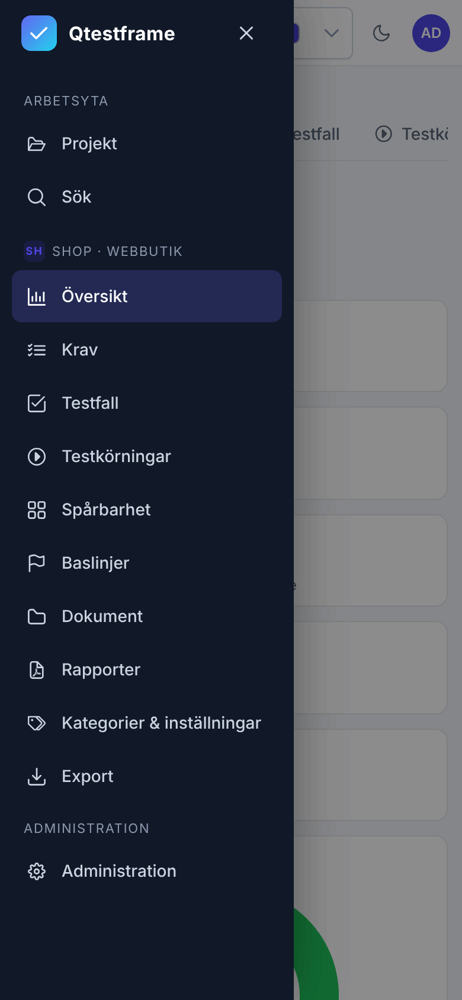

- **Under 1024 bildpunkter** (surfplattor, små fönster) blir sidopanelen en utfällbar panel. Öppna den med menyknappen (☰) uppe till vänster; den stängs när du väljer en sida, trycker utanför den eller trycker <kbd>Esc</kbd>.
- **Under 768 bildpunkter** blir sökfältet en förstoringsglasknapp som öppnar en sökdialog.
- **Under 640 bildpunkter** (mobiler) visas tabeller som staplade kort, formulär har en kolumn och redigerare öppnas i helskärm.
- Mappträdet på krav- och testfallssidorna öppnas med knappen **Mappar** på smala skärmar.
- Exekveringsvyn fungerar bra på en surfplatta bredvid systemet som testas.
- Stora tabeller som spårbarhetsmatrisen rullar i sidled inom sin ram; matrisens vy **Lista** är enklare att använda på en mobil.


## Zoom och textstorlek

När du zoomar i webbläsaren anpassas layouten i stället för att rulla i sidled; vid kraftig förstoring får du layouten för surfplattor eller mobiler som beskrivs ovan. Inställningar för textstorlek i webbläsaren eller operativsystemet respekteras. **Kompakta tabeller** i dina inställningar visar fler rader om du föredrar täthet framför storlek.

# Så fungerar Qtestframe

Den här sidan förklarar hur Qtestframe är uppbyggt och hur delarna fungerar tillsammans, utan att gå in i källkoden. Läs den när du vill förstå varför verktyget beter sig som det gör, eller när du ska förklara det för kollegor. Begreppen i fetstil förklaras i [Ordlistan](#ordlista); administratörer hittar detaljerna i [administratörshandboken](https://github.com/rom/Qtestframe/blob/rom/docs/admin-guide/sv/index.md).

## Ett program i webbläsaren

Qtestframe är **ett enda program** på en server. Samma program innehåller webbapplikationen som du använder i webbläsaren, REST-API:et som webbapplikationen, CI-pipelines och andra verktyg anropar, och administratörens kommandoradsverktyg. Du behöver inte installera något på din dator: en aktuell webbläsare räcker, på dator, surfplatta eller mobil.

- Webbapplikationen är en så kallad single-page application: efter första inläsningen utbyter den bara data med servern, så sidbyten går snabbt och det du har skrivit men inte sparat ligger kvar medan du rör dig i appen.
- Allt du kan göra i webbläsaren kan också göras via API:et, som beskrivs med **[OpenAPI](#openapi)** på `/api/v1/openapi.json`. Det är så [`qtestframe report`](runs.md#kommandot-qtestframe-report), JUnit-uppladdningen, Playwright-rapportören och andra verktyg fungerar.
- Användargränssnittet och handboken finns på svenska och engelska; [språkanalysen](#språkanalysen) förstår kravtexter på båda språken.

## Var dina data finns

Allt sparas i **en databas**: organisationer, användare, projekt, krav, testfall, körningar och deras utfall, versionshistorik, kommentarer, händelseloggen och även uppladdade filer (bilagor, dokument, framtagna rapporter). Det finns ingen separat filserver.

- Databasen är **SQLite** (en enda fil på servern, ingen databasserver behövs) eller **PostgreSQL** (för större installationer eller flera servrar bakom en lastbalanserare). Du märker ingen skillnad; administratören väljer.
- Hemligheter som servern måste kunna läsa, till exempel token för ärendesystem eller webhookhemligheter, krypteras med en nyckel som förvaras utanför databasen (se [Säkerhet](#säkerhet-2)).
- Borttagna objekt hamnar i papperskorgen i 30 dagar innan de tas bort för gott.

## Organisationer, projekt och roller

En installation kan rymma flera **organisationer** som aldrig ser varandras data. Du kan vara medlem i flera och byta mellan dem i det övre fältet.

| Nivå | Vad som hör dit | Vem som hanterar det |
|---|---|---|
| Installation | användare, organisationer, systeminställningar, säkerhetskopior | superadministratörer |
| Organisation | medlemmar och deras roller, projekt, API-nycklar, testkonfigurationer, inställningar för testexekvering, händelseloggen | organisationens administratörer |
| Projekt | krav, testfall, körningar, testcykler, utforskande sessioner, defekter, risker, releaser, undantag, baslinjer, dokument, projektinställningar | ansvariga (och projektroller) |

Vad du får göra avgörs av din **roll** i organisationen: *Läsare*, *Granskare*, *Testare*, *Testledare*, *Ansvarig* eller *Administratör*, eller en roll som organisationen har skapat. En roll är en uppsättning behörigheter som `requirement.write` eller `run.execute`. Ett projekt kan begränsas till vissa medlemmar och ge någon en annan roll just i det projektet. Servern kontrollerar varje begäran mot behörigheterna; knappar som du inte får använda döljs eller är avstängda, och orsaken visas. Se [Roller och behörigheter](#roller-och-behörigheter).

## Objekten och hur de hänger ihop


Varje objekt har en **nyckel** som består av projektnyckeln och ett nummer, till exempel `SHOP-REQ-12` eller `SHOP-TC-7`, en status, en ägare och en **versionshistorik**. De viktigaste sambanden:

| Objekt | Vad det är | Hänger ihop med |
|---|---|---|
| [Krav](#krav) | vad produkten ska, bör eller får göra | sina **utvärderingskriterier**; andra krav (*förfinar*, *härlett från*, *beror på* …); de **risker** det hanterar; de testfall som verifierar det |
| [Testfall](#testfall) | ett manuellt testfall med steg eller ett automatiserat med ett skript | de krav (och kriterier) det **verifierar** via spårlänkar; testfall som det anropar som delade steg eller beror på |
| [Körning](#testkörningar-och-exekvering) | en testomgång i en miljö och ett bygge | sina **exekveringar**: en per testfall (och konfiguration), var och en med utfall, utfall per steg, bevis och defekter |
| [Testcykel](#testcykler) | planen för en testperiod | de testfall, testare och uppskattningar den planerar; körningen den skapar |
| [Utforskande session](#utforskande-test) | tidsbegränsad utforskande testning med ett uppdrag | kraven i dess omfattning; defekterna som skapats från dess anteckningar |
| [Defekt](#defekter-1) | ett funnet problem | de exekveringar, testfall och krav den är kopplad till; ett ärende i Jira, GitHub eller GitLab |
| [Risk](#riskregistret) | något som kan gå fel, efter sannolikhet och konsekvens | de krav som hanterar den; MITRE-tekniker |
| [Release](#releaser-och-risker) | en version som ska levereras | dess **omfattning** (krav), dess körningar, dess **utgångskriterier**, undantag |
| [Undantag](#undantag-restrisk-och-uttalande-om-tillämplighet) | ett signerat godkännande av krav som inte är uppfyllda | kraven och releasen det gäller, en risk |
| [Baslinje](#baslinjer) | en fryst mängd versioner | versionen av varje krav och testfall vid ett visst tillfälle |
| [Dokument](#dokument-1) | en fil i projektets arkiv | objekten det är länkat till |

Täckning, verifiering, inaktualitet och om en release är redo **sparas aldrig**: de räknas fram ur objekten varje gång du tittar, så de är alltid aktuella.

## Från krav till release

Ett typiskt flöde genom ett projekt, och vad Qtestframe gör i varje steg:

1. **Skriv kraven.** Språkanalysen granskar texten medan du skriver och känner igen [kravnivån](#kravnivåer) från SKA, BÖR, FÅR (eller MUST, SHOULD, MAY). Lägg till [utvärderingskriterier](#utvärderingskriterier) som säger hur uppfyllandet bedöms. En [granskning](#begär-granskning) godkänner dem.
2. **Ta fram testfall** och länka dem till kraven. Ett nytt krav kan få ett länkat testfall automatiskt. [Spårbarhetsmatrisen](#spårbarhetsmatrisen) och [spårbarhetsreglerna](#spårbarhetsregler) visar vad som saknas.
3. **Planera och kör.** En [testcykel](#testcykler) eller en [körning](#testkörningar-och-exekvering) väljer ut testfallen; innan ett testfall exekveras kontrollerar [exekveringsreglerna](#när-kan-ett-testfall-exekveras) att det är klart. Testarna registrerar utfallen i exekveringsvyn; CI laddar upp de automatiserade utfallen.
4. **Följ upp.** Fel blir [defekter](#defekter-1); [täckning](#så-beräknas-täckningen) och [verifiering](#verifiering) härleds från de senaste utfallen; [översikten](#översikten) visar läget.
5. **Ändra.** När ett krav eller testfall ändras i sak blir dess länkar **misstänkta**, dess utfall **inaktuella**, och [ändringspåverkan](#ändringspåverkan) sprids vidare till relaterade objekt, dokument och ärenden.
6. **Släpp.** En [release](#releaser-och-risker) kontrollerar sina utgångskriterier och visar go eller no-go; [undantag](#undantag-restrisk-och-uttalande-om-tillämplighet) godtar det som medvetet inte är uppfyllt; en [baslinje](#baslinjer) fryser resultatet, och [rapporter](#rapporter-och-export) dokumenterar det.

## Versioner, historik och baslinjer

Varje ändring av ett krav, ett testfall och de flesta andra objekt skapar en ny **version**: fliken **Versionshistorik** visar vem som ändrade vad och när, jämför versioner och återställer en gammal. **Ångra** i det övre fältet tar tillbaka dina senaste åtgärder. Två personer som redigerar samma objekt skriver inte över varandra: den andra sparningen avvisas tillsammans med den version den bygger på (en [ETag](#etag-och-if-match)), och du väljer hur ändringarna ska slås ihop (se [När någon annan har sparat först](#när-någon-annan-har-sparat-först)).

En **baslinje** registrerar versionen av varje objekt vid ett visst tillfälle, inför en release eller en revision. **Händelseloggen** registrerar åtgärder i hela organisationen: inloggningar, granskningsbeslut, signaturer, importer, exporter och inställningar.

## Frågespråket

Alla listor, spårbarhetsmatrisen, releasers omfattning, urvalet av testfall till körningar, rapporter, spårbarhetsregler och API:et använder samma [frågespråk](#sökning-och-filter): `status:approved priority=high`, `-has:tests`, `linked:SHOP-TC-7`, `updated_at>=2026-01-01`, `title~/login/i`. Det du lär dig i en lista fungerar överallt. Den globala sökningen omfattar alla projekt i den aktuella organisationen som du kan läsa.

## Arbete i bakgrunden

En del arbete sker på servern utan att du behöver vänta på det:

- **Automatiserade testfall** som du startar med **Kör automatiserade tester** körs som jobb, några i taget; utfallen dyker upp i körningen allteftersom de blir klara.
- **Notiser** och **webhooks** skickas när ändringen som orsakade dem har sparats.
- **Sammanfattningar med e-post** och **schemalagda rapporter** skickas vid de tider du har valt.
- En daglig **ögonblicksbild** av varje projekts mått ger trenderna i översikten.
- Utgångna sessioner och poster som legat mer än 30 dagar i papperskorgen rensas varje timme.

## Notiser, webhooks och chatt

Du får veta det som berör dig: granskningsförfrågningar, omnämnanden, objekt som tilldelats dig, svar i dina diskussioner, statusändringar på dina defekter. [Notiserna](#notiser) visas i appen och, om du vill, med e-post direkt eller som en daglig sammanfattning. [Mitt arbete](#mitt-arbete) listar allt som väntar på dig i alla projekt.

Projekt kan också skicka sina händelser till andra system: **[webhooks](#webhooks)** levererar signerade JSON-begäranden till valfri mottagare, och **[chattkanaler](#chattaviseringar)** postar läsbara meddelanden i Slack, Microsoft Teams, Mattermost, Rocket.Chat, Google Chat, Matrix eller Discord, filtrerade på händelse, prioritet och release.

## Integrationer

| Med | Hur | Läs mer |
|---|---|---|
| Defekt- och ärendesystem (Jira, GitHub Issues, GitLab, Request Tracker) | skicka defekter och krav som ärenden, synkronisera status, importera ärenden | [Defekter](#anslut-jira-github-eller-gitlab) |
| Jira och Azure DevOps | importera krav och uppdatera dem senare | [Rapporter och export](#jira-och-azure-devops) |
| Kodvärdar (GitHub, GitLab) | webhooks länkar incheckningar och merge requests som nämner en objektnyckel; byggen registrerar vilka incheckningar som testades | [Varianter och kod](#kodlänkar) |
| CI-pipelines | `qtestframe report`, uppladdning av JUnit XML, Playwright-rapportören, med en API-nyckel | [Importera utfall från CI](#importera-utfall-från-ci) |
| Krav- och ALM-verktyg (DOORS, DOORS Next, Polarion, Codebeamer, Jama, ProR) | ReqIF-filer åt båda hållen; levande OSLC-länkar, urval och skapande | [Samverkan](#samverkan-reqif-och-oslc) |
| Kontorsprogram | export till PDF, Word, Excel, CSV och Markdown; redigera i Excel och importera tillbaka | [Rapporter och export](#rapporter-och-export) |
| Identitetsleverantörer | enkel inloggning med OpenID Connect eller SAML 2.0, provisionering av användare med SCIM | [Administration](#provisionering-med-scim) |

Standarderna och formaten bakom integrationerna finns i [Ordlistan](#uppslagsord-efter-ämne) och på sidan [Referenser](#format-protokoll-och-ramverk).

## Säkerhet

### Sessioner och CSRF-skydd

När du loggar in skapar servern en **session**, och webbläsaren får en slumpmässig kaka som skript på sidan inte kan läsa. Sessionen upphör efter en högsta ålder (12 timmar som standard), när du loggar ut eller när en administratör återställer ditt lösenord eller stänger av ditt konto; **Profil → Aktiva sessioner** visar dina. Varje ändring du gör skickar en **CSRF-token** för sessionen och kontrolleras mot sitt ursprung, så att en annan webbplats inte kan agera i ditt namn. Skript och CI använder i stället **API-nycklar**, som visas en gång och bara sparas som hashvärde.

### Enkel inloggning och tvåstegsverifiering

Din organisation kan låta dig logga in med sin identitetsleverantör via **OpenID Connect** eller **SAML 2.0**; användare och grupper kan provisioneras automatiskt med **SCIM**. Lokala konton kan, eller måste, lägga till en andra faktor: en **TOTP**-kod från en autentiseringsapp, med engångskoder för återställning. Se [Tvåstegsverifiering](#tvåstegsverifiering).

### Hemligheter

Lösenord och nycklar som bara behöver kontrolleras sparas som hashvärden. Hemligheter som servern själv måste använda, till exempel hemligheter för autentiseringsappar, webhookhemligheter, token för ärendesystem och hemliga testvariabler, krypteras i databasen med en nyckel som förvaras utanför den (en nyckelfil, en miljövariabel, ett TPM eller en HSM). Hemligheter går **bara att skriva**: när de väl är sparade visar ingen sida eller något API dem igen, och projektarkiv innehåller dem aldrig.

### Sandlådan för skript

När administratören har aktiverat det körs skript i automatiserade testfall och webbtester i Playwright på servern. Varje skript körs i en egen, begränsad process: begränsad processortid, filstorlek och antal öppna filer, inga nya privilegier, filåtkomst begränsad till den egna jobbkatalogen med **Landlock**, farliga systemanrop spärrade med **seccomp** och om så önskas inget nätverk. Servern begränsar sig själv på samma sätt efter starten. Bara personer med behörigheten `script.execute` kan köra skript.

## Säkerhetskopior och projektarkiv

- En **säkerhetskopia** innehåller hela installationen: alla organisationer med deras data och filer. Superadministratörer tar den i webbklienten eller på servern; en återställning ersätter allt och loggar ut alla. Se [Säkerhetskopiering och återställning](#säkerhetskopiering-och-återställning).
- Ett **projektarkiv** innehåller ett projekt, med historik, utfall och bilagor men utan hemligheter, som en ZIP-fil. Läs in det som ett nytt projekt på samma eller en annan server. Se [Spara och läs in projekt](#spara-och-läs-in-projekt).
- **Exporter** (PDF, Word, Excel, CSV, Markdown, ReqIF) tar ut data till andra personer och verktyg.

## För administratörer

[Administratörshandboken](https://github.com/rom/Qtestframe/blob/rom/docs/admin-guide/sv/index.md) beskriver hur man driver Qtestframe:

- [översikt och arkitektur](https://github.com/rom/Qtestframe/blob/rom/docs/admin-guide/sv/overview.md): komponenter, datalager, portar, utgående anslutningar och bakgrundsuppgifter;
- [installation](https://github.com/rom/Qtestframe/blob/rom/docs/admin-guide/sv/installation.md) och [konfiguration](https://github.com/rom/Qtestframe/blob/rom/docs/admin-guide/sv/configuration.md), även valet mellan SQLite och PostgreSQL;
- [autentisering](https://github.com/rom/Qtestframe/blob/rom/docs/admin-guide/sv/authentication.md) (lösenord, policyer för tvåstegsverifiering, OIDC, SAML, SCIM, API-nycklar, sessioner) och [behörigheter](https://github.com/rom/Qtestframe/blob/rom/docs/admin-guide/sv/authorisation.md);
- [säkerhet](https://github.com/rom/Qtestframe/blob/rom/docs/admin-guide/sv/security.md): TLS, härdning med Landlock och seccomp, sandlådan för skript, kryptering av lagrade hemligheter och nyckelbyte;
- [integrationer](https://github.com/rom/Qtestframe/blob/rom/docs/admin-guide/sv/integrations.md), [att koppla ihop med andra verktyg](https://github.com/rom/Qtestframe/blob/rom/docs/admin-guide/sv/connecting-tools.md) via OSLC och ReqIF, [loggning och övervakning](https://github.com/rom/Qtestframe/blob/rom/docs/admin-guide/sv/logging-and-monitoring.md) med syslog;
- [säkerhetskopiering, återställning och migrering](https://github.com/rom/Qtestframe/blob/rom/docs/admin-guide/sv/backup-and-migration.md), [driftrutinerna](https://github.com/rom/Qtestframe/blob/rom/docs/admin-guide/sv/runbook.md) och [kommandoradsreferensen](https://github.com/rom/Qtestframe/blob/rom/docs/admin-guide/sv/cli-reference.md).

# Vanliga frågor

Svar på de frågor som användare oftast ställer: först om hur verktyget används, sedan, från [Testbegrepp](#testbegrepp) och framåt, om begreppen inom test och kravhantering, standarderna bakom Qtestframe och hur det fungerar. Använd sökfältet högst upp i handboken för att hitta ett ord på alla sidor; [Ordlistan](#ordlista) förklarar begreppen ett i taget.

## Åtkomst

### Jag har glömt mitt lösenord. Vad gör jag?

Det finns ingen självbetjäning för lösenord. Be en **administratör** i din organisation att [återställa ditt lösenord](#återställa-ett-lösenord). Du får ett tillfälligt lösenord som du måste byta vid nästa inloggning. Om du loggar in med enkel inloggning (en knapp under *eller fortsätt med*) hanteras lösenordet av företagets identitetsleverantör; återställ det där.

### Varför avslutades min session?

En session avslutas när:

- den når sin längsta livslängd (12 timmar som standard, inställt av administratören) och du måste logga in igen;
- du, eller någon med tillgång till ditt konto, valde **Logga ut** för den under **Profil → Aktiva sessioner**, eller **Logga ut alla andra sessioner** på en annan enhet;
- en administratör återställde ditt lösenord, angav ett nytt eller inaktiverade ditt konto;
- en superadministratör återställde en säkerhetskopia, vilket loggar ut alla;
- webbläsaren tog bort sina kakor.

Logga in igen. Om du inte väntade dig det, byt lösenord och kontrollera dina aktiva sessioner.

### Jag ser ”Du har ingen aktuell organisation”. Vad nu?

Du är inloggad men arbetar inte i någon organisation. Välj en i organisationsväljaren i övre fältet. Om listan är tom är du ännu inte medlem i någon organisation; be en administratör att lägga till dig.

### Hur byter jag till en annan organisation?

Använd organisationsväljaren till vänster i övre fältet (på mobiler byggnadsikonen). Qtestframe öppnar organisationens projektlista. För att alltid börja i en viss organisation anger du **Standardorganisation** i dina inställningar.

### En kollega ser inte ett projekt. Varför?

Projektet är troligen **begränsat** (det visas med ett lås 🔒): bara dess projektmedlemmar och organisationens administratörer ser det. Någon som får ändra projektet lägger till din kollega med **Dela** i projektets sidhuvud; se [Delning av projekt](#delning-av-projekt). Projektrollen kan också vara lägre än organisationsrollen, så en kollega kan se ett projekt men inte få ändra i det.

## Redigering

### Hur hänvisar jag till en kollega i ett krav eller en kommentar?

Skriv `@` följt av början på namnet och välj personen i listan, se [Nämn personer](#nämn-personer). Listan innehåller organisationens användare och namn som redan används som ägare eller tilldelad i projektet. `mention:` i ett filter hittar det som nämner någon.

### Var kommer de föreslagna taggarna ifrån?

Från objektets titel och beskrivning. Taggar som projektet redan använder kommer först när texten nämner dem, sedan förkortningar och vanliga ord i texten. Vardagliga ord och kravord föreslås aldrig. Välj ett förslag för att lägga till det; strunta i de andra.

### Varför kan jag inte redigera ett krav?

Att skriva krav kräver rollen **Ansvarig** i den aktuella organisationen. Med **Läsare** eller **Testare** öppnas redigeraren skrivskyddad, och knappar som **Nytt krav** och **Spara** döljs. Kontrollera din roll i användarmenyn och be en administratör om fler rättigheter om du behöver det. Testare kan ändå länka testfall till krav och kommentera dem.

### Varför ser jag inte knappen Kör skript?

Att köra skript på servern kräver rollen **Testledare** eller **Ansvarig** (behörigheten *script.execute*), och administratören måste ha aktiverat skriptexekveringen (`runner.enabled`). Utan rollen visar exekveringsvyn att behörigheten *script.execute* krävs. Om exekveraren är avstängd på servern använder du [CI-importen](#importera-utfall-från-ci) i stället.

### Hur ångrar jag en ändring?

Välj **Ångra** (↶) i övre fältet eller tryck <kbd>Ctrl</kbd>+<kbd>Z</kbd> utanför ett textfält; **Ångrahistorik** (🕘) listar dina senaste ändringar. Det fungerar för redigeringar, borttagningar, flyttar, massändringar, länkar med mera, se [Ångra och gör om](#ångra-och-gör-om). Ett borttaget krav eller testfall kommer tillbaka med sin nyckel, sina länkar, kommentarer och sin historik.

För äldre ändringar öppnar du objektet, går till fliken **Versionshistorik**, väljer den version du vill ha och väljer **Återställ den här versionen**. Det skapar en ny version med det gamla innehållet; inget går förlorat och du kan återställa igen.

### Kan Qtestframe skriva kod eller testfall med AI?

I ett **mjukvaruprojekt** bygger **AI-prompter** en prompt från dina krav eller testfall (implementera dem, granska dem, ta fram eller automatisera testfall, planera en testtyp) som du kopierar till den AI-assistent din organisation använder. Qtestframe anropar själv ingen AI-tjänst. Se [AI-prompter](#ai-prompter-mjukvaruprojekt).

### Varför kan jag inte godkänna ett krav eller markera ett testfall som klart?

Att godkänna eller avvisa ett krav kräver behörigheten *requirement.review*, att markera ett testfall som **Klart** kräver *test.review*. Som standard har rollerna **Granskare** och **Ansvarig** båda och **Testledare** har *test.review*; en **Testare** kan skriva testfall men inte markera dem som klara. Utan behörigheten är statusarna gråade i redigeraren. Se [Roller och behörigheter](#roller-och-behörigheter).

### Kan två personer redigera samma krav samtidigt?

Ja, men den som sparar sist vinner: varje sparning ersätter fälten med det personen ser. Båda versionerna finns i **Versionshistorik**, så inget går förlorat; jämför dem där och återställ vid behov. Använd **Kommentarer** för att samordna er.

### Varför uppdaterades inte kravnivån när jag ändrade texten?

Kravnivån identifieras automatiskt bara när kravet **skapas** med **Identifiera automatiskt från texten**. Efter det ändras den aldrig utan att du vet om det. Använd **Använd identifierad kravnivå** i analysrutan eller välj nivån själv.

### Vad händer när jag flyttar ett krav till ett annat projekt?

Det får en **ny nyckel** i målprojektet (till exempel blir `SHOP-REQ-7` `CORE-REQ-31`); kategorier matchas på dimension och namn och tas bort om målprojektet saknar värdet; **länkar till testfall tas bort**, eftersom länkar aldrig går mellan projekt; kriterier och historik följer med. Inom ett projekt ändrar en flytt bara mappen. Se [Flytta krav och mappar](#flytta-krav-och-mappar).

### Vem kan se mina kommentarer?

Alla som kan läsa objektet, det vill säga alla medlemmar i organisationen med åtkomst till projektet, oavsett roll. Kommentarer syns inte för andra organisationer. Du kan redigera och ta bort dina egna kommentarer; moderatorer (som får ändra projektets inställningar) kan ta bort alla kommentarer, som då visas som borttagna. Kommentarerna tas bort tillsammans med sitt objekt. Se [Diskussioner](#diskussioner).

### Vad betyder ”auto-generated” på ett testfall?

Testfallet skapades automatiskt tillsammans med ett krav (**Skapa även länkat testfall**). Det är ett vanligt testfall: förfina stegen, ändra status och ta bort taggen om du vill.

## Täckning och utfall

### Hur beräknas täckningen?

Utifrån det **senaste utfallet** för varje testfall som är länkat till kravet: inget länkat testfall → *Ingen täckning*; något länkat testfall underkänt eller blockerat → *Underkänd*; alla godkända → *Godkänd*; några godkända och resten ej körda, överhoppade eller pågående → *Delvis*; annars *Ej körd*. Bara körningar i samma projekt räknas. Detaljer och exempel finns under [Så beräknas täckningen](#så-beräknas-täckningen).

### Vad betyder ”Ej körd”?

För ett **testfall** eller en **exekvering**: det finns inget utfall än. För ett **kravs täckning**: testfall är länkade, men inget av dem har godkänts eller underkänts i någon körning i projektet än. Det skiljer sig från *Ingen täckning*, som betyder att inget testfall alls är länkat.

### Ett testfall godkändes igen; varför är mitt krav fortfarande ”Underkänd”?

Täckningen använder det senaste utfallet för **varje** länkat testfall. Om ett annat länkat testfall fortfarande är underkänt eller blockerat förblir kravet *Underkänd*. Öppna kravets **Länkade testfall** för att se varje testfalls senaste utfall. Kontrollera också att det nya utfallet sparades (**Spara** i exekveringsvyn).

### Varför säger översikten ”täckta” när testfallen inte har körts?

På översikten betyder *täckt* att minst ett testfall är länkat. Om testfallen har godkänts visas i **Kravtäckning** bredvid.

### Hur importerar jag utfall från CI?

Skapa en API-nyckel (**Administration → API-nycklar**, roll Testare eller högre), öppna körningen och välj **CI-import** för ett färdigt kommando, och skicka utfallen per testnyckel från din pipeline. Se [Importera utfall från CI](#importera-utfall-från-ci).

### En CI-import rapporterar ”unknown” testnycklar. Varför?

De nycklarna finns inte i körningens projekt. Kontrollera stavningen (versaler och gemener spelar ingen roll) och att testfallen inte har flyttats till ett annat projekt, vilket ger dem nya nycklar.

### Varför är Godkänd och Underkänd avstängda i exekveringsvyn?

Testfallet får inte exekveras än: det är inte **Klart**, ett krav det verifierar är inte godkänt, eller ett testfall det beror på har inte godkänts. Den röda rutan ovanför stegen listar varje orsak med vad du kan göra och vilken inställning som avgör: om **testfallet** inte är Klart (fortfarande Utkast eller under Granskning), om ett **krav** det verifierar inte har någon av de statusar som exekveringsinställningarna kräver (till exempel Godkänt när inställningarna kräver Implementerat), eller om ett **förutsättande test** inte har godkänts. Åtgärda dem (eller be en administratör eller testledare ändra [inställningarna för testexekvering](#inställningar-för-testexekvering)); under tiden kan du markera testfallet som **Blockerat** eller **Överhoppat**.

### Hur skapar jag en egen roll?

*(Administratör)* **Administration → Rollmatris → Ny roll**: ge den ett namn, välj vilken roll den ska börja med behörigheterna från, kryssa sedan i och ur behörigheter i matrisen och spara. Se [Ändra roller och skapa egna](#ändra-roller-och-skapa-egna).

### Kan jag ändra ett utfall efter att jag har sparat det?

Ja. Öppna exekveringen i exekveringsvyn, ändra stegens utfall eller det samlade utfallet och spara. Tidpunkten och personen uppdateras. Testfallets exekveringshistorik visar det senaste läget för varje exekvering.

## Baslinjer och versionshistorik

### Vad är skillnaden mellan en baslinje och en version?

En **version** är ett läge för ett enskilt objekt och skapas automatiskt vid varje ändring (fliken **Versionshistorik**). En **baslinje** är en namngiven ögonblicksbild av versionerna av alla (eller filtrerade) objekt i ett projekt vid ett visst tillfälle, som du skapar själv, till exempel inför en release. Se [Baslinje eller version?](#baslinje-eller-version).

### Tas kraven bort om jag tar bort en baslinje?

Nej. En baslinje registrerar bara versioner. Om du tar bort den förblir alla objekt oförändrade.

## Sökning och filter

### Varför är min fråga ogiltig?

Oftast ett fält som inte finns i listan (till exempel `coverage` för testfall), ett blanksteg efter operatorn (`status: approved`), ett citattecken, en parentes eller ett reguljärt uttryck som inte avslutas, eller en funktion i reguljära uttryck som RE2 inte stöder. Fältet markeras och meddelandet anger positionen. Öppna **Hjälp för frågespråket** (**?** bredvid filtret) för att se fälten. Kom ihåg att fält och värden skrivs på engelska. Se [Varför är min fråga ogiltig?](#varför-är-min-fråga-ogiltig).

### Hur hittar jag krav utan testfall?

Filtrera kraven med `coverage:none` eller `-linked:*`. Kombinera gärna, till exempel `coverage:none obligation=must`.

### Söker sökningen i alla projekt?

Sökningen i övre fältet omfattar alla projekt i den **aktuella organisationen** som du kan läsa. Filter i en lista gäller bara den listan. Andra organisationer genomsöks aldrig.

## Inställningar och enheter

### Vad betyder ett fält?

Peka på det lilla **i** bredvid fältet, eller flytta tangentbordsfokus dit: en kort förklaring visas, med en länk till det avsnitt i handboken som beskriver fältet. Tryck <kbd>?</kbd> för att öppna handbokens sida för den aktuella vyn. Standarderna bakom kravnivåer och test finns under [Referenser](#referenser).

### Hur byter jag språk eller tema?

Språk: **Användarmeny → Språk** (English eller Svenska). Tema: **Färgtema** i övre fältet, eller sol-/måneknappen för ljust och mörkt. Båda finns också under **Profil → Inställningar** och sparas med ditt konto, så de följer med till alla enheter.

### Kan jag använda Qtestframe på en mobil?

Ja. Gränssnittet anpassar sig efter mobiler och surfplattor: sidopanelen blir en utfällbar panel bakom menyknappen, tabeller blir kort och redigerare öppnas i helskärm. Att exekvera manuella testfall på en surfplatta fungerar bra. Se [Mobiler och surfplattor](#mobiler-och-surfplattor).

### Hur startar jag introduktionsturen igen?

Välj **Hjälp** (frågetecknet i övre fältet) → **Starta introduktionsturen igen**.

### Kan jag ändra nyckeln för ett projekt?

Nej. Nyckeln ingår i varje objekts id och kan inte ändras när projektet har skapats. Du kan ändra projektets namn, beskrivning och färg under **Kategorier & inställningar** (eller med ✎ i projektlistan). Om du verkligen behöver en annan nyckel, använd **Duplicera projekt** i projektlistan: kopian får den nya nyckeln och alla objektnycklar följer med (se [Spara och läs in projekt](#spara-och-läs-in-projekt)). Ta sedan bort originalet.

## Filer och data

### Var lagras filerna?

I Qtestframes databas, tillsammans med övriga data. Filerna ingår därför i säkerhetskopior, skyddas av projektets behörighetsregler och tas bort med projektet. Se [Dokument](#var-lagras-filerna).

### Hur stor får en uppladdad fil vara?

25 MB per fil som standard; administratören kan ändra gränsen. Profilbilder och projektikoner får vara högst 1 MB.

### Varför laddas en fil ned i stället för att öppnas?

Bara bilder (PNG, JPEG, GIF, WebP), PDF-filer och vanlig text visas i webbläsaren. Alla andra typer laddas ned, så att ingen fil kan köra kod i din webbläsare.

### Hur återställer jag en säkerhetskopia?

En **superadministratör** öppnar **Administration → Säkerhetskopiering**, väljer filen med säkerhetskopian under **Återställning**, skriver `RESTORE` och väljer **Återställ säkerhetskopia**. Alla aktuella data ersätts och alla loggas ut. Säkerhetskopian måste komma från samma schemaversion. Serveradministratörer kan använda `qtestframe restore --in FIL.zip --yes`. För att få tillbaka ett enskilt objekt använder du i stället dess versionshistorik.

### Hur flyttar jag ett projekt till en annan server?

Välj **Spara projekt** (nedladdningsknappen i projektlistan) och, på den andra servern, **Läs in projekt** med filen. Kopian har allt i projektet utom hemligheter som webhook-hemligheter och felhanteringssystemets token; se [Spara och läs in projekt](#spara-och-läs-in-projekt). För att flytta alla organisationer på en gång använder en superadministratör i stället en säkerhetskopia.

### Kan jag få ut mina data ur Qtestframe?

Ja: **Export** laddar ned krav, kriterier, testfall, spårbarhet och körningar som XLSX, CSV, PDF eller DOCX, och alla funktioner finns också i REST-API:et med en API-nyckel.

## Testbegrepp

### Vad är skillnaden mellan ett testfall, en testkörning och en exekvering?

Ett **testfall** beskriver hur något ska kontrolleras: förutsättningar, steg och förväntade resultat, eller ett skript. En **testkörning** är en testomgång, till exempel *Regressionstest sprint 12*, i en viss miljö och ett visst bygge. En **exekvering** är ett testfall i en körning, med sitt utfall: samma testfall får en ny exekvering i varje körning det ingår i, och dess historik visar alla. Ett **teststeg** är en åtgärd i ett manuellt testfall med sitt förväntade resultat. Se [Testfall](#testfall-2), [Testkörning](#testkörning-1) och [Exekvering](#exekvering).

### Vad är skillnaden mellan en testcykel, en testplan och en testsvit?

En **testplan** är dokumentet som anger vad som ska testas, hur, av vem och med vilka ingångs- och utgångskriterier; Qtestframe kan [ta fram en](#skapa-en-kravspecifikation-eller-en-testplan) ur projektet. En **testcykel** är den operativa planen för en testperiod: vilka testfall, vilka testare, vilka uppskattningar; när den startar skapar den sin körning. En **testsvit** är en grupp testfall för ett visst syfte; Qtestframe har inget separat svitobjekt, så gruppera testfallen med mappar, kategorier eller taggar och skapa körningar från en fråga. Se [Testcykel](#testcykel), [Testplan](#testplan) och [Testsvit](#testsvit).

### Vilka testnivåer och testtyper stöder Qtestframe?

Alla: Qtestframe föreskriver inga nivåer (enhets-, integrations-, system-, acceptans- och end-to-end-test) eller typer (funktionell testning, prestanda, säkerhet, användbarhet, tillgänglighet, regression …). Ange dem där du behöver dem: som en kategoridimension som *Nivå / System* eller *Typ / Säkerhet*, som taggar, som mappar eller som separata körningar och cykler. Utfall från enhets- och integrationstest kommer oftast från CI, utfall från system- och acceptanstest från manuella körningar. Se [Testnivå](#testnivå) och [Testtyp](#testtyp).

### Hur använder jag testdesigntekniker som gränsvärdesanalys i Qtestframe?

Ta fram fallen med tekniken och gör dem sedan till **testdata**: en rad per ekvivalensklass, gränsvärde, regel i beslutstabellen eller parvis kombination, med parametrarna som `{{namn}}` i stegen. Varje rad blir en iteration med eget utfall. Ange tekniken som en kategori om du vill rapportera på den. Se [Datadrivna testfall](#datadrivna-testfall) och [Testdesignteknik](#testdesignteknik).

### Vad är skillnaden mellan allvarlighetsgrad och prioritet?

**Allvarlighetsgraden** anger hur illa en defekts effekt är (från *Kritisk* till *Obetydlig*); **prioriteten** anger hur snart den ska åtgärdas (från *Kritisk* till *Låg*). Ett stavfel i företagsnamnet på startsidan är obetydligt men brådskande; en krasch i en sällan använd export kan vara kritisk men får vänta. Releasens utgångskriterier och reglerna för blockerande defekter använder allvarlighetsgraden. Se [Statusar och allvarlighetsgrader](#statusar-och-allvarlighetsgrader).

### Vad är skillnaden mellan verifiering och validering?

**Verifiering** kontrollerar att produkten uppfyller sina specificerade krav (”bygger vi produkten rätt?”); **validering** kontrollerar att den uppfyller sin avsedda användning (”bygger vi rätt produkt?”). I Qtestframe är ett krav *verifierat* när varje utvärderingskriterium har godkända bevis; validering visas oftast med acceptanstest, demonstrationer och utforskande sessioner med användare mot intressentkraven. Se [Verifiering](#verifiering-1) och [Validering](#validering).

### Vad är ett instabilt testfall, och hur hittar Qtestframe dem?

Ett testfall som växelvis godkänns och underkänns utan att något har ändrats. Qtestframe räknar växlingarna mellan godkänt och underkänt bland de tio senaste utfallen för varje testfall, manuella som automatiserade; två eller fler växlingar ger märket **Instabilt**. Hitta dem med `flaky:true`. Se [Instabila testfall](#instabila-testfall).

### Mäter Qtestframe kodtäckning?

Nej. Kodtäckning mäts av dina bygg- och testverktyg. Qtestframe mäter **kravtäckning**: vilka krav som har testfall och vilka deras senaste utfall är. Verktyget kopplar också incheckningar och byggen till krav och testfall, så att du ser vilka ändringar som har testats. Se [Kodtäckning](#kodtäckning) och [Så beräknas täckningen](#så-beräknas-täckningen).

### Vad är ingångs- och utgångskriterier i Qtestframe?

**Ingångskriterier** avgör när testningen får börja: per testfall kräver [exekveringsreglerna](#när-kan-ett-testfall-exekveras) att det är *Klart*, att dess krav är godkända och att dess förutsättningar är godkända. **Utgångskriterier** avgör när testningen är klar och en release får släppas: täckning, andel godkända, obligatoriska krav klarade, inga öppna defekter, risker hanterade med mera, på releasens flik [Utgångskriterier](#utgångskriterier).

### Kan jag göra utforskande testning i Qtestframe?

Ja, med **sessionsbaserad testledning**: planera en session med uppdrag och omfattning, testa med tidtagning och typade anteckningar, skapa defekter från anteckningarna och avsluta med en utvärdering. Utvärderade sessioner kan räknas som verifieringsbevis. Se [Utforskande test](#utforskande-test).

### Hur passar Qtestframe ihop med CI/CD, TDD eller BDD?

Din pipeline kör de automatiserade testerna och laddar upp utfallen med `qtestframe report`, som JUnit XML eller med Playwright-rapportören; de hamnar i en körning, räknas in i täckningen och releasekriterierna och registrerar bygget. Tester som skrivs enligt TDD eller BDD kopplas till testfall i Qtestframe via testnyckeln. Se [Importera utfall från CI](#importera-utfall-från-ci), [Testdriven utveckling](#testdriven-utveckling) och [Beteendedriven utveckling](#beteendedriven-utveckling).

## Kravbegrepp

### Vad är skillnaden mellan ett krav och en specifikation?

Ett **krav** är ett enskilt verifierbart påstående om vad som behövs. En **specifikation** är den ordnade helheten: inledning, omfattning, definitioner och kraven, ofta för ett system eller en leverans. I Qtestframe är projektet den levande specifikationen, och **Skapa dokument → Kravspecifikation** gör ett dokument av det. Se [Specifikation](#specifikation).

### Ska jag skriva SKA eller MÅSTE? Och hur förhåller de sig till MUST och SHALL?

På svenska skriver du **SKA** för krav, **BÖR** för rekommendationer och **FÅR** för det som är tillåtet, som i standarder från SIS; ett förbud skrivs **FÅR INTE**. Undvik *måste inte*, som betyder ”behöver inte” men ofta läses som ett förbud. Qtestframe förstår också **MÅSTE** och **SKALL** som absoluta krav. I engelska texter markerar både MUST och SHALL ett absolut krav enligt RFC 2119; välj ett och använd det konsekvent, med versaler, eftersom bara versalformerna har den normativa betydelsen (RFC 8174). Se [Kravnivåer](#kravnivåer) och [SKA, BÖR och FÅR](#ska-bör-och-får).

### Vad är skillnaden mellan funktionella och icke-funktionella krav?

Ett **funktionellt** krav säger vad systemet gör (”skickar en orderbekräftelse”); ett **icke-funktionellt** krav säger hur väl eller under vilka förhållanden (”inom 5 sekunder för 99 % av ordrarna”). Icke-funktionella krav behöver mätbara gränser; lägg dem i ett utvärderingskriterium. ISO/IEC 25010 är en bra checklista över kvalitetsegenskaper. Se [Icke-funktionellt krav](#icke-funktionellt-krav).

### Vad är skillnaden mellan acceptanskriterier och utvärderingskriterier?

Acceptanskriterier är villkoren för att godta ett krav eller en användarberättelse. Qtestframe kallar dem **utvärderingskriterier** och ger varje kriterium en metod (test, inspektion, analys, demonstration, granskning) och ett tröskelvärde, så att det är tydligt hur varje kriterium ska visas. Se [Utvärderingskriterier](#utvärderingskriterier).

### Vilken verifieringsmetod ska jag välja?

**Test** när beteendet kan exekveras med bestämda indata och förväntade resultat; **inspektion** för dokument, kod, märkning eller konfiguration; **analys** för beräkningar, simuleringar eller mätningar som utvärderas i efterhand; **demonstration** för att visa en funktion för en granskare utan detaljerade mätningar; **granskning** för en formell bedömning av kvalificerade personer. Andra metoder än test registreras som [verifieringsposter](#verifieringsposter). Se [Verifieringsmetod](#verifieringsmetod).

### Vad betyder dubbelriktad spårbarhet i Qtestframe?

Varje spårlänk kan följas åt båda hållen: från ett krav till dess testfall (framåt) och från ett testfall till dess krav (bakåt), i redigerarna och i spårbarhetsmatrisen. Relationer gör detsamma mellan krav (*förfinar* / *förfinas av*). Spårbarhetsregler kontrollerar båda riktningarna, till exempel ”varje godkänt krav har ett testfall” och ”varje testfall verifierar ett krav”. Se [Spårbarhet](#spårbarhet).

### Vad är en misstänkt länk, och hur blir jag av med den?

En länk blir **misstänkt** när kravet eller testfallet i ena änden ändras i sak efter att länken bekräftades, eftersom den andra änden kanske inte längre passar. Granska det andra objektet, uppdatera det vid behov och bekräfta sedan länken: med **Bekräfta misstänkta** i spårbarhetsmatrisen eller **Bekräfta** på kravets flik **Påverkan**. Se [Ändringspåverkan](#ändringspåverkan).

### Vad är skillnaden mellan förfinar och härlett från?

**Förfinar** är nedbrytning: barnkravet är en mer detaljerad del av sin förälder, och föräldern är verifierad först när barnen är det. **Härlett från** säger att ett krav följer av ett annat eller av ett designbeslut utan att vara en del av det, till exempel en tidsbudget för en komponent som härletts ur systemets svarstid. Båda gör det beroende kravet misstänkt när det andra ändras. Se [Relationer](#relationer).

### När behöver jag ett undantag och när en avvikelse?

Ett **undantag** godtar att ett krav inte är uppfyllt (underkänt, otestat eller ej genomfört) för en release eller en period; en **avvikelse** godtar att det uppfylls med en annan lösning än den specificerade. Båda kräver ett signerat godkännande och kan ha ett slutdatum. Se [Undantag och avvikelser](#undantag-och-avvikelser).

### Hur skriver jag bra krav?

Ett krav per påstående, med tydligt subjekt, ett kravord, mätbara begrepp och inga reservationer; säg vad, inte hur; ange motivering och källa. [Språkanalysen](#språkanalysen) kontrollerar många av reglerna medan du skriver, enligt INCOSE:s vägledning; ISO/IEC/IEEE 29148 räknar upp egenskaperna hos bra krav, och EARS ger meningsmönster. Se [Kravkvalitet](#kravkvalitet).

### Hur arbetar jag riskbaserat?

Registrera riskerna i riskregistret, koppla de krav som hanterar dem och låt risknivån styra vad du specificerar och testar först: bygg releasens omfattning med `risk:high` och lägg till utgångskriterierna *Risker hanterade* och *Restrisk*. Se [Riskbaserad testning](#riskbaserad-testning) och [Hur risker påverkar en release](#hur-risker-påverkar-en-release).

## Standarder och format

### Vilka standarder följer Qtestframe?

För kravformuleringar RFC 2119 och RFC 8174 (och SIS praxis på svenska); för dokument ISO/IEC/IEEE 29148 (kravspecifikation) och 29119-3 (testplan); för utbyte ReqIF och OSLC; för utfall JUnit XML; för inloggning OpenID Connect, OAuth 2.0 med PKCE, SAML 2.0, SCIM 2.0 och TOTP; för API:et HTTP-semantik med ETag/If-Match och OpenAPI; för loggar syslog; för webbklienten WCAG 2.1 AA. Sidan [Referenser](#referenser) listar dem med länkar; [Ordlistan](#uppslagsord-efter-ämne) förklarar var och en.

### ReqIF eller OSLC: vilket ska jag använda?

**ReqIF** flyttar hela specifikationer som filer mellan verktyg, för överlämningar, utbyte med leverantörer och fram och tillbaka. **OSLC** kopplar ihop verktygen direkt: ett annat verktyg länkar sina objekt till Qtestframes krav och testfall och kan skapa och ändra dem utan fil. Många team använder båda. Se [Vilket ska jag välja?](#vilket-ska-jag-välja-1)

### Vilka format för testutfall kan Qtestframe importera?

**JUnit XML**, som nästan alla testramverk skriver, via API:et eller `qtestframe report`, och utfallen från **Playwright-rapportören**. Manuella utfall registreras i exekveringsvyn eller många på en gång på körningens sida. Se [Importera utfall från CI](#importera-utfall-från-ci).

### Vilka standarder för enkel inloggning stöds?

**OpenID Connect** (ovanpå OAuth 2.0, med PKCE) och **SAML 2.0**, med provisionering av användare via **SCIM 2.0**. Administratören sätter upp dem; se [Enkel inloggning (OIDC)](#enkel-inloggning-oidc) och [Provisionering med SCIM](#provisionering-med-scim).

### Stöder Qtestframe passkeys eller säkerhetsnycklar?

Inte för inloggning i Qtestframe: där används lösenord eller enkel inloggning, med TOTP som andra faktor. Med enkel inloggning kan din identitetsleverantör kräva passkeys eller säkerhetsnycklar. Katalogen har krav och testfall som hänvisar till WebAuthn för dina egna produkter. Se [WebAuthn och FIDO2](#webauthn-och-fido2).

### Var kommer uppgifterna om MITRE ATT&CK ifrån?

Från MITRE:s publicerade data: katalogens listor för ATT&CK (Enterprise, ICS, Mobile), ATLAS och EMB3D genereras från deras **STIX 2.1**-paket, och D3FEND från dess publicerade data, utan återkallade eller utfasade poster. Namnen visas på engelska, som hos MITRE. Se [MITRE ATT&CK](#mitre-attck).

### Kan Qtestframe hjälpa till med ISO/IEC 27001, CRA eller AI-förordningen?

Ja. I katalogen väljer du de lagar och standarder som ett projekt ska uppfylla och lägger till de krav som hänvisar till dem, med testfall; efterlevnadsanalysen visar hur långt varje källa är verifierad, och sidan **SoA** täcker åtgärderna i ISO/IEC 27001 bilaga A. Qtestframe certifierar ingenting: det ordnar dina bevis. Se [Uppfyll lagar, standarder och bästa praxis](#uppfyll-lagar-standarder-och-bästa-praxis).

### Är Qtestframe självt tillgängligt?

Webbklienten siktar på WCAG 2.1 nivå AA: full användning med tangentbord, stöd för skärmläsare, högkontrast och andra färgteman, webbläsarzoom med en layout som anpassar sig, och mobillayouter, kontrollerat med automatiska tillgänglighetstester. Se [Tillgänglighet och språk](#tillgänglighet-och-språk).

## Så fungerar Qtestframe

### Var lagras mina data?

I en databas på organisationens server, SQLite eller PostgreSQL, även uppladdade filer. Hemligheter krypteras med en nyckel som förvaras utanför databasen. Se [Var dina data finns](#var-dina-data-finns).

### Vad händer i bakgrunden?

Automatiserade testfall körs som jobb, notiser, webhooks och chattmeddelanden levereras när en ändring har sparats, sammanfattningar med e-post och schemalagda rapporter skickas i tid, trenderna i översikten registreras dagligen, och gamla sessioner och papperskorgen rensas. Se [Arbete i bakgrunden](#arbete-i-bakgrunden).

### Hur skyddas mina data?

Organisationerna är isolerade från varandra, varje begäran kontrolleras mot din rolls behörigheter, sessionerna är skyddade mot förfalskade begäranden från andra webbplatser, tvåstegsverifiering och enkel inloggning finns, hemligheter är krypterade och går bara att skriva, och händelseloggen registrerar viktiga åtgärder. Se [Säkerhet](#säkerhet-2).

### Kan skript på servern skada den?

Bara personer med behörigheten `script.execute` kan köra skript, och bara när administratören har aktiverat skriptkörningen. Varje skript körs i en sandlåda med resursgränser, utan nya privilegier, med filåtkomst begränsad av Landlock och systemanrop begränsade av seccomp. Webbtester behöver en webbläsare och nätverket, så deras sandlåda är svagare; administratören bör begränsa serverns utgående anslutningar. Se [Sandlådan för skript](#sandlådan-för-skript).

### Vad är skillnaden mellan en säkerhetskopia, ett projektarkiv och en export?

En **säkerhetskopia** innehåller hela installationen och återställs av en superadministratör. Ett **projektarkiv** innehåller ett projekt, utan hemligheter, och läses in som ett nytt projekt. En **export** tar ut data i ett format för människor eller andra verktyg (PDF, Word, Excel, CSV, Markdown, ReqIF). Se [Säkerhetskopior och projektarkiv](#säkerhetskopior-och-projektarkiv).

### Hur hittar jag ett ord som jag inte förstår?

Slå upp det i [Ordlistan](#ordlista), eller skriv det i sökfältet högst upp i handboken: sökningen omfattar alla sidor, också ordlistan.

# Ordlista

Begreppen inom test, kravhantering och de standarder och format som Qtestframe bygger på, förklarade med några meningar vardera, med vad de betyder i Qtestframe och var du kan läsa mer. Förklaringarna är skrivna för den här handboken; när ett begrepp kommer från en standard eller en etablerad terminologi som ISTQB:s ordlista eller ISO/IEC/IEEE 29119 anges källan, och den finns på sidan [Referenser](#referenser). Helheten beskrivs i [Så fungerar Qtestframe](#så-fungerar-qtestframe).

**Hoppa till:** [A](#a) · [B](#b) · [C](#c) · [D](#d) · [E](#e) · [F](#f) · [G](#g) · [H](#h) · [I](#i) · [J](#j) · [K](#k) · [L](#l) · [M](#m) · [N](#n) · [O](#o) · [P](#p) · [Q](#q) · [R](#r) · [S](#s) · [T](#t) · [U](#u) · [V](#v) · [W](#w) · [Ä](#ä)

## Uppslagsord efter ämne

**Test:** [Acceptanstest](#acceptanstest) · [Allvarlighetsgrad](#allvarlighetsgrad) · [Användbarhetstest](#användbarhetstest) · [Beslutstabelltest](#beslutstabelltest) · [Beteendedriven utveckling](#beteendedriven-utveckling) · [Datadriven testning](#datadriven-testning) · [Defekt](#defekt) · [Defektens livscykel](#defektens-livscykel) · [Ekvivalensklassindelning](#ekvivalensklassindelning) · [End-to-end-test](#end-to-end-test) · [Enhetstest](#enhetstest) · [Exekvering](#exekvering) · [Felgissning](#felgissning) · [Funktionell testning](#funktionell-testning) · [Grålådetest](#grålådetest) · [Gränsvärdesanalys](#gränsvärdesanalys) · [Icke-funktionell testning](#icke-funktionell-testning) · [Ingångskriterier](#ingångskriterier) · [Instabilt testfall](#instabilt-testfall) · [Integrationstest](#integrationstest) · [Kodtäckning](#kodtäckning) · [Kontinuerlig integration](#kontinuerlig-integration) · [Kravtäckning](#kravtäckning) · [Lasttest](#lasttest) · [Parvis testning](#parvis-testning) · [Prestandatest](#prestandatest) · [Prioritet](#prioritet) · [Regressionstest](#regressionstest) · [Röktest och sanitetstest](#röktest-och-sanitetstest) · [Sessionsbaserad testledning](#sessionsbaserad-testledning) · [Shift-left](#shift-left) · [Stresstest](#stresstest) · [Svartlådetest](#svartlådetest) · [Systemtest](#systemtest) · [Säkerhetstest](#säkerhetstest) · [Testcykel](#testcykel) · [Testdata](#testdata) · [Testdesignteknik](#testdesignteknik) · [Testdriven utveckling](#testdriven-utveckling) · [Testfall](#testfall-2) · [Testkonfiguration](#testkonfiguration) · [Testkörning](#testkörning-1) · [Testmiljö](#testmiljö) · [Testnivå](#testnivå) · [Testorakel](#testorakel) · [Testplan](#testplan) · [Teststeg](#teststeg) · [Testsvit](#testsvit) · [Testtyp](#testtyp) · [Testutfall](#testutfall) · [Tillgänglighetstest](#tillgänglighetstest) · [Tillståndsövergångstest](#tillståndsövergångstest) · [Täckning](#täckning) · [Utforskande testning](#utforskande-testning) · [Utgångskriterier](#utgångskriterier-1) · [V-modellen](#v-modellen) · [Validering](#validering) · [Verifiering](#verifiering-1) · [Vitlådetest](#vitlådetest)

**Krav:** [Acceptanskriterier](#acceptanskriterier-1) · [Användarkrav](#användarkrav) · [Avvikelse](#avvikelse) · [Bakåtspårbarhet](#bakåtspårbarhet) · [Baslinje](#baslinje) · [Begränsning](#begränsning) · [Dubbelriktad spårbarhet](#dubbelriktad-spårbarhet) · [EARS](#ears) · [Framåtspårbarhet](#framåtspårbarhet) · [Funktionellt krav](#funktionellt-krav) · [Förfining](#förfining) · [Härlett krav](#härlett-krav) · [Icke-funktionellt krav](#icke-funktionellt-krav) · [INCOSE-regler](#incose-regler) · [Intressent](#intressent) · [Intressentkrav](#intressentkrav) · [Krav](#krav-2) · [Kravkvalitet](#kravkvalitet) · [Kravnivå](#kravnivå) · [Kravord](#kravord) · [Kvalitetsegenskap](#kvalitetsegenskap) · [Misstänkt länk](#misstänkt-länk) · [Programvarukrav](#programvarukrav) · [Restrisk](#restrisk-1) · [Risk](#risk) · [Riskbaserad testning](#riskbaserad-testning) · [SKA, BÖR och FÅR](#ska-bör-och-får) · [Specifikation](#specifikation) · [Spårbarhet](#spårbarhet) · [Spårbarhetsmatris](#spårbarhetsmatris) · [Spårlänk](#spårlänk) · [Systemkrav](#systemkrav) · [Undantag](#undantag) · [Uttalande om tillämplighet](#uttalande-om-tillämplighet-1) · [Utvärderingskriterium](#utvärderingskriterium) · [Verifieringsmetod](#verifieringsmetod) · [Verifieringspost](#verifieringspost) · [Verksamhetskrav](#verksamhetskrav) · [Ändringspåverkan](#ändringspåverkan-1)

**Standarder, format och ramverk:** [AI-förordningen](#ai-förordningen) · [Bearer-token](#bearer-token) · [CSV](#csv) · [CWE](#cwe) · [Cyberresiliensförordningen](#cyberresiliensförordningen) · [ETag och If-Match](#etag-och-if-match) · [HOTP](#hotp) · [HTTP-semantik](#http-semantik) · [ISO/IEC 25010](#isoiec-25010) · [ISO/IEC 27001 bilaga A](#isoiec-27001-bilaga-a) · [ISO/IEC/IEEE 29119](#isoiecieee-29119) · [ISO/IEC/IEEE 29148](#isoiecieee-29148) · [ISTQB](#istqb) · [JSON Web Token](#json-web-token) · [JUnit XML](#junit-xml-1) · [Landlock](#landlock) · [Markdown](#markdown) · [MITRE ATLAS](#mitre-atlas) · [MITRE ATT&CK](#mitre-attck-1) · [MITRE D3FEND](#mitre-d3fend) · [MITRE EMB3D](#mitre-emb3d) · [OAuth 2.0](#oauth-20) · [OpenAPI](#openapi) · [OpenID Connect](#openid-connect) · [OSLC](#oslc-2) · [PKCE](#pkce) · [Problem Details](#problem-details) · [ReqIF](#reqif) · [SAML 2.0](#saml-20) · [SCIM](#scim) · [seccomp](#seccomp) · [STIX](#stix) · [Syslog](#syslog) · [TOTP](#totp) · [WCAG](#wcag) · [WebAuthn och FIDO2](#webauthn-och-fido2)

**Qtestframe:** [API-nyckel](#api-nyckel) · [Bakgrundsjobb](#bakgrundsjobb) · [CSRF-skydd](#csrf-skydd) · [Databas](#databas) · [Delat steg](#delat-steg) · [Diskussion](#diskussion-1) · [Frågespråk](#frågespråk) · [Granskning](#granskning) · [Händelselogg](#händelselogg-1) · [Inaktuellt utfall](#inaktuellt-utfall) · [Iteration](#iteration) · [Katalog](#katalog-1) · [Kodlänk](#kodlänk) · [Konsistenskontroll](#konsistenskontroll) · [Kryptering av hemligheter](#kryptering-av-hemligheter) · [Notis](#notis) · [Nyckel](#nyckel) · [Organisation](#organisation) · [Papperskorg](#papperskorg) · [Projekt](#projekt) · [Projektarkiv](#projektarkiv) · [qtestframe report](#qtestframe-report) · [Release](#release) · [Roll](#roll) · [Session](#session) · [Skriptkörning](#skriptkörning) · [Spårbarhetsregel](#spårbarhetsregel) · [Språkanalys](#språkanalys) · [Systemelement](#systemelement-1) · [Säkerhetskopia](#säkerhetskopia) · [Tvåstegsverifiering](#tvåstegsverifiering-2) · [Variant](#variant) · [Version](#version) · [Webbtest](#webbtest) · [Webhook](#webhook) · [Ärendesystem](#ärendesystem)

## A

### Acceptanskriterier

De villkor som en produkt eller ett krav ska uppfylla för att godtas av kunden, en användare eller någon annan med befogenhet. Bra acceptanskriterier är konkreta och kontrollerbara, så att alla i förväg är överens om vad ”klart” betyder. I agilt arbete skrivs de ofta under en användarberättelse; i klassiska specifikationer är de verifieringsdelen av varje krav.

**I Qtestframe:** acceptanskriterier skrivs som [utvärderingskriterier](#utvärderingskriterium) för ett krav: en beskrivning, en metod och ett valfritt tröskelvärde. Ett krav räknas som verifierat först när varje kriterium har godkända bevis.

**Se även:** [Utvärderingskriterium](#utvärderingskriterium), [Acceptanstest](#acceptanstest), [Utvärderingskriterier](#utvärderingskriterier)

### Acceptanstest

Den testnivå som avgör om ett system är redo att tas emot: av användarna (användaracceptanstest), av driften (driftacceptanstest) eller mot ett avtal eller en föreskrift. Den svarar på ”är det här vad vi behöver?” snarare än ”fungerar koden?” och är därför till stor del [validering](#validering). Acceptanstest härleds oftast från [acceptanskriterier](#acceptanskriterier-1) och verksamhetens processer (ISTQB:s ordlista).

**I Qtestframe:** planera acceptanstestningen som en egen [testcykel](#testcykel) eller [körning](#testkörning-1), till exempel *Acceptanstest release 2.1*, och tagga eller kategorisera testfallen (`tag:acceptance`). Mallen för krav av typen *Verksamhet* föreslår ett acceptanstest.

**Se även:** [Testnivå](#testnivå), [Systemtest](#systemtest), [Release](#release)

### AI-förordningen

Förordning (EU) 2024/1689 om artificiell intelligens. Den delar in AI-system efter risk och ställer krav på system med hög risk, till exempel riskhantering, datastyrning, teknisk dokumentation, loggning, mänsklig tillsyn, noggrannhet och robusthet, och krav på transparens för vissa andra.

**I Qtestframe:** katalogen har krav, testfall och risker för AI-förordningen (riskerna hänvisar också till tekniker i MITRE ATLAS); välj förordningen under **Uppfyll lagar, standarder och bästa praxis**.

**Se även:** [MITRE ATLAS](#mitre-atlas), [Cyberresiliensförordningen](#cyberresiliensförordningen), [Katalog](#katalog-1)

### Allvarlighetsgrad

Hur allvarlig effekten av en defekt är för systemet eller användarna, från krasch eller dataförlust till ett stavfel. Allvarlighetsgraden är en teknisk bedömning; [prioriteten](#prioritet) är beslutet om hur snart felet ska åtgärdas.

**I Qtestframe:** defekter har allvarlighetsgraderna *Kritisk*, *Allvarlig*, *Mindre* och *Obetydlig*; utgångskriteriet *Inga öppna defekter* och reglerna för blockerande defekter använder en lägsta allvarlighetsgrad.

**Se även:** [Prioritet](#prioritet), [Blockerande defekter](#blockerande-defekter), [Defekt](#defekt)

### Användarkrav

Ett krav som beskriver vad en användare ska kunna göra med systemet, ofta skrivet som ett användningsfall eller en användarberättelse (”Som kund vill jag …”). Det är en sorts intressentkrav med fokus på användarnas uppgifter.

**I Qtestframe:** skriv användarberättelser som krav och deras acceptanskriterier som utvärderingskriterier; förfina dem till system- eller programvarukrav där det behövs.

**Se även:** [Intressentkrav](#intressentkrav), [Acceptanskriterier](#acceptanskriterier-1), [Beteendedriven utveckling](#beteendedriven-utveckling)

### Användbarhetstest

Test av hur lätt, effektivt och tillfredsställande verkliga användare når sina mål med produkten, oftast genom att representativa användare får utföra uppgifter medan man observerar och mäter hur många som lyckas, tidsåtgång och fel.

**I Qtestframe:** formulera användbarhetsmål som krav av typen *Användbarhet* med mätbara kriterier, och registrera iakttagelser från testtillfällena som utforskande sessioner eller som verifieringsposter med metoden *Demonstration*.

**Se även:** [Tillgänglighetstest](#tillgänglighetstest), [Icke-funktionell testning](#icke-funktionell-testning), [Utforskande testning](#utforskande-testning)

### API-nyckel

En hemlig teckensträng som ett skript eller en CI-pipeline skickar i stället för ett lösenord när den anropar API:et. Den hör till en användare och en organisation, har en roll som kan vara lägre än användarens och kan löpa ut eller återkallas.

**I Qtestframe:** nycklarna börjar med `qtf_`, skickas som [bearer-token](#bearer-token) och visas bara en gång, när du skapar dem; servern sparar bara ett hashvärde. Du behöver en nyckel för [`qtestframe report`](#qtestframe-report), JUnit-uppladdningen och Playwright-rapportören.

**Se även:** [API-nycklar](#api-nycklar), [Bearer-token](#bearer-token), [Importera utfall från CI](#importera-utfall-från-ci)

### Avvikelse

Ett godkänt avsteg från ett krav där kravet uppfylls på ett annat sätt än det specificerade, oftast med kompenserande åtgärder. Till skillnad från ett [undantag](#undantag) uppnås ändå kravets syfte.

**I Qtestframe:** en avvikelse är ett undantag av typen *Avvikelse*, med den valda lösningen, ett signerat godkännande och ett valfritt slutdatum.

**Se även:** [Undantag](#undantag), [Undantag och avvikelser](#undantag-och-avvikelser), [Restrisk](#restrisk-1)

## B

### Bakgrundsjobb

Arbete som servern gör på egen hand, utanför ett enskilt klick: rensar utgångna sessioner, sparar dagliga mätvärden, skickar sammanfattningar och schemalagda rapporter med e-post, levererar webhooks och kör automatiserade testfall. Jobben körs i serverprocessen; det finns ingen separat jobbserver.

**I Qtestframe:** du ser resultatet, inte jobben: trender i översikten, sammanfattningar i inkorgen, utfall som fylls i medan **Kör automatiserade tester** arbetar sig igenom en körning.

**Se även:** [Arbete i bakgrunden](#arbete-i-bakgrunden), [Webhook](#webhook), [Skriptkörning](#skriptkörning)

### Bakåtspårbarhet

Spårning från en senare eller mer detaljerad artefakt tillbaka till dess ursprung: från ett testfall till kravet det verifierar, från ett programvarukrav till system- eller intressentkravet det härleddes från. Den visar varför något finns och hittar ”föräldralösa” objekt utan anledning.

**I Qtestframe:** ett testfalls **Länkade krav**, kravens relationer *förfinar* och *härlett från* samt [spårbarhetsregler](#spårbarhetsregel) som ”varje testfall verifierar ett krav” kontrollerar bakåtspårbarheten.

**Se även:** [Framåtspårbarhet](#framåtspårbarhet), [Dubbelriktad spårbarhet](#dubbelriktad-spårbarhet), [Spårbarhetsregler](#spårbarhetsregler)

### Baslinje

Ett överenskommet, fryst läge för en mängd objekt som är utgångspunkt för det fortsatta arbetet och för ändringar. Typiska baslinjer är den godkända specifikationen för en release eller testunderlaget som lämnas till en leverantör. Ändringar efter baslinjen görs under ändringsstyrning och jämförs mot den.

**I Qtestframe:** en baslinje registrerar vilken version av varje krav och testfall som hörde till den; den kopierar inget som går att redigera, så att ta bort den ändrar aldrig objekten. Du kan jämföra två baslinjer, se [ändringspåverkan](#ändringspåverkan-1) sedan en baslinje, signera den och exportera den som ReqIF.

**Se även:** [Version](#version), [Baslinjer](#baslinjer), [Release](#release)

### Bearer-token

En åtkomsttoken som gäller för den som har den, skickad i HTTP-huvudet `Authorization: Bearer <token>`. RFC 6750 beskriver detta sätt att skicka åtkomsttoken i OAuth 2.0; eftersom vem som helst som har token kan använda den måste den skickas över TLS och hållas hemlig.

**I Qtestframe:** [API-nycklar](#api-nyckel) och SCIM-nycklar skickas i just det huvudet. Webbklienten använder inga token utan en kaka för [sessionen](#session).

**Se även:** [API-nyckel](#api-nyckel), [OAuth 2.0](#oauth-20), [Andra RFC:er](#andra-rfcer-som-qtestframe-följer)

### Begränsning

Ett krav som begränsar hur en lösning får byggas i stället för att säga vad den gör: en föreskriven plattform, ett programspråk, ett standardgränssnitt, en lag, en budget. Begränsningar smalnar av lösningsutrymmet och går ofta inte att förhandla bort.

**I Qtestframe:** välj typen **Begränsning**. Verifiera med **Inspektion** eller **Analys** när det inte finns något att exekvera.

**Se även:** [Icke-funktionellt krav](#icke-funktionellt-krav), [Verifieringsmetod](#verifieringsmetod), [Krav](#krav-2)

### Beslutstabelltest

En testdesignteknik för regler som kombinerar flera villkor. Varje kolumn i tabellen är en kombination av villkor med de förväntade åtgärderna, och varje kolumn blir minst ett testfall. Tekniken synliggör regler som saknas eller motsäger varandra (ISO/IEC/IEEE 29119-4).

**I Qtestframe:** klistra in beslutstabellen som [testdata](#testdata): en rad per regel och en parameter per villkor och förväntat utfall.

**Se även:** [Testdesignteknik](#testdesignteknik), [Parvis testning](#parvis-testning), [Datadriven testning](#datadriven-testning)

### Beteendedriven utveckling

BDD: ett arbetssätt där teamet beskriver det önskade beteendet som konkreta exempel i ett strukturerat språk (*Givet … När … Så …*) innan det byggs. Exemplen fungerar som krav, som acceptanskriterier och, när de automatiseras, som testfall.

**I Qtestframe:** skriv ett scenario som steg i ett testfall (Givet som förutsättning, När som åtgärd, Så som förväntat resultat) och länka det till kravet. Automatiserade scenarier rapporterar sina utfall med JUnit XML som andra testfall.

**Se även:** [Testdriven utveckling](#testdriven-utveckling), [Acceptanskriterier](#acceptanskriterier-1), [JUnit XML](#junit-xml-1)

## C

### CSRF-skydd

Förfalskning av begäranden mellan webbplatser (cross-site request forgery) är en attack där en annan webbplats får din webbläsare att skicka en begäran till ett program som du är inloggad i. Skyddet är en hemlig token per session som sidan måste skicka med varje ändring och som en främmande webbplats inte kan känna till, och en kontroll av var begäran kommer ifrån.

**I Qtestframe:** varje ändring från webbklienten skickar sessionens CSRF-token i ett huvud och kontrolleras mot ursprunget; sessionskakan är dessutom `SameSite=Lax`. Anrop med [bearer-token](#bearer-token) behöver ingen CSRF-token.

**Se även:** [Session](#session), [Säkerhet](#säkerhet-2), [Sessioner](https://github.com/rom/Qtestframe/blob/rom/docs/admin-guide/sv/authentication.md#sessioner)

### CSV

Kommaseparerade värden: en tabell i ren text med en post per rad. RFC 4180 beskriver det vanliga formatet, bland annat hur fält som innehåller kommatecken, citattecken eller radbrytningar citeras.

**I Qtestframe:** CSV-exporten skriver filer enligt RFC 4180 i UTF-8, en fil per aspekt eller en ZIP-fil med flera. CSV-filer från DOORS eller Polarion kan importeras med en kolumnmappning.

**Se även:** [Export](#export), [Utbyta data med andra verktyg](#utbyta-data-med-andra-verktyg), [Andra RFC:er](#andra-rfcer-som-qtestframe-följer)

### CWE

Common Weakness Enumeration från MITRE: en numrerad förteckning över typer av svagheter i program- och maskinvara, till exempel *CWE-79 Cross-site scripting* eller *CWE-521 Weak password requirements*. Den ger säkerhetskrav och fynd ett gemensamt språk.

**I Qtestframe:** krav, testfall och risker i katalogen hänvisar till CWE-poster, och sökningen hittar dem på id (`CWE-79`).

**Se även:** [MITRE ATT&CK](#mitre-attck-1), [Katalog](#katalog-1), [Källor som katalogen hänvisar till](#källor-som-katalogen-hänvisar-till)

### Cyberresiliensförordningen

Förordning (EU) 2024/2847 (Cyber Resilience Act, CRA) om cybersäkerhetskrav för produkter med digitala element: inbyggd säkerhet, inga kända utnyttjbara sårbarheter, säkerhetsuppdateringar och sårbarhetshantering under supportperioden. De flesta skyldigheterna gäller från december 2027.

**I Qtestframe:** välj *Cyberresiliensförordningen* under **Uppfyll lagar, standarder och bästa praxis** i katalogen för att lägga till dess väsentliga krav med testfall; efterlevnadsanalysen visar sedan hur långt de är verifierade.

**Se även:** [AI-förordningen](#ai-förordningen), [Efterlevnad av lagar och standarder](#efterlevnad-av-lagar-och-standarder), [Katalog](#katalog-1)

## D

### Databas

Där ett program sparar sina data. Qtestframe sparar allt, även uppladdade filer, i en relationsdatabas.

**I Qtestframe:** SQLite (en enda fil, ingen databasserver, standardvalet) eller PostgreSQL (för större installationer och flera serverinstanser). Användarna märker ingen skillnad; administratören väljer vid installationen.

**Se även:** [Var dina data finns](#var-dina-data-finns), [Säkerhetskopia](#säkerhetskopia), [SQLite eller PostgreSQL](https://github.com/rom/Qtestframe/blob/rom/docs/admin-guide/sv/installation.md#sqlite-eller-postgresql)

### Datadriven testning

Att skriva ett testfall en gång och köra det med flera uppsättningar indata och förväntade värden ur en tabell. Testlogiken skiljs från testdatan, så att ett nytt fall bara är en ny rad.

**I Qtestframe:** ge testfallet parametrar och rader under **Testdata** och använd dem som `{{namn}}` i stegen. Varje rad blir en **iteration** av exekveringen med egna utfall per steg.

**Se även:** [Datadrivna testfall](#datadrivna-testfall), [Iteration](#iteration), [Testdata](#testdata)

### Defekt

En brist i en arbetsprodukt som kan göra att den inte uppfyller ett krav: i kod, i ett dokument, i en konfiguration. Ett felbeteende (failure) är det du ser när en defekt exekveras; ett misstag (error) är den mänskliga handling som orsakade den (ISTQB:s ordlista). I dagligt tal används defekt, bugg och fel om samma sak.

**I Qtestframe:** defekter har status, [allvarlighetsgrad](#allvarlighetsgrad), [prioritet](#prioritet) och den fas de hittades i, och kopplas till krav, testfall och exekveringar. Öppna defekter kan blockera krav och releaser, och de kan skickas till Jira, GitHub eller GitLab.

**Se även:** [Defekter](#defekter-1), [Defektens livscykel](#defektens-livscykel), [Ärendesystem](#ärendesystem)

### Defektens livscykel

De tillstånd en defekt går igenom från rapport till avslut, och vem som flyttar den mellan dem. En typisk cykel är rapporterad → pågår → åtgärdad → verifierad och stängd, med avvisning för dubbletter och sådant som inte är fel, och återöppning när rättningen inte håller.

**I Qtestframe:** statusarna är *Öppen*, *Pågår*, *Åtgärdad*, *Stängd* och *Avvisad*; *Öppen* och *Pågår* räknas som öppna. En defekt som dyker upp igen efter att ha åtgärdats rapporteras som en regression.

**Se även:** [Statusar och allvarlighetsgrader](#statusar-och-allvarlighetsgrader), [Regressioner](#regressioner), [Defekt](#defekt)

### Delat steg

En följd av steg som många testfall använder, till exempel inloggning, skriven en gång och anropad från andra testfall.

**I Qtestframe:** ett teststeg kan anropa ett annat testfall i projektet; när en körning skapas ersätts anropet av det anropade testfallets steg, ifyllda med det anropande testfallets parametrar. En ändring i det anropade testfallet når alla som anropar det i nästa körning.

**Se även:** [Delade steg](#delade-steg), [Teststeg](#teststeg), [Datadriven testning](#datadriven-testning)

### Diskussion

En tråd med kommentarer på ett objekt, där man ställer frågor, föreslår ändringar och fattar beslut.

**I Qtestframe:** krav, testfall, körningar, defekter, risker och granskningsförfrågningar har diskussioner med Markdown, @omnämnanden, reaktioner och lösta trådar; projektets sida **Diskussioner** samlar trådarna.

**Se även:** [Diskussioner](#diskussioner), [Markdown](#markdown), [Notis](#notis)

### Dubbelriktad spårbarhet

Spårbarhet åt båda hållen samtidigt: från varje krav till de testfall och den design som förverkligar det, och från varje testfall eller designelement tillbaka till dess krav. Många säkerhets- och kvalitetsstandarder kräver det, eftersom det visar både att inget saknas och att inget är överflödigt.

**I Qtestframe:** en [spårlänk](#spårlänk) sparas en gång och visas från båda håll: på kravet som **Länkade testfall**, på testfallet som **Länkade krav** och i [spårbarhetsmatrisen](#spårbarhetsmatris).

**Se även:** [Framåtspårbarhet](#framåtspårbarhet), [Bakåtspårbarhet](#bakåtspårbarhet), [Spårbarhet](#spårbarhet)

## E

### EARS

Easy Approach to Requirements Syntax: ett litet antal meningsmönster som gör krav mindre tvetydiga. Mönstren är *allmängiltiga* (Systemet ska …), *händelsestyrda* (När …, ska systemet …), *tillståndsstyrda* (Medan …, ska systemet …), *oönskat beteende* (Om …, så ska systemet …) och *valfri funktion* (Där …, ska systemet …), och kombinationer av dem (Mavin m.fl., 2009).

**I Qtestframe:** skriv kravtexten enligt ett EARS-mönster med ett kravord; [språkanalysen](#språkanalys) kontrollerar ändå vaga ord och reservationer.

**Se även:** [INCOSE-regler](#incose-regler), [Kravkvalitet](#kravkvalitet), [Standarder för kravhantering](#standarder-och-vägledningar-för-kravhantering)

### Ekvivalensklassindelning

En testdesignteknik som delar in de möjliga värdena för en indata eller utdata i grupper (klasser) som systemet ska behandla lika, och sedan testar ett värde ur varje grupp. Klasser med ogiltiga värden testas en i taget, så att ett fel inte döljer ett annat (ISO/IEC/IEEE 29119-4).

**I Qtestframe:** en rad [testdata](#testdata) per klass håller ihop fallen i ett testfall; döp varje rad efter sin klass.

**Se även:** [Gränsvärdesanalys](#gränsvärdesanalys), [Testdesignteknik](#testdesignteknik), [Svartlådetest](#svartlådetest)

### End-to-end-test

Test av ett helt flöde genom systemet och dess grannsystem, så som en användare går igenom det: från inloggning via beställning till bekräftelsemejlet. End-to-end-test hittar integrationsproblem som smalare test missar men är långsammare och ömtåligare, så de hålls få.

**I Qtestframe:** end-to-end-test är oftast [webbtester](#webbtest) (Playwright) eller manuella testfall med många steg; använd [beroenden](#beroenden) för flöden som bygger på varandra.

**Se även:** [Systemtest](#systemtest), [Webbtest](#webbtest), [Instabilt testfall](#instabilt-testfall)

### Enhetstest

Testnivån för de minsta testbara delarna av programvaran, till exempel funktioner, klasser eller moduler, isolerade från resten. Enhetstest skrivs av utvecklarna, körs på sekunder och utgör basen i testpyramiden (kallas också komponenttest).

**I Qtestframe:** utfall från enhetstest kommer från CI som JUnit XML; ett testfall med en testnyckel kopplar dem till testfall och krav i Qtestframe.

**Se även:** [Testnivå](#testnivå), [Testdriven utveckling](#testdriven-utveckling), [Koppla automatiserade tester till testnycklar](#koppla-automatiserade-tester-till-testnycklar)

### ETag och If-Match

HTTP-huvuden för optimistisk samtidighetskontroll (RFC 9110). Servern skickar en versionsmärkning (`ETag`) med en resurs; en klient som ändrar resursen skickar tillbaka märkningen i `If-Match`, och servern avvisar ändringen med *412 Precondition Failed* om någon har sparat en nyare version under tiden. Ingens arbete skrivs över i tysthet, och inget låses.

**I Qtestframe:** ett objekts ETag är dess version. Webbklienten skickar den när du sparar, och därför får du se **Någon annan har ändrat det här** i stället för att en kollegas ändringar försvinner; OSLC- och API-klienter använder samma mekanism.

**Se även:** [När någon annan har sparat först](#när-någon-annan-har-sparat-först), [HTTP-semantik](#http-semantik), [Koppla ihop med andra verktyg](https://github.com/rom/Qtestframe/blob/rom/docs/admin-guide/sv/connecting-tools.md)

### Exekvering

Att köra ett testfall och registrera vad som hände: utfallet, utfallen per steg, iakttagelser, bevis och eventuella defekter.

**I Qtestframe:** en exekvering är ett testfall i en [körning](#testkörning-1) (per konfiguration), med utfall, utfall per steg, iterationer, anteckningar, bilagor, defekter och tidsåtgång. Stegen kopieras när testfallet läggs till, så senare ändringar i testfallet påverkar inte registrerade utfall.

**Se även:** [Exekveringsvyn](#exekveringsvyn), [Testkörning](#testkörning-1), [Testutfall](#testutfall)

## F

### Felgissning

En testdesignteknik där testaren utgår från erfarenhet av vanliga misstag när testfallen väljs: tom indata, mycket lång indata, specialtecken, tidszoner, dubbelklick, avbrutna anslutningar. Den fungerar bäst som komplement till systematiska tekniker, gärna styrd av en lista över tidigare defekter.

**I Qtestframe:** tidigare defekter (filtret `found_in:production`) och [utforskande sessioner](#utforskande-testning) är bra källor; samla de testfall det leder till i en egen kategori.

**Se även:** [Utforskande testning](#utforskande-testning), [Testdesignteknik](#testdesignteknik), [Defekt](#defekt)

### Framåtspårbarhet

Spårning från ett krav till allt som förverkligar och verifierar det: mer detaljerade krav, design, kod, testfall och utfall. Den svarar på ”är varje krav genomfört och testat?” och ”vad påverkas om det här ändras?”.

**I Qtestframe:** kravets **Länkade testfall**, dess barn (*förfinas av*), kodlänkar och täckningskolumnen visar framåtspårbarheten; `-has:tests` hittar krav som saknar testfall.

**Se även:** [Bakåtspårbarhet](#bakåtspårbarhet), [Ändringspåverkan](#ändringspåverkan-1), [Spårbarhetsmatris](#spårbarhetsmatris)

### Frågespråk

Ett litet textspråk för att filtrera listor.

**I Qtestframe:** samma språk filtrerar alla listor, spårbarhetsmatrisen, releasers omfattning, rapporter och API:et: `status:approved priority=high`, `-has:tests`, `updated_at>=2026-01-01`, `title~/login/i`. En ogiltig fråga visar var felet finns.

**Se även:** [Sökning och filter](#sökning-och-filter), [Frågespråket](#frågespråket)

### Funktionell testning

Test av vad systemet gör mot de funktionella kraven, oavsett hur det är byggt. Den kan göras på alla [testnivåer](#testnivå) och är oftast [svartlådetest](#svartlådetest).

**I Qtestframe:** funktionella testfall är de manuella och automatiserade testfall som är länkade till funktionella krav; filtrera fram dem med `linked:` och kravtypen eller med en kategori.

**Se även:** [Icke-funktionell testning](#icke-funktionell-testning), [Testtyp](#testtyp), [Funktionellt krav](#funktionellt-krav)

### Funktionellt krav

Ett krav som säger vad systemet gör: en funktion, ett beteende, en reaktion på en indata, en beräkning. ”Systemet ska skicka en orderbekräftelse med e-post” är funktionellt; hur snabbt det sker är [icke-funktionellt](#icke-funktionellt-krav).

**I Qtestframe:** välj typen **Funktionellt** (standardvalet). Funktionella krav verifieras oftast med testfall.

**Se även:** [Icke-funktionellt krav](#icke-funktionellt-krav), [Funktionell testning](#funktionell-testning), [Fält](#fält)

### Förfining

Att bryta ned ett krav i mer detaljerade krav som tillsammans uppfyller det: ett intressentbehov i systemkrav, ett systemkrav i programvarukrav. De detaljerade kraven förfinar det övergripande.

**I Qtestframe:** relationen **förfinar (förälder)** / **förfinas av (barn)** bygger kravhierarkin; förfiningar får inte bilda en cykel, och en förälder är verifierad först när dess barn är det.

**Se även:** [Kravhierarki och sammanräkning](#kravhierarki-och-sammanräkning), [Härlett krav](#härlett-krav), [Relationer](#relationer)

## G

### Granskning

En kontroll av en arbetsprodukt som görs av andra än författaren, från en informell genomläsning till en formell inspektion med roller och protokoll. I Qtestframe betyder granskning också beslutet att godkänna ett objekt.

**I Qtestframe:** begär granskning av krav eller testfall; granskare godkänner eller avvisar krav (`requirement.review`) och markerar testfall som klara (`test.review`), och varje beslut hamnar i händelseloggen. *Granskning* är också en av [verifieringsmetoderna](#verifieringsmetod).

**Se även:** [Begär granskning](#begär-granskning), [Roll](#roll), [Verifieringsmetod](#verifieringsmetod)

### Grålådetest

Test med delvis kännedom om det inre: testaren tar fram svartlådetest men använder kunskap om arkitekturen, databasen eller gränssnitten för att välja dem bättre, till exempel för att kontrollera att en order sparas rätt efter att den lagts i användargränssnittet.

**I Qtestframe:** grålådetest kombinerar ofta manuella steg med en kontroll av loggar eller data; registrera vad som kontrollerades som anteckningar och bevis i exekveringen.

**Se även:** [Svartlådetest](#svartlådetest), [Vitlådetest](#vitlådetest), [Bevis](#bevis)

### Gränsvärdesanalys

En testdesignteknik som lägger testvärden vid kanterna av [ekvivalensklasserna](#ekvivalensklassindelning), eftersom fel samlas där: ”mindre än” i stället för ”mindre än eller lika med”, slingor som går ett varv för mycket. För ett fält som tar emot 1 till 100 testar du 0, 1, 100 och 101 (och med tre värden per gräns även 2 och 99).

**I Qtestframe:** lägg gränsvärdena i [testdatan](#testdata) för ett datadrivet testfall, en rad per värde, så att varje värde blir en egen iteration med eget utfall.

**Se även:** [Ekvivalensklassindelning](#ekvivalensklassindelning), [Datadriven testning](#datadriven-testning), [Datadrivna testfall](#datadrivna-testfall)

## H

### HOTP

HMAC-based One-Time Password (RFC 4226): en kod som beräknas från en delad hemlighet och en räknare. [TOTP](#totp) är HOTP med det aktuella tidssteget som räknare.

**I Qtestframe:** används bara inuti TOTP; längden på den sparade hemligheten följer rekommendationen i RFC 4226.

**Se även:** [TOTP](#totp), [Tvåstegsverifiering](#tvåstegsverifiering-2), [Andra RFC:er](#andra-rfcer-som-qtestframe-följer)

### HTTP-semantik

RFC 9110 definierar vad HTTP-metoder, statuskoder och huvuden betyder, oberoende av HTTP-version: att GET bara läser, att PUT ersätter, vad 404 eller 412 betyder, och villkorade begäranden med [ETag och If-Match](#etag-och-if-match).

**I Qtestframe:** REST-API:et, OSLC och SCIM följer den; felsvar har en statuskod och en maskinläsbar felkod.

**Se även:** [ETag och If-Match](#etag-och-if-match), [OpenAPI](#openapi), [Andra RFC:er](#andra-rfcer-som-qtestframe-följer)

### Händelselogg

En spårbar logg över vem som gjorde vad och när, som sparas för säkerhetsgenomgångar och revisioner. Till skillnad från ett objekts versionshistorik registrerar den också inloggningar, ändrade behörigheter, exporter och administrativa åtgärder.

**I Qtestframe:** organisationens händelselogg finns under **Administration → Händelselogg** (kräver `audit.read`); varje granskningsbeslut, signerat undantag, import och ändrad inställning registreras där. Administratörer kan också skicka den till en central [syslog](#syslog)server.

**Se även:** [Händelselogg](#händelselogg), [Version](#version), [Syslog](#syslog)

### Härlett krav

Ett krav som ingen intressent har ställt men som följer av ett annat krav eller av ett designbeslut. En svarstid för hela systemet leder till exempel till härledda tidsbudgetar för varje komponent.

**I Qtestframe:** använd relationen **härlett från** / **källa till**. En ändring av källan gör det härledda kravet misstänkt, så att det granskas.

**Se även:** [Förfining](#förfining), [Relationer](#relationer), [Ändringspåverkan](#ändringspåverkan-1)

## I

### Icke-funktionell testning

Test av kvalitetsegenskaper snarare än funktioner: prestanda, last, säkerhet, användbarhet, tillgänglighet, tillförlitlighet, kompatibilitet. Den kräver ofta särskilda verktyg, miljöer och mätningar.

**I Qtestframe:** icke-funktionella testfall länkas till icke-funktionella krav som alla andra testfall; analyser och mätningar som inte är exekveringar registreras som [verifieringsposter](#verifieringspost).

**Se även:** [Funktionell testning](#funktionell-testning), [ISO/IEC 25010](#isoiec-25010), [Testtyp](#testtyp)

### Icke-funktionellt krav

Ett krav på hur väl systemet gör det det gör, eller under vilka förhållanden: prestanda, säkerhet, användbarhet, tillförlitlighet, underhållbarhet, flyttbarhet. Icke-funktionella krav behöver mätbara gränser, annars går de inte att verifiera (”snabbt” är inget krav; ”p95 under 2 s” är det).

**I Qtestframe:** välj typen **Icke-funktionellt** eller den mer specifika **Säkerhet**, **Prestanda** eller **Användbarhet**, och lägg den mätbara gränsen i ett [utvärderingskriterium](#utvärderingskriterium).

**Se även:** [Kvalitetsegenskap](#kvalitetsegenskap), [Funktionellt krav](#funktionellt-krav), [Icke-funktionell testning](#icke-funktionell-testning)

### Inaktuellt utfall

Ett testutfall som kanske inte längre duger som bevis: det är för gammalt, eller testfallet eller ett krav som det verifierar har ändrats efter att utfallet registrerades.

**I Qtestframe:** inaktuella utfall har märket **Inaktuellt**, räknas som ej körda i täckningen och verifierar inte ett krav; kör testfallet igen. Åldersgränsen och regeln för ändringar är projektinställningar.

**Se även:** [Inaktuella utfall](#inaktuella-utfall), [Ändringspåverkan](#ändringspåverkan-1), [Misstänkt länk](#misstänkt-länk)

### INCOSE-regler

*Guide to Writing Requirements* från International Council on Systems Engineering: regler för välformade krav, som aktiv form med tydligt subjekt, en tanke per krav, inga vaga ord, inga reservationer, inga öppna uppräkningar och angivna enheter och toleranser.

**I Qtestframe:** [språkanalysen](#språkanalys) kontrollerar flera av reglerna (tvetydiga ord, reservationer, flera kravord i en mening, passiv förmåga, platshållare) och sätter ett poängtal på texten.

**Se även:** [Kravkvalitet](#kravkvalitet), [EARS](#ears), [Språkanalysen](#språkanalysen)

### Ingångskriterier

De villkor som ska vara uppfyllda innan en testaktivitet får börja: testunderlaget är godkänt, miljön och datan är klara, bygget har klarat sitt röktest. De hindrar att man lägger tid på att testa något som ännu inte kan bli godkänt (ISO/IEC/IEEE 29119-3).

**I Qtestframe:** organisationens exekveringsregler är ingångskriterier per testfall: testfallet ska vara *Klart*, dess krav godkända och dess förutsättningar godkända. De står som ingångskriterier i en framtagen testplan.

**Se även:** [När kan ett testfall exekveras?](#när-kan-ett-testfall-exekveras), [Utgångskriterier](#utgångskriterier-1), [Testplan](#testplan)

### Instabilt testfall

Ett testfall vars utfall växlar mellan godkänt och underkänt utan att testfallet eller produkten har ändrats, på grund av tidsberoenden, delad testdata, ordningsberoenden eller en ostabil miljö (på engelska *flaky*). Instabila testfall döljer verkliga fel och undergräver förtroendet för hela testsviten.

**I Qtestframe:** ett testfall med två eller fler växlingar bland sina tio senaste godkända eller underkända utfall får märket **Instabilt**; `flaky:true` och `flakiness>=3` hittar dem, och översikten listar de mest instabila.

**Se även:** [Instabila testfall](#instabila-testfall), [Kontinuerlig integration](#kontinuerlig-integration), [Testutfall](#testutfall)

### Integrationstest

Testnivån som kontrollerar samspelet mellan komponenter eller system: gränssnitt, data som skickas mellan dem, protokoll och tidsförhållanden. Komponentintegrationstest tittar inom ett system, systemintegrationstest på kopplingarna till andra system.

**I Qtestframe:** länka integrationstest till krav av typen *Gränssnitt* och allokera båda till [systemelement](#systemelement-1) för att se täckningen per komponent.

**Se även:** [Testnivå](#testnivå), [Enhetstest](#enhetstest), [Systemtest](#systemtest)

### Intressent

En person eller organisation som har ett intresse i systemet eller påverkas av det: kunder, användare, driftpersonal, tillsynsmyndigheter, utvecklingsteamet.

**I Qtestframe:** ange vem som ställde ett krav i **Källa** (till exempel *Intressent* eller *Kundspec. §4.2*) och vem som ansvarar för det i **Ägare**.

**Se även:** [Intressentkrav](#intressentkrav), [Fält](#fält), [Krav](#krav-2)

### Intressentkrav

Ett krav så som en intressent uttrycker det, på intressentens språk: vad hen behöver av systemet och under vilka förhållanden. Intressentkrav valideras med intressenterna och omvandlas till [systemkrav](#systemkrav) (ISO/IEC/IEEE 29148).

**I Qtestframe:** håll intressentkraven i en egen mapp eller kategori och förfina dem till systemkrav; deras verifiering räknas samman från barnen.

**Se även:** [Användarkrav](#användarkrav), [Verksamhetskrav](#verksamhetskrav), [Validering](#validering)

### ISO/IEC 25010

Produktkvalitetsmodellen i SQuaRE-serien. Den delar in programvarukvalitet i egenskaper som funktionell lämplighet, prestandaeffektivitet, kompatibilitet, interaktionsförmåga (användbarhet), tillförlitlighet, säkerhet, underhållbarhet, flexibilitet (flyttbarhet) och skydd mot skada (safety), var och en med underegenskaper.

**I Qtestframe:** använd egenskaperna som checklista för [icke-funktionella krav](#icke-funktionellt-krav) och som kategoridimension (till exempel *Kvalitet / Säkerhet*); kravtyperna täcker de vanligaste.

**Se även:** [Kvalitetsegenskap](#kvalitetsegenskap), [Icke-funktionell testning](#icke-funktionell-testning), [Standarder för kravhantering](#standarder-och-vägledningar-för-kravhantering)

### ISO/IEC 27001 bilaga A

ISO/IEC 27001 specificerar ett ledningssystem för informationssäkerhet. Bilaga A förtecknar 93 säkerhetsåtgärder i fyra teman (organisatoriska, personrelaterade, fysiska och tekniska; utgåvan 2022). Organisationen avgör vilka åtgärder som är tillämpliga och dokumenterar det i ett [uttalande om tillämplighet](#uttalande-om-tillämplighet-1).

**I Qtestframe:** sidan **SoA** listar åtgärderna i bilaga A med tillämplighet, motivering, ägare, de krav som hänvisar till varje åtgärd och deras bevis; katalogen har krav för ISO/IEC 27001 att lägga till.

**Se även:** [Uttalande om tillämplighet](#uttalande-om-tillämplighet), [Katalog](#katalog-1), [Källor som katalogen hänvisar till](#källor-som-katalogen-hänvisar-till)

### ISO/IEC/IEEE 29119

Den internationella standardserien för programvarutest: begrepp och terminologi (del 1), testprocesser (del 2), testdokumentation som testplaner, testfallsspecifikationer och testrapporter (del 3) och testdesigntekniker (del 4).

**I Qtestframe:** den framtagna testplanen följer strukturen i del 3, och den här ordlistan använder begreppen i del 1 och 4.

**Se även:** [ISTQB](#istqb), [Testplan](#testplan), [Standarder och vägledningar för test](#standarder-och-vägledningar-för-test)

### ISO/IEC/IEEE 29148

Den internationella standarden för kravhantering: processer, informationsobjekt (specifikationer av intressent-, system- och programvarukrav) och egenskaperna hos bra enskilda krav och kravmängder.

**I Qtestframe:** den framtagna kravspecifikationen bygger på den, och uppslagsordet [Kravkvalitet](#kravkvalitet) sammanfattar dess egenskaper.

**Se även:** [Kravkvalitet](#kravkvalitet), [Specifikation](#specifikation), [Standarder för kravhantering](#standarder-och-vägledningar-för-kravhantering)

### ISTQB

International Software Testing Qualifications Board ger ut kursplanerna för certifierade testare och ISTQB:s ordlista, den mest använda terminologin inom test.

**I Qtestframe:** handboken använder ISTQB:s begrepp (testfall, testkörning, defekt, täckning …) där användargränssnittet gör det.

**Se även:** [ISO/IEC/IEEE 29119](#isoiecieee-29119), [Standarder och vägledningar för test](#standarder-och-vägledningar-för-test)

### Iteration

Ett genomlopp av ett datadrivet testfall med en rad testdata.

**I Qtestframe:** varje rad i testfallets testdata blir en iteration av exekveringen, med egna utfall per steg; exekveringens utfall härleds från iterationerna.

**Se även:** [Datadrivna testfall: iterationer](#datadrivna-testfall-iterationer), [Datadriven testning](#datadriven-testning), [Exekvering](#exekvering)

## J

### JSON Web Token

JWT (RFC 7519): en kompakt, signerad samling påståenden, till exempel vem en användare är, vem som utfärdade token och när den går ut, som mottagaren kan kontrollera utan att fråga utfärdaren.

**I Qtestframe:** id-token vid enkel inloggning med [OpenID Connect](#openid-connect) är en JWT; Qtestframe kontrollerar signatur, utfärdare, mottagare, giltighetstid och nonce. API-nycklar är inte JWT utan slumpmässiga strängar.

**Se även:** [OpenID Connect](#openid-connect), [OAuth 2.0](#oauth-20), [API-nyckel](#api-nyckel)

### JUnit XML

Ett XML-format för testutfall, uppkallat efter Java-ramverket JUnit, med testsviter, testfall, tidsåtgång, fel och överhoppade testfall. Det finns ingen formell standard, men nästan alla testverktyg kan skriva formatet, vilket gör det till det gemensamma språket mellan CI och testhantering.

**I Qtestframe:** ladda upp JUnit XML till en körning (`POST /api/v1/runs/{id}/junit`) eller med [`qtestframe report`](#qtestframe-report); testfallen matchas mot testfall i Qtestframe på testnyckeln.

**Se även:** [JUnit XML](#junit-xml), [Kontinuerlig integration](#kontinuerlig-integration), [Format, protokoll och ramverk](#format-protokoll-och-ramverk)

## K

### Katalog

Ett bibliotek med färdiga krav, testfall och risker för vanliga behov, som autentisering, loggning, dataskydd eller tillgänglighet, med hänvisningar till de lagar, standarder och den bästa praxis de bygger på.

**I Qtestframe:** i [katalogen](#katalog) väljer du de lagar och standarder som ett projekt ska uppfylla och lägger till de krav som hör till, med testfall och spårlänkar. Den kopplar också risker till MITRE ATT&CK, ATLAS, D3FEND och EMB3D.

**Se även:** [Katalog](#katalog), [MITRE ATT&CK](#mitre-attck-1), [Uttalande om tillämplighet](#uttalande-om-tillämplighet-1)

### Kodlänk

En länk mellan ett objekt och en ändring i ett versionshanteringssystem: en incheckning (commit) eller en merge request eller pull request.

**I Qtestframe:** incheckningar och merge requests som nämner en objektnyckel (`SHOP-REQ-12`) länkas automatiskt via webhooks från GitHub och GitLab, eller för hand under fliken **Kod**. Byggen som CI laddar upp visar vilka incheckningar som testades, och regressionsurvalet använder länkarna.

**Se även:** [Kodlänkar](#kodlänkar), [Kontinuerlig integration](#kontinuerlig-integration), [Regressionstest](#regressionstest)

### Kodtäckning

Andelen av koden som testerna exekverar, mätt som satser, grenar, villkor eller vägar. Den visar otestad kod, men hög kodtäckning säger i sig inget om huruvida kraven är uppfyllda: kod som gör fel sak kan vara helt täckt.

**I Qtestframe:** kodtäckning mäts av dina byggverktyg, inte av Qtestframe. Qtestframe mäter [kravtäckning](#kravtäckning) och kopplar kodändringar och byggen till krav och testfall med [kodlänkar](#kodlänk).

**Se även:** [Kravtäckning](#kravtäckning), [Vitlådetest](#vitlådetest), [Täckning](#täckning)

### Konsistenskontroll

En automatisk kontroll av problem som berör många objekt: krav utan testfall, godkända krav med ej godkända föräldrar, misstänkta dubbletter, möjligen motstridiga krav.

**I Qtestframe:** inbyggda kontroller och dina egna [spårbarhetsregler](#spårbarhetsregel) körs vid behov och i kravanalysen; varje avvikelse pekar ut objektet och föreslår åtgärder som **Markera som dubblett** eller **Inget problem**.

**Se även:** [Inbyggda konsistenskontroller](#inbyggda-konsistenskontroller), [Dubbletter och konflikter](#dubbletter-och-konflikter), [Spårbarhetsregel](#spårbarhetsregel)

### Kontinuerlig integration

CI: varje ändring slås ofta ihop med en gemensam gren och byggs och testas automatiskt, så att problem syns inom några minuter. Kontinuerlig leverans och driftsättning (CD) förlänger kedjan ända fram till en produkt som kan släppas eller är släppt. Testning i CI/CD bygger på snabba, pålitliga automatiserade tester på flera [testnivåer](#testnivå).

**I Qtestframe:** CI-pipelines laddar upp sina utfall med [`qtestframe report`](#qtestframe-report), som [JUnit XML](#junit-xml-1) eller med Playwright-rapportören. Utfallen hamnar i en körning, räknas in i täckningen och releasens utgångskriterier och registrerar bygget.

**Se även:** [Importera utfall från CI](#importera-utfall-från-ci), [Shift-left](#shift-left), [Byggen](#byggen)

### Krav

Ett påstående om ett behov, en förmåga eller ett villkor som ett system ska uppfylla, formulerat så att man kan enas om det och verifiera det. Ett krav säger vad som behövs, inte hur det ska byggas, och har egenskaper som prioritet, källa och motivering.

**I Qtestframe:** ett krav har nyckel, titel, beskrivning, [kravnivå](#kravnivå), typ, status, prioritet, ägare, källa, motivering, [utvärderingskriterier](#utvärderingskriterium), relationer och versionshistorik; täckningen kommer från de länkade testfallen.

**Se även:** [Krav](#krav), [Specifikation](#specifikation), [Kravkvalitet](#kravkvalitet)

### Kravkvalitet

De egenskaper som gör ett krav bra. ISO/IEC/IEEE 29148 kräver att varje krav är nödvändigt, lämpligt (på rätt nivå), entydigt, fullständigt, odelat, genomförbart, verifierbart, korrekt och följer gällande form, och att en kravmängd är fullständig, konsistent, genomförbar, begriplig och möjlig att validera.

**I Qtestframe:** [språkanalysen](#språkanalys) sätter poäng på varje text, konsistenskontrollerna hittar dubbletter, konflikter och luckor, och kravanalysen visar kvalitetsmått för hela projektet.

**Se även:** [INCOSE-regler](#incose-regler), [Kravanalys](#kravanalys), [ISO/IEC/IEEE 29148](#isoiecieee-29148)

### Kravnivå

Hur bindande ett krav är: obligatoriskt, rekommenderat, valfritt eller enbart beskrivande. Nivån uttrycks med kravord som SKA, BÖR och FÅR (MUST, SHOULD, MAY) och avgör hur kravet vägs in i beslut om en release.

**I Qtestframe:** nivåerna är MUST och SHALL (SKA), MUST NOT och SHALL NOT (SKA INTE), SHOULD (BÖR), SHOULD NOT (BÖR INTE), MAY (FÅR), OPTIONAL (VALFRITT), WILL (KOMMER ATT) och *Beskrivande*. De känns igen i texten när du skapar ett krav, markeras i beskrivningar, och utgångskriteriet *Obligatoriska krav klarade* kontrollerar alla krav på nivån SKA.

**Se även:** [Kravnivåer](#kravnivåer), [Kravord](#kravord), [SKA, BÖR och FÅR](#ska-bör-och-får)

### Kravord

Orden som anger hur bindande en mening är. RFC 2119 definierar de engelska MUST, MUST NOT, REQUIRED, SHALL, SHALL NOT, SHOULD, SHOULD NOT, RECOMMENDED, NOT RECOMMENDED, MAY och OPTIONAL; RFC 8174 tillägger att bara versalformerna har den betydelsen. Tillsammans utgör de BCP 14. Svenska motsvarigheter beskrivs under [SKA, BÖR och FÅR](#ska-bör-och-får).

**I Qtestframe:** kravorden bestämmer [kravnivån](#kravnivå) och markeras i texten; språkanalysen varnar för engelska kravord med gemener och för flera kravord i samma mening.

**Se även:** [Kravord (RFC)](#kravord-rfc), [SKA, BÖR och FÅR](#ska-bör-och-får), [Kravnivå](#kravnivå)

### Kravtäckning

Den andel av kraven som testerna når, och hur långt utfallen visar att kraven är uppfyllda. Det är testhanteringens viktigaste täckningsmått, eftersom det knyter testningen till vad produkten ska göra.

**I Qtestframe:** varje krav har ett täckningsläge (*Ingen täckning*, *Ej körd*, *Godkänd*, *Underkänd*, *Delvis*) från de senaste utfallen för dess testfall, per konfiguration; översikten och releasekriterierna *Täckning* och *Klarade testfall* räknar samman dem.

**Se även:** [Så beräknas täckningen](#så-beräknas-täckningen), [Täckning](#täckning), [Kodtäckning](#kodtäckning)

### Kryptering av hemligheter

Skydd av sparade lösenord, token och nycklar som servern själv måste kunna läsa.

**I Qtestframe:** TOTP-hemligheter, webhookhemligheter, token för ärendesystem, hemliga testvariabler och liknande krypteras i databasen med en nyckel som aldrig sparas där: en nyckelfil, en miljövariabel, ett TPM 2.0 eller en HSM. Hemligheter går bara att skriva: API:et returnerar dem aldrig.

**Se även:** [Kryptering av lagrade hemligheter](#kryptering-av-lagrade-hemligheter), [Säkerhetskopia](#säkerhetskopia), [Säkerhet](#säkerhet-2)

### Kvalitetsegenskap

En mätbar egenskap hos ett system utöver dess funktioner, till exempel svarstid, tillgänglighet (drifttid), lärbarhet eller motståndskraft mot angrepp. [ISO/IEC 25010](#isoiec-25010) ordnar dem i en kvalitetsmodell.

**I Qtestframe:** kvalitetsegenskaper anges som icke-funktionella krav med utvärderingskriterium och tröskelvärde; en kategoridimension som *Kvalitet* grupperar dem.

**Se även:** [Icke-funktionellt krav](#icke-funktionellt-krav), [ISO/IEC 25010](#isoiec-25010), [Utvärderingskriterium](#utvärderingskriterium)

## L

### Landlock

En säkerhetsmodul i Linux med vilken ett program begränsar sin egen åtkomst till filer: när det har öppnat det det behöver anger det vilka kataloger det fortfarande får läsa och skriva, och kärnan vägrar allt annat, även om någon senare tar över programmet.

**I Qtestframe:** på Linux begränsar servern sig själv med Landlock efter starten, och varje skript i sandlådan körs med en Landlock-regeluppsättning som bara tillåter skrivning i dess jobbkatalog.

**Se även:** [seccomp](#seccomp), [Skriptkörning](#skriptkörning), [Härdning](https://github.com/rom/Qtestframe/blob/rom/docs/admin-guide/sv/security.md#h%C3%A4rdning)

### Lasttest

En sorts [prestandatest](#prestandatest) som kontrollerar beteendet under den förväntade belastningen, till exempel antalet användare eller transaktioner vid högsta trafik, för att bekräfta att svarstider och genomströmning uppfyller kraven.

**I Qtestframe:** ange belastningen och gränserna i utvärderingskriteriet (metod *Analys* eller *Test*, tröskelvärde *p95 < 2 s vid 500 användare*) och bifoga lasttestrapporten som bevis.

**Se även:** [Prestandatest](#prestandatest), [Stresstest](#stresstest), [Utvärderingskriterium](#utvärderingskriterium)

## M

### Markdown

Ett enkelt textformat där `**fetstil**`, listor, länkar och tabeller skrivs med vanliga tecken. CommonMark är en exakt specifikation av Markdown; GitHub Flavored Markdown lägger till tabeller med mera.

**I Qtestframe:** kommentarer i diskussioner skrivs i Markdown, den här handboken är skriven i Markdown, och exporten kan ta fram ett Markdown-dokument; beroendegrafen kan sparas som Markdown med ett Mermaid-diagram.

**Se även:** [Diskussion](#diskussion-1), [Export](#export), [Format, protokoll och ramverk](#format-protokoll-och-ramverk)

### Misstänkt länk

En spårlänk eller relation där den ena änden har ändrats i sak efter att länken skapades eller senast bekräftades, så att den andra änden kanske inte längre passar. En misstänkt länk ska granskas och sedan bekräftas, eller så uppdateras objektet.

**I Qtestframe:** länkar och relationer blir misstänkta automatiskt när ett kravs titel, beskrivning, kravnivå eller kriterier, eller ett testfalls innehåll, ändras; de har en gul ram i matrisen, syns i arbetslistorna, och utgångskriteriet *Inga misstänkta länkar* kontrollerar dem.

**Se även:** [Ändringspåverkan](#ändringspåverkan-1), [Spårbarhetsmatrisen](#spårbarhetsmatrisen), [Inaktuellt utfall](#inaktuellt-utfall)

### MITRE ATLAS

Adversarial Threat Landscape for Artificial-Intelligence Systems: en kunskapsbas över taktiker och tekniker för angrepp mot AI- och maskininlärningssystem, till exempel promptinjektion eller förgiftning av träningsdata, uppbyggd som ATT&CK.

**I Qtestframe:** AI-risker i katalogen anger de ATLAS-tekniker som förverkligar dem (`AML.T0051`), bredvid ATT&CK-teknikerna.

**Se även:** [MITRE ATT&CK](#mitre-attck-1), [AI-förordningen](#ai-förordningen), [MITRE ATT&CK i katalogen](#mitre-attck)

### MITRE ATT&CK

En kunskapsbas över hur verkliga angripare arbetar: taktiker (deras mål, som initial åtkomst eller åtkomst till inloggningsuppgifter) och tekniker (hur de når dem, som *T1110 Brute Force*), i matriser för företags-IT, industriella styrsystem och mobila enheter.

**I Qtestframe:** risker i katalogen som orsakas av en angripare anger sina ATT&CK-tekniker; filtrera på taktik eller teknik, se ramverkstäckningen och behåll teknikerna på risker som du lägger till i ett projekt.

**Se även:** [MITRE D3FEND](#mitre-d3fend), [STIX](#stix), [MITRE ATT&CK i katalogen](#mitre-attck)

### MITRE D3FEND

En kunskapsgraf över defensiva tekniker inom cybersäkerhet, grupperade efter taktiker som *Harden*, *Detect* och *Isolate* och kopplade till de ATT&CK-tekniker de motverkar.

**I Qtestframe:** krav och testfall anger de D3FEND-tekniker de genomför eller verifierar (fältet **MITRE D3FEND-tekniker**, frågan `d3fend:`); för en risk visar katalogen de försvar som motverkar dess tekniker och markerar luckor.

**Se även:** [MITRE ATT&CK](#mitre-attck-1), [MITRE EMB3D](#mitre-emb3d), [MITRE D3FEND och EMB3D](#mitre-d3fend-och-emb3d)

### MITRE EMB3D

En hotmodell för inbyggda enheter: hot (*TID-…*) som otillräckligt skydd av startladdaren och motåtgärder (*MID-…*) som säker uppdatering av fast programvara.

**I Qtestframe:** krav och testfall för enheter och IoT anger de EMB3D-motåtgärder och hot de hanterar (frågan `emb3d:`), och katalogen visar vilka hot inget krav hanterar.

**Se även:** [MITRE D3FEND](#mitre-d3fend), [STIX](#stix), [MITRE D3FEND och EMB3D](#mitre-d3fend-och-emb3d)

## N

### Notis

Ett meddelande om att något har hänt som berör dig: en granskningsförfrågan, ett omnämnande, en tilldelning, ett utfall.

**I Qtestframe:** notiserna visas i appen och, om du vill, med e-post direkt eller som en daglig sammanfattning. Projekt kan också skicka händelser till chattkanaler (Slack, Microsoft Teams, Mattermost, Rocket.Chat, Google Chat, Matrix, Discord) och till [webhooks](#webhook).

**Se även:** [Notiser](#notiser), [Chattaviseringar](#chattaviseringar), [Webhook](#webhook)

### Nyckel

En kort, läsbar och unik identifierare.

**I Qtestframe:** varje projekt har en nyckel som `SHOP`, och varje objekt en nyckel som bygger på den: `SHOP-REQ-12`, `SHOP-TC-7`, `SHOP-RISK-3`. Nycklar återanvänds aldrig inom ett projekt. Nämn en nyckel i ett incheckningsmeddelande, en beskrivning eller ett testnamn i CI för att länka till objektet.

**Se även:** [Projekt](#projekt), [Kodlänk](#kodlänk), [Viktiga begrepp](#viktiga-begrepp)

## O

### OAuth 2.0

Ramverket för auktorisering i RFC 6749: ett program får en åtkomsttoken från en auktoriseringsserver för en användares räkning, utan att se användarens lösenord. Det är grunden för [OpenID Connect](#openid-connect).

**I Qtestframe:** används för enkel inloggning med OpenID Connect, med auktoriseringskodflödet och [PKCE](#pkce). Qtestframe är själv ingen OAuth-auktoriseringsserver; API:et använder [API-nycklar](#api-nyckel).

**Se även:** [OpenID Connect](#openid-connect), [PKCE](#pkce), [Bearer-token](#bearer-token)

### OpenAPI

Ett maskinläsbart beskrivningsformat för HTTP-API:er: slutpunkter, parametrar, kroppar i begäranden och svar, autentisering. Verktyg tar fram dokumentation, klienter och tester ur beskrivningen.

**I Qtestframe:** servern publicerar REST-API:et som OpenAPI 3.1 på `/api/v1/openapi.json`, utan inloggning, så att du kan generera en klient för dina skript.

**Se även:** [HTTP-semantik](#http-semantik), [API-nyckel](#api-nyckel), [Översikt](https://github.com/rom/Qtestframe/blob/rom/docs/admin-guide/sv/overview.md)

### OpenID Connect

OIDC: ett identitetslager ovanpå [OAuth 2.0](#oauth-20). När användaren har loggat in hos identitetsleverantören (till exempel Microsoft Entra ID, Okta eller Keycloak) får programmet en id-token ([JWT](#json-web-token)) som talar om vem användaren är.

**I Qtestframe:** enkel inloggning med en eller flera OIDC-leverantörer, med PKCE och nonce; användare kan skapas vid första inloggningen och få roller utifrån grupper.

**Se även:** [Enkel inloggning (OIDC)](#enkel-inloggning-oidc), [SAML 2.0](#saml-20), [OpenID Connect](https://github.com/rom/Qtestframe/blob/rom/docs/admin-guide/sv/authentication.md#openid-connect)

### Organisation

En isolerad arbetsyta i en delad installation (på engelska *tenant*). Organisationer ser inte varandras data.

**I Qtestframe:** projekt, medlemmar, roller, API-nycklar, inställningar och händelseloggen hör till en organisation. Du kan vara medlem i flera och byta mellan dem; din roll kan skilja sig mellan dem.

**Se även:** [Organisationer, projekt och roller](#organisationer-projekt-och-roller), [Roll](#roll), [Projekt](#projekt)

### OSLC

Open Services for Lifecycle Collaboration: en öppen OASIS-standard för att länka objekt mellan livscykelverktyg över HTTP, med domäner för kravhantering (RM) och kvalitetshantering (QM). Verktygen upptäcker varandras tjänster, väljer eller skapar objekt i små dialogrutor och sparar länkar i stället för kopior.

**I Qtestframe:** Qtestframe är OSLC-leverantör för RM 2.1 (krav) och QM 2.1 (testfall): DOORS Next, Polarion, Codebeamer och andra verktyg kan välja, skapa, läsa och ändra objekt och länka till dem.

**Se även:** [OSLC](#oslc), [ReqIF](#reqif), [Koppla ihop med andra verktyg](https://github.com/rom/Qtestframe/blob/rom/docs/admin-guide/sv/connecting-tools.md)

## P

### Papperskorg

Där borttagna objekt väntar innan de tas bort för gott.

**I Qtestframe:** borttagna objekt kan återställas från papperskorgen i 30 dagar; sedan rensar servern bort dem.

**Se även:** [Hur ångrar jag en ändring?](#hur-ångrar-jag-en-ändring), [Version](#version), [Bakgrundsjobb](#bakgrundsjobb)

### Parvis testning

En kombinatorisk testdesignteknik: i stället för att testa varje kombination av parametervärden väljer man en mycket mindre mängd testfall där varje par av värden förekommer minst en gång. De flesta samspelsfel beror på två parametrar, så få testfall hittar de flesta (NIST SP 800-142).

**I Qtestframe:** ta fram de parvisa kombinationerna med ett verktyg och klistra in dem som [testdata](#testdata), eller använd dem för att välja [testkonfigurationerna](#testkonfiguration) i en körning.

**Se även:** [Testkonfiguration](#testkonfiguration), [Beslutstabelltest](#beslutstabelltest), [NIST-publikationer](#nist-publikationer)

### PKCE

Proof Key for Code Exchange (RFC 7636): ett tillägg till auktoriseringskodflödet i OAuth. Klienten skickar ett hashat slumpvärde med inloggningsbegäran och själva värdet när koden växlas in, så att en uppsnappad kod är värdelös för någon annan.

**I Qtestframe:** inloggning med OIDC använder alltid PKCE med metoden S256, och dessutom en nonce i id-token.

**Se även:** [OAuth 2.0](#oauth-20), [OpenID Connect](#openid-connect), [Andra RFC:er](#andra-rfcer-som-qtestframe-följer)

### Prestandatest

Test av svarstider, genomströmning och resursanvändning under en viss belastning. [Lasttest](#lasttest) kontrollerar den förväntade belastningen, [stresstest](#stresstest) går förbi den, och uthållighetstest håller belastningen länge för att hitta läckor.

**I Qtestframe:** länka prestandatest till krav av typen *Prestanda* med tröskelvärden; registrera mätrapporter som bevis eller som verifieringsposter med metoden analys.

**Se även:** [Lasttest](#lasttest), [Stresstest](#stresstest), [Icke-funktionell testning](#icke-funktionell-testning)

### Prioritet

Hur snart något ska tas om hand, som ett verksamhetsbeslut. Ett kosmetiskt fel på startsidan kan ha hög prioritet; en krasch i en sällan använd administratörsfunktion kan ha låg. Prioritet är något annat än [allvarlighetsgrad](#allvarlighetsgrad).

**I Qtestframe:** krav, testfall och defekter har en prioritet (*Kritisk*, *Hög*, *Medel*, *Låg*). Den ordnar arbetslistor och filter, och chattkanaler kan begränsas till objekt med en lägsta prioritet.

**Se även:** [Allvarlighetsgrad](#allvarlighetsgrad), [Defekt](#defekt), [Statusar och allvarlighetsgrader](#statusar-och-allvarlighetsgrader)

### Problem Details

RFC 9457 definierar ett standardformat i JSON för felsvar från HTTP-API:er (`application/problem+json`) med medlemmarna type, title, status och detail.

**I Qtestframe:** katalogen har API-krav och testfall som hänvisar till RFC 9457 för system som du bygger. Qtestframes eget API svarar med ett eget JSON-felobjekt med felkod.

**Se även:** [HTTP-semantik](#http-semantik), [OpenAPI](#openapi), [Katalog](#katalog-1)

### Programvarukrav

Ett krav på en programvaruenhet, härlett från systemkraven och arkitekturen: dess funktioner, gränssnitt, data och kvalitet. Programvarukraven är det som utvecklarna genomför och som enhets- och integrationstest verifierar.

**I Qtestframe:** relatera programvarukraven till sina systemkrav med **förfinar** eller **härlett från**, och allokera dem till programvarukomponenterna under [systemelement](#systemelement-1).

**Se även:** [Systemkrav](#systemkrav), [Förfining](#förfining), [Enhetstest](#enhetstest)

### Projekt

En behållare för en produkt, ett system eller en leverans.

**I Qtestframe:** ett projekt innehåller krav, testfall, körningar, cykler, sessioner, defekter, risker, releaser, baslinjer, dokument och sina inställningar. Projektnyckeln inleder alla objektnycklar. Projekt kan begränsas till de medlemmar som arbetar i dem, med en egen projektroll, och sparas som ett [projektarkiv](#projektarkiv) som kan läsas in någon annanstans.

**Se även:** [Objekten och hur de hänger ihop](#objekten-och-hur-de-hänger-ihop), [Organisation](#organisation), [Nyckel](#nyckel)

### Projektarkiv

En enda fil som innehåller ett helt projekt, för att lämna över det, behålla en kopia eller starta ett nytt projekt från det.

**I Qtestframe:** **Spara projekt** skriver en ZIP-fil med allt i projektet, även historik, utfall och bilagor, men aldrig hemligheter; **Läs in projekt** skapar ett nytt projekt från den, på samma eller en annan server, med nya id:n och nycklar.

**Se även:** [Spara och läs in projekt](#spara-och-läs-in-projekt), [Säkerhetskopia](#säkerhetskopia), [Projekt](#projekt)

## Q

### qtestframe report

Kommandot i programmet `qtestframe` som laddar upp testutfall från en CI-pipeline.

**I Qtestframe:** `qtestframe report --project SHOP --run "Nattlig 412" --create-run --junit 'results/*.xml'` hittar eller skapar körningen, laddar upp JUnit XML och registrerar bygge och miljö; det autentiserar sig med en [API-nyckel](#api-nyckel) i `QTF_TOKEN`.

**Se även:** [Kommandot qtestframe report](#kommandot-qtestframe-report), [JUnit XML](#junit-xml-1), [Kontinuerlig integration](#kontinuerlig-integration)

## R

### Regressionstest

Att testa det som fungerade tidigare igen efter en ändring, för att se om ändringen förstörde något. Regressionstestsviter växer med tiden och automatiseras därför oftast och väljs ut efter risk och efter vad som ändrats.

**I Qtestframe:** **Regressionsurval** föreslår testfall utifrån ändrade krav och incheckningar sedan ett bygge; en defekt som dyker upp igen efter att ha åtgärdats flaggas som en regression.

**Se även:** [Regressionsurval](#regressionsurval), [Röktest och sanitetstest](#röktest-och-sanitetstest), [Kontinuerlig integration](#kontinuerlig-integration)

### Release

En version av produkten som planeras, testas och levereras som en helhet.

**I Qtestframe:** en release har en omfattning (de krav den ska leverera), de körningar som testar den, [utgångskriterier](#utgångskriterier-1) och ett go/no-go-läge; undantag kan godta krav för en release, och en baslinje fryser den oftast.

**Se även:** [Releaser och risker](#releaser-och-risker), [Utgångskriterier](#utgångskriterier-1), [Baslinje](#baslinje)

### ReqIF

Requirements Interchange Format från Object Management Group (OMG): ett XML-format för att utbyta kravspecifikationer mellan verktyg, med attribut, hierarki och relationer. En `.reqifz`-fil är en ZIP-fil med ReqIF-filen och de bifogade filerna.

**I Qtestframe:** exportera krav (om du vill med testfall, spårlänkar, verifieringsposter eller en baslinje) som ReqIF 1.2 och importera ReqIF från DOORS, Polarion, Codebeamer, Jama eller ProR, även fram och tillbaka.

**Se även:** [ReqIF-export](#reqif-export), [ReqIF-import](#reqif-import), [OSLC](#oslc-2)

### Restrisk

Den risk som återstår när motåtgärderna är på plats. Den ska ligga på eller under det organisationen är beredd att acceptera, annars måste någon med befogenhet uttryckligen acceptera den.

**I Qtestframe:** en risk har en kvarstående sannolikhet och konsekvens; över projektets gräns för riskacceptans måste acceptansen signeras (`waiver.approve`), och utgångskriteriet *Restrisk* kontrollerar det.

**Se även:** [Restrisk](#restrisk), [Risk](#risk), [Undantag](#undantag)

### Risk

Något osäkert som, om det inträffar, skadar produkten, projektet eller användarna, bedömt efter sannolikhet och konsekvens. Produktrisker gäller kvalitet och säkerhet; projektrisker gäller tidplan, budget och bemanning.

**I Qtestframe:** riskregistret bedömer varje risk 1–5 för sannolikhet och konsekvens (poäng 1–25, nivå *Låg* till *Kritisk*), visar de krav som hanterar risken och hur långt de är täckta och verifierade; öppna risker påverkar releasens utgångskriterier.

**Se även:** [Riskregistret](#riskregistret), [Riskbaserad testning](#riskbaserad-testning), [Restrisk](#restrisk-1)

### Riskbaserad testning

Att välja ut, ordna och dosera krav och testfall efter risk: ju större sannolikhet och konsekvens ett fel har, desto tidigare och grundligare specificeras och testas det. Det gör mest av begränsad testtid och förklarar för intressenterna vad som lämnades utanför och varför.

**I Qtestframe:** koppla kraven till de risker de hanterar, bygg releasens omfattning med `risk:high` och använd utgångskriterierna *Risker hanterade* och *Restrisk*. Riskrapporten och värmekartan visar var täckningen saknas.

**Se även:** [Risk](#risk), [Hur risker påverkar en release](#hur-risker-påverkar-en-release), [Utgångskriterier](#utgångskriterier-1)

### Roll

En namngiven uppsättning behörigheter som ges till en person.

**I Qtestframe:** varje organisation har rollerna *Läsare*, *Granskare*, *Testare*, *Testledare*, *Ansvarig* och *Administratör* och kan ändra dem eller skapa egna; ett projekt kan ge en medlem en annan roll. *Superadministratörer* hanterar hela installationen.

**Se även:** [Roller och behörigheter](#roller-och-behörigheter), [Organisation](#organisation), [Behörigheter](https://github.com/rom/Qtestframe/blob/rom/docs/admin-guide/sv/authorisation.md)

### Röktest och sanitetstest

Ett röktest (smoke test) är en liten, snabb uppsättning testfall som kontrollerar att ett nytt bygge alls fungerar (det startar, huvudsidorna öppnas, inloggningen fungerar) innan mer testtid läggs på det. Ett sanitetstest (sanity test) är en snabb, smal kontroll av att en viss rättning eller ändring fungerar som avsett.

**I Qtestframe:** tagga testfallen `smoke` och skapa en körning från `tag:smoke`, eller låt CI köra dem först; en underkänd röktestkörning säger åt alla att vänta på nästa bygge.

**Se även:** [Regressionstest](#regressionstest), [Ingångskriterier](#ingångskriterier), [Testkörning](#testkörning-1)

## S

### SAML 2.0

Security Assertion Markup Language, en OASIS-standard för enkel inloggning: identitetsleverantören skickar programmet ett signerat XML-intyg om användaren.

**I Qtestframe:** enkel inloggning med en SAML-identitetsleverantör som Active Directory Federation Services (AD FS), som alternativ till OpenID Connect.

**Se även:** [OpenID Connect](#openid-connect), [SCIM](#scim), [SAML 2.0](https://github.com/rom/Qtestframe/blob/rom/docs/admin-guide/sv/authentication.md#saml-20)

### SCIM

System for Cross-domain Identity Management (RFC 7643 för datamodellen, RFC 7644 för protokollet): ett REST-gränssnitt genom vilket en identitetsleverantör automatiskt skapar, ändrar och tar bort användarkonton och grupper i ett program.

**I Qtestframe:** `/scim/v2` låter er identitetsleverantör provisionera användare och gruppmedlemskap i en organisation, med en egen nyckel; när en användare inaktiveras tas medlemskapet bort och användarens sessioner och API-nycklar i organisationen upphör direkt.

**Se även:** [Provisionering med SCIM](#provisionering-med-scim), [SAML 2.0](#saml-20), [Andra RFC:er](#andra-rfcer-som-qtestframe-följer)

### seccomp

Secure computing mode: en funktion i Linuxkärnan med vilken en process talar om för kärnan vilka systemanrop den aldrig kommer att göra, så att de misslyckas även om en angripare tar över processen.

**I Qtestframe:** servern och varje skript i sandlådan installerar en spärrlista med systemanrop som en server aldrig behöver; med `runner.deny_network` förlorar skripten också anropen för nätverksuttag.

**Se även:** [Landlock](#landlock), [Skriptkörning](#skriptkörning), [Härdning](https://github.com/rom/Qtestframe/blob/rom/docs/admin-guide/sv/security.md#h%C3%A4rdning)

### Session

1. Ett inloggat besök av en användare, som hålls igång av en kaka tills den går ut eller användaren loggar ut. 2. Inom utforskande testning en tidsbegränsad testperiod med ett uppdrag (se [sessionsbaserad testledning](#sessionsbaserad-testledning)).

**I Qtestframe:** inloggningssessioner varar som standard i 12 timmar; du ser och avslutar dina under **Profil → Aktiva sessioner**. Utforskande sessioner finns under **Utforskande test** i ett projekt.

**Se även:** [Varför avslutades min session?](#varför-avslutades-min-session), [CSRF-skydd](#csrf-skydd), [Sessionsbaserad testledning](#sessionsbaserad-testledning)

### Sessionsbaserad testledning

SBTM (session-based test management): ett sätt att planera, genomföra och redovisa [utforskande testning](#utforskande-testning), beskrivet av Jonathan och James Bach år 2000. Testningen sker i ostörda sessioner med fast längd, var och en med ett uppdrag (charter), anteckningar under testningen och en utvärdering (debriefing) med en testledare efteråt; mått visar hur sessionstiden användes.

**I Qtestframe:** planera sessioner med uppdrag och omfattning, genomför dem med tidtagning och typade anteckningar (bugg, problem, fråga, idé …), skapa defekter från anteckningar och avsluta med en utvärdering och ett resultat; utvärderade sessioner kan räknas som verifieringsbevis.

**Se även:** [Utforskande test](#utforskande-test), [Utforskande testning](#utforskande-testning), [Session](#session)

### Shift-left

Att flytta test- och kvalitetsarbetet tidigare i livscykeln: granska kraven före designen, skriva testfall före eller samtidigt med koden, köra automatiserade tester vid varje ändring. Defekter som hittas tidigt är mycket billigare att rätta än de som hittas i produktion.

**I Qtestframe:** språkanalysen och granskningarna kontrollerar kraven medan de skrivs, ett länkat testfall kan skapas med varje krav, och utfall från CI kommer med varje bygge.

**Se även:** [Kontinuerlig integration](#kontinuerlig-integration), [Testdriven utveckling](#testdriven-utveckling), [V-modellen](#v-modellen)

### SKA, BÖR och FÅR

De svenska kravorden. Svenska standarder (SIS, i enlighet med ISO/IEC Directives) använder *ska* för krav, *bör* för rekommendation, *får* för tillåtelse och *kan* för möjlighet; negationerna är *ska inte*, *bör inte* och *får inte*.

**I Qtestframe:** svensk kravtext använder **SKA**/**SKALL** och **MÅSTE** (måste), **BÖR** (bör), **FÅR** (får), **FÅR INTE** och **SKA INTE** (får inte), **BÖR INTE**, **BEHÖVER INTE** och **VALFRI** (valfritt), **KOMMER ATT** (avsikt) och **BESKRIVER** (beskrivande). Analysen varnar för *måste inte*, som betyder ”behöver inte” men ofta läses som ett förbud. Observera att *får* också betyder ”tar emot”: *användaren får ett mejl* läses som tillåtelse.

**Se även:** [Språkanalysen](#språkanalysen), [Kravord](#kravord), [Standarder för kravhantering](#standarder-och-vägledningar-för-kravhantering)

### Skriptkörning

Den del av servern som kör skripten i automatiserade testfall.

**I Qtestframe:** när en administratör har slagit på den kan medlemmar med `script.execute` köra ett testfalls skript på servern. Varje skript körs i en avgränsad barnprocess med resursgränser, Landlock, seccomp och om så önskas utan nätverk; webbtester kör Playwright med en riktig webbläsare.

**Se även:** [Automatiserade testfall: skript](#automatiserade-testfall-skript), [Landlock](#landlock), [Sandlådan för skript och webbtester](https://github.com/rom/Qtestframe/blob/rom/docs/admin-guide/sv/security.md#sandl%C3%A5dan-f%C3%B6r-skript-och-webbtester)

### Specifikation

Ett dokument, eller en strukturerad mängd objekt, som anger krav, design eller beteende fullständigt och exakt. Ett krav är ett enskilt påstående; en specifikation är den ordnade helheten med inledning, omfattning, definitioner och själva kraven.

**I Qtestframe:** projektet är den levande specifikationen; **Skapa dokument → Kravspecifikation** skriver ett komplett dokument enligt ISO/IEC/IEEE 29148 till arkivet, och ReqIF utbyter specifikationen med andra verktyg.

**Se även:** [Skapa en kravspecifikation eller en testplan](#skapa-en-kravspecifikation-eller-en-testplan), [Krav](#krav-2), [ReqIF](#reqif)

### Språkanalys

En automatisk granskning av kravtexten mot skrivregler.

**I Qtestframe:** medan du skriver känner analysen igen [kravnivån](#kravnivå) från kravorden, markerar dem, listar fynd som vaga ord, reservationer, platshållare eller flera kravord i samma mening och sätter ett poängtal från 0 till 100, på svenska och engelska.

**Se även:** [Språkanalysen](#språkanalysen), [INCOSE-regler](#incose-regler), [Kravord](#kravord)

### Spårbarhet

Förmågan att följa ett kravs liv framåt och bakåt: från ursprunget, genom förfining, design och genomförande, till dess testfall och deras utfall. Den stöder påverkansanalys, kontroller av fullständighet och revisioner.

**I Qtestframe:** spårlänkar, relationer, kodlänkar, spårbarhetsmatrisen, beroendegrafer, spårbarhetsregler och påverkansanalysen tjänar alla spårbarheten.

**Se även:** [Spårbarhet och täckning](#spårbarhet-och-täckning), [Framåtspårbarhet](#framåtspårbarhet), [Bakåtspårbarhet](#bakåtspårbarhet)

### Spårbarhetsmatris

En tabell med krav i den ena dimensionen och testfall (eller andra objekt) i den andra, där det markeras vilka som är länkade. Den visar med en blick vilka krav som saknar testfall och vilka testfall som inte verifierar något.

**I Qtestframe:** **Spårbarhet** visar krav som rader och testfall som kolumner; varje markering färgas efter testfallets senaste utfall och får en ram när länken är misstänkt, och du kan länka och ta bort länkar direkt i matrisen.

**Se även:** [Spårbarhetsmatrisen](#spårbarhetsmatrisen), [Spårlänk](#spårlänk), [Dubbelriktad spårbarhet](#dubbelriktad-spårbarhet)

### Spårbarhetsregel

En regel som objekten ska följa i sina länkar, till exempel ”varje godkänt krav på nivån måste har minst ett testfall” eller ”varje testfall verifierar ett krav”.

**I Qtestframe:** ansvariga definierar regler med en fråga för objekten, ett villkor och en allvarlighetsgrad; överträdelser syns i kravanalysen och arbetslistorna, och ett utgångskriterium för releasen kan kräva att inga regler bryts.

**Se även:** [Spårbarhetsregler](#spårbarhetsregler), [Konsistenskontroll](#konsistenskontroll), [Utgångskriterier](#utgångskriterier-1)

### Spårlänk

Ett registrerat samband mellan två objekt i livscykeln, till exempel ”testfall T verifierar krav K”. Spårlänkar är råmaterialet för [spårbarhet](#spårbarhet).

**I Qtestframe:** en spårlänk kopplar ett testfall till ett krav som det verifierar, om du vill till ett visst utvärderingskriterium; den är grunden för täckningen. Andra länkar kopplar krav till varandra (relationer), till kod, körningar och dokument.

**Se även:** [Länkade testfall](#länkade-testfall), [Spårbarhet](#spårbarhet), [Misstänkt länk](#misstänkt-länk)

### STIX

Structured Threat Information Expression: ett JSON-format från OASIS för utbyte av information om cyberhot, till exempel angreppsmönster, hotaktörer och motåtgärder, och sambanden mellan dem.

**I Qtestframe:** MITRE publicerar ATT&CK, ATLAS och EMB3D som STIX 2.1-paket; katalogens listor över tekniker, hot och motåtgärder genereras från dem.

**Se även:** [MITRE ATT&CK](#mitre-attck-1), [MITRE EMB3D](#mitre-emb3d), [Format, protokoll och ramverk](#format-protokoll-och-ramverk)

### Stresstest

En sorts [prestandatest](#prestandatest) bortom den förväntade belastningen eller med minskade resurser, för att hitta brytpunkten och se om systemet fallerar på ett kontrollerat sätt och återhämtar sig.

**I Qtestframe:** formulera det förväntade beteendet vid överbelastning (till exempel ”avvisar nya sessioner med ett meddelande men behåller befintliga”) som ett krav med kriterier, så att stresstestet har något att verifiera.

**Se även:** [Prestandatest](#prestandatest), [Lasttest](#lasttest), [Icke-funktionell testning](#icke-funktionell-testning)

### Svartlådetest

Test som bara utgår från specifikationen, utan att titta på koden eller den inre strukturen: testaren vet vad som går in och vad som ska komma ut. [Ekvivalensklassindelning](#ekvivalensklassindelning), [gränsvärden](#gränsvärdesanalys), [beslutstabeller](#beslutstabelltest) och [tillståndsövergångar](#tillståndsövergångstest) är svartlådetekniker (ISO/IEC/IEEE 29119-4).

**I Qtestframe:** de flesta manuella testfall är svartlådetest som härletts ur kravtexten och dess utvärderingskriterier.

**Se även:** [Vitlådetest](#vitlådetest), [Grålådetest](#grålådetest), [Testdesignteknik](#testdesignteknik)

### Syslog

Standarden för att skicka loggmeddelanden till en central loggserver. RFC 5424 definierar det nuvarande meddelandeformatet, RFC 3164 det äldre BSD-formatet.

**I Qtestframe:** servern kan skicka sin logg och händelseloggen till syslog över UDP, TCP, TLS eller ett Unix-uttag, i formatet RFC 5424 eller RFC 3164.

**Se även:** [Loggning och syslog](#loggning-och-syslog), [Händelselogg](#händelselogg-1), [Central syslog](https://github.com/rom/Qtestframe/blob/rom/docs/admin-guide/sv/logging-and-monitoring.md#central-syslog)

### Systemelement

En del i produktstrukturen: ett system, delsystem, en komponent, produkt eller leverantörsleverans.

**I Qtestframe:** under **Verifiering → Systemelement** bygger du strukturen som ett träd och allokerar krav och testfall till elementen; varje element visar hur många av dess krav som är verifierade, och `element:"Kraftenhet"` filtrerar på det.

**Se även:** [Systemelement](#systemelement), [Integrationstest](#integrationstest), [Programvarukrav](#programvarukrav)

### Systemkrav

Ett krav på systemet som helhet, sett utifrån: vad det ska göra och hur väl, på ingenjörernas språk snarare än intressenternas. Systemkrav härleds ur intressentkraven och förfinas till krav på delsystem, maskinvara och programvara.

**I Qtestframe:** relatera dem uppåt till intressentkrav och nedåt till programvarukrav med **förfinar**; systemtest verifierar dem.

**Se även:** [Intressentkrav](#intressentkrav), [Programvarukrav](#programvarukrav), [Systemtest](#systemtest)

### Systemtest

Testnivån som kontrollerar det kompletta, integrerade systemet mot systemkraven, i en miljö så lik produktionen som möjligt. Den omfattar både funktionella och icke-funktionella test.

**I Qtestframe:** systemtestkörningar riktar sig oftast mot flera [testkonfigurationer](#testkonfiguration) och miljöer; deras utfall räknas in i releasens utgångskriterier.

**Se även:** [Testnivå](#testnivå), [Acceptanstest](#acceptanstest), [Systemkrav](#systemkrav)

### Säkerhetskopia

En kopia av alla data som en installation kan återställas från efter ett fel. För Qtestframe är en säkerhetskopia av databasen plus nyckeln till de lagrade hemligheterna en säkerhetskopia av hela installationen.

**I Qtestframe:** superadministratörer tar och återställer säkerhetskopior under **Administration → Säkerhetskopiering**, eller med `qtestframe backup` och `restore` på servern. En återställning loggar ut alla. Ett enskilt projekt sparas och flyttas i stället med ett [projektarkiv](#projektarkiv).

**Se även:** [Säkerhetskopiering och återställning](#säkerhetskopiering-och-återställning), [Projektarkiv](#projektarkiv), [Säkerhetskopiering och migrering](https://github.com/rom/Qtestframe/blob/rom/docs/admin-guide/sv/backup-and-migration.md)

### Säkerhetstest

Test av om systemet skyddar data och funktioner mot angrepp och missbruk: autentisering, behörighetskontroll, hantering av indata, sessionshantering, kryptografi, loggning. Det sträcker sig från kontroller av enskilda krav till penetrationstester och fuzzning.

**I Qtestframe:** katalogen har säkerhetskrav och testfall som hänvisar till OWASP ASVS, NIST, CWE och ATT&CK; registrera fynd som defekter, vid behov med allvarlighetsgraden *Kritisk*.

**Se även:** [CWE](#cwe), [MITRE ATT&CK](#mitre-attck-1), [Icke-funktionell testning](#icke-funktionell-testning)

## T

### Testcykel

En planerad period av testning för ett mål, till exempel regressionstest i en sprint eller acceptanstest inför en release, med sina testfall, testare, uppskattningar och datum.

**I Qtestframe:** en testcykel innehåller planen (vilka testfall, i vilka konfigurationer, av vem, hur länge); när den startar skapar den sin [körning](#testkörning-1) och följer planerat mot exekverat, en nedbränning och varje testares arbetsbelastning. Cykler kan återkomma.

**Se även:** [Testcykler](#testcykler), [Testkörning](#testkörning-1), [Testplan](#testplan)

### Testdata

De data ett testfall behöver: indata, förväntade värden, konton, filer och tillståndet i databaser. Testdata ska vara känd, upprepbar och säker (inga verkliga personuppgifter utan skäl).

**I Qtestframe:** testfallets tabell **Testdata** innehåller parametrar och rader för [datadriven testning](#datadriven-testning); större datamängder och filer läggs som bilagor eller i dokumentarkivet, och hemliga värden i hemliga testvariabler.

**Se även:** [Datadrivna testfall](#datadrivna-testfall), [Datadriven testning](#datadriven-testning), [Testmiljö](#testmiljö)

### Testdesignteknik

Ett systematiskt sätt att ta fram testfall och testdata ur ett testunderlag, så att testfallen väljs av ett skäl och deras täckning kan anges. ISO/IEC/IEEE 29119-4 delar in dem i specifikationsbaserade (svartlåda), strukturbaserade (vitlåda) och erfarenhetsbaserade tekniker.

**I Qtestframe:** författaren väljer tekniken; ange den som en kategoridimension (till exempel *Teknik / Gränsvärden*) om du vill rapportera på den.

**Se även:** [Ekvivalensklassindelning](#ekvivalensklassindelning), [Gränsvärdesanalys](#gränsvärdesanalys), [Felgissning](#felgissning)

### Testdriven utveckling

TDD: en utvecklingsmetod i korta cykler: skriv ett automatiserat test som misslyckas för nästa lilla del av beteendet, skriv precis så mycket kod att det går igenom, och förbättra sedan koden medan testerna förblir gröna.

**I Qtestframe:** enhetstest som skrivs med TDD rapporteras med JUnit XML; koppla dem till de programvarukrav de täcker via testnycklarna.

**Se även:** [Beteendedriven utveckling](#beteendedriven-utveckling), [Enhetstest](#enhetstest), [Shift-left](#shift-left)

### Testfall

En uppsättning förutsättningar, indata, åtgärder och förväntade resultat, framtagen för att kontrollera ett eller flera krav eller villkor. Ett bra testfall kan upprepas av någon annan med samma resultat.

**I Qtestframe:** ett testfall (nyckel `…-TC-n`) är manuellt, med [steg](#teststeg), eller automatiserat, med ett skript eller ett webbtest i Playwright. Det har status (*Utkast*, *Klart*, *Granskning*, *Utfasat*), länkar till de krav det verifierar, testdata och versionshistorik.

**Se även:** [Testfall](#testfall), [Teststeg](#teststeg), [Exekvering](#exekvering)

### Testkonfiguration

En kombination av de förhållanden ett testfall körs under, till exempel webbläsare, operativsystem, enhet eller språk. Att köra samma testfall i flera konfigurationer hittar problem som bara visar sig i en av dem.

**I Qtestframe:** organisationen definierar konfigurationer (till exempel *Chrome / Windows*); en körning med tre konfigurationer får en exekvering per testfall och konfiguration, och ett krav är godkänt först när dess testfall är godkända i varje konfiguration de är planerade i.

**Se även:** [Konfigurationer i en körning](#konfigurationer-i-en-körning), [Testkonfigurationer](#testkonfigurationer), [Parvis testning](#parvis-testning)

### Testkörning

En omgång där en utvald mängd testfall exekveras, i en miljö och ett bygge, ofta kallad testkampanj.

**I Qtestframe:** en körning (till exempel *Regressionstest sprint 12*) har en [exekvering](#exekvering) per testfall (och konfiguration), visar framsteg och andel godkända och kan höra till en release. Körningar skapas för hand, av en testcykel, från en fråga eller av CI.

**Se även:** [Testkörningar och exekvering](#testkörningar-och-exekvering), [Testcykel](#testcykel), [Testsvit](#testsvit)

### Testmiljö

Den maskinvara, programvara, det nätverk, de data och verktyg som testerna körs i, till exempel *staging* eller ett labbrack. Utfall betyder bara något tillsammans med den miljö de togs fram i.

**I Qtestframe:** en körning registrerar **Miljö** och **Bygge**; kombinera med [testkonfigurationer](#testkonfiguration) för webbläsare eller enheter.

**Se även:** [Skapa en körning](#skapa-en-körning), [Testkonfiguration](#testkonfiguration), [Testkörning](#testkörning-1)

### Testnivå

En grupp testaktiviteter som organiseras tillsammans och riktar sig mot en nivå av systemet: [enhetstest](#enhetstest) (komponenttest), [integrationstest](#integrationstest), [systemtest](#systemtest) och [acceptanstest](#acceptanstest), samt [end-to-end-test](#end-to-end-test) över flera system. Varje nivå har sitt eget testunderlag, sina testobjekt, typiska defekter och ansvariga (ISTQB:s ordlista).

**I Qtestframe:** det finns inget fast fält för nivå; använd en kategoridimension som *Nivå / System*, mappar eller separata körningar och cykler per nivå.

**Se även:** [Testtyp](#testtyp), [V-modellen](#v-modellen), [Kategorier](#kategorier)

### Testorakel

Källan som avgör om ett resultat är rätt: specifikationen, ett referenssystem, en tidigare version, en handräkning eller en expertbedömning. Utan orakel kan ett testfall köras men inte bedömas.

**I Qtestframe:** det förväntade resultatet för varje steg och testfallets övergripande förväntade resultat är dess orakel; för automatiserade testfall är det kontrollerna i skriptet.

**Se även:** [Teststeg](#teststeg), [Testfall](#testfall-2), [Manuella testfall: steg](#manuella-testfall-steg)

### Testplan

Ett dokument som beskriver testningens omfattning, angreppssätt, resurser, tidplan, ingångs- och utgångskriterier och risker (ISO/IEC/IEEE 29119-3). Det är överenskommelsen om vad som ska testas, hur och av vem.

**I Qtestframe:** **Skapa dokument → Testplan** skriver en testplan med testspecifikation från projektet: de funktioner som ska testas, angreppssätt med ingångs- och utgångskriterier, miljö, roller, tidplan, varje testfall med sina steg och en bilaga om täckningen. En [testcykel](#testcykel) är den operativa planen för en testperiod.

**Se även:** [Skapa en kravspecifikation eller en testplan](#skapa-en-kravspecifikation-eller-en-testplan), [Testcykel](#testcykel), [Utgångskriterier](#utgångskriterier-1)

### Teststeg

En åtgärd i ett manuellt testfall, med det förväntade resultatet av åtgärden.

**I Qtestframe:** steg har en åtgärd, ett förväntat resultat och eventuellt platshållare för testdata; i exekveringsvyn får varje steg ett eget utfall, och ett steg kan anropa ett annat testfall som ett [delat steg](#delat-steg).

**Se även:** [Manuella testfall: steg](#manuella-testfall-steg), [Testfall](#testfall-2), [Delat steg](#delat-steg)

### Testsvit

En mängd testfall som grupperats för ett syfte, till exempel alla testfall för en funktion eller den nattliga regressionen. I många verktyg är en svit en mapp; i JUnit XML är den en grupp testfall i en rapport.

**I Qtestframe:** det finns inget separat svitobjekt: gruppera testfallen med mappar, kategorier eller taggar, spara frågan och skapa en körning från den.

**Se även:** [Testkörning](#testkörning-1), [Frågespråk](#frågespråk), [JUnit XML](#junit-xml-1)

### Testtyp

En grupp testaktiviteter som riktar sig mot en sorts kvalitet: [funktionell](#funktionell-testning), [icke-funktionell](#icke-funktionell-testning) (prestanda, säkerhet, användbarhet, tillgänglighet …), ändringsrelaterad ([regressionstest](#regressionstest), bekräftelsetest) och strukturell testning. Varje testtyp kan utföras på varje [testnivå](#testnivå).

**I Qtestframe:** använd en kategoridimension (*Typ / Säkerhet*) eller taggar; kravtyperna och katalogens kategorier följer samma indelning.

**Se även:** [Testnivå](#testnivå), [Kategorier](#kategorier), [Icke-funktionell testning](#icke-funktionell-testning)

### Testutfall

Resultatet av att exekvera ett testfall, också kallat dess bedömning (verdict).

**I Qtestframe:** en exekvering är *Godkänd*, *Underkänd*, *Blockerad* (kunde inte exekveras på grund av ett hinder), *Överhoppad* (medvetet utelämnad), *Pågår* eller *Ej körd*. Det senaste utfallet för varje testfall avgör täckningen för dess krav.

**Se även:** [Så beräknas täckningen](#så-beräknas-täckningen), [Exekvering](#exekvering), [Inaktuellt utfall](#inaktuellt-utfall)

### Tillgänglighetstest

Test av om personer med funktionsnedsättning kan använda produkten: med enbart tangentbord, skärmläsare, förstoring, hög kontrast eller utan att vara beroende av färg. Automatiska verktyg hittar en del av problemen; resten kräver manuella kontroller mot en standard som [WCAG](#wcag).

**I Qtestframe:** katalogen har tillgänglighetskrav och testfall som hänvisar till WCAG 2.2. Webbklienten siktar själv på WCAG 2.1 AA och kontrolleras med automatiska tillgänglighetstester i ljust, mörkt och högkontrasttema.

**Se även:** [WCAG](#wcag), [Icke-funktionell testning](#icke-funktionell-testning), [Tillgänglighet och språk](#tillgänglighet-och-språk)

### Tillståndsövergångstest

En testdesignteknik för system vars beteende beror på deras tillstånd, till exempel en order (*skapad, betald, skickad, avbruten*) eller en session. Testfallen täcker tillstånden, de giltiga övergångarna och de händelser som ska avvisas i ett visst tillstånd (ISO/IEC/IEEE 29119-4).

**I Qtestframe:** ett testfall per väg eller övergång, med tillståndet i förutsättningarna; testflödesdiagrammet visar stegens och beroendenas ordning.

**Se även:** [Testdesignteknik](#testdesignteknik), [Testflöde](#testflöde), [Beslutstabelltest](#beslutstabelltest)

### TOTP

Time-based One-Time Password (RFC 6238): en sexsiffrig kod som beräknas från en delad hemlighet och det aktuella tidssteget på 30 sekunder och visas i en autentiseringsapp.

**I Qtestframe:** den andra faktorn i [tvåstegsverifieringen](#tvåstegsverifiering-2): HMAC-SHA-1, 6 siffror, steg om 30 sekunder, ett stegs klockavvikelse tillåts och varje kod godtas bara en gång.

**Se även:** [HOTP](#hotp), [Tvåstegsverifiering](#tvåstegsverifiering-2), [Flerfaktorsautentisering](https://github.com/rom/Qtestframe/blob/rom/docs/admin-guide/sv/authentication.md#flerfaktorsautentisering)

### Tvåstegsverifiering

Inloggning med mer än ett slags bevis: något du vet (ett lösenord) och något du har (en telefon med en autentiseringsapp, en säkerhetsnyckel). Ett stulet lösenord räcker då inte. Kallas också flerfaktorsautentisering (MFA).

**I Qtestframe:** den andra faktorn är en [TOTP](#totp)-kod med tio engångskoder för återställning. Server- och organisationspolicyer kan kräva den av alla eller av vissa roller; vid enkel inloggning sköter oftast identitetsleverantören den.

**Se även:** [Tvåstegsverifiering](#tvåstegsverifiering), [TOTP](#totp), [WebAuthn och FIDO2](#webauthn-och-fido2)

### Täckning

Hur mycket av något som testerna når. Vad ”något” är avgör vilken sorts täckning det gäller: krav, risker, kod, konfigurationer eller datakombinationer. Täckning gäller alltid i förhållande till en modell och bevisar aldrig att det saknas defekter.

**I Qtestframe:** ”täckning” betyder [kravtäckning](#kravtäckning): varje kravs verifieringsläge, härlett från de senaste utfallen för dess länkade testfall (*Ingen täckning*, *Ej körd*, *Godkänd*, *Underkänd*, *Delvis*). Risktäckningen visas i riskregistret.

**Se även:** [Så beräknas täckningen](#så-beräknas-täckningen), [Kodtäckning](#kodtäckning), [Kravtäckning](#kravtäckning)

## U

### Undantag

Ett formellt, signerat godkännande av att ett krav inte är uppfyllt (underkänt, otestat eller ej genomfört) för en release eller en period, oftast med villkor, kompenserande åtgärder och ett slutdatum (på engelska *waiver*). Till skillnad från en [avvikelse](#avvikelse) uppnås inte kravets syfte; risken accepteras.

**I Qtestframe:** undantag begärs på sidan **Undantag** eller från ett krav, godkänns med en elektronisk signatur av någon med `waiver.approve` (aldrig den som begärde det) och gör att releasens utgångskriterier godtar de undantagna kraven.

**Se även:** [Undantag och avvikelser](#undantag-och-avvikelser), [Avvikelse](#avvikelse), [Restrisk](#restrisk-1)

### Utforskande testning

Testdesign och testexekvering på samma gång: testaren lär sig produkten medan hen testar den och väljer nästa test utifrån det hen just såg. Den hittar problem som ingen tänkte på att skriva ett testfall för, och är mest effektiv när den är strukturerad med ett mål och en tidsram.

**I Qtestframe:** utforskande testning sker i sessioner med uppdrag, tidtagning, typade anteckningar och en utvärdering; se [sessionsbaserad testledning](#sessionsbaserad-testledning).

**Se även:** [Utforskande test](#utforskande-test), [Sessionsbaserad testledning](#sessionsbaserad-testledning), [Felgissning](#felgissning)

### Utgångskriterier

De villkor som ska vara uppfyllda för att avsluta en testaktivitet eller släppa en release: en andel krav täckta och godkända, inga öppna kritiska defekter, risker hanterade. De gör ”är vi klara?” till en kontroll i stället för en känsla (ISO/IEC/IEEE 29119-3, ISTQB:s ordlista).

**I Qtestframe:** en [release](#release) har utgångskriterier som *Täckning*, *Klarade testfall*, *Obligatoriska krav klarade*, *Inga öppna defekter*, *Inga misstänkta länkar*, *Risker hanterade* eller *Restrisk*, och fliken **Status** visar go eller no-go.

**Se även:** [Utgångskriterier](#utgångskriterier), [Ingångskriterier](#ingångskriterier), [Undantag](#undantag)

### Uttalande om tillämplighet

SoA (Statement of Applicability): dokumentet där en organisation för varje åtgärd i en referensförteckning som ISO/IEC 27001 bilaga A anger om den är tillämplig, varför eller varför inte, och om den är genomförd.

**I Qtestframe:** sidan **SoA** listar åtgärderna med tillämplighet, motivering och ägare, härleder genomförandet från de krav som hänvisar till varje åtgärd och deras testfall, och rapporten **Uttalande om tillämplighet** skriver ut det.

**Se även:** [Uttalande om tillämplighet](#uttalande-om-tillämplighet), [ISO/IEC 27001 bilaga A](#isoiec-27001-bilaga-a), [Undantag](#undantag)

### Utvärderingskriterium

En beskrivning av hur uppfyllandet av ett krav ska bedömas: vad som kontrolleras, med vilken [metod](#verifieringsmetod) och vilket tröskelvärde som ska nås, till exempel ”svarstid p95 under 2 s, mätt med 200 samtidiga användare”.

**I Qtestframe:** varje krav kan ha flera kriterier, vart och ett med en metod (test, inspektion, analys, demonstration, granskning) och ett tröskelvärde. Testfall länkas till ett kriterium, andra metoder registreras som [verifieringsposter](#verifieringspost); kravet är verifierat när alla kriterier är det.

**Se även:** [Utvärderingskriterier](#utvärderingskriterier), [Acceptanskriterier](#acceptanskriterier-1), [Verifiering](#verifiering)

## V

### V-modellen

En livscykelmodell som ritas som ett V: den vänstra sidan går nedåt från krav via arkitektur till detaljerad design och kod, den högra sidan uppåt genom enhets-, integrations-, system- och acceptanstest, och varje testnivå verifierar arbetsprodukten mittemot. Den gör tidigt tydligt vilka test som ska verifiera vilken specifikation.

**I Qtestframe:** kravnivåer som kopplas ihop med **förfinar** och de testfall som länkas på varje nivå speglar V:et; sammanräkningen visar verifieringen från V:ets botten till toppen.

**Se även:** [Testnivå](#testnivå), [Verifiering](#verifiering-1), [Förfining](#förfining)

### Validering

Bekräftelse på att produkten uppfyller sin avsedda användning i sin avsedda miljö: ”bygger vi rätt produkt?” Validering involverar intressenter och verklig användning; en produkt kan klara all verifiering och ändå inte klara valideringen (IEEE 1012, ISO/IEC/IEEE 29148).

**I Qtestframe:** acceptanstest, demonstrationer för användare och utforskande sessioner med användare ger valideringsbevis; registrera dem mot intressent- eller användarkraven.

**Se även:** [Verifiering](#verifiering-1), [Acceptanstest](#acceptanstest), [Intressentkrav](#intressentkrav)

### Variant

En version i en produktfamilj som delar de flesta krav och testfall med de andra, till exempel en modell för en viss marknad.

**I Qtestframe:** objekt kan gälla alla varianter eller bara vissa; listor, täckning, releaser, dokument och releasegrindar kan visas för en variant.

**Se även:** [Varianter](#varianter), [Release](#release), [Testkonfiguration](#testkonfiguration)

### Verifiering

Bekräftelse, med objektiva bevis, på att en arbetsprodukt uppfyller sina specificerade krav: ”bygger vi produkten rätt?” Verifiering sker genom test, inspektion, analys, demonstration och granskning (IEEE 1012, ISTQB:s ordlista).

**I Qtestframe:** ett krav är verifierat när varje utvärderingskriterium har godkända bevis (testutfall, verifieringsposter, eventuellt utforskande sessioner) och alla dess barn är verifierade; **Verifiering** visar trädet och luckorna.

**Se även:** [Verifiering](#verifiering), [Validering](#validering), [Verifieringsmetod](#verifieringsmetod)

### Verifieringsmetod

Sättet att visa att ett krav är uppfyllt. De klassiska metoderna är **test** (exekvering med bestämda indata och förväntade resultat), **inspektion** (granskning av kod, dokument eller produkten), **analys** (beräkning, simulering, modellering), **demonstration** (att visa funktionen utan detaljerade mätningar) och **granskning** (en formell bedömning av kvalificerade personer).

**I Qtestframe:** varje utvärderingskriterium har en av de fem metoderna; *Test* uppfylls av länkade testfall, de andra av [verifieringsposter](#verifieringspost).

**Se även:** [Utvärderingskriterier](#utvärderingskriterier), [Verifieringspost](#verifieringspost), [Verifiering](#verifiering-1)

### Verifieringspost

Beviset för en verifiering som inte är en testexekvering: vem som inspekterade, analyserade, demonstrerade eller granskade vad, när, med vilket resultat och vilka dokument.

**I Qtestframe:** en post har metod, utfall (*Godkänd*, *Underkänd*, *Godkänd med villkor*), utförare, datum, anteckning, dokument och giltighet; den kan signeras av en andra person och blir ogiltig när kravet ändras, om man har valt det.

**Se även:** [Verifieringsposter](#verifieringsposter), [Verifieringsmetod](#verifieringsmetod), [Utvärderingskriterium](#utvärderingskriterium)

### Verksamhetskrav

Ett krav som anger ett mål eller behov hos organisationen, till exempel ”halvera den manuella orderhanteringen”, snarare än en funktion i ett system. Verksamhetskrav förklarar varför ett projekt finns och förfinas till intressent-, användar- och systemkrav.

**I Qtestframe:** välj typen **Verksamhet**. Relatera de krav som genomför det med **förfinar**, så att kravhierarkin räknar samman deras verifiering till det.

**Se även:** [Intressentkrav](#intressentkrav), [Förfining](#förfining), [Krav](#krav-2)

### Version

En sparad version av ett objekt. Varje ändring skapar en ny version, så historiken visar vem som ändrade vad, när och hur.

**I Qtestframe:** fliken **Versionshistorik** jämför och återställer versioner; versionsnumret i redigerarens rubrik räknar dem. En [baslinje](#baslinje) registrerar en version av varje objekt vid ett visst tillfälle.

**Se även:** [Versionshistorik och återställning](#versionshistorik-och-återställning), [Baslinje](#baslinje), [Baslinje eller version?](#baslinje-eller-version)

### Vitlådetest

Test som utgår från den inre strukturen i koden eller systemet: testfallen tas fram för att exekvera satser, grenar, villkor eller vägar, och [kodtäckningen](#kodtäckning) mäter hur långt de når (ISO/IEC/IEEE 29119-4).

**I Qtestframe:** vitlådetest är oftast enhetstest som körs i CI; utfallen importeras, kodtäckningen stannar i byggverktygen.

**Se även:** [Svartlådetest](#svartlådetest), [Kodtäckning](#kodtäckning), [Enhetstest](#enhetstest)

## W

### WCAG

Web Content Accessibility Guidelines från W3C: testbara framgångskriterier, ordnade under principerna möjlig att uppfatta, hanterbar, begriplig och robust, på nivåerna A, AA och AAA. Version 2.2 (2023) bygger ut 2.1. Lagen om tillgänglighet till digital offentlig service hänvisar till dem via EN 301 549.

**I Qtestframe:** webbklienten siktar på WCAG 2.1 AA, och katalogen har krav och testfall som hänvisar till WCAG 2.2 för dina egna produkter.

**Se även:** [Tillgänglighetstest](#tillgänglighetstest), [Tillgänglighet och språk](#tillgänglighet-och-språk), [Standarder och vägledningar för test](#standarder-och-vägledningar-för-test)

### WebAuthn och FIDO2

W3C:s Web Authentication API och FIDO2-standarderna: inloggning med en säkerhetsnyckel eller en passkey, baserad på ett nyckelpar som är bundet till webbplatsen och därför står emot nätfiske.

**I Qtestframe:** inte en inloggningsmetod i Qtestframe självt (det använder lösenord, enkel inloggning och TOTP), men katalogen har krav och testfall för passkeys och säkerhetsnycklar som hänvisar till WebAuthn.

**Se även:** [Tvåstegsverifiering](#tvåstegsverifiering-2), [TOTP](#totp), [Katalog](#katalog-1)

### Webbtest

Ett automatiserat testfall som styr en riktig webbläsare genom en webbapplikation.

**I Qtestframe:** webbtester är Playwright-skript (skriptspråket **Webbtest (Playwright)**), körs på servern som bakgrundsjobb när administratören har aktiverat dem och sparar utdata, skärmbilder och en spårning (trace) som bevis.

**Se även:** [Webbtester (Playwright)](#webbtester-playwright), [End-to-end-test](#end-to-end-test), [Skriptkörning](#skriptkörning)

### Webhook

En HTTP-begäran som ett program skickar till ett annat när något händer, så att det andra inte behöver fråga om och om igen.

**I Qtestframe:** projektets webhooks skickar händelser som `run.completed` eller `defect.created` som signerade JSON-begäranden med POST; inkommande webhooks från GitHub och GitLab skapar [kodlänkar](#kodlänk). Webhookhemligheter visas bara en gång.

**Se även:** [Webhooks](#webhooks), [Kodlänkar](#kodlänkar), [Notis](#notis)

## Ä

### Ändringspåverkan

Det som en ändring kan påverka: de testfall som verifierar ett ändrat krav, de krav som förfinar det eller beror på det, deras utfall, dokument och öppna defekter. En påverkansanalys hittar dem före eller efter ändringen, så att inget blir inaktuellt utan att någon märker det.

**I Qtestframe:** när ett krav eller testfall ändras i sak blir dess länkar och relationer [misstänkta](#misstänkt-länk), utfallen [inaktuella](#inaktuellt-utfall), ärenden och framtagna dokument markeras som inaktuella, och påverkan sprids vidare längs relationerna upp till projektets påverkansdjup. Fliken **Påverkan** och påverkansanalysen visar vägarna.

**Se även:** [Ändringspåverkan](#ändringspåverkan), [Misstänkt länk](#misstänkt-länk), [Baslinje](#baslinje)

### Ärendesystem

Ett verktyg där utvecklingsteam hanterar buggar och uppgifter, till exempel Jira, GitHub Issues eller GitLab.

**I Qtestframe:** ett projekt kan skicka defekter och krav till Jira, GitHub, GitLab eller Request Tracker, synkronisera deras status och importera ärenden; ett ändrat krav markerar sitt ärende som inaktuellt.

**Se även:** [Anslut Jira, GitHub eller GitLab](#anslut-jira-github-eller-gitlab), [Integrationer](#integrationer), [Defekt](#defekt)

# Referenser

Standarder, riktlinjer och andra dokument som ligger bakom Qtestframes sätt att skriva krav och testfall. Använd dem när du inför en process för kravspecifikationer, utbildar kravskrivare eller behöver motivera en regel för en granskare. Länkarna går till utgivaren. ISO- och IEEE-standarder är inte fritt tillgängliga, men deras katalogsidor beskriver omfattningen. Dokumenten är på engelska om inget annat anges.

## Kravord (RFC)

Dessa dokument definierar kravnivåerna och [språkanalysen](#språkanalysen) i Qtestframe.

| Dokument | Innehåll | Används i Qtestframe för |
|---|---|---|
| [RFC 2119](https://www.rfc-editor.org/rfc/rfc2119) – *Key words for use in RFCs to Indicate Requirement Levels* (S. Bradner, 1997) | Definierar **MUST**, **MUST NOT**, **REQUIRED**, **SHALL**, **SHALL NOT**, **SHOULD**, **SHOULD NOT**, **RECOMMENDED**, **NOT RECOMMENDED**, **MAY** och **OPTIONAL**, och varnar för att använda dem där de inte behövs. | Kravnivåerna (*must*, *shall*, *should*, *may*, *optional* och deras negationer) och identifieringen av kravord |
| [RFC 8174](https://www.rfc-editor.org/rfc/rfc8174) – *Ambiguity of Uppercase vs Lowercase in RFC 2119 Key Words* (B. Leiba, 2017) | Förtydligar att bara formerna med **VERSALER** har betydelsen enligt RFC 2119; ord med gemener har sin vanliga engelska betydelse. | Regeln *Kravord med gemener* |
| [BCP 14](https://www.rfc-editor.org/info/bcp14) | "Best current practice" som består av RFC 2119 och RFC 8174. Specifikationer hänvisar till den med en standardmening: *The key words "MUST", "MUST NOT", … are to be interpreted as described in BCP 14 [RFC2119] [RFC8174] when, and only when, they appear in all capitals, as shown here.* | Skriv en sådan mening i inledningen till din specifikation |
| [RFC 7322](https://www.rfc-editor.org/rfc/rfc7322) – *RFC Style Guide* (2014) | Redaktionella regler för RFC:er, bland annat hur BCP 14 citeras. | Förebild för en egen skrivhandledning |
| [RFC 3552](https://www.rfc-editor.org/rfc/rfc3552) – *Guidelines for Writing RFC Text on Security Considerations* (BCP 72, 2003) | Hur hot analyseras och beskrivs i en specifikation. | Att skriva *säkerhetskrav* |
| [RFC 6919](https://www.rfc-editor.org/rfc/rfc6919) – *Further Key Words for Use in RFCs to Indicate Requirement Levels* (2013) | En aprilskämts-RFC med kravord som *MUST (BUT WE KNOW YOU WON'T)*. | En humoristisk påminnelse om varför tvetydiga formuleringar inte fungerar |

### Andra RFC:er som Qtestframe följer

| Dokument | Var |
|---|---|
| [RFC 9110](https://www.rfc-editor.org/rfc/rfc9110) – *HTTP Semantics* | REST-API:t, OSLC och SCIM, även villkorade uppdateringar med `ETag` och `If-Match` |
| [RFC 8259](https://www.rfc-editor.org/rfc/rfc8259) – *JSON* | Anrop och svar i API:t, säkerhetskopior |
| [RFC 3339](https://www.rfc-editor.org/rfc/rfc3339) – *Date and Time on the Internet: Timestamps* | Datum i API:t, i frågor (`updated_at>=2026-01-01`) och i händelseloggens filter |
| [RFC 4180](https://www.rfc-editor.org/rfc/rfc4180) – *CSV Files* | CSV-export |
| [RFC 5424](https://www.rfc-editor.org/rfc/rfc5424) – *The Syslog Protocol* och [RFC 3164](https://www.rfc-editor.org/rfc/rfc3164) – *The BSD syslog Protocol* | Serverns loggning till syslog (båda formaten kan väljas) |
| [RFC 5280](https://www.rfc-editor.org/rfc/rfc5280) – *X.509 Certificate and CRL Profile* | TLS-certifikat och certifikatskripten |
| [RFC 6265](https://www.rfc-editor.org/rfc/rfc6265) – *HTTP State Management Mechanism* (kakor) | Sessionskakor |
| [RFC 6749](https://www.rfc-editor.org/rfc/rfc6749) – *OAuth 2.0* och [RFC 7519](https://www.rfc-editor.org/rfc/rfc7519) – *JSON Web Token* | Enkel inloggning med [OpenID Connect Core 1.0](https://openid.net/specs/openid-connect-core-1_0.html) |
| [RFC 7636](https://www.rfc-editor.org/rfc/rfc7636) – *Proof Key for Code Exchange by OAuth Public Clients* (PKCE) | Inloggning med OpenID Connect (metoden S256) |
| [RFC 6750](https://www.rfc-editor.org/rfc/rfc6750) – *OAuth 2.0 Bearer Token Usage* | Huvudet `Authorization: Bearer` för API-nycklar och SCIM-nycklar |
| [SAML 2.0 Core](https://docs.oasis-open.org/security/saml/v2.0/saml-core-2.0-os.pdf) (OASIS) | Enkel inloggning med SAML |
| [RFC 7643](https://www.rfc-editor.org/rfc/rfc7643) – *SCIM: Core Schema* och [RFC 7644](https://www.rfc-editor.org/rfc/rfc7644) – *SCIM: Protocol* | Provisionering av användare och grupper via `/scim/v2` |
| [RFC 6238](https://www.rfc-editor.org/rfc/rfc6238) – *TOTP: Time-Based One-Time Password Algorithm* och [RFC 4226](https://www.rfc-editor.org/rfc/rfc4226) – *HOTP* | Den andra faktorn i tvåstegsverifieringen |

## NIST-publikationer

Amerikanska National Institute of Standards and Technology ger ut fritt tillgängliga vägledningar som många organisationer använder som kravkataloger och testunderlag, särskilt för säkerhet.

| Dokument | Relevans |
|---|---|
| [NIST SP 800-53 Rev. 5](https://doi.org/10.6028/NIST.SP.800-53r5) – *Security and Privacy Controls for Information Systems and Organizations* (2020) | En katalog med säkerhetsåtgärder som ofta importeras som säkerhetskrav. Håll ordning på dem med kategorier (till exempel *Åtgärdsfamilj / AC*). |
| [NIST SP 800-53A Rev. 5](https://doi.org/10.6028/NIST.SP.800-53Ar5) – *Assessing Security and Privacy Controls in Information Systems and Organizations* (2022) | Bedömningsmetoder per åtgärd med metoderna *granska*, *intervjua* och *testa*; de motsvarar metoderna i [utvärderingskriterierna](#utvärderingskriterier). |
| [NIST SP 800-115](https://doi.org/10.6028/NIST.SP.800-115) – *Technical Guide to Information Security Testing and Assessment* (2008) | Att planera och genomföra säkerhetstester: granskning, identifiering av mål, verifiering av sårbarheter. |
| [NIST SP 800-160 Vol. 1 Rev. 1](https://doi.org/10.6028/NIST.SP.800-160v1r1) – *Engineering Trustworthy Secure Systems* (2022) | Säkerhetsinriktad systemutveckling, bland annat intressenters behov, kravdefinition och verifiering, i linje med ISO/IEC/IEEE 15288. |
| [NIST SP 800-218](https://doi.org/10.6028/NIST.SP.800-218) – *Secure Software Development Framework (SSDF) Version 1.1* (2022) | Arbetssätt för säker utveckling, bland annat att definiera säkerhetskrav och testa dem. |
| [NIST IR 8397](https://doi.org/10.6028/NIST.IR.8397) – *Guidelines on Minimum Standards for Developer Verification of Software* (2021) | Minimikrav på verifiering: hotmodellering, automatiserade tester, statisk och dynamisk analys, fuzzning med mera. |
| [NIST SP 800-142](https://doi.org/10.6028/NIST.SP.800-142) – *Practical Combinatorial Testing* (2010) | Att ta fram ett litet antal testfall som täcker samspelet mellan parametrar. |
| [NIST SP 800-63B-4](https://doi.org/10.6028/NIST.SP.800-63B-4) – *Digital Identity Guidelines: Authentication and Authenticator Management* (2025) | Krav på lösenord, flerfaktorsautentisering och sessioner. |
| [NIST SP 800-92](https://doi.org/10.6028/NIST.SP.800-92) – *Guide to Computer Security Log Management* (2006) | Krav på händelse- och säkerhetsloggning. |
| [NIST CSWP 29](https://doi.org/10.6028/NIST.CSWP.29) – *The NIST Cybersecurity Framework (CSF) 2.0* (2024) | Övergripande mål som kan brytas ned i krav. |
| [NIST Planning Report 02-3](https://www.nist.gov/system/files/documents/director/planning/report02-3.pdf) – *The Economic Impacts of Inadequate Infrastructure for Software Testing* (2002) | En klassisk studie av vad det kostar att hitta fel sent. |

## Standarder och vägledningar för kravhantering

| Dokument | Relevans |
|---|---|
| [ISO/IEC/IEEE 29148:2018](https://www.iso.org/standard/72089.html) – *Systems and software engineering — Life cycle processes — Requirements engineering* | Den viktigaste internationella standarden för krav: egenskaper hos bra krav (nödvändiga, entydiga, fullständiga, odelbara, genomförbara, verifierbara, korrekta), kravattribut och specifikationens innehåll. Ersätter IEEE 830. |
| [ISO/IEC Directives, Part 2](https://www.iso.org/sites/directives/current/part2/index.xhtml) – *Principles and rules for the structure and drafting of ISO and IEC documents* | Definierar verbformerna i internationella standarder: **shall** (krav), **should** (rekommendation), **may** (tillåtelse), **can** (möjlighet). Svenska standarder från [SIS](https://www.sis.se/) använder *ska*, *bör*, *får* och *kan*, vilket Qtestframes svenska språkanalys följer. |
| [INCOSE Guide to Writing Requirements](https://www.incose.org/docs/default-source/working-groups/requirements-wg/guidetowritingrequirements/incose_rwg_gtwr_v4_summary_sheet.pdf) (version 4, 2023; länken går till den fria sammanfattningen) | Regler för välformulerade krav: aktiv form, inga vaga ord, inga undantagsklausuler, undvik "inte", en tanke per krav. Språkanalysen kontrollerar flera av reglerna. |
| [EARS – Easy Approach to Requirements Syntax](https://doi.org/10.1109/RE.2009.9) (A. Mavin m.fl., IEEE RE 2009) | Enkla meningsmönster: *Medan …, när …, ska systemet …*. |
| [IREB CPRE Foundation Level](https://www.ireb.org/en/cpre/foundation/) | Kursplan och ordlista för certifiering i kravhantering. |
| [ISO/IEC 25010:2023](https://www.iso.org/standard/78176.html) – *Product quality model* | Kvalitetsegenskaper (prestanda, användbarhet, säkerhet, tillförlitlighet …) som fungerar bra som checklista för icke-funktionella kravtyper. |

## Standarder och vägledningar för test

| Dokument | Relevans |
|---|---|
| [ISO/IEC/IEEE 29119](https://committee.iso.org/sites/jtc1sc7/home/projects/flagship-standards/isoiecieee-29119-series.html) – serien *Software testing*, särskilt [Part 1: General concepts](https://www.iso.org/standard/81291.html) (2022) och [Part 3: Test documentation](https://www.iso.org/standard/79429.html) (2021) | Testprocesser, dokumentmallar (testplan, testfall, testlogg, incidentrapport) och testtekniker. Del 3 ersätter IEEE 829. |
| [ISO/IEC/IEEE 29119-4:2021](https://www.iso.org/standard/79430.html) – *Test techniques* | Specifikations-, struktur- och erfarenhetsbaserade testdesigntekniker som ekvivalensklassindelning, gränsvärdesanalys, beslutstabeller, tillståndsövergångar och kombinatorisk testning; se [Ordlistan](#testdesignteknik). |
| [IEEE 1012-2016](https://standards.ieee.org/ieee/1012/5609/) – *System, Software, and Hardware Verification and Validation* | Verifierings- och valideringsaktiviteter och integritetsnivåer. |
| [ISTQB Glossary](https://glossary.istqb.org/) och [Certified Tester Foundation Level v4.0](https://www.istqb.org/certifications/certified-tester-foundation-level-ctfl-v4-0/) | Den gemensamma testterminologin (testfall, testkörning, defekt, täckning …). |
| [OWASP Application Security Verification Standard (ASVS)](https://owasp.org/www-project-application-security-verification-standard/) | En färdig lista med testbara säkerhetskrav för webbapplikationer, i tre nivåer. |
| [OWASP Web Security Testing Guide](https://owasp.org/www-project-web-security-testing-guide/) | Hur säkerheten i webbapplikationer testas; kompletterar ASVS. |
| [WCAG 2.2](https://www.w3.org/TR/WCAG22/) (och [WCAG 2.1](https://www.w3.org/TR/WCAG21/)) – *Web Content Accessibility Guidelines* | Testbara framgångskriterier för tillgänglighet. Qtestframe siktar själv på WCAG 2.1 AA, se [Tillgänglighet och språk](#tillgänglighet-och-språk). |

## Format, protokoll och ramverk

Utbytesformat, gränssnitt och kunskapsbaser som Qtestframe läser, skriver eller bygger på, och var de syns i verktyget. [Ordlistan](#uppslagsord-efter-ämne) förklarar vart och ett med några meningar.

| Dokument | Används i Qtestframe till |
|---|---|
| [ReqIF 1.2](https://www.omg.org/spec/ReqIF/) – *Requirements Interchange Format* (OMG) | [Export och import med ReqIF](#samverkan-reqif-och-oslc) av krav, testfall, relationer, spårlänkar och bilagor |
| [OSLC](https://open-services.net/) – *Open Services for Lifecycle Collaboration* (OASIS Open Project), Requirements Management 2.1 och Quality Management 2.1 | [OSLC-tjänsten](#oslc) för DOORS Next, Polarion, Codebeamer och andra verktyg |
| [OpenAPI Specification 3.1](https://spec.openapis.org/oas/v3.1.0) (OpenAPI Initiative) | Beskrivningen av REST-API:t på `/api/v1/openapi.json` |
| JUnit XML (ett de facto-format utan formell specifikation, som de flesta testramverk skriver) | [Import av utfall från CI](#junit-xml) |
| [CommonMark](https://spec.commonmark.org/) – en specifikation av Markdown | Kommentarer i [diskussioner](#diskussioner), den här handboken och Markdown-exporten |
| [STIX 2.1](https://docs.oasis-open.org/cti/stix/v2.1/stix-v2.1.html) – *Structured Threat Information Expression* (OASIS) | Formatet för MITRE:s data om ATT&CK, ATLAS och EMB3D, som katalogens listor genereras från |
| [MITRE ATT&CK](https://attack.mitre.org/), [MITRE ATLAS](https://atlas.mitre.org/), [MITRE D3FEND](https://d3fend.mitre.org/), [MITRE EMB3D](https://emb3d.mitre.org/) och [CWE](https://cwe.mitre.org/) | Tekniker, försvar, hot och svagheter på risker, krav och testfall i [katalogen](#mitre-attck) |
| [Landlock](https://docs.kernel.org/userspace-api/landlock.html) och [seccomp](https://docs.kernel.org/userspace-api/seccomp_filter.html) (Linuxkärnans dokumentation) | [Härdningen](https://github.com/rom/Qtestframe/blob/rom/docs/admin-guide/sv/security.md#h%C3%A4rdning) av servern och sandlådan för skript |

## Branschspecifika standarder

Reglerade branscher har egna regler för krav och verifiering. Qtestframes kravnivåer, utvärderingskriterier, baslinjer, versionshistorik och händelselogg är användbara där, men kontrollera standarden för din bransch, till exempel *DO-178C* (programvara i luftfartyg), *IEC 62304* (programvara i medicintekniska produkter), *ISO 26262* (vägfordon), *IEC 61508* (funktionell säkerhet) eller *EN 50128* (programvara för järnväg).

<!-- BEGIN generated sources: make refs-docs -->

## Källor som katalogen hänvisar till

[Kravkatalogen](#katalog) hänvisar till 371 lagar, standarder, bästa praxis och vägledningar. Vid varje källa står hur många krav i katalogen som hänvisar till den och hur många testfall i katalogen som hänvisar till den eller verifierar ett sådant krav och, när det finns några, hur många risker i katalogen som hänvisar till den, samma antal som när du väljer källor att uppfylla i katalogen. När en källa samlar flera dokument listas de under den. Avsnittet genereras från katalogen.

### Lagar och förordningar

#### Lagar och förordningar: Internationella

- [FN-föreskrift nr 155 – Cybersäkerhet och ledningssystem för cybersäkerhet](https://unece.org/transport/documents/2021/03/standards/un-regulation-no-155-cyber-security-and-cyber-security) (UN R155): 2 krav, 2 testfall, 1 risk
- [FN-föreskrift nr 156 – Programuppdateringar och ledningssystem för programuppdateringar](https://unece.org/transport/documents/2021/03/standards/un-regulation-no-156-software-update-and-software-update) (UN R156): 4 krav, 4 testfall, 3 risker

#### Lagar och förordningar: Europeiska unionen

- [AI-förordningen (EU) 2024/1689](https://eur-lex.europa.eu/eli/reg/2024/1689/oj) (AI Act): 40 krav, 29 testfall, 10 risker
- [Batteriförordningen (EU) 2023/1542](https://eur-lex.europa.eu/eli/reg/2023/1542/oj): 3 krav, 3 testfall, 1 risk
- [Beslut nr 768/2008/EG om en gemensam ram för saluföring av produkter](https://eur-lex.europa.eu/legal-content/EN/TXT/?uri=CELEX:32008D0768) (Decision 768/2008/EC): 4 krav, 3 testfall, 1 risk
- [CLP-förordningen (EG) nr 1272/2008 om klassificering, märkning och förpackning](https://eur-lex.europa.eu/eli/reg/2008/1272/oj): 2 krav, 2 testfall, 1 risk
- [Cyberresiliensförordningen (EU) 2024/2847](https://eur-lex.europa.eu/eli/reg/2024/2847/oj) (CRA): 134 krav, 114 testfall, 11 risker
- [Dataförordningen (EU) 2023/2854](https://eur-lex.europa.eu/eli/reg/2023/2854/oj) (Data Act): 9 krav, 6 testfall, 1 risk
- [Dataskyddsförordningen (EU) 2016/679](https://eur-lex.europa.eu/eli/reg/2016/679/oj) (GDPR): 97 krav, 95 testfall, 31 risker
- [Digital omnibusförordning om AI, förordning (EU) 2026/1744 om ändring av AI-förordningen](https://eur-lex.europa.eu/eli/reg/2026/1744/oj) (Digital Omnibus on AI): 5 krav, 4 testfall
- [E-PRTR-förordningen (EG) nr 166/2006](https://eur-lex.europa.eu/eli/reg/2006/166/oj): 1 krav, 1 testfall
- [eIDAS-förordningen (EU) nr 910/2014](https://eur-lex.europa.eu/eli/reg/2014/910/oj): 7 krav, 7 testfall, 2 risker
- [EU:s nätföreskrifter och riktlinjer för el (SO GL, EB GL, NC ER)](https://eur-lex.europa.eu/eli/reg/2017/1485/oj): 4 krav, 4 testfall
  - [Commission Regulation (EU) 2017/1485](https://eur-lex.europa.eu/eli/reg/2017/1485/oj) · [Commission Regulation (EU) 2017/2195](https://eur-lex.europa.eu/eli/reg/2017/2195/oj) · [Commission Regulation (EU) 2017/2196](https://eur-lex.europa.eu/eli/reg/2017/2196/oj)
- [Förordning (EG) nr 765/2008 om ackreditering och CE-märkning](https://eur-lex.europa.eu/eli/reg/2008/765/oj): 1 krav, 1 testfall, 1 risk
- [Förordningen om digital operativ motståndskraft (DORA), (EU) 2022/2554](https://eur-lex.europa.eu/eli/reg/2022/2554/oj): 50 krav, 42 testfall, 1 risk
- [Förordningen om digitala tjänster (EU) 2022/2065](https://eur-lex.europa.eu/eli/reg/2022/2065/oj) (DSA): 1 krav, 1 testfall
- [Förordningen om ekodesign för hållbara produkter (EU) 2024/1781](https://eur-lex.europa.eu/eli/reg/2024/1781/oj) (ESPR): 5 krav, 4 testfall, 1 risk
- [Förordningen om en gemensam digital ingång (EU) 2018/1724](https://eur-lex.europa.eu/eli/reg/2018/1724/oj) (SDG): 5 krav, 5 testfall, 2 risker
- [Förordningen om ett kompatibelt Europa (EU) 2024/903](https://eur-lex.europa.eu/eli/reg/2024/903/oj): 1 krav, 1 testfall
- [Förordningen om medicintekniska produkter (EU) 2017/745](https://eur-lex.europa.eu/eli/reg/2017/745/oj) (MDR): 6 krav, 6 testfall, 3 risker
- [Förordningen om metanutsläpp i energisektorn (EU) 2024/1787](https://eur-lex.europa.eu/eli/reg/2024/1787/oj): 3 krav, 3 testfall, 1 risk
- [Förordningen om öppen internetanslutning (EU) 2015/2120](https://eur-lex.europa.eu/eli/reg/2015/2120/oj): 1 krav, 1 testfall
- [Förordningen om övervakning och rapportering inom EU ETS, (EU) 2018/2066](https://eur-lex.europa.eu/eli/reg_impl/2018/2066/oj): 1 krav, 1 testfall
- [Genomförandeförordningen till NIS2, (EU) 2024/2690](https://eur-lex.europa.eu/eli/reg_impl/2024/2690/oj) (NIS2 IR): 13 krav, 15 testfall
- [Kommissionens förordning (EU) 2019/1782 om ekodesignkrav för externa nätaggregat](https://eur-lex.europa.eu/eli/reg/2019/1782/oj): 1 krav, 1 testfall
- [Kommissionens förordning (EU) 2023/826 om ekodesignkrav för frånläge, standbyläge och nätverksanslutet standbyläge](https://eur-lex.europa.eu/eli/reg/2023/826/oj): 1 krav, 1 testfall
- [Maskinförordningen (EU) 2023/1230](https://eur-lex.europa.eu/eli/reg/2023/1230/oj): 25 krav, 21 testfall, 10 risker
- [Nätföreskrifter för cybersäkerhet, delegerad förordning (EU) 2024/1366](https://eur-lex.europa.eu/eli/reg_del/2024/1366/oj) (NCCS): 2 krav, 2 testfall
- [Reach-förordningen (EG) nr 1907/2006](https://eur-lex.europa.eu/eli/reg/2006/1907/oj) (REACH): 3 krav, 3 testfall, 1 risk
- [REMIT, förordning (EU) nr 1227/2011 om integritet och öppenhet på grossistmarknaderna för energi](https://eur-lex.europa.eu/eli/reg/2011/1227/oj): 1 krav, 1 testfall

#### Lagar och förordningar: Sverige

- [Arbetsmiljöverkets föreskrifter (AFS 2023:1–2023:15)](https://www.av.se/arbetsmiljoarbete-och-inspektioner/publikationer/foreskrifter/): 4 krav, 3 testfall, 1 risk
- [Arkivlag (1990:782)](https://www.riksdagen.se/sv/dokument-och-lagar/dokument/svensk-forfattningssamling/arkivlag-1990782_sfs-1990-782/): 2 krav, 1 testfall
- [Bokföringslagen (1999:1078)](https://lagen.nu/1999:1078): 3 krav, 3 testfall, 1 risk
- [Boverkets byggregler (BFS 2024:4–2024:13, BFS 2026:4 och 2026:9), som har ersatt BBR (BFS 2011:6) och EKS](https://www.boverket.se/sv/byggande/regler-for-byggande/om-boverkets-nya-byggregler/): 9 krav, 6 testfall, 4 risker
- [Cybersäkerhetslag (2025:1506), som genomför NIS2](https://www.riksdagen.se/sv/dokument-och-lagar/dokument/svensk-forfattningssamling/cybersakerhetslag-20251506_sfs-2025-1506/): 9 krav, 7 testfall, 3 risker
- [Elberedskapslag (1997:288)](https://lagen.nu/1997:288): 1 krav, 1 testfall
- [Elsäkerhetslag (2016:732)](https://www.riksdagen.se/sv/dokument-och-lagar/dokument/svensk-forfattningssamling/elsakerhetslag-2016732_sfs-2016-732/): 2 krav, 1 testfall, 1 risk
- [Funktionskontroll av ventilationssystem: plan- och byggförordningen (2011:338) 5 kap. 1–7 §§ och Boverkets BFS 2011:16 (OVK)](https://www.boverket.se/sv/PBL-kunskapsbanken/regler-om-byggande/ovk/): 2 krav, 2 testfall
- [Förvaltningslag (2017:900)](https://www.riksdagen.se/sv/dokument-och-lagar/dokument/svensk-forfattningssamling/forvaltningslag-2017900_sfs-2017-900/): 1 krav, 1 testfall, 1 risk
- [Kamerabevakningslag (2018:1200)](https://lagen.nu/2018:1200): 1 krav, 1 testfall
- [Kontroll av hissar och andra motordrivna anordningar: plan- och byggförordningen (2011:338) 5 kap. 8–11 §§ och Boverkets BFS 2025:11 och 2025:12](https://www.boverket.se/sv/PBL-kunskapsbanken/regler-om-byggande/motordrivna-anordningar/hissar/): 1 krav, 1 testfall
- [Lag (2003:778) om skydd mot olyckor](https://lagen.nu/2003:778) (LSO): 5 krav, 5 testfall, 1 risk
- [Lag (2006:985) om energideklaration för byggnader](https://lagen.nu/2006:985): 1 krav, 1 testfall
- [Lag (2010:1011) om brandfarliga och explosiva varor](https://www.riksdagen.se/sv/dokument-och-lagar/dokument/svensk-forfattningssamling/lag-20101011-om-brandfarliga-och-explosiva_sfs-2010-1011/): 1 krav, 1 testfall
- [Lag (2016:1145) om offentlig upphandling (LOU)](https://lagen.nu/2016:1145): 4 krav, 3 testfall, 1 risk
- [Lag (2018:218) med kompletterande bestämmelser till EU:s dataskyddsförordning](https://www.riksdagen.se/sv/dokument-och-lagar/dokument/svensk-forfattningssamling/lag-2018218-med-kompletterande-bestammelser_sfs-2018-218/): 1 krav, 1 testfall
- [Lag (2021:890) om skydd för personer som rapporterar om missförhållanden](https://www.riksdagen.se/sv/dokument-och-lagar/dokument/svensk-forfattningssamling/lag-2021890-om-skydd-for-personer-som_sfs-2021-890/): 1 krav, 1 testfall
- [Lagen (2018:1937) om tillgänglighet till digital offentlig service och DIGG:s föreskrifter](https://lagen.nu/2018:1937) (DOS-lagen): 4 krav, 4 testfall, 1 risk
  - [Lag (2018:1937)](https://lagen.nu/2018:1937) · [DIGG MDFFS 2019:2](https://www.digg.se/om-oss/forfattningssamling/foreskrifter-om-tillganglighet-till-digital-offentlig-service-mdffs-20192/grundforfattning-mdffs-20192)
- [Lagen (2022:482) om elektronisk kommunikation](https://lagen.nu/2022:482) (LEK): 2 krav, 2 testfall
- [Marknadsföringslagen (2008:486)](https://lagen.nu/2008:486): 2 krav, 2 testfall
- [Offentlighets- och sekretesslag (2009:400)](https://www.riksdagen.se/sv/dokument-och-lagar/dokument/svensk-forfattningssamling/offentlighets-och-sekretesslag-2009400_sfs-2009-400/) (OSL): 2 krav, 2 testfall, 2 risker
- [Patientdatalagen (2008:355)](https://lagen.nu/2008:355): 1 krav, 1 testfall
- [Språklag (2009:600)](https://lagen.nu/2009:600): 3 krav, 3 testfall
- [Säkerhetsskyddslagen (2018:585), säkerhetsskyddsförordningen (2021:955) och föreskrifter](https://lagen.nu/2018:585): 20 krav, 17 testfall, 5 risker
  - [Säkerhetsskyddslag (2018:585)](https://lagen.nu/2018:585) · [Säkerhetsskyddsförordning (2021:955)](https://lagen.nu/2021:955)

#### Lagar och förordningar: USA

- [Amerikanska FDA 21 CFR Part 11 (elektroniska register och underskrifter)](https://www.ecfr.gov/current/title-21/chapter-I/subchapter-A/part-11): 15 krav, 14 testfall, 4 risker
- [HIPAA Security Rule (45 CFR del 164)](https://www.ecfr.gov/current/title-45/subtitle-A/subchapter-C/part-164/subpart-C): 1 krav, 1 testfall
- [OSHA processäkerhet, 29 CFR 1910.119](https://www.osha.gov/laws-regs/regulations/standardnumber/1910/1910.119): 1 krav, 1 testfall
- [USA:s Code of Federal Regulations avdelning 47 (FCC), del 2 och 15](https://www.ecfr.gov/current/title-47) (FCC 47 CFR): 1 krav, 1 testfall

### Direktiv

#### Direktiv: Europeiska unionen

- [Arbetsutrustningsdirektivet 2009/104/EG](https://eur-lex.europa.eu/eli/dir/2009/104/oj): 5 krav, 4 testfall
- [ATEX-direktivet om arbetsplatser 1999/92/EG](https://eur-lex.europa.eu/eli/dir/1999/92/oj) (ATEX 153): 1 krav, 1 testfall
- [Avfallsdirektivet 2008/98/EG](https://eur-lex.europa.eu/eli/dir/2008/98/oj): 1 krav, 1 testfall
- [Betaltjänstdirektivet (EU) 2015/2366 (PSD2) med tekniska standarder för stark kundautentisering](https://eur-lex.europa.eu/eli/dir/2015/2366/oj): 2 krav, 2 testfall
  - [Directive (EU) 2015/2366](https://eur-lex.europa.eu/eli/dir/2015/2366/oj) · [Commission Delegated Regulation (EU) 2018/389](https://eur-lex.europa.eu/eli/reg_del/2018/389/oj)
- [Buller i arbetet, direktiv 2003/10/EG om arbetstagares exponering för risker som har samband med buller](https://eur-lex.europa.eu/eli/dir/2003/10/oj): 1 krav, 1 testfall
- [Direktivet om avfall som utgörs av eller innehåller elektriska eller elektroniska produkter (WEEE) 2012/19/EU](https://eur-lex.europa.eu/eli/dir/2012/19/oj): 6 krav, 5 testfall, 1 risk
- [Direktivet om byggnaders energiprestanda (EU) 2024/1275](https://eur-lex.europa.eu/eli/dir/2024/1275/oj) (EPBD): 3 krav, 3 testfall
- [Direktivet om integritet och elektronisk kommunikation 2002/58/EG](https://eur-lex.europa.eu/eli/dir/2002/58/oj) (ePrivacy): 15 krav, 15 testfall, 4 risker
- [Direktivet om kritiska entiteters motståndskraft (CER), (EU) 2022/2557](https://eur-lex.europa.eu/eli/dir/2022/2557/oj): 14 krav, 12 testfall, 1 risk
- [Direktivet om offentlig upphandling 2014/24/EU](https://eur-lex.europa.eu/eli/dir/2014/24/oj): 5 krav, 4 testfall, 1 risk
- [Direktivet om oskäliga avtalsvillkor 93/13/EEG](https://eur-lex.europa.eu/eli/dir/1993/13/oj): 1 krav, 1 testfall
- [Direktivet om otillbörliga affärsmetoder 2005/29/EG](https://eur-lex.europa.eu/eli/dir/2005/29/oj) (UCPD): 4 krav, 4 testfall, 2 risker
- [Direktivet om tryckbärande anordningar 2014/68/EU](https://eur-lex.europa.eu/eli/dir/2014/68/oj) (PED): 14 krav, 9 testfall, 4 risker
- [Elmarknadsdirektivet (EU) 2019/944](https://eur-lex.europa.eu/eli/dir/2019/944/oj): 4 krav, 4 testfall
- [EMC-direktivet 2014/30/EU](https://eur-lex.europa.eu/eli/dir/2014/30/oj): 12 krav, 9 testfall, 1 risk
- [Energieffektivitetsdirektivet (EU) 2023/1791](https://eur-lex.europa.eu/eli/dir/2023/1791/oj): 2 krav, 2 testfall
- [Europeiska kodexen för elektronisk kommunikation, direktiv (EU) 2018/1972](https://eur-lex.europa.eu/eli/dir/2018/1972/oj) (EECC): 11 krav, 9 testfall, 3 risker
  - [Directive (EU) 2018/1972](https://eur-lex.europa.eu/eli/dir/2018/1972/oj) · [Commission Delegated Regulation (EU) 2023/444](https://eur-lex.europa.eu/eli/reg_del/2023/444/oj)
- [Gemensam laddare, direktiv (EU) 2022/2380 om ändring av radioutrustningsdirektivet](https://eur-lex.europa.eu/eli/dir/2022/2380/oj): 1 krav, 1 testfall
- [Hissdirektivet 2014/33/EU](https://eur-lex.europa.eu/eli/dir/2014/33/oj): 1 krav, 1 testfall, 1 risk
- [Industriutsläppsdirektivet 2010/75/EU](https://eur-lex.europa.eu/eli/dir/2010/75/oj) (IED): 2 krav, 1 testfall
- [Konsumenträttighetsdirektivet 2011/83/EU (ändrat genom direktiv (EU) 2023/2673)](https://eur-lex.europa.eu/eli/dir/2011/83/oj): 11 krav, 9 testfall, 2 risker
  - [Directive 2011/83/EU](https://eur-lex.europa.eu/eli/dir/2011/83/oj) · [Directive (EU) 2023/2673](https://eur-lex.europa.eu/eli/dir/2023/2673/oj)
- [Lågspänningsdirektivet 2014/35/EU](https://eur-lex.europa.eu/eli/dir/2014/35/oj) (LVD): 11 krav, 8 testfall
- [Mervärdesskattedirektivet 2006/112/EG](https://eur-lex.europa.eu/eli/dir/2006/112/oj): 9 krav, 8 testfall, 2 risker
- [Mätinstrumentdirektivet 2014/32/EU](https://eur-lex.europa.eu/eli/dir/2014/32/oj) (MID): 2 krav, 2 testfall
- [NIS2-direktivet (EU) 2022/2555](https://eur-lex.europa.eu/eli/dir/2022/2555/oj): 30 krav, 29 testfall, 6 risker
- [Prisinformationsdirektivet 98/6/EG (ändrat genom direktiv (EU) 2019/2161)](https://eur-lex.europa.eu/eli/dir/1998/6/oj): 1 krav, 1 testfall
- [Radioutrustningsdirektivet 2014/53/EU med delegerad förordning (EU) 2022/30 och EN 18031](https://eur-lex.europa.eu/eli/dir/2014/53/oj) (RED): 37 krav, 34 testfall, 1 risk
  - [Directive 2014/53/EU](https://eur-lex.europa.eu/eli/dir/2014/53/oj) · [Commission Delegated Regulation (EU) 2022/30](https://eur-lex.europa.eu/eli/reg_del/2022/30/oj) · [EN 18031](https://single-market-economy.ec.europa.eu/single-market/goods/european-standards/harmonised-standards/radio-equipment_en)
- [RoHS-direktivet 2011/65/EU om farliga ämnen i elektrisk och elektronisk utrustning](https://eur-lex.europa.eu/eli/dir/2011/65/oj): 3 krav, 2 testfall, 1 risk
- [Seveso III-direktivet 2012/18/EU](https://eur-lex.europa.eu/eli/dir/2012/18/oj): 3 krav, 2 testfall, 1 risk
- [Tillgänglighetsdirektivet (EU) 2019/882](https://eur-lex.europa.eu/eli/dir/2019/882/oj) (EAA): 2 krav, 2 testfall, 1 risk
- [Visselblåsardirektivet (EU) 2019/1937](https://eur-lex.europa.eu/eli/dir/2019/1937/oj) (Whistleblower Directive): 1 krav, 1 testfall
- [Webbtillgänglighetsdirektivet (EU) 2016/2102](https://eur-lex.europa.eu/eli/dir/2016/2102/oj): 4 krav, 4 testfall, 2 risker
  - [Directive (EU) 2016/2102](https://eur-lex.europa.eu/eli/dir/2016/2102/oj) · [Commission Implementing Decision (EU) 2018/1523](https://eur-lex.europa.eu/eli/dec_impl/2018/1523/oj)

### Standarder och specifikationer

#### Standarder och specifikationer: Internationella

- [3GPP tekniska specifikationer](https://www.3gpp.org/specifications-technologies): 19 krav, 16 testfall, 5 risker
  - [3GPP TS 22.179](https://www.3gpp.org/DynaReport/22179.htm) · [3GPP TS 22.280](https://www.3gpp.org/DynaReport/22280.htm) · [3GPP TS 23.167](https://www.3gpp.org/DynaReport/23167.htm) · [3GPP TS 23.283](https://www.3gpp.org/DynaReport/23283.htm) · [3GPP TS 23.501](https://www.3gpp.org/DynaReport/23501.htm) · [3GPP TS 23.682](https://www.3gpp.org/DynaReport/23682.htm) · [3GPP TS 28.552](https://www.3gpp.org/DynaReport/28552.htm) · [3GPP TS 32.240](https://www.3gpp.org/DynaReport/32240.htm) · [3GPP TS 32.298](https://www.3gpp.org/DynaReport/32298.htm) · [3GPP TS 32.401](https://www.3gpp.org/DynaReport/32401.htm) · [3GPP TS 33.126](https://www.3gpp.org/DynaReport/33126.htm) · [3GPP TS 33.127](https://www.3gpp.org/DynaReport/33127.htm) · [3GPP TS 33.180](https://www.3gpp.org/DynaReport/33180.htm) · [3GPP TS 33.501](https://www.3gpp.org/DynaReport/33501.htm)
- [ANSI/ISA-101.01 Operatörsgränssnitt för processautomation](https://www.isa.org/standards-and-publications/isa-standards/isa-101-standards): 3 krav, 3 testfall
- [C2PA-specifikationen för innehållsursprung](https://c2pa.org/specifications/specifications/2.1/specs/C2PA_Specification.html): 2 krav, 2 testfall
- [CycloneDX-standarden för materialförteckningar](https://cyclonedx.org/specification/overview/): 4 krav, 5 testfall
- [ECMA-376 Office Open XML-filformat](https://ecma-international.org/publications-and-standards/standards/ecma-376/): 2 krav, 2 testfall
- [ECSS-standarder för produktsäkring inom rymd](https://ecss.nl/standards/): 2 krav, 2 testfall
  - [ECSS-Q-ST-30-11C](https://ecss.nl/standard/ecss-q-st-30-11c-rev-2-derating-eee-components-23-june-2021/)
- [EMC-standarder (EN 55032, EN 55035, IEC 61000-4)](https://webstore.iec.ch/en/publication/22046): 7 krav, 7 testfall
  - [CISPR 32 (EN 55032)](https://webstore.iec.ch/en/publication/22046) · [CISPR 35 (EN 55035)](https://webstore.iec.ch/en/publication/25667) · [IEC 61000-4-2](https://webstore.iec.ch/en/publication/68954) · [IEC 61000-4-11](https://webstore.iec.ch/en/publication/63503) · [IEC 61000-4-6](https://webstore.iec.ch/en/publication/65586)
- [ETSI NFV-specifikationer (virtualisering av nätfunktioner)](https://www.etsi.org/technologies/nfv): 1 krav, 1 testfall, 1 risk
  - [ETSI GS NFV-SEC 001](https://www.etsi.org/deliver/etsi_gs/NFV-SEC/001_099/001/) · [ETSI GS NFV-SEC 021](https://www.etsi.org/deliver/etsi_gs/NFV-SEC/001_099/021/) · [ETSI GS NFV-SOL 004](https://www.etsi.org/deliver/etsi_gs/NFV-SOL/001_099/004/)
- [ETSI tekniska specifikationer (laglig avlyssning, lagrade data, nödpositionering)](https://www.etsi.org/standards) (ETSI TS): 7 krav, 6 testfall, 2 risker
  - [ETSI TS 102 232-1](https://www.etsi.org/deliver/etsi_ts/102200_102299/10223201/) · [ETSI TS 102 657](https://www.etsi.org/deliver/etsi_ts/102600_102699/102657/) · [ETSI TS 103 221-1](https://www.etsi.org/deliver/etsi_ts/103200_103299/10322101/) · [ETSI TS 103 221-2](https://www.etsi.org/deliver/etsi_ts/103200_103299/10322102/) · [ETSI TS 103 625](https://www.etsi.org/deliver/etsi_ts/103600_103699/103625/)
- [FIRST:s standarder och riktlinjer (CVSS, EPSS, samordnat offentliggörande)](https://www.first.org/standards/): 4 krav, 5 testfall
  - [FIRST CVSS v4.0](https://www.first.org/cvss/v4.0/specification-document) · [FIRST EPSS](https://www.first.org/epss/) · [FIRST Guidelines and Practices for Multi-Party Vulnerability Coordination](https://www.first.org/global/sigs/vulnerability-coordination/multiparty/guidelines-v1.1)
- [Greenhouse Gas Protocol](https://ghgprotocol.org/) (GHG Protocol): 1 krav, 2 testfall, 1 risk
  - [GHG Protocol Scope 3 Standard](https://ghgprotocol.org/corporate-value-chain-scope-3-standard)
- [GS1 General Specifications](https://www.gs1.org/standards/barcodes-epcrfid-id-keys/gs1-general-specifications): 1 krav, 1 testfall
- [IANA:s tidszonsdatabas](https://www.iana.org/time-zones) (tz): 6 krav, 4 testfall, 2 risker
- [IEC 60079 Explosiv atmosfär](https://webstore.iec.ch/en/publication/63327): 1 krav, 1 testfall
- [IEC 60118-4 Hörselslingor](https://webstore.iec.ch/en/publication/798): 1 krav, 1 testfall
- [IEC 60870 Fjärrkontrollutrustning och system](https://webstore.iec.ch/en/publication/3755): 1 krav, 1 testfall
  - [IEC 60870-5-104](https://webstore.iec.ch/en/publication/3746)
- [IEC 61082 Dokument inom elektrotekniken](https://webstore.iec.ch/en/publication/4469): 2 krav, 2 testfall
- [IEC 61131-3 Programspråk för programmerbara styrsystem](https://webstore.iec.ch/en/publication/4552): 1 krav, 1 testfall
- [IEC 61340 Elektrostatik, skydd av elektroniska komponenter mot elektrostatiska fenomen](https://webstore.iec.ch/en/publication/74748): 1 krav, 1 testfall
  - [IEC 61340-5-1](https://webstore.iec.ch/en/publication/74748)
- [IEC 61508 Funktionssäkerhet för elektriska, elektroniska och programmerbara säkerhetssystem](https://webstore.iec.ch/en/publication/5515): 16 krav, 13 testfall, 11 risker
  - [IEC 61508-1](https://webstore.iec.ch/en/publication/5515) · [IEC 61508-2](https://webstore.iec.ch/en/publication/5516) · [IEC 61508-3](https://webstore.iec.ch/en/publication/5517) · [IEC 61508-5](https://webstore.iec.ch/en/publication/5519) · [IEC 61508-6](https://webstore.iec.ch/en/publication/5520)
- [IEC 61511 Funktionssäkerhet inom processindustrin](https://webstore.iec.ch/en/publication/24241): 15 krav, 13 testfall, 6 risker
- [IEC 61850 Kommunikation för automation i elnät](https://webstore.iec.ch/en/publication/6028): 5 krav, 5 testfall
  - [IEC 61850-5](https://webstore.iec.ch/en/publication/6012) · [IEC 61850-7-1](https://webstore.iec.ch/en/publication/6014) · [IEC 61850-10](https://webstore.iec.ch/en/publication/6008)
- [IEC 62056 Datautbyte för elmätning (DLMS/COSEM)](https://webstore.iec.ch/en/publication/67915): 1 krav, 1 testfall
- [IEC 62061 Funktionssäkerhet för maskiners styrsystem](https://webstore.iec.ch/en/publication/59927): 3 krav, 3 testfall, 1 risk
- [IEC 62304 Programvara för medicintekniska produkter – Livscykelprocesser](https://webstore.iec.ch/en/publication/22794): 6 krav, 6 testfall, 3 risker
- [IEC 62351 Säkerhet för data och kommunikation i elkraftsystem](https://webstore.iec.ch/en/publication/6912): 4 krav, 3 testfall, 1 risk
  - [IEC 62351-5](https://webstore.iec.ch/en/publication/65511) · [IEC 62351-7](https://webstore.iec.ch/en/publication/30593)
- [IEC 62366-1 Medicintekniska produkter – Användbarhetsteknik för medicintekniska produkter](https://webstore.iec.ch/en/publication/67220): 1 krav, 1 testfall, 1 risk
- [IEC 62402 Hantering av inkurans](https://webstore.iec.ch/en/publication/59531): 8 krav, 6 testfall, 1 risk
- [IEC 62443-2-1 Krav på säkerhetsprogram för anläggningsägare](https://webstore.iec.ch/en/publication/62883): 4 krav, 4 testfall, 1 risk
- [IEC 62443-2-4 Krav på säkerhetsprogram för tjänsteleverantörer](https://webstore.iec.ch/en/publication/67631): 13 krav, 12 testfall, 3 risker
- [IEC 62443-3-2 Säkerhetsriskbedömning för systemdesign](https://webstore.iec.ch/en/publication/30727): 6 krav, 6 testfall, 15 risker
- [IEC 62443-3-3 Säkerhetskrav och säkerhetsnivåer för system](https://webstore.iec.ch/en/publication/7033): 170 krav, 159 testfall, 11 risker
- [IEC 62443-4-1 Krav på säker produktutvecklingsprocess](https://webstore.iec.ch/en/publication/33615): 54 krav, 44 testfall, 1 risk
- [IEC 62443-4-2 Tekniska säkerhetskrav för komponenter i industriella styrsystem](https://webstore.iec.ch/en/publication/34421): 83 krav, 73 testfall, 2 risker
- [IEC 62541 OPC Unified Architecture](https://reference.opcfoundation.org/) (OPC UA): 3 krav, 3 testfall, 1 risk
- [IEC 62740 Grundorsaksanalys (RCA)](https://webstore.iec.ch/en/publication/21810): 1 krav, 1 testfall
- [IEC 81001-5-1 Hälsoprogramvara och hälso-IT-system – Säkerhetsaktiviteter i produktens livscykel](https://webstore.iec.ch/en/publication/33615): 1 krav, 1 testfall
- [IEC 81346 Strukturering och referensbeteckningar](https://www.iso.org/standard/82229.html): 2 krav, 2 testfall
- [IEC TR 62443-2-3 Patchhantering i industriella styrsystem](https://webstore.iec.ch/en/publication/22811) (IEC 62443-2-3): 1 krav, 1 testfall
- [IEC-standarder för acceptans och idrifttagning av processutrustning (IEC 62381, IEC 62337)](https://webstore.iec.ch/en/publication/6871): 6 krav, 4 testfall, 2 risker
  - [IEC 62337](https://webstore.iec.ch/en/publication/6871)
- [IEC-standarder för driftsäkerhet (IEC 60300, 60812, 61025, 61078, 61124, 61163, 61703, 61709, 62506, TR 63069)](https://webstore.iec.ch/en/publication/1293): 22 krav, 18 testfall, 2 risker
  - [IEC 60300-1](https://webstore.iec.ch/en/publication/1293) · [IEC 60812](https://webstore.iec.ch/en/publication/26359) · [IEC 61025](https://webstore.iec.ch/en/publication/4311) · [IEC 61703](https://webstore.iec.ch/en/publication/25646) · [IEC 61709](https://webstore.iec.ch/en/publication/28554)
- [IEC-standarder för elsäkerhet hos produkter (IEC 62368-1, 60664-1, 60204-1, 60364-6)](https://webstore.iec.ch/en/publication/69308): 17 krav, 15 testfall, 3 risker
  - [IEC 62368-1](https://webstore.iec.ch/en/publication/69308) · [IEC 60664-1](https://webstore.iec.ch/en/publication/59671) · [IEC 60204-1](https://webstore.iec.ch/en/publication/26037) · [IEC 60364-6](https://webstore.iec.ch/en/publication/24656) · [IEC 60364-4-41](https://webstore.iec.ch/en/publication/60169)
- [IEC-standarder för sekundära litiumceller och litiumbatterier (IEC 62133, 61960, 62619)](https://webstore.iec.ch/en/publication/32662): 5 krav, 5 testfall, 2 risker
- [IEC/IEEE 60255-118-1 Synkrofasmätning](https://webstore.iec.ch/en/publication/28722): 1 krav, 1 testfall
- [IEC/IEEE 82079-1 Framtagning av information för användning (bruksanvisningar)](https://www.iso.org/standard/71620.html): 10 krav, 8 testfall, 2 risker
- [IEC:s gemensamma informationsmodell (IEC 61968, 61970, 62325)](https://webstore.iec.ch/en/publication/62698) (IEC CIM): 3 krav, 3 testfall
  - [IEC 61970-301](https://webstore.iec.ch/en/publication/62698)
- [IEEE 1149.1 Boundary scan (JTAG)](https://standards.ieee.org/ieee/1149.1/4484/): 1 krav, 1 testfall
- [IEEE 1588 Precision Time Protocol](https://standards.ieee.org/ieee/1588/6825/): 2 krav, 2 testfall
- [IEEE 1815 Distributed Network Protocol (DNP3)](https://standards.ieee.org/ieee/1815/5414/): 1 krav, 1 testfall
- [IEEE 802.11 Specifikationer för åtkomstkontroll och fysiskt lager i trådlösa lokala nät](https://standards.ieee.org/ieee/802.11/10548/): 3 krav, 1 testfall
- [IEEE 802.1X Portbaserad nätverksåtkomstkontroll](https://standards.ieee.org/ieee/802.1X/7345/): 2 krav, 2 testfall, 2 risker
- [IEEE 9274.1.1 Experience API (xAPI)](https://standards.ieee.org/ieee/9274.1.1/7321/): 1 krav, 1 testfall
- [IETF:s RFC:er och Internet-Drafts](https://www.rfc-editor.org/) (IETF RFC): 104 krav, 94 testfall, 14 risker
  - [RFC 2104](https://www.rfc-editor.org/rfc/rfc2104) · [RFC 2369](https://www.rfc-editor.org/rfc/rfc2369) · [RFC 2474](https://www.rfc-editor.org/rfc/rfc2474) · [RFC 3161](https://www.rfc-editor.org/rfc/rfc3161) · [RFC 3207](https://www.rfc-editor.org/rfc/rfc3207) · [RFC 3246](https://www.rfc-editor.org/rfc/rfc3246) · [RFC 3261](https://www.rfc-editor.org/rfc/rfc3261) · [RFC 3339](https://www.rfc-editor.org/rfc/rfc3339) · [RFC 3414](https://www.rfc-editor.org/rfc/rfc3414) · [RFC 3464](https://www.rfc-editor.org/rfc/rfc3464) · [RFC 3629](https://www.rfc-editor.org/rfc/rfc3629) · [RFC 3711](https://www.rfc-editor.org/rfc/rfc3711) · [RFC 3986](https://www.rfc-editor.org/rfc/rfc3986) · [RFC 4035](https://www.rfc-editor.org/rfc/rfc4035) · [RFC 4180](https://www.rfc-editor.org/rfc/rfc4180) · [RFC 4594](https://www.rfc-editor.org/rfc/rfc4594) · [RFC 4647](https://www.rfc-editor.org/rfc/rfc4647) · [RFC 5321](https://www.rfc-editor.org/rfc/rfc5321) · [RFC 5322](https://www.rfc-editor.org/rfc/rfc5322) · [RFC 5424](https://www.rfc-editor.org/rfc/rfc5424) · [RFC 5545](https://www.rfc-editor.org/rfc/rfc5545) · [RFC 5546](https://www.rfc-editor.org/rfc/rfc5546) · [RFC 5853](https://www.rfc-editor.org/rfc/rfc5853) · [RFC 5880](https://www.rfc-editor.org/rfc/rfc5880) · [RFC 5905](https://www.rfc-editor.org/rfc/rfc5905) · [RFC 6047](https://www.rfc-editor.org/rfc/rfc6047) · [RFC 6238](https://www.rfc-editor.org/rfc/rfc6238) · [RFC 6241](https://www.rfc-editor.org/rfc/rfc6241) · [RFC 6266](https://www.rfc-editor.org/rfc/rfc6266) · [RFC 6376](https://www.rfc-editor.org/rfc/rfc6376) · [RFC 6455](https://www.rfc-editor.org/rfc/rfc6455) · [RFC 6585](https://www.rfc-editor.org/rfc/rfc6585) · [RFC 6716](https://www.rfc-editor.org/rfc/rfc6716) · [RFC 6749](https://www.rfc-editor.org/rfc/rfc6749) · [RFC 6797](https://www.rfc-editor.org/rfc/rfc6797) · [RFC 7208](https://www.rfc-editor.org/rfc/rfc7208) · [RFC 7519](https://www.rfc-editor.org/rfc/rfc7519) · [RFC 7643](https://www.rfc-editor.org/rfc/rfc7643) · [RFC 7644](https://www.rfc-editor.org/rfc/rfc7644) · [RFC 7932](https://www.rfc-editor.org/rfc/rfc7932) · [RFC 7986](https://www.rfc-editor.org/rfc/rfc7986) · [RFC 8058](https://www.rfc-editor.org/rfc/rfc8058) · [RFC 8246](https://www.rfc-editor.org/rfc/rfc8246) · [RFC 8259](https://www.rfc-editor.org/rfc/rfc8259) · [RFC 8288](https://www.rfc-editor.org/rfc/rfc8288) · [RFC 8301](https://www.rfc-editor.org/rfc/rfc8301) · [RFC 8460](https://www.rfc-editor.org/rfc/rfc8460) · [RFC 8461](https://www.rfc-editor.org/rfc/rfc8461) · [RFC 8594](https://www.rfc-editor.org/rfc/rfc8594) · [RFC 8613](https://www.rfc-editor.org/rfc/rfc8613) · [RFC 8641](https://www.rfc-editor.org/rfc/rfc8641) · [RFC 8705](https://www.rfc-editor.org/rfc/rfc8705) · [RFC 8725](https://www.rfc-editor.org/rfc/rfc8725) · [RFC 9068](https://www.rfc-editor.org/rfc/rfc9068) · [RFC 9106](https://www.rfc-editor.org/rfc/rfc9106) · [RFC 9110](https://www.rfc-editor.org/rfc/rfc9110) · [RFC 9111](https://www.rfc-editor.org/rfc/rfc9111) · [RFC 9116](https://www.rfc-editor.org/rfc/rfc9116) · [RFC 9147](https://www.rfc-editor.org/rfc/rfc9147) · [RFC 9413](https://www.rfc-editor.org/rfc/rfc9413) · [RFC 9449](https://www.rfc-editor.org/rfc/rfc9449) · [RFC 9457](https://www.rfc-editor.org/rfc/rfc9457) · [RFC 9700](https://www.rfc-editor.org/rfc/rfc9700) · [RFC 9745](https://www.rfc-editor.org/rfc/rfc9745) · [RFC 9989](https://www.rfc-editor.org/rfc/rfc9989) · [RFC 9990](https://www.rfc-editor.org/rfc/rfc9990) · [RFC 10024](https://www.rfc-editor.org/rfc/rfc10024) · [draft-ietf-httpapi-idempotency-key-header](https://datatracker.ietf.org/doc/draft-ietf-httpapi-idempotency-key-header/) · [draft-ietf-httpapi-ratelimit-headers](https://datatracker.ietf.org/doc/draft-ietf-httpapi-ratelimit-headers/)
- [IPC-standarder för kretskort och elektronikmontering (IPC-2221, IPC-6012, IPC-A-610, J-STD-001)](https://www.electronics.org/ipc-standards): 5 krav, 4 testfall, 1 risk
- [ISA-18.2 / IEC 62682 Larmhantering](https://webstore.iec.ch/en/publication/65543): 10 krav, 9 testfall, 2 risker
  - [IEC 62682](https://webstore.iec.ch/en/publication/65543)
- [ISA-88 / IEC 61512 Satsvis processtyrning](https://www.isa.org/standards-and-publications/isa-standards/isa-88-standards): 5 krav, 5 testfall
  - [IEC 61512-1](https://webstore.iec.ch/en/publication/75287)
- [ISA-95 / IEC 62264 Integration mellan affärs- och styrsystem](https://www.isa.org/standards-and-publications/isa-standards/isa-95-standard): 6 krav, 5 testfall
  - [IEC 62264-1](https://www.iso.org/standard/57308.html) · [IEC 62264-2](https://webstore.iec.ch/en/publication/75127) · [IEC 62264-3](https://webstore.iec.ch/en/publication/33511)
- [ISAE 3402 Bestyrkanderapporter om kontroller hos en serviceorganisation](https://www.iaasb.org/consultations-projects/assurance-reports-service-organizations-controls): 1 krav, 1 testfall
- [ISO 10002 Kundtillfredsställelse: klagomålshantering](https://www.iso.org/standard/71580.html): 3 krav, 2 testfall
- [ISO 10004 Kundtillfredsställelse: övervakning och mätning](https://www.iso.org/standard/71582.html): 3 krav, 3 testfall
- [ISO 10006 Kvalitetsledning i projekt](https://www.iso.org/standard/70376.html): 2 krav, 2 testfall
- [ISO 10007 Riktlinjer för konfigurationsledning](https://www.iso.org/standard/70400.html): 11 krav, 8 testfall
- [ISO 10015 Riktlinjer för kompetensförsörjning och personalutveckling](https://www.iso.org/standard/69459.html): 11 krav, 9 testfall, 3 risker
- [ISO 10075 Ergonomiska principer för mental belastning](https://www.iso.org/standard/76686.html): 1 krav, 1 testfall, 1 risk
- [ISO 11064 Ergonomisk utformning av kontrollcentraler](https://www.iso.org/standard/19042.html): 5 krav, 3 testfall, 3 risker
- [ISO 13485 Medicintekniska produkter – Ledningssystem för kvalitet](https://www.iso.org/standard/59752.html): 2 krav, 2 testfall
- [ISO 13702 Kontroll och begränsning av brand och explosion på offshoreanläggningar](https://www.iso.org/standard/57416.html): 2 krav, 2 testfall, 1 risk
- [ISO 13849 Säkerhetsrelaterade delar av maskiners styrsystem](https://www.iso.org/standard/73481.html): 3 krav, 3 testfall, 1 risk
  - [ISO 13849-1](https://www.iso.org/standard/73481.html) · [ISO 13849-2](https://www.iso.org/standard/53640.html)
- [ISO 14001 Miljöledningssystem](https://www.iso.org/standard/92300.html): 1 krav, 1 testfall
- [ISO 14064 Kvantifiering och rapportering av växthusgaser](https://www.iso.org/standard/66453.html): 1 krav, 1 testfall
- [ISO 14224 Tillförlitlighets- och underhållsdata för utrustning inom olja och gas](https://www.iso.org/standard/64076.html): 3 krav, 3 testfall
- [ISO 14289 PDF/UA tillgänglig PDF](https://www.iso.org/standard/64599.html): 3 krav, 3 testfall, 1 risk
- [ISO 14721 Referensmodell för öppna arkivinformationssystem (OAIS)](https://www.iso.org/standard/87471.html): 1 krav, 1 testfall
- [ISO 14971 Medicintekniska produkter – Riskhantering för medicintekniska produkter](https://www.iso.org/standard/72704.html): 2 krav, 2 testfall, 6 risker
- [ISO 15489 Informationshantering: dokumenthantering](https://www.iso.org/standard/62542.html): 7 krav, 6 testfall, 3 risker
- [ISO 17100 Översättningstjänster](https://www.iso.org/standard/59149.html): 1 krav, 1 testfall, 1 risk
- [ISO 17359 och ISO 13374 Tillståndsövervakning av maskiner](https://www.iso.org/standard/71194.html): 3 krav, 3 testfall
  - [ISO 17359](https://www.iso.org/standard/71194.html) · [ISO 13374-1](https://www.iso.org/standard/21832.html)
- [ISO 19011 Vägledning för revision av ledningssystem](https://www.iso.org/standard/88984.html): 4 krav, 3 testfall, 1 risk
- [ISO 20816 Mätning av mekaniska vibrationer](https://www.iso.org/standard/63180.html): 1 krav, 1 testfall
- [ISO 21502, 21508 och 21511 Projekt-, program- och portföljstyrning](https://www.iso.org/standard/74947.html): 30 krav, 23 testfall, 5 risker
  - [ISO 21502](https://www.iso.org/standard/74947.html) · [ISO 21508](https://www.iso.org/standard/63582.html) · [ISO 21511](https://www.iso.org/standard/69702.html)
- [ISO 21504 Projekt-, program- och portföljstyrning: vägledning för portföljstyrning](https://www.iso.org/standard/82867.html): 9 krav, 6 testfall, 3 risker
- [ISO 21542 Tillgänglighet och användbarhet i den byggda miljön](https://www.iso.org/standard/71860.html): 2 krav, 1 testfall
- [ISO 22301 Ledningssystem för kontinuitet](https://www.iso.org/standard/75106.html): 24 krav, 19 testfall, 9 risker
- [ISO 22400 Nyckeltal för tillverkning](https://www.iso.org/standard/54497.html): 3 krav, 3 testfall, 1 risk
- [ISO 22514 Statistiska metoder för processtyrning (duglighet)](https://www.iso.org/standard/88883.html): 1 krav, 1 testfall
- [ISO 24089 Vägfordon – Teknik för programuppdateringar](https://www.iso.org/standard/77796.html): 4 krav, 4 testfall
- [ISO 24495 Klarspråk](https://www.iso.org/standard/78907.html): 3 krav, 3 testfall
- [ISO 26262 Vägfordon – Funktionssäkerhet](https://www.iso.org/standard/68383.html): 5 krav, 5 testfall, 5 risker
- [ISO 29993 Utbildningstjänster utanför det formella utbildningssystemet](https://www.iso.org/standard/70357.html): 6 krav, 4 testfall
- [ISO 31000 Riskhantering: vägledning](https://www.iso.org/standard/65694.html): 14 krav, 10 testfall, 219 risker
- [ISO 32000 Portable Document Format (PDF)](https://www.iso.org/standard/75839.html): 1 krav, 1 testfall
- [ISO 3382-3 Akustik: mätning av rumsakustiska parametrar i kontorslandskap](https://www.iso.org/standard/77437.html): 1 krav, 1 testfall
- [ISO 37301 Ledningssystem för regelefterlevnad: krav med vägledning](https://www.iso.org/standard/75080.html): 4 krav, 2 testfall, 1 risk
- [ISO 3864 Säkerhetsfärger och säkerhetsskyltar](https://www.iso.org/standard/66836.html): 1 krav, 1 testfall
- [ISO 41001 Ledningssystem för fastighetsförvaltning (facility management)](https://www.iso.org/standard/68021.html): 2 krav, 2 testfall
- [ISO 4126 Säkerhetsanordningar för skydd mot för högt tryck](https://www.iso.org/standard/50826.html): 1 krav, 1 testfall, 1 risk
- [ISO 4217 Valutakoder](https://www.iso.org/standard/64758.html): 4 krav, 4 testfall, 1 risk
- [ISO 45001 Ledningssystem för arbetsmiljö](https://www.iso.org/standard/63787.html): 2 krav, 2 testfall, 2 risker
- [ISO 50001 Ledningssystem för energi](https://www.iso.org/standard/69426.html): 2 krav, 2 testfall, 1 risk
- [ISO 55001 Ledningssystem för tillgångsförvaltning](https://www.iso.org/standard/83054.html): 11 krav, 10 testfall, 2 risker
- [ISO 639 Språkkoder](https://www.iso.org/standard/74575.html): 1 krav, 1 testfall
- [ISO 7870 Styrdiagram](https://www.iso.org/standard/78859.html): 1 krav, 1 testfall
- [ISO 8000 Datakvalitet](https://www.iso.org/standard/60805.html): 4 krav, 4 testfall
- [ISO 8601 Representation av datum och tid](https://www.iso.org/standard/70907.html): 7 krav, 7 testfall, 1 risk
- [ISO 9001 Ledningssystem för kvalitet](https://www.iso.org/standard/88464.html): 96 krav, 77 testfall, 13 risker
- [ISO 9241 Ergonomi för människa–system-interaktion](https://www.iso.org/standard/63500.html): 114 krav, 100 testfall, 12 risker
  - [ISO 9241-11](https://www.iso.org/standard/63500.html) · [ISO 9241-110](https://www.iso.org/standard/75258.html) · [ISO 9241-143](https://www.iso.org/standard/53590.html) · [ISO 9241-303](https://www.iso.org/standard/57992.html)
- [ISO/IEC 15415 och 15416 Utskriftskvalitet för streckkoder](https://www.iso.org/standard/76876.html): 1 krav, 1 testfall
  - [ISO/IEC 15415](https://www.iso.org/standard/76876.html) · [ISO/IEC 15416](https://www.iso.org/standard/83390.html)
- [ISO/IEC 17025 Kompetens hos provnings- och kalibreringslaboratorier](https://www.iso.org/standard/66912.html): 6 krav, 6 testfall
- [ISO/IEC 19941 Interoperabilitet och portabilitet för molntjänster](https://www.iso.org/standard/66639.html): 2 krav, 2 testfall, 1 risk
- [ISO/IEC 20000-1 Ledningssystem för tjänster](https://www.iso.org/standard/70636.html): 32 krav, 30 testfall, 10 risker
- [ISO/IEC 20889 Tekniker för avidentifiering av data](https://www.iso.org/standard/69373.html): 1 krav, 1 testfall
- [ISO/IEC 21031 Specifikation för programvarans koldioxidintensitet (SCI)](https://www.iso.org/standard/86612.html): 3 krav, 3 testfall, 1 risk
- [ISO/IEC 25000-serien, kvalitetsmätning och rapportering (25022, 25023, 25062)](https://www.iso.org/standard/35746.html): 8 krav, 8 testfall
  - [ISO/IEC 25022](https://www.iso.org/standard/35746.html) · [ISO/IEC 25023](https://www.iso.org/standard/35747.html) · [ISO/IEC 25062](https://www.iso.org/standard/43046.html)
- [ISO/IEC 25010 Kvalitetsmodell för produkter](https://www.iso.org/standard/78176.html): 179 krav, 173 testfall, 32 risker
- [ISO/IEC 25012 Kvalitetsmodell för data](https://www.iso.org/standard/35736.html): 16 krav, 15 testfall, 9 risker
- [ISO/IEC 27001 Ledningssystem för informationssäkerhet](https://www.iso.org/standard/27001): 550 krav, 499 testfall, 53 risker
- [ISO/IEC 27002 Säkerhetsåtgärder för informationssäkerhet](https://www.iso.org/standard/75652.html): 4 krav, 4 testfall
- [ISO/IEC 27005 Riskhantering för informationssäkerhet](https://www.iso.org/standard/80585.html): 3 krav, 2 testfall, 184 risker
- [ISO/IEC 27017 Säkerhetsåtgärder för molntjänster](https://www.iso.org/standard/82878.html): 8 krav, 8 testfall, 2 risker
- [ISO/IEC 27018 Skydd av personuppgifter i publika moln](https://www.iso.org/standard/88150.html): 5 krav, 6 testfall
- [ISO/IEC 27019 Informationssäkerhet för energibranschen](https://www.iso.org/standard/85056.html): 7 krav, 7 testfall, 3 risker
- [ISO/IEC 27031 IT-beredskap för kontinuitet](https://www.iso.org/standard/80975.html): 6 krav, 5 testfall, 4 risker
- [ISO/IEC 27033 Nätverkssäkerhet](https://www.iso.org/standard/63461.html): 15 krav, 14 testfall, 3 risker
  - [ISO/IEC 27033-1](https://www.iso.org/standard/63461.html) · [ISO/IEC 27033-2](https://www.iso.org/standard/51581.html) · [ISO/IEC 27033-4](https://www.iso.org/standard/51583.html) · [ISO/IEC 27033-5](https://www.iso.org/standard/51584.html) · [ISO/IEC 27033-6](https://www.iso.org/standard/51585.html)
- [ISO/IEC 27034 Applikationssäkerhet](https://www.iso.org/standard/44378.html): 1 krav, 1 testfall
- [ISO/IEC 27035 Hantering av informationssäkerhetsincidenter](https://www.iso.org/standard/78973.html): 10 krav, 10 testfall, 4 risker
  - [ISO/IEC 27035-1](https://www.iso.org/standard/78973.html) · [ISO/IEC 27035-2](https://www.iso.org/standard/78974.html)
- [ISO/IEC 27036 Informationssäkerhet i leverantörsrelationer](https://www.iso.org/standard/82060.html): 11 krav, 10 testfall, 3 risker
  - [ISO/IEC 27036-2](https://www.iso.org/standard/82060.html) · [ISO/IEC 27036-3](https://www.iso.org/standard/82890.html)
- [ISO/IEC 27037 Hantering av digitala bevis](https://www.iso.org/standard/44381.html): 1 krav, 1 testfall
- [ISO/IEC 27040 Lagringssäkerhet](https://www.iso.org/standard/80194.html): 4 krav, 4 testfall
- [ISO/IEC 27701 Ledningssystem för integritetsskydd](https://www.iso.org/standard/85819.html): 23 krav, 23 testfall
- [ISO/IEC 29147 Offentliggörande av sårbarheter](https://www.iso.org/standard/72311.html): 18 krav, 16 testfall, 4 risker
- [ISO/IEC 30111 Processer för sårbarhetshantering](https://www.iso.org/standard/69725.html): 15 krav, 14 testfall, 4 risker
- [ISO/IEC 42001 Ledningssystem för AI](https://www.iso.org/standard/81230.html): 42 krav, 35 testfall, 9 risker
- [ISO/IEC-standarder för AI (22989, 23894, 25059, 5259, 8183, TR 24027, TS 4213)](https://www.iso.org/standard/74296.html): 14 krav, 11 testfall, 19 risker
  - [ISO/IEC 22989](https://www.iso.org/standard/74296.html) · [ISO/IEC 23894](https://www.iso.org/standard/77304.html) · [ISO/IEC 25059](https://www.iso.org/standard/80655.html) · [ISO/IEC 5259-2](https://www.iso.org/standard/81860.html) · [ISO/IEC 8183](https://www.iso.org/standard/83002.html) · [ISO/IEC TR 24027](https://www.iso.org/standard/77607.html) · [ISO/IEC TS 4213](https://www.iso.org/standard/79799.html)
- [ISO/IEC/IEEE 12207 Livscykelprocesser för programvara](https://www.iso.org/standard/63712.html): 1 krav, 1 testfall
- [ISO/IEC/IEEE 15288 Livscykelprocesser för system](https://www.iso.org/standard/81702.html): 39 krav, 30 testfall, 10 risker
- [ISO/IEC/IEEE 15289 Innehåll i informationsobjekt för livscykeln](https://www.iso.org/standard/74909.html): 11 krav, 8 testfall, 2 risker
- [ISO/IEC/IEEE 26514 Utformning av användarinformation](https://www.iso.org/standard/77451.html): 13 krav, 10 testfall, 2 risker
- [ISO/IEC/IEEE 29119 Programvarutestning](https://www.iso.org/standard/79429.html): 11 krav, 9 testfall, 1 risk
  - [ISO/IEC/IEEE 29119-3](https://www.iso.org/standard/79429.html)
- [ISO/IEC/IEEE 29148 Kravhantering](https://www.iso.org/standard/72089.html): 10 krav, 7 testfall, 2 risker
- [ISO/IEC/IEEE 42010 Arkitekturbeskrivning](https://www.iso.org/standard/74393.html): 5 krav, 5 testfall, 2 risker
- [ISO/SAE 21434 Vägfordon – Cybersäkerhetsteknik](https://www.iso.org/standard/70918.html): 3 krav, 3 testfall, 2 risker
- [ITU-R-rekommendationer (radioutbredning)](https://www.itu.int/pub/R-REC): 1 krav, 1 testfall
  - [ITU-R P.530](https://www.itu.int/rec/R-REC-P.530) · [ITU-R P.837](https://www.itu.int/rec/R-REC-P.837)
- [ITU-T-rekommendationer](https://www.itu.int/en/ITU-T/publications/Pages/recs.aspx): 11 krav, 10 testfall, 3 risker
  - [ITU-T E.800](https://www.itu.int/rec/T-REC-E.800) · [ITU-T G.107](https://www.itu.int/rec/T-REC-G.107) · [ITU-T G.114](https://www.itu.int/rec/T-REC-G.114) · [ITU-T G.722](https://www.itu.int/rec/T-REC-G.722) · [ITU-T G.8271](https://www.itu.int/rec/T-REC-G.8271) · [ITU-T G.8275.1](https://www.itu.int/rec/T-REC-G.8275.1) · [ITU-T M.3400](https://www.itu.int/rec/T-REC-M.3400) · [ITU-T X.733](https://www.itu.int/rec/T-REC-X.733) · [ITU-T Y.1541](https://www.itu.int/rec/T-REC-Y.1541)
- [LoRa Alliance LoRaWAN-specifikationer (länklager, regionala parametrar, applikationslager)](https://resources.lora-alliance.org/technical-specifications): 6 krav, 4 testfall, 3 risker
- [Miljöprovning och skyddsklasser (IEC 60068, 60721-3, 60529, 62262)](https://webstore.iec.ch/en/publication/501): 11 krav, 9 testfall, 1 risk
  - [IEC 60068-1](https://webstore.iec.ch/en/publication/501) · [IEC 60529](https://webstore.iec.ch/en/publication/2452)
- [MITRE Common Weakness Enumeration (CWE)](https://cwe.mitre.org/): 276 krav, 249 testfall, 115 risker
  - [CWE Top 25](https://cwe.mitre.org/top25/) · [CWE-16](https://cwe.mitre.org/data/definitions/16.html) · [CWE-20](https://cwe.mitre.org/data/definitions/20.html) · [CWE-22](https://cwe.mitre.org/data/definitions/22.html) · [CWE-59](https://cwe.mitre.org/data/definitions/59.html) · [CWE-78](https://cwe.mitre.org/data/definitions/78.html) · [CWE-79](https://cwe.mitre.org/data/definitions/79.html) · [CWE-89](https://cwe.mitre.org/data/definitions/89.html) · [CWE-90](https://cwe.mitre.org/data/definitions/90.html) · [CWE-93](https://cwe.mitre.org/data/definitions/93.html) · [CWE-113](https://cwe.mitre.org/data/definitions/113.html) · [CWE-116](https://cwe.mitre.org/data/definitions/116.html) · [CWE-117](https://cwe.mitre.org/data/definitions/117.html) · [CWE-119](https://cwe.mitre.org/data/definitions/119.html) · [CWE-121](https://cwe.mitre.org/data/definitions/121.html) · [CWE-125](https://cwe.mitre.org/data/definitions/125.html) · [CWE-180](https://cwe.mitre.org/data/definitions/180.html) · [CWE-190](https://cwe.mitre.org/data/definitions/190.html) · [CWE-200](https://cwe.mitre.org/data/definitions/200.html) · [CWE-204](https://cwe.mitre.org/data/definitions/204.html) · [CWE-208](https://cwe.mitre.org/data/definitions/208.html) · [CWE-209](https://cwe.mitre.org/data/definitions/209.html) · [CWE-212](https://cwe.mitre.org/data/definitions/212.html) · [CWE-214](https://cwe.mitre.org/data/definitions/214.html) · [CWE-223](https://cwe.mitre.org/data/definitions/223.html) · [CWE-226](https://cwe.mitre.org/data/definitions/226.html) · [CWE-250](https://cwe.mitre.org/data/definitions/250.html) · [CWE-256](https://cwe.mitre.org/data/definitions/256.html) · [CWE-257](https://cwe.mitre.org/data/definitions/257.html) · [CWE-260](https://cwe.mitre.org/data/definitions/260.html) · [CWE-262](https://cwe.mitre.org/data/definitions/262.html) · [CWE-266](https://cwe.mitre.org/data/definitions/266.html) · [CWE-269](https://cwe.mitre.org/data/definitions/269.html) · [CWE-276](https://cwe.mitre.org/data/definitions/276.html) · [CWE-290](https://cwe.mitre.org/data/definitions/290.html) · [CWE-294](https://cwe.mitre.org/data/definitions/294.html) · [CWE-295](https://cwe.mitre.org/data/definitions/295.html) · [CWE-297](https://cwe.mitre.org/data/definitions/297.html) · [CWE-306](https://cwe.mitre.org/data/definitions/306.html) · [CWE-307](https://cwe.mitre.org/data/definitions/307.html) · [CWE-308](https://cwe.mitre.org/data/definitions/308.html) · [CWE-311](https://cwe.mitre.org/data/definitions/311.html) · [CWE-312](https://cwe.mitre.org/data/definitions/312.html) · [CWE-319](https://cwe.mitre.org/data/definitions/319.html) · [CWE-321](https://cwe.mitre.org/data/definitions/321.html) · [CWE-324](https://cwe.mitre.org/data/definitions/324.html) · [CWE-326](https://cwe.mitre.org/data/definitions/326.html) · [CWE-327](https://cwe.mitre.org/data/definitions/327.html) · [CWE-328](https://cwe.mitre.org/data/definitions/328.html) · [CWE-330](https://cwe.mitre.org/data/definitions/330.html) · [CWE-331](https://cwe.mitre.org/data/definitions/331.html) · [CWE-338](https://cwe.mitre.org/data/definitions/338.html) · [CWE-345](https://cwe.mitre.org/data/definitions/345.html) · [CWE-346](https://cwe.mitre.org/data/definitions/346.html) · [CWE-347](https://cwe.mitre.org/data/definitions/347.html) · [CWE-352](https://cwe.mitre.org/data/definitions/352.html) · [CWE-353](https://cwe.mitre.org/data/definitions/353.html) · [CWE-359](https://cwe.mitre.org/data/definitions/359.html) · [CWE-384](https://cwe.mitre.org/data/definitions/384.html) · [CWE-400](https://cwe.mitre.org/data/definitions/400.html) · [CWE-409](https://cwe.mitre.org/data/definitions/409.html) · [CWE-416](https://cwe.mitre.org/data/definitions/416.html) · [CWE-427](https://cwe.mitre.org/data/definitions/427.html) · [CWE-434](https://cwe.mitre.org/data/definitions/434.html) · [CWE-459](https://cwe.mitre.org/data/definitions/459.html) · [CWE-489](https://cwe.mitre.org/data/definitions/489.html) · [CWE-494](https://cwe.mitre.org/data/definitions/494.html) · [CWE-497](https://cwe.mitre.org/data/definitions/497.html) · [CWE-502](https://cwe.mitre.org/data/definitions/502.html) · [CWE-506](https://cwe.mitre.org/data/definitions/506.html) · [CWE-521](https://cwe.mitre.org/data/definitions/521.html) · [CWE-522](https://cwe.mitre.org/data/definitions/522.html) · [CWE-524](https://cwe.mitre.org/data/definitions/524.html) · [CWE-525](https://cwe.mitre.org/data/definitions/525.html) · [CWE-526](https://cwe.mitre.org/data/definitions/526.html) · [CWE-532](https://cwe.mitre.org/data/definitions/532.html) · [CWE-540](https://cwe.mitre.org/data/definitions/540.html) · [CWE-552](https://cwe.mitre.org/data/definitions/552.html) · [CWE-565](https://cwe.mitre.org/data/definitions/565.html) · [CWE-598](https://cwe.mitre.org/data/definitions/598.html) · [CWE-601](https://cwe.mitre.org/data/definitions/601.html) · [CWE-602](https://cwe.mitre.org/data/definitions/602.html) · [CWE-611](https://cwe.mitre.org/data/definitions/611.html) · [CWE-613](https://cwe.mitre.org/data/definitions/613.html) · [CWE-614](https://cwe.mitre.org/data/definitions/614.html) · [CWE-620](https://cwe.mitre.org/data/definitions/620.html) · [CWE-636](https://cwe.mitre.org/data/definitions/636.html) · [CWE-639](https://cwe.mitre.org/data/definitions/639.html) · [CWE-640](https://cwe.mitre.org/data/definitions/640.html) · [CWE-646](https://cwe.mitre.org/data/definitions/646.html) · [CWE-653](https://cwe.mitre.org/data/definitions/653.html) · [CWE-749](https://cwe.mitre.org/data/definitions/749.html) · [CWE-770](https://cwe.mitre.org/data/definitions/770.html) · [CWE-776](https://cwe.mitre.org/data/definitions/776.html) · [CWE-778](https://cwe.mitre.org/data/definitions/778.html) · [CWE-787](https://cwe.mitre.org/data/definitions/787.html) · [CWE-798](https://cwe.mitre.org/data/definitions/798.html) · [CWE-799](https://cwe.mitre.org/data/definitions/799.html) · [CWE-807](https://cwe.mitre.org/data/definitions/807.html) · [CWE-829](https://cwe.mitre.org/data/definitions/829.html) · [CWE-837](https://cwe.mitre.org/data/definitions/837.html) · [CWE-840](https://cwe.mitre.org/data/definitions/840.html) · [CWE-841](https://cwe.mitre.org/data/definitions/841.html) · [CWE-862](https://cwe.mitre.org/data/definitions/862.html) · [CWE-863](https://cwe.mitre.org/data/definitions/863.html) · [CWE-912](https://cwe.mitre.org/data/definitions/912.html) · [CWE-915](https://cwe.mitre.org/data/definitions/915.html) · [CWE-916](https://cwe.mitre.org/data/definitions/916.html) · [CWE-918](https://cwe.mitre.org/data/definitions/918.html) · [CWE-922](https://cwe.mitre.org/data/definitions/922.html) · [CWE-926](https://cwe.mitre.org/data/definitions/926.html) · [CWE-939](https://cwe.mitre.org/data/definitions/939.html) · [CWE-942](https://cwe.mitre.org/data/definitions/942.html) · [CWE-1004](https://cwe.mitre.org/data/definitions/1004.html) · [CWE-1007](https://cwe.mitre.org/data/definitions/1007.html) · [CWE-1104](https://cwe.mitre.org/data/definitions/1104.html) · [CWE-1125](https://cwe.mitre.org/data/definitions/1125.html) · [CWE-1189](https://cwe.mitre.org/data/definitions/1189.html) · [CWE-1190](https://cwe.mitre.org/data/definitions/1190.html) · [CWE-1191](https://cwe.mitre.org/data/definitions/1191.html) · [CWE-1236](https://cwe.mitre.org/data/definitions/1236.html) · [CWE-1244](https://cwe.mitre.org/data/definitions/1244.html) · [CWE-1257](https://cwe.mitre.org/data/definitions/1257.html) · [CWE-1263](https://cwe.mitre.org/data/definitions/1263.html) · [CWE-1266](https://cwe.mitre.org/data/definitions/1266.html) · [CWE-1275](https://cwe.mitre.org/data/definitions/1275.html) · [CWE-1277](https://cwe.mitre.org/data/definitions/1277.html) · [CWE-1300](https://cwe.mitre.org/data/definitions/1300.html) · [CWE-1319](https://cwe.mitre.org/data/definitions/1319.html) · [CWE-1326](https://cwe.mitre.org/data/definitions/1326.html) · [CWE-1328](https://cwe.mitre.org/data/definitions/1328.html) · [CWE-1332](https://cwe.mitre.org/data/definitions/1332.html) · [CWE-1333](https://cwe.mitre.org/data/definitions/1333.html) · [CWE-1336](https://cwe.mitre.org/data/definitions/1336.html) · [CWE-1357](https://cwe.mitre.org/data/definitions/1357.html) · [CWE-1390](https://cwe.mitre.org/data/definitions/1390.html) · [CWE-1392](https://cwe.mitre.org/data/definitions/1392.html) · [CWE-1393](https://cwe.mitre.org/data/definitions/1393.html) · [CWE-1394](https://cwe.mitre.org/data/definitions/1394.html) · [CWE-1395](https://cwe.mitre.org/data/definitions/1395.html) · [CWE-1426](https://cwe.mitre.org/data/definitions/1426.html) · [CWE-1427](https://cwe.mitre.org/data/definitions/1427.html) · [CWE-1428](https://cwe.mitre.org/data/definitions/1428.html) · [CWE-1463](https://cwe.mitre.org/data/definitions/1463.html) · [CWE-1464](https://cwe.mitre.org/data/definitions/1464.html) · [CWE-1465](https://cwe.mitre.org/data/definitions/1465.html) · [CWE-1466](https://cwe.mitre.org/data/definitions/1466.html) · [CWE-1469](https://cwe.mitre.org/data/definitions/1469.html) · [CWE-1470](https://cwe.mitre.org/data/definitions/1470.html) · [CWE-1472](https://cwe.mitre.org/data/definitions/1472.html)
- [OASIS Common Security Advisory Framework (CSAF)](https://docs.oasis-open.org/csaf/csaf/v2.0/csaf-v2.0.html): 2 krav, 2 testfall, 1 risk
- [OASIS MQTT](https://docs.oasis-open.org/mqtt/mqtt/v5.0/mqtt-v5.0.html): 2 krav, 2 testfall, 1 risk
- [Open Container Initiatives specifikationer](https://opencontainers.org/) (OCI): 1 krav, 1 testfall
  - [Open Container Initiative Image Format Specification](https://github.com/opencontainers/image-spec)
- [OpenAPI Specification](https://spec.openapis.org/oas/v3.1.0): 5 krav, 4 testfall
- [OpenChain ISO/IEC 5230 Efterlevnad av licenser för öppen källkod](https://www.iso.org/standard/81039.html): 8 krav, 7 testfall, 3 risker
- [OpenFeature-specifikationen](https://openfeature.dev/specification/): 5 krav, 5 testfall
- [OpenID Connect](https://openid.net/specs/openid-connect-core-1_0.html) (OIDC): 2 krav, 2 testfall
- [OpenTelemetry-specifikationen](https://opentelemetry.io/docs/specs/otel/): 5 krav, 5 testfall
- [OWASP Application Security Verification Standard (ASVS)](https://owasp.org/www-project-application-security-verification-standard/) (OWASP ASVS): 127 krav, 121 testfall, 22 risker
- [OWASP Mobile Application Security Verification Standard (MASVS)](https://mas.owasp.org/MASVS/) (OWASP MASVS): 18 krav, 18 testfall, 8 risker
- [PCI Data Security Standard och vägledning från PCI SSC](https://www.pcisecuritystandards.org/) (PCI DSS): 26 krav, 25 testfall, 4 risker
- [Peppol BIS Billing](https://docs.peppol.eu/poacc/billing/3.0/): 1 krav, 1 testfall
- [Riktlinjer för tillgängligt webbinnehåll (WCAG) 2.2](https://www.w3.org/TR/WCAG22/) (WCAG 2.2): 71 krav, 57 testfall, 5 risker
- [SAE EIA-649 Standard för konfigurationsledning](https://www.sae.org/standards/content/eia649c/): 4 krav, 3 testfall, 1 risk
- [SCORM, paketering av e-lärandeinnehåll](https://www.adlnet.gov/research/scorm): 1 krav, 1 testfall
- [Semantisk versionshantering](https://semver.org/spec/v2.0.0.html) (SemVer): 7 krav, 7 testfall, 1 risk
- [SPDX-specifikationen och licenslistan](https://spdx.dev/): 6 krav, 7 testfall, 1 risk
  - [SPDX Specification 2.3](https://spdx.github.io/spdx-spec/v2.3/) · [SPDX License List](https://spdx.org/licenses/)
- [Specifikationer för webbapplikationer offline (W3C Service Workers, W3C Indexed Database API, WHATWG Storage)](https://www.w3.org/TR/service-workers/): 2 krav, 2 testfall
- [Standard Webhooks-specifikationen](https://www.standardwebhooks.com/): 3 krav, 3 testfall, 1 risk
- [Standarder för livscykel för system och programvara (ISO/IEC/IEEE 15939, 24748-1, IEEE 1012)](https://www.iso.org/standard/71197.html): 10 krav, 10 testfall, 3 risker
  - [ISO/IEC/IEEE 15939](https://www.iso.org/standard/71197.html) · [ISO/IEC/IEEE 24748-1](https://www.iso.org/standard/84709.html) · [IEEE 1012](https://standards.ieee.org/ieee/1012/5609/)
- [Standarder för maskinsäkerhet (ISO 12100, 13850, 13855, 13857, 14118, 14119, 14120)](https://www.iso.org/standard/51528.html): 8 krav, 7 testfall, 9 risker
  - [ISO 12100](https://www.iso.org/standard/51528.html) · [ISO 13850](https://www.iso.org/standard/59970.html) · [ISO 13855](https://www.iso.org/standard/80590.html) · [ISO 13857](https://www.iso.org/standard/69569.html) · [ISO 14118](https://www.iso.org/standard/66460.html) · [ISO 14119](https://www.iso.org/standard/75942.html) · [ISO 14120](https://www.iso.org/standard/59545.html)
- [Standarder för materialdeklaration och märkning (EN IEC 63000, IEC 62474, EN 50419)](https://webstore.iec.ch/en/publication/29857): 2 krav, 2 testfall
  - [IEC 62474](https://webstore.iec.ch/en/publication/29857)
- [Standarder för operatörsgränssnitt (IEC 60073, 60447, 61310-1, EN 894-3, ISO 7010)](https://webstore.iec.ch/en/publication/5263): 4 krav, 3 testfall
  - [IEC 61310-1](https://webstore.iec.ch/en/publication/5263) · [ISO 7010](https://www.iso.org/standard/72424.html)
- [Standarder och vägledningar för mätteknik (ISO 10012, JCGM 100 GUM, ILAC-G24)](https://www.iso.org/standard/26033.html): 5 krav, 5 testfall, 1 risk
  - [ISO 10012](https://www.iso.org/standard/26033.html) · [JCGM 100](https://www.bipm.org/en/doi/10.59161/JCGM100-2008E) · [ILAC-G24](https://ilac.org/publications-and-resources/ilac-guidance-series/)
- [Teknisk produktdokumentation: namnrutor och ritningsprinciper (ISO 7200, ISO 128)](https://www.iso.org/standard/35446.html): 2 krav, 1 testfall
  - [ISO 7200](https://www.iso.org/standard/35446.html) · [ISO 128-1](https://www.iso.org/standard/65296.html)
- [TM Forum Open API:er](https://www.tmforum.org/oda/open-apis): 4 krav, 4 testfall
- [Unicode-standarden, CLDR, ICU och ISO/IEC 10646](https://www.unicode.org/standard/standard.html): 20 krav, 19 testfall, 2 risker
  - [Unicode CLDR](https://cldr.unicode.org/) · [Unicode UAX #9](https://www.unicode.org/reports/tr9/) · [Unicode UAX #15](https://www.unicode.org/reports/tr15/) · [Unicode UTS #10](https://www.unicode.org/reports/tr10/) · [Unicode UTS #35](https://www.unicode.org/reports/tr35/) · [ICU MessageFormat](https://unicode-org.github.io/icu/userguide/format_parse/messages/) · [ISO/IEC 10646](https://www.iso.org/standard/76835.html)
- [Världspostföreningens standarder (S42 adressering)](https://www.upu.int/en/postal-solutions/programmes-services/addressing-solutions) (UPU): 1 krav, 1 testfall
- [W3C Clear Site Data (rensning av webbplatsdata)](https://www.w3.org/TR/clear-site-data/): 1 krav, 1 testfall
- [W3C:s webbstandarder (internationalisering, Trace Context, WebAuthn, CSP, Media Queries)](https://www.w3.org/TR/): 24 krav, 21 testfall, 1 risk
  - [W3C Character Model for the World Wide Web](https://www.w3.org/TR/charmod/) · [W3C Character Model: String Matching](https://www.w3.org/TR/charmod-norm/) · [W3C Content Security Policy Level 3](https://www.w3.org/TR/CSP3/) · [W3C Internationalization Best Practices](https://www.w3.org/International/techniques/authoring-html) · [W3C Internationalization: language negotiation](https://www.w3.org/International/questions/qa-accept-lang-locales) · [W3C Internationalization: text size in translation](https://www.w3.org/International/articles/article-text-size) · [W3C Personal names around the world](https://www.w3.org/International/questions/qa-personal-names) · [W3C Structural markup and right-to-left text in HTML](https://www.w3.org/International/questions/qa-html-dir) · [W3C Trace Context](https://www.w3.org/TR/trace-context/) · [W3C Web Authentication Level 2](https://www.w3.org/TR/webauthn-2/) · [Media Queries Level 5](https://www.w3.org/TR/mediaqueries-5/)
- [WHATWG Living Standards (HTML, Fetch)](https://spec.whatwg.org/): 5 krav, 5 testfall
  - [HTML Living Standard](https://html.spec.whatwg.org/multipage/) · [Fetch Living Standard](https://fetch.spec.whatwg.org/)

#### Standarder och specifikationer: Europeiska unionen

- [EN 12464-1 Ljus och belysning: belysning av arbetsplatser inomhus](https://www.sis.se/en/produkter/construction-materials-and-building/lighting/interior-lighting/ss-en-12464-12021-f17a3ebb/): 1 krav, 1 testfall
- [EN 12845 Fasta släcksystem: automatiska sprinklersystem](https://www.sis.se/en/produkter/environment-health-protection-safety/protection-against-fire/firefighting/ss-en-128452015a22026/): 1 krav, 1 testfall
- [EN 13306 Underhållsterminologi](https://www.sis.se/en/produkter/standardization/vocabularies/services/ss-en-133062017/): 11 krav, 8 testfall, 1 risk
- [EN 14181 och EN 17255 Automatisk utsläppsmätning](https://www.sis.se/en/produkter/environment-health-protection-safety/air-quality/ssen141812014/): 1 krav, 1 testfall
  - [EN 14181](https://www.sis.se/en/produkter/environment-health-protection-safety/air-quality/ssen141812014/)
- [EN 16798-1 Byggnaders energiprestanda: indata för inomhusmiljön](https://www.sis.se/en/produkter/construction-materials-and-building/installations-in-buildings/general/ss-en-16798-12019/): 3 krav, 2 testfall, 1 risk
- [EN 16931 Elektronisk fakturering](https://ec.europa.eu/digital-building-blocks/sites/display/DIGITAL/Obtaining+a+copy+of+the+European+standard+on+eInvoicing): 1 krav, 1 testfall
- [EN 1717 Skydd mot förorening av dricksvatten i dricksvatteninstallationer (återströmning)](https://www.sis.se/en/produkter/fluid-systems-and-components-for-general-use/valves/general/ss-en-17172025/): 1 krav, 1 testfall
- [EN 3 Handbrandsläckare](https://www.sis.se/en/produkter/environment-health-protection-safety/protection-against-fire/firefighting/ssen372004a12007/): 1 krav, 1 testfall
- [EN 301 549 Tillgänglighetskrav för IKT-produkter och tjänster](https://www.etsi.org/deliver/etsi_en/301500_301599/301549/): 23 krav, 19 testfall
- [EN 50110-1 Skötsel av elektriska anläggningar](https://elstandard.se/standard/3246401): 3 krav, 3 testfall
- [EN 50126 och EN 50129 RAMS för järnväg och säkerhetsrelaterade elektroniska system](https://www.sis.se/en/produkter/electrical-engineering/electric-traction-equipment/ss-en-50126-1/): 12 krav, 8 testfall, 3 risker
- [EN 50518 Larmcentraler för övervakning och larmmottagning](https://www.sis.se/en/produkter/environment-health-protection-safety/alarm-and-warning-systems/ss-en-50518/): 2 krav, 2 testfall, 1 risk
- [EN 50600 Datacenteranläggningar och infrastruktur](https://www.sis.se/en/produkter/information-technology-office-machines/general/ssen506001/): 16 krav, 13 testfall, 4 risker
  - [EN 50600-1](https://www.sis.se/en/produkter/information-technology-office-machines/general/ssen506001/) · [EN 50600-3-1](https://www.sis.se/en/produkter/information-technology-office-machines/general/ssen5060031/)
- [ETSI EN 300 220 Kortdistansutrustning i frekvensområdet 25 MHz till 1 000 MHz](https://www.etsi.org/deliver/etsi_en/300200_300299/30022002/): 1 krav, 1 testfall
- [ETSI EN 303 645 Cybersäkerhet för konsumentprodukter för sakernas internet](https://www.etsi.org/deliver/etsi_en/303600_303699/303645/): 23 krav, 19 testfall, 4 risker
- [ETSI harmoniserade radiostandarder (EN 300 328, EN 300 396, EN 301 893)](https://www.etsi.org/deliver/etsi_en/300300_300399/300328/): 3 krav, 2 testfall, 2 risker
  - [ETSI EN 300 328](https://www.etsi.org/deliver/etsi_en/300300_300399/300328/) · [ETSI EN 301 893](https://www.etsi.org/deliver/etsi_en/301800_301899/301893/)
- [Europeiska standarder för brand och nödbelysning (EN 54, EN 1155, EN 1838, EN 15004-1, EN 50172)](https://www.sis.se/en/produkter/environment-health-protection-safety/protection-against-fire/fire-protection/ss-en-54-120212/): 8 krav, 7 testfall, 3 risker
- [Europeiska standarder för skydd av byggnader (EN 1627, EN 50131, EN 60839-11-1, EN 62676-4)](https://www.sis.se/en/produkter/environment-health-protection-safety/protection-against-crime/ss-en-50131-1-6a7cf25e/): 6 krav, 6 testfall, 1 risk
  - [EN 50131-1](https://www.sis.se/en/produkter/environment-health-protection-safety/protection-against-crime/ss-en-50131-1-6a7cf25e/)
- [Europeiska tillgänglighetsstandarder för byggd miljö (EN 17210, EN 81-70)](https://www.sis.se/en/produkter/construction-materials-and-building/elements-of-buildings/elements-of-buildings-in-general/ss-en-172102021/): 3 krav, 2 testfall, 1 risk
  - [EN 17210](https://www.sis.se/en/produkter/construction-materials-and-building/elements-of-buildings/elements-of-buildings-in-general/ss-en-172102021/)
- [Europeiska underhållsstandarder (EN 13269, EN 13460, EN 15341, EN 17007)](https://www.sis.se/en/produkter/image-technology/graphic-technology/reproduction-equipment/ss-en-153412019a12022/): 15 krav, 13 testfall, 2 risker
  - [EN 15341](https://www.sis.se/en/produkter/image-technology/graphic-technology/reproduction-equipment/ss-en-153412019a12022/) · [EN 13460](https://www.sis.se/en/produkter/standardization/technical-product-documentation/ss-en-134602009/)
- [Säkerhetsregler för hissar och rulltrappor (EN 81-20, EN 81-28, EN 115-1)](https://www.sis.se/en/produkter/maskinsakerhet-357f77b1/passenger-goods-and-service-lifts/ss-en-81-202020/): 2 krav, 1 testfall, 1 risk
  - [EN 81-20](https://www.sis.se/en/produkter/maskinsakerhet-357f77b1/passenger-goods-and-service-lifts/ss-en-81-202020/) · [EN 115-1](https://www.sis.se/en/produkter/maskinsakerhet-357f77b1/passenger-goods-and-service-lifts/ss-en-115-12017/)

#### Standarder och specifikationer: Norge

- [NORSOK-standarder (norsk petroleumindustri)](https://standard.no/en/sectors/petroleum/): 2 krav, 2 testfall

#### Standarder och specifikationer: Sverige

- [SS 436 40 00 Elinstallationer för lågspänning: utförande av elinstallationer](https://www.sis.se/en/produkter/construction-materials-and-building/installations-in-buildings/electricity-supply-systems/ss-436-40-00-utg-42023r12024/): 4 krav, 3 testfall

#### Standarder och specifikationer: USA

- [American Petroleum Institutes standarder och rekommenderade praxis](https://www.api.org/products-and-services/standards) (API): 7 krav, 7 testfall, 2 risker
- [NERC:s standarder för skydd av kritisk infrastruktur (CIP)](https://www.nerc.com/standards/reliability-standards) (NERC CIP): 2 krav, 2 testfall
- [NIST SP 800-53 Säkerhets- och integritetsåtgärder](https://doi.org/10.6028/NIST.SP.800-53r5): 59 krav, 57 testfall, 3 risker
- [NIST:s kryptografiska standarder och riktlinjer (FIPS 180-4, SP 800-52, 800-57, 800-90A, 800-107, 800-131A)](https://csrc.nist.gov/projects/cryptographic-standards-and-guidelines): 15 krav, 16 testfall
  - [NIST FIPS 180-4](https://doi.org/10.6028/NIST.FIPS.180-4) · [NIST SP 800-52 Rev. 2](https://doi.org/10.6028/NIST.SP.800-52r2) · [NIST SP 800-57 Part 1 Rev. 5](https://doi.org/10.6028/NIST.SP.800-57pt1r5) · [NIST SP 800-90A Rev. 1](https://doi.org/10.6028/NIST.SP.800-90Ar1) · [NIST SP 800-107 Rev. 1](https://doi.org/10.6028/NIST.SP.800-107r1) · [NIST SP 800-131A Rev. 2](https://doi.org/10.6028/NIST.SP.800-131Ar2)

### Bästa praxis och ramverk

#### Bästa praxis och ramverk: Internationella

- [AWS Well-Architected Framework](https://aws.amazon.com/architecture/well-architected/): 4 krav, 4 testfall, 1 risk
  - [AWS Well-Architected Framework, Sustainability Pillar](https://docs.aws.amazon.com/wellarchitected/latest/sustainability-pillar/sustainability-pillar.html) · [AWS Well-Architected SaaS Lens](https://docs.aws.amazon.com/wellarchitected/latest/saas-lens/saas-lens.html)
- [CIS-riktmärken för containrar (CIS Kubernetes Benchmark, CIS Docker Benchmark)](https://www.cisecurity.org/benchmark/kubernetes): 11 krav, 11 testfall
- [Continuous Delivery (Humble och Farley)](https://continuousdelivery.com/): 3 krav, 3 testfall
- [CSA Cloud Controls Matrix](https://cloudsecurityalliance.org/research/cloud-controls-matrix) (CSA CCM): 9 krav, 8 testfall, 1 risk
- [CVE-programmet](https://www.cve.org/): 1 krav, 1 testfall
- [DORA:s forskning State of DevOps](https://dora.dev/research/): 5 krav, 4 testfall
- [Feature Toggles (Martin Fowlers webbplats)](https://martinfowler.com/articles/feature-toggles.html): 7 krav, 6 testfall, 2 risker
- [Goal Structuring Notation (GSN) Community Standard, Safety-Critical Systems Club](https://scsc.uk/gsn): 1 krav, 1 testfall
- [Googles böcker om Site Reliability Engineering](https://sre.google/books/) (Google SRE): 51 krav, 49 testfall, 8 risker
- [ISTQB:s kursplaner](https://www.istqb.org/): 20 krav, 21 testfall, 4 risker
  - [ISTQB CTFL 4.0](https://www.istqb.org/certifications/certified-tester-foundation-level-ctfl-v4-0/)
- [ITIL 4, praxis för tjänstehantering](https://www.axelos.com/certifications/itil-service-management): 96 krav, 83 testfall, 15 risker
- [Keep a Changelog](https://keepachangelog.com/en/1.1.0/): 4 krav, 4 testfall, 1 risk
- [Kubernetes säkerhetsdokumentation (Pod Security Standards, god praxis för RBAC, granskning, kryptering vid lagring)](https://kubernetes.io/docs/concepts/security/): 7 krav, 7 testfall
- [M3AAWG:s bästa praxis för e-post](https://www.m3aawg.org/published-documents): 8 krav, 8 testfall, 1 risk
- [MITRE ATLAS, hotlandskap för AI-system](https://atlas.mitre.org/): 1 krav, 1 testfall, 12 risker
  - [MITRE ATLAS AML.T0010.003](https://atlas.mitre.org/techniques/AML.T0010.003) · [MITRE ATLAS AML.T0015](https://atlas.mitre.org/techniques/AML.T0015) · [MITRE ATLAS AML.T0020](https://atlas.mitre.org/techniques/AML.T0020) · [MITRE ATLAS AML.T0024.000](https://atlas.mitre.org/techniques/AML.T0024.000) · [MITRE ATLAS AML.T0034](https://atlas.mitre.org/techniques/AML.T0034) · [MITRE ATLAS AML.T0043](https://atlas.mitre.org/techniques/AML.T0043) · [MITRE ATLAS AML.T0048.001](https://atlas.mitre.org/techniques/AML.T0048.001) · [MITRE ATLAS AML.T0051.000](https://atlas.mitre.org/techniques/AML.T0051.000) · [MITRE ATLAS AML.T0051.001](https://atlas.mitre.org/techniques/AML.T0051.001) · [MITRE ATLAS AML.T0053](https://atlas.mitre.org/techniques/AML.T0053) · [MITRE ATLAS AML.T0054](https://atlas.mitre.org/techniques/AML.T0054) · [MITRE ATLAS AML.T0056](https://atlas.mitre.org/techniques/AML.T0056) · [MITRE ATLAS AML.T0057](https://atlas.mitre.org/techniques/AML.T0057) · [MITRE ATLAS AML.T0058](https://atlas.mitre.org/techniques/AML.T0058) · [MITRE ATLAS AML.T0070](https://atlas.mitre.org/techniques/AML.T0070)
- [MITRE ATT&CK](https://attack.mitre.org/): 253 krav, 234 testfall, 208 risker
  - [MITRE ATT&CK Containers Matrix](https://attack.mitre.org/matrices/enterprise/containers/) · [MITRE ATT&CK M0930](https://attack.mitre.org/mitigations/M0930/) · [MITRE ATT&CK M0932](https://attack.mitre.org/mitigations/M0932/) · [MITRE ATT&CK M0934](https://attack.mitre.org/mitigations/M0934/) · [MITRE ATT&CK M0938](https://attack.mitre.org/mitigations/M0938/) · [MITRE ATT&CK M0942](https://attack.mitre.org/mitigations/M0942/) · [MITRE ATT&CK M0951](https://attack.mitre.org/mitigations/M0951/) · [MITRE ATT&CK M0953](https://attack.mitre.org/mitigations/M0953/) · [MITRE ATT&CK M1002](https://attack.mitre.org/mitigations/M1002/) · [MITRE ATT&CK M1013](https://attack.mitre.org/mitigations/M1013/) · [MITRE ATT&CK M1016](https://attack.mitre.org/mitigations/M1016/) · [MITRE ATT&CK M1017](https://attack.mitre.org/mitigations/M1017/) · [MITRE ATT&CK M1018](https://attack.mitre.org/mitigations/M1018/) · [MITRE ATT&CK M1021](https://attack.mitre.org/mitigations/M1021/) · [MITRE ATT&CK M1022](https://attack.mitre.org/mitigations/M1022/) · [MITRE ATT&CK M1026](https://attack.mitre.org/mitigations/M1026/) · [MITRE ATT&CK M1027](https://attack.mitre.org/mitigations/M1027/) · [MITRE ATT&CK M1029](https://attack.mitre.org/mitigations/M1029/) · [MITRE ATT&CK M1030](https://attack.mitre.org/mitigations/M1030/) · [MITRE ATT&CK M1032](https://attack.mitre.org/mitigations/M1032/) · [MITRE ATT&CK M1035](https://attack.mitre.org/mitigations/M1035/) · [MITRE ATT&CK M1037](https://attack.mitre.org/mitigations/M1037/) · [MITRE ATT&CK M1042](https://attack.mitre.org/mitigations/M1042/) · [MITRE ATT&CK M1045](https://attack.mitre.org/mitigations/M1045/) · [MITRE ATT&CK M1050](https://attack.mitre.org/mitigations/M1050/) · [MITRE ATT&CK M1051](https://attack.mitre.org/mitigations/M1051/) · [MITRE ATT&CK M1053](https://attack.mitre.org/mitigations/M1053/) · [MITRE ATT&CK M1054](https://attack.mitre.org/mitigations/M1054/) · [MITRE ATT&CK M1060](https://attack.mitre.org/mitigations/M1060/) · [MITRE ATT&CK T0809](https://attack.mitre.org/techniques/T0809/) · [MITRE ATT&CK T0814](https://attack.mitre.org/techniques/T0814/) · [MITRE ATT&CK T0822](https://attack.mitre.org/techniques/T0822/) · [MITRE ATT&CK T0828](https://attack.mitre.org/techniques/T0828/) · [MITRE ATT&CK T0830](https://attack.mitre.org/techniques/T0830/) · [MITRE ATT&CK T0831](https://attack.mitre.org/techniques/T0831/) · [MITRE ATT&CK T0832](https://attack.mitre.org/techniques/T0832/) · [MITRE ATT&CK T0843](https://attack.mitre.org/techniques/T0843/) · [MITRE ATT&CK T0846](https://attack.mitre.org/techniques/T0846/) · [MITRE ATT&CK T0847](https://attack.mitre.org/techniques/T0847/) · [MITRE ATT&CK T0858](https://attack.mitre.org/techniques/T0858/) · [MITRE ATT&CK T0863](https://attack.mitre.org/techniques/T0863/) · [MITRE ATT&CK T0866](https://attack.mitre.org/techniques/T0866/) · [MITRE ATT&CK T0880](https://attack.mitre.org/techniques/T0880/) · [MITRE ATT&CK T0886](https://attack.mitre.org/techniques/T0886/) · [MITRE ATT&CK T0889](https://attack.mitre.org/techniques/T0889/) · [MITRE ATT&CK T1005](https://attack.mitre.org/techniques/T1005/) · [MITRE ATT&CK T1021](https://attack.mitre.org/techniques/T1021/) · [MITRE ATT&CK T1036.010](https://attack.mitre.org/techniques/T1036/010/) · [MITRE ATT&CK T1040](https://attack.mitre.org/techniques/T1040/) · [MITRE ATT&CK T1046](https://attack.mitre.org/techniques/T1046/) · [MITRE ATT&CK T1048](https://attack.mitre.org/techniques/T1048/) · [MITRE ATT&CK T1052.001](https://attack.mitre.org/techniques/T1052/001/) · [MITRE ATT&CK T1056.003](https://attack.mitre.org/techniques/T1056/003/) · [MITRE ATT&CK T1059.004](https://attack.mitre.org/techniques/T1059/004/) · [MITRE ATT&CK T1059.007](https://attack.mitre.org/techniques/T1059/007/) · [MITRE ATT&CK T1068](https://attack.mitre.org/techniques/T1068/) · [MITRE ATT&CK T1070](https://attack.mitre.org/techniques/T1070/) · [MITRE ATT&CK T1071.004](https://attack.mitre.org/techniques/T1071/004/) · [MITRE ATT&CK T1078](https://attack.mitre.org/techniques/T1078/) · [MITRE ATT&CK T1078.001](https://attack.mitre.org/techniques/T1078/001/) · [MITRE ATT&CK T1078.003](https://attack.mitre.org/techniques/T1078/003/) · [MITRE ATT&CK T1078.004](https://attack.mitre.org/techniques/T1078/004/) · [MITRE ATT&CK T1080](https://attack.mitre.org/techniques/T1080/) · [MITRE ATT&CK T1091](https://attack.mitre.org/techniques/T1091/) · [MITRE ATT&CK T1098](https://attack.mitre.org/techniques/T1098/) · [MITRE ATT&CK T1098.004](https://attack.mitre.org/techniques/T1098/004/) · [MITRE ATT&CK T1098.006](https://attack.mitre.org/techniques/T1098/006/) · [MITRE ATT&CK T1105](https://attack.mitre.org/techniques/T1105/) · [MITRE ATT&CK T1110](https://attack.mitre.org/techniques/T1110/) · [MITRE ATT&CK T1110.001](https://attack.mitre.org/techniques/T1110/001/) · [MITRE ATT&CK T1110.002](https://attack.mitre.org/techniques/T1110/002/) · [MITRE ATT&CK T1110.003](https://attack.mitre.org/techniques/T1110/003/) · [MITRE ATT&CK T1110.004](https://attack.mitre.org/techniques/T1110/004/) · [MITRE ATT&CK T1111](https://attack.mitre.org/techniques/T1111/) · [MITRE ATT&CK T1114](https://attack.mitre.org/techniques/T1114/) · [MITRE ATT&CK T1123](https://attack.mitre.org/techniques/T1123/) · [MITRE ATT&CK T1125](https://attack.mitre.org/techniques/T1125/) · [MITRE ATT&CK T1133](https://attack.mitre.org/techniques/T1133/) · [MITRE ATT&CK T1136](https://attack.mitre.org/techniques/T1136/) · [MITRE ATT&CK T1185](https://attack.mitre.org/techniques/T1185/) · [MITRE ATT&CK T1190](https://attack.mitre.org/techniques/T1190/) · [MITRE ATT&CK T1195.001](https://attack.mitre.org/techniques/T1195/001/) · [MITRE ATT&CK T1195.002](https://attack.mitre.org/techniques/T1195/002/) · [MITRE ATT&CK T1199](https://attack.mitre.org/techniques/T1199/) · [MITRE ATT&CK T1200](https://attack.mitre.org/techniques/T1200/) · [MITRE ATT&CK T1204.001](https://attack.mitre.org/techniques/T1204/001/) · [MITRE ATT&CK T1204.002](https://attack.mitre.org/techniques/T1204/002/) · [MITRE ATT&CK T1210](https://attack.mitre.org/techniques/T1210/) · [MITRE ATT&CK T1213](https://attack.mitre.org/techniques/T1213/) · [MITRE ATT&CK T1409](https://attack.mitre.org/techniques/T1409/) · [MITRE ATT&CK T1430](https://attack.mitre.org/techniques/T1430/) · [MITRE ATT&CK T1474](https://attack.mitre.org/techniques/T1474/) · [MITRE ATT&CK T1486](https://attack.mitre.org/techniques/T1486/) · [MITRE ATT&CK T1490](https://attack.mitre.org/techniques/T1490/) · [MITRE ATT&CK T1496](https://attack.mitre.org/techniques/T1496/) · [MITRE ATT&CK T1496.001](https://attack.mitre.org/techniques/T1496/001/) · [MITRE ATT&CK T1498](https://attack.mitre.org/techniques/T1498/) · [MITRE ATT&CK T1499](https://attack.mitre.org/techniques/T1499/) · [MITRE ATT&CK T1499.002](https://attack.mitre.org/techniques/T1499/002/) · [MITRE ATT&CK T1499.003](https://attack.mitre.org/techniques/T1499/003/) · [MITRE ATT&CK T1499.004](https://attack.mitre.org/techniques/T1499/004/) · [MITRE ATT&CK T1505.003](https://attack.mitre.org/techniques/T1505/003/) · [MITRE ATT&CK T1513](https://attack.mitre.org/techniques/T1513/) · [MITRE ATT&CK T1525](https://attack.mitre.org/techniques/T1525/) · [MITRE ATT&CK T1528](https://attack.mitre.org/techniques/T1528/) · [MITRE ATT&CK T1530](https://attack.mitre.org/techniques/T1530/) · [MITRE ATT&CK T1539](https://attack.mitre.org/techniques/T1539/) · [MITRE ATT&CK T1542.001](https://attack.mitre.org/techniques/T1542/001/) · [MITRE ATT&CK T1542.003](https://attack.mitre.org/techniques/T1542/003/) · [MITRE ATT&CK T1550.001](https://attack.mitre.org/techniques/T1550/001/) · [MITRE ATT&CK T1550.004](https://attack.mitre.org/techniques/T1550/004/) · [MITRE ATT&CK T1552](https://attack.mitre.org/techniques/T1552/) · [MITRE ATT&CK T1552.001](https://attack.mitre.org/techniques/T1552/001/) · [MITRE ATT&CK T1552.004](https://attack.mitre.org/techniques/T1552/004/) · [MITRE ATT&CK T1552.005](https://attack.mitre.org/techniques/T1552/005/) · [MITRE ATT&CK T1552.007](https://attack.mitre.org/techniques/T1552/007/) · [MITRE ATT&CK T1553.002](https://attack.mitre.org/techniques/T1553/002/) · [MITRE ATT&CK T1555.006](https://attack.mitre.org/techniques/T1555/006/) · [MITRE ATT&CK T1557](https://attack.mitre.org/techniques/T1557/) · [MITRE ATT&CK T1557.004](https://attack.mitre.org/techniques/T1557/004/) · [MITRE ATT&CK T1565.001](https://attack.mitre.org/techniques/T1565/001/) · [MITRE ATT&CK T1565.002](https://attack.mitre.org/techniques/T1565/002/) · [MITRE ATT&CK T1566](https://attack.mitre.org/techniques/T1566/) · [MITRE ATT&CK T1566.002](https://attack.mitre.org/techniques/T1566/002/) · [MITRE ATT&CK T1566.003](https://attack.mitre.org/techniques/T1566/003/) · [MITRE ATT&CK T1567](https://attack.mitre.org/techniques/T1567/) · [MITRE ATT&CK T1568](https://attack.mitre.org/techniques/T1568/) · [MITRE ATT&CK T1577](https://attack.mitre.org/techniques/T1577/) · [MITRE ATT&CK T1580](https://attack.mitre.org/techniques/T1580/) · [MITRE ATT&CK T1584.001](https://attack.mitre.org/techniques/T1584/001/) · [MITRE ATT&CK T1585](https://attack.mitre.org/techniques/T1585/) · [MITRE ATT&CK T1588.006](https://attack.mitre.org/techniques/T1588/006/) · [MITRE ATT&CK T1589](https://attack.mitre.org/techniques/T1589/) · [MITRE ATT&CK T1595.003](https://attack.mitre.org/techniques/T1595/003/) · [MITRE ATT&CK T1598](https://attack.mitre.org/techniques/T1598/) · [MITRE ATT&CK T1598.003](https://attack.mitre.org/techniques/T1598/003/) · [MITRE ATT&CK T1601.001](https://attack.mitre.org/techniques/T1601/001/) · [MITRE ATT&CK T1601.002](https://attack.mitre.org/techniques/T1601/002/) · [MITRE ATT&CK T1606](https://attack.mitre.org/techniques/T1606/) · [MITRE ATT&CK T1606.002](https://attack.mitre.org/techniques/T1606/002/) · [MITRE ATT&CK T1609](https://attack.mitre.org/techniques/T1609/) · [MITRE ATT&CK T1610](https://attack.mitre.org/techniques/T1610/) · [MITRE ATT&CK T1611](https://attack.mitre.org/techniques/T1611/) · [MITRE ATT&CK T1617](https://attack.mitre.org/techniques/T1617/) · [MITRE ATT&CK T1621](https://attack.mitre.org/techniques/T1621/) · [MITRE ATT&CK T1635.001](https://attack.mitre.org/techniques/T1635/001/) · [MITRE ATT&CK T1638](https://attack.mitre.org/techniques/T1638/) · [MITRE ATT&CK T1657](https://attack.mitre.org/techniques/T1657/) · [MITRE ATT&CK T1658](https://attack.mitre.org/techniques/T1658/) · [MITRE ATT&CK T1664](https://attack.mitre.org/techniques/T1664/) · [MITRE ATT&CK T1669](https://attack.mitre.org/techniques/T1669/) · [MITRE ATT&CK T1677](https://attack.mitre.org/techniques/T1677/) · [MITRE ATT&CK T1684.001](https://attack.mitre.org/techniques/T1684/001/) · [MITRE ATT&CK T1684.002](https://attack.mitre.org/techniques/T1684/002/) · [MITRE ATT&CK T1685](https://attack.mitre.org/techniques/T1685/) · [MITRE ATT&CK T1685.002](https://attack.mitre.org/techniques/T1685/002/) · [MITRE ATT&CK T1689](https://attack.mitre.org/techniques/T1689/) · [MITRE ATT&CK T1692.001](https://attack.mitre.org/techniques/T1692/001/) · [MITRE ATT&CK T1693.001](https://attack.mitre.org/techniques/T1693/001/) · [MITRE ATT&CK T1693.002](https://attack.mitre.org/techniques/T1693/002/) · [MITRE ATT&CK T1694.001](https://attack.mitre.org/techniques/T1694/001/) · [MITRE ATT&CK T1698](https://attack.mitre.org/techniques/T1698/) · [MITRE ATT&CK T1699](https://attack.mitre.org/techniques/T1699/) · [MITRE ATT&CK TA0010](https://attack.mitre.org/tactics/TA0010/)
- Modeller för utformning och utvärdering av utbildning (ADDIE, Kirkpatrick): 9 krav, 5 testfall, 1 risk
  - [Kirkpatrick four-level training evaluation model](https://www.kirkpatrickpartners.com/the-kirkpatrick-model/)
- [Nielsens användbarhetsheuristiker](https://www.nngroup.com/articles/ten-usability-heuristics/): 28 krav, 25 testfall
- [Oil and Gas Methane Partnership 2.0, rapporteringsramverk](https://ogmpartnership.org/) (OGMP 2.0): 1 krav, 1 testfall
- [OpenSSF Scorecard](https://scorecard.dev/): 3 krav, 3 testfall, 1 risk
- [OWASP API Security Top 10](https://owasp.org/API-Security/editions/2023/en/0x11-t10/) (OWASP API Top 10): 13 krav, 13 testfall, 7 risker
- [OWASP Mobile Application Security Testing Guide (MASTG, testguide för mobilappar)](https://mas.owasp.org/MASTG/) (OWASP MASTG): 0 krav, 1 testfall
- [OWASP Software Assurance Maturity Model (SAMM)](https://owaspsamm.org/) (OWASP SAMM): 3 krav, 3 testfall
- [OWASP Top 10 CI/CD Security Risks (säkerhetsrisker i CI/CD)](https://owasp.org/www-project-top-10-ci-cd-security-risks/): 4 krav, 4 testfall, 2 risker
- [OWASP Top 10 för LLM-applikationer](https://genai.owasp.org/llm-top-10/) (OWASP LLM Top 10): 14 krav, 12 testfall, 9 risker
- [OWASP Top 10, de största säkerhetsriskerna för webbapplikationer](https://owasp.org/Top10/): 36 krav, 37 testfall, 23 risker
- [PMBOK Guide (Project Management Institute)](https://www.pmi.org/standards/pmbok): 6 krav, 6 testfall
- [PRINCE2, projektstyrningsmetod](https://www.axelos.com/certifications/propath/prince2-project-management): 14 krav, 12 testfall, 1 risk
- RACI-matris för ansvarsfördelning: 1 krav, 1 testfall
- [REUSE-specifikationen (licens- och upphovsrättsinformation)](https://reuse.software/spec-3.2/): 1 krav, 1 testfall
- [Scaled Agile Framework (SAFe), ramverk för skalad agilitet](https://framework.scaledagile.com/): 2 krav, 1 testfall, 1 risk
- [Scrumguiden (Schwaber och Sutherland)](https://scrumguides.org/scrum-guide.html) (Scrum Guide): 6 krav, 4 testfall, 2 risker
- [SLSA, nivåer för säkerhet i programvarans leveranskedja](https://slsa.dev/spec/v1.0/): 7 krav, 7 testfall, 1 risk
- System Usability Scale (SUS): 1 krav, 1 testfall
- [The Twelve-Factor App](https://12factor.net/): 20 krav, 20 testfall
- [Villkor i licenser för öppen källkod och innehåll](https://opensource.org/licenses): 6 krav, 7 testfall, 1 risk
  - [Apache License 2.0](https://www.apache.org/licenses/LICENSE-2.0) · [BSD 3-Clause License](https://opensource.org/license/bsd-3-clause) · [MIT License](https://opensource.org/license/mit) · [GNU AGPL v3](https://www.gnu.org/licenses/agpl-3.0.html) · [GNU GPL v3](https://www.gnu.org/licenses/gpl-3.0.html) · [GNU LGPL v2.1](https://www.gnu.org/licenses/old-licenses/lgpl-2.1.html) · [Mozilla Public License 2.0](https://www.mozilla.org/en-US/MPL/2.0/) · [Server Side Public License v1](https://www.mongodb.com/legal/licensing/server-side-public-license) · [Creative Commons Attribution-ShareAlike 4.0](https://creativecommons.org/licenses/by-sa/4.0/) · [Creative Commons licences 4.0](https://creativecommons.org/licenses/) · [SIL Open Font License 1.1](https://openfontlicense.org/)
- [Vägledningar från Green Software Foundation](https://greensoftware.foundation/) (GSF): 6 krav, 6 testfall
  - [Green Software Foundation: Carbon Aware SDK](https://github.com/Green-Software-Foundation/carbon-aware-sdk) · [Green Software Foundation: SCI guidance](https://sci-guide.greensoftware.foundation/)

#### Bästa praxis och ramverk: USA

- [FEMA Incident Command System](https://training.fema.gov/emiweb/is/icsresource/) (ICS): 1 krav, 1 testfall
- [NIST SP 800-218 Ramverk för säker programvaruutveckling (SSDF)](https://doi.org/10.6028/NIST.SP.800-218) (NIST SSDF): 24 krav, 21 testfall, 3 risker
- [NIST:s ramverk för AI-riskhantering och profilen för generativ AI](https://www.nist.gov/itl/ai-risk-management-framework) (NIST AI RMF): 26 krav, 22 testfall, 2 risker
  - [NIST AI RMF 1.0](https://doi.org/10.6028/NIST.AI.100-1) · [NIST AI 600-1](https://doi.org/10.6028/NIST.AI.600-1) · [NIST AI 100-2](https://doi.org/10.6028/NIST.AI.100-2e2025)

### Riktlinjer och vägledningar

#### Riktlinjer och vägledningar: Internationella

- [ASHRAE TC 9.9 Termiska riktlinjer för datormiljöer](https://tc0909.ashraetcs.org/): 2 krav, 2 testfall, 1 risk
- [CERT/CC:s vägledning om samordnat offentliggörande av sårbarheter](https://certcc.github.io/CERT-Guide-to-CVD/): 3 krav, 3 testfall
- [DNV-RP-G108 Cybersäkerhet inom olje- och gasindustrin](https://www.dnv.com/cybersecurity/recommended-practices/dnv-rp-g108-cyber-security-in-the-oil-and-gas-industry-based-on-IEC-62443.html): 1 krav, 1 testfall
- [EEMUA 191 Vägledning för larmsystem](https://www.eemua.org/products/publications/digital/eemua-publication-191): 2 krav, 2 testfall
- [FN:s rekommendationer om transport av farligt gods, handbok för provning och kriterier](https://unece.org/transport/dangerous-goods/un-manual-tests-and-criteria): 1 krav, 1 testfall, 1 risk
- [GSMA:s specifikationer och riktlinjer (FS-, NG- och SGP-serierna, IoT Security Guidelines)](https://www.gsma.com/solutions-and-impact/technologies/security/cybersecurity-knowledge-base/interworking-security/): 5 krav, 4 testfall, 3 risker
  - [GSMA SGP.32](https://www.gsma.com/solutions-and-impact/technologies/esim/gsma_resources/sgp-32-v1-3) · [GSMA IoT Security Guidelines](https://www.gsma.com/solutions-and-impact/technologies/internet-of-things/introduction-gsma-iot-security-guidelines-assessment/)
- [IOGP-rapporter](https://idms.iogp.org/): 1 krav, 1 testfall
- [OWASP Cheat Sheet Series och vägledningar](https://cheatsheetseries.owasp.org/) (OWASP Cheat Sheets): 71 krav, 67 testfall, 1 risk
- [OWASP Web Security Testing Guide](https://owasp.org/www-project-web-security-testing-guide/) (OWASP WSTG): 13 krav, 31 testfall, 1 risk
- [PIC/S vägledning om datahantering och dataintegritet](https://picscheme.org/en/publications): 2 krav, 2 testfall
- Plattformarnas designriktlinjer (Material Design, Apples Human Interface Guidelines): 11 krav, 11 testfall
  - [Material Design](https://m3.material.io/) · [Apple Human Interface Guidelines](https://developer.apple.com/design/human-interface-guidelines/)
- [Vägledning om webbprestanda (web.dev, HTTP Archive, Google Web Fundamentals)](https://web.dev/): 7 krav, 4 testfall
  - [web.dev Core Web Vitals](https://web.dev/articles/vitals) · [web.dev Performance budgets](https://web.dev/articles/performance-budgets-101) · [HTTP Archive Web Almanac 2024, Page Weight chapter](https://almanac.httparchive.org/en/2024/page-weight)
- [W3C:s riktlinjer för hållbar webb (WSG)](https://www.w3.org/TR/web-sustainability-guidelines/): 6 krav, 5 testfall, 1 risk

#### Riktlinjer och vägledningar: Europeiska unionen

- [Blå guiden om genomförandet av EU:s produktregler (2022/C 247/01)](https://eur-lex.europa.eu/legal-content/EN/TXT/?uri=CELEX:52022XC0629%2804%29) (Blue Guide): 2 krav, 2 testfall
- [CEN/TR 16355 Rekommendationer för att förhindra tillväxt av legionella i dricksvatteninstallationer i byggnader](https://www.din.de/en/wdc-beuth:din21:154167737): 1 krav, 1 testfall
- [EU:s riktlinjer för god tillverkningssed (EudraLex volym 4)](https://health.ec.europa.eu/medicinal-products/eudralex/eudralex-volume-4_en) (EU GMP): 18 krav, 18 testfall, 2 risker
- [NIS-samarbetsgruppen: samordnad färdplan för övergången till postkvantkryptografi (v1.1, 2025)](https://digital-strategy.ec.europa.eu/en/library/coordinated-implementation-roadmap-transition-post-quantum-cryptography): 3 krav, 2 testfall
- [Riktlinjer från EDPB och artikel 29-gruppen](https://www.edpb.europa.eu/documents_en): 16 krav, 16 testfall
  - [EDPB Guidelines 9/2022](https://www.edpb.europa.eu/documents/guideline/guidelines-92022-on-personal-data-breach-notification-under-gdpr_en)
- [Vägledningar från ENISA](https://www.enisa.europa.eu/publications): 3 krav, 3 testfall, 8 risker
- [Vägledningar från samordningsgruppen för medicintekniska produkter (MDCG)](https://health.ec.europa.eu/medical-devices-sector/new-regulations/guidance-mdcg-endorsed-documents-and-other-guidance_en): 1 krav, 1 testfall

#### Riktlinjer och vägledningar: Storbritannien

- [Brittiska HSE HSG250, vägledning om arbetstillståndssystem](https://www.hse.gov.uk/pubns/books/hsg250.htm): 3 krav, 3 testfall, 1 risk

#### Riktlinjer och vägledningar: USA

- [CISA:s vägledningar och kataloger (KEV, VEX)](https://www.cisa.gov/known-exploited-vulnerabilities-catalog): 9 krav, 9 testfall, 1 risk
  - [CISA Known Exploited Vulnerabilities Catalog](https://www.cisa.gov/known-exploited-vulnerabilities-catalog) · [CISA Minimum Requirements for VEX](https://www.cisa.gov/resources-tools/resources/minimum-requirements-vulnerability-exploitability-exchange-vex)
- [NIST IR 8259-serien: cybersäkerhet i IoT-enheter för tillverkare (8259, 8259A)](https://doi.org/10.6028/NIST.IR.8259): 9 krav, 7 testfall
  - [NIST IR 8259A](https://doi.org/10.6028/NIST.IR.8259A) · [NIST IR 8259](https://doi.org/10.6028/NIST.IR.8259)
- [NIST IR 8547 Övergång till standarder för postkvantkryptografi](https://doi.org/10.6028/NIST.IR.8547): 5 krav, 4 testfall, 1 risk
- [NIST SP 800-190 Säkerhet för applikationscontainrar](https://doi.org/10.6028/NIST.SP.800-190): 15 krav, 15 testfall, 4 risker
- [NIST SP 800-204D Säkerhet i leveranskedjan för programvara i CI/CD-pipelines för DevSecOps](https://csrc.nist.gov/pubs/sp/800/204/d/final): 3 krav, 3 testfall
- [NIST SP 800-207 Nollförtroendearkitektur](https://doi.org/10.6028/NIST.SP.800-207): 17 krav, 17 testfall, 6 risker
- [NIST SP 800-209 Säkerhetsriktlinjer för lagringsinfrastruktur](https://doi.org/10.6028/NIST.SP.800-209): 1 krav, 1 testfall
- [NIST SP 800-34 Vägledning för kontinuitetsplanering](https://doi.org/10.6028/NIST.SP.800-34r1): 2 krav, 2 testfall
- [NIST SP 800-61 Vägledning för hantering av säkerhetsincidenter](https://doi.org/10.6028/NIST.SP.800-61r2): 9 krav, 9 testfall, 2 risker
- [NIST SP 800-63-4 Riktlinjer för digital identitet (63A-4, 63B-4)](https://pages.nist.gov/800-63-4/): 27 krav, 27 testfall, 3 risker
  - [NIST SP 800-63A-4](https://doi.org/10.6028/NIST.SP.800-63A-4) · [NIST SP 800-63B-4](https://doi.org/10.6028/NIST.SP.800-63B-4)
- [NIST SP 800-63C Riktlinjer för digital identitet: federation och intyg](https://pages.nist.gov/800-63-4/sp800-63c.html): 1 krav, 1 testfall
- [NIST SP 800-82 Vägledning för säkerhet i driftteknik (OT)](https://doi.org/10.6028/NIST.SP.800-82r3): 7 krav, 6 testfall
- [NIST SP 800-84 Program för test, utbildning och övning](https://doi.org/10.6028/NIST.SP.800-84): 1 krav, 3 testfall
- [NIST SP 800-88 Riktlinjer för sanering av lagringsmedia](https://doi.org/10.6028/NIST.SP.800-88r2): 5 krav, 5 testfall, 1 risk
- [NIST-vägledning för system- och plattformssäkerhet (SP 800-160, 800-193, 800-90B)](https://doi.org/10.6028/NIST.SP.800-160v1r1): 10 krav, 8 testfall, 1 risk
  - [NIST SP 800-160 Vol. 1 Rev. 1](https://doi.org/10.6028/NIST.SP.800-160v1r1) · [NIST SP 800-193](https://doi.org/10.6028/NIST.SP.800-193) · [NIST SP 800-90B](https://doi.org/10.6028/NIST.SP.800-90B)
- [NTIA:s minimikrav för en programvaruförteckning (SBOM)](https://www.ntia.gov/report/2021/minimum-elements-software-bill-materials-sbom) (NTIA SBOM): 1 krav, 1 testfall

<!-- END generated sources -->
