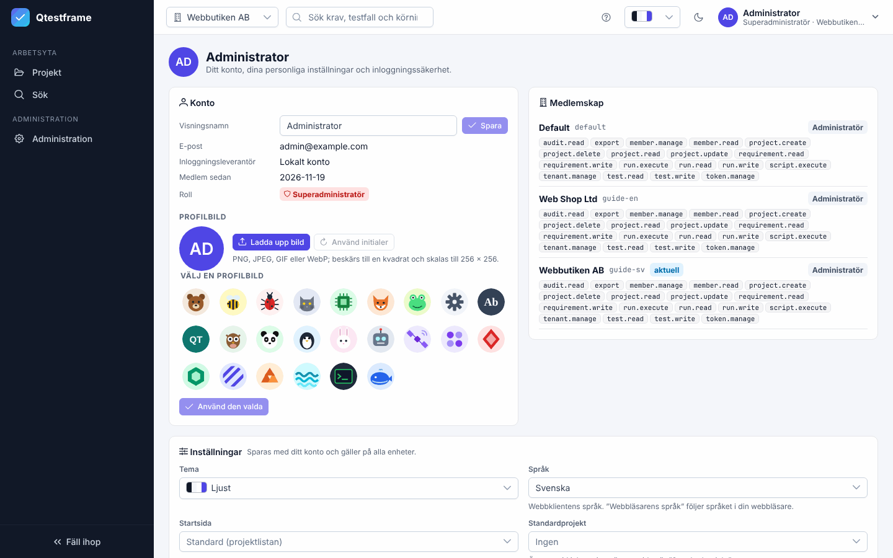
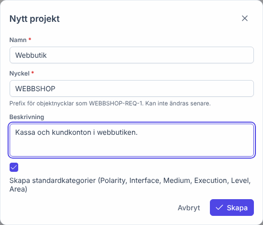
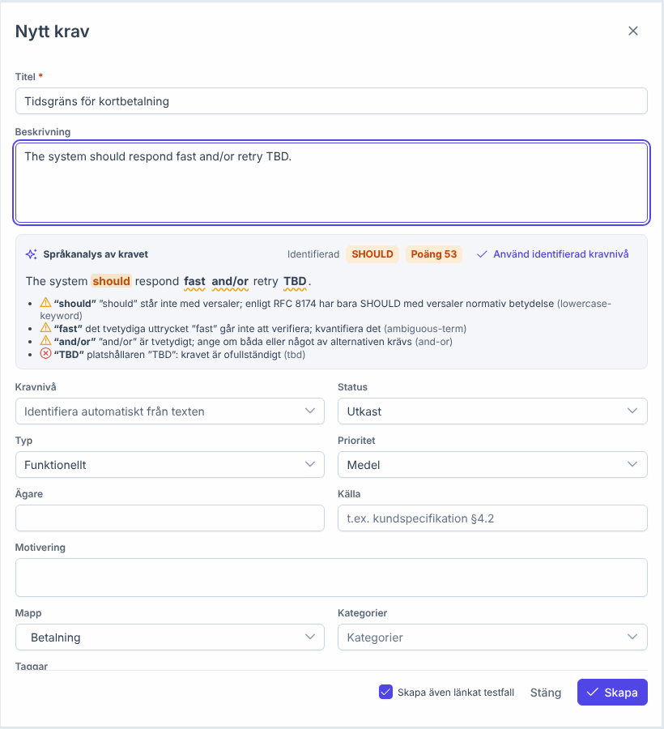
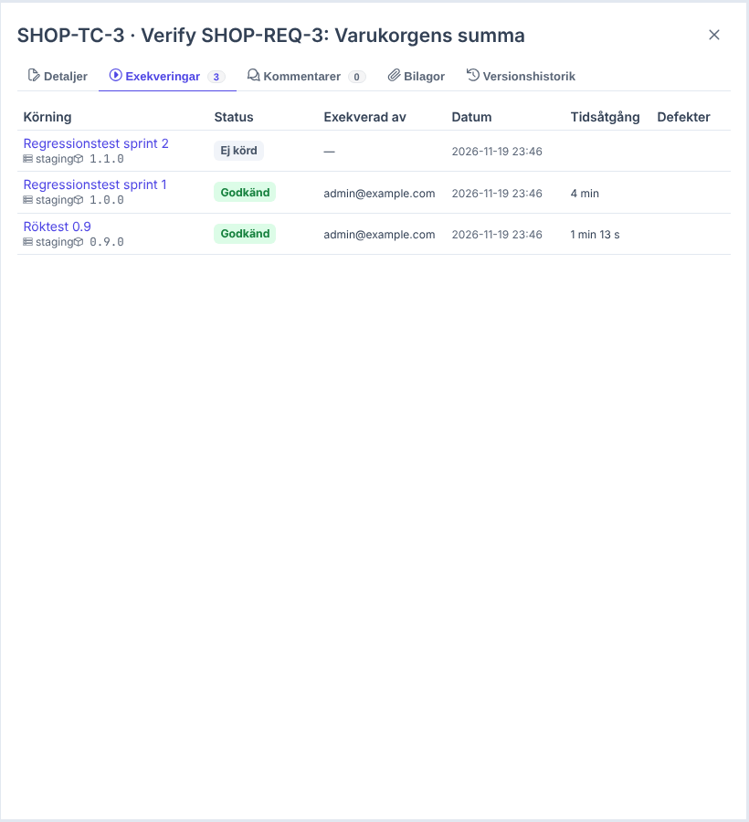
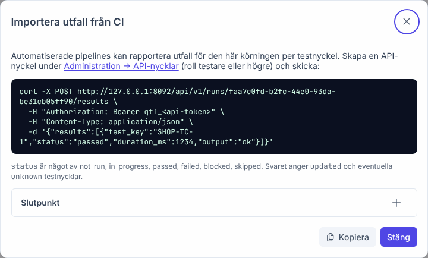
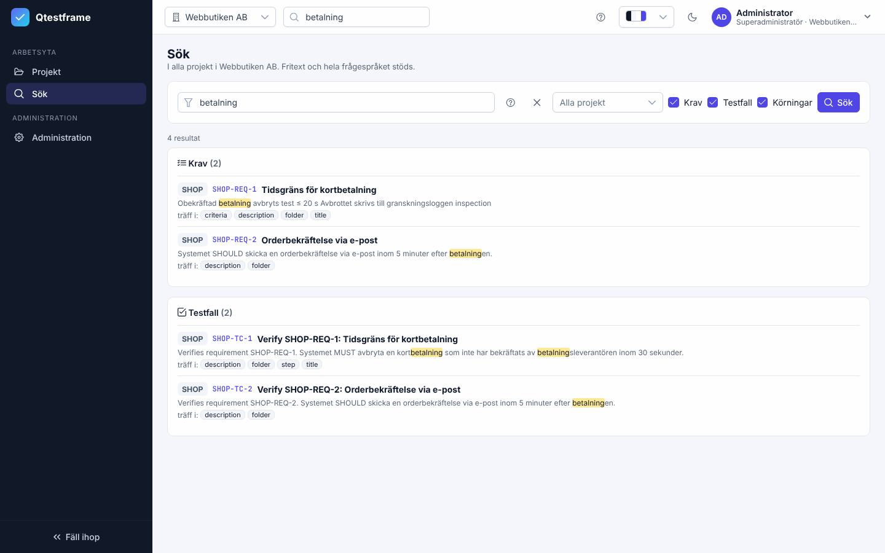
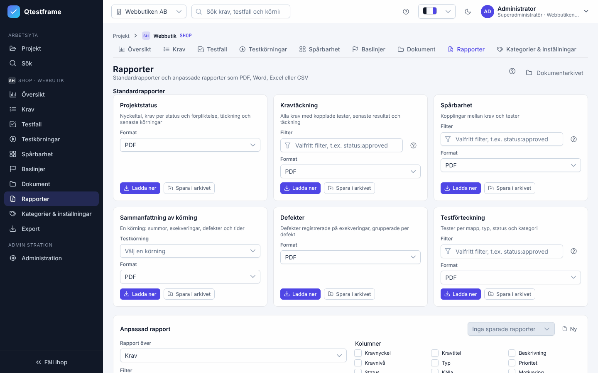
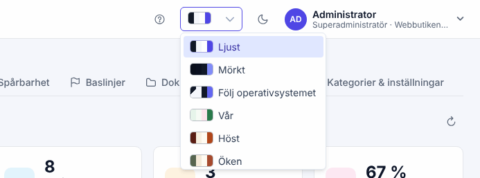
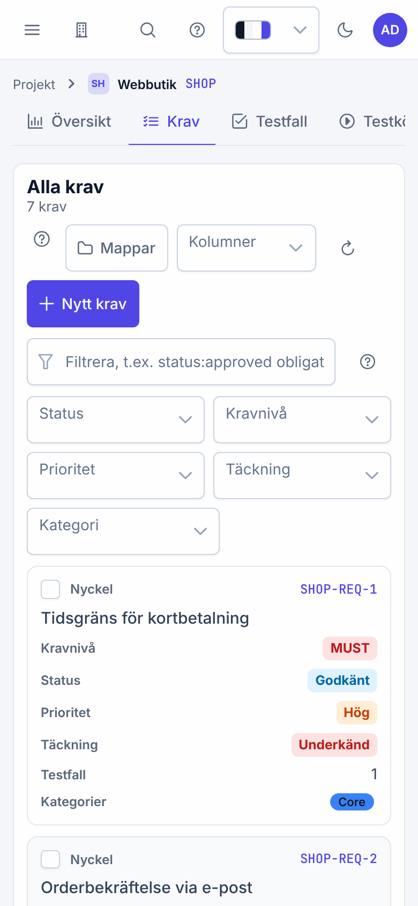

# Användarhandbok för Qtestframe

Qtestframe är ett verktyg för att hantera **kravspecifikationer och tester** på ett ställe. Du skriver krav, utformar manuella och automatiserade testfall som verifierar dem, genomför testkörningar, registrerar utfall och defekter och visar täckningen med en spårbarhetsmatris, en översikt och rapporter. Flera organisationer kan dela en installation utan att se varandras data.

Handboken riktar sig till alla som arbetar i Qtestframe: kravförfattare, testare, testledare och administratörer. Den beskriver webbklienten så som du ser den. Du kan läsa den här i appen (**Hjälp → Användarhandbok** eller **?**-länken på många sidor) eller som Markdown-filer i mappen `docs/user-guide` i källkoden.


## Var börjar jag?

- **Ny i Qtestframe?** Läs [Kom igång](#kom-igång) och gå sedan igenom handledningen [Din första testkampanj](#handledning-din-första-testkampanj). Den tar ungefär 30 minuter och berör alla viktiga funktioner.
- **Letar du efter ett svar?** Titta i [Vanliga frågor](#vanliga-frågor) eller använd sökfältet högst upp i handboken.
- **Administratör?** Gå direkt till [Administration](#administration).

## Innehåll

| Sida | Innehåll |
|---|---|
| [Kom igång](#kom-igång) | Inloggning, sidans uppbyggnad, organisationer, sökning, tema och språk, profil och inställningar |
| [Handledning: din första testkampanj](#handledning-din-första-testkampanj) | En komplett genomgång från ett tomt projekt till en rapport |
| [Krav](#krav) | Kravnivåer, språkanalysen, fält, utvärderingskriterier, relationer, kommentarer, versionshistorik, massändring, flytt och bilagor |
| [Testfall](#testfall) | Manuella steg, automatiserade skript, delade steg, kategorier, exekveringshistorik, kommentarer, versionshistorik och bilagor |
| [Katalog](#katalog) | Standardkrav och testfall att lägga till i ett projekt: bläddra, söka, förhandsvisa och lägga till med testfall och spårlänkar |
| [Testkörningar och exekvering](#testkörningar-och-exekvering) | Körningar, exekveringsvyn och dess kortkommandon, defekter, CI-import med API-nycklar, bilagor |
| [Spårbarhet och täckning](#spårbarhet-och-täckning) | Spårbarhetsmatrisen, hur täckningen beräknas, översikten |
| [Baslinjer](#baslinjer) | Frysa en release och jämföra versioner |
| [Sökning och filter](#sökning-och-filter) | Frågespråket med många exempel |
| [Rapporter och export](#rapporter-och-export) | Standardrapporter, den egna rapportbyggaren, exportformat och dokumentarkivet |
| [Dokument](#dokument) | Projektets dokumentarkiv: uppladdning, förhandsvisning och länkar |
| [Administration](#administration) | Organisationer, användare, medlemmar och roller, delning av projekt, återställning av lösenord, API-nycklar, händelseloggen, säkerhetskopiering och återställning |
| [Tillgänglighet och språk](#tillgänglighet-och-språk) | Tangentbord, skärmläsare, teman, engelska och svenska, mobiler och surfplattor |
| [Vanliga frågor](#vanliga-frågor) | Svar på vanliga frågor |
| [Referenser](#referenser) | RFC 2119, RFC 8174 och andra RFC:er, NIST-publikationer samt standarder för krav och test |

## Viktiga begrepp

| Begrepp | Betydelse |
|---|---|
| **Organisation** | En isolerad arbetsyta. Projekt, medlemmar och API-nycklar hör till en organisation. Du kan vara medlem i flera och byta mellan dem. |
| **Projekt** | En behållare för krav, testfall, körningar, baslinjer och dokument. Projektets **nyckel** (till exempel `SHOP`) inleder varje objekts id: `SHOP-REQ-12`, `SHOP-TC-7`. |
| **Krav** | Ett påstående om vad systemet ska, bör eller får göra, med kravnivå, status, prioritet, utvärderingskriterier med mera. |
| **Utvärderingskriterium** | Hur man bedömer att ett krav är uppfyllt: en metod (test, inspektion, analys, demonstration, granskning) och ett tröskelvärde. |
| **Testfall** | Ett manuellt testfall med steg eller ett automatiserat testfall med ett skript. |
| **Länk** (spårlänk) | Kopplar ett krav till ett testfall som verifierar det. Länkarna är grunden för täckningen. |
| **Körning** (testkörning) | En testkampanj, till exempel *Regressionstest sprint 12*, med en uppsättning testfall som ska exekveras i en viss miljö och ett visst bygge. |
| **Exekvering** | Ett testfall i en körning, med utfall, utfall per steg, anteckningar, defekter och utdata. |
| **Täckning** | Ett kravs verifieringsläge, härlett från de senaste utfallen för dess länkade testfall: *Ingen täckning*, *Ej körd*, *Godkänd*, *Underkänd* eller *Delvis*. |
| **Baslinje** | En fryst ögonblicksbild av versionerna av ett projekts krav och testfall, till exempel inför en release. |
| **Roll** | Vad du får göra i en organisation: *Läsare*, *Testare*, *Ansvarig* eller *Administratör*. *Superadministratörer* hanterar hela installationen. |

## Konventioner i handboken

- Namn på knappar, menyer och fält skrivs i **fetstil**, precis som de står i det svenska gränssnittet. Den engelska handboken använder de engelska etiketterna.
- Menyvägar skrivs med pilar: **Användarmeny → Profil och lösenord**.
- Tangenter skrivs som <kbd>Enter</kbd> och frågeexempel som `status:approved`.
- En anmärkning som *(Ansvarig)* efter en åtgärd anger den lägsta roll som får utföra den. Se [rollmatrisen](#roller-och-behörigheter).

# Kom igång

Den här sidan förklarar hur du loggar in, hittar rätt på skärmen och ställer in Qtestframe som du vill ha det.

## Logga in

Öppna adressen du har fått av din administratör (för en lokal testinstallation `http://localhost:8080`).


1. Ange **E-post** och **Lösenord** och välj **Logga in**.
2. Om du tillhör flera organisationer och vill börja i en viss, välj **Logga in i en viss organisation …** och ange dess kortnamn, till exempel `acme`. Utan kortnamn hamnar du i din standardorganisation (se [Inställningar](#inställningar)) eller den du använde senast.
3. Om din organisation använder enkel inloggning (SSO) visar sidan en knapp per leverantör under **eller fortsätt med**. Välj den och logga in hos identitetsleverantören; du kommer automatiskt tillbaka till Qtestframe.
4. Om du använder [tvåstegsverifiering](#tvåstegsverifiering) frågar sidan sedan efter **Verifieringskod**: öppna autentiseringsappen, ange den sexsiffriga kod den visar för Qtestframe och välj **Verifiera**. Varje kod fungerar en gång; om en kod nekas, vänta på nästa. Utan telefonen väljer du **Använd en återställningskod i stället** och anger en av dina återställningskoder. Om din organisation tillåter det hoppar **Kom ihåg den här enheten** över koden i den här webbläsaren under ett antal dagar.

Språkknapparna högst upp på inloggningssidan växlar mellan engelska och svenska innan du loggar in. Efter inloggningen gäller språket i dina inställningar.

> **Tips:** Efter tio misslyckade försök inom fem minuter spärras inloggningen en stund för den e-postadressen och nätverksadressen. Vänta några minuter och försök igen, eller be en administratör att [återställa ditt lösenord](#återställa-ett-lösenord).

### Det här ser du efter inloggningen

- **Introduktionsturen.** Första gången du loggar in visar en kort tur de viktigaste delarna av skärmen. Använd **Nästa** och **Tillbaka**, eller **Hoppa över turen** (eller <kbd>Esc</kbd>) för att stänga den. Du kan starta den igen när som helst med **Hjälp → Starta introduktionsturen igen**.

  
- **Information om inloggningen.** Vid senare inloggningar kan Qtestframe visa när och varifrån du loggade in förra gången och hur många misslyckade försök det har varit sedan dess. Om du inte känner igen en inloggning, byt lösenord och logga ut dina andra sessioner (se [Säkerhet](#säkerhet)).
- **Tvingat lösenordsbyte.** Om en administratör har återställt ditt lösenord måste du välja ett nytt innan du kan fortsätta.
- **Krav på tvåstegsverifiering.** Om din organisation kräver en andra faktor och du inte har konfigurerat någon, talar en påminnelse om till när; efter det datumet måste du [konfigurera en autentiseringsapp](#tvåstegsverifiering) vid inloggningen innan du kan fortsätta.

## Sidans uppbyggnad


### Sidopanelen

Det mörka fältet till vänster är huvudnavigeringen:

- **Arbetsyta:** **Projekt** (alla projekt i den aktuella organisationen) och **Sök** (sökning i alla projekt).
- **Det öppna projektet:** när du öppnar ett projekt visas dess nyckel och namn med projektets delar: **Översikt**, **Krav**, **Testfall**, **Testkörningar**, **Spårbarhet**, **Analys**, **Beroendegraf**, **Testflöde**, **AI-prompter** (mjukvaruprojekt), **Taggar**, **Baslinjer**, **Kategorier & inställningar**, **Export** och, där de finns, **Dokument** och **Rapporter**.
- **Administration**, om din roll tillåter det.

I ett projekt visas samma delar också som flikar högst upp på sidan, under sökvägen *Projekt › projektets namn*.

**Fäll ihop** längst ned krymper sidopanelen till ikoner; håll pekaren över en ikon för att se namnet. På skärmar smalare än 1024 bildpunkter är sidopanelen dold och öppnas med menyknappen (☰) i övre fältet; <kbd>Esc</kbd> eller stängningsknappen stänger den igen.

### Övre fältet

Från vänster till höger:

| Del | Användning |
|---|---|
| **Organisation** | Visar den aktuella organisationen och låter dig byta till en annan som du är medlem i. På mobiler är det en byggnadsikon. |
| **Sökfältet** | Söker bland krav, testfall och körningar i alla projekt i organisationen. Skriv text eller en [fråga](#sökning-och-filter) och tryck <kbd>Enter</kbd>. På mobiler är det en förstoringsglasknapp. |
| **Hjälp** (?) | Öppnar **Användarhandbok**, **Hjälp för den här sidan**, **Frågespråket**, **Referenser och standarder** och **Starta introduktionsturen igen**. |
| **Ångra / Gör om / Ångrahistorik** | Ångrar och gör om dina ändringar, se [Ångra och gör om](#ångra-och-gör-om). |
| **Färgtema** | Väljer ett av de tjugotvå temana, se [Teman](#teman). |
| **Ljust läge / Mörkt läge** | Växlar snabbt mellan ljust och mörkt. |
| **Användarmeny** | Ditt namn och din roll, **Profil och lösenord**, ljust/mörkt läge, **Språk** och **Logga ut**. |

### Ångra och gör om

De flesta ändringar kan ångras: att redigera, skapa, kopiera och ta bort krav och testfall, flytta dem, massändringar, länkar, relationer, beroenden, granskningsbeslut, att återställa en version, utfall i exekveringsvyn samt att skapa, byta namn på och flytta mappar.

- **Ångra** (↶, <kbd>Ctrl</kbd>+<kbd>Z</kbd>) återställer den senaste ändringen; välj den igen för att gå längre bakåt. Knappens tips namnger ändringen, till exempel *Ångra: Redigera SHOP-TC-4*.
- **Gör om** (↷, <kbd>Ctrl</kbd>+<kbd>Skift</kbd>+<kbd>Z</kbd> eller <kbd>Ctrl</kbd>+<kbd>Y</kbd>) gör en ångrad ändring igen. En ny ändring rensar det som kunde göras om.
- **Ångrahistorik** (🕘) listar dina senaste 50 ändringar, nyast först, med när de gjordes. Väljer du en ångras den och allt som gjordes efter den.

Kortkommandona fungerar utanför textfält; i ett textfält ångrar de som vanligt det du skrivit. Historiken hör till dig och din webbläsarflik: den rensas när du byter organisation, loggar ut eller laddar om sidan. Ett borttaget krav eller testfall kommer tillbaka med sin nyckel, sina länkar, relationer, kommentarer, versionshistorik, bilagor och utfall; borttagningar kan ångras i 30 dagar via API:t (se `GET /projects/{pid}/trash` i API-referensen). Ett ångra misslyckas om läget har ändrats under tiden, till exempel om någon annan har redigerat objektet eller om du inte längre har behörigheten; objektet lämnas då som det är och ett meddelande förklarar varför.

### Hjälp där du behöver den

- Många fält och avsnitt har ett litet **i** bredvid namnet. Peka på det med musen, eller flytta tangentbordsfokus dit, så visas vad fältet betyder. Välj det (eller tryck på det på en mobil) för att låta förklaringen vara kvar, och välj **Läs mer i användarhandboken** för att öppna avsnittet som beskriver det. <kbd>Esc</kbd> stänger förklaringen.
- Tryck <kbd>?</kbd> var som helst utanför ett textfält för att öppna handbokens sida för den vy du är i (i exekveringsvyn visar <kbd>?</kbd> i stället vyns kortkommandon).
- **?** bredvid varje filterfält listar operatorerna och fälten i [frågespråket](#sökning-och-filter) för just den listan.

### Organisationer

En organisation är en separat arbetsyta med egna projekt, medlemmar och API-nycklar. När du byter organisation i övre fältet tar Qtestframe dig till organisationens projektlista. Din roll kan skilja sig mellan organisationer, så vad du får göra kan också ändras.

Om du ser meddelandet *Du har ingen aktuell organisation*, välj en i organisationsväljaren. Om du inte är medlem i någon organisation, be en administratör att lägga till dig.

### Sökning

Sökfältet i övre fältet söker överallt i den aktuella organisationen. Träffarna grupperas per typ med den matchande texten markerad; välj en träff för att öppna den. Alla detaljer finns i [Sökning och filter](#sökning-och-filter).

### Tema och språk

- Välj **färgtema** i övre fältet eller i dina inställningar. Valet sparas med ditt konto och följer med till alla enheter.
- Byt **språk** med **Användarmeny → Språk**: *English* eller *Svenska*. Ändringen gäller direkt och sparas som din inställning.

## Din profil

Öppna **Användarmeny → Profil och lösenord**.



### Konto

- **Visningsnamn**: namnet som andra ser i kommentarer, versionshistorik och händelseloggen.
- **Profilbild**: välj en bild för ditt konto: ladda upp en bild (PNG, JPEG, GIF eller WebP, högst 1 MB), välj en av de inbyggda bilderna eller använd dina initialer.
- **Inloggningsleverantör**, **Medlem sedan** och dina **Medlemskap**: organisationerna du tillhör och din roll i var och en.

### Inställningar

Inställningarna sparas med ditt konto och gäller på alla enheter. Ändra dem och välj **Spara inställningar**.

| Inställning | Effekt |
|---|---|
| **Språk** | Engelska eller svenska; *Webbläsarens språk* följer webbläsaren. |
| **Tema** | Färgtema. *Följ operativsystemet* växlar mellan ljust och mörkt enligt systemets inställning. |
| **Startsida** | Det du ser efter inloggningen: projektlistan, det senast öppnade projektet, ett standardprojekt eller sökningen. |
| **Standardprojekt** | Projektet som öppnas när startsidan är *Standardprojekt*. |
| **Standardorganisation** | Organisationen som väljs vid inloggning när du inte anger någon. |
| **Rader per tabellsida** | 10, 25, 50 eller 100 rader i tabeller. |
| **Datumformat** | *Språkets format*, *ISO* (2026-03-14 09:30) eller *Relativt* (för 3 timmar sedan). |
| **Tidszon** | Tidszonen för alla tider; *Webbläsarens* använder datorns. |
| **Skapa även länkat testfall (nya krav)** | Ditt personliga standardval för kryssrutan i kravredigeraren. |
| **Kompakta tabeller** | Tätare tabellrader, så att du ser mer på en gång. |
| **Dölj den löpande språkanalysen av kraven** | Stänger av analysrutan i kravredigeraren. |
| **Markera nyckelord för kravnivå** | På från början: markerar SKA, BÖR, FÅR, MUST, SHOULD, MAY … i kravens beskrivningar och visar raden med nyckelord under beskrivningen i redigeraren. Se [Markerade nyckelord för kravnivå](#markerade-nyckelord-för-kravnivå). |

### Säkerhet

- **Lösenord**: för lokala konton anger du **Nuvarande lösenord** och **Nytt lösenord** två gånger och väljer **Byt lösenord**. Om du loggar in med enkel inloggning hanteras lösenordet av din identitetsleverantör.
- **API-nycklar**: nycklar för CI-pipelines och skript skapas under **Administration → API-nycklar** (se [API-nycklar](#api-nycklar)).
- **Aktiva sessioner**: alla webbläsare och enheter som är inloggade med ditt konto, med webbläsare, IP-adress, inloggningstid och senaste aktivitet. **Logga ut** avslutar en session; **Logga ut alla andra sessioner** avslutar alla utom den du använder.
- **Inloggningshistorik**: dina senaste inloggningar och misslyckade försök, om de visas. Felaktiga koder för den andra faktorn visas som misslyckade försök med metoden *Andra faktor*.

### Tvåstegsverifiering

En andra faktor skyddar ditt konto även om någon får reda på ditt lösenord: efter lösenordet anger du en sexsiffrig kod från en **autentiseringsapp** i telefonen, till exempel Microsoft Authenticator, Google Authenticator, 1Password eller FreeOTP.

**Slå på**

1. I din profil, under **Tvåstegsverifiering**, väljer du **Konfigurera autentiseringsapp**.
2. Skanna QR-koden med appen. På en telefon lägger **Öppna i en autentiseringsapp på den här enheten** till kontot direkt; om det inte går att skanna väljer du **Går det inte att skanna? Ange nyckeln för hand** och skriver in konfigurationsnyckeln i appen.
3. Ange den sexsiffriga kod som appen visar och välj **Slå på**.
4. Qtestframe visar tio **återställningskoder**. Spara dem nu (**Kopiera** eller **Ladda ned**), till exempel i en lösenordshanterare: de visas bara den här gången. Varje kod fungerar en gång och låter dig logga in utan telefonen. Välj sedan **Jag har sparat koderna**.

Därefter frågar varje inloggning med lösenord efter en kod. API-nycklar påverkas inte.

**Senare**

- **Nya återställningskoder** skapar tio nya koder (de gamla slutar fungera). Gör det när bara några få finns kvar; profilen varnar dig.
- **Glöm ihågkomna enheter** gör att alla webbläsare där du valde *Kom ihåg den här enheten* frågar efter en kod igen.
- **Stäng av** tar bort autentiseringsappen och dina återställningskoder; båda kräver en aktuell kod (eller en återställningskod). Om din organisation kräver tvåstegsverifiering kan du inte stänga av den. Du får ett e-postmeddelande när den stängs av.
- **Ny eller borttappad telefon**: med en återställningskod kan du fortfarande logga in; stäng av tvåstegsverifieringen och konfigurera den igen med den nya telefonen. Utan telefon och återställningskoder ber du en administratör att [återställa din tvåstegsverifiering](#återställa-tvåstegsverifiering).

Om du loggar in med enkel inloggning frågar oftast identitetsleverantören efter den andra faktorn; Qtestframe frågar efter en egen kod bara om servern är konfigurerad för det.

## Nästa steg

- Följ [handledningen](#handledning-din-första-testkampanj) och bygg ett litet projekt från början.
- Lär dig [frågespråket](#sökning-och-filter); det fungerar i alla filterfält.

# Handledning: din första testkampanj

I den här handledningen bygger du ett litet projekt från början och tar det hela vägen till en rapport. Du skriver krav, låter Qtestframe skapa länkade testfall, förfinar dem, kör dem manuellt och automatiskt, registrerar en defekt, kontrollerar täckningen, fryser en baslinje och exporterar resultatet.

**Exempel:** kassan i en webbutik, projektnyckel `SHOP`.

**Du behöver:** rollen **Ansvarig** eller **Administratör** i din organisation (krav och projekt kräver rollen Ansvarig, se [roller](#roller-och-behörigheter)). För att köra skript på servern måste dessutom administratören ha slagit på skriptexekveringen (steg 9). Räkna med ungefär 30 minuter.

> **Vill du bara titta runt?** Din administratör kan läsa in ett färdigt demoprojekt (*Demo – Online Banking*) med `qtestframe seed-demo`. Stegen nedan fungerar även där, men du lär dig mer om du börjar med ett tomt projekt.

## Steg 1: Skapa ett projekt

1. Välj **Projekt** i sidopanelen.
2. Välj **Nytt projekt**.
3. Ange **Namn** `Webbutik`. Qtestframe föreslår en nyckel utifrån namnet när du lämnar fältet.
4. Ändra **Nyckel** till `SHOP`. Nyckeln inleder varje objekts id, till exempel `SHOP-REQ-1` och `SHOP-TC-1`. Den består av 2–16 versaler eller siffror, börjar med en bokstav och **kan inte ändras senare**. Lägg gärna till en **Beskrivning**.
5. Låt **Skapa standardkategorier (Polarity, Interface, Medium, Execution, Level, Area)** vara ikryssad. Kategoridimensionerna används senare för att klassificera testfall och krav.
6. Välj **Skapa**.



Öppna projektet genom att välja dess kort. Du hamnar på projektets **Översikt**, som ännu är tom. Projektets delar visas nu i sidopanelen.

## Steg 2: Skapa mappar

Mappar grupperar krav (och, separat, testfall) i ett träd, som kapitlen i en specifikation.

1. Välj **Krav** i sidopanelen. Mappträdet finns till vänster och kravtabellen till höger.
2. Välj knappen **+** (**Ny mapp**) ovanför trädet, skriv `Kassa` och välj **Spara**.
3. Skapa en undermapp: högerklicka på **Kassa** (eller använd dess åtgärdsknapp **⋮**) och välj **Ny undermapp**. Ge den namnet `Betalning`.
4. Skapa på samma sätt en andra mapp på översta nivån, `Konton`.


Du kan dra mappar för att placera dem i varandra eller ändra ordningen. Välj en mapp för att bara visa dess krav; **Ta med undermappar** avgör om krav i undermappar också visas.

## Steg 3: Skriv krav med MUST och SHOULD

1. Välj mappen **Betalning** och sedan **Nytt krav**. Redigeraren öppnas till höger med mappen redan ifylld.
2. Ange **Titel** `Tidsgräns för kortbetalning`.
3. Skriv först in ett medvetet svagt påstående i **Beskrivning**:

   `The system should respond fast and/or retry TBD.`

   Rutan **Språkanalys av kravet** visas under texten och uppdateras medan du skriver. Den hittar:

   - kravordet *should* med gemener (enligt RFC 8174 har bara `SHOULD` med versaler normativ betydelse),
   - det tvetydiga uttrycket *fast*, som inte går att verifiera,
   - *and/or*, som lämnar öppet om båda eller ett av alternativen krävs,
   - platshållaren *TBD*, som visar att kravet är ofullständigt.

   **Poängen** sjunker till 53 av 100.



4. Ersätt nu texten med en exakt formulering:

   `The system MUST cancel a card payment that is not confirmed by the payment provider within 30 seconds.`

   Analysen visar **Identifierad: MUST (SKA)** och poängen 100.


5. Låt **Kravnivå** stå på **Identifiera automatiskt från texten**: den identifierade nivån sparas när du skapar kravet. Du kan också välja en nivå själv; **Använd identifierad kravnivå** fyller i fältet med det analysen hittade.
6. Sätt **Prioritet** till **Hög** och välj **Area / Core** under **Kategorier**.
7. Sätt **Status** till **Godkänt**: i ett riktigt projekt gör du det när kravet har granskats. Som standard kan ett testfall bara exekveras när det är **Klart** och alla krav det verifierar är **Godkända**, **Implementerade** eller **Verifierade** (se [Inställningar för testexekvering](#inställningar-för-testexekvering)).

> **Om språket:** analysen förstår både svenska och engelska. Skriv du på svenska använder du de svenska kravorden: *Systemet SKA avbryta en kortbetalning …*; engelska kravord med versaler (MUST, SHALL …) fungerar också. Se [Språkanalysen](#språkanalysen).

Vilket kravord ska du använda?

| Kravord | Betydelse | Exempel |
|---|---|---|
| `MUST` / `SHALL` | Absolut krav (SKA) | Systemet MUST logga varje misslyckad inloggning. |
| `MUST NOT` / `SHALL NOT` | Absolut förbud (SKA INTE) | Systemet MUST NOT lagra kortnummer. |
| `SHOULD` | Rekommendation (BÖR); avvikelser kräver skäl | Systemet SHOULD skicka en orderbekräftelse inom 5 minuter. |
| `SHOULD NOT` | Avrådan (BÖR INTE) | Kassan SHOULD NOT kräva mer än tre sidor. |
| `MAY` / `OPTIONAL` | Verkligt valfritt (FÅR) | Kunden MAY spara kortet till senare köp. |
| `WILL` | Avsikt eller faktum (KOMMER ATT) | Betalningsleverantören WILL skicka ett återanrop. |

Skriv en skyldighet per mening. Om analysen rapporterar *flera kravord* i meningen, dela upp den i två krav. Fler regler förklaras under [Krav](#språkanalysen).

## Steg 4: Lägg till utvärderingskriterier

Utvärderingskriterierna anger **hur** du bedömer att kravet är uppfyllt. De blir också stegen i det länkade testfallet.

1. Välj **Lägg till kriterium** under **Utvärderingskriterier** i redigeraren.
2. Skriv `Obekräftad betalning avbryts`, behåll metoden **Test** och ange tröskelvärdet `≤ 30 s`.
3. Lägg till ett andra kriterium, `Avbrottet skrivs till granskningsloggen`, med metoden **Inspektion**.
4. Kontrollera att **Skapa även länkat testfall** längst ned är ikryssad.
5. Välj **Skapa**.


Ett meddelande bekräftar *SHOP-REQ-1 med länkat testfall SHOP-TC-1*. I tabellen är kravets **Täckning** **Ej körd**: det har ett testfall, men testfallet har inte exekverats än.

Lägg gärna till ytterligare ett krav i samma mapp för att öva:

`The system SHOULD send an order confirmation by e-mail within 5 minutes after payment.`

## Steg 5: Förfina det automatiskt länkade testfallet

1. Välj **Testfall** i sidopanelen. Testmappsträdet speglar dina kravmappar: där finns mappen **Kassa / Betalning** som Qtestframe har skapat åt dig.
2. Öppna **SHOP-TC-1 Verify SHOP-REQ-1: Tidsgräns för kortbetalning**. Det är ett manuellt testfall med status **Utkast** och taggen `auto-generated`, med ett steg per kriterium, till exempel *Verify (test): Obekräftad betalning avbryts* med det förväntade resultatet *≤ 30 s*.
3. Gör stegen konkreta. Klicka i ett steg för att redigera **Åtgärd**, **Förväntat resultat** och **Data**:

   | Nr | Åtgärd | Förväntat resultat | Data |
   |---|---|---|---|
   | 1 | Lägg en vara i varukorgen och starta kortbetalningen | Leverantörens betalningssida öppnas | testkort 4111 1111 1111 1111 |
   | 2 | Bekräfta inte betalningen; vänta 30 sekunder | Ordern visar *Betalningen avbruten* | |
   | 3 | Öppna granskningsloggen | Det finns en post *betalning avbruten* för ordern | |

4. Använd **Lägg till steg** för att lägga till ett steg sist, **+** på en rad för att infoga ett steg nedanför och pilarna för att ändra ordningen.
5. Sätt **Status** till **Klart** och lägg till kategorierna **Polarity / Negative** och **Interface / External**.
6. Välj **Spara**.


Under **Länkade krav** längst ned ser du SHOP-REQ-1. Med **Länka krav** länkar du fler krav till samma testfall.

## Steg 6: Lägg till ett delat steg

Många testfall börjar på samma sätt, till exempel med en inloggning. Skriv sådana steg en gång och anropa dem från andra testfall.

1. Välj **Nytt testfall** och skapa testfallet `Logga in som kund` med två steg: *Öppna butiken och välj Logga in* → *Inloggningsformuläret visas* och *Ange kundens e-post och lösenord* → *Kontosidan visas*. Sätt status till **Klart** och välj **Skapa**.
2. Öppna SHOP-TC-1 igen och välj **Infoga anrop till testfall …** ovanför stegen.
3. Välj **Logga in som kund** och sedan **Infoga anrop**. Det nya steget visar **Anropar SHOP-TC-…**.
4. Flytta anropssteget överst med uppåtpilen och välj **Spara**.


När en körning skapas infogas det anropade testfallets steg i stället för anropet, markerade med det anropade testfallets nyckel. Om du förbättrar det delade testfallet senare får nya körningar förbättringen. Det delade testfallet visar var det används under **Används av:**.

## Steg 7: Skapa en körning

1. Välj **Testkörningar** i sidopanelen och sedan **Ny körning**.
2. Ange **Namn** `Regressionstest sprint 1`, **Miljö** `staging` och **Bygge** `1.0.0`.
3. Välj vilka testfall som ska ingå. Körningen får unionen av alla tre flikarna:
   - **Testfall**: **Välj testfall …** och välj enskilda testfall;
   - **Mappar**: kryssa i **Kassa**; testfall i undermappar tas med;
   - **Fråga**: ett filter som `status:ready`; **Förhandsgranska** visar hur många testfall som matchar.
4. Välj **Skapa körning**.


Körningen öppnas med en **exekvering** per testfall, alla **Ej körd**. Stegen i varje testfall, inklusive de infogade delade stegen, kopieras nu in i körningen, så senare ändringar av testfallen påverkar inte den här körningen.

## Steg 8: Exekvera manuellt och registrera en defekt

1. Välj **Exekvera** i körningen (eller uppspelningsknappen för en exekvering). Exekveringsvyn öppnas.
2. Den vänstra kolumnen listar stegen; till höger visas det aktuella steget med **Åtgärd**, **Förväntat resultat** och **Testdata**.
3. Gör det steget beskriver och jämför resultatet:
   - om det stämmer, välj **Godkänn** eller tryck <kbd>P</kbd>;
   - om inte, skriv vad som hände i **Faktiskt resultat** och välj **Underkänn** eller tryck <kbd>F</kbd>.

   **Blockerad** (<kbd>B</kbd>) och **Hoppa över** (<kbd>S</kbd>) finns också. Vyn går automatiskt vidare till nästa steg. Tryck <kbd>?</kbd> för att se alla kortkommandon.
4. Låt steg 3 underkännas: posten i granskningsloggen saknas. Skriv `SHOP-101` (id:t i ditt ärendehanteringssystem) under **Defekter** och tryck <kbd>Enter</kbd>. Skriv en kommentar under **Anteckningar**.
5. **Samlat utfall** härleds från stegen: ett underkänt steg gör exekveringen **Underkänd**. Välj **Spara och nästa** för att spara och gå till nästa exekvering.


**Gör defekt-id:n till länkar:** ange en **URL-mall för felhanteringssystem** under **Kategorier & inställningar**, till exempel `https://jira.example.com/browse/{id}`. Därefter länkar `SHOP-101` till ditt system.

## Steg 9: Kör ett automatiserat skript

Automatiserade testfall är skript som körs på servern. Slutkod 0 betyder *godkänt*, allt annat *underkänt*.

1. Välj **Nytt testfall** under **Testfall**, skriv `Beräkning av ordersumma` och växla exekveringstypen till **Automatiserat**.
2. Välj skriptspråket **sh** under **Skript** och skriv:

   ```sh
   #!/bin/sh
   # slutkod 0 = godkänt, annat = underkänt
   total=$((2 * 15 + 5))
   echo "ordersumma: $total"
   [ "$total" -eq 35 ] || { echo "oväntad summa"; exit 1; }
   ```

3. Välj **Skapa**.
4. Öppna körningen *Regressionstest sprint 1*, välj **Lägg till testfall**, välj det nya testfallet och bekräfta.
5. Öppna dess exekvering och välj **Kör skript**. Efter en stund visar **Utdata** skriptets utskrifter och exekveringen är **Godkänd**, med tidsåtgången.


**Kör skript** kräver rollen **Ansvarig** (behörigheten `script.execute`) och serverinställningen `runner.enabled: true`. Om knappen saknas eller meddelar att exekveraren är avstängd, kontakta din administratör. CI-pipelines kan i stället rapportera utfall via API:et; se [CI-import](#importera-utfall-från-ci).

## Steg 10: Kontrollera spårbarheten och översikten

1. Välj **Spårbarhet**. Kraven är rader, testfallen kolumner och en markerad cell betyder *länkad*. Det färgade fältet först på varje rad visar täckningen (se förklaringen): SHOP-REQ-1 är nu **Underkänd** eftersom dess testfall underkändes. Kravlistan visar samma sak i kolumnen **Täckning**.
2. Klicka på en tom cell för att länka ett krav till ett testfall, eller på en markerad cell för att ta bort länken. **Bara länkade testfall** döljer testfall utan länkar.
3. Välj **Översikt**. Den sammanfattar kravtäckning, utfall av exekveringar, krav per status och kravnivå, testfall per status och de senaste körningarna.


Hur täckningen beräknas förklaras under [Spårbarhet och täckning](#så-beräknas-täckningen).

## Steg 11: Skapa en baslinje

Frys de aktuella versionerna av alla krav och testfall inför en release.

1. Välj **Baslinjer** och sedan **Ny baslinje**.
2. Ange **Namn** `Release 1.0`. Lämna **Filter (valfritt)** tomt för att ta med allt.
3. Välj **Skapa baslinje**.

Ändra nu något, till exempel tröskelvärdet för ett kriterium i SHOP-REQ-1. Gå tillbaka till **Baslinjer**, välj **Jämför** för *Release 1.0* och jämför med **Nuläget**: SHOP-REQ-1 visas under **Ändrade**, med de ändrade fälten och båda versionsnumren.


## Steg 12: Exportera eller ta fram en rapport

**Exportera data:**

1. Välj **Export**.
2. Välj **Format**: **XLSX** (ett blad per del), **CSV** (ett ZIP-arkiv när du väljer flera delar), **PDF** (utskriftsvänlig) eller **DOCX** (redigerbart dokument).
3. Kryssa i det **Innehåll** du behöver: krav, utvärderingskriterier, testfall med steg, spårbarhetsmatris, körningar och exekveringar.
4. Ange eventuellt ett filter som `folder:Kassa` och välj **Ladda ned**.


**Ta fram en rapport:** välj en standardrapport under **Rapporter**, till exempel **Kravtäckning** eller **Sammanfattning av körning** (för *Regressionstest sprint 1*), välj PDF, Word, Excel eller CSV och ladda ner den, eller spara den i projektets dokumentarkiv så att hela teamet hittar den under **Dokument**. Under **Anpassad rapport** väljer du själv objekttyp, filter, kolumner, gruppering och sortering. Se [Rapporter och export](#rapporter-och-export).

## Det här har du lärt dig

Du har skapat ett projekt med mappar, skrivit verifierbara krav med hjälp av språkanalysen, lagt till utvärderingskriterier, förfinat det automatiskt skapade testfallet, återanvänt steg, genomfört en körning manuellt och automatiskt, registrerat en defekt, kontrollerat täckningen, fryst en baslinje och exporterat resultatet.

Läs sedan mer om [krav](#krav) och [testfall](#testfall), eller lär dig [frågespråket](#sökning-och-filter) för att snabbt hitta vad som helst.

# Krav

Projektets del **Krav** innehåller specifikationen: varje krav med kravnivå, status, utvärderingskriterier, länkar till testfall, relationer till andra krav, kommentarer, versionshistorik och bilagor.

Att läsa krav kräver rollen **Läsare**; att skapa och ändra dem kräver **Ansvarig**. Att länka testfall till ett krav kräver **Testare**.


## Kravsidan

- **Mappträdet** (till vänster): välj **Alla krav** eller en mapp. **Ta med undermappar** avgör om objekt i undermappar listas. På smala skärmar öppnas trädet med knappen **Mappar**.
- **Filterfältet**: ett fält för [frågor](#sökning-och-filter) och snabbfilter för **Status**, **Kravnivå**, **Prioritet**, **Täckning** och **Kategori**. Snabbfiltren sätts ihop till en fråga som visas under fältet (`q = …`). **Rensa** återställer alla filter.
- **Kolumner**: välj vilka kolumner tabellen visar: kravnivå, status, prioritet, typ, täckning, länkade testfall, kategorier, mapp, ägare, källa, taggar, **relationer**, antal relationer, kriterier, version, kommentarer, skapad av, skapad och uppdaterad. Kolumnen **Relationer** listar relaterade objekt grupperade per relation, åt båda hållen, till exempel *beror på SHOP-REQ-2*, *tillhandahålls av SHOP-REQ-3* och *verifieras av SHOP-TC-1*; välj en nyckel för att öppna objektet. Flytta kolumner genom att dra i rubriken, eller med pilknapparna under **Kolumner**; **Återställ** ger standardkolumnerna tillbaka. Valet sparas i webbläsaren, även för tabellerna över körningar, exekveringar och dokument.
- **Tabellen**: sortera genom att klicka på en kolumnrubrik; välj en rad (eller dess titel) för att öppna redigeraren. Id:t (till exempel `SHOP-REQ-12`) tilldelas automatiskt.

Den valda mappen, filtret och det öppna kravet ingår i sidans adress, så du kan bokmärka eller dela en filtrerad vy.

## Kravnivåer

Varje krav har en **kravnivå** enligt [RFC 2119 och RFC 8174](#kravord-rfc):

| Nivå | Betydelse |
|---|---|
| **MUST (SKA)**, **SHALL (SKA)** | Absolut krav |
| **MUST NOT (SKA INTE)**, **SHALL NOT (SKA INTE)** | Absolut förbud |
| **SHOULD (BÖR)** | Rekommendation: det kan finnas giltiga skäl att avvika, men konsekvenserna måste vara kända |
| **SHOULD NOT (BÖR INTE)** | Avrådan |
| **MAY (FÅR)**, **OPTIONAL (VALFRITT)** | Verkligt valfritt |
| **WILL (KOMMER ATT)** | Avsikt eller faktum (inget kravord enligt RFC 2119) |
| **Beskrivande** | Text utan kravnivå, till exempel en inledning eller en anmärkning |

När du skapar ett krav med **Kravnivå** satt till **Identifiera automatiskt från texten** identifieras nivån från titeln och beskrivningen. Om flera kravord förekommer vinner det starkaste (MUST NOT före MUST före SHALL NOT … före Beskrivande). Text utan kravord får ingen kravnivå och räknas som *ospecificerad* på översikten. Senare ändringar ändrar aldrig kravnivån automatiskt; använd **Använd identifierad kravnivå** i analysrutan eller välj nivån själv.

Bara kravord med VERSALER har normativ betydelse (RFC 8174). Skriv `MUST`, inte `must`. I krav som är skrivna på svenska används i stället de svenska kravorden (SKA, BÖR, FÅR …) som beskrivs under [Språkanalysen](#språkanalysen). Sidan [Referenser](#referenser) listar dessa och andra standarder för krav och test.

Medan du skriver visar **Hjälp: kravnivåer** under beskrivningen (öppen för nya krav) nyckelorden för varje nivå på gränssnittets språk, vad de betyder och ett exempel, med tips om hur de skrivs. [Analys](#kravanalys) visar hur nivåerna och nyckelorden fördelar sig i projektet.

### Markerade nyckelord för kravnivå

Där ett kravs beskrivning visas skrivskyddad markeras nyckelorden för kravnivå: i kravredigeraren när du bara får läsa kravet, i förhandsvisningen i [katalogen](#katalog) och i förhandsvisningen i [Importera krav](#importera-krav). Varje nivå har en egen stil, och nivåerna skiljer sig inte bara i färg utan också i tjocklek och understrykning, så att de syns i alla teman, även hög kontrast:

| Nivå | Nyckelord | Understrykning |
|---|---|---|
| Ska | SKA, SKALL, MÅSTE, MUST, SHALL, REQUIRED | heldragen, extra fet |
| Ska inte | SKA INTE, FÅR INTE, MUST NOT, SHALL NOT | dubbel, extra fet |
| Bör | BÖR, REKOMMENDERAS, SHOULD | streckad, fet |
| Bör inte | BÖR INTE, SHOULD NOT, NOT RECOMMENDED | dubbel, fet |
| Får | FÅR, VALFRI, MAY, OPTIONAL | prickad |

Negationer som `SKA INTE` och `MUST NOT` är ett nyckelord. Bara nyckelord skrivna med versaler markeras, bara hela ord (`FÅRA` är inte `FÅR`), och aldrig i länkar eller i kod mellan bakåtapostrofer (`` `SKA` ``). Peka på ett nyckelord för att se vad det betyder; skärmläsare läser nivån efter nyckelordet, till exempel "SKA INTE – kravnivå: SHALL NOT (SKA INTE)". Nyckelorden är desamma som [språkanalysen](#språkanalysen) känner till.

När du redigerar beskrivningen visar raden **Nyckelord för kravnivå** under den nyckelorden som hittas medan du skriver, med deras nivå. Den säger till när nyckelordet inte stämmer med fältet **Kravnivå** (med en knapp som sätter fältet till den hittade nivån), när texten har mer än ett nyckelord och när ett nyckelord är skrivet med gemener. **Vad betyder nyckelorden?** öppnar **Hjälp: kravnivåer**.

Vill du stänga av markeringen och raden, avmarkera **Markera nyckelord för kravnivå** i dina [inställningar](#inställningar).

## Språkanalysen

Medan du skriver beskrivningen visar rutan **Språkanalys av kravet** den identifierade kravnivån, en **Poäng** från 0 till 100, kravorden markerade i texten och en lista med **Anmärkningar**.

Analysen förstår **svenska** och **engelska**. Som standard (**Identifiera språk**) avgör den vilket språk texten är skriven på och visar det bredvid väljaren, till exempel *Identifierat: Svenska*; välj **Svenska** eller **Engelska** i väljaren för att tvinga fram ett språk. Valet sparas i webbläsaren. Anmärkningarna visas alltid på ditt gränssnittsspråk, oavsett vilket språk kravet är skrivet på.

På svenska är kravorden:

| Kravord | Kravnivå |
|---|---|
| **SKA**, **SKALL** | Ska (shall) |
| **MÅSTE**, **OBLIGATORISK** | Måste (must) |
| **BÖR**, **REKOMMENDERAS** | Bör (should) |
| **FÅR** | Får (may) |
| **FÅR INTE**, **FÅR EJ** | Får inte (must not) |
| **SKA INTE**, **SKALL INTE** | Ska inte (shall not) |
| **BÖR INTE**, **REKOMMENDERAS INTE** | Bör inte (should not) |
| **BEHÖVER INTE**, **MÅSTE INTE**, **VALFRI** | Valfritt (optional) |
| **KOMMER ATT** | Kommer att (will) |
| **BESKRIVER**, **NOT:**, **ANMÄRKNING:** | Beskrivande |

Engelska kravord med versaler (MUST, SHALL …) räknas också. Svenskan har ingen konvention om versaler, så regeln om kravord med gemener gäller bara engelska. Tänk på att *får* även betyder "tar emot": i *användaren får ett mejl* tolkas *får* som ett tillåtande kravord.


| Regel | Allvarlighet | Upptäcks när |
|---|---|---|
| Kravord saknas | Varning | det finns inget kravord (MUST, SHALL, SHOULD, MAY …) |
| Kravord med gemener | Info | ett kravord inte står med versaler, till exempel `must` |
| Negativt krav | Info | `MUST NOT` eller `SHALL NOT`: svårare att verifiera; ange hellre vad systemet gör |
| Flera kravord | Varning | en mening innehåller mer än ett kravord; dela upp den |
| Lång mening | Info | en mening har fler än 40 ord |
| Tvetydigt uttryck | Varning | vaga ord som *fast, easy, user-friendly, simple, efficient, adequate, appropriate, approximately, flexible, robust, reliable, intuitive, sufficient, as needed, normally, usually, seamless, scalable, optimal, several, many, few, reasonable, timely, acceptable, as soon as possible, suitable* |
| Platshållare | Fel | `TBD`, `TBC`, `TODO`, `XXX`, `???`: kravet är ofullständigt |
| Obegränsat uttryck | Info | *all, always, never, every, any, none*: kontrollera att det verkligen ska gälla generellt |
| And/or | Varning | `and/or`: ange om båda eller något av alternativen krävs |
| Passiv förmåga | Info | *be able to*, *be capable of*: beskriv beteendet i stället |
| Undantagsklausul | Varning | *if possible, where applicable, unless, except*: gör villkoret explicit |
| Tvetydig negation | Varning | bara svenska: *måste inte* läses ofta som ett förbud men betyder "behöver inte"; skriv *får inte* eller *behöver inte* |

Tabellen visar de engelska orden. I svensk text letar reglerna efter motsvarande svenska ord, till exempel *snabb, enkel, användarvänlig, effektiv, tillräcklig, lämplig, ungefär, flexibel, robust, intuitiv, osv, vid behov, normalt, vanligtvis, skalbar, optimal, flera, många, rimlig, så snart som möjligt* (tvetydiga), *bestäms senare* (platshållare), *alla, alltid, aldrig, varje, ingen* (obegränsade), *och/eller*, *kunna, ha möjlighet att* (passiv förmåga) och *om möjligt, där tillämpligt, om inte, utom, förutom* (undantag).

**Poäng** = 100 − 25 per fel − 10 per varning − 2 per info, aldrig under 0. Till exempel får *The system shall respond fast and/or retry TBD.* poängen 53: kravord med gemener (info), *fast* (varning), *and/or* (varning) och *TBD* (fel).

Om du inte vill se rutan kan du stänga av den i din profil: **Dölj den löpande språkanalysen av kraven**.

## Fält

| Fält | Användning |
|---|---|
| **Titel** | Ett kort namn (obligatoriskt). |
| **Beskrivning** | Själva kravformuleringen, som analyseras medan du skriver. |
| **Kravnivå** | Se ovan. |
| **Status** | Utkast, Granskning, Godkänt, Implementerat, Verifierat, Avvisat eller Inaktuellt. *Godkänt* och *Avvisat* är granskningsbeslut: de kräver behörigheten *requirement.review* (Granskare eller Ansvarig) och är gråade utan den. Granskare ser knapparna **Godkänn** och **Avvisa** överst i redigeraren. |
| **Typ** | Funktionellt, Icke-funktionellt, Säkerhet, Prestanda, Användbarhet, Gränssnitt, Begränsning, Verksamhet eller Regelverk. |
| **Prioritet** | Kritisk, Hög, Medel eller Låg. |
| **Ägare** | Vem som ansvarar för kravet. Skriv `@` för att välja en person, se [Nämn personer](#nämn-personer). |
| **Källa** | Var kravet kommer ifrån. Välj i listan (▾), som erbjuder projektets källor och de källor som andra krav redan använder, eller skriv en egen, till exempel *kundspecifikation §4.2*. Projektets lista redigeras under **Kategorier & inställningar → Kravkällor** (en per rad; tom betyder standardlistan: Customer, Contract, Standard, Regulation, Stakeholder …). |
| **Motivering** | Varför kravet finns. |
| **Mapp** | Var kravet är placerat. |
| **Kategorier** | Värden i projektets kravkategorier, till exempel *Area / Security*. |
| **Taggar** | Fria nyckelord; skriv en tagg och tryck <kbd>Enter</kbd>, eller välj en av de **föreslagna taggarna** under fältet. Förslagen kommer från titeln och beskrivningen: taggar som projektet redan använder och som texten nämner kommer först (heldragen ram), sedan förkortningar som *GDPR* och ord i titeln eller ord som förekommer mer än en gång (streckad ram). Varje tagg får en egen färg, samma överallt (tabeller, taggmolnet, dokument), så att lika taggar är lätta att se. |

Redigerarens huvud visar id:t, **versionen** (till exempel *v3*), täckningen och vem som ändrade kravet senast. Versionen ökar vid varje ändring.

## Utvärderingskriterier

Under **Utvärderingskriterier** anger du hur uppfyllelsen bedöms. Varje kriterium har en beskrivning, en **metod** och ett valfritt **tröskelvärde**:

| Metod | Typisk användning |
|---|---|
| **Test** | exekvering av ett testfall (standard) |
| **Inspektion** | granskning av kod, dokument eller konfiguration |
| **Analys** | beräkning, simulering eller utvärdering av mätningar, till exempel *p95 < 2 s* |
| **Demonstration** | funktionen visas för en granskare |
| **Granskning** | en formell granskning |

Välj **Lägg till kriterium** för att lägga till ett; använd pilarna för att ändra ordningen och papperskorgen för att ta bort. När du sparar ersätts listan. När du länkar ett testfall kan du välja vilket kriterium det verifierar under **Kriterium för nya länkar**.

## Länkade testfall

**Skapa även länkat testfall** (ikryssad som standard; ditt personliga standardval finns i profilen) skapar ett manuellt testfall som utkast när du skapar ett krav:

- med titeln *Verify SHOP-REQ-n: …*, kravets prioritet och taggen `auto-generated`;
- med ett steg per utvärderingskriterium, eller ett steg som härleds från texten om det inte finns några;
- i testmappen med samma sökväg som kravets mapp (saknade mappar skapas);
- länkat till kravet, så att täckningen börjar som **Ej körd** i stället för **Ingen täckning**.

Avsnittet **Länkade testfall** i redigeraren listar alla länkade testfall med deras senaste utfall. **Länka testfall** lägger till fler (Testare); **×** på en rad tar bort en länk. Länkar kan också sättas i [spårbarhetsmatrisen](#spårbarhet-och-täckning).

## Relationer

Fliken **Relationer** kopplar ihop krav i samma projekt:

| Relation | Betydelse |
|---|---|
| **förfinar (överordnat)** / **förfinas av (underordnat)** | nedbrytning: kravet är en mer detaljerad del av det andra |
| **beror på** / **krävs av** | kravet behöver det andra |
| **tillhandahåller** / **tillhandahålls av** | kravet levererar något (en förmåga, ett gränssnitt, data) som det andra behöver |
| **härlett från** / **källa till** | kravet har härletts ur det andra |
| **står i konflikt med** | båda kan inte uppfyllas samtidigt |
| **duplicerar** / **dupliceras av** | samma innehåll två gånger |
| **relaterar till** | en informell relation |

Välj **Lägg till relation …**, välj typen och sedan kraven. Ett krav kan inte relatera till sig självt, och *förfinar*-relationer får inte bilda en cykel. I frågor hittar `parent:`, `child:` och `related:` krav utifrån deras relationer, till exempel `child:*` för krav som har brutits ned.

### Relationer för många krav på en gång

För att relatera många krav i ett steg markerar du dem i listan och väljer **Relationer** i verktygsfältet (kräver **Ansvarig**):

- **Lägg till:** välj relationen som **varje markerat krav** ska ha, till exempel *förfinar (överordnat)*, och **Välj krav …** för den andra änden. Varje markerat krav får relationen till varje valt krav, så du kan göra tio krav till barn till en förälder på en gång. Relationer som redan finns, som skulle relatera ett krav till sig självt eller som skulle bilda en cykel av *förfinar* hoppas över och räknas i meddelandet.
- **Ta bort:** välj relationen som ska tas bort, eller **Alla relationer**, och eventuellt kraven i den andra änden; utan valda krav tas de matchande relationerna till alla krav bort.

Dialogen visar hur många relationer som läggs till eller tas bort innan du bekräftar. På ett kravs flik **Relationer** kan du kryssa i flera relationer (eller **Markera alla**) och välja **Ta bort** för att ta bort dem tillsammans. Båda kan ångras med **Ångra**.

## Nämn personer

Skriv `@` i **Ägare**, **Beskrivning**, **Motivering**, en kommentar, eller i ett testfalls beskrivning och förutsättningar och en exekverings **Tilldelad** och anteckningar: en lista med personer visas. Den innehåller organisationens användare (med avatar) och namn som redan används som ägare eller tilldelad i projektet men saknar konto (*inget konto*). Skriv vidare för att begränsa listan, använd piltangenterna och <kbd>Enter</kbd> eller <kbd>Tabb</kbd> för att infoga, eller <kbd>Esc</kbd> för att stänga listan.

Ett omnämnande skrivs som `@namn`: för användare delen av e-postadressen före `@` (`@anna.berg` för *anna.berg@example.com*), för andra personer namnet med punkter i stället för mellanslag (`@carl.carlsson`). Omnämnanden av kända personer visas som en etikett med avatar och namn, i kommentarerna och i kolumnen **Ägare**. Vanliga namn fungerar fortfarande: ägaren är fritext.

Filtrera med `mention:anna.berg` (eller `mention:@anna.berg`) för att hitta allt som nämner en person.

## Kommentarer

Fliken **Kommentarer** är en diskussionstråd för kravet. Skriv i fältet och välj **Kommentera** (eller tryck <kbd>Ctrl</kbd>+<kbd>Enter</kbd>). Alla som kan läsa kravet kan läsa och skriva kommentarer. Du kan redigera och ta bort dina egna kommentarer; administratörer kan ta bort alla kommentarer. Antalet kommentarer visas på fliken och i kolumnen **Kommentarer**.

## När någon annan har sparat först

Om någon sparar ett krav medan du redigerar det skriver din **Spara** inte över deras arbete. Dialogen **Någon annan har ändrat det här** visar vem som sparade den nyare versionen och när, och listar fälten som den andra ändrade bredvid dina osparade värden; fält som du också har ändrat är markerade. Välj:

- **Fortsätt redigera**: stäng dialogen och fortsätt (till exempel för att först kopiera din text);
- **Släng mina, läs in deras**: läs in den sparade versionen och släng dina ändringar;
- **Spara mina ändringar**: spara bara fälten som du har ändrat ovanpå deras version. Fält som bara den andra ändrade behåller sina värden; där ni båda har ändrat ett fält sparas ditt. Den nyare versionen finns kvar på fliken **Versionshistorik**, så du kan fortfarande jämföra eller återställa den.

Detsamma gäller för testfall.

## Versionshistorik och återställning

Varje ändring skapar en ny **version**. Fliken **Versionshistorik** listar versionerna med vem som gjorde ändringen (med avatar), när och vilken sorts ändring det var (skapad, ändrad, återställd, flyttad, massändring). Välj en version för att se en jämförelse fält för fält med den föregående.


**Återställ den här versionen** kopierar tillbaka innehållet i en gammal version som en **ny** version: titel, beskrivning, kravnivå, typ, prioritet, status, källa, motivering, ägare, taggar, kategorier och kriterier. Inget går förlorat; de nyare versionerna finns kvar i historiken. Mapp och projekt ändras inte. Kategorier som inte längre finns tas bort.

## Godkänn många krav på en gång

Den som har granskningsbehörighet (`requirement.review`) kan godkänna eller avslå många krav i ett steg. Kryssa i kraven och välj **Godkänn eller avslå…** i verktygsfältet, eller välj **Massgranskning** ovanför listan när inget är markerat. Välj sedan:

- **Vilka poster**: de markerade, alla som visas i listan (aktuell mapp och filter, så filtrera först för ett urval, t.ex. `folder:Betalningar obligation:must`) eller alla krav i projektet.
- **Beslut**: godkänn eller avslå.
- **Bara poster med status**: som standard bara krav i *Granskning*. Lägg till *Utkast* för att godkänna utkast direkt.
- **Ta med ändå, trots**: se nedan.
- **Kommentar**: läggs till på varje krav som ändras, till exempel "Godkänt på granskningsmötet 12 mars".
- **Slutför också mina öppna granskningsförfrågningar**: visas när [granskningsförfrågningar](#granskningar-och-notiser) till dig är öppna för några av kraven; påslaget som standard. Dina förfrågningar beslutas då tillsammans med kraven (*Godkänd* när du godkänner, *Ändringar begärda* när du avslår), och de som frågade får en notis. Checklistorna bockas inte för; granskningen sparar att den beslutades i en massgranskning. Förfrågningar till andra granskare håller fortfarande kravet utanför.

Förhandsgranskningen visar vilka krav som ändras och vilka som hoppas över, grupperade efter orsak:

| Orsak | Betydelse |
|---|---|
| Har redan den här statusen | inget att göra |
| Statusen är inte vald ovan | statusen är inte en av dem du valde |
| Den senaste granskningen begärde ändringar | en [granskningsförfrågan](#granskningar-och-notiser) besvarades med *Begär ändringar* |
| Granskningsförfrågningar är fortfarande öppna | någon har inte granskat klart |
| Har misstänkta länkar | ett länkat test har ändrats sedan länken bekräftades |
| Saknar kravnivå | för att godkänna krävs en kravnivå (inte för att avslå) |

Välj en kontroll under **Ta med ändå, trots** för att godkänna de kraven ändå. Inget sparas förrän du väljer knappen längst ner. Varje ändring registreras i kravets versionshistorik och i granskningsloggen, och hela steget kan ångras med ångra-knappen i övre fältet (för att ångra krävs skrivbehörighet; slutförda granskningsförfrågningar förblir beslutade).

## Massändring

Kryssa i rutorna för flera krav (eller rubrikens kryssruta för hela sidan). Ett verktygsfält visas:

- **Ange status**, **Ange prioritet**, **Ange kravnivå**: tillämpas direkt på alla markerade krav;
- **Kategorier +** / **Kategorier −**: lägg till eller ta bort kategorivärden;
- **Taggar +** / **Taggar −**: lägg till eller ta bort taggar (vid borttagning spelar stora och små bokstäver ingen roll);
- **Flytta**: flytta dem till en mapp;
- **Ta bort**: ta bort dem efter bekräftelse;
- **×**: rensa markeringen.


Varje massändring registreras i varje kravs versionshistorik.

## Flytta krav och mappar

- **Inom projektet:** dra rader i deras handtag (☰) till en mapp i trädet, eller markera dem och använd **Flytta**. Nycklar, länkar, kategorier och historik förblir oförändrade.
- **Mappar:** dra en mapp till en annan för att placera den där, eller använd **⋮ → Flytta till översta nivån**. En mapp kan inte flyttas in i sig själv eller sina egna undermappar.
- **Till ett annat projekt:** högerklicka på en mapp och välj **Flytta till projekt …**. Mappen med alla undermappar och krav flyttas till målprojektet i samma organisation. Där gäller:
  - varje krav får en **ny nyckel** i målprojektet (till exempel `CORE-REQ-17`); den gamla nyckeln återanvänds inte;
  - kategorier matchas på dimension och namn; värden som målprojektet saknar tas bort;
  - **länkar till testfall tas bort**, eftersom länkar aldrig går mellan projekt;
  - kriterier och historik följer med.

Utan mus använder du mappens åtgärdsknapp **⋮** eller knappen **Flytta** för markeringen.

**Flera mappar på en gång:** välj **Markera flera mappar** (☑) ovanför trädet. Varje mapp får en kryssruta; en ikryssad mapp omfattar sina undermappar. Verktygsfältet flyttar sedan de ikryssade mapparna **till** en annan mapp, till **översta nivån** eller till **ett annat projekt** (med allt innehåll, som ovan), eller **tar bort** dem (och behåller deras krav i den överordnade mappen, eller tar bort dem också). En flytt in i någon av de ikryssade mapparna nekas innan något ändras. **Klar** återgår till det vanliga trädet.

**Mappfärg:** högerklicka på en mapp (eller använd **⋮**) och välj **Redigera…** för att ge den en färg. Alla krav i mappen, och i undermappar utan egen färg, får ett färgat fält först på raden och en färgruta bredvid mappsökvägen, så att krav i samma mapp är lätta att se. Mappträdet visar färgen som en prick (en smal prick när den är ärvd). Välj **Ingen färg** för att ta bort den. Testfallsmappar fungerar på samma sätt, och en testfallsmapp som skapas som spegel av en kravmapp får dess färg.

**När du tar bort en mapp** frågar Qtestframe vad som ska hända med innehållet: **Ta bort, behåll innehållet** flyttar undermappar och krav till den överordnade mappen; **Ta bort allt** tar bort hela delträdet med alla krav i det.

## Länkar

Fliken **Länkar** för ett krav, ett testfall och en körning listar länkar till annat, både i verktyget och utanför. **Lägg till länk** erbjuder:

| Länka till | Välj |
|---|---|
| **Krav**, **Testfall** | ett eller flera objekt i projektet med objektväljaren |
| **Körning** | en testkörning i projektet |
| **Arkivfil** | ett dokument eller en sparad rapport i projektets [dokumentarkiv](#dokument) |
| **Rapport** | en sparad rapportdefinition; länken öppnar den under **Rapporter** |
| **Webbadress** | en adress som börjar med `https://`, `http://` eller `mailto:`, till exempel en designspecifikation, ett ärende eller en wikisida |

En **etikett** (valfri) säger vad länken är, till exempel *Designspecifikation* eller *Jira-ärende*. Länkar till objekt i verktyget öppnar dem; filer och webbadresser öppnas i en ny flik. Under **Länkas från** ser du de krav, testfall och körningar som länkar till objektet, så länkarna fungerar åt båda hållen.

Länkar kan bara peka på objekt i samma projekt. När ett länkat objekt tas bort försvinner dess länkar (och kommer tillbaka om du ångrar borttagningen); när ett objekt flyttas till ett annat projekt tas dess länkar till objekt i det gamla projektet bort medan webblänkarna följer med. Att lägga till och ta bort länkar kräver behörighet att redigera objektet som bär dem, och du ser bara länkar till sådana objekt du får läsa. Att lägga till och ta bort en länk kan ångras.

### Länkar för många objekt på en gång

Markera krav eller testfall i deras lista, eller körningar på sidan **Testkörningar**, och välj **Länkar** i verktygsfältet:

- **Lägg till:** välj vad som ska länkas till och målen (flera krav, testfall, körningar eller filer på en gång, eller en webbadress) och en valfri etikett. Varje markerat objekt får en länk till varje mål; befintliga länkar och länkar från ett objekt till sig självt hoppas över.
- **Ta bort:** välj en sorts länk, eller **Alla länkar**, och eventuellt målen; utan valda mål tas alla länkar av den sorten bort från de markerade objekten.

Dialogen visar hur många länkar som läggs till eller tas bort innan du bekräftar; objekt du inte får ändra hoppas över och räknas i meddelandet. På ett objekts flik **Länkar** kan du kryssa i flera länkar (eller **Markera alla**) och välja **Ta bort** för att ta bort dem tillsammans. Båda kan ångras.

**Nycklar och adresser i texter.** I kommentarer blir en objektnyckel som `SHOP-REQ-12` eller `SHOP-TC-3` en länk till objektet, och en webbadress blir en länk som öppnas i en ny flik. Adressen `/go/SHOP-TC-3` i verktyget öppnar alltid det objektet, vilket är praktiskt i e-post och chattar.

## Bilagor

Fliken **Bilagor** i redigeraren innehåller filer som hör till kravet: ritningar, specifikationer, e-post, skärmbilder. Dra filer till fliken eller välj dem för att ladda upp (upp till 25 MB per fil om administratören inte har angett en annan gräns); flera filer laddas upp efter varandra med förloppsvisning. Bilder, PDF-filer och vanlig text kan förhandsvisas; andra filer laddas ned.

Du kan också välja **Bifoga från arkivet**: en fil som redan finns i projektets [dokumentarkiv](#dokument) länkas i stället för att kopieras, så att en specifikation kan bifogas till många krav. Att ta bort en bilaga tar bara bort länken; en uppladdad bilaga som inte längre är länkad någonstans tas bort.

Att ladda upp och ta bort bilagor kräver rollen **Ansvarig** (samma som att redigera kravet); att läsa dem kräver **Läsare**.

## Importera krav

Kunder skickar ofta sina krav som ett kalkylark, en ReqIF-export från sitt kravverktyg eller ett Word-dokument. **Importera** i sidhuvudet på kravsidan läser en sådan fil och skapar alla krav på en gång. Import kräver behörighet att redigera krav (**Manager** som standard).

1. Dra filen till dialogrutan eller välj den. Filformat som stöds är **CSV** (separerad med komma, semikolon eller tabb; UTF-8 med eller utan BOM, UTF-16 och Windows-1252), **Excel** (`.xlsx`), **ReqIF 1.x** (`.reqif` och den zippade `.reqifz`) och **Word** (`.docx`), högst 20 MB och 5 000 krav per fil.
2. Granska **förhandsvisningen**: det upptäckta formatet, hur varje kolumn läses och de första 50 kraven med anmärkningar (härledd rubrik, okänt värde, dubblett). Inget har sparats än.
3. Byt fält för en kolumn om gissningen blev fel, eller välj *ignorera*. Avmarkera **Importera** för rader du inte vill ha.
4. Välj alternativ och klicka på **Importera**. Listan laddas om och dialogrutan visar hur många krav, mappar och tester som skapades och vad som hoppades över.

**Kolumner (CSV, Excel och tabeller i Word).** Den första av de inledande raderna som namnger en rubrik- eller beskrivningskolumn är rubrikraden; rader ovanför den ignoreras. Kolumnnamn känns igen på svenska och engelska, oavsett versaler:

| Fält | Kolumnnamn |
|---|---|
| Rubrik | Titel, Namn, Rubrik · Title, Name, Heading, Summary |
| Beskrivning | Beskrivning, Krav, Kravtext · Description, Text, Requirement, Statement |
| ID | Nyckel, Referens, Nummer, Krav-ID · ID, Key, Ref, Number |
| Kravnivå | Kravnivå, Nivå · Obligation, Level |
| Typ | Typ, Kravtyp · Type |
| Prioritet | Prioritet · Priority |
| Status | Status, Tillstånd · State |
| Källa | Källa, Ursprung · Source, Origin |
| Motivering | Motivering, Kommentar · Rationale, Justification, Comment |
| Ägare | Ägare, Ansvarig · Owner, Responsible |
| Taggar | Taggar, Etiketter · Tags, Labels (separerade med komma) |
| Mapp | Mapp, Avsnitt, Kapitel · Folder, Section, Chapter (en sökväg som `Säkerhet / Inloggning`) |
| Acceptanskriterier | Kriterier, Acceptanskriterier · Criteria, Acceptance criteria (ett per rad; en rad kan börja med en metod, t.ex. `inspektion: …`) |

Värden för typ, prioritet, status och kravnivå kan skrivas på svenska eller engelska (*Hög*/*High*, *Godkänd*/*Approved*, *Säkerhet*/*Security*). Ett okänt värde noteras och standardvärdet används. En rad utan rubrik får en av de första orden i beskrivningen. En fil som exporterats från Qtestframe (krav som CSV eller Excel) kan importeras igen; från en Excel-export följer utvärderingskriterierna på kriteriebladet med.

**ReqIF.** Varje SPEC-OBJECT blir ett krav: *ReqIF.Name* (eller ett attribut som heter title eller name) ger rubriken, *ReqIF.Text* beskrivningen och *ReqIF.ForeignID* ID:t; övriga attribut matchas på namn som kolumner. Formaterad text (XHTML) importeras som ren text med sina radbrytningar; i en ReqIF-fil som Qtestframe har exporterat läses den tillbaka med sin formatering (stycken, listor, fetstil …), så att en [export](#reqif-för-kravverktyg) kommer tillbaka oförändrad. Objekt som bara har ett *ReqIF.ChapterName* är rubriker: specifikationshierarkin under dem blir mappar.

**Word.** Rubriker (formatmallarna *Rubrik 1*, *Rubrik 2* … eller *Heading 1* …) blir mappar. Varje annat stycke eller listpunkt som innehåller ett kravord blir ett krav: stycket blir beskrivningen och rubriken dess första åtta ord. En inledande beteckning som `REQ-12:` eller `[SRS-7]` blir ID:t. Listpunkter direkt efter ett krav som slutar med kolon läggs till i kravet. Tabeller med en rubrikrad läses som ett kalkylark. Om dokumentet skriver sina engelska kravord med versaler (MUST, SHALL) räknas inte gemena *may* eller *should* i löptext som krav.

**Kravnivåer.** En kravnivåkolumn (SKA, BÖR, FÅR, FÅR INTE, MUST, SHALL …) har företräde; annars upptäcks nivån i rubriken och beskrivningen som i redigeraren, se [Kravnivåer](#kravnivåer).

**Alternativ.**

- **Målmapp:** dit kraven hamnar (mappen som är vald i trädet, eller översta nivån).
- **Skapa mappar från filen:** mappsökvägar, avsnitt och rubriker skapas under målmappen; befintliga mappar med samma namn återanvänds. Utan alternativet hamnar allt i målmappen.
- **Status:** för krav som saknar status i filen (standard *Utkast*). *Godkänd* och *Avvisad* kräver granskningsbehörighet.
- **Skapa ett länkat test för varje krav**, som i redigeraren (kräver behörighet att redigera tester).
- **Hoppa över dubbletter:** en rad hoppas över när dess ID redan finns registrerat i ett krav i projektet, eller när ett krav med samma rubrik (oavsett versaler) finns; rader som upprepas i filen räknas också.

Ett importerat kravs ID sparas i fältet **Källa** som `ID: REQ-12` (efter filens källa, om den finns), och det är så dubbletter hittas nästa gång. Importen är allt eller inget: kan ett krav inte sparas, sparas inget. Varje import loggas i granskningsloggen.

## Kopiera ett krav

**Kopiera** i redigeraren skapar ett nytt krav med det här som grund: med titeln *Copy of …*, en ny nyckel i samma mapp och beskrivning, kravnivå, typ, prioritet, källa, motivering, ägare, taggar, kategorier och utvärderingskriterier. Kopian börjar som **Utkast** och öppnas i redigeraren så att du kan anpassa den. **▾ → Kopiera och relatera som härlett från** registrerar också relationen *härlett från* originalet. Länkar till testfall, kommentarer och versionshistorik kopieras inte.

## AI-prompter (mjukvaruprojekt)

I ett projekt vars **projekttyp** är **Mjukvara** (ange den när du skapar projektet, eller under **Kategorier & inställningar → Projekt**) finns **AI-prompter** i projektets navigering. Där byggs en färdig prompt för en AI-assistent (till exempel en kodassistent) från projektets krav eller testfall. Qtestframe skriver bara texten; du kopierar den till den assistent som din organisation tillåter. Inget skickas till någon AI-tjänst.

1. Välj vad prompten ska användas till:

   | Från | Prompt | Vad assistenten ombeds göra |
   |---|---|---|
   | krav | **Implementera krav** | skriva koden, spårbar till kravnycklarna, med tester; lista öppna frågor |
   | krav | **Granska krav** | kontrollera dem mot ISO/IEC/IEEE 29148 och RFC 2119; föreslå omformuleringar och mätbara kriterier |
   | krav | **Ta fram testfall** | härleda testfall av en **testtyp**, som JSON som kan importeras via API:t |
   | testfall | **Automatisera testfall** | skriva automatiserade tester i ert **testramverk**, ett per testfall, namngivna efter nyckeln |
   | testfall | **Granska testfall** | kontrollera kvalitet och täckning mot kraven de verifierar |
   | testfall | **Planera en testtyp** | en testplan för en testtyp: omfattning, verktyg, in- och utgångskriterier, tester att lägga till |

2. Välj objekten: **alla**, de som **matchar ett filter** ([frågespråket](#sökning-och-filter)) eller **valda**. Du kan också utgå från ett krav eller testfall: **AI-prompt** längst ned i redigeraren, eller **AI-prompt** i verktygsfältet för massändring för de markerade raderna.
3. Välj **testtyp** (enhets-, integrations-, system-, acceptans-, end-to-end-, API-, regressions-, rök-, prestanda-, säkerhets-, användbarhets- eller tillgänglighetstester), **testramverk eller verktyg** (förslag som pytest, Playwright, JUnit 5 eller Go testing; valfri text fungerar), **promptens språk** (engelska eller svenska) och eventuella **ytterligare instruktioner**.
4. Välj **Bygg prompt** och sedan **Kopiera** eller **Ladda ned (.md)**.

En prompt innehåller projektets **tekniska beskrivning**, objekten med kravnivå, status, beskrivning, motivering, kriterier med gränsvärden, relationer, länkade testfall eller krav, steg med testdata och förväntade resultat, förutsättande test och, vid automatisering, det nuvarande skriptet, följt av instruktioner och svarets form. Beskriv projektets språk, ramverk, arkitektur och konventioner en gång under **Kategorier & inställningar → Projekt → Teknisk beskrivning**; varje prompt tar med den.

Det räcker att kunna läsa objekten för att bygga en prompt. En prompt rymmer högst 200 objekt. Klistra bara in prompter i AI-tjänster som din organisation tillåter för den här informationen.

## Ta bort ett krav

Öppna kravet och välj **Ta bort**, eller markera flera och använd **Ta bort** i verktygsfältet för massändring. Borttagningen tar även bort kravets länkar, relationer, kommentarer och historik. Välj **Ångra** (<kbd>Ctrl</kbd>+<kbd>Z</kbd>) direkt efteråt för att få tillbaka det med allt, se [Ångra och gör om](#ångra-och-gör-om).

# Testfall

Delen **Testfall** innehåller projektets testfall. Ett testfall är antingen **manuellt** och utförs steg för steg av en person, eller **automatiserat**, ett skript som servern kör. Testfall ordnas i mappar, klassificeras med kategorier, länkas till de krav de verifierar och återanvänds i många körningar.

Att läsa testfall kräver **Läsare**; att skapa, redigera, länka och kopiera testfall kräver **Testare**.

Sidan fungerar som [kravsidan](#kravsidan): mappträd, filterfält med snabbfilter (**Status**, **Exekvering**, **Prioritet**, **Senaste utfall**, **Kategori**), valbara kolumner (bland annat exekveringstyp, senaste utfall, länkade krav, språk, steg, taggar, **relationer** — *verifierar*, *anropar* och *anropas av* — defekter, skapad av och datum) och en tabell. Massändring, flytt och borttagning fungerar på samma sätt; verktygsfältet för massändring har **Ange exekvering** i stället för *Ange kravnivå*.


## Fält

| Fält | Användning |
|---|---|
| **Titel** | Ett kort namn (obligatoriskt). |
| **Exekveringstyp** | **Manuellt** eller **Automatiserat**. |
| **Beskrivning** | Vad testfallet handlar om. |
| **Förutsättningar** | Vad som måste gälla innan testet börjar, till exempel *ett kundkonto finns*. Visas för testaren i exekveringsvyn. |
| **Status** | Utkast, Klart, Granskning eller Utfasat. |
| **Prioritet** | Kritisk, Hög, Medel eller Låg. |
| **Uppskattning (minuter)** | Förväntad tidsåtgång. |
| **Mapp**, **Kategorier**, **Taggar** | Placering och klassificering. **Föreslagna taggar** under taggfältet kommer från titeln, beskrivningen, förutsättningarna och stegen, som för [krav](#fält). |
| **Förväntat slutresultat** | Det förväntade utfallet av testfallet som helhet. |

## Manuella testfall: steg

Varje steg har en **Åtgärd** (vad som ska göras), ett **Förväntat resultat** (vad som ska hända) och valfri **Data** (indata, konton, filer).


- **Lägg till steg** lägger till ett steg sist; **+** på en rad infogar ett steg nedanför.
- Pilarna flyttar ett steg uppåt eller nedåt; papperskorgen tar bort det.
- När du sparar ersätter steglistan den gamla. Att spara samma steg igen räknas inte som en ändring.

När ett testfall läggs till i en körning kopieras stegen in i körningen. Senare ändringar av testfallet påverkar inte befintliga körningar, bara nya.

## Automatiserade testfall: skript

Växla **Exekveringstyp** till **Automatiserat** för att visa fältet **Skript**. Välj **Skriptspråk**: **sh**, **Bash**, **Python**, **JavaScript** (Node.js) eller **Webbtest (Playwright)** (se [Webbtester](#webbtester-playwright)).


- Skriptet körs på servern i en sandlåda när någon väljer **Kör skript** i exekveringsvyn.
- Slutkod **0** betyder **Godkänd**; alla andra slutkoder, eller en överskriden tidsgräns, betyder **Underkänd**.
- Standardutdata och fel sparas som exekveringens **Utdata**, tillsammans med tidsåtgången.
- Skriptet kan läsa miljövariablerna `QTF_TEST_KEY`, `QTF_RUN_ID`, `QTF_RUN_NAME`, `QTF_ENVIRONMENT`, `QTF_BUILD` och `QTF_BASE_URL`, så att ett skript kan testa den miljö och det bygge som körningen anger. Projektets [testvariabler](#webbtester) finns som `QTF_VAR_<NAMN>`, till exempel `QTF_VAR_USERNAME`; värdena för hemliga variabler maskeras som `***` i sparade utdata.

Att köra skript kräver rollen **Ansvarig** och måste ha aktiverats av administratören (`runner.enabled`). Om dina skript körs någon annanstans, till exempel i en CI-pipeline, lämna skriptet tomt och [importera utfallen](#importera-utfall-från-ci) i stället. Steg är valfria för automatiserade testfall.

## Webbtester (Playwright)

Ett **webbtest** styr en riktig webbläsare med [Playwright](https://playwright.dev): välj skriptspråket **Webbtest (Playwright)**. Redigeraren erbjuder en **startmall**; välj **Infoga startmall** när skriptet är tomt.

Skriv skriptet på ett av två sätt:

- **Innehållet i ett test** (det vanliga). Qtestframe lägger in det i ett Playwright-test med testfallets namn, med `page`, `context`, `request` och `baseURL` till hands och `test` och `expect` importerade:

  ```js
  await page.goto('/login');
  await expect(page.getByRole('heading', { level: 1 })).toHaveText('Logga in');
  await page.getByLabel('E-post').fill(process.env.QTF_VAR_USERNAME);
  ```

- **En hel spec-fil**: när skriptet själv anropar `test(` (till exempel `test('…', async ({ page }) => { … })` eller `test.describe(…)`) används det som det är. Importera då `test` och `expect` från `@playwright/test` själv. Alla tester i filen måste gå igenom för att exekveringen ska bli godkänd.

Sökvägar som `page.goto('/login')` är relativa till projektets **bas-URL** (en administratör anger den under **Inställningar → Webbtester**, även en per körningsmiljö). En [testkonfiguration](#testkonfigurationer) med dimensionen **Webbläsare** (eller **Browser**) väljer webbläsare: *Chrome*, *Chromium* eller *Edge* körs i Chromium, *Firefox* i Firefox, *Safari* eller *WebKit* i WebKit; en dimension **Bas-URL** ersätter bas-URL:en.

**Spela in skriptet i stället för att skriva det**: kör `npx playwright codegen https://din-app.example.com` på en dator med Node.js, klicka igenom scenariot i webbläsaren som öppnas och kopiera raderna inuti det genererade `test(…)` till skriptet (eller klistra in hela filen).

Webbtester körs på servern i bakgrunden när någon väljer **Kör skript** eller [Kör automatiserade tester](#kör-alla-automatiserade-tester); utfallet, utdata, skärmbilder och ett spår (trace) sparas med exekveringen (se [Webbtester och deras bevis](#webbtester-och-deras-bevis)). Servern måste ha Playwright installerat och webbtester aktiverade (se [Webbtester](#webbtester)).

## Delade steg

Ett steg kan **anropa** ett annat testfall i samma projekt i stället för att ha en egen åtgärd. Använd det för sekvenser som många testfall har gemensamt, till exempel inloggning.

1. Välj **Infoga anrop till testfall …** bland stegen i ett testfall.
2. Välj testfallet som ska anropas och välj **Infoga anrop**. Steget visar **Anropar** med det anropade testfallets nyckel.
3. Flytta anropssteget till rätt plats och spara.

När en körning skapas ersätts anropet med det anropade testfallets steg (markerade `[NYCKEL]`). Anrop kan nästlas i upp till fem nivåer. Ett testfall kan inte anropa sig självt, och anrop får inte bilda en cykel. Det anropade testfallet visar **Används av:** med alla testfall som anropar det. Om du tar bort ett anropat testfall blir anropet ett tomt steg.

## Datadrivna testfall

Ett datadrivet (parametriserat) testfall skrivs en gång och körs med flera uppsättningar data, till exempel samma inloggning med ett kundkonto, ett företagskonto och ett administratörskonto.

1. Öppna avsnittet **Testdata** under stegen i testfallsredigeraren och välj **Lägg till parameter**. Namnge parametern, till exempel `username` (bokstäver, siffror, `_`, `.` och `-`, inte först en siffra; högst 50 parametrar).
2. Välj **Lägg till rad** för varje uppsättning data och fyll i värdena. En rad kan ha ett namn (*Kund*); utan namn heter den *Rad 1*, *Rad 2* … Pilarna flyttar rader och papperskorgen tar bort en (högst 500 rader).
3. Använd parametrarna i stegen, förutsättningarna, beskrivningen och de förväntade resultaten som `{{username}}` (mellanslag innanför klamrarna går bra: `{{ username }}`).

**Klistra in tabell** tar emot celler som kopierats från Excel, LibreOffice eller Google Kalkylark (eller text åtskild med komma eller semikolon). Ange om första raden namnger parametrarna, om första kolumnen innehåller radnamnen och om de inklistrade raderna ska ersätta testdatan eller läggas till. **Kopiera tabell** kopierar testdatan som en tabell som du kan klistra in i ett kalkylark. En platshållare som inte är en parameter lämnas som den är; redigeraren varnar för sådana platshållare, eftersom de oftast är stavfel.

När testfallet läggs till i en körning blir varje rad en **iteration** av exekveringen, med en egen kopia av stegen där platshållarna har ersatts med radens värden. Ändringar i testdatan efteråt påverkar inte befintliga körningar, bara nya. Ett testfall utan rader exekveras en gång, som tidigare. Under [Datadrivna testfall: iterationer](#datadrivna-testfall-iterationer) beskrivs hur iterationer exekveras och hur det samlade utfallet härleds.

**Delade steg och parametrar:** steg som anropas från ett annat testfall ([delade steg](#delade-steg)) fylls i med parametrarna i det **anropande** testfallet, så ett delat *Logga in som {{username}}* fungerar med varje rad i alla testfall som anropar det. Det anropade testfallets egen testdata används inte när det anropas; den gäller bara när testfallet självt exekveras. Platshållare som det anropande testfallet inte definierar lämnas oförändrade.

Testdatan ingår i testfallets versionshistorik och i exporten (**Exportera → Testdata**: en rad per datarad och parameter).

## Kategorier

Kategorier klassificerar testfall och krav längs **dimensioner**. Nya projekt får dessa standardvärden:

| Gäller | Dimension | Värden |
|---|---|---|
| Testfall | Polarity | Positive, Negative |
| Testfall | Interface | External, Internal |
| Testfall | Medium | File based, Network based |
| Testfall | Execution | Manual, Automated |
| Testfall | Level | Unit, Integration, System, Acceptance |
| Krav | Area | Core, UI, Security, Operations |

Ett objekt kan ha hur många kategorivärden som helst, även flera i samma dimension. Hantera dem under **Kategorier & inställningar**:


- **Ny dimension** skapar en dimension med dess första värde; **Lägg till värde** lägger till fler.
- Välj en färgruta för att ändra ett värdes färg; värdet visas i den färgen överallt.
- **Byt namn på dimension** flyttar alla värden till ett nytt dimensionsnamn. Om måldimensionen redan har ett värde med samma namn slås de ihop.
- När du tar bort ett värde tas det bort från alla objekt.
- Kryssa i värden (i alla dimensioner på en flik) för att ändra flera på en gång: **Flytta till dimension** (en befintlig eller ett nytt namn; ett värde med samma namn där tar över det flyttade), **Färg**, **Slå ihop** (välj värdet som ska behållas; poster med de andra får det och de andra tas bort, till exempel för att städa bort dubbletter som *UI* och *User interface*), **Kopiera till testfall** / **Kopiera till krav** (värden som redan finns där hoppas över) och **Ta bort**. Varje ändring görs helt eller inte alls; färgändringar kan ångras.

I frågor matchar `category:Negative` värdets namn och `dimension:Polarity/Negative` den fullständiga formen.

På samma sida finns projektets **Namn**, **Beskrivning**, **URL-mall för felhanteringssystem** (se [Defekter](#defekter)), avsnittet [Spara och läs in](#spara-och-läs-in-projekt) (**Spara projekt**, **Duplicera projekt**, **Läs in projekt**) och, för administratörer, **Ta bort projekt**. Att redigera kategorier kräver **Ansvarig** (eller skrivbehörighet för deras område, Testare för testfallskategorier).

## Markera många tester som klara på en gång

Den som har `test.review` kan markera många tester som *Klart* i ett steg: kryssa i testerna och välj **Markera som klara…**, eller välj **Massgranskning** ovanför listan när inget är markerat. Precis som för krav (se [Godkänn många krav på en gång](#godkänn-många-krav-på-en-gång)) väljer du tester (markerade, de som visas i listan eller alla), vilka statusar de får komma från (som standard *Granskning*; lägg till *Utkast* för att ta med utkast) och en valfri kommentar, och en förhandsgranskning visar vad som ändras.

Utöver kontrollerna för krav (den senaste granskningen begärde ändringar, öppna granskningsförfrågningar, misstänkta länkar) hoppas ett test över när det inte kan köras som det är skrivet: ett **manuellt test utan steg** eller ett **automatiserat test utan skript**. Välj kontrollen under **Ta med ändå, trots** för att markera dem som klara ändå.

## Kopiera ett testfall

**Kopiera** i redigeraren skapar en kopia med titeln *Copy of …* och en ny nyckel i samma mapp, med steg, kategorier och taggar. Kopian börjar som **Utkast** och granskas alltså på nytt. Länkar till krav kopieras inte.

Ett testfall blir **Klart** genom en granskning: att sätta den statusen kräver behörigheten *test.review* (Granskare, Testledare eller Ansvarig); granskare ser knappen **Markera som klart** överst i redigeraren.

## Länkade krav

Avsnittet **Länkade krav** visar vilka krav testfallet verifierar. **Länka krav** lägger till länkar; **×** tar bort en. Testfall utan länkar bidrar inte till täckningen.

## Beroenden

Ett testfall kan **bero på** andra testfall: de är dess förutsättningar och måste ha godkänts innan det får startas. Till exempel beror *Ändra leveransadress* på *Logga in*.

I testfallsredigeraren listar avsnittet **Beror på** förutsättningarna med deras senaste utfall. Välj **Lägg till förutsättning** för att välja testfall i samma projekt, och **×** för att ta bort en *(Testare)*. **Krävs av** listar de testfall som väntar på det här. Ett testfall kan inte bero på sig självt, och beroenden får inte bilda en cykel.

När testfallet exekveras räknas en förutsättning som godkänd när dess exekvering i samma körning har godkänts; när förutsättningen inte ingår i körningen räknas dess senaste utfall. Fram till dess visar exekveringsvyn varför testfallet inte kan startas, om inte [inställningarna för testexekvering](#inställningar-för-testexekvering) tillåter det. Kolumnen **Relationer** i testfallslistan visar *beror på* och *krävs av*, [beroendegrafen](#beroendegrafer) ritar dem, och filtret `depends_on:SHOP-TC-1` (eller `depends:`) hittar testfallen som beror på SHOP-TC-1.

## Testflöde

**Testflöde** i projektets navigering (eller **Flödesschema** längst ned i testfallsredigeraren) ritar ett testfall som ett flödesschema:

- **Start**, sedan kontrollen **Förutsättande test godkända?** när testfallet har [beroenden](#beroenden) (nej → *Blockerat*), sedan **Förutsättningarna**;
- varje steg som en ruta med nummer, åtgärd och testdata; ett steg med förväntat resultat följs av beslutet **Som förväntat?** vars *nej*-gren slutar i **Underkänt**;
- ett [delat steg](#delade-steg) som en ruta med dubbla sidokanter (*Kör stegen i TC-…*). Välj det, eller dess knapp under **Delade steg**, för att visa det anropade testfallets steg på plats, numrerade 3.1, 3.2 …, inom en streckad ram; **Fäll ut alla** och **Fäll ihop alla** gör det för alla anrop. Ett testfall som anropar sig självt markeras och fälls inte ut;
- ett automatiserat testfall som **Kör skriptet** följt av **Slutkod 0?**;
- det övergripande **förväntade resultatet** som en sista kontroll, och **Godkänt** i slutet.

**Lista** visar samma flöde som en numrerad textlista, med utfallet *annars* för varje kontroll. Använd zoomknapparna för stora testfall.

**Körordning** visar en testkörning i **etapper**: ett testfall placeras efter alla testfall i körningen som det beror på, så etapp 1 innehåller testfallen utan förutsättande test i körningen. Testfallen i en etapp kan exekveras i valfri ordning eller parallellt. Varje kort visar det senaste utfallet i körningen, vilka testfall det väntar på och länkar till exekveringsvyn och till dess flödesschema. Förutsättande test som inte ingår i körningen visas som varningar.

## Exekveringshistorik

Fliken **Exekveringar** listar alla exekveringar av testfallet i alla körningar, nyast först, med körning, miljö och bygge, utfall, vem som exekverade, när, tidsåtgång och eventuella defekter. Använd den för att se om ett testfall är instabilt eller när det började underkännas.



I körningar med [konfigurationer](#konfigurationer-i-en-körning) visas varje exekverings konfiguration under körningen, och en datadriven exekvering länkar till sina iterationer i exekveringsvyn.

Kolumnen **Senaste utfall** visar det senaste utfallet (i vilken konfiguration som helst). I frågor hittar `last_result:failed` testfall vars senaste utfall är underkänt och `defect:SHOP-*` testfall med en sådan defekt.

Ett utfall markerat med **Växling** skiljer sig från testfallets föregående godkända eller underkända utfall: där började testfallet underkännas, eller blev godkänt igen.

## Instabila testfall

Ett testfall är *instabilt* när utfallet växlar fram och tillbaka mellan godkänt och underkänt utan att testfallet eller produkten har ändrats däremellan. Qtestframe tittar på de 10 senaste godkända eller underkända utfallen för varje testfall, från alla körningar – manuella utfall och automatiserade utfall från JUnit-importer, uppladdaren `qtestframe report` och Playwright-rapportören. Blockerade, överhoppade och ej körda utfall räknas inte, eftersom de inte säger något om själva testfallet.

Testfallets *instabilitet* är antalet växlingar bland de utfallen: ett godkänt utfall efter ett underkänt, eller tvärtom. Ett testfall med **2 eller fler växlingar** räknas som instabilt. Ett testfall som gick sönder en gång och lagades har högst två växlingar utspridda över lång tid; ett testfall som växlar hela tiden når gränsen snabbt.

- I listan över testfall har instabila testfall märket **Instabilt** bredvid det senaste utfallet (håll pekaren över det för att se antalet växlingar).
- Frågan `flaky:true` listar de instabila testfallen; `flakiness>=3` (eller `flips>=3`) dem med minst tre växlingar.
- Fliken **Kvalitet** på [översikten](#översikten) visar de tio mest instabila testfallen med deras senaste utfall.
- Fliken **Exekveringar** för ett testfall markerar varje växling.

Ett instabilt testfall döljer verkliga fel och kostar tid i omkörningar: hitta orsaken (tidsberoenden, testdata, ordningen, miljön) eller lägg testfallet åt sidan tills det är åtgärdat.

## Kommentarer och versionshistorik

**Kommentarer** och **Versionshistorik** fungerar precis som för [krav](#kommentarer). När du återställer en version av ett testfall återställs fälten och stegen som en ny version; stegen får nya id:n och anrop till borttagna testfall tas bort. Om någon annan sparar ett testfall medan du redigerar det kan du jämföra och välja i stället för att skriva över den andras ändringar, se [När någon annan har sparat först](#när-någon-annan-har-sparat-först).

## Länkar

Fliken **Länkar** för ett testfall länkar det till andra testfall, krav, körningar, dokument och sparade rapporter i arkivet, rapportdefinitioner och webbadresser, se [Länkar](#länkar).

## Bilagor

Fliken **Bilagor** innehåller filer för testfallet: testdata, förväntade skärmbilder, konfigurationsfiler. Ladda upp genom att dra och släppa eller välja filer, eller använd **Bifoga från arkivet**. Att ladda upp och ta bort kräver **Testare**. Se [Krav → Bilagor](#bilagor) för detaljer.

# Katalog

**Katalogen** är ett inbyggt bibliotek med standardkrav och testfall för programvaruutveckling: säkerhet, integritet och regelefterlevnad, prestanda och tillförlitlighet, drift och underhåll, användbarhet och tillgänglighet (även formulär, användarinställningar och mobilappar), vanlig funktionalitet (även arbetsflöde och godkännanden, samarbete, filer, schemaläggning) samt domänspecifik funktionalitet som kassa i e-handel, fakturering, industriella automations- och styrsystem, elenergi, olja och gas, telekom, kemisk industri samt industriell tillverkning. I stället för att skriva *"Lösenord ska vara minst 12 tecken"* och dess testfall i varje projekt väljer du de poster som passar och lägger till dem i projektet på en gång, med testfall och spårlänkar.

För att bläddra i katalogen behövs behörighet att läsa krav eller testfall (alla roller har den). Att lägga till krav kräver **Ansvarig** (`requirement.write`), att lägga till testfall **Testare** (`test.write`).

## Varifrån texterna kommer

Katalogens texter är skrivna för Qtestframe, på engelska och svenska. Varje post bygger på erkända standarder och god praxis, till exempel OWASP ASVS och OWASP Top 10, WCAG 2.2, ISO/IEC 25010, NIST SP 800-63B, ISO/IEC 27001 och andra standarder i ISO/IEC 27000-serien (27002, 27005, 27017, 27018, 27019, 27035, 27701 …), IEC 62443, PCI DSS och EU-lagstiftning: dataskyddsförordningen (GDPR), cyberresiliensförordningen (CRA), DORA, NIS2, direktivet om kritiska entiteters motståndskraft (CER), radioutrustningsdirektivet (RED, med EN 18031) och AI-förordningen. Den **hänvisar** till dem under **Baserad på** med namn och avsnitt. Katalogen kopierar inte texten i någon standard: läs standarden när du behöver dess exakta lydelse.

För svenska organisationer omfattar gruppen *Integritet och regelefterlevnad* även säkerhetsskydd enligt säkerhetsskyddslagen (2018:585) och cybersäkerhetslagen, som genomför NIS2-direktivet, och grupperna *Säkerhet* samt *Drift och underhåll* omfattar samordnat offentliggörande av sårbarheter (ISO/IEC 29147, RFC 9116, CSAF) och sårbarhetshantering (ISO/IEC 30111, IEC 62443-4-1, EU:s cyberresiliensförordning). Posterna hänvisar till lagar och förordningar med namn och avsnitt; de hjälper er att planera och kontrollera men är inte juridisk rådgivning.

Varje krav är ett verifierbart påstående med exakt ett förpliktelseord (SKA, BÖR, FÅR … på svenska; MUST, SHOULD, MAY … på engelska, se [Krav](#krav)), utvärderingskriterier och en motivering. Varje testfall har förutsättningar, numrerade steg med ett förväntat resultat vardera och ett samlat förväntat resultat. Värden som ett team brukar justera (12 tecken, 2 sekunder, 99,9 %) står i texten, så att du kan ändra dem när posten har lagts till.

Varje krav anger minst ett testfall i katalogen som verifierar det, och varje testfall verifierar minst ett krav, så när du lägger till ett krav med dess testfall har du alltid ett sätt att kontrollera det. Varje post är komplett på både engelska och svenska, med samma kriterier och steg på båda språken.

## Bläddra och sök

Öppna **Katalog** i projektets sidomeny eller välj **Lägg till från katalogen** överst i listan med krav eller testfall.

- Växla mellan **Krav** och **Testfall** överst.
- Välj **English** eller **Svenska** som språk för texterna. Posterna läggs till på det språket.
- **Katalogtyp** begränsar katalogen till ett slags arbete: *Programvara*, *Hårdvara*, *Utrustning*, *System*, *Kommunikationslösningar*, *Projekt*, *Tjänster*, *Byggnader och anläggningar*, *Styrning*, *Dokumentation* eller *Utbildning* (bara typer med innehåll visas). Den börjar med typen som passar projektet: programvaruprojekt visar *Programvara*, hårdvaruprojekt *Hårdvara*, systemprojekt *System* och verksamhetsprojekt *Styrning*; allmänna projekt visar **Alla typer**. Trädet, listorna och lagarna och standarderna följer valet.
- Till vänster visar **Grupper och områden** katalogens grupper (till exempel *Säkerhet*) och deras områden (till exempel *Autentisering*) med antalet poster som matchar sökningen och filtren. Välj **Allt** för att se alla områden. Flytta i trädet med piltangenterna och välj med Enter. På en smal skärm öppnas trädet med knappen **Områden**.
- **Sökfältet** hittar poster vars titel, ID, taggar, standarder eller beskrivning innehåller alla ord du skriver (skriv till exempel `62443` eller `27001` för att lista posterna som hänvisar till den standarden). De bästa träffarna kommer först: ett exakt ID som `AUTH-01`, sedan orden i titeln, sedan de andra fälten.
- Begränsa listan med **Typ**, **Förpliktelse** och **Prioritet** (krav), **Utförande** (testfall) och **Taggar**. **Dölj poster som redan finns i projektet** visar inte det du har lagt till tidigare.

Varje rad visar ID, titel, förpliktelse och prioritet samt hur många testfall i katalogen som verifierar kravet (eller hur många krav testfallet verifierar). **I projektet** markerar poster som projektet redan har; håll pekaren över märket för att se deras nycklar.

## Uppfyll lagar, standarder och bästa praxis

När projektet ska uppfylla ett regelverk eller en standard kan katalogen ta fram kraven för det:

1. Under **Uppfyll lagar, standarder och bästa praxis** väljer du **Välj lagar och standarder…**.
2. Dialogen visar alla lagar, förordningar, direktiv, standarder, bästa praxis och vägledningar som katalogen hänvisar till, grupperade efter slag (*Lagar och förordningar*, *Direktiv*, *Standarder och specifikationer*, *Bästa praxis och ramverk*, *Riktlinjer och vägledningar*). Varje källa visar sin förkortning, sin jurisdiktion (EU, Sverige, internationell …) och hur många katalogkrav som hänvisar till den och hur många testfall som verifierar dem, räknat i den valda katalogtypen. Skriv i sökfältet för att hitta en källa på namn, förkortning eller jurisdiktion (`CRA`, `27001`, `Sverige`). Kryssa i källorna en och en, eller ett helt slag med rutan vid rubriken; länkikonen öppnar källans text där den är känd.
3. Välj **Visa kraven**. Båda flikarna visar nu bara posterna för de valda källorna: kraven som hänvisar till någon av dem och, under varje krav, katalogens testfall som verifierar det (**Verifieras av:**; välj ett testfall för att förhandsvisa det). En etikett på varje krav visar vilka av de valda källorna det hänvisar till.
4. Rutan sammanfattar hur många krav som hänvisar till källorna, hur många testfall som verifierar dem och hur många projektet redan har. **Lägg till de N saknade kraven med deras testfall** kryssar i de krav som projektet inte har ännu och öppnar den vanliga dialogen (se nedan), som lägger till dem med testfall och spårlänkar, hoppar över dubbletter och skapar de mappar du väljer.

Ta bort en källa med × på dess etikett, eller välj **Rensa valet** för att se hela katalogen igen. Valet ingår i sidans adress, så du kan spara eller dela det. Bland källorna finns EU:s förordningar och direktiv (GDPR, CRA, NIS2 och dess genomförandeförordning, DORA, CER, RED med EN 18031, AI-förordningen, ePrivacy, eIDAS …), svensk lag (cybersäkerhetslagen, säkerhetsskyddslagen och säkerhetsskyddsförordningen, lagen om tillgänglighet till digital offentlig service …), standarder (ISO/IEC 27001, 27002 och övriga delar av 27000-serien, IEC 62443-2-1 till 4-2, ISO/IEC 29147 och 30111, ISO/IEC 25010, WCAG 2.2, IEC 61508, 61511, 61850 …) och bästa praxis (OWASP ASVS och Top 10, NIST SP 800-63, ITIL 4, Google SRE …). Hur väl projektet uppfyller dem visas under [Efterlevnad av lagar och standarder](#efterlevnad-av-lagar-och-standarder) i kravanalysen.

## Förhandsvisa en post

Välj en rad för att se hela texten till höger (på en mobil öppnas den som en panel): beskrivningen med förpliktelseordet markerat, motiveringen, utvärderingskriterierna med gränsvärden, standarderna och katalogens testfall som verifierar kravet. För ett testfall ser du förutsättningarna, stegen, det förväntade resultatet och kraven det verifierar. Välj ett ID under *Verifieras av* eller *Verifierar* för att gå till den posten.

## Lägg till poster i projektet

1. Markera de poster du vill ha. **Markera alla som visas** markerar allt i listan, så välj först området i trädet om du vill ta ett helt område. Du kan markera krav och testfall på båda flikarna; listen längst ned räknar dem.
2. Välj **Lägg till N krav (+ M testfall)**. M omfattar testfallen som verifierar de valda kraven.
3. Välj i dialogen:
   - **Språk** för texterna.
   - **Mapp för kraven** och **Mapp för testfallen** (översta nivån som standard).
   - **Undermappar**: inga, *en mapp per område* (till exempel *Autentisering*) eller *mappar för grupp och område* (*Säkerhet / Autentisering*). Befintliga mappar med samma namn återanvänds.
   - **Status** för kraven och testfallen (*Utkast* som standard, så att de granskas som andra nya poster).
   - **Källa för kraven**: de angivna standarderna (standard) eller en av projektets källor.
   - **Lägg även till testfallen som verifierar de valda kraven** (på som standard).
   - **Lägg till kopior av poster som redan finns i projektet**: av som standard, så att poster som projektet redan har hoppas över.
4. Sammanfattningen visar hur många krav och testfall som läggs till och hur många som hoppas över. Välj **Lägg till**.

Högst 500 poster kan läggas till åt gången. Importen sker helt eller inte alls: om något misslyckas läggs ingenting till.

Qtestframe skapar kraven och testfallen som om du hade skrivit dem, med en första version i historiken, och skapar **spårlänkar** mellan varje krav och testfallen som verifierar det, även till motsvarande poster som lagts till i projektet tidigare. Det automatiska länkade testfallsutkastet som ett nytt krav annars får skapas inte: katalogens testfall ersätter det.

## Efteråt

En ruta överst på sidan sammanfattar vad som lades till. **Öppna de tillagda kraven** och **Öppna de tillagda testfallen** öppnar listorna filtrerade på de nya posterna. **Ångra** (eller Ctrl+Z) flyttar dem till papperskorgen; gör om tar tillbaka dem med sina länkar. Mappar som importen skapade finns kvar.

De tillagda posterna är vanliga poster i projektet: anpassa texterna och värdena till ert system. Redigeraren visar **Från katalogen: AUTH-01 · …** med standarderna, och **Visa i katalogen** öppnar originalposten. Ursprunget behålls när du redigerar, kopierar, flyttar eller återställer posten. I filter hittar `catalog:AUTH-01` posterna som kopierats från en katalogpost, `catalog:AUTH-*` ett områdes poster och `has:catalog` alla poster från katalogen (se [Sökning och filter](#sökning-och-filter)).

## Tips

- Starta ett nytt projekt från katalogen: lägg till de grupper som gäller och ta sedan bort eller anpassa det som inte passar.
- Använd statusen **Utkast** och en [massgranskning](#krav) för att enas om de anpassade posterna i teamet.
- Katalogen är en del av Qtestframe och växer med nya versioner. Poster som du har lagt till ändras inte när katalogen ändras.

# Testkörningar och exekvering

En **körning** (testkörning, kampanj) är en uppsättning testfall som du exekverar tillsammans, till exempel *Regressionstest sprint 12* i miljön *staging* med bygget *1.4.2*. Varje testfall i en körning är en **exekvering** med ett eget utfall. Körningarna finns under **Testkörningar** i projektets sidopanel.

| Åtgärd | Roll som krävs |
|---|---|
| Visa körningar och utfall | Läsare |
| Skapa, redigera och ta bort körningar, lägga till testfall | Testare |
| Registrera utfall, importera utfall från CI | Testare |
| Köra automatiserade skript på servern | Testledare |
| Ändra [inställningarna för testexekvering](#inställningar-för-testexekvering) | Testledare |

## Listan över körningar

**Testkörningar** listar projektets körningar med status, miljö, bygge, förloppsstapel och andel godkända. Filtrera med frågespråket, till exempel `status:in_progress env:staging`. Välj en körning för att öppna den.


## Ändra många körningar på en gång

Kryssa i körningarna i listan (eller rubrikens kryssruta för hela sidan). Verktygsfältet som visas ändrar alla på en gång (behörighet att ändra körningar):

- **Ange status**: till exempel avbryta gamla körningar, eller avsluta körningar som i praktiken är klara.
- **Ange release**: lägg körningarna i en [release](#releaser-och-risker), eller ta bort dem ur en.
- **Miljö / bygge**: ange miljö, bygge eller båda (ett tomt fält rensar).
- **Ta bort**: ta bort körningarna med alla resultat, efter bekräftelse.

Ändringar av status, release, miljö och bygge kan ångras med ångra-knappen i övre fältet; borttagning kan inte ångras.

## Skapa en körning

Välj **Ny körning** och fyll i:

- **Namn**, till exempel *Regressionstest sprint 12* (ett namn med datum föreslås);
- **Beskrivning**, **Miljö** (t.ex. *staging*) och **Bygge** (t.ex. *1.4.2+sha*): fri text som visas med utfallen och skickas till automatiserade skript;
- **Konfigurationer** (när projektet har [testkonfigurationer](#testkonfigurationer)): de konfigurationer som körningen gäller, till exempel *Chrome / Windows* och *Firefox / Linux*. Varje testfall exekveras då en gång per konfiguration; se [Konfigurationer i en körning](#konfigurationer-i-en-körning). Utan konfigurationer exekveras varje testfall en gång;
- **Testfall som ska ingå**: unionen av tre flikar:
  - **Testfall**: **Välj testfall …** för att välja enskilda testfall;
  - **Mappar**: testfallen i de valda mapparna, inklusive undermappar;
  - **Fråga**: alla testfall som matchar ett filter som `status:ready category:Negative`; **Förhandsgranska** räknar träffarna.

Välj **Skapa körning**. Ett testfall finns bara en gång i en körning även om flera flikar väljer det. Utan testfall startar körningen tom och du lägger till testfall senare.

När ett testfall läggs till kopieras dess aktuella steg (med delade steg utvecklade) in i exekveringen. Senare ändringar av testfallet påverkar inte den här körningen.

## Körningens sida


- **Körningens status**: **Planerad**, **Pågår**, **Slutförd** eller **Avbruten**. Starttiden sätts när körningen första gången får status *Pågår* (även automatiskt när det första utfallet registreras), sluttiden när den blir *Slutförd* eller *Avbruten*. En körning blir **Slutförd av sig själv** när varje testfall i den har ett slutligt utfall (godkänt, underkänt, blockerat eller överhoppat), även en körning med ett enda testfall. Den går tillbaka till *Pågår* när ett utfall återställs till *Ej kört* eller *Pågår*, eller när testfall läggs till. Du kan fortfarande ändra statusen för hand; en *Avbruten* körning ändras aldrig automatiskt.
- **Förlopp** och **Andel godkända** sammanfattar exekveringarna.
- **Exekvera** öppnar exekveringsvyn vid den första exekveringen som ännu inte har körts.
- **Lägg till testfall** lägger till fler testfall; **CI-import** visar hur en pipeline rapporterar utfall; **Redigera körning** ändrar namn, beskrivning, miljö och bygge; **Ta bort** tar bort körningen med alla dess utfall.
- Tabellen listar varje exekvering med testfall, utfall, **Tilldelad**, **Exekverad av**, **Defekter**, tidpunkten **Avslutad** och tidsåtgången. Filtrera den, till exempel `status:failed` eller `assignee:anna`.
- Per rad: **Markera som godkänd** och **Markera som underkänd** registrerar ett utfall direkt; uppspelningsknappen öppnar exekveringen i exekveringsvyn.

## Konfigurationer i en körning

En körning kan gälla en eller flera [testkonfigurationer](#testkonfigurationer). När ett testfall läggs till skapas då **en exekvering per testfall och konfiguration**: en körning med 10 testfall och 3 konfigurationer har 30 exekveringar.

- Listan över körningar visar varje körnings konfigurationer i kolumnen **Konfigurationer**; filtret `configuration:Chrome` (eller `config:`) hittar körningar som gäller en konfiguration.
- På körningens sida visar **Utfall per konfiguration** framsteg och andel godkända för varje konfiguration; välj en konfigurations namn för att bara se dess exekveringar, eller använd **Visa konfiguration** ovanför tabellen. Kolumnen **Konfiguration** anger varje exekverings konfiguration, och filtret `configuration:"Chrome / Windows"` fungerar även i exekveringstabellen.
- **Redigera körning → Konfigurationer** ändrar konfigurationerna i efterhand. En tillagd konfiguration får en exekvering för varje testfall i körningen. En borttagen konfigurations exekveringar tas bort, vilket nekas så länge någon av dem har ett utfall (sätt dem först tillbaka till *Ej körd*). Den första konfigurationen som läggs till i en körning utan konfigurationer tar över de befintliga exekveringarna; tas den sista bort blir dess exekveringar kvar som exekveringar utan konfiguration.
- Förutsättningar ([beroenden](#beroenden)) räknas per konfiguration: i en körning räknas en förutsättning som godkänd när den har godkänts i **samma konfiguration**.
- Exekveringsvyn visar konfigurationen i sidhuvudet, och ett testfalls [exekveringshistorik](#exekveringshistorik) visar varje exekverings konfiguration.

Körningar utan konfigurationer fungerar precis som tidigare. Hur utfall i flera konfigurationer räknas för krav beskrivs under [Så beräknas täckningen](#så-beräknas-täckningen).

## Spara många utfall på en gång

På körningens sida kryssar du i tester i exekveringstabellen (rubrikens kryssruta markerar hela sidan). Verktygsfältet erbjuder då:

- **Ange resultat**: *Godkänd*, *Underkänd*, *Blockerad*, *Överhoppad* eller *Ej körd* för alla markerade tester.
- **Resultat, ansvarig, anteckning…**: en dialog för att i ett steg ange resultat, tilldela testerna till någon (tomt tar bort tilldelningen) och lägga till en anteckning under de anteckningar de redan har. **Bara tester som inte har körts än** lämnar tester som redan har ett utfall orörda, till exempel för att markera resten *Överhoppad* i slutet av en körning.
- **Ta bort ur körningen** (behörighet att ändra körningar): tar ut testerna ur körningen, med utfall, stegresultat och bevis, efter bekräftelse.

Samma [exekveringsinställningar](#administration) gäller som för ett test i taget: *Godkänd* och *Underkänd* sparas bara för tester som får köras. Tester som inte får det listas med orsaken, och resten sparas. Förutsättningar i samma urval hanteras: när du markerar ett test och dess förutsättning *Godkänd* samtidigt sparas förutsättningen först. *Blockerad*, *Överhoppad*, *Ej körd*, tilldelningar och anteckningar går alltid.

Stegresultaten ändras inte: ett massresultat är varje tests samlade utfall. Körningen avslutas av sig själv när alla tester har ett slutligt utfall, och krav vars status följer bevisen uppdateras. Resultat, tilldelningar och anteckningar kan ångras med ångra-knappen; att ta bort tester kan inte ångras.

## Exekveringsvyn

Exekveringsvyn visar en exekvering i taget. Rubriken anger vilken exekvering i körningen det är (*Exekvering 3 av 12*) och vem som exekverade den senast.


### Manuella testfall

1. Läs **Förutsättningar** högst upp.
2. Den vänstra kolumnen listar stegen med deras status; välj ett steg för att hoppa dit.
3. Utför stegets **Åtgärd** med **Testdata** och jämför med **Förväntat resultat**.
4. Registrera utfallet med **Godkänn**, **Underkänn**, **Blockerad** eller **Hoppa över**. Skriv vad som hände i **Faktiskt resultat** för allt annat än godkänt. Vyn går vidare till nästa steg.
5. Under stegen:
   - **Samlat utfall** härleds från stegen (*Sparas som …*): något underkänt steg → **Underkänd**; annars något blockerat steg → **Blockerad**; alla godkända eller överhoppade med minst ett godkänt → **Godkänd**; alla överhoppade → **Överhoppad**; delvis utfört → **Pågår**. Du kan också ange det uttryckligen.
   - **Tilldelad**: vem som ska exekvera testfallet. Skriv `@` för att välja en person ([omnämnanden](#nämn-personer)).
   - **Defekter**: defekt-id:n eller URL:er, var och en följd av <kbd>Enter</kbd>.
   - **Anteckningar**: iakttagelser, länkar, allt som är värt att spara.
6. Välj **Spara**, eller **Spara och nästa** för att spara och öppna nästa exekvering. På den sista exekveringen heter knappen **Spara och avsluta**: den sparar och går tillbaka till körningens sida, där körningen blir slutförd när alla testfall har ett utfall; saknar några fortfarande utfall säger den hur många och öppnar det första av dem. **Föregående** och **Nästa** växlar mellan exekveringar. *Osparade ändringar* påminner dig om att spara.

Ett testfall utan steg visar bara samlat utfall, anteckningar och defekter.

### Datadrivna testfall: iterationer

Ett [datadrivet testfall](#datadrivna-testfall) har en **iteration** per rad i sin testdata. Exekveringsvyn listar iterationerna ovanför stegen, var och en med sitt utfall; välj en för att arbeta med den. Vyn visar värdena i iterationens rad, och stegen, förutsättningarna och de förväntade resultaten med platshållarna ersatta av dessa värden.

- Med steg har varje iteration egna stegutfall, bevis och faktiska resultat. Dess utfall härleds från stegen precis som utfallet för ett testfall. När du markerar det sista steget i en iteration går vyn vidare till första steget i nästa.
- Utan steg markerar du varje iteration **Godkänn**, **Underkänn**, **Blockerad** eller **Hoppa över** med knapparna under värdena (eller tangenterna P, F, B och S).
- Varje iteration har egna anteckningar.

Exekveringens **samlade utfall** följer iterationerna, utvärderat uppifrån och ned: **Underkänd** om en iteration är underkänd; annars **Blockerad** om en är blockerad; **Godkänd** när alla iterationer är godkända eller överhoppade (minst en godkänd); **Överhoppad** när alla är överhoppade; **Ej körd** när ingen har något utfall; annars **Pågår**. Precis som för steg kan du välja ett annat samlat utfall för hand. Ett utfall som anges direkt på exekveringen (med **Markera som godkänd** i körningen, ett utfall för många på en gång eller en CI-import) sparas som det samlade utfallet; iterationerna behåller sina utfall, och nästa ändring av en iteration härleder det samlade utfallet på nytt.

Körningens sida visar antalet iterationer bredvid utfallet för en datadriven exekvering.

### Kortkommandon

Kortkommandona fungerar när fokus inte står i ett textfält. Tryck <kbd>?</kbd> i exekveringsvyn för att visa dem.

| Tangent | Åtgärd |
|---|---|
| <kbd>P</kbd> | Markera steget som godkänt |
| <kbd>F</kbd> | Markera steget som underkänt |
| <kbd>B</kbd> | Markera steget som blockerat |
| <kbd>S</kbd> | Hoppa över steget |
| <kbd>J</kbd> eller <kbd>↓</kbd> | Nästa steg |
| <kbd>K</kbd> eller <kbd>↑</kbd> | Föregående steg |
| <kbd>?</kbd> | Visa eller dölj hjälpen för kortkommandon |

Tangenterna är desamma på svenska och engelska (P som i *pass*, F som i *fail*).


### Automatiserade testfall

För ett automatiserat testfall visar exekveringsvyn **Skript** och **Utdata**. Välj **Kör skript** för att köra det på servern: exekveringen får status *Pågår*, skriptet körs och utfallet blir **Godkänd** vid slutkod 0 och annars **Underkänd** (även när tidsgränsen överskrids). Utdata och tidsåtgång sparas.

Knappen kräver rollen **Testledare** eller **Ansvarig** (behörigheten *script.execute*). Om administratören inte har aktiverat skriptexekveringen svarar servern att den är avstängd; utfallen kommer då från CI.

### Webbtester och deras bevis

Ett [webbtest](#webbtester-playwright) tar sekunder till minuter, så **Kör skript** lägger det i en kö och svarar direkt: exekveringen visar *I kö* eller *Körs* (med **Avbryt**), du kan fortsätta med andra testfall och sidan uppdaterar sig själv när utfallet finns. Servern kör några webbtester samtidigt (administratören bestämmer hur många); de andra väntar i kön.

När testet är klart visar exekveringsvyn utfallet, Playwrights **Utdata** (stegen och felmeddelandet; värden för hemliga variabler visas som `***`) och **Bevis från webbtestet**:

- **Skärmbilder** — som standard bara när testet underkänns, och de visar sidan i felögonblicket. Välj en skärmbild för att förstora den.
- **Spår** (`trace.zip`, som standard när testet underkänns) — en inspelning av varje åtgärd med sidan före och efter, nätverksanropen och konsolen. Ladda ned det och öppna det med `npx playwright show-trace trace.zip`, eller släpp filen på [trace.playwright.dev](https://trace.playwright.dev) (filen öppnas i din webbläsare och laddas inte upp).
- **Video** — när administratören har slagit på videor.

Filerna finns också under **Bilagor** för exekveringen. När webbtestet körs igen ersätts de (andra bilagor finns kvar).

### Kör alla automatiserade tester

På körningens sida lägger **Kör automatiserade tester** alla automatiserade testfall i körningen som inte är godkända ännu i kön, vart och ett i sina konfigurationer; markera exekveringar och använd **Kör automatiserat** i verktygsraden för att köra bara dem (även godkända). Testfall som inte får exekveras ännu (se [När kan ett testfall exekveras?](#när-kan-ett-testfall-exekveras)) hoppas över och listas. En förutsättning som också finns i körningen körs först, och testfallen som beror på den väntar — underkänns den exekveras de inte.

Medan testfall står i kö eller körs visar en panel förloppet (*i kö*, *körs*, *klara*, godkända och underkända) och testfallen i kön; **Avbryt köade** tar bort testfallen som inte har startat (deras exekveringar behåller sitt tidigare utfall). Exekveringarna och utfallen uppdateras när jobben blir klara. Skript i de andra språken körs också på det här sättet.

Jobben överlever inte en omstart av servern: testfall som fortfarande står i kö eller körs får då tillbaka sitt tidigare utfall, med en anteckning i utdata.

### Bevis

Varje steg i ett manuellt testfall har ett avsnitt **Bevis** under *Faktiskt resultat*: öppna det för att registrera vad som visar utfallet. Skriv iakttagelser, värden eller länkar i textfältet (till exempel *svarstid 120 ms, order 4711*), och lägg till filer som skärmbilder eller loggutdrag *(Testare)*. Filer kan släppas på ytan eller väljas ur arkivet, som andra [bilagor](#bilagor-till-körningar-och-exekveringar). Stegets rubrik visar hur mycket bevis det har.

Bevisen sparas med exekveringen (välj **Spara**), stannar kvar i körningen även om testfallet ändras senare, och visas i dokumentarkivet som *Bevis för ett teststeg*, länkade till steget. När körningen tas bort tas även bevisfilerna bort.

### När kan ett testfall exekveras?

Innan ett testfall exekveras kontrollerar Qtestframe att det är klart: testfallet har status **Klar**, kraven det verifierar är godkända (eller implementerade eller verifierade), och testfallen det [beror på](#beroenden) har godkänts. Vad som händer när en kontroll inte går igenom ställs in under [inställningar för testexekvering](#inställningar-för-testexekvering):

- **blockerat** (standard): exekveringsvyn visar en röd ruta med orsaker och länkar; **Godkänd**, **Underkänd** och **Kör skript** är avstängda, och servern avvisar sådana utfall. Du kan fortfarande markera testfallet som **Blockerat** eller **Överhoppat**;
- **tillåtet**: orsakerna visas som en gul varning, och du kan exekvera testfallet.

Varje orsak säger exakt vad som är fel, vad du kan göra åt det och vilken inställning som avgör, till exempel:

- *SHOP-TC-4 har status Utkast; bara testfall med status Klart kan exekveras.* — **Gör så här:** gör klart testfallet och låt det granskas och markeras som Klart (kräver *test.review*). *Blockeras av exekveringsinställningen ”Tillåt exekvering av testfall som inte är Klara”, som är avslagen.*
- *Det verifierar SHOP-REQ-2, som har status Godkänt; inställningarna för exekvering kräver att länkade krav är Implementerat eller Verifierat.* — **Gör så här:** flytta kravet vidare när det har implementerats, eller be en administratör lägga till dess status bland de klara statusarna.
- *Det beror på SHOP-TC-1, som är Underkänt i den här körningen; ett förutsättande test måste ha godkänts först.* — **Gör så här:** exekvera SHOP-TC-1 först så att det godkänns, eller lägg till det i körningen.

Så ser du om det är testfallet självt, ett krav, ett förutsättande test eller en inställning i organisationen som stoppar det. Körningens sida visar samma sak i kolumnen **Redo** (välj posten för att se hela förklaringen), med en sammanfattning ovanför tabellen; knappbeskrivningarna för de avstängda knapparna Godkänd och Underkänd och ett avvisat utfall anger också orsakerna, och dialogen **Ny körning** markerar valda testfall som inte är klara.

## Defekter

Registrera en defekt när ett testfall underkänns: i exekveringsvyn under **Defekter** (ett id som `JIRA-123` eller en fullständig URL). Defekterna visas på körningens sida, på fliken **Exekveringar** för testfallet och i rapporter.

För att göra id:n klickbara anger du en **URL-mall för felhanteringssystem** under **Kategorier & inställningar**, till exempel `https://jira.example.com/browse/{id}`. `{id}` ersätts med defektens id; utan `{id}` läggs id:t till sist. Värden som redan är URL:er länkas direkt.

Hitta defekter med frågor: `defect:JIRA-*` i körningens filter hittar exekveringar med en JIRA-defekt; i testfallslistan hittar frågan testfall med en sådan defekt i de senaste exekveringarna.

## Importera utfall från CI

Automatiserade pipelines (GitLab CI, GitHub Actions, Jenkins …) kan rapportera utfall till en körning per testnyckel.

1. Skapa en API-nyckel: **Administration → API-nycklar → Ny API-nyckel**, roll **Testare** eller högre (se [API-nycklar](#api-nycklar)). Kopiera nyckeln; den visas bara en gång och börjar med `qtf_`.
2. Öppna körningen och välj **CI-import**. Dialogen visar slutpunkten med körningens id och ett färdigt kommando.



3. Skicka utfallen från din pipeline:

```bash
curl -X POST "https://qtf.example.com/api/v1/runs/$RUN_ID/results" \
  -H "Authorization: Bearer $QTF_TOKEN" \
  -H "Content-Type: application/json" \
  -d '{"results":[
        {"test_key":"SHOP-TC-7","status":"passed","duration_ms":1234,"output":"ok"},
        {"test_key":"SHOP-TC-9","status":"failed","duration_ms":877,"output":"expected 35, got 34"}
      ]}'
```

- `status` är något av `passed`, `failed`, `blocked`, `skipped`, `in_progress` eller `not_run`.
- Testnycklarna matchas utan hänsyn till versaler och gemener inom körningens projekt. Testfall som ännu inte ingår i körningen läggs till.
- Svaret anger hur många exekveringar som uppdaterades (`updated`) och listar okända nycklar (`unknown`), som hoppades över.
- En ogiltig status stoppar importen med ett fel; utfall före den förblir sparade.
- **Konfigurationer:** när körningen gäller [konfigurationer](#konfigurationer-i-en-körning) anger du utfallens konfiguration med `?configuration=NAMN` i adressen (`.../results?configuration=Chrome%20%2F%20Windows`) eller per utfall med fältet `"configuration": "Chrome / Windows"` (namn eller ID). En konfiguration som körningen inte gäller än läggs till i den. Utan konfiguration används den enda konfigurationen i en körning som har exakt en, och en körning utan konfigurationer sparar utfallen utan konfiguration, som tidigare; en körning med flera konfigurationer svarar med ett fel.

Förvara nyckeln i CI-systemets hemlighetslager, aldrig i kodförrådet. En API-nyckel är knuten till en organisation och har aldrig fler rättigheter än sin ägare.

Utöver det här JSON-formatet finns tre enklare vägar för testverktyg som redan skriver rapporter: JUnit XML, kommandot `qtestframe report` och Playwright-rapportören.

### Koppla automatiserade tester till testnycklar

Varje automatiserat test måste ange vilket testfall i Qtestframe det exekverar. Skriv testnyckeln (till exempel `SHOP-TC-12`) på något av följande ställen:

- **i testets namn**, till exempel `test_login[SHOP-TC-12]`, `TestCart/SHOP-TC-12_add` eller `SHOP-TC-12 betalar med kort`. Där ett namn inte får innehålla bindestreck fungerar även `SHOP_TC_12`. Nyckeln kan också stå i klassnamnet.
- **som egenskap på testfallet** i JUnit-rapporten, med namnet `qtestframe.key` eller `test_key`. Med pytest: `record_property("test_key", "SHOP-TC-12")`.
- **med Playwright** som taggen `@SHOP-TC-12` eller annoteringen `{ type: 'qtestframe', description: 'SHOP-TC-12' }`.

Flera testfall med samma nyckel (till exempel samma test i två webbläsare) ger ett gemensamt utfall: *underkänt* går före *godkänt*, och tiderna summeras.

### JUnit XML

Nästan alla testverktyg skriver JUnit XML: Playwright (rapportören `junit`), pytest (`--junitxml`), Go (med go-junit-report), Maven Surefire och Gradle, Jest (jest-junit) och Vitest (`--reporter=junit`). Skicka filen till körningen:

```bash
curl -X POST "https://qtf.example.com/api/v1/runs/$RUN_ID/junit" \
  -H "Authorization: Bearer $QTF_TOKEN" \
  -H "Content-Type: application/xml" \
  --data-binary @results/junit.xml
```

- Ett testfall med `<failure>` eller `<error>` registreras som *underkänt*, ett med `<skipped>` som *överhoppat* och alla andra som *godkända*. Tiden hämtas från `time`; utdata innehåller felmeddelandet och `system-out`/`system-err`.
- Svaret listar, förutom `updated`, `unknown` och `rejected`, namnen på testfall utan nyckel under `unmapped`.
- Lägg till `?create_missing=true` för att skapa ett automatiserat testfall i utkastläge för varje testfall utan nyckel (med testfallets namn som titel) och registrera dess utfall. Vid nästa import hittas testfallet igen via titeln. Det kräver behörighet att skriva testfall.
- Flera filer kan skickas samtidigt som en multipart-uppladdning (`-F file=@a.xml -F file=@b.xml`); tillsammans får de vara högst 20 MB.
- `?configuration=NAMN` sparar utfallen i den konfigurationen, som för JSON-formatet.

### Kommandot qtestframe report

Programmet `qtestframe` kan själv ladda upp rapporter. Det hittar körningen via namnet i projektet, eller skapar den:

```bash
export QTF_URL=https://qtf.example.com QTF_TOKEN=qtf_…
qtestframe report --project SHOP --run "Nattlig $BUILD_NUMBER" --create-run \
  --build "$BUILD_NUMBER" --environment staging \
  --junit 'results/*.xml'
```

- `--run-id ID` rapporterar till en känd körning i stället för `--project`/`--run`.
- `--junit` och `--json` (JSON-formatet ovan) tar filer eller mönster och kan anges flera gånger.
- `--create-missing` skapar testfall för testfall utan nyckel, som ovan.
- `--configuration NAMN` (eller `QTF_CONFIGURATION`) sparar utfallen i den konfigurationen; körningen får konfigurationen om den inte redan gäller den. Kör kommandot en gång per konfiguration, till exempel en gång per webbläsare.
- Kommandot skriver ut hur många utfall som registrerades och listar okända nycklar, testfall utan nyckel och avvisade utfall med orsaken. Det avslutas med en felkod när uppladdningen misslyckas, och med `--fail-on-unknown` även när utfall inte matchade något testfall.

### Playwright-rapportören

För Playwright finns en rapportör (`@qtestframe/playwright-reporter`, i `integrations/playwright-reporter` i Qtestframes källkod) som rapporterar medan testerna körs, utan någon JUnit-fil:

```ts
// playwright.config.ts
reporter: [
  ['list'],
  ['@qtestframe/playwright-reporter', { project: 'SHOP', run: 'Nattlig', createRun: true }],
],
```

Den läser serverns adress och API-nyckeln från `QTF_URL` och `QTF_TOKEN`; inställningen `configuration` (eller `QTF_CONFIGURATION`) anger utfallens [konfiguration](#konfigurationer-i-en-körning). Den hämtar nyckeln från annoteringen, taggen eller titeln, skriver felet och rubrikerna från `test.step()` med deras utfall i utdata och laddar upp skärmbilder, spår (traces) och andra bilagor från underkända tester som bilagor till exekveringen. Om rapporteringen misslyckas loggas bara ett meddelande; testkörningen påverkas inte.

## Länkar för en körning

Fliken **Länkar** på körningens sida länkar körningen till krav, testfall, andra körningar, arkivfiler, rapporter och webbadresser, till exempel CI-bygget eller versionsinformationen, se [Länkar](#länkar).

## Bilagor till körningar och exekveringar

Även körningar och exekveringar har **Bilagor**: loggfiler, skärmbilder av ett fel, testrapporter från andra verktyg. I exekveringsvyn öppnar du fliken **Bilagor** bredvid **Resultat** och drar filer dit eller väljer **Välj filer**; på körningens sida hör bilagorna till körningen som helhet. Du kan också bifoga en fil från projektets [dokumentarkiv](#dokument). Att ladda upp och ta bort bilagor för körningar och exekveringar kräver **Testare** (rätten att registrera utfall).

# Releaser och risker

En **release** är en version av produkten som du planerar, testar och levererar, till exempel *Vår 2027* eller *2.1.0*. Den samlar de krav som ska levereras (releasens **omfattning**), de testkörningar som testar den och de **utgångskriterier** som avgör om den får släppas. **Riskregistret** listar vad som kan gå fel, hur sannolikt det är, hur allvarlig konsekvensen blir och vilka krav som hanterar varje risk. Öppna risker påverkar direkt en releases utgångskriterier.

Releaser och risker finns i projektets sidopanel.

| Åtgärd | Roll som krävs |
|---|---|
| Visa releaser, deras status och riskregistret | Läsare |
| Skapa, redigera och ta bort releaser, ändra omfattning och utgångskriterier, markera som släppt | Ansvarig |
| Skapa, redigera och ta bort risker och länka krav till dem | Ansvarig |
| Lägga en körning i en release | Testare |

## Listan över releaser

**Releaser** listar projektets releaser med version, status (*Planerad*, *Aktiv*, *Släppt* eller *Inställd*), måldatum, antal krav och körningar och en etikett **Go** eller **No-go**. Välj en release för att öppna detaljerna under listan.

Skapa en release med **Ny release**. Ange ett namn och gärna version, status, måldatum och beskrivning. En ny release får standardkriterierna:

- täckning minst 100 %,
- varje MUST- och SHALL-krav har klarat sina testfall,
- minst 95 % av kraven har klarat alla sina testfall,
- inga underkända testfall,
- inga misstänkta länkar.

## Omfattning

Fliken **Omfattning** listar de krav som releasen ska leverera, med status, täckning och risknivå.

- Välj **Lägg till krav** för att välja krav i en lista.
- Eller skriv ett filter i frågespråket, till exempel `tag:kassa` eller `risk:high`, och välj **Lägg till matchande**: alla krav som matchar läggs till. Syntaxen beskrivs i [Sökning och filter](#sökning-och-filter).
- Välj **×** på en rad för att ta bort kravet ur omfattningen.

Ett krav kan ingå i flera releaser.

## Körningar i en release

En körning hör till en release när du väljer releasen under **Release** i dialogen **Ny testkörning** eller i **Redigera körning** på körningens sida. Välj **Ingen release** för att ta bort den igen. Listan **Testkörningar** visar varje körnings release i kolumnen **Release**, och körningens sida visar den bredvid miljö och bygge.

Bara utfallen i releasens egna körningar räknas för utgångskriterierna: ett testfall som blev godkänt i en körning för en annan release gör inte den här releasen godkänd.

Fliken **Körningar** listar releasens körningar med status och förlopp; välj en körning för att öppna den.

## Utgångskriterier

Fliken **Utgångskriterier** listar de villkor som releasen måste uppfylla. Välj **Lägg till kriterium**, välj en typ och, om typen har en sådan, en tröskel eller nivå; välj papperskorgen för att ta bort ett kriterium. Välj **Spara kriterier** för att behålla ändringarna.

| Kriterium | Uppfyllt när | Parameter |
|---|---|---|
| Täckning | minst tröskeln av kraven i omfattningen har ett testfall | tröskel i % |
| Klarade testfall | minst tröskeln av kraven har klarat alla sina testfall i releasens körningar | tröskel i % |
| Obligatoriska krav klarade | varje MUST- och SHALL-krav i omfattningen har klarat sina testfall | — |
| Exekverat | minst tröskeln av exekveringarna i releasens körningar har ett utfall | tröskel i % |
| Inga underkända testfall | inget testfall är underkänt eller blockerat i releasens körningar | — |
| Godkända krav | minst tröskeln av kraven är godkända, implementerade eller verifierade | tröskel i % |
| Inga misstänkta länkar | inget krav i omfattningen har en [misstänkt länk](#spårbarhet-och-täckning) | — |
| Inga öppna defekter | ingen öppen defekt med minst den valda allvarlighetsgraden är länkad till ett krav i omfattningen eller dess testfall | lägsta allvarlighetsgrad |
| Risker hanterade | varje risk på minst den valda nivån som ett krav i omfattningen hanterar är åtgärdad, accepterad eller stängd | lägsta risknivå |
| Spårbarhetsregler | inget krav i omfattningen och inget testfall som är länkat till ett sådant bryter mot en påslagen [spårbarhetsregel](#spårbarhetsregler) med den valda allvarligheten; statusfliken listar objekten med reglerna de bryter mot | bara fel, eller fel och varningar |

En release utan utgångskriterier är alltid go.

## Go eller no-go

Fliken **Status** utvärderar utgångskriterierna just nu. Den visar **Go** när alla kriterier är uppfyllda och annars **No-go**, hur många kriterier som är uppfyllda och en sammanfattning av omfattningen (krav, hur många som har testfall, godkända, underkända och ej körda) och körningarna.

Varje kriterium visar om det är uppfyllt, det faktiska värdet bredvid målet (till exempel *80 % (mål ≥ 95 %)*) och det som blockerar kriteriet: krav utan testfall, underkända testfall, öppna defekter eller risker som fortfarande kräver åtgärd. Varje objekt är en länk som öppnar det.

Etiketten i listan över releaser bygger på samma utvärdering, så att du direkt ser vilka releaser som är klara.

Ett procentkriterium utan något att mäta är **inte uppfyllt**: en release utan krav i omfattningen, eller utan exekveringar för *exekverade*, visar *Inget att mäta än* och får no-go. En release helt utan utgångskriterier får alltid go.

## Markera en release som släppt

Välj **Markera som släppt** på en öppen release.

- Är releasen **go** bekräftar du, och releasen markeras som släppt.
- Är den **no-go** listar dialogen de kriterier som inte är uppfyllda. Du kan ändå släppa releasen genom att **åsidosätta** kriterierna: skriv varför i **Varför släppa ändå?** (minst 3 tecken) och välj **Släpp ändå**. Motiveringen sparas med releasen och i händelseloggen.

När en release markeras som släppt skapar Qtestframe [baslinjen](#baslinjer) *Release* följt av releasens namn: den fryser kraven i omfattningen och deras testfall i de versioner de hade. Releasen visar sedan när och av vem den släpptes, eventuell motivering och en länk till baslinjen.

## Ändra många releaser på en gång

Kryssa i releaser i listan. Verktygsfältet erbjuder då:

- **Ange status**. Väljer du **Släppt** släpps bara de markerade releaser som har go, var och en med sin baslinje; releaser med no-go hoppas över och listas. För att släppa trots no-go använder du **Markera som släppt** på den releasen, som frågar efter skälet.
- **Måldatum** för alla (tomt rensar).
- **Kopiera utgångskriterier** från en annan release; de ersätter kriterierna för de markerade releaserna.
- **Lägg till krav** (välj dem) eller **Lägg till med filter** (till exempel `obligation:must tag:payments`) i omfattningen för varje markerad release.
- **Ta bort**, efter bekräftelse; körningarna behåller sina resultat.

Alla releaser kontrolleras innan någon ändras. Ändringar av status (utom *Släppt*), måldatum och utgångskriterier kan ångras med ångra-knappen.

## Riskregistret

**Risker** listar projektets risker. Varje risk har en nyckel som *SHOP-RISK-3*, en titel, en kategori, en ägare, en **sannolikhet** och en **konsekvens** från 1 till 5, en status och en **åtgärd**: det ni gör för att göra risken mindre sannolik eller mindre skadlig.

| Sannolikhet | | Konsekvens | |
|---|---|---|---|
| 1 | Sällsynt | 1 | Försumbar |
| 2 | Osannolik | 2 | Liten |
| 3 | Möjlig | 3 | Måttlig |
| 4 | Trolig | 4 | Stor |
| 5 | Nästan säker | 5 | Allvarlig |

Registret visar varje risks poäng och nivå, status, ägare, de krav som hanterar risken och hur många av dem som är **täckta** (har testfall) och **verifierade** (alla testfall godkända). Filtrera på text, nivå eller status. Stängda risker döljs om du inte väljer **Ta med stängda risker** eller filtrerar på statusen *Stängd*.

Lägg till en risk med **Ny risk**. Välj sannolikhet och konsekvens (dialogen visar poäng och nivå medan du väljer), beskriv åtgärden och välj **Länka krav** för att välja de krav som hanterar risken. Välj en risk i registret för att ändra den.

Kravredigeraren visar under **Risker** de risker som kravet hanterar, och kravlistan har de valfria kolumnerna **Risk** och **Öppna defekter** (se **Kolumner**).

### Ändra många risker på en gång

Kryssa i risker i registret. Verktygsfältet anger **status**, **sannolikhet** eller **konsekvens** för alla, **Ägare / kategori** anger det ena eller båda (tomt rensar), **Länka krav** länkar samma krav till varje markerad risk, och **Ta bort** tar bort dem efter bekräftelse. Bara rader som visas förblir markerade, så när du filtrerar registret eller väljer en ruta i värmekartan blir inga dolda risker kvar i urvalet. Alla risker kontrolleras innan någon ändras. Andra ändringar än länkning och borttagning kan ångras med ångra-knappen.

## Värmekartan

Värmekartan räknar riskerna i ett rutnät med 5 × 5 rutor: sannolikhet från 5 överst till 1 nederst, konsekvens från 1 till vänster till 5 till höger. Rutans färg är nivån för dess poäng. Välj en ruta för att bara visa riskerna med den sannolikheten och konsekvensen i registret; välj den igen, eller **×** på filteretiketten, för att visa alla.

Bredvid värmekartan räknar **Öppna risker per nivå** de risker som inte är stängda, per nivå; välj en nivå för att filtrera registret.

## Risknivåer

En risks **poäng** är sannolikhet × konsekvens, från 1 till 25. Poängen ger **nivån**:

| Nivå | Poäng |
|---|---|
| Låg | 1–4 |
| Medel | 5–9 |
| Hög | 10–16 |
| Kritisk | 17–25 |

Statusarna *Identifierad* och *Åtgärdas* betyder att risken fortfarande kräver åtgärd; *Åtgärdad*, *Accepterad* och *Stängd* betyder att den inte gör det.

## Hur risker påverkar en release

Ett krav får nivån för den högsta **öppna** risk som det hanterar. Du kan filtrera krav på den med `risk:critical` eller `risk:high`, och på öppna defekter med `defects>0`.

Utgångskriteriet **Risker hanterade** med nivån *Hög* blockerar en release så länge ett krav i omfattningen hanterar en risk på nivå hög eller kritisk som fortfarande är *Identifierad* eller *Åtgärdas*. Statusfliken listar de riskerna; åtgärda (eller acceptera) dem och ändra deras status, så blir kriteriet uppfyllt. Ett typiskt arbetssätt:

1. Registrera riskerna och länka de krav som hanterar dem.
2. Lägg kraven i releasens omfattning.
3. Lägg till **Risker hanterade** med den nivå ni kan acceptera i utgångskriterierna.
4. Testa kraven i releasens körningar; när åtgärderna fungerar sätter du riskerna till *Åtgärdad*.

## Riskrapporten

**Riskrapport** under **Rapporter** sammanfattar registret inför ett granskningsmöte eller en revision: nyckeltal, risker per nivå och status, värmekartan, de största riskerna, registret, spårbarheten från varje risk till dess krav, deras testfall och senaste utfall, och de öppna risker vars åtgärd ännu inte är testad. Se [Standardrapporter](#standardrapporter). [Översikten](#översikten) visar de öppna riskerna per nivå och en liten värmekarta.

# Defekter

En **defekt** (bugg) är ett problem som hittats vid testning. Varje defekt har en nyckel som `SHOP-BUG-3`, en titel, en beskrivning, en status, en allvarlighetsgrad, en prioritet och en tilldelad person, och den kopplas till de krav, testfall och exekveringar den gäller. Defekterna finns under **Defekter** i projektets sidomeny.

Defekter kan speglas i **Jira** eller **GitHub Issues**: Qtestframe skapar ärendet åt dig och läser tillbaka dess status, så att utvecklarna arbetar i sin ärendehanterare medan testteamet ser varje defekts läge bredvid testfallen.

| Åtgärd | Roll som krävs |
|---|---|
| Visa defekter | Läsare |
| Rapportera och redigera defekter, koppla dem, skicka, synkronisera och importera ärenden | Testare |
| Ta bort defekter, ansluta ärendehanteraren | Ansvarig |

## Listan över defekter

**Defekter** listar projektets defekter, öppna först och de allvarligaste överst. Kolumnerna visar nyckel, titel, status, allvarlighetsgrad, tilldelad person, de kopplade objekten och ärendet i ärendehanteraren med dess egen status.

Filtrera med snabbfiltren **Status** och **Allvarlighetsgrad**, eller med [frågespråket](#sökning-och-filter), till exempel `open:true severity:critical`, `assignee:anna*` eller `linked:SHOP-REQ-12`. Fälten är `key`, `title`, `description`, `status`, `severity`, `priority`, `assignee`, `external` (ärendets nyckel i ärendehanteraren), `created_by`, `open` (`true` för *Öppen* och *Pågår*) och `linked` (nycklar för kopplade krav och testfall).

Välj en defekt för att öppna och redigera den. Välj **Ny defekt** för att rapportera en.

## Ändra många defekter på en gång

Kryssa i defekter i listan (rubrikens kryssruta markerar hela sidan). Verktygsfältet ändrar alla på en gång:

- **Ange status** och **Ange allvarlighetsgrad**, samt **Tilldela…** för att ge dem till någon (tomt tar bort tilldelningen). Den nya ansvariga får en notis. Kräver behörighet att spara utfall (`run.execute`).
- **Skicka till Jira/GitHub** skapar ett ärende för varje markerad defekt som saknar ett; defekter som redan har ett ärende lämnas orörda. **Synkronisera** läser status för de markerade defekternas ärenden. Båda visas när en ärendehanterare är ansluten.
- **Ta bort** (behörighet att ändra projektet), efter bekräftelse.

Alla defekter kontrolleras innan någon ändras, så ett felaktigt värde ändrar ingenting. Ändringar av status, allvarlighetsgrad och tilldelning kan ångras med ångra-knappen i övre fältet.

## Statusar och allvarlighetsgrader

| Status | Betydelse |
|---|---|
| **Öppen** | Rapporterad, ingen arbetar med den än |
| **Pågår** | Någon åtgärdar den |
| **Åtgärdad** | Rättad, väntar på att verifieras av ett nytt test |
| **Stängd** | Verifierad eller klar |
| **Avvisad** | Ingen defekt, en dubblett eller kommer inte att åtgärdas |

*Öppen* och *Pågår* räknas som **öppna**. Öppna defekter visas på krav och testfall och stoppar en release (se [Öppna defekter och releaser](#öppna-defekter-och-releaser)).

| Allvarlighetsgrad | Typisk användning |
|---|---|
| **Kritisk** | Krasch, dataförlust, säkerhetsproblem, ingen tillfällig lösning |
| **Allvarlig** | En viktig funktion fungerar inte (standard) |
| **Mindre** | Fungerar med en tillfällig lösning, eller en liten funktion påverkas |
| **Obetydlig** | Kosmetiskt, t.ex. ett stavfel |

Allvarlighetsgraden säger hur illa problemet är; **prioriteten** (kritisk, hög, medel, låg) säger hur snart det ska åtgärdas.

## Koppla defekter till objekt

En defekt kan kopplas till valfritt antal **krav**, **testfall** och **exekveringar** i projektet. I defektdialogen, under **Kopplade objekt**, väljer du **Koppla krav** eller **Koppla testfall** för att välja objekt, eller **Koppla exekvering** för att välja en körning och en av dess exekveringar. Ta bort en koppling med ×.

Fliken **Defekter** för ett krav eller testfall visar dess defekter:

- ett **testfall** visar defekterna som är kopplade till det och till dess exekveringar i alla körningar (*via en exekvering*);
- ett **krav** visar defekterna som är kopplade till det, till dess testfall och till deras exekveringar (*via ett testfall*).

Där kan du välja **Rapportera defekt** (en ny defekt som redan är kopplad till objektet) eller **Koppla befintlig** (välj en defekt i projektet). × tar bort en direkt koppling. Ett krav med öppna defekter visar en röd markering som *2 öppna defekter* bredvid nyckeln; välj den för att öppna fliken.

Defektnycklar fungerar som andra nycklar: `SHOP-BUG-3` i en beskrivning eller kommentar blir en länk, och `/go/SHOP-BUG-3` öppnar defekten.

Defekt-id:n som skrivs i fältet **Defekter** för en exekvering (den äldre fritextlistan, se [Defekter i exekveringsvyn](#defekter)) fungerar som förut. När ett sådant id är en defektnyckel i verktyget, till exempel `SHOP-BUG-3`, länkar det till själva defekten.

## Rapportera en defekt från en misslyckad exekvering

När ett testfall misslyckas i [exekveringsvyn](#exekveringsvyn) visas en notis med **Rapportera defekt** vid utfallet. Den öppnar defektdialogen ifylld med:

- testfallets nyckel och titel som titel;
- körningen, de misslyckade stegen med förväntat och faktiskt resultat samt exekveringens anteckningar som beskrivning;
- en koppling till exekveringen (och därmed till testfallet och dess krav).

Justera texten, ange allvarlighetsgrad och välj **Rapportera defekt**. Den nya defekten visas på fliken **Defekter** i exekveringsvyn, och testfallet och dess krav visar den också. Fliken har även **Koppla befintlig** för en defekt som redan är känd.

## Anslut Jira eller GitHub

En användare med rollen **Ansvarig** ansluter projektet till en ärendehanterare under **Kategorier & inställningar**, fliken **Projekt**, kortet **Ärendehanterare för defekter**. Välj **Ärendehanterare** och fyll i fälten; **Testa anslutningen** sparar inställningarna och kontrollerar adressen, projektet eller repot och token.

### Jira

- **Jira-webbplatsens adress**: webbplatsens adress, t.ex. `https://example.atlassian.net`, eller adressen till er Jira Server eller Data Center.
- **Jira-projektnyckel**, t.ex. `SHOP`, och **Ärendetyp** för nya ärenden (standard *Bug*).
- **Jira-kontots e-postadress** och **Token**: för Jira Cloud kontots e-postadress och en **API-token** som skapas på id.atlassian.com under *Säkerhet, API-tokens*. För Jira Server eller Data Center lämnar du e-postadressen tom och använder en **personlig åtkomsttoken**.

Kontot behöver behörighet att bläddra i projektet och skapa ärenden i det.

### GitHub Issues

- **Repo** som `ägare/repo`.
- **API-adress**: tom för github.com; för GitHub Enterprise Server t.ex. `https://github.example.com/api/v3`.
- **Etiketter** som läggs till på nya ärenden, separerade med komma, t.ex. `bug, qtestframe`.
- **Token**: en **finkornig personlig åtkomsttoken** (fine-grained) med åtkomst till repot och repobehörigheten **Issues: Read and write** (*Metadata: Read* ingår automatiskt).

### Token

Token kan **bara skrivas, aldrig läsas**: när den väl är sparad visas den aldrig och skickas aldrig tillbaka till webbläsaren, kortet säger bara **Token sparad**. Lämna fältet tomt när du ändrar andra inställningar för att behålla den. Skriv en ny och spara för att byta. **Ta bort token** raderar den. Om du sätter ärendehanteraren till **Ingen** tas hela anslutningen bort.

## Skicka, synkronisera och importera

När en ärendehanterare är ansluten har listan över defekter tre åtgärder till:

- **Skicka till ärendehanteraren** (uppladdningsknappen för en defekt) skapar ett ärende från defekten: titeln med defektens nyckel, beskrivningen, allvarlighetsgraden och prioriteten samt nycklarna för de kopplade objekten. Defekten visar sedan ärendets nyckel, en länk till det och dess status i ärendehanteraren. En defekt som redan har ett ärende kan inte skickas igen.
- **Synkronisera** (synkknappen för en defekt) läser ärendets status och uppdaterar defektens status; **Synkronisera alla** gör det för varje defekt med ett ärende i den anslutna ärendehanteraren och visar hur många som ändrades. Statusarna översätts så här:

  | Jira | GitHub | Defektens status |
  |---|---|---|
  | statuskategori *To Do* | open | Öppen |
  | statuskategori *In Progress* | | Pågår |
  | *Done* | closed (completed) | Stängd |
  | *Done* med lösningen *Won't Do*, *Duplicate* eller liknande | closed (not planned) | Avvisad |

- **Importera ärende** skapar en defekt från ett ärende som redan finns i ärendehanteraren: ange dess nyckel (`SHOP-123` i Jira, `#123` eller `ägare/repo#123` i GitHub) och allvarlighetsgraden. Titel och status hämtas från ärendet.

Synkronisering läser bara; den ändrar aldrig ärendet. Ändringar du gör i en defekt i Qtestframe skrivs inte till ärendehanteraren.

Om ärendehanteraren inte kan nås eller avvisar en begäran, till exempel för att token har gått ut eller saknar en behörighet, visar en röd notis överst i listan ärendehanterarens eget svar. Kontrollera inställningarna med **Testa anslutningen**.

## Öppna defekter och releaser

Öppna defekter (status *Öppen* eller *Pågår*) som är kopplade till ett krav, till dess testfall eller till deras exekveringar räknas för kravet. De visas:

- som markeringen på kravet och antalet på fliken **Defekter**;
- i kravlistan som kolumnen *Öppna defekter* (`open_defects`);
- i [releasens](#releaser-och-risker) slutkriterium **Inga öppna defekter** (`no_open_defects`): en release är inte klar så länge ett krav i dess omfattning har en öppen defekt. Kriteriet kan begränsas till en lägsta allvarlighetsgrad, t.ex. att bara *kritiska* och *allvarliga* defekter stoppar releasen. Releasens sida listar defekterna som stoppar den.

Åtgärda eller stäng defekterna (i Qtestframe eller i ärendehanteraren följt av **Synkronisera**) för att uppfylla kriteriet.

# Granskningar och notiser

Qtestframe säger till när något behöver din uppmärksamhet, låter dig be kollegor granska ett krav eller ett test och sparar elektroniska signeringar av baslinjer. Webhooks skickar samma händelser vidare till andra system.

## Notiser

Klockan i övre fältet visar hur många notiser du inte har läst. Öppna den för att se de senaste; välj en för att gå till posten den gäller. **Alla notiser** visar allt, med ett filter för olästa.

Du får en notis när någon annan:

- tilldelar dig ett krav (ägare), en exekvering eller en defekt,
- nämner dig med `@handle` i en beskrivning, en kommentar eller anteckningar vid exekvering,
- ber dig granska något, eller har granskat det du bad om,
- ändrar status på en defekt som är tilldelad dig.

Du får aldrig notiser om dina egna ändringar. Lästa notiser rensas bort efter en tid.

På **Alla notiser** kryssar du i notiser (eller **Markera alla som visas**) för att **Markera som läst**, **Markera som oläst** eller **Ta bort** dem tillsammans. **Ta bort lästa** tar bort alla notiser som du redan har läst.

### Notiser med e-post

När servern kan skicka e-post kan du också få dina notiser med e-post. Välj under **Profil → Notiser med e-post** (eller **Notiser med e-post** på notissidan):

- **Av** (standard): notiserna visas bara i appen.
- **Direkt**: varje notis skickas till dig med e-post, med en länk till posten.
- **Daglig sammanfattning**: en gång om dagen får du ett e-postmeddelande med de notiser som du inte har läst än och som inte har skickats tidigare. Inget skickas de dagar då inga nya notiser har kommit.

Du får aldrig e-post om det du själv har gjort. Varje e-postmeddelande med notiser har en länk tillbaka till den här inställningen, så att du när som helst kan ändra eller stänga av den.

## Begär granskning

Öppna ett krav eller ett test. Under granskningsfältet visar **Granskningsförfrågningar** vilka som har tillfrågats och vad de beslutade. Välj **Begär granskning** (du behöver skrivbehörighet för posten):

1. Välj en eller flera granskare.
2. Skriv ett meddelande och, om du vill, ett datum då det ska vara klart.
3. Justera checklistan: en punkt per rad. Varje sorts post har en standardlista (till exempel "Verifierbart (kan testas)" för krav).

Varje granskare får en egen förfrågan och en notis. Den som redan har en öppen förfrågan för posten tillfrågas inte igen. Du kan avbryta en öppen förfrågan med krysset bredvid den.

## Granska

**Mina granskningar** i sidofältet visar förfrågningarna till dig; försenade är markerade. Välj **Granska** för att öppna en:

- Bocka för varje punkt i checklistan. En punkt som inte gäller behöver i stället en kort anteckning.
- Skriv en kommentar.
- **Godkänn** kräver att alla punkter är förbockade eller förklarade. **Begär ändringar** kräver en kommentar om vad som ska ändras.
- **Spara** sparar ditt arbete utan beslut.

Om posten ändras efter att förfrågan skickades markeras granskningen "ändrad sedan dess", så att alla ser att beslutet gällde en äldre version.

### Poster med status Granskning

Under förfrågningarna visar **Status Granskning** de krav och testfall som har status **Granskning** och som berör dig, i alla projekt, även när ingen har skickat en förfrågan till dig. **Varför du ser det** anger hur de berör dig:

- **du äger det**: kravets **Ägare** anger dig (ditt namn, din e-postadress eller ditt @namn);
- **du skrev det**: du skapade kravet eller testfallet;
- **granskning begärd**: någon har bett dig granska det;
- **du får granska**: din roll får granska krav eller testfall.

De som har väntat längst kommer först. Slå på **Bara sådant jag äger, skrev eller ombetts granska** för att dölja dem du bara ser på grund av din roll. Öppna en post för att granska den: godkänn den, avvisa den eller sätt tillbaka den till **Utkast**. När statusen inte längre är **Granskning** försvinner den från listan.

Många granskningar på en gång: när du godkänner eller avslår krav, eller markerar tester som klara, i en [massgranskning](#godkänn-många-krav-på-en-gång) kan du slutföra dina öppna förfrågningar för de posterna i samma steg. De beslutas då utan checklistan och markeras som beslutade i en massgranskning.

En granskningsförfrågan sparar ett beslut; den ändrar inte postens status. Den som har granskningsbehörighet godkänner fortfarande ett krav eller markerar ett test som klart med granskningsfältet.

## Många granskningsförfrågningar på en gång

**Mina granskningar** har två flikar: **Att granska** (förfrågningar till dig) och **Begärda av mig** (förfrågningar du har skickat). Kryssa i förfrågningar i någon av listorna för att få ett verktygsfält; bara väntande förfrågningar ändras.

- **Att granska**: **Godkänn** flera på en gång (med en kommentar, och efter att du bekräftat att checklistorna inte bockas för; varje granskning sparar att den godkändes i en massgranskning), eller **Begär ändringar** med en kommentar för alla. De som frågade får en notis.
- **Begärda av mig**: **Påminn** granskarna (de får en ny notis, med ditt meddelande), ange **Klart senast** (tomt tar bort datumet), eller **Avbryt** förfrågningarna.

## Signera en baslinje

Öppna en baslinje under **Baslinjer**. **Signeringar** visar de elektroniska signaturerna: vem som signerade, i vilken roll (författare, granskare, godkännare eller release), när, och ett fingeravtryck av innehållet.

För att signera behöver du granskningsbehörighet för krav eller tester. Välj **Signera**, välj vad din signatur betyder och bekräfta med ditt lösenord. Om du loggar in med enkel inloggning måste inloggningen vara mindre än 15 minuter gammal. API-token kan inte signera.

Varje signatur sparar ett SHA-256-fingeravtryck av baslinjens poster. **Giltig** betyder att innehållet är exakt det som signerades. En signerad baslinje kan inte tas bort, och varje signatur skrivs i granskningsloggen.

## Webhooks

Under **Kategorier & inställningar** kan projektets administratörer (behörighet att ändra projektet) lägga till webhooks. En webhook skickar händelser som HTTP POST-anrop med JSON-innehåll:

```json
{ "id": "…", "event": "defect.created", "project_id": "…", "actor": "anna@example.com", "time": "…", "data": { … } }
```

- Välj händelser, eller **Alla händelser**. Exempel är `requirement.updated`, `run.completed`, `defect.status`, `release.released`, `review.completed` och `baseline.signed`.
- Signeringshemligheten visas bara en gång, när du skapar webhooken eller väljer **Ny hemlighet**.
- Varje anrop har huvudet `X-Qtestframe-Signature: sha256=<hex>`, HMAC-SHA256 av innehållet med hemligheten. Kontrollera det innan du litar på ett anrop.
- **Skicka test** skickar en `ping`-händelse direkt. Tabellen visar resultatet av den senaste leveransen.

Leveranser görs inte om och omdirigeringar följs inte.

Kryssa i webhooks i listan för att **Slå på** eller **Stäng av** flera på en gång, **Lägg till händelser** eller **Ta bort händelser** (varje webhook måste ha minst en händelse kvar, annars ändras ingenting), **Skicka test** till alla (resultatet för varje visas) eller **Ta bort** dem. Andra ändringar än borttagning kan ångras med ångra-knappen.

# Spårbarhet och täckning

Spårbarheten besvarar två frågor: *vilka testfall verifierar det här kravet?* och *har det verifierats med godkänt resultat?* Qtestframe besvarar dem med **länkar** mellan krav och testfall och med **täckningen** som härleds från testutfallen.

## Spårbarhetsmatrisen

Välj **Spårbarhet** i projektets sidopanel.


- Kraven är **rader** och testfallen **kolumner**. En markerad (nedtryckt) cell betyder *länkad*.
- Varje markering färgas efter det länkade testfallets senaste utfall och har en egen symbol: ✓ Godkänd (grön), ✕ Underkänd (röd), ⊘ Blockerad (gul), » Överhoppad (lila), klocka Pågår (blå), – Ej körd (grå). En misstänkt länk har en gul ram och en varningstriangel. Förklaringen **Markeringar** beskriver dem; skärmläsare läser upp utfallet för varje cell. Vyn **Lista** färgar de länkade testfallen på samma sätt.
- Det färgade fältet först på varje rad visar kravets täckning; **Förklaring av täckning** förklarar färgerna. Peka på ett testfalls kolumnrubrik för att se nyckel, titel och senaste utfall.
- Sammanfattningen anger hur många krav som är länkade, till exempel *14/20 krav länkade (70 %)*.
- **Filtrera krav** och **Filtrera testfall** tar emot [frågor](#sökning-och-filter), till exempel `folder:Kassa` och `type=automated`.
- **Bara länkade testfall** döljer testfall som inte är länkade till något av de visade kraven.
- **Vy** växlar mellan **Matris** och **Lista**. Listan visar varje krav med dess länkade testfall och är lättare att läsa på en mobil. **Regler** visar [spårbarhetsreglerna](#spårbarhetsregler).

**Länka och ta bort länkar:** klicka på (eller flytta fokus till och tryck <kbd>Enter</kbd> eller <kbd>Blanksteg</kbd> på) en tom cell för att länka kravet och testfallet; klicka på en markerad cell för att ta bort länken. Det kräver rollen **Testare**. Länkar kan också hanteras i kravredigeraren (**Länka testfall**) och testfallsredigeraren (**Länka krav**).

Matrisen rullar i båda riktningarna; kravkolumnen förblir synlig.

### Länka flera på en gång

Med rollen **Testare** finns ett verktygsfält ovanför matrisen (och listan) som arbetar med många länkar på en gång:

1. Kryssa i krav med kryssrutan först på raden, eller **Markera alla visade krav** (använd filtren först för att avgränsa).
2. Välj eventuellt testfall i **Testfall för de markerade kraven**; utan valda testfall gäller åtgärderna alla testfall.
3. Välj en åtgärd; talet på varje knapp anger hur många länkar den påverkar:
   - **Länka** länkar varje markerat krav till varje valt testfall; befintliga länkar behålls.
   - **Ta bort länkar** tar bort länkarna mellan de markerade kraven och de valda testfallen (efter en bekräftelse).
   - **Bekräfta misstänkta** bekräftar de misstänkta länkarna bland dem (celler med en varningssymbol: kravet eller testfallet har ändrats sedan länken bekräftades).

Väljer du bara testfall (inga krav) gäller **Ta bort länkar** och **Bekräfta misstänkta** alla länkar för de testfallen. Att länka och ta bort länkar kan ångras med **Ångra**; statusen som följer bevisen uppdateras en gång för alla berörda krav.

## Spårbarhetsregler

Regler anger hur ett projekts objekt ska spåras, så att luckor syns långt före en revision eller en release. En regel säger: *de objekt som matchar en fråga måste ha minst N spår av ett visst slag*, till exempel *varje MUST-krav verifieras av minst ett testfall*.

Välj **Spårbarhet** i projektets sidofält och **Vy → Regler**. Varje regel visar:

- en grön bock när inget objekt bryter mot den, ett rött kryss för ett brutet **fel** och ett gult för en bruten **varning**;
- vilka objekt den gäller och vad de behöver, till exempel *Krav som matchar obligation:must behöver minst 1 länkat testfall (inte misstänkta)*;
- hur många objekt som matchar och hur många av dem som bryter mot den. **Visa överträdelser** listar objekten som bryter mot regeln och vad som saknas (*har 0, behöver 1*, eller *1 av 2 räknas, behöver 1* när några spår inte uppfyller villkoren); välj en nyckel för att öppna objektet.

**Bara överträdelser** döljer regler som uppfylls och regler som är avstängda; **Filtrera regler och objekt** hittar en regel efter namn eller ett objekt efter nyckel eller titel. Kravens och testfallens redigerare visar reglerna som objektet bryter mot ovanför fälten, med en länk till reglerna.

### Skapa och redigera regler

Regler hanteras av användare som får ändra projektinställningarna (behörigheten `project.update`, som standard **Ansvarig** och **Administratör**); alla andra ser resultaten. Välj **Ny regel**, välj eventuellt en förinställning under **Utgå från** och fyll i:

| Fält | Betydelse |
|---|---|
| **Namn**, **Beskrivning** | vad regeln är till för |
| **Allvarlighet** | **Fel** eller **Varning**. Fel gör att reglerna inte uppfylls; utgångskriterier för releaser kan räkna bara fel eller även varningar |
| **Regeln är på** | avstängda regler listas men räknas inte |
| **Gäller** | krav eller testfall |
| **Objekt som regeln gäller** | en [fråga](#sökning-och-filter), till exempel `obligation:must type:security` eller `folder:Payments`; tomt låter regeln gälla alla objekt |
| **Måste ha** | slaget av spår: **Testfall som verifierar det** (ett kravs spårlänkar), **Krav som det verifierar** (ett testfalls spårlänkar), **Relationer till krav** eller **Objektlänkar** |
| **Minst** | hur många spår ett objekt behöver (standard 1) |
| **Relationstyp**, **Riktning** | för relationer: till exempel *Förfinar* och *inkommande* betyder *förfinas av underordnade krav*; *valfri relation* och *båda riktningarna* räknar alla relationer |
| **Länk till**, **Riktning** | för objektlänkar: vad länken ska peka på (ett krav, testfall, en körning, fil, rapport, webbadress eller vad som helst) |
| **Bara … som matchar** | en fråga på objektet i andra änden, till exempel `type:functional` för att bara räkna funktionella underordnade krav |
| **Bara länkar som inte är misstänkta** | misstänkta länkar räknas inte |
| **Bara testfall vars senaste utfall är godkänt** | testfall som inte är godkända räknas inte |
| **Varje spår måste uppfylla villkoren** | ett objekt bryter mot regeln så fort ett av dess spår inte uppfyller villkoren (till exempel har en misstänkt länk). Då får **Minst** vara 0 |

**Prova** utvärderar regeln utan att spara den och visar hur många objekt som matchar och bryter mot den. Använd ögat för att stänga av och slå på en regel, pennan för att redigera den och papperskorgen för att ta bort den; allt detta kan ångras.

Förinställningarna:

| Förinställning | Regel |
|---|---|
| Varje MUST-krav verifieras av ett testfall | krav som matchar `obligation:must OR obligation:shall` behöver minst 1 länkat testfall (fel) |
| Varje MUST-krav har ett godkänt testfall | som ovan, men testfallet får inte vara misstänkt och dess senaste utfall måste vara godkänt (fel) |
| Inga misstänkta länkar på MUST-krav | ingen länk för ett MUST- eller SHALL-krav får vara misstänkt, minst 0 (varning) |
| Varje testfall verifierar ett krav | varje testfall är länkat till minst 1 krav (varning) |
| Verksamhetskrav förfinas av minst ett krav | krav som matchar `type:business` har minst 1 inkommande *förfinar*-relation (varning) |
| Säkerhetskrav verifieras av två testfall | krav som matchar `type:security` behöver minst 2 länkade testfall (varning) |

Reglerna utvärderas också på en releases omfattning av utgångskriteriet [Spårbarhetsregler](#utgångskriterier), och rapporten **Spårbarhet** listar varje påslagen regel med resultat och de objekt som bryter mot den.

## Så beräknas täckningen

Täckningen härleds från det **senaste utfallet** för varje länkat testfall. Den beräknas varje gång du tittar på den och sparas aldrig, så den är alltid aktuell.

**Senaste utfall för ett testfall:** bland testfallets exekveringar i körningar i det här projektet som inte är *Ej körd*, den med den senaste tidpunkten (avslutad, annars startad, annars körningens skapandetid). Ett testfall utan någon sådan exekvering har senaste utfall **Ej körd**.

**Täckning för ett krav**, utvärderat uppifrån och ned:

| Täckning | När |
|---|---|
| **Ingen täckning** | inget testfall är länkat |
| **Underkänd** | minst ett länkat testfall är *Underkänd* eller *Blockerad* |
| **Godkänd** | alla länkade testfall är *Godkänd* |
| **Delvis** | minst ett länkat testfall är *Godkänd*, de övriga är *Ej körd*, *Överhoppad* eller *Pågår* |
| **Ej körd** | annars: testfall är länkade, men inget har godkänts eller underkänts än |

Exempel:

- REQ-1 är länkat till TC-1 (godkänd) och TC-2 (godkänd) → **Godkänd**.
- REQ-2 är länkat till TC-1 (godkänd) och TC-3 (ej körd) → **Delvis**.
- REQ-3 är länkat till TC-1 (godkänd) och TC-4 (blockerad) → **Underkänd**.
- REQ-4 har ett länkat testfall som aldrig har exekverats → **Ej körd**.
- REQ-5 har inga länkar → **Ingen täckning**.

**Konfigurationer:** när testfall exekveras i [konfigurationer](#konfigurationer-i-en-körning) räknas varje konfiguration som ett testfall är planerat i **som ett eget utfall**: testfallets senaste utfall *i den konfigurationen* (en exekvering utan konfiguration räknas som ytterligare en konfiguration). Reglerna ovan tillämpas sedan på alla dessa utfall tillsammans. Ett krav blir alltså **Godkänd** bara när vart och ett av dess testfall har godkänts i **varje konfiguration** det är planerat i; en underkänd eller blockerad konfiguration gör det **Underkänd**; ett testfall som har godkänts i Chrome men inte körts i Firefox än gör det **Delvis**. En konfiguration räknas som planerad så snart testfallet har en exekvering i den i någon körning i projektet, även en som inte har körts än.

- REQ-6 är länkat till TC-5, planerat i *Chrome* (godkänd) och *Firefox* (godkänd) → **Godkänd**.
- REQ-7 är länkat till TC-6, planerat i *Chrome* (godkänd) och *Firefox* (ej körd) → **Delvis**.
- REQ-8 är länkat till TC-7, planerat i *Chrome* (godkänd) och *Safari* (underkänd) → **Underkänd**.

Utan konfigurationer ändras ingenting: varje testfall har ett utfall, sitt senaste utfall. En release räknar ett testfall som godkänt bara när det har godkänts i varje konfiguration i releasens körningar.

**Täckning per konfiguration:** kravredigeraren visar under de länkade testfallen en tabell med det senaste utfallet för varje länkat testfall i varje konfiguration och täckningen **i varje konfiguration** (där bara testfall som är planerade i den räknas). I spårbarhetsmatrisen visar **Täckning i konfiguration** täckningen och testfallens utfall i en enda konfiguration, eller för exekveringarna utan konfiguration.

Tänk på följande:

- Täckningen beräknas per krav, inte per utvärderingskriterium. En länk kan ange vilket kriterium ett testfall verifierar, men alla länkar räknas lika.
- Bara körningar i samma projekt räknas. Ett testfall som har flyttats från ett annat projekt behåller sina gamla exekveringar, men de räknas inte längre.
- Ett nyare utfall *Godkänd* ersätter ett äldre *Underkänd*; du behöver inte ta bort gamla körningar.

Täckningen visas som kolumn och snabbfilter i kravlistan, som frågefältet `coverage` (till exempel `coverage:failed` eller `coverage:none category:Security`), i matrisen, i exporter, i rapporter och på översikten.

## Översikten

**Översikt** är den första sidan i varje projekt. Den har tre flikar: **Översikt** med läget i dag, **Trender** med hur det har förändrats och **Kvalitet** med det som behöver åtgärdas. Fliken ingår i adressen, så en länk kan öppna översikten på en viss flik. På en mobil visas diagrammen under varandra.


**Översikt**

- **Nyckeltal**: antal krav (och hur många som saknar täckning), täckning (hur många som täcks av testfall), antal testfall (manuella och automatiserade), testkörningar (som pågår) och andelen godkända av alla exekveringar.
- **Kravtäckning**: hur många krav som är *Godkänd*, *Underkänd*, *Delvis*, *Ej körd* och *Ingen täckning*.
- **Utfall av exekveringar**: alla utfall i alla körningar.
- **Framsteg i aktiva körningar**: en stapel per planerad eller pågående körning (de åtta nyaste), uppdelad i godkända, underkända, blockerade, överhoppade och ej körda.
- **Senaste körningar**: de fem nyaste körningarna med förlopp; **Alla körningar →** öppnar listan över körningar.
- **Krav per status** och **Krav per kravnivå** (krav utan kravord räknas som *ospecificerade*).
- **Testfall per status**.
- **Fler nyckeltal** (under de första): **Verifierade krav** (andelen krav vars länkade testfall alla är godkända), **Öppna risker** (med hur många som är kritiska och höga), **Öppna defekter** (med deras medelålder), **Misstänkta länkar** (länkar vars krav eller testfall har ändrats sedan dess, och hur många krav som har en, se [spårbarhetsmatrisen](#spårbarhetsmatrisen)), **Överträdelser av spårbarhetsregler** (objekt som bryter mot de aktiverade [spårbarhetsreglerna](#spårbarhetsregler), och hur många regler som bryts) och **Releasens framsteg** (andelen exekveringar med utfall i den aktuella releasen).
- **Manuella och automatiserade testfall per senaste utfall**: en stapel för manuella och en för automatiserade testfall, uppdelade i godkända, underkända, blockerade, överhoppade och ej körda.
- **Kravens granskningsstatus**: kraven efter status på sin senaste granskningsbegäran: *Inte granskat*, *Granskning pågår*, *Ändringar begärda* eller *Godkänt* (avbrutna begäranden räknas inte). Se [Granskningar](#granskningar-och-notiser).
- **Releasens exekveringsframsteg**: för den aktuella releasen (den aktiva, annars den planerade med tidigast måldatum) utfallen av alla exekveringar i dess körningar, och hur många som har utfall och är godkända. Releasens namn öppnar den.

På översikten räknas ett krav som *täckt* så snart minst ett testfall är länkat, oavsett utfall. *Verifierade* krav är de vars länkade testfall alla är godkända.

**Trender**

- **Täckning och andel godkända över tid**: täckningen (andelen krav med länkade testfall) och andelen godkända (andelen exekverade testfall vars senaste utfall är godkänt) per dag. Välj period ovanför diagrammet: 30, 90 eller 365 dagar.
- **Öppnade och stängda defekter per vecka**: nya defekter och defekter som har lösts, stängts eller avvisats, per vecka (måndag till söndag).
- **Aktivitet de senaste 30 dagarna**: per dag ändringarna av krav och testfall (varje sparad version), de avslutade exekveringarna och de rapporterade defekterna. Diagrammet visar alltid de senaste 30 dagarna, oavsett vald period.
- **Burn-up för release**: för den release som är vald i listan visas kraven i omfattningen, hur många av dem som har länkade testfall och hur många vars testfall alla är godkända i releasens körningar, dag för dag från det att releasen skapades. Releasens måldatum står ovanför diagrammet. Se [Releaser](#releaser-och-risker).

Trenderna bygger på en ögonblicksbild av siffrorna som Qtestframe sparar en gång om dagen för varje projekt (och när översikten öppnas och dagens bild saknas). Ett nytt projekt, eller ett projekt från tiden före funktionen, börjar inte tomt: vid den första ögonblicksbilden återskapas de tidigare dagarna utifrån det som har datum – när krav, testfall och länkar skapades, utfallen i körningarna och när defekter rapporterades och löstes (upp till ett år bakåt). Dagar utan ögonblicksbild överbryggas av linjen.

**Kvalitet**

- **Instabila testfall**: de tio testfall vars utfall oftast växlar mellan godkänt och underkänt, med de senaste utfallen (äldst först; en ring markerar varje växling) och när utfallet senast växlade. Klicka på ett testfall för att öppna det. Se [Instabila testfall](#instabila-testfall).
- **Öppna defekter per allvarlighetsgrad**: öppna och påbörjade defekter per allvarlighetsgrad.
- **Kravtäckning per grupp**: täckningen per mapp på översta nivån (krav i undermappar räknas till den översta mappen) eller, med **Kategori**, per kravkategori; de tolv största grupperna.
- **Öppna risker per nivå**: öppna risker (*Identifierad* eller *Åtgärdas*) per nivå; **Riskregister →** öppnar [riskregistret](#riskregistret).
- **Värmekarta för risker**: en liten tabell 5 × 5 med de risker som inte är stängda, per sannolikhet (rader, 5 överst) och konsekvens (kolumner). Utöver färgen har varje nivå en egen kantlinje (prickad för medel, streckad för hög, heldragen med ränder för kritisk), förklarad under tabellen.
- **Åtgärder för öppna risker**: de öppna riskerna efter hur långt kraven som hanterar dem är testade: *Inga krav*, *Otestad*, *Delvis testad*, *Testad, inte alla godkända* och *Verifierad* (som i [riskrapporten](#standardrapporter)).
- **Ålder på öppna defekter**: öppna och påbörjade defekter efter ålder (under 7 dagar, 7–30, 30–90, över 90 dagar), uppdelade per allvarlighetsgrad, med medelåldern och den äldsta.
- **Spårbarhetsregler**: om alla aktiverade regler med allvarlighet *fel* är uppfyllda, hur många regler som är aktiverade, hur många som bryts (fel och varningar) och antalet överträdelser. **Spårbarhet →** öppnar matrisen med reglerna.

De extra nyckeltalen och diagrammen räknas fram på servern i en enda begäran, som läses in samtidigt med resten av översikten.

Varje diagram har ett textalternativ med siffrorna för skärmläsare, och förklaringen namnger varje färg. Värmekartan är en tabell med rubrik, och varje ruta anger sin sannolikhet, konsekvens, nivå och antal risker.

## Beroendegrafer

**Beroendegraf** i projektets sidopanel ritar hur objekten bygger på varandra. Välj **Krav** eller **Testfall** överst:

- **Krav**: relationerna mellan krav, som *beror på*, *tillhandahåller*, *förfinar*, *härlett från*, *står i konflikt med*, *duplicerar* och *relaterar till* (se [Relationer](#relationer));
- **Testfall**: [beroendena](#beroenden) mellan testfall (*beror på*) och de delade stegen (*anropar*).

Grafen läses från vänster till höger: förutsättningar, överordnade krav och källor står till vänster, det som bygger på dem till höger. Varje ruta visar nyckel, titel och täckning (krav) eller senaste utfall (testfall), med en färgad list i samma färger som i resten av appen. Varje relationstyp har en egen färg och linjestil, förklarad vid dess kryssruta.

- Kryssa ur en relationstyp för att dölja de linjerna; objekt som då saknar relationer försvinner om inte **Visa objekt utan relationer** är på.
- Skriv i **Markera objekt…** för att markera matchande objekt.
- Högerklicka på ett objekt (eller ge det fokus och tryck <kbd>Blanksteg</kbd>) för att markera dess grannar; **Visa alla** avslutar det.
- Välj ett objekt (eller tryck <kbd>Enter</kbd>) för att öppna det. Zooma med förstoringsknapparna; rulla för att flytta dig.
- **Rotera 90°** (knappen med den vridna pilen bredvid zoomen) ritar grafen uppifrån och ned i stället för från vänster till höger: förutsättningar och överordnade krav hamnar då överst. Valet sparas i adressen (`dir=vertical`) och i din webbläsare.
- **Skriv ut eller spara** skriver ut grafen på en egen sida (liggande när den är bred) eller sparar den som **SVG**-bild (skarp i alla storlekar, behåller länkarna till posterna), **PNG**-bild eller **Markdown** med ett Mermaid-diagram (ritas av GitHub, GitLab och många redigerare) och en tabell med posterna och deras relationer. De sparade filerna visar det som syns på skärmen: valda relationstyper, riktning och poster.
- **Lista** visar samma relationer som en tabell, ett objekt per rad, vilket är lättare att läsa med skärmläsare eller att skriva ut.

Cykler (till exempel två krav som beror på varandra) ritas, men en av linjerna visas utan pil.

## Kravanalys

**Analys** i projektets navigering analyserar alla krav i projektet på en gång (öppna den igen eller välj **Analysera igen** efter ändringar). Överst: **hälsan** (andelen krav utan problem eller varningar), antalet krav och testfall, andelen **täckta av testfall** (avvisade och inaktuella krav räknas inte) och den genomsnittliga **språkpoängen**.

- **Kravnivåer** visar hur många krav som har varje nivå, inklusive de som **saknar kravnivå**.
- **Nyckelord per betydelse** grupperar nyckelord som betyder samma sak (MUST, SHALL och REQUIRED; MAY och OPTIONAL …) och visar hur de används, så att du direkt ser projektets konvention.

**Anmärkningar** listar vad analysen har lagt märke till, problem först, var och en med en förklaring, **vad du kan göra** och de krav (eller testfall) det gäller; välj en nyckel för att öppna objektet. Filtrera på allvarlighet eller kategori:

| Kategori | Anmärkningar |
|---|---|
| Kravnivåer | nyckelord som inte skrivs med versaler som RFC 2119 och RFC 8174 kräver ("must", "Should"), och krav vars nyckelord *bara* står med gemener och därför saknar normativt nyckelord; WILL använt som kravnivå (det är inget nyckelord i RFC 2119); krav utan kravnivå; nivå i fältet men inget nyckelord i texten; fältet och texten säger olika; flera nivåer i ett krav; fördelningen: nästan allt obligatoriskt, inga obligatoriska krav, många valfria (MAY) eller många BÖR- eller beskrivande krav |
| Konsekvens | krav på mer än ett språk (till exempel mest engelska med några svenska), ett krav vars titel och meningar är på olika språk, och engelska nyckelord i ett krav skrivet på ett annat språk (MUST i en svensk mening); ett nyckelord som används i några få krav medan ett annat med samma betydelse dominerar, till exempel *SHALL används i 1 krav, medan MUST används i 95 %*; nyckelord med samma betydelse som används ungefär lika mycket |
| Täckning | obligatoriska och andra krav utan testfall; underkända eller ännu inte körda testfall; krav utan acceptanskriterier |
| Testfall | testfall som inte verifierar något krav; godkända krav utan testfall som är Klart |
| Kvalitet | tomma beskrivningar, dubblerade titlar, krav i konflikt, låg språkpoäng, många utkast, krav utan ägare |
| Språk | [språkanalysens](#språkanalysen) anmärkningar summerade per regel: vaga ord, TBD, undanflykter … |

**Kravens språk** visar hur många krav som är skrivna på varje språk. Bara texter som är tillräckligt långa för att avgöra språket räknas; en titel på ett eller två ord räcker inte.

**Språk** väljer analysens språk (identifieras per krav som standard). Anmärkningar om testfall visas när du får läsa testfall.

### Efterlevnad av lagar och standarder

Längst ned i **Analys** visar **Efterlevnad av lagar, standarder och bästa praxis** hur väl projektet uppfyller regelverken och standarderna i [katalogen](#uppfyll-lagar-standarder-och-bästa-praxis). Utan val visas alla källor som projektet använder; välj andra i listan (grupperad efter slag, med sökfält) för att se vad som saknas även för dem.

För varje källa:

- **Katalogkrav** är de krav i katalogen som hänvisar till den. Ett katalogkrav är **infört** när projektet har ett krav som lagts till från det och som inte är avvisat eller inaktuellt; annars **saknas** det. **Egna** krav är projektets krav som inte lagts till från de posterna men som nämner källan i fältet **Källa**, till exempel `GDPR Art. 32; ISO/IEC 27001:2022 A.8.5` (skrivet som under *Baserat på* i katalogen; stora och små bokstäver spelar ingen roll).
- **Uppfyllelse**: ett krav är *uppfyllt* när det har testfall och det senaste utfallet för vart och ett är godkänt, *underkänt* när något är underkänt, *blockerat* när något är blockerat, och *ej testat* annars. När projektet har flera kopior av samma katalogpost räknas det sämsta läget.
- **Efterlevnad** är andelen uppfyllda krav av alla katalogkrav och egna krav för källan; **Infört** är andelen katalogkrav som projektet har; **MUST-krav (SKA)** är efterlevnaden för de obligatoriska kraven. Stapeln visar uppfyllda, underkända, blockerade, ej testade och saknade krav.
- **Per kravnivå** delar upp siffrorna på MUST (även MUST NOT), SHOULD och MAY. **Per avsnitt** visar efterlevnaden per artikel, bilaga eller grupp av åtgärder, hämtat ur hänvisningarna (`Art. 32`, `A.8`, `Annex I Part I`, `SR 1` …; *(allmänt)* för hänvisningar till källan som helhet).
- **Saknade krav** listar luckorna, MUST först: välj ett för att öppna det i katalogen, eller **Lägg till det som saknas från katalogen** för att öppna katalogen med källan vald. **Infört men inte uppfyllt** listar projektets krav som fortfarande är underkända eller saknar godkända testfall; välj en nyckel för att öppna kravet.

Standardrapporten **Efterlevnad** (se [Rapporter och export](#rapporter-och-export)) innehåller samma siffror, per källa och avsnitt, med luckorna. Analysen hjälper dig att planera och följa upp; den är ingen juridisk bedömning.

# Baslinjer

En **baslinje** fryser den aktuella versionen av projektets krav och testfall under ett namn, till exempel *Release 2.0* eller *Revision 2026-Q3*. Senare kan du jämföra baslinjen med nuläget eller med en annan baslinje och se exakt vad som har lagts till, tagits bort eller ändrats.

Att visa och jämföra baslinjer kräver **Läsare**; att skapa och ta bort dem kräver **Ansvarig**.

## Baslinje eller version?

| | Version (versionshistorik) | Baslinje |
|---|---|---|
| Vad | en version av **ett** objekt | versionerna av **alla** (eller filtrerade) objekt vid ett tillfälle |
| Skapas | automatiskt vid varje ändring | av dig, när du behöver det |
| Används för | att se och ångra ändringar av ett objekt | releaser, revisioner, godkännanden, jämförelser mellan releaser |
| Var | fliken **Versionshistorik** i redigeraren | **Baslinjer** i projektets sidopanel |

En baslinje kopierar inget som du kan redigera; den registrerar vilken version av varje objekt som hörde till den. Att ta bort en baslinje ändrar aldrig objekten.

## Skapa en baslinje

1. Välj **Baslinjer** och sedan **Ny baslinje**.
2. Ange ett **Namn**, till exempel *Release 2.0*, och gärna en beskrivning.
3. Ange eventuellt ett **Filter**, till exempel `folder:Kassa` eller `status:approved`. Det tillämpas på krav och testfall på samma sätt som exportfiltret. Tomt betyder alla krav och testfall.
4. Välj **Skapa baslinje**. Listan visar hur många krav och testfall den innehåller.


## Titta i en baslinje

Välj en baslinje för att se dess **Objekt**: varje krav och testfall med den version det hade. Filtrera på **Krav** eller **Testfall**.

## Jämför

1. Välj **Jämför** för en baslinje.
2. Välj **Nuläget** eller en annan baslinje i projektet under **Jämför med**.
3. Resultatet listar:
   - **Tillagda**: objekt som finns nu (eller i den andra baslinjen) men inte i den första;
   - **Borttagna**: objekt som fanns i den första baslinjen men inte längre finns;
   - **Ändrade**: objekt vars version skiljer sig, med båda versionsnumren och de ändrade fälten;
   - antalet oförändrade objekt.

Objekten matchas på sin identitet, inte på nyckeln: ett krav som har flyttats eller fått en ny nyckel visas som *ändrat*, inte som borttaget och tillagt.

**Nuläget** omfattar alla objekt i projektet, även de utanför baslinjens filter. Använd **Jämför igen** efter fler ändringar.

### Återställ baslinjens version

När du jämför med nuläget och får ändra krav eller testfall har varje ändrad post en kryssruta. Kryssa i posterna som ska rullas tillbaka (eller **Markera alla ändrade poster**) och välj **Återställ baslinjens version**. Varje markerad post får innehållet den hade i baslinjen (titel, text, fält, status, kategorier) som en ny version; versionshistoriken visar en *återställning*, så ändringen kan i sin tur ångras.

Poster hoppas över, med orsaken angiven, när de inte längre finns i baslinjen, har tagits bort, redan har baslinjens version, du inte får ändra dem, eller när återställningen skulle sätta en granskningsstatus (som *Godkänd*) utan att du har granskningsbehörighet.

För att se detaljerna i en ändring öppnar du objektet och tittar på fliken **Versionshistorik**; den visar skillnaden fält för fält för varje version.

## Signera eller ta bort många baslinjer

Kryssa i baslinjer i listan:

- **Signera…** signerar varje markerad baslinje med en bekräftelse: välj vad din signatur betyder, skriv en kommentar och ange ditt lösenord en gång. Varje signatur sparar fingeravtrycket av sin egen baslinje. Baslinjer som du redan har signerat med den betydelsen hoppas över. Att signera kräver granskningsbehörighet; se [Signera en baslinje](#signera-en-baslinje).
- **Ta bort** tar bort de markerade baslinjerna efter bekräftelse. **Signerade baslinjer behålls**: de listas i stället för att tas bort.

## Typiska användningsfall

- **Release:** skapa *Release 1.0* när specifikationen är godkänd; under nästa release jämför du med nuläget för att skriva release notes.
- **Revision:** en revisor kan se exakt vilken version av varje krav som gällde vid ett visst datum.
- **Två releaser:** jämför *Release 1.0* med *Release 2.0* för att se vad som ändrades mellan dem.

# Sökning och filter

Alla listor i Qtestframe kan filtreras med samma **frågespråk**: krav, testfall, körningar, exekveringar, spårbarhetsmatrisen, händelseloggen och dokumentarkivet. Samma språk används av den **globala sökningen** i övre fältet, fliken Fråga när du skapar en körning, filter för baslinjer, exportfilter och rapporter.

Fältnamn, nyckelord och värden som status och kravnivå skrivs på engelska, även i det svenska gränssnittet: `status:approved`, inte `status:godkänt`.

## Global sökning

Skriv i sökfältet i övre fältet och tryck <kbd>Enter</kbd> (på mobiler väljer du först förstoringsglaset). Sidan **Sök** listar matchande krav, testfall och körningar i **alla projekt i den aktuella organisationen**, med den matchande texten markerad och de fält som matchade.



- **Sök i** begränsar resultatet till krav, testfall eller körningar.
- **Projekt** begränsar det till ett projekt.
- Utöver objektens fält kan du använda `project:` (nyckel eller namn) och `kind:` (`requirement`, `test`, `run`), till exempel `kind=requirement project:SHOP coverage:none`.

## Filter i listor

Filterfältet ovanför en tabell tar emot en fråga. Tryck <kbd>Enter</kbd> för att tillämpa den. Om frågan innehåller ett fel markeras fältet och meddelandet anger var problemet finns. Knappen **?** (**Hjälp för frågespråket**) bredvid fältet listar operatorerna och alla fält i listan.


Snabbfiltren (status, prioritet och så vidare) görs om till en fråga åt dig och visas under filterfältet som `q = …`. Kopiera den om du vill återanvända eller bygga ut den.

## Taggmoln

**Taggar** i projektets sidopanel visar alla taggar på projektets krav, testfall och dokument; ju oftare en tagg används, desto större är den. Håll muspekaren över en tagg för att se hur många objekt av varje slag som har den. Filtrera molnet på namn och sortera det **Efter användning** eller **A–Ö**.

Välj en eller flera taggar för att lista objekten som har dem, grupperade i krav, testfall och dokument. Med flera taggar väljer du om objekten ska ha **Alla taggar** eller **Någon tagg**. **Öppna som filtrerad lista** öppnar kravsidan eller testfallssidan med samma fråga (till exempel `tag=gdpr AND tag=login`), och sidans adress behåller urvalet, så att du kan bokmärka det.

Med behörighet att redigera både krav och testfall kan de valda taggarna också ändras i hela projektet: **Byt namn** (en tagg), **Slå ihop** (flera taggar till en, som kan vara en av dem eller ett nytt namn, till exempel för att städa upp *gdpr*, *GDPR* och *privacy*) eller **Ta bort från alla poster**. Dokument ändras också om du får ändra projektet. Varje ändring sparas i versionshistoriken för de krav och testfall den berör.

## Syntaxen på fem minuter

| Du skriver | Det hittar |
|---|---|
| `login` | *login* var som helst i något fält (versaler och gemener spelar ingen roll) |
| `"session timeout"` | exakt den frasen var som helst |
| `status:approved` | objekt vars status innehåller *approved* |
| `priority=high` | prioritet exakt *high* |
| `status:approved priority=high` | båda: villkor bredvid varandra kombineras med AND |
| `obligation=must OR obligation=shall` | något av dem |
| `NOT status:obsolete` eller `-status:obsolete` | allt utom inaktuella objekt |
| `(tag:smoke OR tag:regression) -status:deprecated` | gruppering med parenteser |
| `title~/^login.*(fail\|error)/i` | ett reguljärt uttryck; `/i` ignorerar versaler och gemener |
| `description!~/TBD/` | beskrivningen matchar inte |
| `key:*-REQ-1?` | jokertecken: `*` valfria tecken, `?` ett tecken, matchas mot hela värdet |
| `version>=2` | jämförelse av tal |
| `updated_at>=2026-01-01` | jämförelse av datum |
| `has:criteria` eller `criteria:*` | fältet är inte tomt |

### Operatorer

| Operator | Betydelse |
|---|---|
| `fält:värde` | innehåller (skiftlägesokänsligt); med `*` eller `?` ett jokerteckenmönster mot hela värdet |
| `fält=värde` | lika med (skiftlägesokänsligt); `fält=""` matchar tomma fält |
| `fält!=värde` | lika med inget av värdena |
| `fält~/regex/` | det reguljära uttrycket matchar (RE2-syntax, skiftlägeskänsligt utom med `/i`) |
| `fält!~/regex/` | det reguljära uttrycket matchar inget värde |
| `fält>v`, `>=`, `<`, `<=` | jämför tal numeriskt, allt annat (till exempel datum) som text |
| `/regex/` | reguljärt uttryck i alla fält |
| `AND`, `OR`, `NOT` (även `&&`, `\|\|`, `!`, `-`) | logik; NOT binder starkare än AND, AND starkare än OR |

Nyckelord och fältnamn är skiftlägesokänsliga. Värden med blanksteg behöver citattecken: `category:"Network based"`. Inom citattecken skriver du `\"` för ett citattecken. En tom fråga matchar allt.

**Fält med flera värden** (taggar, kategorier, kriterier, steg, länkade objekt): ett positivt villkor gäller om **något** värde matchar; ett negativt (`!=`, `!~`) bara om **inget** värde matchar.

## Fält

### Krav

`id`, `key`, `title`, `description` (`desc`), `obligation`, `type`, `priority`, `status`, `source`, `rationale`, `owner`, `tag` (`tags`), `version`, `folder` (mappens sökväg, t.ex. `Kassa / Betalning`), `category` (`categories`, värdenas namn), `dimension` (`Dimension/Namn`), `coverage`, `linked` (nycklar för länkade testfall), `related`, `parent`, `child` (nycklar för relaterade, överordnade och underordnade krav), `comments`, `mention` (`mentions`: [@-namn](#nämn-personer) i ägare, titel, beskrivning, motivering och källa), `created_by`, `created_at`, `updated_at`, `criteria` (`criterion`: beskrivning, metod och tröskelvärde), `risk` (högsta nivån bland de öppna [risker](#risknivåer) som kravet hanterar: `risk:high`), `defects` (antal öppna defekter på kravet eller dess testfall: `defects>0`), `catalog` ([katalogposten](#katalog) kravet kopierades från: `catalog:AUTH-01`, `has:catalog`).

### Testfall

`id`, `key`, `title`, `description` (`desc`), `preconditions`, `execution_type` (`type`), `script_language` (`language`), `script`, `expected`, `step` (`steps`: åtgärd, förväntat resultat och data för alla steg), `priority`, `status`, `estimate`, `tag` (`tags`), `folder`, `category`, `dimension`, `linked` (nycklar för länkade krav), `last_result` (`result`), `defect` (`defects`), `calls` (nycklar för anropade testfall), `depends_on` (`depends`: nycklar för förutsättningar), `comments`, `mention` (@-namn i texterna och stegen), `version`, `created_by`, `created_at`, `updated_at`, `flaky` (`true` för [instabila testfall](#instabila-testfall): `flaky:true`), `flakiness` (`flips`: antalet växlingar mellan godkänt och underkänt bland de senaste utfallen: `flakiness>=3`), `catalog` (katalogposten testfallet kopierades från).

### Körningar och exekveringar

Körningar: `id`, `name`, `description`, `status`, `environment` (`env`), `build`, `created_by`, `created_at`.
Exekveringar (filtret på en körnings sida): `id`, `key`, `title`, `status`, `assignee`, `executed_by`, `notes`, `output`, `defect`, `mention` (@-namn i tilldelad och anteckningar).

### Andra listor

- **Händelselogg:** `action`, `entity`, `entity_id`, `user`, `details`, `created_at`.
- **Dokumentarkiv:** `name`, `description`, `tag`, `kind`, `type` (innehållstyp), `uploaded_by`, `created_at`, `size`, `linked` (nycklar för länkade objekt).

Ett fält som inte finns i en lista ger ett fel, så `coverage:none` fungerar för krav men inte för testfall.

## Exempel

**Krav**

```text
obligation=must status!=approved               MUST-krav som ännu inte är godkända
coverage:none category:Security                säkerhetskrav utan testfall
coverage:failed priority=critical              kritiska krav vars testfall underkänns
has:criteria coverage:none                     kriterier finns, men inget testfall är länkat
-has:criteria status:approved                  godkända, men utan utvärderingskriterier
description~/\b(fast|easy|TBD)\b/i             svaga formuleringar, som språkanalysen ser dem
folder:"Kassa / Betalning"                     en mapp och dess undermappar (sökvägen innehåller)
child:*                                        krav som har brutits ned
parent:SHOP-REQ-4                              underordnade krav till SHOP-REQ-4
linked:SHOP-TC-3                               krav som verifieras av SHOP-TC-3
version>=3 updated_at>=2026-06-01              ofta och nyligen ändrade
owner:anna OR owner:ben                        ägs av Anna eller Ben
dimension:Area/UI                              krav i kategorin Area / UI
tag:gdpr -status:obsolete                      gällande GDPR-krav
```

**Testfall**

```text
type=automated last_result:failed              underkända automatiserade testfall
status:ready category:Negative                 klara negativa testfall
dimension:Level/System execution_type=manual   manuella systemtester
-linked:*                                      testfall som inte är länkade till något krav
step~/lösenord/i                               testfall med ett steg om lösenord
defect:JIRA-*                                  testfall med en JIRA-defekt i de senaste exekveringarna
estimate>30                                    testfall som beräknas ta mer än 30 minuter
language=python                                Python-skript
```

**Körningar och exekveringar**

```text
status:in_progress env:staging                 pågående körningar i staging
build:1.4.*                                    alla 1.4-byggen
created_at>=2026-09-01                         körningar sedan september
status:failed                                  (på en körnings sida) underkända exekveringar
assignee:anna -status:passed                   Annas exekveringar som inte är godkända
output~/timeout/i                              automatiserade exekveringar vars utdata nämner timeout
```

**Global sökning**

```text
"orderbekräftelse"                             frasen i alla projekt
kind=test project:SHOP betalning               testfall i projektet SHOP om betalning
kind=requirement coverage:none                 krav utan täckning i alla projekt
```

## Varför är min fråga ogiltig?

De vanligaste orsakerna:

- **Okänt fält**: fältet finns inte i den här listan (till exempel `coverage` för testfall). Öppna **Hjälp för frågespråket** för att se fälten.
- **Ett citattecken, en parentes eller ett reguljärt uttryck som inte avslutas**: `title:"login`, `(a OR b`, `title~/abc`.
- **Ett blanksteg efter operatorn**: skriv `status:approved`, inte `status: approved`.
- **Ett ogiltigt reguljärt uttryck**: uttrycken använder RE2-syntax, som saknar framåtblick (`(?=…)`) och bakåtreferenser.
- **Gränser**: högst 4096 tecken, 64 reguljära uttryck eller jokerteckenmönster och 128 nästlingsnivåer.

Ett `-` negerar bara när det står direkt före villkoret: `-status:obsolete`, inte `- status:obsolete`.

# Rapporter och export

Qtestframe tar ut data på två sätt (ett helt projekt kan också [sparas som fil och läsas in igen](#spara-och-läs-in-projekt)):

- **Export** laddar ned projektets rådata (krav, kriterier, testfall, spårbarhet, körningar) som kalkylblad, dokument eller Markdown, för granskningar, revisioner, arbete offline eller andra verktyg.
- **Rapporter** tar fram formaterade dokument för människor: en statusrapport för projektet, en täckningsrapport, en sammanfattning av en körning, en defektlista eller en rapport som du utformar själv. Rapporter kan laddas ned eller sparas i projektets [dokumentarkiv](#dokument).

Alla med rollen **Läsare** eller högre får exportera och ta fram rapporter. Att spara en egen rapportdefinition kräver **Testare** (testfall) eller **Ansvarig** (krav); att spara en framtagen rapport i arkivet får alla som får ta fram den.

## Export

Välj **Export** i projektets sidopanel.


1. Välj **Format**:

   | Format | Resultat |
   |---|---|
   | **PDF** | En utskriftsvänlig rapport i liggande format med en tabell per del och sidnummer. |
   | **DOCX** | Ett redigerbart Word-dokument med en rubrik och en tabell per del, till exempel som grund för ett specifikationsdokument. |
   | **XLSX** | En Excel-arbetsbok med bladet *Summary* och ett blad per del; fet rubrikrad, låst första rad, autofilter och lämpliga kolumnbredder. |
   | **CSV** | En `.csv`-fil för en del; ett `.zip`-arkiv med en CSV-fil per del när du väljer flera. UTF-8, kommaavgränsad. |
   | **Markdown** | En `.md`-fil med alla delar: en rubrik, projektet, filtret och tidpunkten och en tabell per del. Ren text som läses bra i en wiki, ett Git-förråd eller vilken textredigerare som helst; nycklar länkar till Qtestframe när serverns adress är inställd. |
   | **ReqIF** | Kraven som en ReqIF 1.2-fil (`.reqif`) för kravverktyg som IBM DOORS, Polarion, Jama eller ProR. Se [ReqIF för kravverktyg](#reqif-för-kravverktyg). |
   | **ReqIF (med bilagor)** | Ett `.reqifz`-arkiv: ReqIF-filen och kravens bilagor och bilder. |

2. Välj **Innehåll**:

   | Del | Kolumner |
   |---|---|
   | **Krav** | nyckel, titel, kravnivå, typ, prioritet, status, mapp, kategorier, taggar, beskrivning, motivering, källa, ägare, version, länkade testfall, täckning |
   | **Utvärderingskriterier** | krav, nummer, kriterium, metod, tröskelvärde |
   | **Testfall (med steg)** | nyckel, titel, exekvering, status, prioritet, mapp, kategorier, taggar, förutsättningar, steg, förväntat resultat, skriptspråk, länkade krav, senaste utfall |
   | **Spårbarhetsmatris** | en rad per länk mellan krav och testfall med täckning och senaste utfall; krav utan länkar får en rad |
   | **Körningar och exekveringar** | en rad per exekvering med körning, status, miljö, bygge, utfall, exekverad av, tidsåtgång och anteckningar |

   Kolumnrubrikerna i de exporterade filerna är på engelska.

   ReqIF innehåller bara krav, så valet av innehåll används inte för det formatet.

3. Ange eventuellt ett **Filter**. Det gäller krav om det är en giltig fråga för krav och testfall om det är en giltig fråga för testfall: `obligation=must` filtrerar bara krav, `type=automated` bara testfall, `folder:Kassa` båda.
4. Välj **Ladda ned**. Filen namnges efter projektnyckeln och tidpunkten, till exempel `SHOP-20261119-143000.xlsx`.

**Säkert för kalkylblad:** värden som börjar med `=`, `+`, `-` eller `@` får ett prefix i CSV-filer, och celler i XLSX är alltid text, så inget i dina data körs som en formel.

### ReqIF för kravverktyg

ReqIF (Requirements Interchange Format) är standardformatet för att utbyta krav mellan verktyg. Använd det för att lämna dina krav till en kund eller leverantör i deras eget verktyg, eller för att hämta tillbaka krav som har bearbetats där.

Det här innehåller ReqIF-filen:

- **Ett objekt per krav** med nyckel (*ReqIF.ForeignID*), rubrik (*ReqIF.Name*), beskrivning som formaterad text (*ReqIF.Text*), kravnivå, typ, prioritet och status som värdelistor, källa, motivering, ägare, taggar, kategorier, acceptanskriterier (en rad per kriterium: metod, text och tröskelvärde), version, upphovsperson och när kravet skapades.
- **Mapparna som rubriker.** Varje mapp blir ett rubrikobjekt (*ReqIF.ChapterName*); mappens krav och sedan dess undermappar ligger under rubriken, så att kravverktyget visar samma kapitel som kravträdet. Med ett filter tas bara mappar med exporterade krav med.
- **Relationer** mellan de exporterade kraven (*förfinar*, *beror på* och de andra) som ReqIF-relationer.
- **Formatering.** Stycken, radbrytningar, listor, rubriker, kodblock, fetstil, kursiv, länkar och bilder i beskrivningar blir formaterad text. I en `.reqifz`-fil ligger bilder och andra bilagor som filer i arkivet och listas i attributet *Attachments*.
- **Stabila identifierare.** Varje objekt får samma identifierare i varje export, så att ett verktyg känner igen krav som det redan har och kan uppdatera dem.

**Importera igen.** En ReqIF-fil från Qtestframe kan [importeras](#importera-krav) i vilket projekt som helst. Rubriker, beskrivningar med sin formatering, kravnivå, typ, prioritet, status, källa, motivering, ägare, taggar, kriterier och mappar kommer tillbaka; den ursprungliga nyckeln sparas som externt ID (*ID: SHOP-REQ-12* i källan), och de nya kraven får nycklar i målprojektet. Relationer, kategorier och bilagor importeras inte.

## Standardrapporter

Välj **Rapporter** i projektets sidopanel. Standardrapporterna är färdiga upplägg:

| Rapport | Innehåll | Parametrar |
|---|---|---|
| **Projektstatus** | nyckeltal, krav per status och kravnivå, täckning, senaste körningar | – |
| **Kravtäckning** | varje krav med länkade testfall, deras senaste utfall och täckningen | valfritt filter |
| **Spårbarhet** | länkarna mellan krav och testfall, och [spårbarhetsreglerna](#spårbarhetsregler) med resultat och överträdelser | valfritt filter |
| **Sammanfattning av körning** | en körning: summor, exekveringar, defekter och tidsåtgång | körningen (obligatorisk) |
| **Defekter** | alla defekter som registrerats på exekveringar, grupperade per defekt | – |
| **Testförteckning** | testfall per mapp, typ, status och kategori | valfritt filter |
| **Riskrapport** | [riskerna](#releaser-och-risker) med nyckeltal, värmekarta, riskregister, spårbarhet till krav och testfall, otestade åtgärder och de största riskerna | – |
| **Efterlevnad** | efterlevnad av lagar, standarder och bästa praxis: per källa, per avsnitt, de katalogkrav som saknas och de krav som inte är uppfyllda (se [Efterlevnad av lagar och standarder](#efterlevnad-av-lagar-och-standarder)) | valfria lagar, standarder och bästa praxis (standard: de som projektet använder) |

**Riskrapporten** innehåller:

- **Nyckeltal**: alla risker; öppna risker (*Identifierad* eller *Åtgärdas*); åtgärdade, accepterade och stängda risker; öppna risker per nivå; öppna risker utan krav, med otestad åtgärd och med verifierad åtgärd; och öppna risker som inte har ändrats på 90 dagar eller mer.
- **Risker per nivå och status**: en tabell med en rad per nivå och en kolumn per status.
- **Öppna risker per åtgärdsstatus** (se nedan).
- **Värmekarta**: sannolikhet (rader, 5 överst) × konsekvens (kolumner). Varje ruta anger antalet risker som inte är stängda och rutans nivå, till exempel *2 · Hög*, så att tabellen kan läsas utan färger.
- **Största öppna risker**: de tio öppna riskerna med högst poäng.
- **Riskregister**: varje risk med nyckel, titel, kategori, ägare, sannolikhet, konsekvens, poäng, nivå, status, åtgärd, kraven som hanterar den, åtgärdens status och när den senast ändrades.
- **Spårbarhet**: en rad per risk, krav och länkat testfall, med kravets täckning och testfallets senaste utfall.
- **Öppna risker med otestad åtgärd**: öppna risker utan krav, eller med krav som saknar testfall, och vilka av deras krav som saknar testfall eller inte är godkända.
- **Öppna risker som inte uppdaterats på 90 dagar eller mer**: en påminnelse om att se över dem.

**Åtgärdens status** för en risk kommer från kraven som hanterar den: *Inga krav*, *Otestad* (inget av dem har länkade testfall), *Delvis testad* (några har), *Testad, inte alla godkända* (alla har testfall, men alla testfall är inte godkända) eller *Verifierad* (alla länkade testfall för alla dess krav är godkända). En risk har en poäng för sannolikhet × konsekvens; rapporten visar poängen och nivån, och hur långt åtgärden är verifierad av tester.



1. Välj en rapport.
2. Fyll i parametrarna, till exempel körningen för **Sammanfattning av körning**.
3. Välj **Format**: **PDF**, **Word** (DOCX), **Excel** (XLSX), **CSV** eller **Markdown** (`.md`, text med tabeller för wikis, Git-förråd och chattverktyg; flera avsnitt blir ett dokument).
4. Välj **Ladda ner**, eller **Spara i arkivet**. En sparad rapport blir ett dokument av typen *rapport* under **Dokument**, där hela teamet kan hitta, förhandsvisa och ladda ned den senare.

Rapporter tas fram på det språk du just nu använder i Qtestframe (**Användarmeny → Språk**, se [Språk](#språk)). Med det svenska gränssnittet är rapportens rubrik, avsnitt, kolumnrubriker, nyckeltal och värden som status, utfall, täckning och kravnivå (till exempel *Godkänt*, *Underkänd*, *MUST (SKA)*) på svenska, med samma ord som i appen. Ditt eget innehåll, som titlar, namn, beskrivningar, taggar och anteckningar, översätts aldrig. Det gäller nedladdningar, rapporter som sparas i arkivet, egna rapporter, flera rapporter på en gång och rapporter som skickas med e-post.

## Egna rapporter

Under **Anpassad rapport** utformar du en rapport själv:

1. **Rapport över**: krav, testfall, testkörningar eller exekveringarna i en körning (välj då körningen).
2. **Filter**: valfri [fråga](#sökning-och-filter), till exempel `status:approved obligation=must`.
3. **Kolumner**: välj kolumnerna och ordna dem under kolumnordningen.
4. **Gruppera efter**: gruppera eventuellt raderna, till exempel per status eller mapp, med ett antal per grupp.
5. **Sortera efter**, eventuellt **Fallande**.
6. **Ta med sammanfattning**: summor överst.
7. Rapportens **Rubrik**.


Ta fram rapporten i valfritt format, som ovan. För att återanvända den väljer du **Spara rapportdefinition** och ger den ett namn: med **Läs in sparad rapport** hämtar du den när som helst för att ta fram den igen med aktuella data, ändra den eller ta bort den.

**Exempel:**

- *Öppna MUST-krav*: krav, filter `obligation=must -status:verified`, kolumnerna nyckel, titel, status, ägare, täckning, grupperade per ägare.
- *Underkända testfall i sprinten*: exekveringar i körningen *Sprint 12*, filter `status:failed`, kolumnerna nyckel, titel, exekverad av, defekter, anteckningar.
- *Automatiseringsgrad*: testfall, grupperade per exekveringstyp, kolumnerna nyckel, titel, status, senaste utfall.

## Flera rapporter på en gång

**Flera rapporter på en gång**, längst ner på sidan Rapporter, listar standardrapporterna och dina sparade egna rapporter. Kryssa i dem du behöver, till exempel ett veckopaket med *Projektstatus*, *Sammanfattning av körning* och två sparade rapporter, och sedan:

- välj **format** (bara format som alla markerade rapporter stöder visas),
- för *Sammanfattning av körning*, välj **körning**,
- **Ladda ner som ZIP** för att få alla i en fil, eller **Spara i arkivet** för att lägga var och en i [dokumentarkivet](#dokument) (taggad *report*). När du sparar listas en rapport som inte kan skapas med orsaken, och de andra sparas ändå.

**Ta bort sparade rapporter** tar bort de markerade sparade egna rapporterna (standardrapporter kan inte tas bort). Att spara i arkivet och att ta bort kräver behörighet att redigera krav eller testfall; att ladda ner kräver exportbehörighet.

## Skicka en rapport med e-post

När servern kan skicka e-post har varje standardrapport en kuvertknapp (**Skicka med e-post**), och verktyget för egna rapporter har också **Skicka med e-post**. Välj:

- **Medlemmar**: personer i din organisation som får läsa projektet. En medlem som inte får läsa det rapporten visar (till exempel testkörningar) hoppas över, och meddelandet säger vem.
- **Andra adresser**, åtskilda med kommatecken: personer utanför organisationen. Det kräver behörighet att ändra projektet, så att Qtestframe inte kan användas för att skicka e-post till vem som helst.
- ett **Meddelande** om du vill och **Format**.

Rapporten tas fram med dina behörigheter och bifogas e-postmeddelandet; rapporten och e-posttexten är på ditt nuvarande gränssnittsspråk. Om det inte kan levereras får du en [notis](#notiser).

## Schemalagda rapporter

**Schemalagda rapporter**, längst ned på sidan Rapporter, skickar [sparade egna rapporter](#egna-rapporter) med e-post enligt ett schema. *(Kräver behörighet att redigera krav eller tester.)* Välj **Schemalägg en rapport** och välj sedan den sparade rapporten, **Hur ofta** (varje dag, varje vecka på en veckodag eller varje månad på en dag från 1 till 28), **Tid** och **Tidszon**, **Format**, mottagarna och ett meddelande om du vill.

Listan visar varje schema med dess mottagare, när det **Senast skickades** (eller felet vid senaste försöket) och **Nästa utskick**. Stäng av **Aktiv** för att pausa ett schema, välj **Skicka nu** för att skicka direkt (schemat ändras inte), eller ändra och ta bort det. Bara den som schemalade rapporten, eller någon som får ändra projektet, kan ändra schemat.

Bra att veta:

- Rapporten tas fram med behörigheterna hos den som schemalade den, vid den tidpunkt den skickas. Om personen inte längre är medlem eller inte längre får exportera visar schemat ett fel i stället för att skicka.
- Rapporten och e-postmeddelandet är på gränssnittsspråket hos den som schemalade rapporten eller senast ändrade schemat. Byt språk och spara schemat igen för att ändra det.
- Medlemmar som inte längre får läsa rapporten hoppas över.
- Om servern var nere när en rapport skulle skickas skickas den en gång när servern är igång igen, inte en gång för varje missat tillfälle.
- När den sparade rapporten tas bort försvinner även dess scheman.

## Spara och läs in projekt

Ett helt projekt kan sparas som en fil och läsas in igen som ett **nytt** projekt, på samma server eller en annan: för att lämna över ett projekt, behålla en kopia utanför servern eller starta ett nytt projekt från en mall.

- **Spara projekt**: i projektlistan (nedladdningsknappen för ett projekt) eller under **Kategorier & inställningar → Projekt → Spara och läs in**. Filen (`<nyckel>-project-<datum>.zip`) innehåller allt i projektet: krav med kriterier och mappar, testfall med steg och testdata, spårbarhetslänkar och relationer, länkar, körningar med alla resultat, iterationer och bevis, defekter, risker, releaser, baslinjer och signeringar, granskningar, kommentarer, versionshistorik, dokument och bilagor med innehåll, kategorier, konfigurationer, spårbarhetsregler, sparade rapporter, webhooks och projektets inställningar. Det kräver behörighet att ändra projektet och att exportera (som standard **Ansvarig** och **Administratör**).
- **Läs in projekt**: i projektlistan eller i samma avsnitt av inställningarna. Välj filen; Qtestframe kontrollerar den och visar vad den innehåller. Välj sedan det nya projektets **Nyckel** och **Namn** (en ledig nyckel föreslås om den ursprungliga är upptagen) och välj **Läs in projekt**. Du behöver behörighet att skapa projekt. Det nya projektet öppnas när det är klart.
- **Duplicera projekt** gör båda i ett steg: det skapar en kopia med en ny nyckel i samma organisation.

Bra att veta om inlästa projekt:

- Det nya projektet får nya id:n överallt, och objektnycklarna följer den nya projektnyckeln (`DEMO-REQ-1` blir `COPY-REQ-1`, även där en beskrivning nämner den). Nya objekt fortsätter originalets numrering.
- Personer förblir desamma: *skapad av*, ägare och tilldelade behålls som text, och kommentarer och granskningar hänvisar till samma konton. En granskningsbegäran vars granskare inte har något konto på servern utelämnas; resultatet visar hur många poster som utelämnades.
- **Hemligheter sparas aldrig**: webhooks läses in avstängda och utan hemlighet, och felhanteringssystemet utan sin token. Ange dem igen under **Kategorier & inställningar → Projekt** innan du slår på dem.
- Medlemmar, roller, API-nycklar, aviseringar, schemalagda e-postrapporter, händelseloggen och papperskorgen ingår inte i filen. Åtkomsten till det nya projektet följer organisationens roller, som för alla projekt.
- En fil som sparats av en nyare version av Qtestframe kan inte läsas in; uppdatera servern först. Filer från äldre versioner går att läsa in.

Filen innehåller projektets data i klartext. Förvara den lika omsorgsfullt som själva projektet.

## Vilket ska jag välja?

| Behov | Använd |
|---|---|
| Arbeta med data i Excel eller ett annat verktyg | **Export**, XLSX eller CSV |
| Lägga in data eller en rapport i en wiki, en pull request eller ett Git-förråd | **Export** eller **Rapporter**, Markdown |
| Lämna över krav till ett kravverktyg (DOORS, Polarion …) eller en annan Qtestframe | **Export**, ReqIF |
| Ett specifikationsdokument för granskning eller underskrift | **Export**, DOCX, delarna krav och kriterier |
| En statusrapport till ett styrgruppsmöte | **Rapporter → Projektstatus**, PDF |
| Underlag för en revision eller en release | **Rapporter → Kravtäckning** eller **Sammanfattning av körning**, sparad i arkivet, tillsammans med en [baslinje](#baslinjer) |
| En återkommande lista med egna kolumner | En sparad **anpassad rapport** |
| Samma rapport i mottagarnas inkorg varje vecka | En sparad anpassad rapport under **Schemalagda rapporter** |
| Lämna över ett helt projekt, behålla en kopia eller utgå från en mall | **Spara projekt** och **Läs in projekt** (se [ovan](#spara-och-läs-in-projekt)) |

# Dokument

Varje projekt har ett **dokumentarkiv**: en samlad plats för alla filer i projektet. Det innehåller

- **dokument** som du laddar upp direkt till arkivet, till exempel specifikationer, avtal, testplaner eller mötesanteckningar;
- **bilagor** som har laddats upp till ett krav, ett testfall, en körning eller en exekvering;
- **rapporter** som har tagits fram och sparats i arkivet (se [Rapporter](#standardrapporter)).

Välj **Dokument** i projektets sidopanel. Alla som kan läsa projektet kan se och ladda ned dess filer.


## Hitta filer

- Tabellen visar varje fils **namn**, **typ** (dokument, bilaga eller rapport), **storlek**, vem som laddade upp den, när, dess taggar och de objekt den är **Kopplad till**.
- Filtrera på **Typ**, eller med en [fråga](#sökning-och-filter) på fälten `name`, `description`, `tag`, `kind`, `type` (innehållstyp), `uploaded_by`, `created_at`, `size` och `linked`:

```text
kind=report                                    bara framtagna rapporter
type:pdf created_at>=2026-09-01                PDF-filer sedan september
linked:SHOP-REQ-12                             filer som är bifogade till SHOP-REQ-12
tag:avtal -kind=attachment                     avtalsdokument
size>5000000                                   filer större än ungefär 5 MB
```

## Ladda upp

1. Välj **Ladda upp dokument**, eller dra filer från datorn till sidan.
2. Flera filer laddas upp efter varandra; en förloppslista visar varje fil och rapporterar fel (till exempel en fil som är för stor).
3. Lägg till en beskrivning och taggar, åtskilda med kommatecken, så att filerna blir lättare att hitta. Du kan ändra dem senare med **Redigera**.

Den största tillåtna storleken är 25 MB per fil om administratören inte har angett en annan gräns. Att ladda upp dokument till arkivet kräver rollen **Testare** eller **Ansvarig** (rätten att redigera testfall eller krav).

## Förhandsvisa och ladda ned

- **Förhandsvisa** visar bilder (PNG, JPEG, GIF, WebP), PDF-filer och vanlig text direkt i webbläsaren.
- **Ladda ner** sparar filen. Andra filtyper laddas alltid ned i stället för att visas, av säkerhetsskäl.

## Arbeta med många filer på en gång

Kryssa i filer i listan (rubrikens kryssruta markerar hela sidan). Verktygsfältet erbjuder:

- **Ladda ner som ZIP**: ett arkiv med alla markerade filer (högst 512 MB tillsammans). Filer med samma namn numreras, till exempel *plan (2).pdf*. Alla som kan se arkivet kan ladda ner.
- **Lägg till taggar** / **Ta bort taggar** för alla markerade filer.
- **Beskrivning**: ersätter beskrivningen av varje fil (tomt rensar den).
- **Ta bort**, efter bekräftelse.

Ändringar och borttagning gäller de filer du får ändra: dina egna uppladdningar, eller alla filer om du har behörighet att ändra projektet. Om urvalet också innehåller andra filer visar verktygsfältet hur många av dem du kan ändra, och bara de ändras. Ändringar av taggar och beskrivning kan ångras med ångra-knappen.

## Länka dokument till objekt

En fil i arkivet kan bifogas till hur många krav, testfall, körningar och exekveringar som helst i samma projekt, utan att kopieras. På fliken **Bilagor** för ett objekt väljer du **Bifoga från arkivet** och väljer filerna. Arkivet listar sedan objektet under **Kopplad till**.

- **Att ta bort en bilaga** från ett objekt tar bara bort länken.
- En fil av typen *bilaga* som inte längre är länkad till något tas bort automatiskt; *dokument* och *rapporter* finns kvar i arkivet.
- **Att ta bort en fil** i arkivet tar bort den tillsammans med alla dess länkar, efter en bekräftelse som namnger de länkade objekten.

Den som laddade upp en fil samt projektets ansvariga och administratörer får redigera och ta bort den.

## Var lagras filerna?

Filerna lagras i Qtestframes databas, inte på en separat filserver. Det betyder att de ingår i varje [säkerhetskopia](#säkerhetskopiering-och-återställning), skyddas av samma behörighetsregler som projektet och tas bort tillsammans med projektet. Varje nedladdning kontrolleras mot dina behörigheter.

# Administration

**Administration** i sidopanelen visas för alla som får se minst en av dess delar. Vilka delar du ser beror på din roll:

| Del | Vem ser den |
|---|---|
| **Medlemmar** | alla (Läsare och uppåt) ser medlemslistan; **Administratörer** hanterar den |
| **Rollmatris** (roller och behörigheter) | alla |
| **API-nycklar** | Testare och uppåt (dina egna nycklar) |
| **Provisionering (SCIM)** | Administratörer |
| **Tvåstegsverifiering** | Administratörer (organisationens policy); superadministratörer ställer också in serverpolicyn |
| **Händelselogg** | Ansvarig och uppåt |
| **Organisationer** | Superadministratörer |
| **Användare** | Superadministratörer |
| **Säkerhetskopiering** | Superadministratörer |
| **Systeminställningar** | Superadministratörer |

## Organisationer och roller

En **organisation** är en isolerad arbetsyta: dess projekt, medlemmar, API-nycklar och händelselogg är osynliga för andra organisationer. En person har ett användarkonto för hela installationen och kan vara **medlem** i flera organisationer, med **en roll i var och en**.

### Roller och behörigheter

Varje organisation börjar med sex inbyggda roller. Som standard kan varje roll i tabellen allt som rollen ovanför kan, utom **Granskare**, som står vid sidan av Testare:

| Roll | Kan dessutom (standard) |
|---|---|
| **Läsare** | läsa alla projekt, krav, testfall, körningar, dokument och medlemslistan; söka; exportera och ta fram rapporter |
| **Granskare** | godkänna och avvisa krav och markera testfall som klara (*requirement.review*, *test.review*), utan att redigera innehållet |
| **Testare** | skriva och länka testfall, hantera testmappar och testfallskategorier, skapa och redigera körningar, registrera utfall, importera utfall från CI, ladda upp bilagor till testfall, körningar och exekveringar, skapa egna API-nycklar |
| **Testledare** | markera testfall som klara (*test.review*), köra automatiserade skript på servern, läsa händelseloggen, ändra [inställningarna för testexekvering](#inställningar-för-testexekvering) |
| **Ansvarig** | godkänna och avvisa krav (*requirement.review*), skriva krav och kravmappar, skapa och redigera projekt, alla kategorier och [spårbarhetsreglerna](#spårbarhetsregler), skapa baslinjer |
| **Administratör** | allt: ta bort projekt, hantera medlemmar och roller, byta namn på organisationen, återställa medlemmars lösenord, ta bort alla kommentarer |
| **Superadministratör** | allt i alla organisationer; hantera organisationer och användare; säkerhetskopiering och återställning |

Standardmatrisen med behörigheter:

| Behörighet | Läsare | Granskare | Testare | Testledare | Ansvarig | Administratör |
|---|:-:|:-:|:-:|:-:|:-:|:-:|
| `project.read`, `requirement.read`, `test.read`, `run.read`, `member.read`, `export` | ✔ | ✔ | ✔ | ✔ | ✔ | ✔ |
| `test.review` | | ✔ | | ✔ | ✔ | ✔ |
| `requirement.review` | | ✔ | | | ✔ | ✔ |
| `test.write`, `run.write`, `run.execute`, `token.manage` | | | ✔ | ✔ | ✔ | ✔ |
| `script.execute`, `audit.read`, `settings.manage` | | | | ✔ | ✔ | ✔ |
| `requirement.write`, `project.create`, `project.update` | | | | | ✔ | ✔ |
| `project.delete`, `member.manage`, `role.manage`, `tenant.manage` | | | | | | ✔ |

**Granskningsbeslut.** Att sätta ett krav till *Godkänt* eller *Avvisat* kräver `requirement.review`; att sätta ett testfall till *Klart* kräver `test.review`. Detsamma gäller massändringar, att skapa ett objekt med den statusen och att återställa en version som har den. En granskare utan skrivbehörighet får bara ändra statusen; att redigera något annat kräver fortfarande `requirement.write` eller `test.write`. Varje beslut registreras i händelseloggen som `requirement.review` eller `test.review`. Ett kopierat krav eller testfall börjar som *Utkast* och granskas alltså på nytt.

### Ändra roller och skapa egna

*(Administratör, eller en roll med `role.manage`)* **Administration → Rollmatris** visar organisationens matris. Kryssa i eller ur en behörighet för alla roller utom **Administratör**; ändrade celler markeras och en rad visar hur många roller som har osparade ändringar. Välj **Spara** för att tillämpa dem; medlemmar med rollen får de nya behörigheterna direkt. Du kan bara ge behörigheter som du själv har.

- En inbyggd roll vars behörigheter skiljer sig från standard markeras *ändrad*; knappen **Återställ till standard** (↺) återställer dem.
- **Ny roll** skapar en egen roll: ange ett **Visningsnamn** (till exempel *Revisor*), ett **Tekniskt namn** (gemener, siffror och `_`, används i API:t och i SSO-gruppmappningar) och gärna en beskrivning, och välj vilken roll den ska börja med behörigheterna från. Justera sedan behörigheterna i matrisen.
- Egna roller markeras *egen*. Du kan byta namn på dem (✎) och ta bort dem (🗑) när ingen medlem eller API-nyckel använder dem.
- Nya roller kan väljas under **Medlemmar**, för API-nycklar och i gruppmappningen från identitetsleverantören.

**Administratör** har alltid alla behörigheter, så en organisation kan inte låsa ute sig själv.


Knappar för åtgärder som du inte får utföra döljs. Om du saknar en knapp som beskrivs i handboken, kontrollera din roll i användarmenyn.

## Medlemmar

**Administration → Medlemmar** listar medlemmarna i den aktuella organisationen med roll och sedan när de är medlemmar.


- **Lägg till medlem** *(Administratör)*: ange **E-post** och välj **Roll**. Om personen redan har ett konto läggs hon eller han till med den rollen. Om e-postadressen är okänd skapas ett lokalt konto: när servern kan skicka e-post låter du **Skicka en inbjudan med e-post** vara påslaget (se [Bjuda in med e-post](#bjuda-in-med-e-post)); annars anger du ett **Visningsnamn** och ett **Första lösenord**, och ber personen att byta det efter första inloggningen.
- **Ändra roll** *(Administratör)*: välj en annan roll på medlemmens rad. Ändringen gäller direkt, även för personens API-nycklar.
- **Ta bort** *(Administratör)*: tar bort medlemskapet; själva kontot finns kvar.
- **Flera medlemmar på en gång** *(Administratör)*: kryssa i medlemmar (eller rutan i rubriken för alla visade), välj sedan en roll under **Ange roll** eller välj **Ta bort**, och bekräfta. Ditt eget medlemskap lämnas som det är, liksom medlemmar som redan har rollen; meddelandet visar vilka som hoppades över. Båda kan ångras (borttagna medlemmar läggs tillbaka med sina tidigare roller).
- En organisation måste ha minst **en administratör**: den sista administratören kan inte nedgraderas eller tas bort, och en ändring av flera medlemmar som skulle lämna organisationen utan administratör avvisas i sin helhet.
- Medlemmar märkta **SCIM** [provisioneras av er identitetsleverantör](#provisionering-med-scim): deras roll följer grupperna där, så rollen kan inte ändras och de kan inte tas bort här (en ändring av flera medlemmar hoppar över dem).

### Bjuda in med e-post

*(Administratör, när e-post är inställt)* Med **Skicka en inbjudan med e-post** påslaget skickar **Lägg till och bjud in** ett e-postmeddelande med en länk till personen i stället för ett första lösenord. Länken leder till en sida där personen väljer namn och lösenord och loggas in direkt. Den kan användas **en gång** och gäller i **7 dagar**. För personer som loggar in med enkel inloggning (OIDC eller SAML) slår du också på **Använder enkel inloggning**; deras länk ber dem i stället att logga in med organisationens konto.

Tills inbjudan har antagits visar medlemmen etiketten **Inbjuden** (eller **Inbjudan har gått ut**); håll pekaren över den för att se när den skickades och hur länge den gäller. På medlemmens rad finns:

- **Skicka inbjudan igen**, som skickar en ny länk; den gamla slutar fungera. Använd den när inbjudan har gått ut eller kommit bort.
- **Återkalla inbjudan**, som gör länken oanvändbar och tar bort personen från organisationen.

Om personen redan har ett konto läggs hon eller han till direkt och får ett e-postmeddelande om det. Varje inbjudan, nytt utskick, återkallelse och antagen inbjudan sparas i [händelseloggen](#händelselogg).

### Återställa ett lösenord

*(Administratör, för lokala konton)*: välj **Återställ lösenord** på medlemmens rad. Qtestframe tar fram ett **tillfälligt lösenord** och visar det **en gång**; kopiera det och lämna det till personen på ett säkert sätt. Personen loggas ut överallt och måste välja ett nytt lösenord vid nästa inloggning.

Administratörer kan bara återställa lösenord för personer som enbart tillhör deras egen organisation; för superadministratörer och personer som även är medlemmar i andra organisationer måste en superadministratör göra det. Konton som loggar in med enkel inloggning har inget lösenord i Qtestframe.

### Återställa tvåstegsverifiering

Kolumnen **MFA** visar vem som använder tvåstegsverifiering: **På**, *Av*, eller **Saknas** när [MFA-policyn](#tvåstegsverifiering-1) kräver den för medlemmen men hen inte har konfigurerat den än.

*(Administratör)* När någon har tappat bort både telefonen och återställningskoderna väljer du **Återställ MFA** (skölden) på hens rad och bekräftar. Autentiseringsappen, återställningskoderna och ihågkomna enheter tas bort, personen loggas ut överallt och får en notis och ett e-postmeddelande. Därefter loggar hen in med bara lösenordet, eller, om MFA krävs för hen, konfigurerar en ny autentiseringsapp vid nästa inloggning. Försäkra dig om att begäran verkligen kommer från personen innan du återställer. Precis som för lösenord kan administratörer bara återställa personer som enbart tillhör deras organisation; superadministratörer kan återställa vem som helst, även under [Användare](#användare). Varje återställning registreras i [händelseloggen](#händelselogg).

## Tvåstegsverifiering

**Administration → Tvåstegsverifiering** bestämmer vem som måste använda en andra faktor (en autentiseringsapp, se [din profil](#tvåstegsverifiering)) vid inloggning med lösenord. Sidan visar hur många medlemmar som redan använder den.

- **Policy för organisationen** *(Administratör)*: **Valfritt** (standard: alla får, ingen måste), **Krävs för alla** eller **Krävs för vissa roller**, till exempel bara för administratörer. Den gäller medlemmarna utifrån deras roll i den här organisationen.
- **Serverpolicy** *(Superadministratör)*: samma val för alla användare i installationen; en roll räknas i vilken organisation som helst, och *Superadministratör* kan väljas som roll. En organisation kan kräva mer än servern, aldrig mindre.
- **Övergångsperiod**: personer som policyn börjar gälla för kan fortsätta logga in utan andra faktor i så här många dagar; de ser en påminnelse med datumet. Därefter måste de konfigurera den vid nästa inloggning innan de kan göra något annat. **0** betyder vid nästa inloggning.
- **Kom ihåg enheten** *(Superadministratör, serverpolicy)*: antalet dagar en webbläsare får hoppa över koden efter att användaren valt *Kom ihåg den här enheten*; **0** (standard) stänger av alternativet.

API-nycklar påverkas inte. Den som loggar in med enkel inloggning får normalt sin andra faktor från identitetsleverantören; om Qtestframe också ska fråga efter en egen kod ställs in per leverantör i serverkonfigurationen (`local_mfa`). Varje ändring av policyn registreras i [händelseloggen](#händelselogg).

## Delning av projekt

Normalt ser alla medlemmar i organisationen alla projekt, med sin organisationsroll. **Delning** ändrar det per projekt: du kan begränsa ett projekt till dem som arbetar med det och ge någon en annan roll i ett projekt än i organisationen.

Öppna det med **Dela** i projektets sidhuvud (eller dela-knappen för ett projekt på sidan **Projekt**) eller under **Kategorier & inställningar → Delning**. Du behöver `project.update` i projektet *(Ansvarig, eller en projektroll som har det)*.

**Åtkomst** har två val:

- **Alla i organisationen** (standard): alla medlemmar ser projektet med sin organisationsroll. Projektmedlemmar får i stället sin projektroll.
- **Begränsat till projektmedlemmar**: bara projektmedlemmarna (och organisationens administratörer) ser projektet. För alla andra finns det inte: det saknas i projektlistan, sökningen, granskningar och notiser, och länkar till det visar *hittades inte*. Begränsade projekt visas med ett lås (🔒) i projektlistan och sidhuvudet.

**Projektmedlemmar** är personer i organisationen eller grupper från din [identitetsleverantör (SCIM)](#provisionering-med-scim), var och en med en **projektroll**: vilken roll som helst i organisationen, även egna. I projektet **ersätter** projektrollen organisationsrollen, så den kan höja eller sänka någons rättigheter där: en Testare i organisationen kan vara Ansvarig i ett projekt, en Ansvarig bara Läsare i ett annat. En persons eget medlemskap går före en grupps; flera grupper läggs ihop. Organisationens administratörer har alltid full åtkomst till alla projekt.

- **Lägg till**: sök efter en person eller grupp på namn eller e-post, välj projektroll och välj **Lägg till**. Bara medlemmar i organisationen kan läggas till (lägg först till nya personer under [Medlemmar](#medlemmar)). Personen får en notis (och ett e-postmeddelande om hen vill ha notiser via e-post).
- **Ändra en roll**: välj en annan roll i medlemmens rad.
- **Ta bort** tar bort någon från projektet; medlemmar kan också själva lämna ett projekt. **Flera medlemmar på en gång**: markera dem och välj sedan **Sätt projektroll** eller **Ta bort**.
- Du kan bara ge, ändra eller ta bort roller vars projektbehörigheter du själv har i projektet, så ingen kan ge mer än hen har.
- När du begränsar ett projekt som du ser genom din organisationsroll läggs du till som projektmedlem med den rollen, så att du inte stänger ute dig själv.
- Behörigheter för hela organisationen – medlemmar, roller, API-nycklar, händelseloggen, att skapa projekt – följer alltid organisationsrollen. API-nycklar går aldrig utöver sin egen roll, inte heller i ett projekt.

Varje ändring av åtkomsten eller medlemmarna registreras i [händelseloggen](#händelselogg). Tar du bort någon från organisationen tas även hens projektmedlemskap bort. Ett duplicerat projekt behåller originalets medlemmar.

## E-post

Notiser med e-post, inbjudningar och [rapporter med e-post](#skicka-en-rapport-med-e-post) kräver en server för utgående e-post, som serveradministratören ställer in i avsnittet `email` i konfigurationsfilen. Utan den döljs funktionerna och profilen förklarar att notiserna bara visas i appen.

*(Administratör)* **Administration → Medlemmar → Skicka testmeddelande** skickar ett testmeddelande till din egen adress. Om det misslyckas visar meddelandet e-postserverns svar, till exempel ett felaktigt lösenord eller en nekad anslutning; lämna det till serveradministratören.

## Inställningar för testexekvering

*(Administratör och Testledare, eller en roll med `settings.manage`)* **Administration → Testexekvering** avgör när ett testfall får exekveras. Som standard kan ett testfall bara exekveras när:

- testfallet har status **Klar**,
- alla krav det verifierar har någon av de **klara statusarna** (standard **Godkänt**, **Implementerat** och **Verifierat**), och
- alla testfall det [beror på](#beroenden) har godkänts: i samma körning när det testfallet ingår i körningen, annars dess senaste utfall.

Varje regel kan lättas upp för sig: **Tillåt exekvering av testfall som inte är Klara**, **Tillåt exekvering av testfall för krav som inte är klara** och **Tillåt att testfall startas innan deras förutsättningar har godkänts**. Du kan också välja vilka kravstatusar som räknas som klara.

Det en regel förbjuder avvisas av servern, även för API-klienter och CI-importer. I appen ser du det direkt:

- i dialogen **Ny körning** markeras valda testfall som inte är klara, med en varning;
- på körningens sida visar kolumnen **Redo** och en sammanfattning vilka exekveringar som inte kan startas än;
- i exekveringsvyn listar en röd ruta orsakerna, med länkar till testfallet, kravet eller förutsättningen, och **Godkänd**, **Underkänd** och **Kör skript** är avstängda. Du kan fortfarande markera testfallet som **Blockerat** eller **Överhoppat**, tilldela det och skriva anteckningar;
- när en regel är upplättad visas samma orsaker som en gul varning, och testfallet kan exekveras.

## Testkonfigurationer

*(Ansvarig och Administratör, eller en roll med `project.update`)* **Kategorier & inställningar → Konfigurationer** innehåller projektets testkonfigurationer: namngivna kombinationer av **dimensionsvärden** som *Webbläsare = Chrome* och *OS = Windows*, en hårdvaruversion eller en firmwareversion. En [körning](#konfigurationer-i-en-körning) som gäller konfigurationer exekverar vart och ett av sina testfall en gång per konfiguration. Alla som kan läsa projektet ser konfigurationerna.

- **Ny konfiguration**: lägg till dimensionsvärden (dimension och värde, varje dimension högst en gång) och eventuellt ett namn och en beskrivning. Utan namn får konfigurationen namn efter sina värden, till exempel *Chrome / Windows*. Namnen är unika i projektet, oavsett versaler och gemener.
- **Skapa kombinationer**: ange värdena för varje dimension åtskilda med komman (*Webbläsare*: Chrome, Firefox, Safari; *OS*: Windows, macOS), så visar dialogen alla kombinationer i förväg. **Skapa** lägger till alla på en gång (högst 200); med **Hoppa över kombinationer som redan finns** utelämnas befintliga namn.
- Pilarna ändrar i vilken ordning konfigurationerna listas och erbjuds; pennan redigerar en. Byter en konfiguration namn ändras namnet även i befintliga körningar.
- **Ta bort** (även för flera markerade konfigurationer) tar bort konfigurationer som ingen körning gäller. En konfiguration som används kan inte tas bort; ta först bort den från körningarna, eller ta bort de körningarna.

Kolumnen **Körningar** visar hur många körningar som gäller varje konfiguration. Att skapa konfigurationer kan ångras med ångraknappen.

## Webbtester

[Webbtester](#webbtester-playwright) körs i en riktig webbläsare på servern. Serveradministratören slår på dem i konfigurationsfilen (`runner.web`, se nedan), och de ställs in per projekt under **Inställningar → Webbtester** *(Ansvarig; behörigheten project.update)*:

- **Bas-URL** — adressen till applikationen som testas, t.ex. `https://staging.example.com`. `page.goto('/login')` i ett webbtest öppnar då `https://staging.example.com/login`.
- **Bas-URL per miljö** — en körning vars **Miljö** stämmer med namnet (oavsett versaler) använder den här URL:en i stället, t.ex. *production* → `https://www.example.com`. En testkonfiguration med dimensionen **Bas-URL** går före båda.
- **Testvariabler** — namn och värde, som skickas till alla automatiserade skript i projektet som `QTF_VAR_<NAMN>` (i ett webbtest `process.env.QTF_VAR_USERNAME`). Markera lösenord och nycklar som **Hemlig**: värdet kan bara skrivas — det visas aldrig igen, inte ens för administratörer (lämna fältet tomt för att behålla det), och det ersätts av `***` i sparade utdata och felmeddelanden. Skärmbilder och spår kan ändå visa en hemlighet som sidan visar.

Bara medlemmar med behörigheten *script.execute* (som standard **Testledare** och **Ansvarig**) kan köra skript och webbtester. Skripten körs på servern med serverns rättigheter, begränsade bara av sandlådan; webbtester har alltid nätverksåtkomst, så se **Kör skript** som att köra kod på servern.

**Installation på servern** (serveradministratören):

1. Installera Node.js och Playwright i en katalog, t.ex. `/opt/qtestframe-playwright`: `npm i @playwright/test`, och sedan webbläsarna med `npx playwright install --with-deps chromium` (lägg till `firefox webkit` för de webbläsarna).
2. Sätt `runner.enabled: true` i konfigurationsfilen och:

   ```yaml
   runner:
     web:
       enabled: true
       node: /usr/bin/node
       playwright_dir: /opt/qtestframe-playwright   # innehåller node_modules/@playwright/test
       browsers_path: /opt/qtestframe-playwright/browsers  # PLAYWRIGHT_BROWSERS_PATH, om inte standard
       browser: chromium          # standardwebbläsare: chromium, firefox eller webkit
       headless: true
       timeout: 60s               # per test
       screenshots: on_failure    # on_failure, always eller off
       trace: on_failure          # on_failure, always eller off
       video: off                 # off, on_failure eller always
       max_parallel: 2            # webbtester som körs samtidigt
   ```

3. Starta om servern. **Kör skript** fungerar nu för webbtester; demoprojektet från `qtestframe seed-demo` har ett (*Login page shows the sign-in form*) som öppnar serverns egen inloggningssida — sätt `server.base_url` till adressen servern nås på.

## API-nycklar

Med API-nycklar kan skript och CI-pipelines använda REST-API:et utan lösenord, till exempel för [CI-importen](#importera-utfall-från-ci).


1. Öppna **Administration → API-nycklar** och välj **Ny API-nyckel** *(Testare)*.
2. Ange ett **Namn** som säger var den används, till exempel *GitLab CI*.
3. Välj **Roll**. En API-nyckel kan aldrig ha högre roll än du.
4. Ange eventuellt **Upphör efter (dagar)**; tomt betyder att den aldrig upphör.
5. Välj **Skapa** och **kopiera nyckeln nu**: den börjar med `qtf_` och visas bara en gång.

Använd den som bearer-token: `Authorization: Bearer qtf_…`. En nyckel hör till en organisation och begränsas vid varje anrop till den roll du har där just då: om din roll sänks, sänks även nyckelns. API-nycklar kan inte skapa nya nycklar. **Återkalla** en nyckel så snart den inte längre behövs eller kan ha läckt; klienter som använder den förlorar åtkomsten direkt. Listan visar när varje nyckel **Senast användes**.

## Provisionering med SCIM

*(Administratör)* Med SCIM 2.0 skapar, uppdaterar och inaktiverar er identitetsleverantör (Microsoft Entra ID, Okta, OneLogin, JumpCloud med flera) organisationens medlemmar åt dig: när någon tilldelas Qtestframe-appen hos leverantören blir personen medlem här, och när personen slutar försvinner åtkomsten.

Så fungerar det:

- **Användare.** En provisionerad användare matchas på e-postadress. Nya användare får ett konto **utan lösenord**: de loggar in med organisationens enkla inloggning (OpenID Connect eller SAML), som kopplar ihop kontot vid första inloggningen. Ett befintligt konto med samma e-postadress (till exempel en medlem som du har lagt till för hand) tas över.
- **Inaktivering.** När leverantören inaktiverar en användare tas medlemskapet bort, och personens sessioner och API-nycklar i den här organisationen upphör direkt. När leverantören aktiverar användaren igen kommer medlemskapet tillbaka med rollen från grupperna. Tar leverantören bort användaren försvinner medlemskapet; själva kontot finns kvar.
- **Roller från grupper.** Leverantören kan också skicka över grupper. Under **Roller för provisionerade medlemmar** väljer du för varje grupp vilken roll dess medlemmar får, eller **Ingen roll**. En medlem i flera kopplade grupper får den mest behöriga av rollerna. Medlemmar utan kopplad grupp får **Standardrollen** (*Läsare* om du inte ändrar den), eller ingenting med **Ingen åtkomst**.
- **Skyddade regler.** SCIM gör aldrig någon till superadministratör och tar aldrig bort den statusen, och organisationen har alltid kvar en administratör: en ändring som skulle ta bort den sista administratören avvisas. E-postadress och namn för en person som även hör till andra organisationer ändras inte av den här organisationens leverantör.
- **Medlemslistan.** Provisionerade medlemmar är märkta **SCIM** under **Administration → Medlemmar**. Ändra deras roll via grupperna hos leverantören (eller gruppkopplingen här); rollen kan inte ändras och de kan inte tas bort för hand, eftersom nästa synkronisering skulle ångra det.

### Anslut identitetsleverantören

1. Öppna **Administration → Provisionering (SCIM)** och välj **Ny SCIM-nyckel**. Ge den ett **Namn**, till exempel *Entra ID*, eventuellt en giltighetstid, och välj **Skapa**.
2. **Kopiera nyckeln nu**: den börjar med `qtfscim_` och visas bara en gång. En SCIM-nyckel fungerar bara för provisionering av den här organisationen; den är ingen API-nyckel, och API-nycklar fungerar inte för provisionering.
3. Kopiera **Bas-URL för SCIM** från samma sida (den slutar med `/scim/v2`).
4. Ställ in provisioneringen hos leverantören:
   - **Microsoft Entra ID**: öppna **Provisioning** i företagsprogrammet för Qtestframe, sätt läget till **Automatic**, ange bas-URL:en som **Tenant URL** och nyckeln som **Secret Token**, välj **Test Connection** och spara. Tilldela användare och grupper till programmet och starta provisioneringen. Entra ID matchar användare på `userName` (användarens UPN eller e-postadress) och synkroniserar ungefär var 40:e minut.
   - **Okta**: aktivera **SCIM provisioning** i appintegrationen för Qtestframe, ange bas-URL:en som **SCIM connector base URL**, välj `email` som **Unique identifier field for users**, välj **Push New Users**, **Push Profile Updates** och **Push Groups**, och välj autentiseringen **HTTP Header** med nyckeln. Aktivera *Create Users*, *Update User Attributes* och *Deactivate Users* under **To App**, tilldela sedan personer och skicka över grupper.
   - Andra leverantörer fungerar på samma sätt: bas-URL, bearer-token och de användare och grupper som ska skickas över.
5. När de första grupperna har kommit kopplar du dem till roller under **Roller för provisionerade medlemmar** och väljer **Standardroll**.

**Senaste provisioneringshändelser** på samma sida visar de senaste ändringarna; varje ändring finns också i [händelseloggen](#händelselogg), med utföraren *SCIM: nyckelns namn*. **Återkalla** en nyckel när du byter ut den eller om den kan ha läckt; leverantören slutar då provisionera tills den får en ny. Alla ändringar i ett anrop sparas tillsammans eller inte alls, och en leverantör som skickar för många anrop bromsas (HTTP 429).

## Händelselogg

*(Ansvarig)* **Administration → Händelselogg** registrerar vem som gjorde vad och när i organisationen: skapande, ändring och borttagning av objekt, in- och utloggningar, ändringar av medlemskap med mera. De nyaste posterna visas först. Varje post visar avataren för den som utförde händelsen.


- Filtrera på användare, åtgärd, objekt eller detaljer med en fråga, till exempel `user:anna action:delete` eller `entity:requirement created_at>=2026-09-01`.
- Begränsa tidsperioden med **Från datum** och **Till datum**.
- **Antal poster** anger hur många som visas (upp till 5000).
- **Exportera CSV** laddar ner den filtrerade loggen till en revisor; **Exportera Markdown** laddar ner den som ett Markdown-dokument med datumintervallet och filtret.

## Organisationer

*(Superadministratör)* **Administration → Organisationer** listar alla organisationer.

- **Ny organisation**: ett **Kortnamn** (används vid inloggning, till exempel `acme`) och ett **Namn**.
- **Byt namn på organisation** (får även göras av organisationens administratörer).
- **Byt** till en organisation för att arbeta i den.
- **Ta bort** tar bort organisationen med **alla** dess projekt och data. Det går inte att ångra.

## Användare

*(Superadministratör)* **Administration → Användare** listar alla konton i installationen med inloggningsleverantör och flaggor.


- **Ny användare**: e-post, visningsnamn, lösenord och eventuellt **Superadministratör**.
- **Redigera användare**: ändra visningsnamnet, ange ett nytt lösenord (**Återställ lösenord (valfritt)**), gör användaren till superadministratör eller markera kontot som **Inaktiverad**. Att inaktivera ett konto eller ange ett lösenord loggar ut användaren överallt. **Måste byta lösenord** tvingar fram ett nytt lösenord vid nästa inloggning.
- Du kan inte ta bort din egen superadministratörsflagga eller inaktivera dig själv.

Användare som loggar in med enkel inloggning via OIDC eller SAML kan skapas automatiskt vid första inloggningen, med en roll som hämtas från grupperna hos identitetsleverantören; det konfigureras på servern (se driftdokumentationen).

## Säkerhetskopiering och återställning

*(Superadministratör)* **Administration → Säkerhetskopiering** sparar och återställer hela installationen.


- **Ladda ner säkerhetskopia** skapar en ZIP-fil med alla organisationer, projekt, objekt, versionshistorik, kommentarer och filer (sessioner ingår inte). Förvara den säkert; den innehåller alla data, även lösenordshashar.
- **Återställning**: välj filen med säkerhetskopian, skriv `RESTORE` för att bekräfta och välj **Återställ säkerhetskopia**. Det **ersätter alla data** i installationen med filens innehåll, i ett enda steg. Säkerhetskopian måste komma från samma version av databasschemat. Alla, även du, loggas ut efteråt.

Återställningen är avsedd för katastrofåterställning och flytt till en ny server. För att få tillbaka ett enskilt objekt använder du i stället dess [versionshistorik](#versionshistorik-och-återställning). En säkerhetskopia innehåller även systeminställningarna (nedan), med de hemligheter som sparats där; de gäller så snart återställningen är klar.

Hemligheter i en säkerhetskopia (hemligheter för autentiseringsappar, webhook-hemligheter, ärendesystemets token, hemliga testvariabler, e-postlösenordet och klienthemligheter) förblir **krypterade** i filen. En säkerhetskopia kan bara återställas på en server som har samma nyckel som servern den kommer från (se [Kryptering av lagrade hemligheter](#kryptering-av-lagrade-hemligheter)); annars nekas återställningen och ingenting ändras. Serveradministratören förvarar nyckeln säkert, skild från säkerhetskopiorna.

## Systeminställningar

*(Superadministratör)* **Administration → Systeminställningar** ändrar serverns konfiguration medan den kör: enkel inloggning, loggning och syslog, e-postservern, inloggningssäkerhet och testkörningen. Organisationsadministratörer ser inte sidan: varje inställning gäller hela installationen.

Välj en del i listan till vänster (på en telefon: överst). Varje del har en egen **Spara**-knapp; bara de värden du ändrat skickas. **Exportera konfiguration** laddar ner den gällande konfigurationen som en YAML-fil där alla hemligheter är utbytta mot `REDACTED`, till exempel för att föra in den i serverns konfigurationsfil.

### Var ett värde kommer ifrån

Varje inställning har en etikett som visar var det nuvarande värdet kommer ifrån:

- **Standard** – det inbyggda värdet.
- **Konfigurationsfil** – satt i serverns konfigurationsfil.
- **Miljövariabel** – satt med en `QTF_…`-miljövariabel på servern.
- **Ändrad här** – ändrad på den här sidan (sparad i databasen).

Ett värde som ändrats här går före konfigurationsfilen och standardvärdet. **Återställ till filens värde** tar bort din ändring, så att värdet i konfigurationsfilen (eller standardvärdet) gäller igen.

Vissa inställningar kan inte ändras här. De har ett lås och en förklaring:

- **Satt med miljövariabel** – en miljövariabel vinner alltid; be serveradministratören ändra den.
- **Låst av serveradministratören** – konfigurationsfilen listar inställningen under `system_settings.locked`.
- **Bara i konfigurationsfilen** – visas som information (till exempel lyssningsadressen eller databasen), eftersom de bara kan ändras med en omstart av servern.

De flesta inställningar gäller direkt. Inställningar med etiketten **Gäller efter omstart** (testkörningen) sparas nu och börjar gälla nästa gång servern startar; till dess visar sidan värdet som används. Om de sparade inställningarna någon gång blir ogiltiga (till exempel efter en ändring i konfigurationsfilen) bortser servern från dem vid start och sidan visar en varning.

Varje ändring registreras i [händelseloggen](#händelselogg) med gammalt och nytt värde; lösenord och klienthemligheter skrivs aldrig dit, bara att de satts eller ändrats.

### Enkel inloggning (OIDC)

Delen **Enkel inloggning (OIDC)** listar de OpenID Connect-leverantörer som visas som knappar på inloggningssidan.

- **Lägg till leverantör** frågar efter ett namn (gemener, siffror, `-` och `_`; det ingår i återanropsadressen), **Knapptext**, **Utfärdare** (issuer-URL), **Klient-id** och **Klienthemlighet**, **Scopes**, vilka claims som innehåller e-postadress, namn och grupper, och hur användare skapas: **Skapa användare vid första inloggningen**, **Standardroll** och organisation, och en koppling **Grupp → roll**.
- **Testa anslutningen** hämtar utfärdarens discovery-dokument (`/.well-known/openid-configuration`) från servern och berättar om det hittades och vilka adresser det anger. Om det misslyckas visas orsaken, till exempel att servern inte når adressen eller att utfärdaren i dokumentet inte stämmer.
- Registrera **Återanrops-URL** som visas för leverantören i din identitetsleverantör.
- Klienthemligheten kan bara skrivas: den visas aldrig igen. Lämna fältet tomt för att behålla den; **Ta bort den sparade hemligheten** raderar den.
- Reglaget i listan stänger av en leverantör utan att ta bort den. Ändringar gäller direkt; den som håller på att logga in hos en oförändrad leverantör avbryts inte.

När du ändrat leverantörerna här ersätter den här listan leverantörerna i konfigurationsfilen. Hemligheter för leverantörer från filen stannar i filen och kopieras inte. **Återställ till filens värde** tar tillbaka leverantörerna från konfigurationsfilen.

### Loggning och syslog

Välj **Loggnivå** och **Loggformat** för serverloggen, och om loggen (även händelseloggen) också ska skickas till en central **syslog**-server: nätverk (`udp`, `tcp`, `tls` eller en lokal socket), adress, meddelandeformat, facility och tagg. **Skicka testmeddelande** skickar ett meddelande med värdena i formuläret, innan du sparar dem; resultatet visas och läses upp vid knappen. Ändringar gäller direkt. Certifikat för syslog över TLS anges i konfigurationsfilen.

### E-postserver

SMTP-servern för aviseringar, inbjudningar och rapporter: värd, port, kryptering (`starttls`, `tls` eller `none`), användarnamn, lösenord, avsändaradress och avsändarnamn, tidsgräns och timmen för den dagliga sammanfattningen. Lösenordet kan bara skrivas. **Skicka testmejl** skickar ett meddelande till din egen adress med värdena i formuläret (och det sparade lösenordet, om du inte skrivit ett nytt). Stänger du av e-post skickas ingen e-post alls.

### Säkerhet

**Sessionens livslängd** (hur länge en inloggning varar; gäller nya inloggningar), **minsta lösenordslängd** för lokala konton, antalet **misslyckade inloggningar** efter vilka fler försök från samma adress för samma konto nekas, och hur länge. **Lokal inloggning** (e-post och lösenord) kan bara stängas av när minst en leverantör för enkel inloggning är aktiv.

### Kryptering av lagrade hemligheter

Delen **Säkerhet** visar också, skrivskyddat, hur de hemligheter som servern måste kunna läsa tillbaka skyddas: hemligheter för autentiseringsappar, webhookarnas signeringshemligheter, ärendesystemets token, hemliga testvariabler samt e-postlösenordet och klienthemligheterna som anges på den här sidan. De lagras **krypterade** (AES-256-GCM) i databasen. Tidigare versioner lagrade dem okrypterade; det gäller inte längre, och värden som sparats av en tidigare version krypteras när servern startar. Lösenord och åtkomstnycklar har aldrig lagrats som de är: bara deras hashvärden sparas.

Sidan visar:

- **Nyckelleverantör** – vad som skyddar nyckeln: en **lokal nyckel** (en nyckelfil på servern eller en miljövariabel), serverns **TPM 2.0**-krets eller en **hårdvarusäkerhetsmodul** (PKCS#11).
- Leverantörens uppgifter, till exempel nyckelfilen eller TPM-enheten, och **nyckelns fingeravtryck**, som identifierar nyckeln utan att avslöja den.
- Den **aktiva datanyckeln** och hur många **lagrade hemligheter** som är krypterade. Om några inte är krypterade ännu visas ett meddelande; de krypteras nästa gång servern startar.

Nyckelleverantören väljs i serverns konfigurationsfil (avsnittet `secrets`) och kan inte ändras här. Utan dess nyckel går de lagrade hemligheterna – och säkerhetskopiorna – inte att läsa; be serveradministratören att förvara den säkert. Serveradministratören hanterar nycklarna på kommandoraden, till exempel `qtestframe secrets status` och `qtestframe secrets rotate`; se driftguiden.

### Testkörning

Om automatiserade skript och webbtester får köras på servern, deras tidsgränser och begränsningar, och vad webbtester sparar som bevis. Inställningarna **gäller efter omstart** av servern, eftersom körningen och dess sandlåda förbereds när servern startar. Slår du på körningen kan medlemmar med rätt behörighet köra kod på servern; läs säkerhetsavsnitten i driftguiden först.

Gallring: borttagna objekt ligger i [papperskorgen](#versionshistorik-och-återställning) i 30 dagar; det går inte att ändra. Om säkerhetskopior, se [Säkerhetskopiering och återställning](#säkerhetskopiering-och-återställning). Flerfaktorsautentisering har en egen sida som länkas från systeminställningarna.

Serveradministratören kan göra samma sak på kommandoraden:

```bash
qtestframe backup --out qtestframe-backup.zip
qtestframe restore --in qtestframe-backup.zip --yes
```

## Kommandoraden

Serveradministratörer kan också hantera organisationer, användare och medlemmar med kommandot `qtestframe`, till exempel för att skapa den första organisationen:

```bash
qtestframe tenant create --slug acme --name "Acme AB"
echo 'Initial-pass-123' | qtestframe user create --email alice@example.com --name Alice --password-stdin
qtestframe member add --tenant acme --email alice@example.com --role manager
```

# Tillgänglighet och språk

Qtestframe är utformat för att uppfylla **WCAG 2.1 nivå AA**. Det fungerar med enbart tangentbord, med skärmläsare, med webbläsarens zoom, på mobiler och surfplattor, på engelska och svenska och i tjugotvå färgteman.

## Tangentbord

Allt kan göras utan mus.

| Tangent | Effekt |
|---|---|
| <kbd>Tabb</kbd> / <kbd>Skift</kbd>+<kbd>Tabb</kbd> | Gå till nästa / föregående kontroll. Kontrollen med fokus har en tydlig ram. |
| <kbd>Enter</kbd> / <kbd>Blanksteg</kbd> | Aktivera en knapp eller länk, kryssa i en kryssruta, växla en cell i spårbarhetsmatrisen. |
| <kbd>Esc</kbd> | Stäng en dialog, meny, utfällbar panel eller introduktionsturen. Fokus återgår dit du var. |
| Piltangenter | Flytta inom menyer, listor, flikar, mappträdet och valknappar. |
| <kbd>Ctrl</kbd>+<kbd>Enter</kbd> | Skicka en kommentar. |
| <kbd>Enter</kbd> i ett filterfält | Tillämpa frågan. |
| <kbd>?</kbd> | Öppna handbokens sida för den aktuella vyn (utanför textfält). |
| <kbd>Ctrl</kbd>+<kbd>Z</kbd> / <kbd>Ctrl</kbd>+<kbd>Skift</kbd>+<kbd>Z</kbd> eller <kbd>Ctrl</kbd>+<kbd>Y</kbd> | [Ångra / gör om](#ångra-och-gör-om) den senaste ändringen (utanför textfält; på Mac <kbd>⌘</kbd>). |

### Hopplänk

Första <kbd>Tabb</kbd> på varje sida visar **Hoppa till huvudinnehållet**. Tryck <kbd>Enter</kbd> för att hoppa förbi sidopanelen och övre fältet direkt till sidans innehåll.

### Byta sida

När du öppnar en annan sida flyttas fokus till dess huvudrubrik och sidans titel läses upp, så att du vet var du är utan att leta.

### Mappträd och tabeller

- I mappträdet flyttar piltangenterna mellan mappar och öppnar eller stänger dem. Mappens åtgärdsknapp **⋮** erbjuder allt som annars görs genom att dra eller högerklicka: ny undermapp, byt namn, flytta, ta bort.
- Rader i krav- och testfallstabellerna öppnas med <kbd>Enter</kbd> på titeln. För att flytta rader utan att dra markerar du dem och använder **Flytta** i verktygsfältet för massändring.

### Exekveringsvyn

Exekveringsvyn har kortkommandon med en tangent (<kbd>P</kbd> godkänn, <kbd>F</kbd> underkänn, <kbd>B</kbd> blockerad, <kbd>S</kbd> hoppa över, <kbd>J</kbd>/<kbd>K</kbd> eller pilarna för nästa/föregående steg, <kbd>?</kbd> hjälp). De fungerar bara när fokus inte står i ett textfält, så att skriva ett faktiskt resultat aldrig utlöser dem. Se [Kortkommandon](#kortkommandon).

## Skärmläsare

Qtestframe är byggt för att användas med skärmläsare som NVDA, JAWS, VoiceOver och TalkBack.

- Sidorna har **landmärken** (navigering, sökning, huvudinnehåll) och en logisk **rubrikstruktur**, så att du kan hoppa med skärmläsarens kommandon för rubriker och landmärken.
- Alla knappar som bara visar en ikon har en textetikett, till exempel *Ta bort SHOP-REQ-4* i stället för bara *papperskorg*.
- **Statusmeddelanden** (sparat, borttaget, misslyckat) läses upp artigt; fel läses upp direkt.
- Formulärfält har etiketter; obligatoriska fält och fel läses upp.
- I språkanalysen läses anmärkningarna upp med sin allvarlighetsgrad (fel, varning).
- På mobiler visas tabeller som staplade kort; varje värde läses upp tillsammans med sitt kolumnnamn.
- Skärmbilderna i handboken har textalternativ som beskriver vad de visar.
- **Introduktionsturen** är en modal dialog: texten läses upp vid varje steg, fokus stannar i dialogen och <kbd>Esc</kbd> avslutar den.

## Teman

Välj tema med **Färgtema** i övre fältet eller under **Profil → Inställningar → Tema**. Valet sparas med ditt konto och följer med till alla enheter. Knappen **Ljust läge / Mörkt läge** bredvid växlar snabbt mellan de ljusa och mörka grundtemana.

| Tema | Karaktär |
|---|---|
| **Ljust** | standard: ljust och neutralt |
| **Mörkt** | mörka ytor, skonsamt för ögonen i svagt ljus |
| **Följ operativsystemet** | ljust eller mörkt, enligt inställningen i din dator eller mobil |
| **Vår**, **Höst**, **Öken** | ljusa teman med årstidsfärger |
| **Hav**, **Solnedgång**, **Nordisk**, **Lavendel**, **Ros** | ljusa teman: havsblått, varma kvällsfärger, lugnt gråblått, mjukt violett, mjukt rosa |
| **Kamouflage**, **Stadskamouflage** | mörka teman med kamouflagemönster i sidopanelen och övre fältet |
| **Arktiskt kamouflage** | ett ljust tema med vinterkamouflage i vitt, ljusgrått och blågrått |
| **Marinblått**, **Midnatt**, **Skog** | mörka teman: marinblått med guld, djupt blåviolett, mörkgrönt |
| **Grön terminal**, **Bärnstensterminal** | mörka teman med jämnbreda tecken, som en gammal datorskärm |
| **Hög kontrast mörkt**, **Hög kontrast ljust** | vitt på svart (med gult) eller svart på vitt (med blått), med tydliga ramar och understrukna länkar, för nedsatt syn; texten uppfyller den strängare AAA-kontrasten 7:1 |
| **Galet** | ett lekfullt, färgstarkt tema |

Alla teman uppfyller AA-kraven på kontrast för text och kontroller. Qtestframe respekterar också systemets inställning för **minskad rörelse**.



## Språk

Användargränssnittet finns på **engelska** (*English*) och **svenska**.

- Byt språk med **Användarmeny → Språk** eller under **Profil → Inställningar → Språk**. Ändringen gäller direkt och sparas med ditt konto.
- **Webbläsarens språk** följer språket i din webbläsare; om det varken är engelska eller svenska används engelska.
- På inloggningssidan gäller språkknapparna innan du loggar in; efter inloggningen gäller din inställning.
- Datum och tal följer det valda språket om du inte anger ett annat **Datumformat** i dina inställningar.
- Den här handboken finns på båda språken. Om en sida ännu inte är översatt visas den engelska sidan med ett meddelande.
- [Rapporter](#standardrapporter) tas fram på det språk du använder när du skapar dem; schemalagda rapporter på språket hos den som schemalade dem.
- Dina data översätts inte: krav, testfall och kommentarer står kvar på det språk de skrevs på. Kravnivåerna enligt RFC 2119 (MUST, SHOULD …) visas alltid på engelska, även i det svenska gränssnittet, där de förklaras på svenska (till exempel *MUST (SKA)*). [Språkanalysen](#språkanalysen) granskar kravtexter skrivna på engelska eller svenska, med svenska kravord som *SKA* och *BÖR*. Fältnamn och värden i frågespråket är också engelska.

## Mobiler och surfplattor

Qtestframe anpassar sig efter skärmstorleken; inget behöver installeras.


- **Under 1024 bildpunkter** (surfplattor, små fönster) blir sidopanelen en utfällbar panel. Öppna den med menyknappen (☰) uppe till vänster; den stängs när du väljer en sida, trycker utanför den eller trycker <kbd>Esc</kbd>.
- **Under 768 bildpunkter** blir sökfältet en förstoringsglasknapp som öppnar en sökdialog.
- **Under 640 bildpunkter** (mobiler) visas tabeller som staplade kort, formulär har en kolumn och redigerare öppnas i helskärm.
- Mappträdet på krav- och testfallssidorna öppnas med knappen **Mappar** på smala skärmar.
- Exekveringsvyn fungerar bra på en surfplatta bredvid systemet som testas.
- Stora tabeller som spårbarhetsmatrisen rullar i sidled inom sin ram; matrisens vy **Lista** är enklare att använda på en mobil.



## Zoom och textstorlek

När du zoomar i webbläsaren anpassas layouten i stället för att rulla i sidled; vid kraftig förstoring får du layouten för surfplattor eller mobiler som beskrivs ovan. Inställningar för textstorlek i webbläsaren eller operativsystemet respekteras. **Kompakta tabeller** i dina inställningar visar fler rader om du föredrar täthet framför storlek.

# Vanliga frågor

Svar på de frågor som användare oftast ställer. Använd sökfältet högst upp i handboken för att hitta ett ord på alla sidor.

## Åtkomst

### Jag har glömt mitt lösenord. Vad gör jag?

Det finns ingen självbetjäning för lösenord. Be en **administratör** i din organisation att [återställa ditt lösenord](#återställa-ett-lösenord). Du får ett tillfälligt lösenord som du måste byta vid nästa inloggning. Om du loggar in med enkel inloggning (en knapp under *eller fortsätt med*) hanteras lösenordet av företagets identitetsleverantör; återställ det där.

### Varför avslutades min session?

En session avslutas när:

- den når sin längsta livslängd (12 timmar som standard, inställt av administratören) och du måste logga in igen;
- du, eller någon med tillgång till ditt konto, valde **Logga ut** för den under **Profil → Aktiva sessioner**, eller **Logga ut alla andra sessioner** på en annan enhet;
- en administratör återställde ditt lösenord, angav ett nytt eller inaktiverade ditt konto;
- en superadministratör återställde en säkerhetskopia, vilket loggar ut alla;
- webbläsaren tog bort sina kakor.

Logga in igen. Om du inte väntade dig det, byt lösenord och kontrollera dina aktiva sessioner.

### Jag ser ”Du har ingen aktuell organisation”. Vad nu?

Du är inloggad men arbetar inte i någon organisation. Välj en i organisationsväljaren i övre fältet. Om listan är tom är du ännu inte medlem i någon organisation; be en administratör att lägga till dig.

### Hur byter jag till en annan organisation?

Använd organisationsväljaren till vänster i övre fältet (på mobiler byggnadsikonen). Qtestframe öppnar organisationens projektlista. För att alltid börja i en viss organisation anger du **Standardorganisation** i dina inställningar.

### En kollega ser inte ett projekt. Varför?

Projektet är troligen **begränsat** (det visas med ett lås 🔒): bara dess projektmedlemmar och organisationens administratörer ser det. Någon som får ändra projektet lägger till din kollega med **Dela** i projektets sidhuvud; se [Delning av projekt](#delning-av-projekt). Projektrollen kan också vara lägre än organisationsrollen, så en kollega kan se ett projekt men inte få ändra i det.

## Redigering

### Hur hänvisar jag till en kollega i ett krav eller en kommentar?

Skriv `@` följt av början på namnet och välj personen i listan, se [Nämn personer](#nämn-personer). Listan innehåller organisationens användare och namn som redan används som ägare eller tilldelad i projektet. `mention:` i ett filter hittar det som nämner någon.

### Var kommer de föreslagna taggarna ifrån?

Från objektets titel och beskrivning. Taggar som projektet redan använder kommer först när texten nämner dem, sedan förkortningar och vanliga ord i texten. Vardagliga ord och kravord föreslås aldrig. Välj ett förslag för att lägga till det; strunta i de andra.

### Varför kan jag inte redigera ett krav?

Att skriva krav kräver rollen **Ansvarig** i den aktuella organisationen. Med **Läsare** eller **Testare** öppnas redigeraren skrivskyddad, och knappar som **Nytt krav** och **Spara** döljs. Kontrollera din roll i användarmenyn och be en administratör om fler rättigheter om du behöver det. Testare kan ändå länka testfall till krav och kommentera dem.

### Varför ser jag inte knappen Kör skript?

Att köra skript på servern kräver rollen **Testledare** eller **Ansvarig** (behörigheten *script.execute*), och administratören måste ha aktiverat skriptexekveringen (`runner.enabled`). Utan rollen visar exekveringsvyn att behörigheten *script.execute* krävs. Om exekveraren är avstängd på servern använder du [CI-importen](#importera-utfall-från-ci) i stället.

### Hur ångrar jag en ändring?

Välj **Ångra** (↶) i övre fältet eller tryck <kbd>Ctrl</kbd>+<kbd>Z</kbd> utanför ett textfält; **Ångrahistorik** (🕘) listar dina senaste ändringar. Det fungerar för redigeringar, borttagningar, flyttar, massändringar, länkar med mera, se [Ångra och gör om](#ångra-och-gör-om). Ett borttaget krav eller testfall kommer tillbaka med sin nyckel, sina länkar, kommentarer och sin historik.

För äldre ändringar öppnar du objektet, går till fliken **Versionshistorik**, väljer den version du vill ha och väljer **Återställ den här versionen**. Det skapar en ny version med det gamla innehållet; inget går förlorat och du kan återställa igen.

### Kan Qtestframe skriva kod eller testfall med AI?

I ett **mjukvaruprojekt** bygger **AI-prompter** en prompt från dina krav eller testfall (implementera dem, granska dem, ta fram eller automatisera testfall, planera en testtyp) som du kopierar till den AI-assistent din organisation använder. Qtestframe anropar själv ingen AI-tjänst. Se [AI-prompter](#ai-prompter-mjukvaruprojekt).

### Varför kan jag inte godkänna ett krav eller markera ett testfall som klart?

Att godkänna eller avvisa ett krav kräver behörigheten *requirement.review*, att markera ett testfall som **Klart** kräver *test.review*. Som standard har rollerna **Granskare** och **Ansvarig** båda och **Testledare** har *test.review*; en **Testare** kan skriva testfall men inte markera dem som klara. Utan behörigheten är statusarna gråade i redigeraren. Se [Roller och behörigheter](#roller-och-behörigheter).

### Kan två personer redigera samma krav samtidigt?

Ja, men den som sparar sist vinner: varje sparning ersätter fälten med det personen ser. Båda versionerna finns i **Versionshistorik**, så inget går förlorat; jämför dem där och återställ vid behov. Använd **Kommentarer** för att samordna er.

### Varför uppdaterades inte kravnivån när jag ändrade texten?

Kravnivån identifieras automatiskt bara när kravet **skapas** med **Identifiera automatiskt från texten**. Efter det ändras den aldrig utan att du vet om det. Använd **Använd identifierad kravnivå** i analysrutan eller välj nivån själv.

### Vad händer när jag flyttar ett krav till ett annat projekt?

Det får en **ny nyckel** i målprojektet (till exempel blir `SHOP-REQ-7` `CORE-REQ-31`); kategorier matchas på dimension och namn och tas bort om målprojektet saknar värdet; **länkar till testfall tas bort**, eftersom länkar aldrig går mellan projekt; kriterier och historik följer med. Inom ett projekt ändrar en flytt bara mappen. Se [Flytta krav och mappar](#flytta-krav-och-mappar).

### Vem kan se mina kommentarer?

Alla som kan läsa objektet, det vill säga alla medlemmar i organisationen med åtkomst till projektet, oavsett roll. Kommentarer syns inte för andra organisationer. Du kan redigera och ta bort dina egna kommentarer; administratörer kan ta bort alla kommentarer. Kommentarerna tas bort tillsammans med sitt objekt.

### Vad betyder ”auto-generated” på ett testfall?

Testfallet skapades automatiskt tillsammans med ett krav (**Skapa även länkat testfall**). Det är ett vanligt testfall: förfina stegen, ändra status och ta bort taggen om du vill.

## Täckning och utfall

### Hur beräknas täckningen?

Utifrån det **senaste utfallet** för varje testfall som är länkat till kravet: inget länkat testfall → *Ingen täckning*; något länkat testfall underkänt eller blockerat → *Underkänd*; alla godkända → *Godkänd*; några godkända och resten ej körda, överhoppade eller pågående → *Delvis*; annars *Ej körd*. Bara körningar i samma projekt räknas. Detaljer och exempel finns under [Så beräknas täckningen](#så-beräknas-täckningen).

### Vad betyder ”Ej körd”?

För ett **testfall** eller en **exekvering**: det finns inget utfall än. För ett **kravs täckning**: testfall är länkade, men inget av dem har godkänts eller underkänts i någon körning i projektet än. Det skiljer sig från *Ingen täckning*, som betyder att inget testfall alls är länkat.

### Ett testfall godkändes igen; varför är mitt krav fortfarande ”Underkänd”?

Täckningen använder det senaste utfallet för **varje** länkat testfall. Om ett annat länkat testfall fortfarande är underkänt eller blockerat förblir kravet *Underkänd*. Öppna kravets **Länkade testfall** för att se varje testfalls senaste utfall. Kontrollera också att det nya utfallet sparades (**Spara** i exekveringsvyn).

### Varför säger översikten ”täckta” när testfallen inte har körts?

På översikten betyder *täckt* att minst ett testfall är länkat. Om testfallen har godkänts visas i **Kravtäckning** bredvid.

### Hur importerar jag utfall från CI?

Skapa en API-nyckel (**Administration → API-nycklar**, roll Testare eller högre), öppna körningen och välj **CI-import** för ett färdigt kommando, och skicka utfallen per testnyckel från din pipeline. Se [Importera utfall från CI](#importera-utfall-från-ci).

### En CI-import rapporterar ”unknown” testnycklar. Varför?

De nycklarna finns inte i körningens projekt. Kontrollera stavningen (versaler och gemener spelar ingen roll) och att testfallen inte har flyttats till ett annat projekt, vilket ger dem nya nycklar.

### Varför är Godkänd och Underkänd avstängda i exekveringsvyn?

Testfallet får inte exekveras än: det är inte **Klart**, ett krav det verifierar är inte godkänt, eller ett testfall det beror på har inte godkänts. Den röda rutan ovanför stegen listar varje orsak med vad du kan göra och vilken inställning som avgör: om **testfallet** inte är Klart (fortfarande Utkast eller under Granskning), om ett **krav** det verifierar inte har någon av de statusar som exekveringsinställningarna kräver (till exempel Godkänt när inställningarna kräver Implementerat), eller om ett **förutsättande test** inte har godkänts. Åtgärda dem (eller be en administratör eller testledare ändra [inställningarna för testexekvering](#inställningar-för-testexekvering)); under tiden kan du markera testfallet som **Blockerat** eller **Överhoppat**.

### Hur skapar jag en egen roll?

*(Administratör)* **Administration → Rollmatris → Ny roll**: ge den ett namn, välj vilken roll den ska börja med behörigheterna från, kryssa sedan i och ur behörigheter i matrisen och spara. Se [Ändra roller och skapa egna](#ändra-roller-och-skapa-egna).

### Kan jag ändra ett utfall efter att jag har sparat det?

Ja. Öppna exekveringen i exekveringsvyn, ändra stegens utfall eller det samlade utfallet och spara. Tidpunkten och personen uppdateras. Testfallets exekveringshistorik visar det senaste läget för varje exekvering.

## Baslinjer och versionshistorik

### Vad är skillnaden mellan en baslinje och en version?

En **version** är ett läge för ett enskilt objekt och skapas automatiskt vid varje ändring (fliken **Versionshistorik**). En **baslinje** är en namngiven ögonblicksbild av versionerna av alla (eller filtrerade) objekt i ett projekt vid ett visst tillfälle, som du skapar själv, till exempel inför en release. Se [Baslinje eller version?](#baslinje-eller-version).

### Tas kraven bort om jag tar bort en baslinje?

Nej. En baslinje registrerar bara versioner. Om du tar bort den förblir alla objekt oförändrade.

## Sökning och filter

### Varför är min fråga ogiltig?

Oftast ett fält som inte finns i listan (till exempel `coverage` för testfall), ett blanksteg efter operatorn (`status: approved`), ett citattecken, en parentes eller ett reguljärt uttryck som inte avslutas, eller en funktion i reguljära uttryck som RE2 inte stöder. Fältet markeras och meddelandet anger positionen. Öppna **Hjälp för frågespråket** (**?** bredvid filtret) för att se fälten. Kom ihåg att fält och värden skrivs på engelska. Se [Varför är min fråga ogiltig?](#varför-är-min-fråga-ogiltig).

### Hur hittar jag krav utan testfall?

Filtrera kraven med `coverage:none` eller `-linked:*`. Kombinera gärna, till exempel `coverage:none obligation=must`.

### Söker sökningen i alla projekt?

Sökningen i övre fältet omfattar alla projekt i den **aktuella organisationen** som du kan läsa. Filter i en lista gäller bara den listan. Andra organisationer genomsöks aldrig.

## Inställningar och enheter

### Vad betyder ett fält?

Peka på det lilla **i** bredvid fältet, eller flytta tangentbordsfokus dit: en kort förklaring visas, med en länk till det avsnitt i handboken som beskriver fältet. Tryck <kbd>?</kbd> för att öppna handbokens sida för den aktuella vyn. Standarderna bakom kravnivåer och test finns under [Referenser](#referenser).

### Hur byter jag språk eller tema?

Språk: **Användarmeny → Språk** (English eller Svenska). Tema: **Färgtema** i övre fältet, eller sol-/måneknappen för ljust och mörkt. Båda finns också under **Profil → Inställningar** och sparas med ditt konto, så de följer med till alla enheter.

### Kan jag använda Qtestframe på en mobil?

Ja. Gränssnittet anpassar sig efter mobiler och surfplattor: sidopanelen blir en utfällbar panel bakom menyknappen, tabeller blir kort och redigerare öppnas i helskärm. Att exekvera manuella testfall på en surfplatta fungerar bra. Se [Mobiler och surfplattor](#mobiler-och-surfplattor).

### Hur startar jag introduktionsturen igen?

Välj **Hjälp** (frågetecknet i övre fältet) → **Starta introduktionsturen igen**.

### Kan jag ändra nyckeln för ett projekt?

Nej. Nyckeln ingår i varje objekts id och kan inte ändras när projektet har skapats. Du kan ändra projektets namn, beskrivning och färg under **Kategorier & inställningar** (eller med ✎ i projektlistan). Om du verkligen behöver en annan nyckel, använd **Duplicera projekt** i projektlistan: kopian får den nya nyckeln och alla objektnycklar följer med (se [Spara och läs in projekt](#spara-och-läs-in-projekt)). Ta sedan bort originalet.

## Filer och data

### Var lagras filerna?

I Qtestframes databas, tillsammans med övriga data. Filerna ingår därför i säkerhetskopior, skyddas av projektets behörighetsregler och tas bort med projektet. Se [Dokument](#var-lagras-filerna).

### Hur stor får en uppladdad fil vara?

25 MB per fil som standard; administratören kan ändra gränsen. Profilbilder och projektikoner får vara högst 1 MB.

### Varför laddas en fil ned i stället för att öppnas?

Bara bilder (PNG, JPEG, GIF, WebP), PDF-filer och vanlig text visas i webbläsaren. Alla andra typer laddas ned, så att ingen fil kan köra kod i din webbläsare.

### Hur återställer jag en säkerhetskopia?

En **superadministratör** öppnar **Administration → Säkerhetskopiering**, väljer filen med säkerhetskopian under **Återställning**, skriver `RESTORE` och väljer **Återställ säkerhetskopia**. Alla aktuella data ersätts och alla loggas ut. Säkerhetskopian måste komma från samma schemaversion. Serveradministratörer kan använda `qtestframe restore --in FIL.zip --yes`. För att få tillbaka ett enskilt objekt använder du i stället dess versionshistorik.

### Hur flyttar jag ett projekt till en annan server?

Välj **Spara projekt** (nedladdningsknappen i projektlistan) och, på den andra servern, **Läs in projekt** med filen. Kopian har allt i projektet utom hemligheter som webhook-hemligheter och felhanteringssystemets token; se [Spara och läs in projekt](#spara-och-läs-in-projekt). För att flytta alla organisationer på en gång använder en superadministratör i stället en säkerhetskopia.

### Kan jag få ut mina data ur Qtestframe?

Ja: **Export** laddar ned krav, kriterier, testfall, spårbarhet och körningar som XLSX, CSV, PDF eller DOCX, och alla funktioner finns också i REST-API:et med en API-nyckel.

# Referenser

Standarder, riktlinjer och andra dokument som ligger bakom Qtestframes sätt att skriva krav och testfall. Använd dem när du inför en process för kravspecifikationer, utbildar kravskrivare eller behöver motivera en regel för en granskare. Länkarna går till utgivaren. ISO- och IEEE-standarder är inte fritt tillgängliga, men deras katalogsidor beskriver omfattningen. Dokumenten är på engelska om inget annat anges.

## Kravord (RFC)

Dessa dokument definierar kravnivåerna och [språkanalysen](#språkanalysen) i Qtestframe.

| Dokument | Innehåll | Används i Qtestframe för |
|---|---|---|
| [RFC 2119](https://www.rfc-editor.org/rfc/rfc2119) – *Key words for use in RFCs to Indicate Requirement Levels* (S. Bradner, 1997) | Definierar **MUST**, **MUST NOT**, **REQUIRED**, **SHALL**, **SHALL NOT**, **SHOULD**, **SHOULD NOT**, **RECOMMENDED**, **NOT RECOMMENDED**, **MAY** och **OPTIONAL**, och varnar för att använda dem där de inte behövs. | Kravnivåerna (*must*, *shall*, *should*, *may*, *optional* och deras negationer) och identifieringen av kravord |
| [RFC 8174](https://www.rfc-editor.org/rfc/rfc8174) – *Ambiguity of Uppercase vs Lowercase in RFC 2119 Key Words* (B. Leiba, 2017) | Förtydligar att bara formerna med **VERSALER** har betydelsen enligt RFC 2119; ord med gemener har sin vanliga engelska betydelse. | Regeln *Kravord med gemener* |
| [BCP 14](https://www.rfc-editor.org/info/bcp14) | "Best current practice" som består av RFC 2119 och RFC 8174. Specifikationer hänvisar till den med en standardmening: *The key words "MUST", "MUST NOT", … are to be interpreted as described in BCP 14 [RFC2119] [RFC8174] when, and only when, they appear in all capitals, as shown here.* | Skriv en sådan mening i inledningen till din specifikation |
| [RFC 7322](https://www.rfc-editor.org/rfc/rfc7322) – *RFC Style Guide* (2014) | Redaktionella regler för RFC:er, bland annat hur BCP 14 citeras. | Förebild för en egen skrivhandledning |
| [RFC 3552](https://www.rfc-editor.org/rfc/rfc3552) – *Guidelines for Writing RFC Text on Security Considerations* (BCP 72, 2003) | Hur hot analyseras och beskrivs i en specifikation. | Att skriva *säkerhetskrav* |
| [RFC 6919](https://www.rfc-editor.org/rfc/rfc6919) – *Further Key Words for Use in RFCs to Indicate Requirement Levels* (2013) | En aprilskämts-RFC med kravord som *MUST (BUT WE KNOW YOU WON'T)*. | En humoristisk påminnelse om varför tvetydiga formuleringar inte fungerar |

### Andra RFC:er som Qtestframe följer

| Dokument | Var |
|---|---|
| [RFC 9110](https://www.rfc-editor.org/rfc/rfc9110) – *HTTP Semantics* | REST-API:t |
| [RFC 8259](https://www.rfc-editor.org/rfc/rfc8259) – *JSON* | Anrop och svar i API:t, säkerhetskopior |
| [RFC 3339](https://www.rfc-editor.org/rfc/rfc3339) – *Date and Time on the Internet: Timestamps* | Datum i API:t, i frågor (`updated_at>=2026-01-01`) och i händelseloggens filter |
| [RFC 4180](https://www.rfc-editor.org/rfc/rfc4180) – *CSV Files* | CSV-export |
| [RFC 5424](https://www.rfc-editor.org/rfc/rfc5424) – *The Syslog Protocol* | Serverns loggning till syslog |
| [RFC 5280](https://www.rfc-editor.org/rfc/rfc5280) – *X.509 Certificate and CRL Profile* | TLS-certifikat och certifikatskripten |
| [RFC 6265](https://www.rfc-editor.org/rfc/rfc6265) – *HTTP State Management Mechanism* (kakor) | Sessionskakor |
| [RFC 6749](https://www.rfc-editor.org/rfc/rfc6749) – *OAuth 2.0* och [RFC 7519](https://www.rfc-editor.org/rfc/rfc7519) – *JSON Web Token* | Enkel inloggning med [OpenID Connect Core 1.0](https://openid.net/specs/openid-connect-core-1_0.html) |
| [SAML 2.0 Core](https://docs.oasis-open.org/security/saml/v2.0/saml-core-2.0-os.pdf) (OASIS) | Enkel inloggning med SAML |

## NIST-publikationer

Amerikanska National Institute of Standards and Technology ger ut fritt tillgängliga vägledningar som många organisationer använder som kravkataloger och testunderlag, särskilt för säkerhet.

| Dokument | Relevans |
|---|---|
| [NIST SP 800-53 Rev. 5](https://doi.org/10.6028/NIST.SP.800-53r5) – *Security and Privacy Controls for Information Systems and Organizations* (2020) | En katalog med säkerhetsåtgärder som ofta importeras som säkerhetskrav. Håll ordning på dem med kategorier (till exempel *Åtgärdsfamilj / AC*). |
| [NIST SP 800-53A Rev. 5](https://doi.org/10.6028/NIST.SP.800-53Ar5) – *Assessing Security and Privacy Controls in Information Systems and Organizations* (2022) | Bedömningsmetoder per åtgärd med metoderna *granska*, *intervjua* och *testa*; de motsvarar metoderna i [utvärderingskriterierna](#utvärderingskriterier). |
| [NIST SP 800-115](https://doi.org/10.6028/NIST.SP.800-115) – *Technical Guide to Information Security Testing and Assessment* (2008) | Att planera och genomföra säkerhetstester: granskning, identifiering av mål, verifiering av sårbarheter. |
| [NIST SP 800-160 Vol. 1 Rev. 1](https://doi.org/10.6028/NIST.SP.800-160v1r1) – *Engineering Trustworthy Secure Systems* (2022) | Säkerhetsinriktad systemutveckling, bland annat intressenters behov, kravdefinition och verifiering, i linje med ISO/IEC/IEEE 15288. |
| [NIST SP 800-218](https://doi.org/10.6028/NIST.SP.800-218) – *Secure Software Development Framework (SSDF) Version 1.1* (2022) | Arbetssätt för säker utveckling, bland annat att definiera säkerhetskrav och testa dem. |
| [NIST IR 8397](https://doi.org/10.6028/NIST.IR.8397) – *Guidelines on Minimum Standards for Developer Verification of Software* (2021) | Minimikrav på verifiering: hotmodellering, automatiserade tester, statisk och dynamisk analys, fuzzning med mera. |
| [NIST SP 800-142](https://doi.org/10.6028/NIST.SP.800-142) – *Practical Combinatorial Testing* (2010) | Att ta fram ett litet antal testfall som täcker samspelet mellan parametrar. |
| [NIST SP 800-63B-4](https://doi.org/10.6028/NIST.SP.800-63B-4) – *Digital Identity Guidelines: Authentication and Authenticator Management* (2025) | Krav på lösenord, flerfaktorsautentisering och sessioner. |
| [NIST SP 800-92](https://doi.org/10.6028/NIST.SP.800-92) – *Guide to Computer Security Log Management* (2006) | Krav på händelse- och säkerhetsloggning. |
| [NIST CSWP 29](https://doi.org/10.6028/NIST.CSWP.29) – *The NIST Cybersecurity Framework (CSF) 2.0* (2024) | Övergripande mål som kan brytas ned i krav. |
| [NIST Planning Report 02-3](https://www.nist.gov/system/files/documents/director/planning/report02-3.pdf) – *The Economic Impacts of Inadequate Infrastructure for Software Testing* (2002) | En klassisk studie av vad det kostar att hitta fel sent. |

## Standarder och vägledningar för kravhantering

| Dokument | Relevans |
|---|---|
| [ISO/IEC/IEEE 29148:2018](https://www.iso.org/standard/72089.html) – *Systems and software engineering — Life cycle processes — Requirements engineering* | Den viktigaste internationella standarden för krav: egenskaper hos bra krav (nödvändiga, entydiga, fullständiga, odelbara, genomförbara, verifierbara, korrekta), kravattribut och specifikationens innehåll. Ersätter IEEE 830. |
| [ISO/IEC Directives, Part 2](https://www.iso.org/sites/directives/current/part2/index.xhtml) – *Principles and rules for the structure and drafting of ISO and IEC documents* | Definierar verbformerna i internationella standarder: **shall** (krav), **should** (rekommendation), **may** (tillåtelse), **can** (möjlighet). Svenska standarder från [SIS](https://www.sis.se/) använder *ska*, *bör*, *får* och *kan*, vilket Qtestframes svenska språkanalys följer. |
| [INCOSE Guide to Writing Requirements](https://www.incose.org/docs/default-source/working-groups/requirements-wg/guidetowritingrequirements/incose_rwg_gtwr_v4_summary_sheet.pdf) (version 4, 2023; länken går till den fria sammanfattningen) | Regler för välformulerade krav: aktiv form, inga vaga ord, inga undantagsklausuler, undvik "inte", en tanke per krav. Språkanalysen kontrollerar flera av reglerna. |
| [EARS – Easy Approach to Requirements Syntax](https://doi.org/10.1109/RE.2009.9) (A. Mavin m.fl., IEEE RE 2009) | Enkla meningsmönster: *Medan …, när …, ska systemet …*. |
| [IREB CPRE Foundation Level](https://www.ireb.org/en/cpre/foundation/) | Kursplan och ordlista för certifiering i kravhantering. |
| [ISO/IEC 25010:2023](https://www.iso.org/standard/78176.html) – *Product quality model* | Kvalitetsegenskaper (prestanda, användbarhet, säkerhet, tillförlitlighet …) som fungerar bra som checklista för icke-funktionella kravtyper. |

## Standarder och vägledningar för test

| Dokument | Relevans |
|---|---|
| [ISO/IEC/IEEE 29119](https://committee.iso.org/sites/jtc1sc7/home/projects/flagship-standards/isoiecieee-29119-series.html) – serien *Software testing*, särskilt [Part 1: General concepts](https://www.iso.org/standard/81291.html) (2022) och [Part 3: Test documentation](https://www.iso.org/standard/79429.html) (2021) | Testprocesser, dokumentmallar (testplan, testfall, testlogg, incidentrapport) och testtekniker. Del 3 ersätter IEEE 829. |
| [IEEE 1012-2016](https://standards.ieee.org/ieee/1012/5609/) – *System, Software, and Hardware Verification and Validation* | Verifierings- och valideringsaktiviteter och integritetsnivåer. |
| [ISTQB Glossary](https://glossary.istqb.org/) och [Certified Tester Foundation Level v4.0](https://www.istqb.org/certifications/certified-tester-foundation-level-ctfl-v4-0/) | Den gemensamma testterminologin (testfall, testkörning, defekt, täckning …). |
| [OWASP Application Security Verification Standard (ASVS)](https://owasp.org/www-project-application-security-verification-standard/) | En färdig lista med testbara säkerhetskrav för webbapplikationer, i tre nivåer. |
| [OWASP Web Security Testing Guide](https://owasp.org/www-project-web-security-testing-guide/) | Hur säkerheten i webbapplikationer testas; kompletterar ASVS. |
| [WCAG 2.2](https://www.w3.org/TR/WCAG22/) (och [WCAG 2.1](https://www.w3.org/TR/WCAG21/)) – *Web Content Accessibility Guidelines* | Testbara framgångskriterier för tillgänglighet. Qtestframe siktar själv på WCAG 2.1 AA, se [Tillgänglighet och språk](#tillgänglighet-och-språk). |

## Branschspecifika standarder

Reglerade branscher har egna regler för krav och verifiering. Qtestframes kravnivåer, utvärderingskriterier, baslinjer, versionshistorik och händelselogg är användbara där, men kontrollera standarden för din bransch, till exempel *DO-178C* (programvara i luftfartyg), *IEC 62304* (programvara i medicintekniska produkter), *ISO 26262* (vägfordon), *IEC 61508* (funktionell säkerhet) eller *EN 50128* (programvara för järnväg).

<!-- BEGIN generated sources: make refs-docs -->

## Källor som katalogen hänvisar till

[Kravkatalogen](#katalog) hänvisar till 339 lagar, standarder, bästa praxis och vägledningar. Vid varje källa står hur många krav i katalogen som hänvisar till den och hur många testfall i katalogen som hänvisar till den eller verifierar ett sådant krav, samma antal som när du väljer källor att uppfylla i katalogen. När en källa samlar flera dokument listas de under den. Avsnittet genereras från katalogen.

### Lagar och förordningar

#### Lagar och förordningar: Europeiska unionen

- [AI-förordningen (EU) 2024/1689](https://eur-lex.europa.eu/eli/reg/2024/1689/oj) (AI Act): 34 krav, 23 testfall
- [Batteriförordningen (EU) 2023/1542](https://eur-lex.europa.eu/eli/reg/2023/1542/oj): 3 krav, 3 testfall
- [Beslut nr 768/2008/EG om en gemensam ram för saluföring av produkter](https://eur-lex.europa.eu/legal-content/EN/TXT/?uri=CELEX:32008D0768) (Decision 768/2008/EC): 4 krav, 3 testfall
- [CLP-förordningen (EG) nr 1272/2008 om klassificering, märkning och förpackning](https://eur-lex.europa.eu/eli/reg/2008/1272/oj): 1 krav, 1 testfall
- [Cyberresiliensförordningen (EU) 2024/2847](https://eur-lex.europa.eu/eli/reg/2024/2847/oj) (CRA): 89 krav, 84 testfall
- [Dataförordningen (EU) 2023/2854](https://eur-lex.europa.eu/eli/reg/2023/2854/oj) (Data Act): 9 krav, 6 testfall
- [Dataskyddsförordningen (EU) 2016/679](https://eur-lex.europa.eu/eli/reg/2016/679/oj) (GDPR): 61 krav, 59 testfall
- [Digital omnibusförordning om AI, förordning (EU) 2026/1744 om ändring av AI-förordningen](https://eur-lex.europa.eu/eli/reg/2026/1744/oj) (Digital Omnibus on AI): 5 krav, 4 testfall
- [E-PRTR-förordningen (EG) nr 166/2006](https://eur-lex.europa.eu/eli/reg/2006/166/oj): 1 krav, 1 testfall
- [eIDAS-förordningen (EU) nr 910/2014](https://eur-lex.europa.eu/eli/reg/2014/910/oj): 1 krav, 1 testfall
- [EU:s nätföreskrifter och riktlinjer för el (SO GL, EB GL, NC ER)](https://eur-lex.europa.eu/eli/reg/2017/1485/oj): 4 krav, 4 testfall
  - [Commission Regulation (EU) 2017/1485](https://eur-lex.europa.eu/eli/reg/2017/1485/oj) · [Commission Regulation (EU) 2017/2195](https://eur-lex.europa.eu/eli/reg/2017/2195/oj) · [Commission Regulation (EU) 2017/2196](https://eur-lex.europa.eu/eli/reg/2017/2196/oj)
- [Förordning (EG) nr 765/2008 om ackreditering och CE-märkning](https://eur-lex.europa.eu/eli/reg/2008/765/oj): 1 krav, 1 testfall
- [Förordningen om digital operativ motståndskraft (DORA), (EU) 2022/2554](https://eur-lex.europa.eu/eli/reg/2022/2554/oj): 49 krav, 41 testfall
- [Förordningen om ekodesign för hållbara produkter (EU) 2024/1781](https://eur-lex.europa.eu/eli/reg/2024/1781/oj) (ESPR): 5 krav, 4 testfall
- [Förordningen om metanutsläpp i energisektorn (EU) 2024/1787](https://eur-lex.europa.eu/eli/reg/2024/1787/oj): 2 krav, 2 testfall
- [Förordningen om övervakning och rapportering inom EU ETS, (EU) 2018/2066](https://eur-lex.europa.eu/eli/reg_impl/2018/2066/oj): 1 krav, 1 testfall
- [Genomförandeförordningen till NIS2, (EU) 2024/2690](https://eur-lex.europa.eu/eli/reg_impl/2024/2690/oj) (NIS2 IR): 9 krav, 11 testfall
- [Kommissionens förordning (EU) 2019/1782 om ekodesignkrav för externa nätaggregat](https://eur-lex.europa.eu/eli/reg/2019/1782/oj): 1 krav, 1 testfall
- [Kommissionens förordning (EU) 2023/826 om ekodesignkrav för frånläge, standbyläge och nätverksanslutet standbyläge](https://eur-lex.europa.eu/eli/reg/2023/826/oj): 1 krav, 1 testfall
- [Maskinförordningen (EU) 2023/1230](https://eur-lex.europa.eu/eli/reg/2023/1230/oj): 25 krav, 21 testfall
- [Nätföreskrifter för cybersäkerhet, delegerad förordning (EU) 2024/1366](https://eur-lex.europa.eu/eli/reg_del/2024/1366/oj) (NCCS): 2 krav, 2 testfall
- [Reach-förordningen (EG) nr 1907/2006](https://eur-lex.europa.eu/eli/reg/2006/1907/oj) (REACH): 3 krav, 3 testfall
- [REMIT, förordning (EU) nr 1227/2011 om integritet och öppenhet på grossistmarknaderna för energi](https://eur-lex.europa.eu/eli/reg/2011/1227/oj): 1 krav, 1 testfall

#### Lagar och förordningar: Sverige

- [Arbetsmiljöverkets föreskrifter (AFS 2023:1–2023:15)](https://www.av.se/arbetsmiljoarbete-och-inspektioner/publikationer/foreskrifter/): 4 krav, 3 testfall
- [Arkivlag (1990:782)](https://www.riksdagen.se/sv/dokument-och-lagar/dokument/svensk-forfattningssamling/arkivlag-1990782_sfs-1990-782/): 2 krav, 1 testfall
- [Bokföringslagen (1999:1078)](https://lagen.nu/1999:1078): 2 krav, 2 testfall
- [Boverkets byggregler (BFS 2024:4–2024:13, BFS 2026:4 och 2026:9), som har ersatt BBR (BFS 2011:6) och EKS](https://www.boverket.se/sv/byggande/regler-for-byggande/om-boverkets-nya-byggregler/): 9 krav, 6 testfall
- [Cybersäkerhetslag (2025:1506), som genomför NIS2](https://www.riksdagen.se/sv/dokument-och-lagar/dokument/svensk-forfattningssamling/cybersakerhetslag-20251506_sfs-2025-1506/): 7 krav, 5 testfall
- [Elberedskapslag (1997:288)](https://lagen.nu/1997:288): 1 krav, 1 testfall
- [Elsäkerhetslag (2016:732)](https://www.riksdagen.se/sv/dokument-och-lagar/dokument/svensk-forfattningssamling/elsakerhetslag-2016732_sfs-2016-732/): 2 krav, 1 testfall
- [Funktionskontroll av ventilationssystem: plan- och byggförordningen (2011:338) 5 kap. 1–7 §§ och Boverkets BFS 2011:16 (OVK)](https://www.boverket.se/sv/PBL-kunskapsbanken/regler-om-byggande/ovk/): 2 krav, 2 testfall
- [Kamerabevakningslag (2018:1200)](https://lagen.nu/2018:1200): 1 krav, 1 testfall
- [Kontroll av hissar och andra motordrivna anordningar: plan- och byggförordningen (2011:338) 5 kap. 8–11 §§ och Boverkets BFS 2025:11 och 2025:12](https://www.boverket.se/sv/PBL-kunskapsbanken/regler-om-byggande/motordrivna-anordningar/hissar/): 1 krav, 1 testfall
- [Lag (2003:778) om skydd mot olyckor](https://lagen.nu/2003:778) (LSO): 5 krav, 5 testfall
- [Lag (2006:985) om energideklaration för byggnader](https://lagen.nu/2006:985): 1 krav, 1 testfall
- [Lag (2010:1011) om brandfarliga och explosiva varor](https://www.riksdagen.se/sv/dokument-och-lagar/dokument/svensk-forfattningssamling/lag-20101011-om-brandfarliga-och-explosiva_sfs-2010-1011/): 1 krav, 1 testfall
- [Lag (2016:1145) om offentlig upphandling (LOU)](https://lagen.nu/2016:1145): 4 krav, 3 testfall
- [Lag (2021:890) om skydd för personer som rapporterar om missförhållanden](https://www.riksdagen.se/sv/dokument-och-lagar/dokument/svensk-forfattningssamling/lag-2021890-om-skydd-for-personer-som_sfs-2021-890/): 1 krav, 1 testfall
- [Lagen (2018:1937) om tillgänglighet till digital offentlig service och DIGG:s föreskrifter](https://lagen.nu/2018:1937) (DOS-lagen): 4 krav, 4 testfall
  - [Lag (2018:1937)](https://lagen.nu/2018:1937) · [DIGG MDFFS 2019:2](https://www.digg.se/om-oss/forfattningssamling/foreskrifter-om-tillganglighet-till-digital-offentlig-service-mdffs-20192/grundforfattning-mdffs-20192)
- [Lagen (2022:482) om elektronisk kommunikation](https://lagen.nu/2022:482) (LEK): 1 krav, 1 testfall
- [Marknadsföringslagen (2008:486)](https://lagen.nu/2008:486): 1 krav, 1 testfall
- [Offentlighets- och sekretesslag (2009:400)](https://www.riksdagen.se/sv/dokument-och-lagar/dokument/svensk-forfattningssamling/offentlighets-och-sekretesslag-2009400_sfs-2009-400/) (OSL): 1 krav, 1 testfall
- [Patientdatalagen (2008:355)](https://lagen.nu/2008:355): 1 krav, 1 testfall
- [Språklag (2009:600)](https://lagen.nu/2009:600): 3 krav, 3 testfall
- [Säkerhetsskyddslagen (2018:585), säkerhetsskyddsförordningen (2021:955) och föreskrifter](https://lagen.nu/2018:585): 16 krav, 13 testfall
  - [Säkerhetsskyddslag (2018:585)](https://lagen.nu/2018:585) · [Säkerhetsskyddsförordning (2021:955)](https://lagen.nu/2021:955)

#### Lagar och förordningar: USA

- [Amerikanska FDA 21 CFR Part 11 (elektroniska register och underskrifter)](https://www.ecfr.gov/current/title-21/chapter-I/subchapter-A/part-11): 13 krav, 12 testfall
- [HIPAA Security Rule (45 CFR del 164)](https://www.ecfr.gov/current/title-45/subtitle-A/subchapter-C/part-164/subpart-C): 1 krav, 1 testfall
- [OSHA processäkerhet, 29 CFR 1910.119](https://www.osha.gov/laws-regs/regulations/standardnumber/1910/1910.119): 1 krav, 1 testfall
- [USA:s Code of Federal Regulations avdelning 47 (FCC), del 2 och 15](https://www.ecfr.gov/current/title-47) (FCC 47 CFR): 1 krav, 1 testfall

### Direktiv

#### Direktiv: Europeiska unionen

- [Arbetsutrustningsdirektivet 2009/104/EG](https://eur-lex.europa.eu/eli/dir/2009/104/oj): 5 krav, 4 testfall
- [ATEX-direktivet om arbetsplatser 1999/92/EG](https://eur-lex.europa.eu/eli/dir/1999/92/oj) (ATEX 153): 1 krav, 1 testfall
- [Avfallsdirektivet 2008/98/EG](https://eur-lex.europa.eu/eli/dir/2008/98/oj): 1 krav, 1 testfall
- [Betaltjänstdirektivet (EU) 2015/2366 (PSD2) med tekniska standarder för stark kundautentisering](https://eur-lex.europa.eu/eli/dir/2015/2366/oj): 2 krav, 2 testfall
  - [Directive (EU) 2015/2366](https://eur-lex.europa.eu/eli/dir/2015/2366/oj) · [Commission Delegated Regulation (EU) 2018/389](https://eur-lex.europa.eu/eli/reg_del/2018/389/oj)
- [Buller i arbetet, direktiv 2003/10/EG om arbetstagares exponering för risker som har samband med buller](https://eur-lex.europa.eu/eli/dir/2003/10/oj): 1 krav, 1 testfall
- [Direktivet om avfall som utgörs av eller innehåller elektriska eller elektroniska produkter (WEEE) 2012/19/EU](https://eur-lex.europa.eu/eli/dir/2012/19/oj): 6 krav, 5 testfall
- [Direktivet om byggnaders energiprestanda (EU) 2024/1275](https://eur-lex.europa.eu/eli/dir/2024/1275/oj) (EPBD): 3 krav, 3 testfall
- [Direktivet om integritet och elektronisk kommunikation 2002/58/EG](https://eur-lex.europa.eu/eli/dir/2002/58/oj) (ePrivacy): 6 krav, 6 testfall
- [Direktivet om kritiska entiteters motståndskraft (CER), (EU) 2022/2557](https://eur-lex.europa.eu/eli/dir/2022/2557/oj): 15 krav, 13 testfall
- [Direktivet om offentlig upphandling 2014/24/EU](https://eur-lex.europa.eu/eli/dir/2014/24/oj): 5 krav, 4 testfall
- [Direktivet om oskäliga avtalsvillkor 93/13/EEG](https://eur-lex.europa.eu/eli/dir/1993/13/oj): 1 krav, 1 testfall
- [Direktivet om otillbörliga affärsmetoder 2005/29/EG](https://eur-lex.europa.eu/eli/dir/2005/29/oj) (UCPD): 3 krav, 3 testfall
- [Direktivet om tryckbärande anordningar 2014/68/EU](https://eur-lex.europa.eu/eli/dir/2014/68/oj) (PED): 14 krav, 9 testfall
- [Elmarknadsdirektivet (EU) 2019/944](https://eur-lex.europa.eu/eli/dir/2019/944/oj): 3 krav, 3 testfall
- [EMC-direktivet 2014/30/EU](https://eur-lex.europa.eu/eli/dir/2014/30/oj): 12 krav, 9 testfall
- [Energieffektivitetsdirektivet (EU) 2023/1791](https://eur-lex.europa.eu/eli/dir/2023/1791/oj): 2 krav, 2 testfall
- [Europeiska kodexen för elektronisk kommunikation, direktiv (EU) 2018/1972](https://eur-lex.europa.eu/eli/dir/2018/1972/oj) (EECC): 8 krav, 6 testfall
  - [Directive (EU) 2018/1972](https://eur-lex.europa.eu/eli/dir/2018/1972/oj) · [Commission Delegated Regulation (EU) 2023/444](https://eur-lex.europa.eu/eli/reg_del/2023/444/oj)
- [Gemensam laddare, direktiv (EU) 2022/2380 om ändring av radioutrustningsdirektivet](https://eur-lex.europa.eu/eli/dir/2022/2380/oj): 1 krav, 1 testfall
- [Industriutsläppsdirektivet 2010/75/EU](https://eur-lex.europa.eu/eli/dir/2010/75/oj) (IED): 2 krav, 1 testfall
- [Konsumenträttighetsdirektivet 2011/83/EU (ändrat genom direktiv (EU) 2023/2673)](https://eur-lex.europa.eu/eli/dir/2011/83/oj): 8 krav, 6 testfall
  - [Directive 2011/83/EU](https://eur-lex.europa.eu/eli/dir/2011/83/oj) · [Directive (EU) 2023/2673](https://eur-lex.europa.eu/eli/dir/2023/2673/oj)
- [Lågspänningsdirektivet 2014/35/EU](https://eur-lex.europa.eu/eli/dir/2014/35/oj) (LVD): 11 krav, 8 testfall
- [Mervärdesskattedirektivet 2006/112/EG](https://eur-lex.europa.eu/eli/dir/2006/112/oj): 5 krav, 4 testfall
- [Mätinstrumentdirektivet 2014/32/EU](https://eur-lex.europa.eu/eli/dir/2014/32/oj) (MID): 2 krav, 2 testfall
- [NIS2-direktivet (EU) 2022/2555](https://eur-lex.europa.eu/eli/dir/2022/2555/oj): 25 krav, 24 testfall
- [Radioutrustningsdirektivet 2014/53/EU med delegerad förordning (EU) 2022/30 och EN 18031](https://eur-lex.europa.eu/eli/dir/2014/53/oj) (RED): 23 krav, 23 testfall
  - [Directive 2014/53/EU](https://eur-lex.europa.eu/eli/dir/2014/53/oj) · [Commission Delegated Regulation (EU) 2022/30](https://eur-lex.europa.eu/eli/reg_del/2022/30/oj) · [EN 18031](https://single-market-economy.ec.europa.eu/single-market/goods/european-standards/harmonised-standards/radio-equipment_en)
- [RoHS-direktivet 2011/65/EU om farliga ämnen i elektrisk och elektronisk utrustning](https://eur-lex.europa.eu/eli/dir/2011/65/oj): 3 krav, 2 testfall
- [Seveso III-direktivet 2012/18/EU](https://eur-lex.europa.eu/eli/dir/2012/18/oj): 3 krav, 2 testfall
- [Visselblåsardirektivet (EU) 2019/1937](https://eur-lex.europa.eu/eli/dir/2019/1937/oj) (Whistleblower Directive): 1 krav, 1 testfall
- [Webbtillgänglighetsdirektivet (EU) 2016/2102](https://eur-lex.europa.eu/eli/dir/2016/2102/oj): 4 krav, 4 testfall
  - [Directive (EU) 2016/2102](https://eur-lex.europa.eu/eli/dir/2016/2102/oj) · [Commission Implementing Decision (EU) 2018/1523](https://eur-lex.europa.eu/eli/dec_impl/2018/1523/oj)

### Standarder och specifikationer

#### Standarder och specifikationer: Internationella

- [3GPP tekniska specifikationer](https://www.3gpp.org/specifications-technologies): 19 krav, 16 testfall
  - [3GPP TS 22.179](https://www.3gpp.org/DynaReport/22179.htm) · [3GPP TS 22.280](https://www.3gpp.org/DynaReport/22280.htm) · [3GPP TS 23.167](https://www.3gpp.org/DynaReport/23167.htm) · [3GPP TS 23.283](https://www.3gpp.org/DynaReport/23283.htm) · [3GPP TS 23.501](https://www.3gpp.org/DynaReport/23501.htm) · [3GPP TS 23.682](https://www.3gpp.org/DynaReport/23682.htm) · [3GPP TS 28.552](https://www.3gpp.org/DynaReport/28552.htm) · [3GPP TS 32.240](https://www.3gpp.org/DynaReport/32240.htm) · [3GPP TS 32.298](https://www.3gpp.org/DynaReport/32298.htm) · [3GPP TS 32.401](https://www.3gpp.org/DynaReport/32401.htm) · [3GPP TS 33.126](https://www.3gpp.org/DynaReport/33126.htm) · [3GPP TS 33.127](https://www.3gpp.org/DynaReport/33127.htm) · [3GPP TS 33.180](https://www.3gpp.org/DynaReport/33180.htm) · [3GPP TS 33.501](https://www.3gpp.org/DynaReport/33501.htm)
- [ANSI/ISA-101.01 Operatörsgränssnitt för processautomation](https://www.isa.org/standards-and-publications/isa-standards/isa-101-standards): 3 krav, 3 testfall
- [C2PA-specifikationen för innehållsursprung](https://c2pa.org/specifications/specifications/2.1/specs/C2PA_Specification.html): 2 krav, 2 testfall
- [CycloneDX-standarden för materialförteckningar](https://cyclonedx.org/specification/overview/): 3 krav, 4 testfall
- [ECMA-376 Office Open XML-filformat](https://ecma-international.org/publications-and-standards/standards/ecma-376/): 2 krav, 2 testfall
- [ECSS-standarder för produktsäkring inom rymd](https://ecss.nl/standards/): 2 krav, 2 testfall
  - [ECSS-Q-ST-30-11C](https://ecss.nl/standard/ecss-q-st-30-11c-rev-2-derating-eee-components-23-june-2021/)
- [EMC-standarder (EN 55032, EN 55035, IEC 61000-4)](https://webstore.iec.ch/en/publication/22046): 7 krav, 7 testfall
  - [CISPR 32 (EN 55032)](https://webstore.iec.ch/en/publication/22046) · [CISPR 35 (EN 55035)](https://webstore.iec.ch/en/publication/25667) · [IEC 61000-4-2](https://webstore.iec.ch/en/publication/68954) · [IEC 61000-4-11](https://webstore.iec.ch/en/publication/63503)
- [ETSI NFV-specifikationer (virtualisering av nätfunktioner)](https://www.etsi.org/technologies/nfv): 1 krav, 1 testfall
  - [ETSI GS NFV-SEC 001](https://www.etsi.org/deliver/etsi_gs/NFV-SEC/001_099/001/) · [ETSI GS NFV-SEC 021](https://www.etsi.org/deliver/etsi_gs/NFV-SEC/001_099/021/) · [ETSI GS NFV-SOL 004](https://www.etsi.org/deliver/etsi_gs/NFV-SOL/001_099/004/)
- [ETSI tekniska specifikationer (laglig avlyssning, lagrade data, nödpositionering)](https://www.etsi.org/standards) (ETSI TS): 6 krav, 5 testfall
  - [ETSI TS 102 232-1](https://www.etsi.org/deliver/etsi_ts/102200_102299/10223201/) · [ETSI TS 102 657](https://www.etsi.org/deliver/etsi_ts/102600_102699/102657/) · [ETSI TS 103 221-1](https://www.etsi.org/deliver/etsi_ts/103200_103299/10322101/) · [ETSI TS 103 221-2](https://www.etsi.org/deliver/etsi_ts/103200_103299/10322102/) · [ETSI TS 103 625](https://www.etsi.org/deliver/etsi_ts/103600_103699/103625/)
- [FIRST:s standarder och riktlinjer (CVSS, EPSS, samordnat offentliggörande)](https://www.first.org/standards/): 4 krav, 5 testfall
  - [FIRST CVSS v4.0](https://www.first.org/cvss/v4.0/specification-document) · [FIRST EPSS](https://www.first.org/epss/) · [FIRST Guidelines and Practices for Multi-Party Vulnerability Coordination](https://www.first.org/global/sigs/vulnerability-coordination/multiparty/guidelines-v1.1)
- [Greenhouse Gas Protocol](https://ghgprotocol.org/) (GHG Protocol): 1 krav, 2 testfall
  - [GHG Protocol Scope 3 Standard](https://ghgprotocol.org/corporate-value-chain-scope-3-standard)
- [GS1 General Specifications](https://www.gs1.org/standards/barcodes-epcrfid-id-keys/gs1-general-specifications): 1 krav, 1 testfall
- [IANA:s tidszonsdatabas](https://www.iana.org/time-zones) (tz): 6 krav, 4 testfall
- [IEC 60079 Explosiv atmosfär](https://webstore.iec.ch/en/publication/63327): 1 krav, 1 testfall
- [IEC 60118-4 Hörselslingor](https://webstore.iec.ch/en/publication/798): 1 krav, 1 testfall
- [IEC 60870 Fjärrkontrollutrustning och system](https://webstore.iec.ch/en/publication/3755): 1 krav, 1 testfall
  - [IEC 60870-5-104](https://webstore.iec.ch/en/publication/3746)
- [IEC 61082 Dokument inom elektrotekniken](https://webstore.iec.ch/en/publication/4469): 2 krav, 2 testfall
- [IEC 61131-3 Programspråk för programmerbara styrsystem](https://webstore.iec.ch/en/publication/4552): 1 krav, 1 testfall
- [IEC 61340 Elektrostatik, skydd av elektroniska komponenter mot elektrostatiska fenomen](https://www.iec.ch/): 1 krav, 1 testfall
- [IEC 61508 Funktionssäkerhet för elektriska, elektroniska och programmerbara säkerhetssystem](https://webstore.iec.ch/en/publication/5515): 16 krav, 13 testfall
  - [IEC 61508-1](https://webstore.iec.ch/en/publication/5515) · [IEC 61508-2](https://webstore.iec.ch/en/publication/5516) · [IEC 61508-3](https://webstore.iec.ch/en/publication/5517) · [IEC 61508-5](https://webstore.iec.ch/en/publication/5519) · [IEC 61508-6](https://webstore.iec.ch/en/publication/5520)
- [IEC 61511 Funktionssäkerhet inom processindustrin](https://webstore.iec.ch/en/publication/24241): 14 krav, 12 testfall
- [IEC 61850 Kommunikation för automation i elnät](https://webstore.iec.ch/en/publication/6028): 4 krav, 4 testfall
  - [IEC 61850-5](https://webstore.iec.ch/en/publication/6012) · [IEC 61850-7-1](https://webstore.iec.ch/en/publication/6014) · [IEC 61850-10](https://webstore.iec.ch/en/publication/6008)
- [IEC 62056 Datautbyte för elmätning (DLMS/COSEM)](https://webstore.iec.ch/en/publication/67915): 1 krav, 1 testfall
- [IEC 62061 Funktionssäkerhet för maskiners styrsystem](https://webstore.iec.ch/en/publication/59927): 3 krav, 3 testfall
- [IEC 62351 Säkerhet för data och kommunikation i elkraftsystem](https://webstore.iec.ch/en/publication/6912): 4 krav, 3 testfall
  - [IEC 62351-5](https://webstore.iec.ch/en/publication/65511) · [IEC 62351-7](https://webstore.iec.ch/en/publication/30593)
- [IEC 62402 Hantering av inkurans](https://webstore.iec.ch/en/publication/59531): 8 krav, 6 testfall
- [IEC 62443-2-1 Krav på säkerhetsprogram för anläggningsägare](https://webstore.iec.ch/en/publication/62883): 4 krav, 4 testfall
- [IEC 62443-2-4 Krav på säkerhetsprogram för tjänsteleverantörer](https://webstore.iec.ch/en/publication/67631): 13 krav, 12 testfall
- [IEC 62443-3-2 Säkerhetsriskbedömning för systemdesign](https://webstore.iec.ch/en/publication/30727): 6 krav, 6 testfall
- [IEC 62443-3-3 Säkerhetskrav och säkerhetsnivåer för system](https://webstore.iec.ch/en/publication/7033): 153 krav, 142 testfall
- [IEC 62443-4-1 Krav på säker produktutvecklingsprocess](https://webstore.iec.ch/en/publication/33615): 40 krav, 34 testfall
- [IEC 62443-4-2 Tekniska säkerhetskrav för komponenter i industriella styrsystem](https://webstore.iec.ch/en/publication/34421): 52 krav, 52 testfall
- [IEC 62541 OPC Unified Architecture](https://reference.opcfoundation.org/) (OPC UA): 3 krav, 3 testfall
- [IEC 62740 Grundorsaksanalys (RCA)](https://webstore.iec.ch/): 1 krav, 1 testfall
- [IEC 81346 Strukturering och referensbeteckningar](https://www.iso.org/standard/82229.html): 2 krav, 2 testfall
- [IEC TR 62443-2-3 Patchhantering i industriella styrsystem](https://webstore.iec.ch/en/publication/22811) (IEC 62443-2-3): 1 krav, 1 testfall
- [IEC-standarder för acceptans och idrifttagning av processutrustning (IEC 62381, IEC 62337)](https://webstore.iec.ch/en/publication/6871): 6 krav, 4 testfall
  - [IEC 62337](https://webstore.iec.ch/en/publication/6871)
- [IEC-standarder för driftsäkerhet (IEC 60300, 60812, 61025, 61078, 61124, 61163, 61703, 61709, 62506, TR 63069)](https://webstore.iec.ch/en/publication/1293): 22 krav, 18 testfall
  - [IEC 60300-1](https://webstore.iec.ch/en/publication/1293) · [IEC 60812](https://webstore.iec.ch/en/publication/26359) · [IEC 61025](https://webstore.iec.ch/en/publication/4311) · [IEC 61703](https://webstore.iec.ch/en/publication/25646) · [IEC 61709](https://webstore.iec.ch/en/publication/28554)
- [IEC-standarder för elsäkerhet hos produkter (IEC 62368-1, 60664-1, 60204-1, 60364-6)](https://webstore.iec.ch/en/publication/69308): 17 krav, 15 testfall
  - [IEC 62368-1](https://webstore.iec.ch/en/publication/69308) · [IEC 60664-1](https://webstore.iec.ch/en/publication/59671) · [IEC 60204-1](https://webstore.iec.ch/en/publication/26037) · [IEC 60364-6](https://webstore.iec.ch/en/publication/24656)
- [IEC-standarder för sekundära litiumceller och litiumbatterier (IEC 62133, 61960, 62619)](https://webstore.iec.ch/en/publication/32662): 5 krav, 5 testfall
- [IEC/IEEE 60255-118-1 Synkrofasmätning](https://webstore.iec.ch/en/publication/28722): 1 krav, 1 testfall
- [IEC/IEEE 82079-1 Framtagning av information för användning (bruksanvisningar)](https://www.iso.org/standard/71620.html): 9 krav, 7 testfall
- [IEC:s gemensamma informationsmodell (IEC 61968, 61970, 62325)](https://webstore.iec.ch/en/publication/62698) (IEC CIM): 3 krav, 3 testfall
  - [IEC 61970-301](https://webstore.iec.ch/en/publication/62698)
- [IEEE 1149.1 Boundary scan (JTAG)](https://standards.ieee.org/ieee/1149.1/4484/): 1 krav, 1 testfall
- [IEEE 1588 Precision Time Protocol](https://standards.ieee.org/ieee/1588/6825/): 2 krav, 2 testfall
- [IEEE 1815 Distributed Network Protocol (DNP3)](https://standards.ieee.org/ieee/1815/5414/): 1 krav, 1 testfall
- [IEEE 802.11 Specifikationer för åtkomstkontroll och fysiskt lager i trådlösa lokala nät](https://standards.ieee.org/ieee/802.11/10548/): 3 krav, 1 testfall
- [IEEE 802.1X Portbaserad nätverksåtkomstkontroll](https://standards.ieee.org/ieee/802.1X/7345/): 2 krav, 2 testfall
- [IEEE 9274.1.1 Experience API (xAPI)](https://standards.ieee.org/ieee/9274.1.1/7321/): 1 krav, 1 testfall
- [IETF:s RFC:er och Internet-Drafts](https://www.rfc-editor.org/) (IETF RFC): 79 krav, 69 testfall
  - [RFC 2104](https://www.rfc-editor.org/rfc/rfc2104) · [RFC 2369](https://www.rfc-editor.org/rfc/rfc2369) · [RFC 2474](https://www.rfc-editor.org/rfc/rfc2474) · [RFC 3207](https://www.rfc-editor.org/rfc/rfc3207) · [RFC 3246](https://www.rfc-editor.org/rfc/rfc3246) · [RFC 3261](https://www.rfc-editor.org/rfc/rfc3261) · [RFC 3339](https://www.rfc-editor.org/rfc/rfc3339) · [RFC 3414](https://www.rfc-editor.org/rfc/rfc3414) · [RFC 3464](https://www.rfc-editor.org/rfc/rfc3464) · [RFC 3629](https://www.rfc-editor.org/rfc/rfc3629) · [RFC 3711](https://www.rfc-editor.org/rfc/rfc3711) · [RFC 3986](https://www.rfc-editor.org/rfc/rfc3986) · [RFC 4035](https://www.rfc-editor.org/rfc/rfc4035) · [RFC 4180](https://www.rfc-editor.org/rfc/rfc4180) · [RFC 4594](https://www.rfc-editor.org/rfc/rfc4594) · [RFC 4647](https://www.rfc-editor.org/rfc/rfc4647) · [RFC 5321](https://www.rfc-editor.org/rfc/rfc5321) · [RFC 5322](https://www.rfc-editor.org/rfc/rfc5322) · [RFC 5424](https://www.rfc-editor.org/rfc/rfc5424) · [RFC 5545](https://www.rfc-editor.org/rfc/rfc5545) · [RFC 5546](https://www.rfc-editor.org/rfc/rfc5546) · [RFC 5853](https://www.rfc-editor.org/rfc/rfc5853) · [RFC 5880](https://www.rfc-editor.org/rfc/rfc5880) · [RFC 5905](https://www.rfc-editor.org/rfc/rfc5905) · [RFC 6047](https://www.rfc-editor.org/rfc/rfc6047) · [RFC 6241](https://www.rfc-editor.org/rfc/rfc6241) · [RFC 6266](https://www.rfc-editor.org/rfc/rfc6266) · [RFC 6376](https://www.rfc-editor.org/rfc/rfc6376) · [RFC 6455](https://www.rfc-editor.org/rfc/rfc6455) · [RFC 6585](https://www.rfc-editor.org/rfc/rfc6585) · [RFC 6716](https://www.rfc-editor.org/rfc/rfc6716) · [RFC 6749](https://www.rfc-editor.org/rfc/rfc6749) · [RFC 6797](https://www.rfc-editor.org/rfc/rfc6797) · [RFC 7208](https://www.rfc-editor.org/rfc/rfc7208) · [RFC 7489](https://www.rfc-editor.org/rfc/rfc7489) · [RFC 7519](https://www.rfc-editor.org/rfc/rfc7519) · [RFC 7932](https://www.rfc-editor.org/rfc/rfc7932) · [RFC 7986](https://www.rfc-editor.org/rfc/rfc7986) · [RFC 8058](https://www.rfc-editor.org/rfc/rfc8058) · [RFC 8246](https://www.rfc-editor.org/rfc/rfc8246) · [RFC 8259](https://www.rfc-editor.org/rfc/rfc8259) · [RFC 8288](https://www.rfc-editor.org/rfc/rfc8288) · [RFC 8301](https://www.rfc-editor.org/rfc/rfc8301) · [RFC 8460](https://www.rfc-editor.org/rfc/rfc8460) · [RFC 8461](https://www.rfc-editor.org/rfc/rfc8461) · [RFC 8594](https://www.rfc-editor.org/rfc/rfc8594) · [RFC 8641](https://www.rfc-editor.org/rfc/rfc8641) · [RFC 9106](https://www.rfc-editor.org/rfc/rfc9106) · [RFC 9110](https://www.rfc-editor.org/rfc/rfc9110) · [RFC 9111](https://www.rfc-editor.org/rfc/rfc9111) · [RFC 9116](https://www.rfc-editor.org/rfc/rfc9116) · [RFC 9413](https://www.rfc-editor.org/rfc/rfc9413) · [RFC 9457](https://www.rfc-editor.org/rfc/rfc9457) · [RFC 9700](https://www.rfc-editor.org/rfc/rfc9700) · [RFC 9745](https://www.rfc-editor.org/rfc/rfc9745) · [draft-ietf-httpapi-idempotency-key-header](https://datatracker.ietf.org/doc/draft-ietf-httpapi-idempotency-key-header/) · [draft-ietf-httpapi-ratelimit-headers](https://datatracker.ietf.org/doc/draft-ietf-httpapi-ratelimit-headers/)
- [IPC-standarder för kretskort och elektronikmontering (IPC-2221, IPC-6012, IPC-A-610, J-STD-001)](https://www.electronics.org/ipc-standards): 5 krav, 4 testfall
- [ISA-18.2 / IEC 62682 Larmhantering](https://webstore.iec.ch/en/publication/65543): 10 krav, 9 testfall
  - [IEC 62682](https://webstore.iec.ch/en/publication/65543)
- [ISA-88 / IEC 61512 Satsvis processtyrning](https://www.isa.org/standards-and-publications/isa-standards/isa-88-standards): 4 krav, 4 testfall
  - [IEC 61512-1](https://webstore.iec.ch/en/publication/75287)
- [ISA-95 / IEC 62264 Integration mellan affärs- och styrsystem](https://www.isa.org/standards-and-publications/isa-standards/isa-95-standard): 5 krav, 4 testfall
  - [IEC 62264-1](https://www.iso.org/standard/57308.html) · [IEC 62264-2](https://webstore.iec.ch/en/publication/75127) · [IEC 62264-3](https://webstore.iec.ch/en/publication/33511)
- [ISAE 3402 Bestyrkanderapporter om kontroller hos en serviceorganisation](https://www.iaasb.org/consultations-projects/assurance-reports-service-organizations-controls): 1 krav, 1 testfall
- [ISO 10002 Kundtillfredsställelse: klagomålshantering](https://www.iso.org/standard/71580.html): 3 krav, 2 testfall
- [ISO 10004 Kundtillfredsställelse: övervakning och mätning](https://www.iso.org/standard/71582.html): 2 krav, 2 testfall
- [ISO 10006 Kvalitetsledning i projekt](https://www.iso.org/standard/70376.html): 2 krav, 2 testfall
- [ISO 10007 Riktlinjer för konfigurationsledning](https://www.iso.org/standard/70400.html): 11 krav, 8 testfall
- [ISO 10015 Riktlinjer för kompetensförsörjning och personalutveckling](https://www.iso.org/standard/69459.html): 11 krav, 9 testfall
- [ISO 10075 Ergonomiska principer för mental belastning](https://www.iso.org/standard/76686.html): 1 krav, 1 testfall
- [ISO 11064 Ergonomisk utformning av kontrollcentraler](https://www.iso.org/standard/19042.html): 5 krav, 3 testfall
- [ISO 13702 Kontroll och begränsning av brand och explosion på offshoreanläggningar](https://www.iso.org/standard/57416.html): 2 krav, 2 testfall
- [ISO 13849 Säkerhetsrelaterade delar av maskiners styrsystem](https://www.iso.org/standard/73481.html): 3 krav, 3 testfall
  - [ISO 13849-1](https://www.iso.org/standard/73481.html) · [ISO 13849-2](https://www.iso.org/standard/53640.html)
- [ISO 14001 Miljöledningssystem](https://www.iso.org/standard/92300.html): 1 krav, 1 testfall
- [ISO 14064 Kvantifiering och rapportering av växthusgaser](https://www.iso.org/standard/66453.html): 1 krav, 1 testfall
- [ISO 14224 Tillförlitlighets- och underhållsdata för utrustning inom olja och gas](https://www.iso.org/standard/64076.html): 3 krav, 3 testfall
- [ISO 14289 PDF/UA tillgänglig PDF](https://www.iso.org/standard/64599.html): 2 krav, 2 testfall
- [ISO 14721 Referensmodell för öppna arkivinformationssystem (OAIS)](https://www.iso.org/search.html?q=ISO%2014721): 1 krav, 1 testfall
- [ISO 15489 Informationshantering: dokumenthantering](https://www.iso.org/standard/62542.html): 5 krav, 4 testfall
- [ISO 17100 Översättningstjänster](https://www.iso.org/standard/59149.html): 1 krav, 1 testfall
- [ISO 17359 och ISO 13374 Tillståndsövervakning av maskiner](https://www.iso.org/standard/71194.html): 3 krav, 3 testfall
  - [ISO 17359](https://www.iso.org/standard/71194.html) · [ISO 13374-1](https://www.iso.org/standard/21832.html)
- [ISO 19011 Vägledning för revision av ledningssystem](https://www.iso.org/standard/88984.html): 4 krav, 3 testfall
- [ISO 20816 Mätning av mekaniska vibrationer](https://www.iso.org/standard/63180.html): 1 krav, 1 testfall
- [ISO 21502, 21508 och 21511 Projekt-, program- och portföljstyrning](https://www.iso.org/standard/74947.html): 30 krav, 23 testfall
  - [ISO 21502](https://www.iso.org/standard/74947.html) · [ISO 21508](https://www.iso.org/standard/63582.html) · [ISO 21511](https://www.iso.org/standard/69702.html)
- [ISO 21504 Projekt-, program- och portföljstyrning: vägledning för portföljstyrning](https://www.iso.org/search.html?q=ISO%2021504): 9 krav, 6 testfall
- [ISO 21542 Tillgänglighet och användbarhet i den byggda miljön](https://www.iso.org/standard/71860.html): 2 krav, 1 testfall
- [ISO 22301 Ledningssystem för kontinuitet](https://www.iso.org/standard/75106.html): 23 krav, 18 testfall
- [ISO 22400 Nyckeltal för tillverkning](https://www.iso.org/standard/54497.html): 2 krav, 2 testfall
- [ISO 22514 Statistiska metoder för processtyrning (duglighet)](https://www.iso.org/standard/88883.html): 1 krav, 1 testfall
- [ISO 24495 Klarspråk](https://www.iso.org/standard/78907.html): 1 krav, 1 testfall
- [ISO 29993 Utbildningstjänster utanför det formella utbildningssystemet](https://www.iso.org/standard/70357.html): 6 krav, 4 testfall
- [ISO 31000 Riskhantering: vägledning](https://www.iso.org/standard/65694.html): 14 krav, 10 testfall
- [ISO 32000 Portable Document Format (PDF)](https://www.iso.org/standard/75839.html): 1 krav, 1 testfall
- [ISO 3382-3 Akustik: mätning av rumsakustiska parametrar i kontorslandskap](https://www.iso.org/search.html?q=ISO%203382-3): 1 krav, 1 testfall
- [ISO 37301 Ledningssystem för regelefterlevnad: krav med vägledning](https://www.iso.org/standard/75080.html): 4 krav, 2 testfall
- [ISO 3864 Säkerhetsfärger och säkerhetsskyltar](https://www.iso.org/standard/66836.html): 1 krav, 1 testfall
- [ISO 41001 Ledningssystem för fastighetsförvaltning (facility management)](https://www.iso.org/standard/68021.html): 2 krav, 2 testfall
- [ISO 4126 Säkerhetsanordningar för skydd mot för högt tryck](https://www.iso.org/standard/50826.html): 1 krav, 1 testfall
- [ISO 4217 Valutakoder](https://www.iso.org/standard/64758.html): 4 krav, 4 testfall
- [ISO 45001 Ledningssystem för arbetsmiljö](https://www.iso.org/standard/63787.html): 2 krav, 2 testfall
- [ISO 50001 Ledningssystem för energi](https://www.iso.org/standard/69426.html): 2 krav, 2 testfall
- [ISO 55001 Ledningssystem för tillgångsförvaltning](https://www.iso.org/standard/83054.html): 11 krav, 10 testfall
- [ISO 639 Språkkoder](https://www.iso.org/standard/74575.html): 1 krav, 1 testfall
- [ISO 7870 Styrdiagram](https://www.iso.org/standard/78859.html): 1 krav, 1 testfall
- [ISO 8000 Datakvalitet](https://www.iso.org/standard/60805.html): 1 krav, 1 testfall
- [ISO 8601 Representation av datum och tid](https://www.iso.org/standard/70907.html): 5 krav, 5 testfall
- [ISO 9001 Ledningssystem för kvalitet](https://www.iso.org/standard/88464.html): 91 krav, 72 testfall
- [ISO 9241 Ergonomi för människa–system-interaktion](https://www.iso.org/standard/63500.html): 82 krav, 68 testfall
  - [ISO 9241-11](https://www.iso.org/standard/63500.html) · [ISO 9241-110](https://www.iso.org/standard/75258.html) · [ISO 9241-143](https://www.iso.org/standard/53590.html) · [ISO 9241-303](https://www.iso.org/standard/57992.html)
- [ISO/IEC 15415 och 15416 Utskriftskvalitet för streckkoder](https://www.iso.org/standard/76876.html): 1 krav, 1 testfall
  - [ISO/IEC 15415](https://www.iso.org/standard/76876.html) · [ISO/IEC 15416](https://www.iso.org/standard/83390.html)
- [ISO/IEC 17025 Kompetens hos provnings- och kalibreringslaboratorier](https://www.iso.org/standard/66912.html): 6 krav, 6 testfall
- [ISO/IEC 19941 Interoperabilitet och portabilitet för molntjänster](https://www.iso.org/standard/66639.html): 2 krav, 2 testfall
- [ISO/IEC 20000-1 Ledningssystem för tjänster](https://www.iso.org/standard/70636.html): 31 krav, 29 testfall
- [ISO/IEC 20889 Tekniker för avidentifiering av data](https://www.iso.org/standard/69373.html): 1 krav, 1 testfall
- [ISO/IEC 21031 Specifikation för programvarans koldioxidintensitet (SCI)](https://www.iso.org/standard/86612.html): 3 krav, 3 testfall
- [ISO/IEC 25000-serien, kvalitetsmätning och rapportering (25022, 25023, 25062)](https://www.iso.org/standard/35746.html): 5 krav, 5 testfall
  - [ISO/IEC 25022](https://www.iso.org/standard/35746.html) · [ISO/IEC 25023](https://www.iso.org/standard/35747.html) · [ISO/IEC 25062](https://www.iso.org/standard/43046.html)
- [ISO/IEC 25010 Kvalitetsmodell för produkter](https://www.iso.org/standard/78176.html): 103 krav, 97 testfall
- [ISO/IEC 25012 Kvalitetsmodell för data](https://www.iso.org/standard/35736.html): 9 krav, 8 testfall
- [ISO/IEC 27001 Ledningssystem för informationssäkerhet](https://www.iso.org/standard/27001): 423 krav, 373 testfall
- [ISO/IEC 27002 Säkerhetsåtgärder för informationssäkerhet](https://www.iso.org/standard/75652.html): 3 krav, 3 testfall
- [ISO/IEC 27005 Riskhantering för informationssäkerhet](https://www.iso.org/standard/80585.html): 3 krav, 2 testfall
- [ISO/IEC 27017 Säkerhetsåtgärder för molntjänster](https://www.iso.org/standard/82878.html): 7 krav, 7 testfall
- [ISO/IEC 27018 Skydd av personuppgifter i publika moln](https://www.iso.org/standard/88150.html): 4 krav, 5 testfall
- [ISO/IEC 27019 Informationssäkerhet för energibranschen](https://www.iso.org/standard/85056.html): 7 krav, 7 testfall
- [ISO/IEC 27031 IT-beredskap för kontinuitet](https://www.iso.org/standard/80975.html): 6 krav, 5 testfall
- [ISO/IEC 27033 Nätverkssäkerhet](https://www.iso.org/standard/63461.html): 15 krav, 14 testfall
  - [ISO/IEC 27033-1](https://www.iso.org/standard/63461.html) · [ISO/IEC 27033-2](https://www.iso.org/standard/51581.html) · [ISO/IEC 27033-4](https://www.iso.org/standard/51583.html) · [ISO/IEC 27033-5](https://www.iso.org/standard/51584.html) · [ISO/IEC 27033-6](https://www.iso.org/standard/51585.html)
- [ISO/IEC 27034 Applikationssäkerhet](https://www.iso.org/standard/44378.html): 1 krav, 1 testfall
- [ISO/IEC 27035 Hantering av informationssäkerhetsincidenter](https://www.iso.org/standard/78973.html): 8 krav, 8 testfall
  - [ISO/IEC 27035-1](https://www.iso.org/standard/78973.html) · [ISO/IEC 27035-2](https://www.iso.org/standard/78974.html)
- [ISO/IEC 27036 Informationssäkerhet i leverantörsrelationer](https://www.iso.org/standard/82060.html): 10 krav, 9 testfall
  - [ISO/IEC 27036-2](https://www.iso.org/standard/82060.html) · [ISO/IEC 27036-3](https://www.iso.org/standard/82890.html)
- [ISO/IEC 27037 Hantering av digitala bevis](https://www.iso.org/standard/44381.html): 1 krav, 1 testfall
- [ISO/IEC 27040 Lagringssäkerhet](https://www.iso.org/standard/80194.html): 3 krav, 3 testfall
- [ISO/IEC 27701 Ledningssystem för integritetsskydd](https://www.iso.org/standard/85819.html): 14 krav, 14 testfall
- [ISO/IEC 29147 Offentliggörande av sårbarheter](https://www.iso.org/standard/72311.html): 15 krav, 13 testfall
- [ISO/IEC 30111 Processer för sårbarhetshantering](https://www.iso.org/standard/69725.html): 13 krav, 12 testfall
- [ISO/IEC 42001 Ledningssystem för AI](https://www.iso.org/standard/81230.html): 33 krav, 26 testfall
- [ISO/IEC-standarder för AI (22989, 23894, 25059, 5259, 8183, TR 24027, TS 4213)](https://www.iso.org/standard/74296.html): 14 krav, 11 testfall
  - [ISO/IEC 22989](https://www.iso.org/standard/74296.html) · [ISO/IEC 23894](https://www.iso.org/standard/77304.html) · [ISO/IEC 25059](https://www.iso.org/standard/80655.html) · [ISO/IEC 5259-2](https://www.iso.org/standard/81860.html) · [ISO/IEC 8183](https://www.iso.org/standard/83002.html) · [ISO/IEC TR 24027](https://www.iso.org/standard/77607.html) · [ISO/IEC TS 4213](https://www.iso.org/standard/79799.html)
- [ISO/IEC/IEEE 12207 Livscykelprocesser för programvara](https://www.iso.org/standard/63712.html): 1 krav, 1 testfall
- [ISO/IEC/IEEE 15288 Livscykelprocesser för system](https://www.iso.org/standard/81702.html): 39 krav, 30 testfall
- [ISO/IEC/IEEE 15289 Innehåll i informationsobjekt för livscykeln](https://www.iso.org/standard/74909.html): 11 krav, 8 testfall
- [ISO/IEC/IEEE 26514 Utformning av användarinformation](https://www.iso.org/standard/77451.html): 10 krav, 7 testfall
- [ISO/IEC/IEEE 29119 Programvarutestning](https://www.iso.org/standard/79429.html): 9 krav, 7 testfall
  - [ISO/IEC/IEEE 29119-3](https://www.iso.org/standard/79429.html)
- [ISO/IEC/IEEE 29148 Kravhantering](https://www.iso.org/standard/72089.html): 10 krav, 7 testfall
- [ISO/IEC/IEEE 42010 Arkitekturbeskrivning](https://www.iso.org/standard/74393.html): 4 krav, 4 testfall
- [ITU-R-rekommendationer (radioutbredning)](https://www.itu.int/pub/R-REC): 1 krav, 1 testfall
  - [ITU-R P.530](https://www.itu.int/rec/R-REC-P.530) · [ITU-R P.837](https://www.itu.int/rec/R-REC-P.837)
- [ITU-T-rekommendationer](https://www.itu.int/en/ITU-T/publications/Pages/recs.aspx): 11 krav, 10 testfall
  - [ITU-T E.800](https://www.itu.int/rec/T-REC-E.800) · [ITU-T G.107](https://www.itu.int/rec/T-REC-G.107) · [ITU-T G.114](https://www.itu.int/rec/T-REC-G.114) · [ITU-T G.722](https://www.itu.int/rec/T-REC-G.722) · [ITU-T G.8271](https://www.itu.int/rec/T-REC-G.8271) · [ITU-T G.8275.1](https://www.itu.int/rec/T-REC-G.8275.1) · [ITU-T M.3400](https://www.itu.int/rec/T-REC-M.3400) · [ITU-T X.733](https://www.itu.int/rec/T-REC-X.733) · [ITU-T Y.1541](https://www.itu.int/rec/T-REC-Y.1541)
- [LoRa Alliance LoRaWAN-specifikationer (länklager, regionala parametrar, applikationslager)](https://resources.lora-alliance.org/technical-specifications): 6 krav, 4 testfall
- [Miljöprovning och skyddsklasser (IEC 60068, 60721-3, 60529, 62262)](https://webstore.iec.ch/en/publication/501): 11 krav, 9 testfall
  - [IEC 60068-1](https://webstore.iec.ch/en/publication/501) · [IEC 60529](https://webstore.iec.ch/en/publication/2452)
- [MITRE Common Weakness Enumeration (CWE)](https://cwe.mitre.org/): 13 krav, 11 testfall
  - [CWE-22](https://cwe.mitre.org/data/definitions/22.html) · [CWE-79](https://cwe.mitre.org/data/definitions/79.html) · [CWE-93](https://cwe.mitre.org/data/definitions/93.html) · [CWE-214](https://cwe.mitre.org/data/definitions/214.html) · [CWE-409](https://cwe.mitre.org/data/definitions/409.html) · [CWE-434](https://cwe.mitre.org/data/definitions/434.html) · [CWE-524](https://cwe.mitre.org/data/definitions/524.html) · [CWE-598](https://cwe.mitre.org/data/definitions/598.html) · [CWE-1236](https://cwe.mitre.org/data/definitions/1236.html)
- [OASIS Common Security Advisory Framework (CSAF)](https://docs.oasis-open.org/csaf/csaf/v2.0/csaf-v2.0.html): 1 krav, 1 testfall
- [OASIS MQTT](https://docs.oasis-open.org/mqtt/mqtt/v5.0/mqtt-v5.0.html): 2 krav, 2 testfall
- [Open Container Initiatives specifikationer](https://opencontainers.org/) (OCI): 1 krav, 1 testfall
  - [Open Container Initiative Image Format Specification](https://github.com/opencontainers/image-spec)
- [OpenAPI Specification](https://spec.openapis.org/oas/v3.1.0): 4 krav, 3 testfall
- [OpenChain ISO/IEC 5230 Efterlevnad av licenser för öppen källkod](https://www.iso.org/standard/81039.html): 4 krav, 3 testfall
- [OpenFeature-specifikationen](https://openfeature.dev/specification/): 2 krav, 2 testfall
- [OpenID Connect](https://openid.net/specs/openid-connect-core-1_0.html) (OIDC): 1 krav, 1 testfall
- [OpenTelemetry-specifikationen](https://opentelemetry.io/docs/specs/otel/): 2 krav, 2 testfall
- [OWASP Application Security Verification Standard (ASVS)](https://owasp.org/www-project-application-security-verification-standard/) (OWASP ASVS): 122 krav, 116 testfall
- [OWASP Mobile Application Security Verification Standard (MASVS)](https://mas.owasp.org/MASVS/) (OWASP MASVS): 2 krav, 2 testfall
- [PCI Data Security Standard och vägledning från PCI SSC](https://www.pcisecuritystandards.org/) (PCI DSS): 23 krav, 22 testfall
- [Peppol BIS Billing](https://docs.peppol.eu/poacc/billing/3.0/): 1 krav, 1 testfall
- [Riktlinjer för tillgängligt webbinnehåll (WCAG) 2.2](https://www.w3.org/TR/WCAG22/) (WCAG 2.2): 60 krav, 46 testfall
- [SAE EIA-649 Standard för konfigurationsledning](https://www.sae.org/standards/content/eia649c/): 4 krav, 3 testfall
- [SCORM, paketering av e-lärandeinnehåll](https://www.adlnet.gov/research/scorm): 1 krav, 1 testfall
- [Semantisk versionshantering](https://semver.org/spec/v2.0.0.html) (SemVer): 5 krav, 5 testfall
- [SPDX-specifikationen och licenslistan](https://spdx.dev/): 4 krav, 5 testfall
  - [SPDX Specification 2.3](https://spdx.github.io/spdx-spec/v2.3/) · [SPDX License List](https://spdx.org/licenses/)
- [Standard Webhooks-specifikationen](https://www.standardwebhooks.com/): 2 krav, 2 testfall
- [Standarder för livscykel för system och programvara (ISO/IEC/IEEE 15939, 24748-1, IEEE 1012)](https://www.iso.org/standard/71197.html): 10 krav, 10 testfall
  - [ISO/IEC/IEEE 15939](https://www.iso.org/standard/71197.html) · [ISO/IEC/IEEE 24748-1](https://www.iso.org/standard/84709.html) · [IEEE 1012](https://standards.ieee.org/ieee/1012/5609/)
- [Standarder för maskinsäkerhet (ISO 12100, 13850, 13855, 13857, 14118, 14119, 14120)](https://www.iso.org/standard/51528.html): 8 krav, 7 testfall
  - [ISO 12100](https://www.iso.org/standard/51528.html) · [ISO 13850](https://www.iso.org/standard/59970.html) · [ISO 13855](https://www.iso.org/standard/80590.html) · [ISO 13857](https://www.iso.org/standard/69569.html) · [ISO 14118](https://www.iso.org/standard/66460.html) · [ISO 14119](https://www.iso.org/standard/75942.html) · [ISO 14120](https://www.iso.org/standard/59545.html)
- [Standarder för materialdeklaration och märkning (EN IEC 63000, IEC 62474, EN 50419)](https://webstore.iec.ch/en/publication/29857): 2 krav, 2 testfall
  - [IEC 62474](https://webstore.iec.ch/en/publication/29857)
- [Standarder för operatörsgränssnitt (IEC 60073, 60447, 61310-1, EN 894-3, ISO 7010)](https://webstore.iec.ch/en/publication/5263): 4 krav, 3 testfall
  - [IEC 61310-1](https://webstore.iec.ch/en/publication/5263) · [ISO 7010](https://www.iso.org/standard/72424.html)
- [Standarder och vägledningar för mätteknik (ISO 10012, JCGM 100 GUM, ILAC-G24)](https://www.iso.org/standard/26033.html): 4 krav, 4 testfall
  - [ISO 10012](https://www.iso.org/standard/26033.html) · [JCGM 100](https://www.bipm.org/en/doi/10.59161/JCGM100-2008E) · [ILAC-G24](https://ilac.org/publications-and-resources/ilac-guidance-series/)
- [Teknisk produktdokumentation: namnrutor och ritningsprinciper (ISO 7200, ISO 128)](https://www.iso.org/search.html?q=ISO%207200): 2 krav, 1 testfall
- [TM Forum Open API:er](https://www.tmforum.org/oda/open-apis): 4 krav, 4 testfall
- [Unicode-standarden, CLDR, ICU och ISO/IEC 10646](https://www.unicode.org/standard/standard.html): 12 krav, 11 testfall
  - [Unicode CLDR](https://cldr.unicode.org/) · [Unicode UAX #9](https://www.unicode.org/reports/tr9/) · [Unicode UAX #15](https://www.unicode.org/reports/tr15/) · [Unicode UTS #10](https://www.unicode.org/reports/tr10/) · [Unicode UTS #35](https://www.unicode.org/reports/tr35/) · [ICU MessageFormat](https://unicode-org.github.io/icu/userguide/format_parse/messages/) · [ISO/IEC 10646](https://www.iso.org/standard/76835.html)
- [Världspostföreningens standarder (S42 adressering)](https://www.upu.int/en/postal-solutions/programmes-services/addressing-solutions) (UPU): 1 krav, 1 testfall
- [W3C:s webbstandarder (internationalisering, Trace Context, WebAuthn, CSP, Media Queries)](https://www.w3.org/TR/): 17 krav, 14 testfall
  - [W3C Character Model for the World Wide Web](https://www.w3.org/TR/charmod/) · [W3C Character Model: String Matching](https://www.w3.org/TR/charmod-norm/) · [W3C Content Security Policy Level 3](https://www.w3.org/TR/CSP3/) · [W3C Internationalization Best Practices](https://www.w3.org/International/techniques/authoring-html) · [W3C Internationalization: language negotiation](https://www.w3.org/International/questions/qa-accept-lang-locales) · [W3C Internationalization: text size in translation](https://www.w3.org/International/articles/article-text-size) · [W3C Personal names around the world](https://www.w3.org/International/questions/qa-personal-names) · [W3C Structural markup and right-to-left text in HTML](https://www.w3.org/International/questions/qa-html-dir) · [W3C Trace Context](https://www.w3.org/TR/trace-context/) · [W3C Web Authentication Level 2](https://www.w3.org/TR/webauthn-2/) · [Media Queries Level 5](https://www.w3.org/TR/mediaqueries-5/)
- [WHATWG Living Standards (HTML, Fetch)](https://spec.whatwg.org/): 3 krav, 3 testfall
  - [HTML Living Standard](https://html.spec.whatwg.org/multipage/) · [Fetch Living Standard](https://fetch.spec.whatwg.org/)

#### Standarder och specifikationer: Europeiska unionen

- [EN 12464-1 Ljus och belysning: belysning av arbetsplatser inomhus](https://standards.cencenelec.eu/): 1 krav, 1 testfall
- [EN 12845 Fasta släcksystem: automatiska sprinklersystem](https://standards.cencenelec.eu/): 1 krav, 1 testfall
- [EN 13306 Underhållsterminologi](https://www.sis.se/en/produkter/standardization/vocabularies/services/ss-en-133062017/): 11 krav, 8 testfall
- EN 14181 och EN 17255 Automatisk utsläppsmätning: 1 krav, 1 testfall
- [EN 16798-1 Byggnaders energiprestanda: indata för inomhusmiljön](https://standards.cencenelec.eu/): 3 krav, 2 testfall
- [EN 16931 Elektronisk fakturering](https://ec.europa.eu/digital-building-blocks/sites/display/DIGITAL/Obtaining+a+copy+of+the+European+standard+on+eInvoicing): 1 krav, 1 testfall
- [EN 1717 Skydd mot förorening av dricksvatten i vatteninstallationer (återströmning)](https://standards.cencenelec.eu/): 1 krav, 1 testfall
- [EN 3 Handbrandsläckare](https://standards.cencenelec.eu/): 1 krav, 1 testfall
- [EN 301 549 Tillgänglighetskrav för IKT-produkter och tjänster](https://www.etsi.org/deliver/etsi_en/301500_301599/301549/): 18 krav, 14 testfall
- EN 50110-1 Skötsel av elektriska anläggningar: 3 krav, 3 testfall
- [EN 50126 och EN 50129 RAMS för järnväg och säkerhetsrelaterade elektroniska system](https://www.sis.se/en/produkter/electrical-engineering/electric-traction-equipment/ss-en-50126-1/): 12 krav, 8 testfall
- [EN 50518 Larmcentraler för övervakning och larmmottagning](https://standards.cencenelec.eu/): 2 krav, 2 testfall
- EN 50600 Datacenteranläggningar och infrastruktur: 16 krav, 13 testfall
- [ETSI EN 300 220 Kortdistansutrustning i frekvensområdet 25 MHz till 1 000 MHz](https://www.etsi.org/deliver/etsi_en/300200_300299/30022002/): 1 krav, 1 testfall
- [ETSI EN 303 645 Cybersäkerhet för konsumentprodukter för sakernas internet](https://www.etsi.org/deliver/etsi_en/303600_303699/303645/): 7 krav, 7 testfall
- [ETSI harmoniserade radiostandarder (EN 300 328, EN 300 396, EN 301 893)](https://www.etsi.org/deliver/etsi_en/300300_300399/300328/): 3 krav, 2 testfall
  - [ETSI EN 300 328](https://www.etsi.org/deliver/etsi_en/300300_300399/300328/) · [ETSI EN 301 893](https://www.etsi.org/deliver/etsi_en/301800_301899/301893/)
- Europeiska standarder för brand och nödbelysning (EN 54, EN 1155, EN 1838, EN 15004-1, EN 50172): 8 krav, 7 testfall
- Europeiska standarder för skydd av byggnader (EN 1627, EN 50131, EN 60839-11-1, EN 62676-4): 6 krav, 6 testfall
- [Europeiska tillgänglighetsstandarder för byggd miljö (EN 17210, EN 81-70)](https://www.sis.se/en/produkter/construction-materials-and-building/elements-of-buildings/elements-of-buildings-in-general/ss-en-172102021/): 3 krav, 2 testfall
  - [EN 17210](https://www.sis.se/en/produkter/construction-materials-and-building/elements-of-buildings/elements-of-buildings-in-general/ss-en-172102021/)
- Europeiska underhållsstandarder (EN 13269, EN 13460, EN 15341, EN 17007): 15 krav, 13 testfall
- [Säkerhetsregler för hissar och rulltrappor (EN 81-20, EN 81-28, EN 115-1)](https://standards.cencenelec.eu/): 2 krav, 1 testfall

#### Standarder och specifikationer: Norge

- [NORSOK-standarder (norsk petroleumindustri)](https://standard.no/en/sectors/petroleum/): 2 krav, 2 testfall

#### Standarder och specifikationer: Sverige

- [SS 436 40 00 Elinstallationer för lågspänning: utförande av elinstallationer](https://www.elstandard.se/): 4 krav, 3 testfall

#### Standarder och specifikationer: USA

- [American Petroleum Institutes standarder och rekommenderade praxis](https://www.api.org/products-and-services/standards) (API): 5 krav, 5 testfall
- [NERC:s standarder för skydd av kritisk infrastruktur (CIP)](https://www.nerc.com/standards/reliability-standards) (NERC CIP): 2 krav, 2 testfall
- [NIST SP 800-53 Säkerhets- och integritetsåtgärder](https://doi.org/10.6028/NIST.SP.800-53r5): 33 krav, 31 testfall
- [NIST:s kryptografiska standarder och riktlinjer (FIPS 180-4, SP 800-52, 800-57, 800-90A, 800-107, 800-131A)](https://csrc.nist.gov/projects/cryptographic-standards-and-guidelines): 11 krav, 12 testfall
  - [NIST FIPS 180-4](https://doi.org/10.6028/NIST.FIPS.180-4) · [NIST SP 800-52 Rev. 2](https://doi.org/10.6028/NIST.SP.800-52r2) · [NIST SP 800-57 Part 1 Rev. 5](https://doi.org/10.6028/NIST.SP.800-57pt1r5) · [NIST SP 800-90A Rev. 1](https://doi.org/10.6028/NIST.SP.800-90Ar1) · [NIST SP 800-107 Rev. 1](https://doi.org/10.6028/NIST.SP.800-107r1) · [NIST SP 800-131A Rev. 2](https://doi.org/10.6028/NIST.SP.800-131Ar2)

### Bästa praxis och ramverk

#### Bästa praxis och ramverk: Internationella

- [AWS Well-Architected Framework](https://aws.amazon.com/architecture/well-architected/): 3 krav, 3 testfall
  - [AWS Well-Architected Framework, Sustainability Pillar](https://docs.aws.amazon.com/wellarchitected/latest/sustainability-pillar/sustainability-pillar.html) · [AWS Well-Architected SaaS Lens](https://docs.aws.amazon.com/wellarchitected/latest/saas-lens/saas-lens.html)
- [Continuous Delivery (Humble och Farley)](https://continuousdelivery.com/): 1 krav, 1 testfall
- [CSA Cloud Controls Matrix](https://cloudsecurityalliance.org/research/cloud-controls-matrix) (CSA CCM): 5 krav, 4 testfall
- [CVE-programmet](https://www.cve.org/): 1 krav, 1 testfall
- [DORA:s forskning State of DevOps](https://dora.dev/research/): 3 krav, 2 testfall
- [Feature Toggles (Martin Fowlers webbplats)](https://martinfowler.com/articles/feature-toggles.html): 4 krav, 3 testfall
- [Goal Structuring Notation (GSN) Community Standard, Safety-Critical Systems Club](https://scsc.uk/gsn): 1 krav, 1 testfall
- [Googles böcker om Site Reliability Engineering](https://sre.google/books/) (Google SRE): 28 krav, 26 testfall
- [ISTQB:s kursplaner](https://www.istqb.org/): 17 krav, 18 testfall
  - [ISTQB CTFL 4.0](https://www.istqb.org/certifications/certified-tester-foundation-level-ctfl-v4-0/)
- [ITIL 4, praxis för tjänstehantering](https://www.axelos.com/certifications/itil-service-management): 81 krav, 68 testfall
- [Keep a Changelog](https://keepachangelog.com/en/1.1.0/): 3 krav, 3 testfall
- [M3AAWG:s bästa praxis för e-post](https://www.m3aawg.org/published-documents): 4 krav, 4 testfall
- [MITRE ATLAS, hotlandskap för AI-system](https://atlas.mitre.org/): 1 krav, 1 testfall
- [MITRE ATT&CK](https://attack.mitre.org/): 2 krav, 2 testfall
  - [MITRE ATT&CK T1078](https://attack.mitre.org/techniques/T1078/)
- Modeller för utformning och utvärdering av utbildning (ADDIE, Kirkpatrick): 9 krav, 5 testfall
  - [Kirkpatrick four-level training evaluation model](https://www.kirkpatrickpartners.com/the-kirkpatrick-model/)
- [Nielsens användbarhetsheuristiker](https://www.nngroup.com/articles/ten-usability-heuristics/): 23 krav, 20 testfall
- [Oil and Gas Methane Partnership 2.0, rapporteringsramverk](https://ogmpartnership.org/) (OGMP 2.0): 1 krav, 1 testfall
- [OpenSSF Scorecard](https://scorecard.dev/): 1 krav, 1 testfall
- [OWASP API Security Top 10](https://owasp.org/API-Security/editions/2023/en/0x11-t10/) (OWASP API Top 10): 9 krav, 9 testfall
- [OWASP Software Assurance Maturity Model (SAMM)](https://owaspsamm.org/) (OWASP SAMM): 2 krav, 2 testfall
- [OWASP Top 10 för LLM-applikationer](https://genai.owasp.org/llm-top-10/) (OWASP LLM Top 10): 12 krav, 10 testfall
- [OWASP Top 10, de största säkerhetsriskerna för webbapplikationer](https://owasp.org/Top10/): 34 krav, 35 testfall
- [PMBOK Guide (Project Management Institute)](https://www.pmi.org/standards/pmbok): 6 krav, 6 testfall
- [PRINCE2, projektstyrningsmetod](https://www.axelos.com/certifications/propath/prince2-project-management): 14 krav, 12 testfall
- RACI-matris för ansvarsfördelning: 1 krav, 1 testfall
- [REUSE-specifikationen (licens- och upphovsrättsinformation)](https://reuse.software/spec-3.2/): 1 krav, 1 testfall
- [Scaled Agile Framework (SAFe), ramverk för skalad agilitet](https://framework.scaledagile.com/): 2 krav, 1 testfall
- [Scrumguiden (Schwaber och Sutherland)](https://scrumguides.org/scrum-guide.html) (Scrum Guide): 6 krav, 4 testfall
- [SLSA, nivåer för säkerhet i programvarans leveranskedja](https://slsa.dev/spec/v1.0/): 4 krav, 4 testfall
- System Usability Scale (SUS): 1 krav, 1 testfall
- [The Twelve-Factor App](https://12factor.net/): 13 krav, 13 testfall
- [Villkor i licenser för öppen källkod och innehåll](https://opensource.org/licenses): 5 krav, 6 testfall
  - [Apache License 2.0](https://www.apache.org/licenses/LICENSE-2.0) · [BSD 3-Clause License](https://opensource.org/license/bsd-3-clause) · [MIT License](https://opensource.org/license/mit) · [GNU AGPL v3](https://www.gnu.org/licenses/agpl-3.0.html) · [GNU GPL v3](https://www.gnu.org/licenses/gpl-3.0.html) · [GNU LGPL v2.1](https://www.gnu.org/licenses/old-licenses/lgpl-2.1.html) · [Mozilla Public License 2.0](https://www.mozilla.org/en-US/MPL/2.0/) · [Server Side Public License v1](https://www.mongodb.com/legal/licensing/server-side-public-license) · [Creative Commons Attribution-ShareAlike 4.0](https://creativecommons.org/licenses/by-sa/4.0/) · [Creative Commons licences 4.0](https://creativecommons.org/licenses/) · [SIL Open Font License 1.1](https://openfontlicense.org/)
- [Vägledningar från Green Software Foundation](https://greensoftware.foundation/) (GSF): 4 krav, 4 testfall
  - [Green Software Foundation: Carbon Aware SDK](https://github.com/Green-Software-Foundation/carbon-aware-sdk) · [Green Software Foundation: SCI guidance](https://sci-guide.greensoftware.foundation/)

#### Bästa praxis och ramverk: USA

- [FEMA Incident Command System](https://training.fema.gov/emiweb/is/icsresource/) (ICS): 1 krav, 1 testfall
- [NIST SP 800-218 Ramverk för säker programvaruutveckling (SSDF)](https://doi.org/10.6028/NIST.SP.800-218) (NIST SSDF): 20 krav, 17 testfall
- [NIST:s ramverk för AI-riskhantering och profilen för generativ AI](https://www.nist.gov/itl/ai-risk-management-framework) (NIST AI RMF): 24 krav, 20 testfall
  - [NIST AI RMF 1.0](https://doi.org/10.6028/NIST.AI.100-1) · [NIST AI 600-1](https://doi.org/10.6028/NIST.AI.600-1) · [NIST AI 100-2](https://doi.org/10.6028/NIST.AI.100-2e2025)

### Riktlinjer och vägledningar

#### Riktlinjer och vägledningar: Internationella

- [ASHRAE TC 9.9 Termiska riktlinjer för datormiljöer](https://tc0909.ashraetcs.org/): 2 krav, 2 testfall
- [CERT/CC:s vägledning om samordnat offentliggörande av sårbarheter](https://certcc.github.io/CERT-Guide-to-CVD/): 2 krav, 2 testfall
- DNV-RP-G108 Cybersäkerhet inom olje- och gasindustrin: 1 krav, 1 testfall
- [EEMUA 191 Vägledning för larmsystem](https://www.eemua.org/products/publications/digital/eemua-publication-191): 2 krav, 2 testfall
- [FN:s rekommendationer om transport av farligt gods, handbok för provning och kriterier](https://unece.org/transport/dangerous-goods/un-manual-tests-and-criteria): 1 krav, 1 testfall
- GSMA:s riktlinjer (FS- och NG-serien): 5 krav, 4 testfall
- [IOGP-rapporter](https://idms.iogp.org/): 1 krav, 1 testfall
- [OWASP Cheat Sheet Series och vägledningar](https://cheatsheetseries.owasp.org/) (OWASP Cheat Sheets): 49 krav, 45 testfall
- [OWASP Web Security Testing Guide](https://owasp.org/www-project-web-security-testing-guide/) (OWASP WSTG): 7 krav, 25 testfall
- [PIC/S vägledning om datahantering och dataintegritet](https://picscheme.org/en/publications): 1 krav, 1 testfall
- Plattformarnas designriktlinjer (Material Design, Apples Human Interface Guidelines): 5 krav, 5 testfall
  - [Material Design](https://m3.material.io/) · [Apple Human Interface Guidelines](https://developer.apple.com/design/human-interface-guidelines/)
- [Vägledning om webbprestanda (web.dev, HTTP Archive, Google Web Fundamentals)](https://web.dev/): 7 krav, 4 testfall
  - [web.dev Core Web Vitals](https://web.dev/articles/vitals) · [web.dev Performance budgets](https://web.dev/articles/performance-budgets-101) · [HTTP Archive Web Almanac 2024, Page Weight chapter](https://almanac.httparchive.org/en/2024/page-weight)
- [W3C:s riktlinjer för hållbar webb (WSG)](https://www.w3.org/TR/web-sustainability-guidelines/): 3 krav, 2 testfall

#### Riktlinjer och vägledningar: Europeiska unionen

- [Blå guiden om genomförandet av EU:s produktregler (2022/C 247/01)](https://eur-lex.europa.eu/legal-content/EN/TXT/?uri=CELEX:52022XC0629%2804%29) (Blue Guide): 2 krav, 2 testfall
- [CEN/TR 16355 Rekommendationer för att förhindra tillväxt av legionella i dricksvatteninstallationer i byggnader](https://standards.cencenelec.eu/): 1 krav, 1 testfall
- [EU:s riktlinjer för god tillverkningssed (EudraLex volym 4)](https://health.ec.europa.eu/medicinal-products/eudralex/eudralex-volume-4_en) (EU GMP): 14 krav, 14 testfall
- [Riktlinjer från EDPB och artikel 29-gruppen](https://www.edpb.europa.eu/documents_en): 4 krav, 4 testfall
  - [EDPB Guidelines 9/2022](https://www.edpb.europa.eu/documents/guideline/guidelines-92022-on-personal-data-breach-notification-under-gdpr_en)
- [Vägledningar från ENISA](https://www.enisa.europa.eu/publications): 2 krav, 2 testfall

#### Riktlinjer och vägledningar: Storbritannien

- [Brittiska HSE HSG250, vägledning om arbetstillståndssystem](https://www.hse.gov.uk/pubns/books/hsg250.htm): 2 krav, 2 testfall

#### Riktlinjer och vägledningar: USA

- [CISA:s vägledningar och kataloger (KEV, VEX)](https://www.cisa.gov/known-exploited-vulnerabilities-catalog): 3 krav, 3 testfall
  - [CISA Known Exploited Vulnerabilities Catalog](https://www.cisa.gov/known-exploited-vulnerabilities-catalog) · [CISA Minimum Requirements for VEX](https://www.cisa.gov/resources-tools/resources/minimum-requirements-vulnerability-exploitability-exchange-vex)
- [NIST SP 800-190 Säkerhet för applikationscontainrar](https://doi.org/10.6028/NIST.SP.800-190): 1 krav, 1 testfall
- [NIST SP 800-207 Nollförtroendearkitektur](https://doi.org/10.6028/NIST.SP.800-207): 2 krav, 2 testfall
- [NIST SP 800-209 Säkerhetsriktlinjer för lagringsinfrastruktur](https://doi.org/10.6028/NIST.SP.800-209): 1 krav, 1 testfall
- [NIST SP 800-34 Vägledning för kontinuitetsplanering](https://doi.org/10.6028/NIST.SP.800-34r1): 1 krav, 1 testfall
- [NIST SP 800-61 Vägledning för hantering av säkerhetsincidenter](https://doi.org/10.6028/NIST.SP.800-61r2): 6 krav, 6 testfall
- [NIST SP 800-63 Riktlinjer för digital identitet (63A, 63B)](https://pages.nist.gov/800-63-3/): 20 krav, 20 testfall
- [NIST SP 800-82 Vägledning för säkerhet i driftteknik (OT)](https://doi.org/10.6028/NIST.SP.800-82r3): 5 krav, 4 testfall
- [NIST SP 800-84 Program för test, utbildning och övning](https://doi.org/10.6028/NIST.SP.800-84): 1 krav, 2 testfall
- [NIST SP 800-88 Riktlinjer för sanering av lagringsmedia](https://doi.org/10.6028/NIST.SP.800-88r2): 3 krav, 3 testfall
- [NIST-vägledning för system- och plattformssäkerhet (SP 800-160, 800-193, 800-90B)](https://doi.org/10.6028/NIST.SP.800-160v1r1): 7 krav, 6 testfall
  - [NIST SP 800-160 Vol. 1 Rev. 1](https://doi.org/10.6028/NIST.SP.800-160v1r1) · [NIST SP 800-193](https://doi.org/10.6028/NIST.SP.800-193) · [NIST SP 800-90B](https://doi.org/10.6028/NIST.SP.800-90B)
- [NTIA:s minimikrav för en programvaruförteckning (SBOM)](https://www.ntia.gov/report/2021/minimum-elements-software-bill-materials-sbom) (NTIA SBOM): 1 krav, 1 testfall

<!-- END generated sources -->
