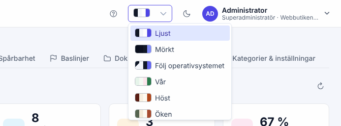
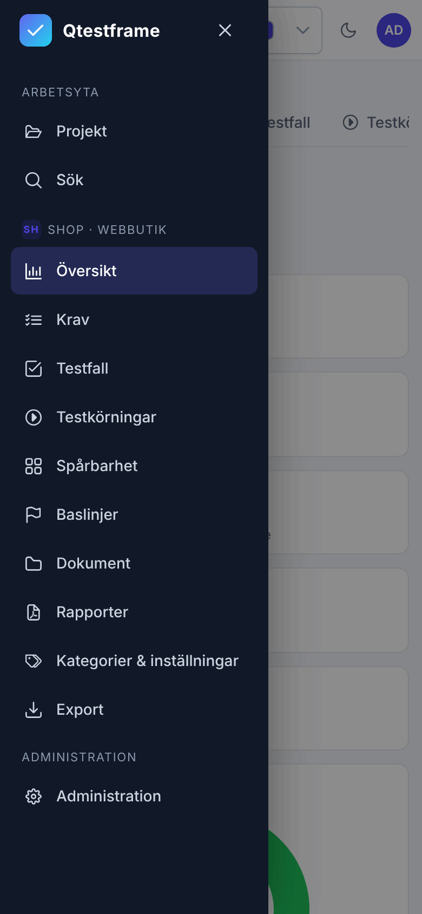
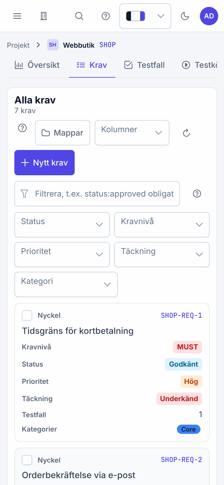

# Tillgänglighet och språk

Qtestframe är utformat för att uppfylla **WCAG 2.1 nivå AA**. Det fungerar med enbart tangentbord, med skärmläsare, med webbläsarens zoom, på mobiler och surfplattor, på engelska och svenska och i tjugotvå färgteman.

## Tangentbord

Allt kan göras utan mus.

| Tangent | Effekt |
|---|---|
| <kbd>Tabb</kbd> / <kbd>Skift</kbd>+<kbd>Tabb</kbd> | Gå till nästa / föregående kontroll. Kontrollen med fokus har en tydlig ram. |
| <kbd>Enter</kbd> / <kbd>Blanksteg</kbd> | Aktivera en knapp eller länk, kryssa i en kryssruta, växla en cell i spårbarhetsmatrisen. |
| <kbd>Esc</kbd> | Stäng en dialog, meny, utfällbar panel eller introduktionsturen. Fokus återgår dit du var. |
| Piltangenter | Flytta inom menyer, listor, flikar, mappträdet och valknappar. |
| <kbd>Ctrl</kbd>+<kbd>Enter</kbd> | Skicka en kommentar. |
| <kbd>Enter</kbd> i ett filterfält | Tillämpa frågan. |
| <kbd>?</kbd> | Öppna handbokens sida för den aktuella vyn (utanför textfält). |
| <kbd>Ctrl</kbd>+<kbd>Z</kbd> / <kbd>Ctrl</kbd>+<kbd>Skift</kbd>+<kbd>Z</kbd> eller <kbd>Ctrl</kbd>+<kbd>Y</kbd> | [Ångra / gör om](getting-started.md#ångra-och-gör-om) den senaste ändringen (utanför textfält; på Mac <kbd>⌘</kbd>). |

### Hopplänk

Första <kbd>Tabb</kbd> på varje sida visar **Hoppa till huvudinnehållet**. Tryck <kbd>Enter</kbd> för att hoppa förbi sidopanelen och övre fältet direkt till sidans innehåll.

### Byta sida

När du öppnar en annan sida flyttas fokus till dess huvudrubrik och sidans titel läses upp, så att du vet var du är utan att leta.

### Mappträd och tabeller

- I mappträdet flyttar piltangenterna mellan mappar och öppnar eller stänger dem. Mappens åtgärdsknapp **⋮** erbjuder allt som annars görs genom att dra eller högerklicka: ny undermapp, byt namn, flytta, ta bort.
- Rader i krav- och testfallstabellerna öppnas med <kbd>Enter</kbd> på titeln. För att flytta rader utan att dra markerar du dem och använder **Flytta** i verktygsfältet för massändring.

### Exekveringsvyn

Exekveringsvyn har kortkommandon med en tangent (<kbd>P</kbd> godkänn, <kbd>F</kbd> underkänn, <kbd>B</kbd> blockerad, <kbd>S</kbd> hoppa över, <kbd>J</kbd>/<kbd>K</kbd> eller pilarna för nästa/föregående steg, <kbd>?</kbd> hjälp). De fungerar bara när fokus inte står i ett textfält, så att skriva ett faktiskt resultat aldrig utlöser dem. Se [Kortkommandon](runs.md#kortkommandon).

## Skärmläsare

Qtestframe är byggt för att användas med skärmläsare som NVDA, JAWS, VoiceOver och TalkBack.

- Sidorna har **landmärken** (navigering, sökning, huvudinnehåll) och en logisk **rubrikstruktur**, så att du kan hoppa med skärmläsarens kommandon för rubriker och landmärken.
- Alla knappar som bara visar en ikon har en textetikett, till exempel *Ta bort SHOP-REQ-4* i stället för bara *papperskorg*.
- **Statusmeddelanden** (sparat, borttaget, misslyckat) läses upp artigt; fel läses upp direkt.
- Formulärfält har etiketter; obligatoriska fält och fel läses upp.
- I språkanalysen läses anmärkningarna upp med sin allvarlighetsgrad (fel, varning).
- På mobiler visas tabeller som staplade kort; varje värde läses upp tillsammans med sitt kolumnnamn.
- Skärmbilderna i handboken har textalternativ som beskriver vad de visar.
- **Introduktionsturen** är en modal dialog: texten läses upp vid varje steg, fokus stannar i dialogen och <kbd>Esc</kbd> avslutar den.

## Teman

Välj tema med **Färgtema** i övre fältet eller under **Profil → Inställningar → Tema**. Valet sparas med ditt konto och följer med till alla enheter. Knappen **Ljust läge / Mörkt läge** bredvid växlar snabbt mellan de ljusa och mörka grundtemana.

| Tema | Karaktär |
|---|---|
| **Ljust** | standard: ljust och neutralt |
| **Mörkt** | mörka ytor, skonsamt för ögonen i svagt ljus |
| **Följ operativsystemet** | ljust eller mörkt, enligt inställningen i din dator eller mobil |
| **Vår**, **Höst**, **Öken** | ljusa teman med årstidsfärger |
| **Hav**, **Solnedgång**, **Nordisk**, **Lavendel**, **Ros** | ljusa teman: havsblått, varma kvällsfärger, lugnt gråblått, mjukt violett, mjukt rosa |
| **Kamouflage**, **Stadskamouflage** | mörka teman med kamouflagemönster i sidopanelen och övre fältet |
| **Arktiskt kamouflage** | ett ljust tema med vinterkamouflage i vitt, ljusgrått och blågrått |
| **Marinblått**, **Midnatt**, **Skog** | mörka teman: marinblått med guld, djupt blåviolett, mörkgrönt |
| **Grön terminal**, **Bärnstensterminal** | mörka teman med jämnbreda tecken, som en gammal datorskärm |
| **Hög kontrast mörkt**, **Hög kontrast ljust** | vitt på svart (med gult) eller svart på vitt (med blått), med tydliga ramar och understrukna länkar, för nedsatt syn; texten uppfyller den strängare AAA-kontrasten 7:1 |
| **Galet** | ett lekfullt, färgstarkt tema |

Alla teman uppfyller AA-kraven på kontrast för text och kontroller. Qtestframe respekterar också systemets inställning för **minskad rörelse**.

## Språk

Användargränssnittet finns på **engelska** (*English*) och **svenska**.

- Byt språk med **Användarmeny → Språk** eller under **Profil → Inställningar → Språk**. Ändringen gäller direkt och sparas med ditt konto.
- **Webbläsarens språk** följer språket i din webbläsare; om det varken är engelska eller svenska används engelska.
- På inloggningssidan gäller språkknapparna innan du loggar in; efter inloggningen gäller din inställning.
- Datum och tal följer det valda språket om du inte anger ett annat **Datumformat** i dina inställningar.
- Den här handboken finns på båda språken. Om en sida ännu inte är översatt visas den engelska sidan med ett meddelande.
- [Rapporter](reports-and-export.md#standardrapporter) tas fram på det språk du använder när du skapar dem; schemalagda rapporter på språket hos den som schemalade dem.
- Dina data översätts inte: krav, testfall och kommentarer står kvar på det språk de skrevs på. Kravnivåerna enligt RFC 2119 (MUST, SHOULD …) visas alltid på engelska, även i det svenska gränssnittet, där de förklaras på svenska (till exempel *MUST (SKA)*). [Språkanalysen](requirements.md#språkanalysen) granskar kravtexter skrivna på engelska eller svenska, med svenska kravord som *SKA* och *BÖR*. Fältnamn och värden i frågespråket är också engelska.

## Mobiler och surfplattor

Qtestframe anpassar sig efter skärmstorleken; inget behöver installeras.

- **Under 1024 bildpunkter** (surfplattor, små fönster) blir sidopanelen en utfällbar panel. Öppna den med menyknappen (☰) uppe till vänster; den stängs när du väljer en sida, trycker utanför den eller trycker <kbd>Esc</kbd>.
- **Under 768 bildpunkter** blir sökfältet en förstoringsglasknapp som öppnar en sökdialog.
- **Under 640 bildpunkter** (mobiler) visas tabeller som staplade kort, formulär har en kolumn och redigerare öppnas i helskärm.
- Mappträdet på krav- och testfallssidorna öppnas med knappen **Mappar** på smala skärmar.
- Exekveringsvyn fungerar bra på en surfplatta bredvid systemet som testas.
- Stora tabeller som spårbarhetsmatrisen rullar i sidled inom sin ram; matrisens vy **Lista** är enklare att använda på en mobil.

## Zoom och textstorlek

När du zoomar i webbläsaren anpassas layouten i stället för att rulla i sidled; vid kraftig förstoring får du layouten för surfplattor eller mobiler som beskrivs ovan. Inställningar för textstorlek i webbläsaren eller operativsystemet respekteras. **Kompakta tabeller** i dina inställningar visar fler rader om du föredrar täthet framför storlek.
