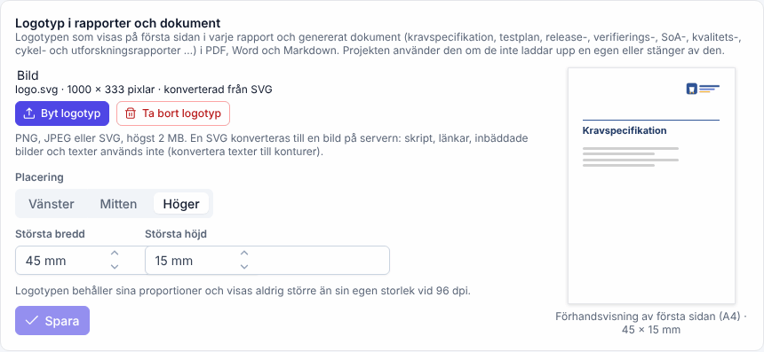
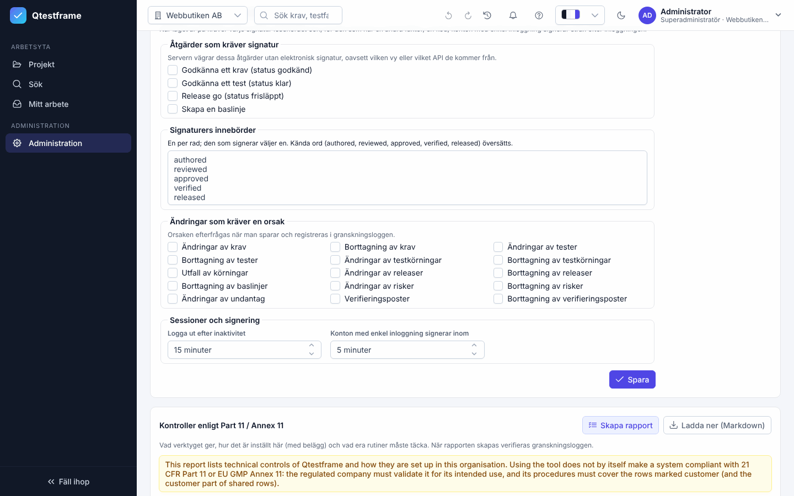
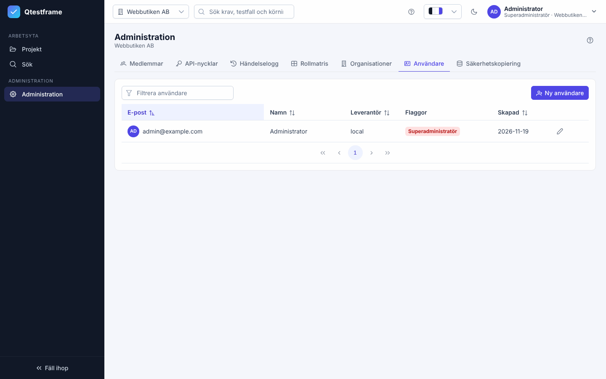

# Administration

**Administration** i sidopanelen visas för alla som får se minst en av dess delar. Vilka delar du ser beror på din roll:

| Del | Vem ser den |
|---|---|
| **Medlemmar** | alla (Läsare och uppåt) ser medlemslistan; **Administratörer** hanterar den |
| **Rollmatris** (roller och behörigheter) | alla |
| **API-nycklar** | Testare och uppåt (dina egna nycklar) |
| **Provisionering (SCIM)** | Administratörer |
| **Tvåstegsverifiering** | Administratörer (organisationens policy); superadministratörer ställer också in serverpolicyn |
| **Händelselogg** | Testledare och uppåt |
| **Elektroniska poster** | Testledare och uppåt (administratörer ändrar inställningarna) |
| **Organisationer** | Superadministratörer |
| **Användare** | Superadministratörer |
| **Säkerhetskopiering** | Superadministratörer |
| **Systeminställningar** | Superadministratörer |

## Organisationer och roller

En **organisation** är en isolerad arbetsyta: dess projekt, medlemmar, API-nycklar och händelselogg är osynliga för andra organisationer. En person har ett användarkonto för hela installationen och kan vara **medlem** i flera organisationer, med **en eller flera roller i var och en**.

### Roller och behörigheter

Varje organisation börjar med sju inbyggda roller. Som standard kan varje roll i tabellen allt som rollen ovanför kan, utom **Granskare** och **Ämnesexpert**, som står vid sidan av Testare:

| Roll | Kan dessutom (standard) |
|---|---|
| **Läsare** | läsa alla projekt, krav, testfall, körningar, dokument och medlemslistan; söka; exportera och ta fram rapporter |
| **Granskare** | godkänna och avvisa krav och markera testfall som klara (*requirement.review*, *test.review*), utan att redigera innehållet; skriva i [diskussioner](discussions.md) (*comment.create*, som alla roller nedan utom Läsare) |
| **Ämnesexpert** | delta i att skriva krav: skapa och redigera krav med kriterier, motivering, källor, relationer, länkar och bilagor (*requirement.write*); granska krav (*requirement.review*) och diskutera dem; läsa testfall, körningar, defekter och risker. Inga testfall, körningar, cykler, undantag, inställningar eller medlemmar |
| **Testare** | skriva och länka testfall, hantera testmappar och testfallskategorier, skapa och redigera körningar, registrera utfall, importera utfall från CI, ladda upp bilagor till testfall, körningar och exekveringar, skapa egna API-nycklar |
| **Testledare** | planera [testcykler](test-cycles.md) (*cycle.plan*), förvalta [testmiljöer](test-environments.md) och godkänna deras bokningar (*environment.manage*), markera testfall som klara (*test.review*), köra automatiserade skript på servern, läsa händelseloggen, ändra [inställningarna för testexekvering](#inställningar-för-testexekvering) |
| **Ansvarig** | godkänna och avvisa krav (*requirement.review*), skriva krav och kravmappar, skapa och redigera projekt, alla kategorier och [spårbarhetsreglerna](traceability-and-coverage.md#spårbarhetsregler), skapa baslinjer |
| **Administratör** | allt: ta bort projekt, hantera medlemmar och roller, byta namn på organisationen, återställa medlemmars lösenord, ta bort alla kommentarer |
| **Superadministratör** | allt i alla organisationer; hantera organisationer och användare; säkerhetskopiering och återställning |

**Flera roller.** En medlem kan ha flera roller samtidigt – till exempel *Ämnesexpert* och *Testare* för den som skriver krav inom sitt område och även testar. Hen har då alla rollernas behörigheter tillsammans; roller lägger bara till rättigheter. Den som har **Administratör** bland sina roller är administratör för organisationen.

Standardmatrisen med behörigheter:

| Behörighet | Läsare | Granskare | Ämnesexpert | Testare | Testledare | Ansvarig | Administratör |
|---|:-:|:-:|:-:|:-:|:-:|:-:|:-:|
| `project.read`, `requirement.read`, `test.read`, `run.read`, `member.read`, `export` | ✔ | ✔ | ✔ | ✔ | ✔ | ✔ | ✔ |
| `test.review` | | ✔ | | | ✔ | ✔ | ✔ |
| `requirement.review` | | ✔ | ✔ | | | ✔ | ✔ |
| `comment.create` | | ✔ | ✔ | ✔ | ✔ | ✔ | ✔ |
| `requirement.write` | | | ✔ | | | ✔ | ✔ |
| `change.create` | | | ✔ | | ✔ | ✔ | ✔ |
| `change.approve` | | | | | ✔ | ✔ | ✔ |
| `test.write`, `run.write`, `run.execute`, `token.manage` | | | | ✔ | ✔ | ✔ | ✔ |
| `cycle.plan`, `environment.manage`, `script.execute`, `audit.read`, `settings.manage` | | | | | ✔ | ✔ | ✔ |
| `waiver.approve`, `project.create`, `project.update` | | | | | | ✔ | ✔ |
| `project.delete`, `member.manage`, `role.manage`, `tenant.manage` | | | | | | | ✔ |

**Undantag och riskacceptans.** Att godkänna, avslå och återkalla [undantag och avvikelser](waivers-and-soa.md) och att signera acceptansen av en restrisk kräver `waiver.approve` (en projektbehörighet, så en projektroll kan ge den i ett enskilt projekt). Varje beslut är en elektronisk signatur (lösenord, eller en nyligen gjord enkel inloggning) och registreras i händelseloggen; den som begärt ett undantag kan inte besluta om det. Ge `waiver.approve` bara till personer som får acceptera att krav inte uppfylls.

**Ändringsbegäranden.** Att föreslå ändringar i [ändringsbegäranden](change-requests.md) (och bedöma, genomföra, verifiera och stänga dem) kräver `change.create`; att besluta om dem som medlem i projektets ändringsnämnd, och nödåtgärden förbi tvingande ändringshantering, kräver `change.approve`. Båda är projektbehörigheter. Varje beslut är en elektronisk signatur, och den som begärt en ändring kan inte besluta om den.

**Granskningsbeslut.** Att sätta ett krav till *Godkänt* eller *Avvisat* kräver `requirement.review`; att sätta ett testfall till *Klart* kräver `test.review`. Detsamma gäller massändringar, att skapa ett objekt med den statusen och att återställa en version som har den. En granskare utan skrivbehörighet får bara ändra statusen; att redigera något annat kräver fortfarande `requirement.write` eller `test.write`. Varje beslut registreras i händelseloggen som `requirement.review` eller `test.review`. Ett kopierat krav eller testfall börjar som *Utkast* och granskas alltså på nytt.

**Ärendehanterare.** Att ansluta ett projekt till Jira, GitHub eller GitLab kräver `project.update`; token anges där en gång och visas aldrig igen (se [Anslut Jira, GitHub eller GitLab](defects.md#anslut-jira-github-eller-gitlab), som också beskriver hur du skapar en GitLab-token med den minsta behörigheten, `api`). Att skicka och synkronisera defekter kräver `run.execute`; att skapa, uppdatera och läsa om [ärenden från krav](requirements.md#ärenden-i-gitlab-github-eller-jira) kräver `requirement.write`. De registreras i händelseloggen (`defect.push`, `defect.sync` när en status ändras, `requirement.issue.create`, `requirement.issue.update`, `requirement.issue.sync`).

### Ändra roller och skapa egna

*(Administratör, eller en roll med `role.manage`)* **Administration → Rollmatris** visar organisationens matris. Kryssa i eller ur en behörighet för alla roller utom **Administratör**; ändrade celler markeras och en rad visar hur många roller som har osparade ändringar. Välj **Spara** för att tillämpa dem; medlemmar med rollen får de nya behörigheterna direkt. Du kan bara ge behörigheter som du själv har.

- En inbyggd roll vars behörigheter skiljer sig från standard markeras *ändrad*; knappen **Återställ till standard** (↺) återställer dem.
- **Ny roll** skapar en egen roll: ange ett **Visningsnamn** (till exempel *Revisor*), ett **Tekniskt namn** (gemener, siffror och `_`, används i API:t och i SSO-gruppmappningar) och gärna en beskrivning, och välj vilken roll den ska börja med behörigheterna från. Justera sedan behörigheterna i matrisen.
- Egna roller markeras *egen*. Du kan byta namn på dem (✎) och ta bort dem (🗑) när ingen medlem eller API-nyckel använder dem.
- Nya roller kan väljas under **Medlemmar**, för API-nycklar och i gruppmappningen från identitetsleverantören.

**Administratör** har alltid alla behörigheter, så en organisation kan inte låsa ute sig själv.


Knappar för åtgärder som du inte får utföra döljs. Om du saknar en knapp som beskrivs i handboken, kontrollera din roll i användarmenyn.

## Medlemmar

**Administration → Medlemmar** listar medlemmarna i den aktuella organisationen med roll och sedan när de är medlemmar.


- **Lägg till medlem** *(Administratör)*: ange **E-post** och välj en eller flera **Roller**. Om personen redan har ett konto läggs hon eller han till med de rollerna. Om e-postadressen är okänd skapas ett lokalt konto: när servern kan skicka e-post låter du **Skicka en inbjudan med e-post** vara påslaget (se [Bjuda in med e-post](#bjuda-in-med-e-post)); annars anger du ett **Visningsnamn** och ett **Första lösenord**, och ber personen att byta det efter första inloggningen.
- **Ändra roller** *(Administratör)*: öppna rollerna på medlemmens rad och kryssa i eller ur roller; varje roll visas som en bricka, och en medlem har alltid minst en roll. Ändringen gäller direkt, även för personens API-nycklar. Organisationen har alltid minst en medlem med rollen **Administratör**.
- **Ta bort** *(Administratör)*: tar bort medlemskapet; själva kontot finns kvar.
- **Flera medlemmar på en gång** *(Administratör)*: kryssa i medlemmar (eller rutan i rubriken för alla visade), välj sedan en roll under **Ange roll** (de får exakt den rollen), **Lägg till roll** eller **Ta bort roll** (övriga roller finns kvar), eller välj **Ta bort**, och bekräfta. Ditt eget medlemskap lämnas som det är, liksom medlemmar vars roller inte skulle ändras eller som skulle stå utan roll; meddelandet visar vilka som hoppades över. Båda kan ångras (borttagna medlemmar läggs tillbaka med sina tidigare roller).
- En organisation måste ha minst **en administratör**: den sista administratören kan inte nedgraderas eller tas bort, och en ändring av flera medlemmar som skulle lämna organisationen utan administratör avvisas i sin helhet.
- Medlemmar märkta **SCIM** [provisioneras av er identitetsleverantör](#provisionering-med-scim): deras roller följer grupperna där, så rollerna kan inte ändras och de kan inte tas bort här (en ändring av flera medlemmar hoppar över dem).

### Bjuda in med e-post

*(Administratör, när e-post är inställt)* Med **Skicka en inbjudan med e-post** påslaget skickar **Lägg till och bjud in** ett e-postmeddelande med en länk till personen i stället för ett första lösenord. Länken leder till en sida där personen väljer namn och lösenord och loggas in direkt. Den kan användas **en gång** och gäller i **7 dagar**. För personer som loggar in med enkel inloggning (OIDC eller SAML) slår du också på **Använder enkel inloggning**; deras länk ber dem i stället att logga in med organisationens konto.

Tills inbjudan har antagits visar medlemmen etiketten **Inbjuden** (eller **Inbjudan har gått ut**); håll pekaren över den för att se när den skickades och hur länge den gäller. På medlemmens rad finns:

- **Skicka inbjudan igen**, som skickar en ny länk; den gamla slutar fungera. Använd den när inbjudan har gått ut eller kommit bort.
- **Återkalla inbjudan**, som gör länken oanvändbar och tar bort personen från organisationen.

Om personen redan har ett konto läggs hon eller han till direkt och får ett e-postmeddelande om det. Varje inbjudan, nytt utskick, återkallelse och antagen inbjudan sparas i [händelseloggen](#händelselogg).

### Återställa ett lösenord

*(Administratör, för lokala konton)*: välj **Återställ lösenord** på medlemmens rad. Qtestframe tar fram ett **tillfälligt lösenord** och visar det **en gång**; kopiera det och lämna det till personen på ett säkert sätt. Personen loggas ut överallt och måste välja ett nytt lösenord vid nästa inloggning.

Administratörer kan bara återställa lösenord för personer som enbart tillhör deras egen organisation; för superadministratörer och personer som även är medlemmar i andra organisationer måste en superadministratör göra det. Konton som loggar in med enkel inloggning har inget lösenord i Qtestframe.

### Återställa tvåstegsverifiering

Kolumnen **MFA** visar vem som använder tvåstegsverifiering: **På**, *Av*, eller **Saknas** när [MFA-policyn](#tvåstegsverifiering) kräver den för medlemmen men hen inte har konfigurerat den än.

*(Administratör)* När någon har tappat bort både telefonen och återställningskoderna väljer du **Återställ MFA** (skölden) på hens rad och bekräftar. Autentiseringsappen, återställningskoderna och ihågkomna enheter tas bort, personen loggas ut överallt och får en notis och ett e-postmeddelande. Därefter loggar hen in med bara lösenordet, eller, om MFA krävs för hen, konfigurerar en ny autentiseringsapp vid nästa inloggning. Försäkra dig om att begäran verkligen kommer från personen innan du återställer. Precis som för lösenord kan administratörer bara återställa personer som enbart tillhör deras organisation; superadministratörer kan återställa vem som helst, även under [Användare](#användare). Varje återställning registreras i [händelseloggen](#händelselogg).

## Tvåstegsverifiering

**Administration → Tvåstegsverifiering** bestämmer vem som måste använda en andra faktor (en autentiseringsapp, se [din profil](getting-started.md#tvåstegsverifiering)) vid inloggning med lösenord. Sidan visar hur många medlemmar som redan använder den.

- **Policy för organisationen** *(Administratör)*: **Valfritt** (standard: alla får, ingen måste), **Krävs för alla** eller **Krävs för vissa roller**, till exempel bara för administratörer. Den gäller medlemmarna utifrån deras roll i den här organisationen.
- **Serverpolicy** *(Superadministratör)*: samma val för alla användare i installationen; en roll räknas i vilken organisation som helst, och *Superadministratör* kan väljas som roll. En organisation kan kräva mer än servern, aldrig mindre.
- **Övergångsperiod**: personer som policyn börjar gälla för kan fortsätta logga in utan andra faktor i så här många dagar; de ser en påminnelse med datumet. Därefter måste de konfigurera den vid nästa inloggning innan de kan göra något annat. **0** betyder vid nästa inloggning.
- **Kom ihåg enheten** *(Superadministratör, serverpolicy)*: antalet dagar en webbläsare får hoppa över koden efter att användaren valt *Kom ihåg den här enheten*; **0** (standard) stänger av alternativet.

API-nycklar påverkas inte. Den som loggar in med enkel inloggning får normalt sin andra faktor från identitetsleverantören; om Qtestframe också ska fråga efter en egen kod ställs in per leverantör i serverkonfigurationen (`local_mfa`). Varje ändring av policyn registreras i [händelseloggen](#händelselogg).

## Delning av projekt

Normalt ser alla medlemmar i organisationen alla projekt, med sin organisationsroll. **Delning** ändrar det per projekt: du kan begränsa ett projekt till dem som arbetar med det och ge någon en annan roll i ett projekt än i organisationen.

Öppna det med **Dela** i projektets sidhuvud (eller dela-knappen för ett projekt på sidan **Projekt**) eller under **Kategorier & inställningar → Delning**. Du behöver `project.update` i projektet *(Ansvarig, eller en projektroll som har det)*.

**Åtkomst** har två val:

- **Alla i organisationen** (standard): alla medlemmar ser projektet med sin organisationsroll. Projektmedlemmar får i stället sin projektroll.
- **Begränsat till projektmedlemmar**: bara projektmedlemmarna (och organisationens administratörer) ser projektet. För alla andra finns det inte: det saknas i projektlistan, sökningen, granskningar och notiser, och länkar till det visar *hittades inte*. Begränsade projekt visas med ett lås (🔒) i projektlistan och sidhuvudet.

**Projektmedlemmar** är personer i organisationen eller grupper från din [identitetsleverantör (SCIM)](#provisionering-med-scim), var och en med en eller flera **projektroller**: vilka roller som helst i organisationen, även egna. I projektet **ersätter** projektrollerna organisationsrollerna, så den kan höja eller sänka någons rättigheter där: en Testare i organisationen kan vara Ansvarig i ett projekt, en Ansvarig bara Läsare i ett annat. En persons eget medlemskap går före en grupps; flera grupper läggs ihop. Organisationens administratörer har alltid full åtkomst till alla projekt.

- **Lägg till**: sök efter en person eller grupp på namn eller e-post, välj projektroller och välj **Lägg till**. Bara medlemmar i organisationen kan läggas till (lägg först till nya personer under [Medlemmar](#medlemmar)). Personen får en notis (och ett e-postmeddelande om hen vill ha notiser via e-post).
- **Ändra roller**: kryssa i eller ur roller i medlemmens rad. Roller som du inte får ge visas men kan inte tas bort.
- **Ta bort** tar bort någon från projektet; medlemmar kan också själva lämna ett projekt. **Flera medlemmar på en gång**: markera dem och välj sedan **Sätt projektroll**, **Lägg till projektroll**, **Ta bort projektroll** eller **Ta bort**.
- Du kan bara ge, ändra eller ta bort roller vars projektbehörigheter du själv har i projektet, så ingen kan ge mer än hen har.
- När du begränsar ett projekt som du ser genom dina organisationsroller läggs du till som projektmedlem med de rollerna, så att du inte stänger ute dig själv.
- Behörigheter för hela organisationen – medlemmar, roller, API-nycklar, händelseloggen, att skapa projekt – följer alltid organisationsrollerna. API-nycklar går aldrig utöver sina egna roller, inte heller i ett projekt.

Varje ändring av åtkomsten eller medlemmarna registreras i [händelseloggen](#händelselogg). Tar du bort någon från organisationen tas även hens projektmedlemskap bort. Ett duplicerat projekt behåller originalets medlemmar.

## E-post

Notiser med e-post, inbjudningar och [rapporter med e-post](reports-and-export.md#skicka-en-rapport-med-e-post) kräver en server för utgående e-post, som serveradministratören ställer in i avsnittet `email` i konfigurationsfilen. Utan den döljs funktionerna och profilen förklarar att notiserna bara visas i appen.

*(Administratör)* **Administration → Medlemmar → Skicka testmeddelande** skickar ett testmeddelande till din egen adress. Om det misslyckas visar meddelandet e-postserverns svar, till exempel ett felaktigt lösenord eller en nekad anslutning; lämna det till serveradministratören.

## Inställningar för testexekvering

*(Administratör och Testledare, eller en roll med `settings.manage`)* **Administration → Testexekvering** avgör när ett testfall får exekveras. Som standard kan ett testfall bara exekveras när:

- testfallet har status **Klar**,
- alla krav det verifierar har någon av de **klara statusarna** (standard **Godkänt**, **Implementerat** och **Verifierat**), och
- alla testfall det [beror på](tests.md#beroenden) har godkänts: i samma körning när det testfallet ingår i körningen, annars dess senaste utfall.

Varje regel kan lättas upp för sig: **Tillåt exekvering av testfall som inte är Klara**, **Tillåt exekvering av testfall för krav som inte är klara** och **Tillåt att testfall startas innan deras förutsättningar har godkänts**. Du kan också välja vilka kravstatusar som räknas som klara.

Det en regel förbjuder avvisas av servern, även för API-klienter och CI-importer. I appen ser du det direkt:

- i dialogen **Ny körning** markeras valda testfall som inte är klara, med en varning;
- på körningens sida visar kolumnen **Redo** och en sammanfattning vilka exekveringar som inte kan startas än;
- i exekveringsvyn listar en röd ruta orsakerna, med länkar till testfallet, kravet eller förutsättningen, och **Godkänd**, **Underkänd** och **Kör skript** är avstängda. Du kan fortfarande markera testfallet som **Blockerat** eller **Överhoppat**, tilldela det och skriva anteckningar;
- när en regel är upplättad visas samma orsaker som en gul varning, och testfallet kan exekveras.

**Kravstatus följer testutfallen** (på som standard) gör att ett implementerat krav blir **Verifierat** när det är [verifierat](traceability-and-coverage.md#verifiering) – varje kriterium har godkända belägg och varje underkrav är verifierat – och går tillbaka till **Implementerat** när det inte längre gäller. Avstängd ändras statusen bara för hand, och avvikelser listas under **Verifiering → Inkonsekvenser**. Om varje kriterium behöver egna belägg är en projektinställning (**Inställningar → Projekt → Verifiering**).

## Logotyp i rapporter och dokument

*(Admin och Testledare, eller en roll med `settings.manage`)* **Administration → Dokument** anger organisationens logotyp. Den visas överst på första sidan i varje [rapport](reports-and-export.md#logotyp-på-första-sidan) och [genererat dokument](documents.md#skapa-en-kravspecifikation-eller-en-testplan) — kravspecifikationer, testplaner, release-, verifierings-, SoA-, kvalitets-, cykel- och utforskningsrapporter, egna rapporter och exporten av ändringspåverkan — i PDF, Word och Markdown.



- **Ladda upp logotyp** tar en PNG-, JPEG- eller SVG-bild på högst 2 MB. En SVG konverteras till en bild på servern av Qtestframes egen renderare: skript, länkar, inbäddade bilder och texter i den används aldrig (konvertera texter till konturer innan du laddar upp den).
- **Placering** lägger logotypen till vänster (standard), i mitten eller till höger på sidan.
- **Största bredd** och **Största höjd** (i millimeter; standard 50 × 20 mm) begränsar storleken. Logotypen behåller sina proportioner och visas aldrig större än sin egen storlek vid 96 dpi.
- **Förhandsvisningen** visar första sidan i ett dokument med logotypen som den kommer att skrivas ut, även innan du sparar.

Projekten använder denna logotyp om de inte laddar upp en egen under **Kategorier och inställningar → Projekt → Logotyp i rapporter och dokument**, eller slår på **Ingen logotyp i projektets dokument** *(Förvaltare och Admin, eller en roll med `project.update`)*. Ett [projektarkiv](reports-and-export.md#spara-och-läs-in-projekt) tar med projektets egen logotyp; organisationens logotyp ingår i säkerhetskopior.

## Fältuppsättningar och mallar

*(Admin och Testledare, eller en roll med `settings.manage`)* **Administration → Fältuppsättningar** håller, per **projekttyp**, de [egna fält](requirements.md#egna-fält) som ett nytt projekt av den typen får och organisationens [mallar](requirements.md#mallar) för nya krav och testfall. En ändring i en fältuppsättning ändrar inte befintliga projekt: de behåller sina egna kopior och kan tillämpa uppsättningen igen under **Kategorier & inställningar → Egna fält → Tillämpa fältuppsättning** (fält som de redan har hoppas över). Organisationens mallar erbjuds i varje projekt av typen, bredvid de inbyggda. Alla i organisationen kan läsa fältuppsättningarna.

## Testkonfigurationer

*(Ansvarig och Administratör, eller en roll med `project.update`)* **Kategorier & inställningar → Konfigurationer** innehåller projektets testkonfigurationer: namngivna kombinationer av **dimensionsvärden** som *Webbläsare = Chrome* och *OS = Windows*, en hårdvaruversion eller en firmwareversion. En [körning](runs.md#konfigurationer-i-en-körning) som gäller konfigurationer exekverar vart och ett av sina testfall en gång per konfiguration. Alla som kan läsa projektet ser konfigurationerna.

- **Ny konfiguration**: lägg till dimensionsvärden (dimension och värde, varje dimension högst en gång) och eventuellt ett namn och en beskrivning. Utan namn får konfigurationen namn efter sina värden, till exempel *Chrome / Windows*. Namnen är unika i projektet, oavsett versaler och gemener.
- **Skapa kombinationer**: ange värdena för varje dimension åtskilda med komman (*Webbläsare*: Chrome, Firefox, Safari; *OS*: Windows, macOS), så visar dialogen alla kombinationer i förväg. **Skapa** lägger till alla på en gång (högst 200); med **Hoppa över kombinationer som redan finns** utelämnas befintliga namn.
- Pilarna ändrar i vilken ordning konfigurationerna listas och erbjuds; pennan redigerar en. Byter en konfiguration namn ändras namnet även i befintliga körningar.
- **Ta bort** (även för flera markerade konfigurationer) tar bort konfigurationer som ingen körning gäller. En konfiguration som används kan inte tas bort; ta först bort den från körningarna, eller ta bort de körningarna.

Kolumnen **Körningar** visar hur många körningar som gäller varje konfiguration. Att skapa konfigurationer kan ångras med ångraknappen.

## Ändringspåverkan, inaktualitet och defekter

*(Ansvarig och Administratör, eller en roll med `project.update`)* **Kategorier & inställningar → Ändringspåverkan** innehåller projektets regler för [ändringspåverkan](traceability-and-coverage.md#ändringspåverkan), [inaktuella utfall](traceability-and-coverage.md#inaktuella-utfall), [blockerande defekter](traceability-and-coverage.md#blockerande-defekter) och [regressioner](defects.md#regressioner). Alla som kan läsa projektet ser dem. Ändringar gäller från och med då: det som redan markerats förblir markerat.

## Varianter och kodintegration

*(Förvaltare och Administratör, eller en roll med `project.update`)* **Varianter** innehåller projektets produktvarianter, marknader och kundkonfigurationer; **Inställningar → Projekt → Kodintegration** innehåller den gemensamma hemligheten för projektets webhookar från GitLab och GitHub. Hemligheten lagras krypterad med de andra hemligheterna, kan bara skrivas och ingår inte i projektarkiv: ange en ny efter att ett projekt lästs in. Leveranser kontrolleras med hemligheten (GitLab) eller signaturen HMAC-SHA256 (GitHub), och varje leverans skrivs i granskningsloggen som `code.webhook`. CI-token behöver `run.execute` för att ladda upp resultat för ett bygge och `run.write` för att skapa en regressionskörning. Se [Varianter och kod](variants-and-code.md).

## Webbtester

[Webbtester](tests.md#webbtester-playwright) körs i en riktig webbläsare på servern. Serveradministratören slår på dem i konfigurationsfilen (`runner.web`, se nedan), och de ställs in per projekt under **Inställningar → Webbtester** *(Ansvarig; behörigheten project.update)*:

- **Bas-URL** — adressen till applikationen som testas, t.ex. `https://staging.example.com`. `page.goto('/login')` i ett webbtest öppnar då `https://staging.example.com/login`.
- **Bas-URL per miljö** — en körning vars **Miljö** stämmer med namnet (oavsett versaler) använder den här URL:en i stället, t.ex. *production* → `https://www.example.com`. En testkonfiguration med dimensionen **Bas-URL** går före båda.
- **Testvariabler** — namn och värde, som skickas till alla automatiserade skript i projektet som `QTF_VAR_<NAMN>` (i ett webbtest `process.env.QTF_VAR_USERNAME`). Markera lösenord och nycklar som **Hemlig**: värdet kan bara skrivas — det visas aldrig igen, inte ens för administratörer (lämna fältet tomt för att behålla det), och det ersätts av `***` i sparade utdata och felmeddelanden. Skärmbilder och spår kan ändå visa en hemlighet som sidan visar.

Bara medlemmar med behörigheten *script.execute* (som standard **Testledare** och **Ansvarig**) kan köra skript och webbtester. Skripten körs på servern med serverns rättigheter, begränsade bara av sandlådan; webbtester har alltid nätverksåtkomst, så se **Kör skript** som att köra kod på servern.

**Installation på servern** (serveradministratören):

1. Installera Node.js och Playwright i en katalog, t.ex. `/opt/qtestframe-playwright`: `npm i @playwright/test`, och sedan webbläsarna med `npx playwright install --with-deps chromium` (lägg till `firefox webkit` för de webbläsarna).
2. Sätt `runner.enabled: true` i konfigurationsfilen och:

   ```yaml
   runner:
     web:
       enabled: true
       node: /usr/bin/node
       playwright_dir: /opt/qtestframe-playwright   # innehåller node_modules/@playwright/test
       browsers_path: /opt/qtestframe-playwright/browsers  # PLAYWRIGHT_BROWSERS_PATH, om inte standard
       browser: chromium          # standardwebbläsare: chromium, firefox eller webkit
       headless: true
       timeout: 60s               # per test
       screenshots: on_failure    # on_failure, always eller off
       trace: on_failure          # on_failure, always eller off
       video: off                 # off, on_failure eller always
       max_parallel: 2            # webbtester som körs samtidigt
   ```

3. Starta om servern. **Kör skript** fungerar nu för webbtester; demoprojektet från `qtestframe seed-demo` har ett (*Login page shows the sign-in form*) som öppnar serverns egen inloggningssida — sätt `server.base_url` till adressen servern nås på.

## Konsistenskontroller

Projekt får inte de [inbyggda konsistenskontrollerna](traceability-and-coverage.md#inbyggda-konsistenskontroller) som regler automatiskt: en förvaltare lägger till dem med **Lägg till inbyggda kontroller** (de börjar som varningar, så releasernas beredskap ändras inte). Avfärdade fynd (*ingen dubblett*, *ingen konflikt*) ingår i säkerhetskopior och projektarkiv; de cachade vektorerna från den valfria tjänsten för inbäddningar gör det inte (se [Dubbletter och konflikter](duplicates-and-conflicts.md)).

## API-nycklar

Med API-nycklar kan skript och CI-pipelines använda REST-API:et utan lösenord, till exempel för [CI-importen](runs.md#importera-utfall-från-ci).


1. Öppna **Administration → API-nycklar** och välj **Ny API-nyckel** *(Testare)*.
2. Ange ett **Namn** som säger var den används, till exempel *GitLab CI*.
3. Välj **Roller** (som standard alla dina). En API-nyckel kan aldrig ha fler behörigheter än du.
4. Ange eventuellt **Upphör efter (dagar)**; tomt betyder att den aldrig upphör.
5. Välj **Skapa** och **kopiera nyckeln nu**: den börjar med `qtf_` och visas bara en gång.

Använd den som bearer-token: `Authorization: Bearer qtf_…`. En nyckel hör till en organisation och begränsas vid varje anrop till de roller du har där just då: om du förlorar en roll gör nyckeln det också. API-nycklar kan inte skapa nya nycklar. **Återkalla** en nyckel så snart den inte längre behövs eller kan ha läckt; klienter som använder den förlorar åtkomsten direkt. Listan visar när varje nyckel **Senast användes**.

## Provisionering med SCIM

*(Administratör)* Med SCIM 2.0 skapar, uppdaterar och inaktiverar er identitetsleverantör (Microsoft Entra ID, Okta, OneLogin, JumpCloud med flera) organisationens medlemmar åt dig: när någon tilldelas Qtestframe-appen hos leverantören blir personen medlem här, och när personen slutar försvinner åtkomsten.

Så fungerar det:

- **Användare.** En provisionerad användare matchas på e-postadress. Nya användare får ett konto **utan lösenord**: de loggar in med organisationens enkla inloggning (OpenID Connect eller SAML), som kopplar ihop kontot vid första inloggningen. Ett befintligt konto med samma e-postadress (till exempel en medlem som du har lagt till för hand) tas över.
- **Inaktivering.** När leverantören inaktiverar en användare tas medlemskapet bort, och personens sessioner och API-nycklar i den här organisationen upphör direkt. När leverantören aktiverar användaren igen kommer medlemskapet tillbaka med rollen från grupperna. Tar leverantören bort användaren försvinner medlemskapet; själva kontot finns kvar.
- **Roller från grupper.** Leverantören kan också skicka över grupper. Under **Roller för provisionerade medlemmar** väljer du för varje grupp vilken roll dess medlemmar får, eller **Ingen roll**. En medlem i flera kopplade grupper får rollerna för alla. Medlemmar utan kopplad grupp får **Standardrollen** (*Läsare* om du inte ändrar den), eller ingenting med **Ingen åtkomst**.
- **Skyddade regler.** SCIM gör aldrig någon till superadministratör och tar aldrig bort den statusen, och organisationen har alltid kvar en administratör: en ändring som skulle ta bort den sista administratören avvisas. E-postadress och namn för en person som även hör till andra organisationer ändras inte av den här organisationens leverantör.
- **Medlemslistan.** Provisionerade medlemmar är märkta **SCIM** under **Administration → Medlemmar**. Ändra deras roll via grupperna hos leverantören (eller gruppkopplingen här); rollen kan inte ändras och de kan inte tas bort för hand, eftersom nästa synkronisering skulle ångra det.

### Anslut identitetsleverantören

1. Öppna **Administration → Provisionering (SCIM)** och välj **Ny SCIM-nyckel**. Ge den ett **Namn**, till exempel *Entra ID*, eventuellt en giltighetstid, och välj **Skapa**.
2. **Kopiera nyckeln nu**: den börjar med `qtfscim_` och visas bara en gång. En SCIM-nyckel fungerar bara för provisionering av den här organisationen; den är ingen API-nyckel, och API-nycklar fungerar inte för provisionering.
3. Kopiera **Bas-URL för SCIM** från samma sida (den slutar med `/scim/v2`).
4. Ställ in provisioneringen hos leverantören:
   - **Microsoft Entra ID**: öppna **Provisioning** i företagsprogrammet för Qtestframe, sätt läget till **Automatic**, ange bas-URL:en som **Tenant URL** och nyckeln som **Secret Token**, välj **Test Connection** och spara. Tilldela användare och grupper till programmet och starta provisioneringen. Entra ID matchar användare på `userName` (användarens UPN eller e-postadress) och synkroniserar ungefär var 40:e minut.
   - **Okta**: aktivera **SCIM provisioning** i appintegrationen för Qtestframe, ange bas-URL:en som **SCIM connector base URL**, välj `email` som **Unique identifier field for users**, välj **Push New Users**, **Push Profile Updates** och **Push Groups**, och välj autentiseringen **HTTP Header** med nyckeln. Aktivera *Create Users*, *Update User Attributes* och *Deactivate Users* under **To App**, tilldela sedan personer och skicka över grupper.
   - Andra leverantörer fungerar på samma sätt: bas-URL, bearer-token och de användare och grupper som ska skickas över.
5. När de första grupperna har kommit kopplar du dem till roller under **Roller för provisionerade medlemmar** och väljer **Standardroll**.

**Senaste provisioneringshändelser** på samma sida visar de senaste ändringarna; varje ändring finns också i [händelseloggen](#händelselogg), med utföraren *SCIM: nyckelns namn*. **Återkalla** en nyckel när du byter ut den eller om den kan ha läckt; leverantören slutar då provisionera tills den får en ny. Alla ändringar i ett anrop sparas tillsammans eller inte alls, och en leverantör som skickar för många anrop bromsas (HTTP 429).

## OSLC

Qtestframe har en OSLC-leverantör (Requirements Management 2.1 och Quality Management 2.1) under `/api/v1/oslc/`, så att ALM-verktyg som IBM Engineering Lifecycle Management (DOORS Next, ETM), Polarion eller Codebeamer kan hitta, länka, skapa och ändra krav och testfall. Den är alltid på; vad användarna kan göra med den beskrivs i [Samverkan](interoperability.md#oslc).

- **Adresser:** katalogen `/api/v1/oslc/catalog` (en tjänsteleverantör per projekt), en katalog per projekt `/api/v1/oslc/projects/<id>/catalog`, upptäcktsdokumentet `/api/v1/oslc/rootservices` (öppet, innehåller inga data). Ställ in **Bas-URL** under [Systeminställningar](#systeminställningar) (`server.base_url`) så att resursadresserna är de som klienterna når.
- **Konton:** klienter loggar in med en [API-nyckel](#api-nycklar) som `Authorization: Bearer …`; klienter som bara har användarnamn och lösenord kan skicka nyckeln som lösenord (valfritt användarnamn). Skapa nyckeln för en person eller ett tjänstekonto vars roll tillåter det som verktyget ska göra: **Läsare** för att läsa och länka från andra hållet, en roll med skrivbehörighet för att skapa och ändra poster. Projektdelning gäller: begränsade projekt listas bara för sina medlemmar.
- **Stöds:** RDF/XML, Turtle och JSON-LD åt båda hållen; creation factories, uppdateringar med `If-Match` (en inaktuell uppdatering nekas), borttagning till papperskorgen; frågor med `oslc.where` på valfri egenskap, `oslc.select`, `oslc.orderBy`, `oslc.searchTerms` och sidindelning; länkegenskaper som spårlänkar, relationer och länkar till det andra verktygets poster; delegerade urvals- och skapadialoger; resource shapes.
- **Dialoger i en ram:** urvals- och skapadialogerna öppnas i ett eget fönster. För verktyg som visar dem inne på sin sida lägger serverns operatör in verktygets adress i `server.frame_ancestors` (administratörshandboken, *Koppla ihop med andra verktyg*).
- **Stöds inte:** OAuth 1.0a (använd API-nycklar), förhandsvisningar, tracked resource sets och konfigurationshantering.

API-referensen (`docs/api.md`, avsnittet *OSLC*) listar egenskaperna och frågesyntaxen.

## Händelselogg

*(Testledare och uppåt)* **Administration → Händelselogg** registrerar vem som gjorde vad och när i organisationen: skapande, ändring och borttagning av objekt, inloggningar, ändringar av medlemskap med mera. De nyaste posterna visas först. Varje post visar avataren för den som utförde händelsen.


- Filtrera på användare, åtgärd, objekt eller detaljer med en fråga, till exempel `user:anna action:delete` eller `entity:requirement created_at>=2026-09-01`.
- Begränsa tidsperioden med **Från datum** och **Till datum**.
- **Antal poster** anger hur många som visas (upp till 5000).
- **Exportera CSV** laddar ner den filtrerade loggen till en revisor; **Exportera Markdown** laddar ner den som ett Markdown-dokument med datumintervallet och filtret.


### Verifiera händelseloggen

Händelseloggen kan inte ändras i programmet, och varje post är kopplad till posten före med en hash (ett fingeravtryck av innehållet), så en ändring som görs direkt i databasen syns. **Verifiera granskningsloggen** högst upp på sidan kontrollerar hela kedjan och visar antingen *Granskningsloggen är intakt* (med antalet poster och signerade kontrollpunkter) eller den **första brutna länken**: postens nummer och vad som är fel – posten har ändrats, poster saknas eller har tagits bort i slutet, eller kedjan har skrivits om. Spara beläggen och rapportera enligt era rutiner.

**Exportera med hashar (JSON)** och **(CSV)** laddar ner hela loggen med varje posts nummer, hash och hashen av posten före, för arkivering utanför Qtestframe. *Detaljer* för en post visar också dess nummer, hash och, i läget för elektroniska poster, orsaken till ändringen.

## Läge för elektroniska poster

*(Administratörer ändrar det; testledare och uppåt kan läsa det och skapa rapporten)* **Administration → Elektroniska poster** slår på de kontroller som reglerade organisationer behöver för elektroniska poster och signaturer (21 CFR Part 11, EU GMP Annex 11). Läget är **av** tills en administratör slår på det. När det är på:

- **Varje signatur kräver att du bekräftar vem du är**: ditt lösenord och, om du använder en autentiseringsapp, en kod från den. Du väljer signaturens **innebörd** (till exempel *Godkänd* eller *Granskad*) från organisationens lista. Loggar du in med enkel inloggning signerar du strax efter inloggningen.
- **Vissa åtgärder kräver signatur**: administratören väljer bland att godkänna ett krav, godkänna ett test (status *Klar*), release go (*Frisläppt*) och att skapa en baslinje. När du gör någon av dem – i redigeraren, en massändring, kalkylbladsvyn eller en massgranskning – öppnas signaturdialogen; ändringen sparas när du har signerat. Avbryter du sparas ingenting.
- **Vissa ändringar kräver en orsak**: när du sparar en sådan ändring frågar en dialog varför (till exempel numret på en ändringsbegäran). Orsaken sparas i händelseloggen tillsammans med ändringen.
- **Du loggas ut efter en tid utan aktivitet** (standard 15 minuter). Uppdateringar i bakgrunden, som antalet aviseringar, håller dig inte inloggad.

Signerade poster visar sina **Elektroniska signaturer**: namn och e-post för den som signerade, datum och tid i UTC och i den personens tidszon, innebörden, vad som signerades och hur personen bekräftade sig. När posten ändras efter signeringen visar signaturen *Posten ändrad efter signeringen*. Du hittar dem under **Historik** för ett krav eller test, bland en baslinjes signeringar, i ett undantag, vid acceptansen av en risk och i en release.



Administratören anger på samma sida vilka åtgärder som kräver signatur, innebörderna (en per rad), vilka ändringar som kräver en orsak, tiden för inaktivitet och hur snart efter inloggningen konton med enkel inloggning får signera. **Skapa rapport** visar **Kontroller enligt Part 11 / Annex 11**: för varje krav i regelverken vad Qtestframe gör, vad organisationens rutiner måste täcka och belägg från den här installationen; **Ladda ner (Markdown)** sparar den. Qtestframe ger tekniska kontroller – validering, utbildning, skriftliga policyer och kontroll av identiteten innan någon får ett konto är fortfarande organisationens ansvar, och rapporten säger det.

## Organisationer

*(Superadministratör)* **Administration → Organisationer** listar alla organisationer.

- **Ny organisation**: ett **Kortnamn** (används vid inloggning, till exempel `acme`) och ett **Namn**.
- **Byt namn på organisation** (får även göras av organisationens administratörer).
- **Byt** till en organisation för att arbeta i den. Du arbetar där i ditt eget namn: ingen, inte ens en superadministratör, kan logga in som en annan användare.
- Listan visar **medlemmar**, **projekt** och **lagring** för varje organisation, mot dess gränser.
- **Användning och regler** visar antalen (krav, testfall, körningar, filer, senaste aktivitet), vad organisationens administratörer har slagit på (AI-assistans, läge för elektroniska poster, flerfaktorsautentisering) och de **regler** som bara superadministratörer ändrar: flest **medlemmar**, **projekt** och mest **lagring** (0 = ingen gräns; att lägga till fler nekas), **Förbjud AI-assistans**, **Tillåtna inloggningssätt** (lösenord eller en leverantör för enkel inloggning; medlemmar vars konto använder ett annat sätt kan inte öppna organisationen) och **E-postdomäner** vars nya användare med enkel inloggning går med i den.
- **Stäng av** stoppar organisationen utan att ta bort något: medlemmarna kan inte öppna den och dess API-tokens slutar fungera tills du **Återaktiverar** den.
- **Granskningslogg** öppnar organisationens [händelselogg](#händelselogg).
- **Ta bort** tar bort organisationen med **alla** dess projekt och data. Det går inte att ångra: dialogen erbjuder **Ladda ned säkerhetskopia** först och ber dig skriva organisationens kortnamn. Du kan inte ta bort organisationen du arbetar i.

## Användare

*(Superadministratör)* **Administration → Användare** listar alla konton i installationen med inloggningsleverantör och flaggor.



- **Ny användare**: e-post, visningsnamn, lösenord och eventuellt **Superadministratör**.
- **Redigera användare**: ändra visningsnamnet, ange ett nytt lösenord (**Återställ lösenord (valfritt)**), gör användaren till superadministratör eller markera kontot som **Inaktiverad**. Att inaktivera ett konto eller ange ett lösenord loggar ut användaren överallt. **Måste byta lösenord** tvingar fram ett nytt lösenord vid nästa inloggning.
- Du kan inte ta bort din egen superadministratörsflagga eller inaktivera dig själv, och den sista aktiverade superadministratören förblir alltid en.
- **Filtrera** på namn eller e-post, status (aktiverad eller inaktiverad), inloggningssätt, flerfaktorsautentisering eller superadministratörer.
- Knapparna på en rad visar användarens **organisationer** med roller och öppna sessioner, **loggar ut användaren överallt** (API-tokens fortsätter att gälla), återställer den andra faktorn eller ett lokalt lösenord och **inaktiverar** eller **aktiverar** kontot.
- **Exportera personuppgifter** (nedladdningsknappen) ger en ZIP-fil med allt servern har om personen, för en begäran om registerutdrag. **Radera användare** anonymiserar kontot när du har skrivit dess e-postadress: det får en pseudonym (*Former user #n*), personuppgifter, sessioner och tokens raderas, innehållet finns kvar under pseudonymen, och elektroniska signaturer och poster i händelseloggen finns kvar som de registrerades. Raderingen kan inte ångras; se [administratörshandboken](../../admin-guide/sv/privacy.md#radering-anonymisering).

Användare som loggar in med enkel inloggning via OIDC eller SAML kan skapas automatiskt vid första inloggningen, med en roll som hämtas från grupperna hos identitetsleverantören; det konfigureras på servern (se [administratörshandboken](../../admin-guide/sv/authentication.md#provisionering-av-användare-med-single-sign-on)).

## Säkerhetskopiering och återställning

*(Superadministratör)* **Administration → Säkerhetskopiering** sparar och återställer hela installationen.


- **Ladda ner säkerhetskopia** skapar en ZIP-fil med alla organisationer, projekt, objekt, versionshistorik, kommentarer och filer (sessioner ingår inte). Förvara den säkert; den innehåller alla data, även lösenordshashar.
- **Återställning**: välj filen med säkerhetskopian, skriv `RESTORE` för att bekräfta och välj **Återställ säkerhetskopia**. Det **ersätter alla data** i installationen med filens innehåll, i ett enda steg. Säkerhetskopian måste komma från samma version av databasschemat. Alla, även du, loggas ut efteråt.

Återställningen är avsedd för katastrofåterställning och flytt till en ny server. För att få tillbaka ett enskilt objekt använder du i stället dess [versionshistorik](requirements.md#versionshistorik-och-återställning). En säkerhetskopia innehåller även systeminställningarna (nedan), med de hemligheter som sparats där; de gäller så snart återställningen är klar.

Hemligheter i en säkerhetskopia (hemligheter för autentiseringsappar, webhook-hemligheter, ärendesystemets token, hemliga testvariabler, e-postlösenordet och klienthemligheter) förblir **krypterade** i filen. En säkerhetskopia kan bara återställas på en server som har samma nyckel som servern den kommer från (se [Kryptering av lagrade hemligheter](#kryptering-av-lagrade-hemligheter)); annars nekas återställningen och ingenting ändras. Serveradministratören förvarar nyckeln säkert, skild från säkerhetskopiorna.

## Systeminställningar

*(Superadministratör)* **Administration → Systeminställningar** ändrar serverns konfiguration medan den kör: inloggning och lösenord, API-tokens, enkel inloggning, loggning och syslog, e-postservern, utgående anslutningar, testkörningen, liveuppdateringar, likhet och AI-assistans. Inställningar som bara kan anges i konfigurationsfilen (lyssningsadressen, TLS, databasen, härdningen) visas skrivskyddade med sin källa. Organisationsadministratörer ser inte sidan: varje inställning gäller hela installationen.

Välj en del i listan till vänster (på en telefon: överst); delarna är grupperade i *Server*, *Åtkomst* och *Tjänster*. **Sök bland alla inställningar** ovanför listan hittar en inställning i vilken del som helst via namn, hjälptext eller värde och tar dig dit. Varje del har en egen knapp **Spara avsnittet**; bara de värden du ändrat skickas, efter en bekräftelse som listar varje ändring med gammalt och nytt värde.

- **Exportera konfiguration** laddar ner den gällande konfigurationen som en YAML-fil där alla hemligheter är utbytta mot `REDACTED`, till exempel för att föra in den i serverns konfigurationsfil.
- **Exportera inställningar (JSON)** laddar bara ned värdena som ändrats på sidan, utan hemligheter; **Importera inställningar** läser en sådan fil (till exempel från en testserver), visar vad den skulle ändra och sparar den när du bekräftat. Låsta inställningar, hemligheter och okända nycklar i filen hoppas över och listas.

### Var ett värde kommer ifrån

Varje inställning har en etikett som visar var det nuvarande värdet kommer ifrån:

- **Standard** – det inbyggda värdet.
- **Konfigurationsfil** – satt i serverns konfigurationsfil.
- **Miljövariabel** – satt med en `QTF_…`-miljövariabel på servern.
- **Ändrad här** – ändrad på den här sidan (sparad i databasen).

Ett värde som ändrats här går före konfigurationsfilen och standardvärdet, men inte före en miljövariabel. **Återställ till filens värde** tar bort din ändring, så att värdet i konfigurationsfilen (eller standardvärdet) gäller igen. Om ett värde du ändrat senare sätts av en miljövariabel eller låses, säger sidan att det sparade värdet ignoreras.

Vissa inställningar kan inte ändras här. De har ett lås och en förklaring:

- **Satt med miljövariabel** – en miljövariabel vinner alltid; be serveradministratören ändra den.
- **Låst av serveradministratören** – konfigurationsfilen listar inställningen under `system_settings.locked`.
- **Bara i konfigurationsfilen** – visas som information (till exempel lyssningsadressen eller databasen), eftersom de bara kan ändras med en omstart av servern.

De flesta inställningar gäller direkt. Inställningar med etiketten **Gäller efter omstart** (testkörningen, gränserna för liveuppdateringar, HTTP-tidsgränserna) sparas nu och börjar gälla nästa gång servern startar; till dess visar sidan värdet som används, och en banderoll överst listar varje ändring som väntar på en omstart. Om de sparade inställningarna någon gång blir ogiltiga (till exempel efter en ändring i konfigurationsfilen) bortser servern från dem vid start och sidan visar en varning.

Varje ändring registreras i [händelseloggen](#händelselogg) med gammalt och nytt värde; lösenord och klienthemligheter skrivs aldrig dit, bara att de satts eller ändrats.

### Enkel inloggning (OIDC)

Delen **Enkel inloggning (OIDC)** listar de OpenID Connect-leverantörer som visas som knappar på inloggningssidan.

- **Lägg till leverantör** frågar efter ett namn (gemener, siffror, `-` och `_`; det ingår i återanropsadressen), **Knapptext**, **Utfärdare** (issuer-URL), **Klient-id** och **Klienthemlighet**, **Scopes**, vilka claims som innehåller e-postadress, namn och grupper, och hur användare skapas: **Skapa användare vid första inloggningen**, **Standardroll** och organisation, och en koppling **Grupp → roll**.
- **Testa anslutningen** hämtar utfärdarens discovery-dokument (`/.well-known/openid-configuration`) från servern och berättar om det hittades och vilka adresser det anger. Om det misslyckas visas orsaken, till exempel att servern inte når adressen eller att utfärdaren i dokumentet inte stämmer.
- Registrera **Återanrops-URL** som visas för leverantören i din identitetsleverantör.
- Klienthemligheten kan bara skrivas: den visas aldrig igen. Lämna fältet tomt för att behålla den; **Ta bort den sparade hemligheten** raderar den.
- Reglaget i listan stänger av en leverantör utan att ta bort den. Ändringar gäller direkt; den som håller på att logga in hos en oförändrad leverantör avbryts inte.

När du ändrat leverantörerna här ersätter den här listan leverantörerna i konfigurationsfilen. Hemligheter för leverantörer från filen stannar i filen och kopieras inte. **Återställ till filens värde** tar tillbaka leverantörerna från konfigurationsfilen.

### Loggning och syslog

Välj **Loggnivå** och **Loggformat** för serverloggen, och om loggen (även händelseloggen) också ska skickas till en central **syslog**-server: nätverk (`udp`, `tcp`, `tls` eller en lokal socket), adress, meddelandeformat, facility och tagg. **Skicka testmeddelande** skickar ett meddelande med värdena i formuläret, innan du sparar dem; resultatet visas och läses upp vid knappen. Ändringar gäller direkt. Certifikat för syslog över TLS anges i konfigurationsfilen.

### E-postserver

SMTP-servern för aviseringar, inbjudningar och rapporter: värd, port, kryptering (`starttls`, `tls` eller `none`), användarnamn, lösenord, avsändaradress och avsändarnamn, tidsgräns och timmen för den dagliga sammanfattningen. Lösenordet kan bara skrivas. **Skicka testmejl** skickar ett meddelande till din egen adress med värdena i formuläret (och det sparade lösenordet, om du inte skrivit ett nytt). Stänger du av e-post skickas ingen e-post alls.

### Säkerhet

**Sessionens livslängd** (hur länge en inloggning varar; gäller nya inloggningar), **tidsgränsen för inaktivitet** (0 = av), lösenordsreglerna för lokala konton – **minsta längd**, **teckenklasser** (gemener, versaler, siffror, symboler), **lösenordshistorik** och **lösenordets giltighet** – antalet **misslyckade inloggningar** efter vilka fler försök från samma adress för samma konto nekas, och hur länge. **Lokal inloggning** (e-post och lösenord) kan bara stängas av när minst en leverantör för enkel inloggning är aktiv.

**API-tokens**: längsta livslängd för nya tokens i dagar, och om de alls behöver ett utgångsdatum.

**Utgående anslutningar**: en proxy för serverns utgående anrop (webhooks, chatt, ärendehanterare, AI, inbäddningar, discovery för enkel inloggning), de värdar som får eller inte får nås, och **Blockera privata adresser** så att ingen kan få servern att anropa ert interna nät. **Kontrollera adress** testar en adress mot reglerna.

**Behörigheter** förklarar vem som får göra vad och länkar till rollmatrisen, organisationer, användare och provisionering.

SAML-leverantörer konfigureras i konfigurationsfilen; delen **Enkel inloggning** listar dem med adresserna som ska registreras hos identitetsleverantören, och **Testa metadata** kontrollerar att servern kan läsa leverantörens metadata. OIDC-leverantörer har också en **knappikon**, **tillåtna e-postdomäner** och kan ge flera roller per grupp (`grupp=roll1, roll2`).

### Kryptering av lagrade hemligheter

Delen **Server och databas** visar också, skrivskyddat, hur de hemligheter som servern måste kunna läsa tillbaka skyddas: hemligheter för autentiseringsappar, webhookarnas signeringshemligheter, ärendesystemets token, hemliga testvariabler samt e-postlösenordet och klienthemligheterna som anges på den här sidan. De lagras **krypterade** (AES-256-GCM) i databasen. Tidigare versioner lagrade dem okrypterade; det gäller inte längre, och värden som sparats av en tidigare version krypteras när servern startar. Lösenord och åtkomstnycklar har aldrig lagrats som de är: bara deras hashvärden sparas.

Sidan visar:

- **Nyckelleverantör** – vad som skyddar nyckeln: en **lokal nyckel** (en nyckelfil på servern eller en miljövariabel), serverns **TPM 2.0**-krets eller en **hårdvarusäkerhetsmodul** (PKCS#11).
- Leverantörens uppgifter, till exempel nyckelfilen eller TPM-enheten, och **nyckelns fingeravtryck**, som identifierar nyckeln utan att avslöja den.
- Den **aktiva datanyckeln** och hur många **lagrade hemligheter** som är krypterade. Om några inte är krypterade ännu visas ett meddelande; de krypteras nästa gång servern startar.

Nyckelleverantören väljs i serverns konfigurationsfil (avsnittet `secrets`) och kan inte ändras här. Utan dess nyckel går de lagrade hemligheterna – och säkerhetskopiorna – inte att läsa; be serveradministratören att förvara den säkert. Serveradministratören hanterar nycklarna på kommandoraden, till exempel `qtestframe secrets status` och `qtestframe secrets rotate`; se [administratörshandboken](../../admin-guide/sv/security.md#kryptering-av-lagrade-hemligheter).

### Testkörning

Om automatiserade skript och webbtester får köras på servern, deras tidsgränser och begränsningar, och vad webbtester sparar som bevis. Inställningarna **gäller efter omstart** av servern, eftersom körningen och dess sandlåda förbereds när servern startar. Slår du på körningen kan medlemmar med rätt behörighet köra kod på servern; läs [säkerhetsavsnitten i administratörshandboken](../../admin-guide/sv/security.md#sandlådan-för-skript-och-webbtester) först.

Gallring: borttagna objekt ligger i [papperskorgen](requirements.md#versionshistorik-och-återställning) i 30 dagar; det går inte att ändra. Om säkerhetskopior, se [Säkerhetskopiering och återställning](#säkerhetskopiering-och-återställning). Flerfaktorsautentisering har en egen sida som länkas från systeminställningarna.

Serveradministratören kan göra samma sak på kommandoraden:

```bash
qtestframe backup --out qtestframe-backup.zip
qtestframe restore --in qtestframe-backup.zip --yes
```

## Kommandoraden

Serveradministratörer kan också hantera organisationer, användare och medlemmar med kommandot `qtestframe`, till exempel för att skapa den första organisationen:

```bash
qtestframe tenant create --slug acme --name "Acme AB"
echo 'Initial-pass-123' | qtestframe user create --email alice@example.com --name Alice --password-stdin
qtestframe member add --tenant acme --email alice@example.com --role manager
```
