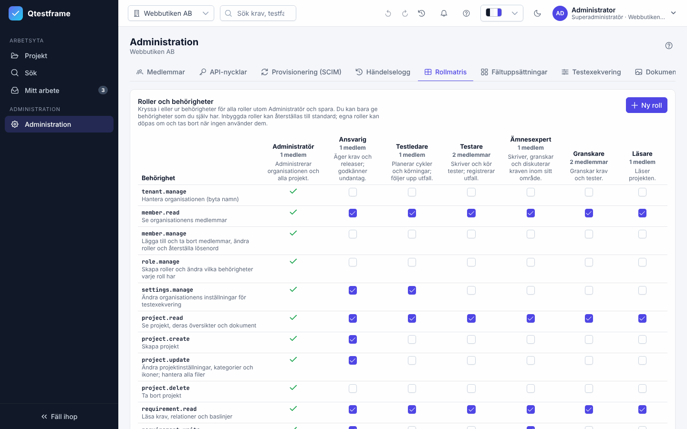
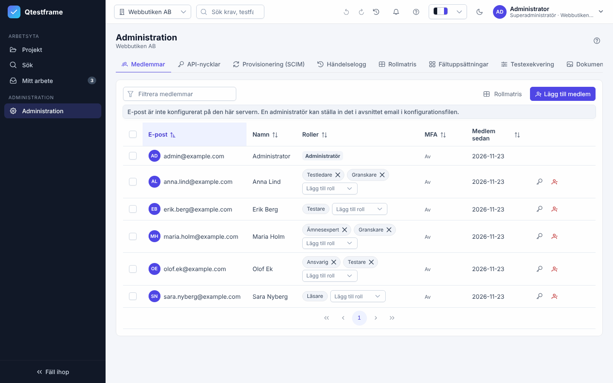
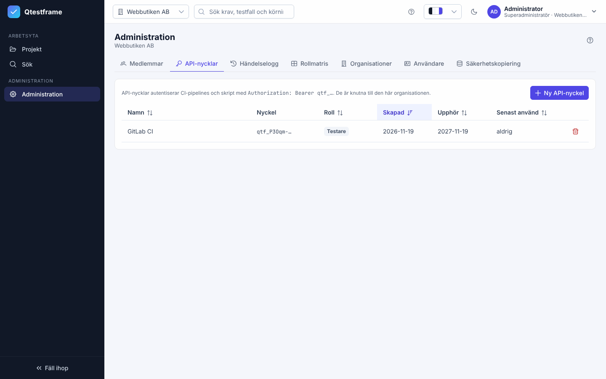
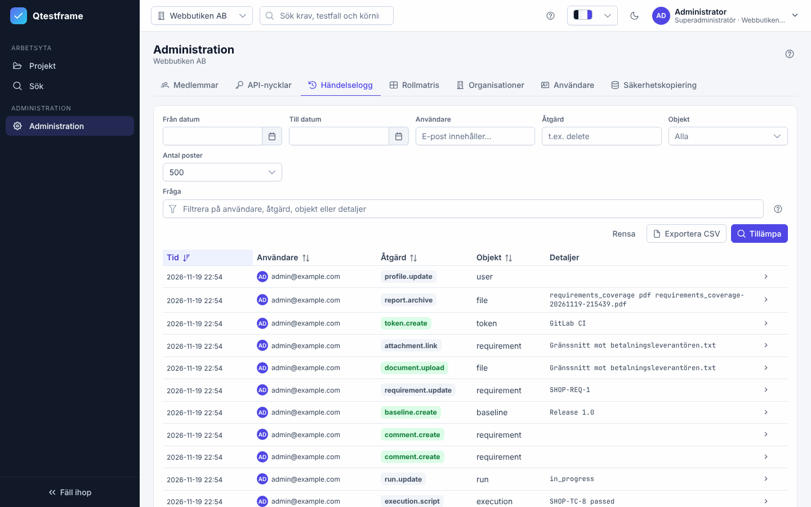
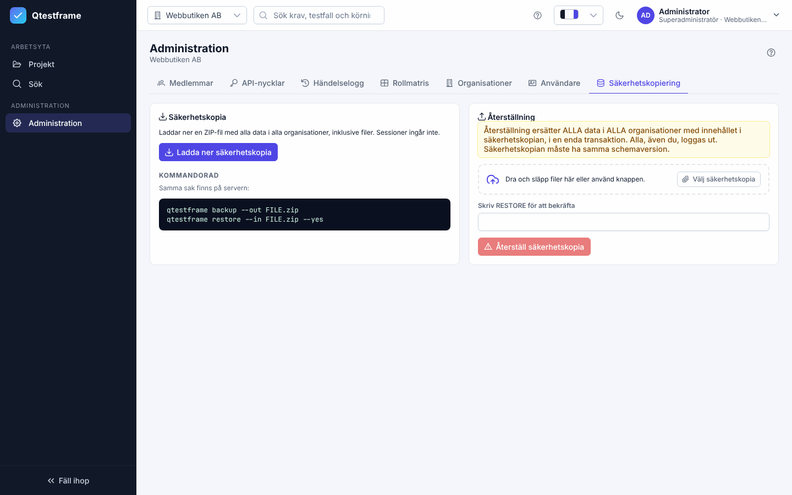

# Administration

**Administration** i sidopanelen visas för alla som får se minst en av dess delar. Vilka delar du ser beror på din roll:

| Del | Vem ser den |
|---|---|
| **Medlemmar** | alla (Läsare och uppåt) ser medlemslistan; **Administratörer** hanterar den |
| **Rollmatris** (roller och behörigheter) | alla |
| **API-nycklar** | Testare och uppåt (dina egna nycklar) |
| **Händelselogg** | Ansvarig och uppåt |
| **Organisationer** | Superadministratörer |
| **Användare** | Superadministratörer |
| **Säkerhetskopiering** | Superadministratörer |

## Organisationer och roller

En **organisation** är en isolerad arbetsyta: dess projekt, medlemmar, API-nycklar och händelselogg är osynliga för andra organisationer. En person har ett användarkonto för hela installationen och kan vara **medlem** i flera organisationer, med **en roll i var och en**.

### Roller och behörigheter

Varje organisation börjar med sex inbyggda roller. Som standard kan varje roll i tabellen allt som rollen ovanför kan, utom **Granskare**, som står vid sidan av Testare:

| Roll | Kan dessutom (standard) |
|---|---|
| **Läsare** | läsa alla projekt, krav, testfall, körningar, dokument och medlemslistan; söka; exportera och ta fram rapporter |
| **Granskare** | godkänna och avvisa krav och markera testfall som klara (*requirement.review*, *test.review*), utan att redigera innehållet |
| **Testare** | skriva och länka testfall, hantera testmappar och testfallskategorier, skapa och redigera körningar, registrera utfall, importera utfall från CI, ladda upp bilagor till testfall, körningar och exekveringar, skapa egna API-nycklar |
| **Testledare** | markera testfall som klara (*test.review*), köra automatiserade skript på servern, läsa händelseloggen, ändra [inställningarna för testexekvering](#inställningar-för-testexekvering) |
| **Ansvarig** | godkänna och avvisa krav (*requirement.review*), skriva krav och kravmappar, skapa och redigera projekt och alla kategorier, skapa baslinjer |
| **Administratör** | allt: ta bort projekt, hantera medlemmar och roller, byta namn på organisationen, återställa medlemmars lösenord, ta bort alla kommentarer |
| **Superadministratör** | allt i alla organisationer; hantera organisationer och användare; säkerhetskopiering och återställning |

Standardmatrisen med behörigheter:

| Behörighet | Läsare | Granskare | Testare | Testledare | Ansvarig | Administratör |
|---|:-:|:-:|:-:|:-:|:-:|:-:|
| `project.read`, `requirement.read`, `test.read`, `run.read`, `member.read`, `export` | ✔ | ✔ | ✔ | ✔ | ✔ | ✔ |
| `test.review` | | ✔ | | ✔ | ✔ | ✔ |
| `requirement.review` | | ✔ | | | ✔ | ✔ |
| `test.write`, `run.write`, `run.execute`, `token.manage` | | | ✔ | ✔ | ✔ | ✔ |
| `script.execute`, `audit.read`, `settings.manage` | | | | ✔ | ✔ | ✔ |
| `requirement.write`, `project.create`, `project.update` | | | | | ✔ | ✔ |
| `project.delete`, `member.manage`, `role.manage`, `tenant.manage` | | | | | | ✔ |

**Granskningsbeslut.** Att sätta ett krav till *Godkänt* eller *Avvisat* kräver `requirement.review`; att sätta ett testfall till *Klart* kräver `test.review`. Detsamma gäller massändringar, att skapa ett objekt med den statusen och att återställa en version som har den. En granskare utan skrivbehörighet får bara ändra statusen; att redigera något annat kräver fortfarande `requirement.write` eller `test.write`. Varje beslut registreras i händelseloggen som `requirement.review` eller `test.review`. Ett kopierat krav eller testfall börjar som *Utkast* och granskas alltså på nytt.

### Ändra roller och skapa egna

*(Administratör, eller en roll med `role.manage`)* **Administration → Rollmatris** visar organisationens matris. Kryssa i eller ur en behörighet för alla roller utom **Administratör**; ändrade celler markeras och en rad visar hur många roller som har osparade ändringar. Välj **Spara** för att tillämpa dem; medlemmar med rollen får de nya behörigheterna direkt. Du kan bara ge behörigheter som du själv har.

- En inbyggd roll vars behörigheter skiljer sig från standard markeras *ändrad*; knappen **Återställ till standard** (↺) återställer dem.
- **Ny roll** skapar en egen roll: ange ett **Visningsnamn** (till exempel *Revisor*), ett **Tekniskt namn** (gemener, siffror och `_`, används i API:t och i SSO-gruppmappningar) och gärna en beskrivning, och välj vilken roll den ska börja med behörigheterna från. Justera sedan behörigheterna i matrisen.
- Egna roller markeras *egen*. Du kan byta namn på dem (✎) och ta bort dem (🗑) när ingen medlem eller API-nyckel använder dem.
- Nya roller kan väljas under **Medlemmar**, för API-nycklar och i gruppmappningen från identitetsleverantören.

**Administratör** har alltid alla behörigheter, så en organisation kan inte låsa ute sig själv.



Knappar för åtgärder som du inte får utföra döljs. Om du saknar en knapp som beskrivs i handboken, kontrollera din roll i användarmenyn.

## Medlemmar

**Administration → Medlemmar** listar medlemmarna i den aktuella organisationen med roll och sedan när de är medlemmar.



- **Lägg till medlem** *(Administratör)*: ange **E-post** och välj **Roll**. Om personen redan har ett konto läggs hon eller han till med den rollen. Om e-postadressen är okänd skapas ett lokalt konto: när servern kan skicka e-post låter du **Skicka en inbjudan med e-post** vara påslaget (se [Bjuda in med e-post](#bjuda-in-med-e-post)); annars anger du ett **Visningsnamn** och ett **Första lösenord**, och ber personen att byta det efter första inloggningen.
- **Ändra roll** *(Administratör)*: välj en annan roll på medlemmens rad. Ändringen gäller direkt, även för personens API-nycklar.
- **Ta bort** *(Administratör)*: tar bort medlemskapet; själva kontot finns kvar.
- **Flera medlemmar på en gång** *(Administratör)*: kryssa i medlemmar (eller rutan i rubriken för alla visade), välj sedan en roll under **Ange roll** eller välj **Ta bort**, och bekräfta. Ditt eget medlemskap lämnas som det är, liksom medlemmar som redan har rollen; meddelandet visar vilka som hoppades över. Båda kan ångras (borttagna medlemmar läggs tillbaka med sina tidigare roller).
- En organisation måste ha minst **en administratör**: den sista administratören kan inte nedgraderas eller tas bort, och en ändring av flera medlemmar som skulle lämna organisationen utan administratör avvisas i sin helhet.

### Bjuda in med e-post

*(Administratör, när e-post är inställt)* Med **Skicka en inbjudan med e-post** påslaget skickar **Lägg till och bjud in** ett e-postmeddelande med en länk till personen i stället för ett första lösenord. Länken leder till en sida där personen väljer namn och lösenord och loggas in direkt. Den kan användas **en gång** och gäller i **7 dagar**. För personer som loggar in med enkel inloggning (OIDC eller SAML) slår du också på **Använder enkel inloggning**; deras länk ber dem i stället att logga in med organisationens konto.

Tills inbjudan har antagits visar medlemmen etiketten **Inbjuden** (eller **Inbjudan har gått ut**); håll pekaren över den för att se när den skickades och hur länge den gäller. På medlemmens rad finns:

- **Skicka inbjudan igen**, som skickar en ny länk; den gamla slutar fungera. Använd den när inbjudan har gått ut eller kommit bort.
- **Återkalla inbjudan**, som gör länken oanvändbar och tar bort personen från organisationen.

Om personen redan har ett konto läggs hon eller han till direkt och får ett e-postmeddelande om det. Varje inbjudan, nytt utskick, återkallelse och antagen inbjudan sparas i [händelseloggen](#händelselogg).

### Återställa ett lösenord

*(Administratör, för lokala konton)*: välj **Återställ lösenord** på medlemmens rad. Qtestframe tar fram ett **tillfälligt lösenord** och visar det **en gång**; kopiera det och lämna det till personen på ett säkert sätt. Personen loggas ut överallt och måste välja ett nytt lösenord vid nästa inloggning.

Administratörer kan bara återställa lösenord för personer som enbart tillhör deras egen organisation; för superadministratörer och personer som även är medlemmar i andra organisationer måste en superadministratör göra det. Konton som loggar in med enkel inloggning har inget lösenord i Qtestframe.

## E-post

Notiser med e-post, inbjudningar och [rapporter med e-post](reports-and-export.md#skicka-en-rapport-med-e-post) kräver en server för utgående e-post, som serveradministratören ställer in i avsnittet `email` i konfigurationsfilen. Utan den döljs funktionerna och profilen förklarar att notiserna bara visas i appen.

*(Administratör)* **Administration → Medlemmar → Skicka testmeddelande** skickar ett testmeddelande till din egen adress. Om det misslyckas visar meddelandet e-postserverns svar, till exempel ett felaktigt lösenord eller en nekad anslutning; lämna det till serveradministratören.

## Inställningar för testexekvering

*(Administratör och Testledare, eller en roll med `settings.manage`)* **Administration → Testexekvering** avgör när ett testfall får exekveras. Som standard kan ett testfall bara exekveras när:

- testfallet har status **Klar**,
- alla krav det verifierar har någon av de **klara statusarna** (standard **Godkänt**, **Implementerat** och **Verifierat**), och
- alla testfall det [beror på](tests.md#beroenden) har godkänts: i samma körning när det testfallet ingår i körningen, annars dess senaste utfall.

Varje regel kan lättas upp för sig: **Tillåt exekvering av testfall som inte är Klara**, **Tillåt exekvering av testfall för krav som inte är klara** och **Tillåt att testfall startas innan deras förutsättningar har godkänts**. Du kan också välja vilka kravstatusar som räknas som klara.

Det en regel förbjuder avvisas av servern, även för API-klienter och CI-importer. I appen ser du det direkt:

- i dialogen **Ny körning** markeras valda testfall som inte är klara, med en varning;
- på körningens sida visar kolumnen **Redo** och en sammanfattning vilka exekveringar som inte kan startas än;
- i exekveringsvyn listar en röd ruta orsakerna, med länkar till testfallet, kravet eller förutsättningen, och **Godkänd**, **Underkänd** och **Kör skript** är avstängda. Du kan fortfarande markera testfallet som **Blockerat** eller **Överhoppat**, tilldela det och skriva anteckningar;
- när en regel är upplättad visas samma orsaker som en gul varning, och testfallet kan exekveras.

## API-nycklar

Med API-nycklar kan skript och CI-pipelines använda REST-API:et utan lösenord, till exempel för [CI-importen](runs.md#importera-utfall-från-ci).



1. Öppna **Administration → API-nycklar** och välj **Ny API-nyckel** *(Testare)*.
2. Ange ett **Namn** som säger var den används, till exempel *GitLab CI*.
3. Välj **Roll**. En API-nyckel kan aldrig ha högre roll än du.
4. Ange eventuellt **Upphör efter (dagar)**; tomt betyder att den aldrig upphör.
5. Välj **Skapa** och **kopiera nyckeln nu**: den börjar med `qtf_` och visas bara en gång.

Använd den som bearer-token: `Authorization: Bearer qtf_…`. En nyckel hör till en organisation och begränsas vid varje anrop till den roll du har där just då: om din roll sänks, sänks även nyckelns. API-nycklar kan inte skapa nya nycklar. **Återkalla** en nyckel så snart den inte längre behövs eller kan ha läckt; klienter som använder den förlorar åtkomsten direkt. Listan visar när varje nyckel **Senast användes**.

## Händelselogg

*(Ansvarig)* **Administration → Händelselogg** registrerar vem som gjorde vad och när i organisationen: skapande, ändring och borttagning av objekt, in- och utloggningar, ändringar av medlemskap med mera. De nyaste posterna visas först. Varje post visar avataren för den som utförde händelsen.



- Filtrera på användare, åtgärd, objekt eller detaljer med en fråga, till exempel `user:anna action:delete` eller `entity:requirement created_at>=2026-09-01`.
- Begränsa tidsperioden med **Från datum** och **Till datum**.
- **Antal poster** anger hur många som visas (upp till 5000).
- **Exportera CSV** laddar ner den filtrerade loggen till en revisor.

## Organisationer

*(Superadministratör)* **Administration → Organisationer** listar alla organisationer.

- **Ny organisation**: ett **Kortnamn** (används vid inloggning, till exempel `acme`) och ett **Namn**.
- **Byt namn på organisation** (får även göras av organisationens administratörer).
- **Byt** till en organisation för att arbeta i den.
- **Ta bort** tar bort organisationen med **alla** dess projekt och data. Det går inte att ångra.

## Användare

*(Superadministratör)* **Administration → Användare** listar alla konton i installationen med inloggningsleverantör och flaggor.


- **Ny användare**: e-post, visningsnamn, lösenord och eventuellt **Superadministratör**.
- **Redigera användare**: ändra visningsnamnet, ange ett nytt lösenord (**Återställ lösenord (valfritt)**), gör användaren till superadministratör eller markera kontot som **Inaktiverad**. Att inaktivera ett konto eller ange ett lösenord loggar ut användaren överallt. **Måste byta lösenord** tvingar fram ett nytt lösenord vid nästa inloggning.
- Du kan inte ta bort din egen superadministratörsflagga eller inaktivera dig själv.

Användare som loggar in med enkel inloggning via OIDC eller SAML kan skapas automatiskt vid första inloggningen, med en roll som hämtas från grupperna hos identitetsleverantören; det konfigureras på servern (se driftdokumentationen).

## Säkerhetskopiering och återställning

*(Superadministratör)* **Administration → Säkerhetskopiering** sparar och återställer hela installationen.



- **Ladda ner säkerhetskopia** skapar en ZIP-fil med alla organisationer, projekt, objekt, versionshistorik, kommentarer och filer (sessioner ingår inte). Förvara den säkert; den innehåller alla data, även lösenordshashar.
- **Återställning**: välj filen med säkerhetskopian, skriv `RESTORE` för att bekräfta och välj **Återställ säkerhetskopia**. Det **ersätter alla data** i installationen med filens innehåll, i ett enda steg. Säkerhetskopian måste komma från samma version av databasschemat. Alla, även du, loggas ut efteråt.

Återställningen är avsedd för katastrofåterställning och flytt till en ny server. För att få tillbaka ett enskilt objekt använder du i stället dess [versionshistorik](requirements.md#versionshistorik-och-återställning).

Serveradministratören kan göra samma sak på kommandoraden:

```bash
qtestframe backup --out qtestframe-backup.zip
qtestframe restore --in qtestframe-backup.zip --yes
```

## Kommandoraden

Serveradministratörer kan också hantera organisationer, användare och medlemmar med kommandot `qtestframe`, till exempel för att skapa den första organisationen:

```bash
qtestframe tenant create --slug acme --name "Acme AB"
echo 'Initial-pass-123' | qtestframe user create --email alice@example.com --name Alice --password-stdin
qtestframe member add --tenant acme --email alice@example.com --role manager
```
