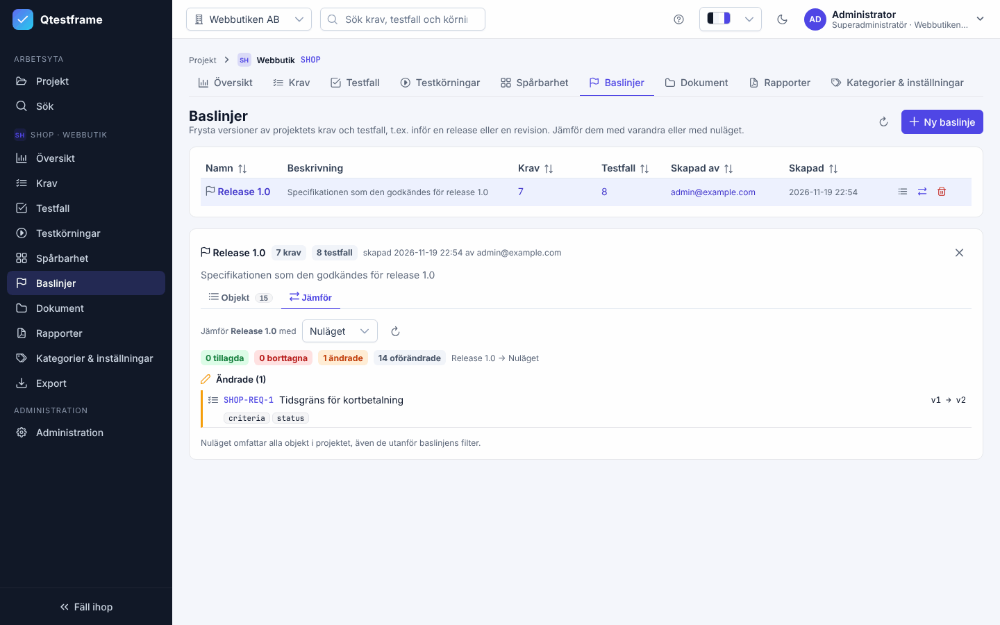

# Baslinjer

En **baslinje** fryser den aktuella versionen av projektets krav och testfall under ett namn, till exempel *Release 2.0* eller *Revision 2026-Q3*. Senare kan du jämföra baslinjen med nuläget eller med en annan baslinje och se exakt vad som har lagts till, tagits bort eller ändrats.

Att visa och jämföra baslinjer kräver **Läsare**; att skapa och ta bort dem kräver **Ansvarig**.

## Baslinje eller version?

| | Version (versionshistorik) | Baslinje |
|---|---|---|
| Vad | en version av **ett** objekt | versionerna av **alla** (eller filtrerade) objekt vid ett tillfälle |
| Skapas | automatiskt vid varje ändring | av dig, när du behöver det |
| Används för | att se och ångra ändringar av ett objekt | releaser, revisioner, godkännanden, jämförelser mellan releaser |
| Var | fliken **Versionshistorik** i redigeraren | **Baslinjer** i projektets sidopanel |

En baslinje kopierar inget som du kan redigera; den registrerar vilken version av varje objekt som hörde till den. Att ta bort en baslinje ändrar aldrig objekten.

## Skapa en baslinje

1. Välj **Baslinjer** och sedan **Ny baslinje**.
2. Ange ett **Namn**, till exempel *Release 2.0*, och gärna en beskrivning.
3. Ange eventuellt ett **Filter**, till exempel `folder:Kassa` eller `status:approved`. Det tillämpas på krav och testfall på samma sätt som exportfiltret. Tomt betyder alla krav och testfall.
4. Välj **Skapa baslinje**. Listan visar hur många krav och testfall den innehåller.

## Titta i en baslinje

Välj en baslinje för att se dess **Objekt**: varje krav och testfall med den version det hade. Filtrera på **Krav** eller **Testfall**.

## Jämför

1. Välj **Jämför** för en baslinje.
2. Välj **Nuläget** eller en annan baslinje i projektet under **Jämför med**.
3. Resultatet listar:
   - **Tillagda**: objekt som finns nu (eller i den andra baslinjen) men inte i den första;
   - **Borttagna**: objekt som fanns i den första baslinjen men inte längre finns;
   - **Ändrade**: objekt vars version skiljer sig, med båda versionsnumren och de ändrade fälten;
   - antalet oförändrade objekt.

Objekten matchas på sin identitet, inte på nyckeln: ett krav som har flyttats eller fått en ny nyckel visas som *ändrat*, inte som borttaget och tillagt.

**Nuläget** omfattar alla objekt i projektet, även de utanför baslinjens filter. Använd **Jämför igen** efter fler ändringar.

För att se detaljerna i en ändring öppnar du objektet och tittar på fliken **Versionshistorik**; den visar skillnaden fält för fält för varje version.

## Typiska användningsfall

- **Release:** skapa *Release 1.0* när specifikationen är godkänd; under nästa release jämför du med nuläget för att skriva release notes.
- **Revision:** en revisor kan se exakt vilken version av varje krav som gällde vid ett visst datum.
- **Två releaser:** jämför *Release 1.0* med *Release 2.0* för att se vad som ändrades mellan dem.
