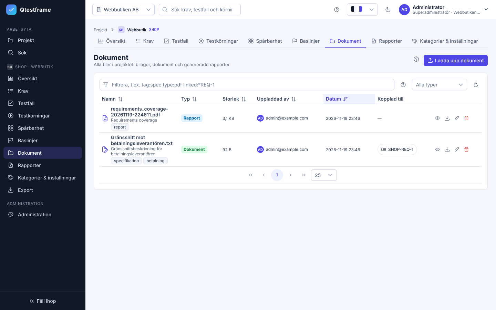

# Dokument

Varje projekt har ett **dokumentarkiv**: en samlad plats för alla filer i projektet. Det innehåller

- **dokument** som du laddar upp direkt till arkivet, till exempel specifikationer, avtal, testplaner eller mötesanteckningar;
- **bilagor** som har laddats upp till ett krav, ett testfall, en körning eller en exekvering;
- **rapporter** som har tagits fram och sparats i arkivet (se [Rapporter](reports-and-export.md#standardrapporter));
- **skapade dokument**: en kravspecifikation eller en testplan som Qtestframe skriver åt dig (se [nedan](#skapa-en-kravspecifikation-eller-en-testplan)).

Välj **Dokument** i projektets sidopanel. Alla som kan läsa projektet kan se och ladda ned dess filer.



## Hitta filer

- Tabellen visar varje fils **namn**, **typ** (dokument, bilaga eller rapport), **storlek**, vem som laddade upp den, när, dess taggar och de objekt den är **Kopplad till**.
- Filtrera på **Typ**, eller med en [fråga](search-and-filters.md) på fälten `name`, `description`, `tag`, `kind`, `type` (innehållstyp), `uploaded_by`, `created_at`, `size` och `linked`:

```text
kind=report                                    bara framtagna rapporter
type:pdf created_at>=2026-09-01                PDF-filer sedan september
linked:SHOP-REQ-12                             filer som är bifogade till SHOP-REQ-12
tag:avtal -kind=attachment                     avtalsdokument
size>5000000                                   filer större än ungefär 5 MB
```

## Ladda upp

1. Välj **Ladda upp dokument**, eller dra filer från datorn till sidan.
2. Flera filer laddas upp efter varandra; en förloppslista visar varje fil och rapporterar fel (till exempel en fil som är för stor).
3. Lägg till en beskrivning och taggar, åtskilda med kommatecken, så att filerna blir lättare att hitta. Du kan ändra dem senare med **Redigera**.

Den största tillåtna storleken är 25 MB per fil om administratören inte har angett en annan gräns. Att ladda upp dokument till arkivet kräver rollen **Testare** eller **Ansvarig** (rätten att redigera testfall eller krav).

## Skapa en kravspecifikation eller en testplan

Qtestframe kan skriva två kompletta dokument åt dig och spara dem i arkivet:

- en **kravspecifikation** enligt ISO/IEC/IEEE 29148: titelsida, dokumentinformation med revisionshistorik, innehållsförteckning, en inledning (syfte, projektets beskrivning som omfattning och vad nyckelorden SKA, BÖR och FÅR betyder), kraven grupperade efter mapp, kategori eller typ, en spårbarhetsmatris och en ordlista med referenser;
- en **testplan** med **testspecifikation** enligt ISO/IEC/IEEE 29119-3: egenskaperna som ska testas (kraven som testfallen verifierar), testansatsen med startkriterier (organisationens [regler för körning](runs.md#när-kan-ett-testfall-exekveras)) och slutkriterier (era [releasers](releases-and-risks.md)), testmiljön (konfigurationer och körningarnas miljöer), roller, tidplanen (releaser och körningar), därefter varje testfall med sina steg, och en bilaga om täckning med de krav som saknar testfall.

1. Välj **Skapa dokument** och välj **Kravspecifikation** eller **Testplan**. (Sidan **Rapporter** har samma två dokument under **Dokument**.)
2. Välj i dialogen:
   - **Titel**, **Version** och **Författare**. Lämnas de tomma är titeln dokumentets namn, versionen en mer än den senaste versionen av samma typ i arkivet (*1.0*, *2.0* …) och författaren du.
   - **Dokumentets språk**: engelska eller svenska, ditt språk som standard. En svensk specifikation förklarar nyckelorden **SKA**, **BÖR** och **FÅR** och hur de motsvarar MUST, SHOULD och MAY.
   - **Format**: PDF, Word (DOCX) eller Markdown. PDF och Word har titelsida, sidnummer och innehållsförteckning; i Word får innehållsförteckningen sina sidnummer när Word uppdaterar fältet (det frågar när filen öppnas).
   - **Innehåll**: aktuella krav och testfall, eller en [baslinje](baselines.md). Med en baslinje visar dokumentet de frysta texterna, och dess signaturer listas som godkännanden.
   - **Filter**: en [fråga](search-and-filters.md) på kraven (specifikation) eller testfallen (testplan), till exempel `status:approved` eller `folder:Kassa`.
   - **Ta med avvisade och inaktuella krav** (och, för en testplan, utfasade testfall). De utelämnas som standard.
   - **Gruppera kraven efter** mapp, kategori (en dimension) eller typ (bara specifikation; en testplan grupperas alltid efter mapp).
   - Vilka **fält** som visas för varje krav eller testfall, och vilka **bilagor**. *Senaste utfall* är avstängt som standard: en specifikation beskriver, den rapporterar inte.
3. Välj **Skapa**. En förloppsindikator visas medan dokumentet skrivs; ett projekt med tusentals krav tar några sekunder.

Det nya dokumentet visas överst i arkivet, markerat, med **Öppna** (PDF) och **Ladda ner**. Det är ett *dokument* med taggarna `generated`, `requirements-specification` eller `test-plan` och versionen (till exempel `v2.0`); de tidigare versionerna av samma typ utgör dess revisionshistorik. Nyckelord i kravtexterna (MUST, SHALL, SKA …) skrivs i fetstil.

Att skapa dokument kräver rätten att exportera, att läsa krav (och testfall för en testplan) och att ladda upp dokument (**Testare** eller **Ansvarig**).

## Förhandsvisa och ladda ned

- **Förhandsvisa** visar bilder (PNG, JPEG, GIF, WebP), PDF-filer och vanlig text direkt i webbläsaren.
- **Ladda ner** sparar filen. Andra filtyper laddas alltid ned i stället för att visas, av säkerhetsskäl.

## Arbeta med många filer på en gång

Kryssa i filer i listan (rubrikens kryssruta markerar hela sidan). Verktygsfältet erbjuder:

- **Ladda ner som ZIP**: ett arkiv med alla markerade filer (högst 512 MB tillsammans). Filer med samma namn numreras, till exempel *plan (2).pdf*. Alla som kan se arkivet kan ladda ner.
- **Lägg till taggar** / **Ta bort taggar** för alla markerade filer.
- **Beskrivning**: ersätter beskrivningen av varje fil (tomt rensar den).
- **Ta bort**, efter bekräftelse.

Ändringar och borttagning gäller de filer du får ändra: dina egna uppladdningar, eller alla filer om du har behörighet att ändra projektet. Om urvalet också innehåller andra filer visar verktygsfältet hur många av dem du kan ändra, och bara de ändras. Ändringar av taggar och beskrivning kan ångras med ångra-knappen.

## Länka dokument till objekt

En fil i arkivet kan bifogas till hur många krav, testfall, körningar och exekveringar som helst i samma projekt, utan att kopieras. På fliken **Bilagor** för ett objekt väljer du **Bifoga från arkivet** och väljer filerna. Arkivet listar sedan objektet under **Kopplad till**.

- **Att ta bort en bilaga** från ett objekt tar bara bort länken.
- En fil av typen *bilaga* som inte längre är länkad till något tas bort automatiskt; *dokument* och *rapporter* finns kvar i arkivet.
- **Att ta bort en fil** i arkivet tar bort den tillsammans med alla dess länkar, efter en bekräftelse som namnger de länkade objekten.

Den som laddade upp en fil samt projektets ansvariga och administratörer får redigera och ta bort den.

## Var lagras filerna?

Filerna lagras i Qtestframes databas, inte på en separat filserver. Det betyder att de ingår i varje [säkerhetskopia](administration.md#säkerhetskopiering-och-återställning), skyddas av samma behörighetsregler som projektet och tas bort tillsammans med projektet. Varje nedladdning kontrolleras mot dina behörigheter.
