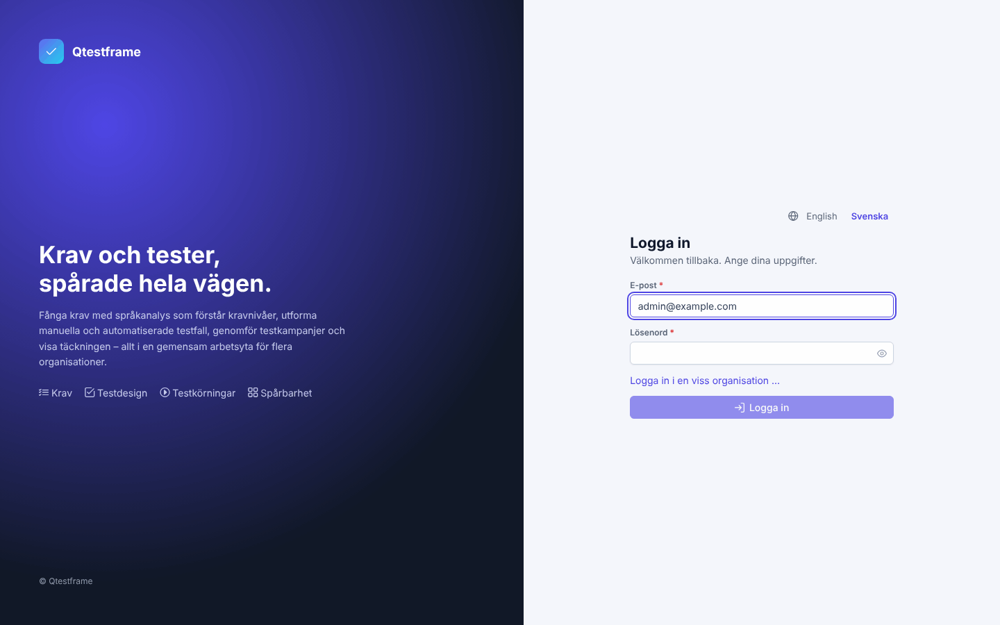
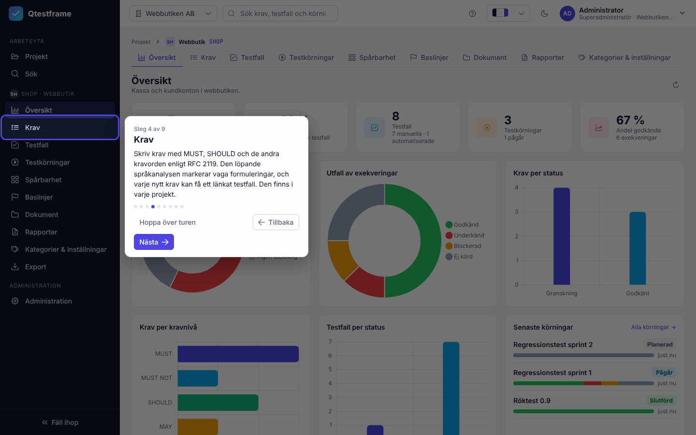
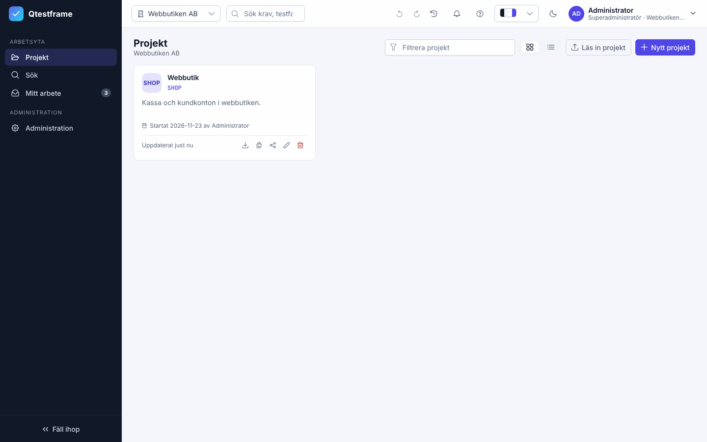
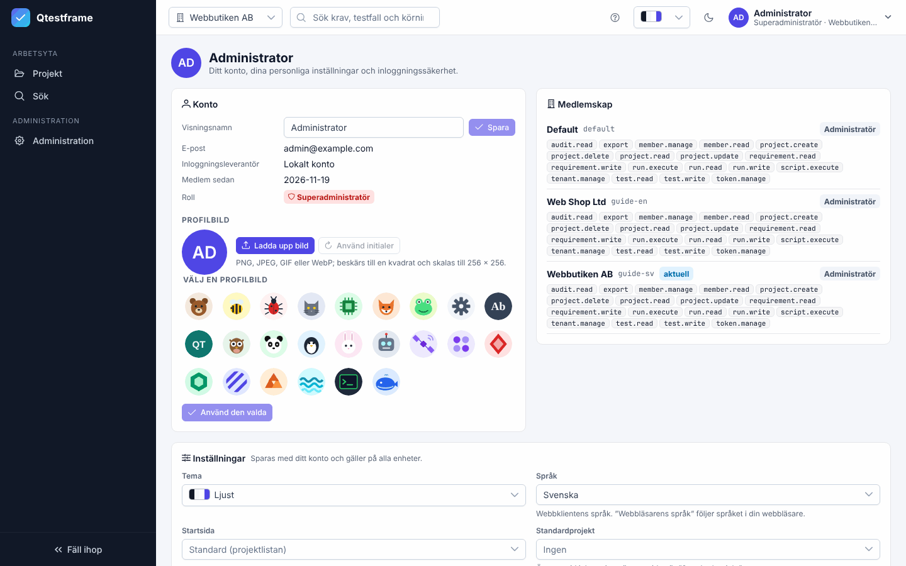

# Kom igång

Den här sidan förklarar hur du loggar in, hittar rätt på skärmen och ställer in Qtestframe som du vill ha det.

## Logga in

Öppna adressen du har fått av din administratör (för en lokal testinstallation `http://localhost:8080`).

1. Ange **E-post** och **Lösenord** och välj **Logga in**.
2. Om du tillhör flera organisationer och vill börja i en viss, välj **Logga in i en viss organisation …** och ange dess kortnamn, till exempel `acme`. Utan kortnamn hamnar du i din standardorganisation (se [Inställningar](#inställningar)) eller den du använde senast.
3. Med en [lösennyckel](#lösennycklar) väljer du **Logga in med lösennyckel** (eller väljer din lösennyckel bland förslagen i fältet **E-post**) och bekräftar med fingeravtryck, ansikte, PIN eller säkerhetsnyckel: du behöver varken lösenord eller kod. Om webbläsaren inte kan använda lösennycklar står det under knappen; logga då in med ditt lösenord.
4. Om din organisation använder enkel inloggning (SSO) visar sidan en knapp per leverantör under **eller fortsätt med**. Välj den och logga in hos identitetsleverantören; du kommer automatiskt tillbaka till Qtestframe.
5. Om du använder [tvåstegsverifiering](#tvåstegsverifiering) frågar sidan sedan efter den andra faktorn. Med en lösennyckel väljer du **Använd lösennyckel** och bekräftar på enheten. Annars anger du **Verifieringskod**: öppna autentiseringsappen, ange den sexsiffriga kod den visar för Qtestframe och välj **Verifiera**. Varje kod fungerar en gång; om en kod nekas, vänta på nästa. Utan telefonen väljer du **Använd en återställningskod i stället** och anger en av dina återställningskoder. Om din organisation tillåter det hoppar **Kom ihåg den här enheten** över koden i den här webbläsaren under ett antal dagar.

Språkknapparna högst upp på inloggningssidan växlar mellan engelska och svenska innan du loggar in. Efter inloggningen gäller språket i dina inställningar.

> **Tips:** Efter tio misslyckade försök inom fem minuter spärras inloggningen en stund för den e-postadressen och nätverksadressen. Vänta några minuter och försök igen, eller be en administratör att [återställa ditt lösenord](administration.md#återställa-ett-lösenord).

### Det här ser du efter inloggningen

- **Introduktionsturen.** Första gången du loggar in visar en kort tur de viktigaste delarna av skärmen. Använd **Nästa** och **Tillbaka**, eller **Hoppa över turen** (eller <kbd>Esc</kbd>) för att stänga den. Du kan starta den igen när som helst med **Hjälp → Starta introduktionsturen igen**.

  
- **Information om inloggningen.** Vid senare inloggningar kan Qtestframe visa när och varifrån du loggade in förra gången och hur många misslyckade försök det har varit sedan dess. Om du inte känner igen en inloggning, byt lösenord och logga ut dina andra sessioner (se [Säkerhet](#säkerhet)).
- **Tvingat lösenordsbyte.** Om en administratör har återställt ditt lösenord måste du välja ett nytt innan du kan fortsätta.
- **Krav på tvåstegsverifiering.** Om din organisation kräver en andra faktor och du inte har konfigurerat någon, talar en påminnelse om till när; efter det datumet måste du [konfigurera en autentiseringsapp](#tvåstegsverifiering) vid inloggningen innan du kan fortsätta.

## Sidans uppbyggnad

### Sidopanelen

Det mörka fältet till vänster är huvudnavigeringen:

- **Arbetsyta:** **Projekt** (alla projekt i den aktuella organisationen) och **Sök** (sökning i alla projekt). Varje projektkort visar när projektet startades och av vem: den som skapade det, eller läste in eller kopierade det från en [projektfil](reports-and-export.md). Vem som startade projektet utelämnas när det inte är känt (projekt från demodata eller kommandoraden, och projekt som är äldre än den här uppgiften). Tabellvyn har samma uppgifter som kolumner, och **Kategorier & inställningar → Projekt** visar dem också.
- **Det öppna projektet:** när du öppnar ett projekt visas dess nyckel och namn med projektets delar: **Översikt**, **Krav**, **Testfall**, **Testkörningar**, **Spårbarhet**, **Analys**, **Beroendegraf**, **Testflöde**, **AI-prompter** (mjukvaruprojekt), **Taggar**, **Baslinjer**, **Kategorier & inställningar**, **Export** och, där de finns, **Dokument** och **Rapporter**.
- **Administration**, om din roll tillåter det.

I ett projekt visas samma delar också som flikar högst upp på sidan, under sökvägen *Projekt › projektets namn*.

**Fäll ihop** längst ned krymper sidopanelen till ikoner; håll pekaren över en ikon för att se namnet. På skärmar smalare än 1024 bildpunkter är sidopanelen dold och öppnas med menyknappen (☰) i övre fältet; <kbd>Esc</kbd> eller stängningsknappen stänger den igen.

### Övre fältet

Från vänster till höger:

| Del | Användning |
|---|---|
| **Organisation** | Visar den aktuella organisationen och låter dig byta till en annan som du är medlem i. På mobiler är det en byggnadsikon. |
| **Sökfältet** | Söker bland krav, testfall och körningar i alla projekt i organisationen. Skriv text eller en [fråga](search-and-filters.md) och tryck <kbd>Enter</kbd>. På mobiler är det en förstoringsglasknapp. |
| **Hjälp** (?) | Öppnar **Användarhandbok**, **Hjälp för den här sidan**, **Frågespråket**, **Referenser och standarder** och **Starta introduktionsturen igen**. |
| **Ångra / Gör om / Ångrahistorik** | Ångrar och gör om dina ändringar, se [Ångra och gör om](#ångra-och-gör-om). |
| **Färgtema** | Väljer ett av de tjugotvå temana, se [Teman](accessibility-and-languages.md#teman). |
| **Ljust läge / Mörkt läge** | Växlar snabbt mellan ljust och mörkt. |
| **Användarmeny** | Ditt namn och din roll, **Profil och lösenord**, ljust/mörkt läge, **Språk** och **Logga ut**. |

### Ångra och gör om

De flesta ändringar kan ångras: att redigera, skapa, kopiera och ta bort krav och testfall, flytta dem, massändringar, länkar, relationer, beroenden, granskningsbeslut, att återställa en version, utfall i exekveringsvyn samt att skapa, byta namn på och flytta mappar.

- **Ångra** (↶, <kbd>Ctrl</kbd>+<kbd>Z</kbd>) återställer den senaste ändringen; välj den igen för att gå längre bakåt. Knappens tips namnger ändringen, till exempel *Ångra: Redigera SHOP-TC-4*.
- **Gör om** (↷, <kbd>Ctrl</kbd>+<kbd>Skift</kbd>+<kbd>Z</kbd> eller <kbd>Ctrl</kbd>+<kbd>Y</kbd>) gör en ångrad ändring igen. En ny ändring rensar det som kunde göras om.
- **Ångrahistorik** (🕘) listar dina senaste 50 ändringar, nyast först, med när de gjordes. Väljer du en ångras den och allt som gjordes efter den.

Kortkommandona fungerar utanför textfält; i ett textfält ångrar de som vanligt det du skrivit. Historiken hör till dig och din webbläsarflik: den rensas när du byter organisation, loggar ut eller laddar om sidan. Ett borttaget krav eller testfall kommer tillbaka med sin nyckel, sina länkar, relationer, kommentarer, versionshistorik, bilagor och utfall; borttagningar kan ångras i 30 dagar via API:t (se `GET /projects/{pid}/trash` i API-referensen). Ett ångra misslyckas om läget har ändrats under tiden, till exempel om någon annan har redigerat objektet eller om du inte längre har behörigheten; objektet lämnas då som det är och ett meddelande förklarar varför.

### Autokomplettering

Textfält där du ofta skriver samma sak föreslår det du har sparat i dem förut: rubriker på krav, testfall, defekter och risker, ett kravs källa, ägare och motivering, ett testfalls förutsättningar och förväntade resultat, åtgärd, förväntat resultat och data i teststeg, anteckningar och faktiska resultat vid utförande, kommentarer, granskningskommentarer, namn på körningar och releaser samt senaste sökningar. För ett kravs **Källa** och **Ägare** och en risks **Ägare** föreslås också värden som redan används i projektet.

- Börja skriva: efter en kort paus öppnas en lista med högst åtta förslag under fältet. Värden som börjar med det du skrivit kommer först, sedan värden med ett ord som börjar med det och sist värden som innehåller det; de du använder oftast och senast vinner vid lika.
- Inget väljs förrän du trycker på <kbd>↓</kbd> eller <kbd>↑</kbd>, så <kbd>Enter</kbd> och <kbd>Tab</kbd> fungerar som vanligt medan listan bara är öppen. På ett markerat förslag lägger <kbd>Enter</kbd> eller <kbd>Tab</kbd> in det i fältet (det ersätter texten); <kbd>Esc</kbd> stänger listan utan att stänga dialogen. Du kan också klicka eller trycka på ett förslag.
- I ett tomt enradigt fält visar <kbd>↓</kbd> dina mest använda senaste värden; i ett fält med flera rader använder du <kbd>Alt</kbd>+<kbd>↓</kbd>, eftersom piltangenterna flyttar markören där.
- Skärmläsare får höra hur många förslag det finns och vad som infogades. En klockikon visar din egen historik, en mappikon ett värde som används i projektet.

Din historik sparas med ditt konto när du sparar ett formulär (inte medan du skriver), så den följer med till alla webbläsare. Du ser bara din egen historik, och bara från projekt som du fortfarande kan öppna. Stäng av förslagen, eller begränsa dem till en källa, med **Autokompletteringsförslag** i dina [inställningar](#inställningar); **Rensa min autokompletteringshistorik** i profilen raderar allt som har sparats. Lösenord, nycklar och e-postadresser sparas aldrig.

### Hjälp där du behöver den

- Många fält och avsnitt har ett litet **i** bredvid namnet. Peka på det med musen, eller flytta tangentbordsfokus dit, så visas vad fältet betyder. Välj det (eller tryck på det på en mobil) för att låta förklaringen vara kvar, och välj **Läs mer i användarhandboken** för att öppna avsnittet som beskriver det. <kbd>Esc</kbd> stänger förklaringen.
- Tryck <kbd>?</kbd> var som helst utanför ett textfält för att öppna handbokens sida för den vy du är i (i exekveringsvyn visar <kbd>?</kbd> i stället vyns kortkommandon).
- **?** bredvid varje filterfält listar operatorerna och fälten i [frågespråket](search-and-filters.md) för just den listan.

### Organisationer

En organisation är en separat arbetsyta med egna projekt, medlemmar och API-nycklar. När du byter organisation i övre fältet tar Qtestframe dig till organisationens projektlista. Din roll kan skilja sig mellan organisationer, så vad du får göra kan också ändras.

Om du ser meddelandet *Du har ingen aktuell organisation*, välj en i organisationsväljaren. Om du inte är medlem i någon organisation, be en administratör att lägga till dig.

### Sökning

Sökfältet i övre fältet söker överallt i den aktuella organisationen. Träffarna grupperas per typ med den matchande texten markerad; välj en träff för att öppna den. Alla detaljer finns i [Sökning och filter](search-and-filters.md).

### Tema och språk

- Välj **färgtema** i övre fältet eller i dina inställningar. Valet sparas med ditt konto och följer med till alla enheter.
- Byt **språk** med **Användarmeny → Språk**: *English* eller *Svenska*. Ändringen gäller direkt och sparas som din inställning.

## Din profil

Öppna **Användarmeny → Profil och lösenord**.

### Konto

- **Visningsnamn**: namnet som andra ser i kommentarer, versionshistorik och händelseloggen.
- **Profilbild**: välj en bild för ditt konto: ladda upp en bild (PNG, JPEG, GIF eller WebP, högst 1 MB), välj en av de inbyggda bilderna eller använd dina initialer.
- **Inloggningsleverantör**, **Medlem sedan** och dina **Medlemskap**: organisationerna du tillhör och din roll i var och en.
- **Dina uppgifter**: **Ladda ner mina uppgifter** ger dig en ZIP-fil med JSON-filer med de personuppgifter servern har om dig: profil, medlemskap och roller, kommentarer du skrivit och kommentarer som nämner dig, sessioner, API-tokens (utan sina hemligheter), inloggningslogg, aviseringar, elektroniska signaturer, inmatningshistorik och händelseloggens poster av eller om dig. Nedladdningen registreras i händelseloggen. Vill du att ditt konto raderas, be en superadministratör (se administratörshandboken, *Integritet och gallring*).

### Inställningar

Inställningarna sparas med ditt konto och gäller på alla enheter. Ändra dem och välj **Spara inställningar**.

| Inställning | Effekt |
|---|---|
| **Språk** | Engelska eller svenska; *Webbläsarens språk* följer webbläsaren. |
| **Tema** | Färgtema. *Följ operativsystemet* växlar mellan ljust och mörkt enligt systemets inställning. |
| **Startsida** | Det du ser efter inloggningen: projektlistan, det senast öppnade projektet, ett standardprojekt, sökningen eller din [hempanel](traceability-and-coverage.md#anpassa-översiktspaneler). |
| **Standardprojekt** | Projektet som öppnas när startsidan är *Standardprojekt*. |
| **Standardorganisation** | Organisationen som väljs vid inloggning när du inte anger någon. |
| **Rader per tabellsida** | 10, 25, 50 eller 100 rader i tabeller. |
| **Datumformat** | *Språkets format*, *ISO* (2026-03-14 09:30) eller *Relativt* (för 3 timmar sedan). |
| **Tidszon** | Tidszonen för alla tider; *Webbläsarens* använder datorns. |
| **Skapa även länkat testfall (nya krav)** | Ditt personliga standardval för kryssrutan i kravredigeraren. |
| **Kompakta tabeller** | Tätare tabellrader, så att du ser mer på en gång. |
| **Dölj den löpande språkanalysen av kraven** | Stänger av analysrutan i kravredigeraren. |
| **Markera nyckelord för kravnivå** | På från början: markerar SKA, BÖR, FÅR, MUST, SHOULD, MAY … i kravens beskrivningar och visar raden med nyckelord under beskrivningen i redigeraren. Se [Markerade nyckelord för kravnivå](requirements.md#markerade-nyckelord-för-kravnivå). |
| **Autokompletteringsförslag** | Vad textfälten föreslår (se [Autokomplettering](#autokomplettering)): *På: min historik och värden som används i projektet* (standard), *Bara min egen historik*, *Bara värden som används i projektet* eller *Av*. Med *Av* visas inga förslag; med *Av* och *Bara värden som används i projektet* läggs inget som du sparar till i din historik. |

Under inställningen raderar **Rensa min autokompletteringshistorik** alla värden som dina textfält kommer ihåg åt dig, i alla organisationer, och visar hur många som är sparade.

### Säkerhet

- **Lösenord**: för lokala konton anger du **Nuvarande lösenord** och **Nytt lösenord** två gånger och väljer **Byt lösenord**. Om du loggar in med enkel inloggning hanteras lösenordet av din identitetsleverantör.
- **API-nycklar**: nycklar för CI-pipelines och skript skapas under **Administration → API-nycklar** (se [API-nycklar](administration.md#api-nycklar)).
- **Aktiva sessioner**: alla webbläsare och enheter som är inloggade med ditt konto, med webbläsare, IP-adress, inloggningstid och senaste aktivitet. **Logga ut** avslutar en session; **Logga ut alla andra sessioner** avslutar alla utom den du använder.
- **Inloggningshistorik**: dina senaste inloggningar och misslyckade försök, om de visas. Felaktiga koder för den andra faktorn visas som misslyckade försök med metoden *Andra faktor*.

### Tvåstegsverifiering

En andra faktor skyddar ditt konto även om någon får reda på ditt lösenord: efter lösenordet anger du en sexsiffrig kod från en **autentiseringsapp** i telefonen, till exempel Microsoft Authenticator, Google Authenticator, 1Password eller FreeOTP.

**Slå på**

1. I din profil, under **Tvåstegsverifiering**, väljer du **Konfigurera autentiseringsapp**.
2. Skanna QR-koden med appen. På en telefon lägger **Öppna i en autentiseringsapp på den här enheten** till kontot direkt; om det inte går att skanna väljer du **Går det inte att skanna? Ange nyckeln för hand** och skriver in konfigurationsnyckeln i appen.
3. Ange den sexsiffriga kod som appen visar och välj **Slå på**.
4. Qtestframe visar tio **återställningskoder**. Spara dem nu (**Kopiera** eller **Ladda ned**), till exempel i en lösenordshanterare: de visas bara den här gången. Varje kod fungerar en gång och låter dig logga in utan telefonen. Välj sedan **Jag har sparat koderna**.

Därefter frågar varje inloggning med lösenord efter en kod. API-nycklar påverkas inte.

**Senare**

- **Nya återställningskoder** skapar tio nya koder (de gamla slutar fungera). Gör det när bara några få finns kvar; profilen varnar dig.
- **Glöm ihågkomna enheter** gör att alla webbläsare där du valde *Kom ihåg den här enheten* frågar efter en kod igen.
- **Stäng av** tar bort autentiseringsappen och dina återställningskoder; båda kräver en aktuell kod (eller en återställningskod). Om din organisation kräver tvåstegsverifiering kan du inte stänga av den. Du får ett e-postmeddelande när den stängs av.
- **Ny eller borttappad telefon**: med en återställningskod kan du fortfarande logga in; stäng av tvåstegsverifieringen och konfigurera den igen med den nya telefonen. Utan telefon och återställningskoder ber du en administratör att [återställa din tvåstegsverifiering](administration.md#återställa-tvåstegsverifiering).

Om du loggar in med enkel inloggning frågar oftast identitetsleverantören efter den andra faktorn; Qtestframe frågar efter en egen kod bara om servern är konfigurerad för det.

### Lösennycklar

Med en **lösennyckel** (passkey) loggar du in med enhetens skärmlås (fingeravtryck, ansikte eller PIN), en lösenordshanterare som sparar den, eller en säkerhetsnyckel, i stället för med lösenord. Den kan inte nätfiskas eller gissas, och den räknas också som din andra faktor: med en lösennyckel behöver du ingen autentiseringsapp. Lösennycklar kräver en aktuell webbläsare (Chrome, Edge, Firefox eller Safari) och en server med en https-adress; annars förklarar profilen varför de inte är tillgängliga.

**Lägg till en lösennyckel**

1. I din profil, under **Lösennycklar**, väljer du **Lägg till lösennyckel**.
2. Ge den ett namn som du känner igen senare (förslaget är din enhet och webbläsare, till exempel *Mac · Safari*) och välj **Lägg till lösennyckel**.
3. Följ webbläsaren: välj var lösennyckeln ska sparas (den här enheten, din telefon, en lösenordshanterare eller en säkerhetsnyckel) och bekräfta med fingeravtryck, ansikte, PIN eller säkerhetsnyckel.

Om du loggade in för mer än 10 minuter sedan ber Qtestframe dig först att **Bekräfta att det är du**: ange ditt lösenord, en kod från autentiseringsappen eller bekräfta med en befintlig lösennyckel.

**Logga in med den**: på inloggningssidan väljer du **Logga in med lösennyckel**, eller väljer den bland förslagen i fältet **E-post**. Om ditt konto loggar in via enkel inloggning använder du din identitetsleverantör; där kan lösennyckeln vara din andra faktor. När administratören har stängt av inloggning utan lösenord är en lösennyckel din andra faktor efter lösenordet.

**Senare**: listan visar varje lösennyckel med namn, när den lades till och när den senast användes (*Synkad* betyder att den är säkerhetskopierad i en lösenordshanterare eller ett molnkonto och fungerar på dina andra enheter också). **Byt namn** (pennan) ändrar namnet; **Ta bort** (papperskorgen) tar bort den från ditt konto – ta också bort den från enheten eller lösenordshanteraren. Att ta bort kräver en ny inloggning, precis som att lägga till. Om din organisation kräver tvåstegsverifiering kan du inte ta bort din sista andra faktor. Om du tappar bort en enhet tar du bort dess lösennyckel från en annan enhet, eller ber en administratör att [återkalla dina lösennycklar](administration.md#återkalla-lösennycklar).

## Nästa steg

- Följ [handledningen](tutorial.md) och bygg ett litet projekt från början.
- Lär dig [frågespråket](search-and-filters.md); det fungerar i alla filterfält.
