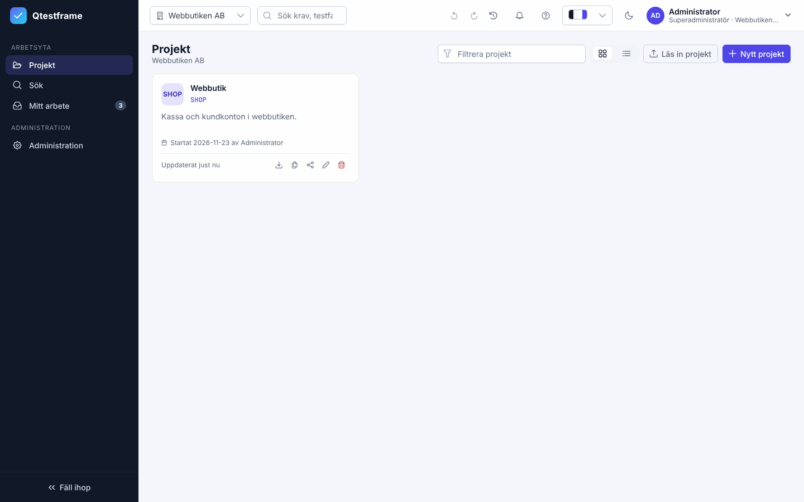

# Användarhandbok för Qtestframe

Qtestframe är ett verktyg för att hantera **kravspecifikationer och tester** på ett ställe. Du skriver krav, utformar manuella och automatiserade testfall som verifierar dem, genomför testkörningar, registrerar utfall och defekter och visar täckningen med en spårbarhetsmatris, en översikt och rapporter. Flera organisationer kan dela en installation utan att se varandras data.

Handboken riktar sig till alla som arbetar i Qtestframe: kravförfattare, testare, testledare och administratörer. Den beskriver webbklienten så som du ser den. Du kan läsa den här i appen (**Hjälp → Användarhandbok** eller **?**-länken på många sidor) eller som Markdown-filer i mappen `docs/user-guide` i källkoden.

## Var börjar jag?

- **Ny i Qtestframe?** Läs [Kom igång](getting-started.md) och gå sedan igenom handledningen [Din första testkampanj](tutorial.md). Den tar ungefär 30 minuter och berör alla viktiga funktioner.
- **Letar du efter ett svar?** Titta i [Vanliga frågor](faq.md) eller använd sökfältet högst upp i handboken.
- **Administratör?** Gå direkt till [Administration](administration.md).

## Innehåll

| Sida | Innehåll |
|---|---|
| [Kom igång](getting-started.md) | Inloggning, sidans uppbyggnad, organisationer, sökning, tema och språk, profil och inställningar |
| [Handledning: din första testkampanj](tutorial.md) | En komplett genomgång från ett tomt projekt till en rapport |
| [Krav](requirements.md) | Kravnivåer, språkanalysen, fält, utvärderingskriterier, relationer, kommentarer, versionshistorik, massändring, flytt och bilagor |
| [Testfall](tests.md) | Manuella steg, automatiserade skript, delade steg, kategorier, exekveringshistorik, kommentarer, versionshistorik och bilagor |
| [Katalog](catalogue.md) | Standardkrav och testfall att lägga till i ett projekt: bläddra, söka, förhandsvisa och lägga till med testfall och spårlänkar |
| [Testkörningar och exekvering](runs.md) | Körningar, exekveringsvyn och dess kortkommandon, defekter, CI-import med API-nycklar, bilagor |
| [Spårbarhet och täckning](traceability-and-coverage.md) | Spårbarhetsmatrisen, hur täckningen beräknas, översikten |
| [Baslinjer](baselines.md) | Frysa en release och jämföra versioner |
| [Sökning och filter](search-and-filters.md) | Frågespråket med många exempel |
| [Rapporter och export](reports-and-export.md) | Standardrapporter, den egna rapportbyggaren, exportformat och dokumentarkivet |
| [Dokument](documents.md) | Projektets dokumentarkiv: uppladdning, förhandsvisning och länkar |
| [Administration](administration.md) | Organisationer, användare, medlemmar och roller, återställning av lösenord, API-nycklar, händelseloggen, säkerhetskopiering och återställning |
| [Tillgänglighet och språk](accessibility-and-languages.md) | Tangentbord, skärmläsare, teman, engelska och svenska, mobiler och surfplattor |
| [Vanliga frågor](faq.md) | Svar på vanliga frågor |
| [Referenser](references.md) | RFC 2119, RFC 8174 och andra RFC:er, NIST-publikationer samt standarder för krav och test |

## Viktiga begrepp

| Begrepp | Betydelse |
|---|---|
| **Organisation** | En isolerad arbetsyta. Projekt, medlemmar och API-nycklar hör till en organisation. Du kan vara medlem i flera och byta mellan dem. |
| **Projekt** | En behållare för krav, testfall, körningar, baslinjer och dokument. Projektets **nyckel** (till exempel `SHOP`) inleder varje objekts id: `SHOP-REQ-12`, `SHOP-TC-7`. |
| **Krav** | Ett påstående om vad systemet ska, bör eller får göra, med kravnivå, status, prioritet, utvärderingskriterier med mera. |
| **Utvärderingskriterium** | Hur man bedömer att ett krav är uppfyllt: en metod (test, inspektion, analys, demonstration, granskning) och ett tröskelvärde. |
| **Testfall** | Ett manuellt testfall med steg eller ett automatiserat testfall med ett skript. |
| **Länk** (spårlänk) | Kopplar ett krav till ett testfall som verifierar det. Länkarna är grunden för täckningen. |
| **Körning** (testkörning) | En testkampanj, till exempel *Regressionstest sprint 12*, med en uppsättning testfall som ska exekveras i en viss miljö och ett visst bygge. |
| **Exekvering** | Ett testfall i en körning, med utfall, utfall per steg, anteckningar, defekter och utdata. |
| **Täckning** | Ett kravs verifieringsläge, härlett från de senaste utfallen för dess länkade testfall: *Ingen täckning*, *Ej körd*, *Godkänd*, *Underkänd* eller *Delvis*. |
| **Baslinje** | En fryst ögonblicksbild av versionerna av ett projekts krav och testfall, till exempel inför en release. |
| **Roll** | Vad du får göra i en organisation: *Läsare*, *Testare*, *Ansvarig* eller *Administratör*. *Superadministratörer* hanterar hela installationen. |

## Konventioner i handboken

- Namn på knappar, menyer och fält skrivs i **fetstil**, precis som de står i det svenska gränssnittet. Den engelska handboken använder de engelska etiketterna.
- Menyvägar skrivs med pilar: **Användarmeny → Profil och lösenord**.
- Tangenter skrivs som <kbd>Enter</kbd> och frågeexempel som `status:approved`.
- En anmärkning som *(Ansvarig)* efter en åtgärd anger den lägsta roll som får utföra den. Se [rollmatrisen](administration.md#roller-och-behörigheter).
