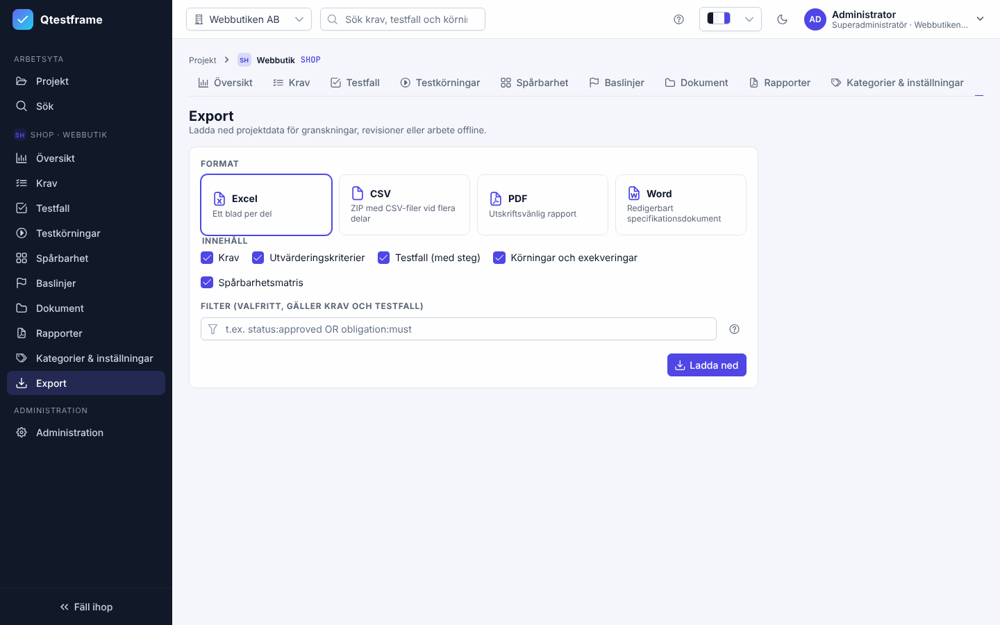
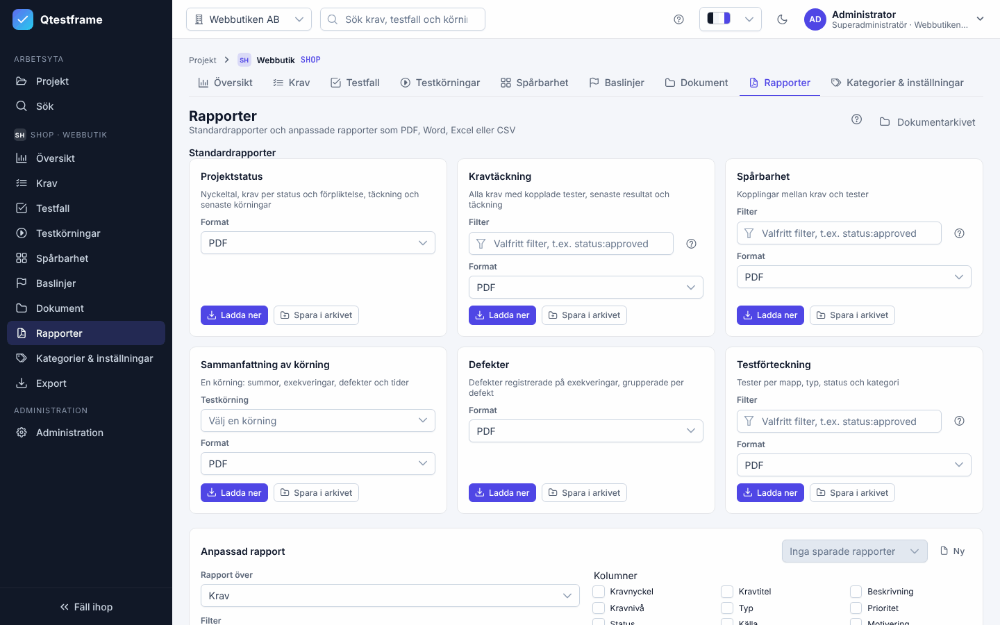
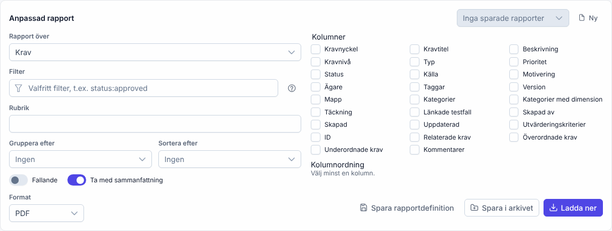

# Rapporter och export

Qtestframe tar ut data på två sätt:

- **Export** laddar ned projektets rådata (krav, kriterier, testfall, spårbarhet, körningar) som kalkylblad eller dokument, för granskningar, revisioner, arbete offline eller andra verktyg.
- **Rapporter** tar fram formaterade dokument för människor: en statusrapport för projektet, en täckningsrapport, en sammanfattning av en körning, en defektlista eller en rapport som du utformar själv. Rapporter kan laddas ned eller sparas i projektets [dokumentarkiv](documents.md).

Alla med rollen **Läsare** eller högre får exportera och ta fram rapporter. Att spara en egen rapportdefinition kräver **Testare** (testfall) eller **Ansvarig** (krav); att spara en framtagen rapport i arkivet får alla som får ta fram den.

## Export

Välj **Export** i projektets sidopanel.

1. Välj **Format**:

   | Format | Resultat |
   |---|---|
   | **XLSX** | En Excel-arbetsbok med bladet *Summary* och ett blad per del; fet rubrikrad, låst första rad, autofilter och lämpliga kolumnbredder. |
   | **CSV** | En `.csv`-fil för en del; ett `.zip`-arkiv med en CSV-fil per del när du väljer flera. UTF-8, kommaavgränsad. |
   | **PDF** | En utskriftsvänlig rapport i liggande format med en tabell per del och sidnummer. |
   | **DOCX** | Ett redigerbart Word-dokument med en rubrik och en tabell per del, till exempel som grund för ett specifikationsdokument. |

2. Välj **Innehåll**:

   | Del | Kolumner |
   |---|---|
   | **Krav** | nyckel, titel, kravnivå, typ, prioritet, status, mapp, kategorier, taggar, beskrivning, motivering, källa, ägare, version, länkade testfall, täckning |
   | **Utvärderingskriterier** | krav, nummer, kriterium, metod, tröskelvärde |
   | **Testfall (med steg)** | nyckel, titel, exekvering, status, prioritet, mapp, kategorier, taggar, förutsättningar, steg, förväntat resultat, skriptspråk, länkade krav, senaste utfall |
   | **Spårbarhetsmatris** | en rad per länk mellan krav och testfall med täckning och senaste utfall; krav utan länkar får en rad |
   | **Körningar och exekveringar** | en rad per exekvering med körning, status, miljö, bygge, utfall, exekverad av, tidsåtgång och anteckningar |

   Kolumnrubrikerna i de exporterade filerna är på engelska.

3. Ange eventuellt ett **Filter**. Det gäller krav om det är en giltig fråga för krav och testfall om det är en giltig fråga för testfall: `obligation=must` filtrerar bara krav, `type=automated` bara testfall, `folder:Kassa` båda.
4. Välj **Ladda ned**. Filen namnges efter projektnyckeln och tidpunkten, till exempel `SHOP-20261119-143000.xlsx`.

**Säkert för kalkylblad:** värden som börjar med `=`, `+`, `-` eller `@` får ett prefix i CSV-filer, och celler i XLSX är alltid text, så inget i dina data körs som en formel.

## Standardrapporter

Välj **Rapporter** i projektets sidopanel. Standardrapporterna är färdiga upplägg:

| Rapport | Innehåll | Parametrar |
|---|---|---|
| **Projektstatus** | nyckeltal, krav per status och kravnivå, täckning, senaste körningar | – |
| **Kravtäckning** | varje krav med länkade testfall, deras senaste utfall och täckningen | valfritt filter |
| **Spårbarhet** | länkarna mellan krav och testfall | valfritt filter |
| **Sammanfattning av körning** | en körning: summor, exekveringar, defekter och tidsåtgång | körningen (obligatorisk) |
| **Defekter** | alla defekter som registrerats på exekveringar, grupperade per defekt | – |
| **Testförteckning** | testfall per mapp, typ, status och kategori | valfritt filter |

1. Välj en rapport.
2. Fyll i parametrarna, till exempel körningen för **Sammanfattning av körning**.
3. Välj **Format**: **PDF**, **Word** (DOCX), **Excel** (XLSX) eller **CSV**.
4. Välj **Ladda ner**, eller **Spara i arkivet**. En sparad rapport blir ett dokument av typen *rapport* under **Dokument**, där hela teamet kan hitta, förhandsvisa och ladda ned den senare.

## Egna rapporter

Under **Anpassad rapport** utformar du en rapport själv:

1. **Rapport över**: krav, testfall, testkörningar eller exekveringarna i en körning (välj då körningen).
2. **Filter**: valfri [fråga](search-and-filters.md), till exempel `status:approved obligation=must`.
3. **Kolumner**: välj kolumnerna och ordna dem under kolumnordningen.
4. **Gruppera efter**: gruppera eventuellt raderna, till exempel per status eller mapp, med ett antal per grupp.
5. **Sortera efter**, eventuellt **Fallande**.
6. **Ta med sammanfattning**: summor överst.
7. Rapportens **Rubrik**.

Ta fram rapporten i valfritt format, som ovan. För att återanvända den väljer du **Spara rapportdefinition** och ger den ett namn: med **Läs in sparad rapport** hämtar du den när som helst för att ta fram den igen med aktuella data, ändra den eller ta bort den.

**Exempel:**

- *Öppna MUST-krav*: krav, filter `obligation=must -status:verified`, kolumnerna nyckel, titel, status, ägare, täckning, grupperade per ägare.
- *Underkända testfall i sprinten*: exekveringar i körningen *Sprint 12*, filter `status:failed`, kolumnerna nyckel, titel, exekverad av, defekter, anteckningar.
- *Automatiseringsgrad*: testfall, grupperade per exekveringstyp, kolumnerna nyckel, titel, status, senaste utfall.

## Flera rapporter på en gång

**Flera rapporter på en gång**, längst ner på sidan Rapporter, listar standardrapporterna och dina sparade egna rapporter. Kryssa i dem du behöver, till exempel ett veckopaket med *Projektstatus*, *Sammanfattning av körning* och två sparade rapporter, och sedan:

- välj **format** (bara format som alla markerade rapporter stöder visas),
- för *Sammanfattning av körning*, välj **körning**,
- **Ladda ner som ZIP** för att få alla i en fil, eller **Spara i arkivet** för att lägga var och en i [dokumentarkivet](documents.md) (taggad *report*). När du sparar listas en rapport som inte kan skapas med orsaken, och de andra sparas ändå.

**Ta bort sparade rapporter** tar bort de markerade sparade egna rapporterna (standardrapporter kan inte tas bort). Att spara i arkivet och att ta bort kräver behörighet att redigera krav eller testfall; att ladda ner kräver exportbehörighet.

## Vilket ska jag välja?

| Behov | Använd |
|---|---|
| Arbeta med data i Excel eller ett annat verktyg | **Export**, XLSX eller CSV |
| Ett specifikationsdokument för granskning eller underskrift | **Export**, DOCX, delarna krav och kriterier |
| En statusrapport till ett styrgruppsmöte | **Rapporter → Projektstatus**, PDF |
| Underlag för en revision eller en release | **Rapporter → Kravtäckning** eller **Sammanfattning av körning**, sparad i arkivet, tillsammans med en [baslinje](baselines.md) |
| En återkommande lista med egna kolumner | En sparad **anpassad rapport** |
