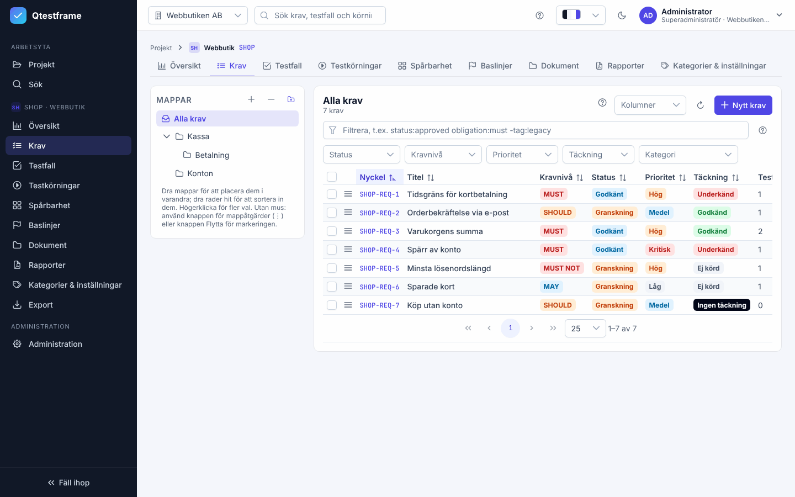
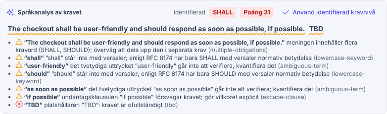
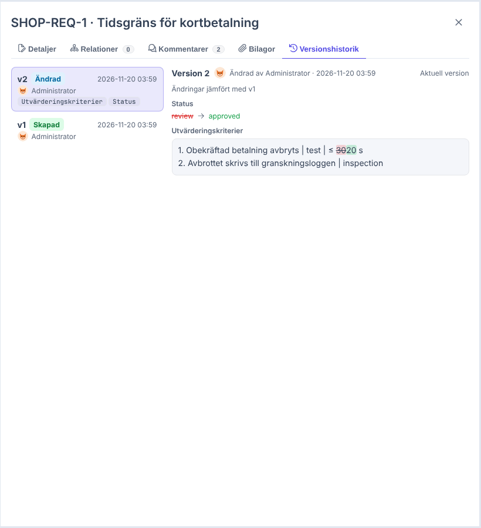
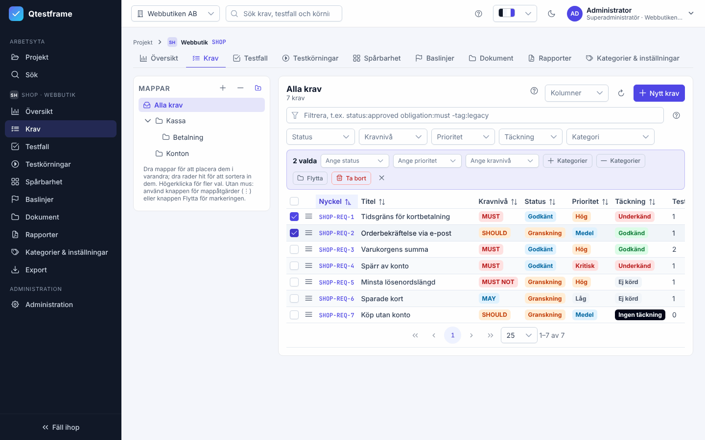

# Krav

Projektets del **Krav** innehåller specifikationen: varje krav med kravnivå, status, utvärderingskriterier, länkar till testfall, relationer till andra krav, kommentarer, versionshistorik och bilagor.

Att läsa krav kräver rollen **Läsare**; att skapa och ändra dem kräver **Ansvarig**. Att länka testfall till ett krav kräver **Testare**.

## Kravsidan

- **Mappträdet** (till vänster): välj **Alla krav** eller en mapp. **Ta med undermappar** avgör om objekt i undermappar listas. På smala skärmar öppnas trädet med knappen **Mappar**.
- **Filterfältet**: ett fält för [frågor](search-and-filters.md) och snabbfilter för **Status**, **Kravnivå**, **Prioritet**, **Täckning** och **Kategori**. Snabbfiltren sätts ihop till en fråga som visas under fältet (`q = …`). **Rensa** återställer alla filter.
- **Kolumner**: välj vilka kolumner tabellen visar: kravnivå, status, prioritet, typ, täckning, länkade testfall, kategorier, mapp, ägare, källa, taggar, **relationer**, antal relationer, kriterier, version, kommentarer, skapad av, skapad och uppdaterad. Kolumnen **Relationer** listar relaterade objekt grupperade per relation, åt båda hållen, till exempel *beror på SHOP-REQ-2*, *tillhandahålls av SHOP-REQ-3* och *verifieras av SHOP-TC-1*; välj en nyckel för att öppna objektet. Flytta kolumner genom att dra i rubriken, eller med pilknapparna under **Kolumner**; **Återställ** ger standardkolumnerna tillbaka. Valet sparas i webbläsaren, även för tabellerna över körningar, exekveringar och dokument.
- **Tabellen**: sortera genom att klicka på en kolumnrubrik; välj en rad (eller dess titel) för att öppna redigeraren. Id:t (till exempel `SHOP-REQ-12`) tilldelas automatiskt.

Den valda mappen, filtret och det öppna kravet ingår i sidans adress, så du kan bokmärka eller dela en filtrerad vy.

## Kravnivåer

Varje krav har en **kravnivå** enligt [RFC 2119 och RFC 8174](references.md#kravord-rfc):

| Nivå | Betydelse |
|---|---|
| **MUST (SKA)**, **SHALL (SKA)** | Absolut krav |
| **MUST NOT (SKA INTE)**, **SHALL NOT (SKA INTE)** | Absolut förbud |
| **SHOULD (BÖR)** | Rekommendation: det kan finnas giltiga skäl att avvika, men konsekvenserna måste vara kända |
| **SHOULD NOT (BÖR INTE)** | Avrådan |
| **MAY (FÅR)**, **OPTIONAL (VALFRITT)** | Verkligt valfritt |
| **WILL (KOMMER ATT)** | Avsikt eller faktum (inget kravord enligt RFC 2119) |
| **Beskrivande** | Text utan kravnivå, till exempel en inledning eller en anmärkning |

När du skapar ett krav med **Kravnivå** satt till **Identifiera automatiskt från texten** identifieras nivån från titeln och beskrivningen. Om flera kravord förekommer vinner det starkaste (MUST NOT före MUST före SHALL NOT … före Beskrivande). Text utan kravord får ingen kravnivå och räknas som *ospecificerad* på översikten. Senare ändringar ändrar aldrig kravnivån automatiskt; använd **Använd identifierad kravnivå** i analysrutan eller välj nivån själv.

Bara kravord med VERSALER har normativ betydelse (RFC 8174). Skriv `MUST`, inte `must`. I krav som är skrivna på svenska används i stället de svenska kravorden (SKA, BÖR, FÅR …) som beskrivs under [Språkanalysen](#språkanalysen). Sidan [Referenser](references.md) listar dessa och andra standarder för krav och test.

Medan du skriver visar **Hjälp: kravnivåer** under beskrivningen (öppen för nya krav) nyckelorden för varje nivå på gränssnittets språk, vad de betyder och ett exempel, med tips om hur de skrivs. [Analys](traceability-and-coverage.md#kravanalys) visar hur nivåerna och nyckelorden fördelar sig i projektet.

## Språkanalysen

Medan du skriver beskrivningen visar rutan **Språkanalys av kravet** den identifierade kravnivån, en **Poäng** från 0 till 100, kravorden markerade i texten och en lista med **Anmärkningar**.

Analysen förstår **svenska** och **engelska**. Som standard (**Identifiera språk**) avgör den vilket språk texten är skriven på och visar det bredvid väljaren, till exempel *Identifierat: Svenska*; välj **Svenska** eller **Engelska** i väljaren för att tvinga fram ett språk. Valet sparas i webbläsaren. Anmärkningarna visas alltid på ditt gränssnittsspråk, oavsett vilket språk kravet är skrivet på.

På svenska är kravorden:

| Kravord | Kravnivå |
|---|---|
| **SKA**, **SKALL** | Ska (shall) |
| **MÅSTE**, **OBLIGATORISK** | Måste (must) |
| **BÖR**, **REKOMMENDERAS** | Bör (should) |
| **FÅR** | Får (may) |
| **FÅR INTE**, **FÅR EJ** | Får inte (must not) |
| **SKA INTE**, **SKALL INTE** | Ska inte (shall not) |
| **BÖR INTE**, **REKOMMENDERAS INTE** | Bör inte (should not) |
| **BEHÖVER INTE**, **MÅSTE INTE**, **VALFRI** | Valfritt (optional) |
| **KOMMER ATT** | Kommer att (will) |
| **BESKRIVER**, **NOT:**, **ANMÄRKNING:** | Beskrivande |

Engelska kravord med versaler (MUST, SHALL …) räknas också. Svenskan har ingen konvention om versaler, så regeln om kravord med gemener gäller bara engelska. Tänk på att *får* även betyder "tar emot": i *användaren får ett mejl* tolkas *får* som ett tillåtande kravord.

| Regel | Allvarlighet | Upptäcks när |
|---|---|---|
| Kravord saknas | Varning | det finns inget kravord (MUST, SHALL, SHOULD, MAY …) |
| Kravord med gemener | Info | ett kravord inte står med versaler, till exempel `must` |
| Negativt krav | Info | `MUST NOT` eller `SHALL NOT`: svårare att verifiera; ange hellre vad systemet gör |
| Flera kravord | Varning | en mening innehåller mer än ett kravord; dela upp den |
| Lång mening | Info | en mening har fler än 40 ord |
| Tvetydigt uttryck | Varning | vaga ord som *fast, easy, user-friendly, simple, efficient, adequate, appropriate, approximately, flexible, robust, reliable, intuitive, sufficient, as needed, normally, usually, seamless, scalable, optimal, several, many, few, reasonable, timely, acceptable, as soon as possible, suitable* |
| Platshållare | Fel | `TBD`, `TBC`, `TODO`, `XXX`, `???`: kravet är ofullständigt |
| Obegränsat uttryck | Info | *all, always, never, every, any, none*: kontrollera att det verkligen ska gälla generellt |
| And/or | Varning | `and/or`: ange om båda eller något av alternativen krävs |
| Passiv förmåga | Info | *be able to*, *be capable of*: beskriv beteendet i stället |
| Undantagsklausul | Varning | *if possible, where applicable, unless, except*: gör villkoret explicit |
| Tvetydig negation | Varning | bara svenska: *måste inte* läses ofta som ett förbud men betyder "behöver inte"; skriv *får inte* eller *behöver inte* |

Tabellen visar de engelska orden. I svensk text letar reglerna efter motsvarande svenska ord, till exempel *snabb, enkel, användarvänlig, effektiv, tillräcklig, lämplig, ungefär, flexibel, robust, intuitiv, osv, vid behov, normalt, vanligtvis, skalbar, optimal, flera, många, rimlig, så snart som möjligt* (tvetydiga), *bestäms senare* (platshållare), *alla, alltid, aldrig, varje, ingen* (obegränsade), *och/eller*, *kunna, ha möjlighet att* (passiv förmåga) och *om möjligt, där tillämpligt, om inte, utom, förutom* (undantag).

**Poäng** = 100 − 25 per fel − 10 per varning − 2 per info, aldrig under 0. Till exempel får *The system shall respond fast and/or retry TBD.* poängen 53: kravord med gemener (info), *fast* (varning), *and/or* (varning) och *TBD* (fel).

Om du inte vill se rutan kan du stänga av den i din profil: **Dölj den löpande språkanalysen av kraven**.

## Fält

| Fält | Användning |
|---|---|
| **Titel** | Ett kort namn (obligatoriskt). |
| **Beskrivning** | Själva kravformuleringen, som analyseras medan du skriver. |
| **Kravnivå** | Se ovan. |
| **Status** | Utkast, Granskning, Godkänt, Implementerat, Verifierat, Avvisat eller Inaktuellt. *Godkänt* och *Avvisat* är granskningsbeslut: de kräver behörigheten *requirement.review* (Granskare eller Ansvarig) och är gråade utan den. Granskare ser knapparna **Godkänn** och **Avvisa** överst i redigeraren. |
| **Typ** | Funktionellt, Icke-funktionellt, Säkerhet, Prestanda, Användbarhet, Gränssnitt, Begränsning, Verksamhet eller Regelverk. |
| **Prioritet** | Kritisk, Hög, Medel eller Låg. |
| **Ägare** | Vem som ansvarar för kravet. Skriv `@` för att välja en person, se [Nämn personer](#nämn-personer). |
| **Källa** | Var kravet kommer ifrån. Välj i listan (▾), som erbjuder projektets källor och de källor som andra krav redan använder, eller skriv en egen, till exempel *kundspecifikation §4.2*. Projektets lista redigeras under **Kategorier & inställningar → Kravkällor** (en per rad; tom betyder standardlistan: Customer, Contract, Standard, Regulation, Stakeholder …). |
| **Motivering** | Varför kravet finns. |
| **Mapp** | Var kravet är placerat. |
| **Kategorier** | Värden i projektets kravkategorier, till exempel *Area / Security*. |
| **Taggar** | Fria nyckelord; skriv en tagg och tryck <kbd>Enter</kbd>, eller välj en av de **föreslagna taggarna** under fältet. Förslagen kommer från titeln och beskrivningen: taggar som projektet redan använder och som texten nämner kommer först (heldragen ram), sedan förkortningar som *GDPR* och ord i titeln eller ord som förekommer mer än en gång (streckad ram). Varje tagg får en egen färg, samma överallt (tabeller, taggmolnet, dokument), så att lika taggar är lätta att se. |

Redigerarens huvud visar id:t, **versionen** (till exempel *v3*), täckningen och vem som ändrade kravet senast. Versionen ökar vid varje ändring.

## Utvärderingskriterier

Under **Utvärderingskriterier** anger du hur uppfyllelsen bedöms. Varje kriterium har en beskrivning, en **metod** och ett valfritt **tröskelvärde**:

| Metod | Typisk användning |
|---|---|
| **Test** | exekvering av ett testfall (standard) |
| **Inspektion** | granskning av kod, dokument eller konfiguration |
| **Analys** | beräkning, simulering eller utvärdering av mätningar, till exempel *p95 < 2 s* |
| **Demonstration** | funktionen visas för en granskare |
| **Granskning** | en formell granskning |

Välj **Lägg till kriterium** för att lägga till ett; använd pilarna för att ändra ordningen och papperskorgen för att ta bort. När du sparar ersätts listan. När du länkar ett testfall kan du välja vilket kriterium det verifierar under **Kriterium för nya länkar**.

## Länkade testfall

**Skapa även länkat testfall** (ikryssad som standard; ditt personliga standardval finns i profilen) skapar ett manuellt testfall som utkast när du skapar ett krav:

- med titeln *Verify SHOP-REQ-n: …*, kravets prioritet och taggen `auto-generated`;
- med ett steg per utvärderingskriterium, eller ett steg som härleds från texten om det inte finns några;
- i testmappen med samma sökväg som kravets mapp (saknade mappar skapas);
- länkat till kravet, så att täckningen börjar som **Ej körd** i stället för **Ingen täckning**.

Avsnittet **Länkade testfall** i redigeraren listar alla länkade testfall med deras senaste utfall. **Länka testfall** lägger till fler (Testare); **×** på en rad tar bort en länk. Länkar kan också sättas i [spårbarhetsmatrisen](traceability-and-coverage.md).

## Relationer

Fliken **Relationer** kopplar ihop krav i samma projekt:

| Relation | Betydelse |
|---|---|
| **förfinar (överordnat)** / **förfinas av (underordnat)** | nedbrytning: kravet är en mer detaljerad del av det andra |
| **beror på** / **krävs av** | kravet behöver det andra |
| **tillhandahåller** / **tillhandahålls av** | kravet levererar något (en förmåga, ett gränssnitt, data) som det andra behöver |
| **härlett från** / **källa till** | kravet har härletts ur det andra |
| **står i konflikt med** | båda kan inte uppfyllas samtidigt |
| **duplicerar** / **dupliceras av** | samma innehåll två gånger |
| **relaterar till** | en informell relation |

Välj **Lägg till relation …**, välj typen och sedan kraven. Ett krav kan inte relatera till sig självt, och *förfinar*-relationer får inte bilda en cykel. I frågor hittar `parent:`, `child:` och `related:` krav utifrån deras relationer, till exempel `child:*` för krav som har brutits ned.

### Relationer för många krav på en gång

För att relatera många krav i ett steg markerar du dem i listan och väljer **Relationer** i verktygsfältet (kräver **Ansvarig**):

- **Lägg till:** välj relationen som **varje markerat krav** ska ha, till exempel *förfinar (överordnat)*, och **Välj krav …** för den andra änden. Varje markerat krav får relationen till varje valt krav, så du kan göra tio krav till barn till en förälder på en gång. Relationer som redan finns, som skulle relatera ett krav till sig självt eller som skulle bilda en cykel av *förfinar* hoppas över och räknas i meddelandet.
- **Ta bort:** välj relationen som ska tas bort, eller **Alla relationer**, och eventuellt kraven i den andra änden; utan valda krav tas de matchande relationerna till alla krav bort.

Dialogen visar hur många relationer som läggs till eller tas bort innan du bekräftar. På ett kravs flik **Relationer** kan du kryssa i flera relationer (eller **Markera alla**) och välja **Ta bort** för att ta bort dem tillsammans. Båda kan ångras med **Ångra**.

## Nämn personer

Skriv `@` i **Ägare**, **Beskrivning**, **Motivering**, en kommentar, eller i ett testfalls beskrivning och förutsättningar och en exekverings **Tilldelad** och anteckningar: en lista med personer visas. Den innehåller organisationens användare (med avatar) och namn som redan används som ägare eller tilldelad i projektet men saknar konto (*inget konto*). Skriv vidare för att begränsa listan, använd piltangenterna och <kbd>Enter</kbd> eller <kbd>Tabb</kbd> för att infoga, eller <kbd>Esc</kbd> för att stänga listan.

Ett omnämnande skrivs som `@namn`: för användare delen av e-postadressen före `@` (`@anna.berg` för *anna.berg@example.com*), för andra personer namnet med punkter i stället för mellanslag (`@carl.carlsson`). Omnämnanden av kända personer visas som en etikett med avatar och namn, i kommentarerna och i kolumnen **Ägare**. Vanliga namn fungerar fortfarande: ägaren är fritext.

Filtrera med `mention:anna.berg` (eller `mention:@anna.berg`) för att hitta allt som nämner en person.

## Kommentarer

Fliken **Kommentarer** är en diskussionstråd för kravet. Skriv i fältet och välj **Kommentera** (eller tryck <kbd>Ctrl</kbd>+<kbd>Enter</kbd>). Alla som kan läsa kravet kan läsa och skriva kommentarer. Du kan redigera och ta bort dina egna kommentarer; administratörer kan ta bort alla kommentarer. Antalet kommentarer visas på fliken och i kolumnen **Kommentarer**.

## Versionshistorik och återställning

Varje ändring skapar en ny **version**. Fliken **Versionshistorik** listar versionerna med vem som gjorde ändringen (med avatar), när och vilken sorts ändring det var (skapad, ändrad, återställd, flyttad, massändring). Välj en version för att se en jämförelse fält för fält med den föregående.

**Återställ den här versionen** kopierar tillbaka innehållet i en gammal version som en **ny** version: titel, beskrivning, kravnivå, typ, prioritet, status, källa, motivering, ägare, taggar, kategorier och kriterier. Inget går förlorat; de nyare versionerna finns kvar i historiken. Mapp och projekt ändras inte. Kategorier som inte längre finns tas bort.

## Godkänn många krav på en gång

Den som har granskningsbehörighet (`requirement.review`) kan godkänna eller avslå många krav i ett steg. Kryssa i kraven och välj **Godkänn eller avslå…** i verktygsfältet, eller välj **Massgranskning** ovanför listan när inget är markerat. Välj sedan:

- **Vilka poster**: de markerade, alla som visas i listan (aktuell mapp och filter, så filtrera först för ett urval, t.ex. `folder:Betalningar obligation:must`) eller alla krav i projektet.
- **Beslut**: godkänn eller avslå.
- **Bara poster med status**: som standard bara krav i *Granskning*. Lägg till *Utkast* för att godkänna utkast direkt.
- **Ta med ändå, trots**: se nedan.
- **Kommentar**: läggs till på varje krav som ändras, till exempel "Godkänt på granskningsmötet 12 mars".
- **Slutför också mina öppna granskningsförfrågningar**: visas när [granskningsförfrågningar](reviews-and-notifications.md) till dig är öppna för några av kraven; påslaget som standard. Dina förfrågningar beslutas då tillsammans med kraven (*Godkänd* när du godkänner, *Ändringar begärda* när du avslår), och de som frågade får en notis. Checklistorna bockas inte för; granskningen sparar att den beslutades i en massgranskning. Förfrågningar till andra granskare håller fortfarande kravet utanför.

Förhandsgranskningen visar vilka krav som ändras och vilka som hoppas över, grupperade efter orsak:

| Orsak | Betydelse |
|---|---|
| Har redan den här statusen | inget att göra |
| Statusen är inte vald ovan | statusen är inte en av dem du valde |
| Den senaste granskningen begärde ändringar | en [granskningsförfrågan](reviews-and-notifications.md) besvarades med *Begär ändringar* |
| Granskningsförfrågningar är fortfarande öppna | någon har inte granskat klart |
| Har misstänkta länkar | ett länkat test har ändrats sedan länken bekräftades |
| Saknar kravnivå | för att godkänna krävs en kravnivå (inte för att avslå) |

Välj en kontroll under **Ta med ändå, trots** för att godkänna de kraven ändå. Inget sparas förrän du väljer knappen längst ner. Varje ändring registreras i kravets versionshistorik och i granskningsloggen, och hela steget kan ångras med ångra-knappen i övre fältet (för att ångra krävs skrivbehörighet; slutförda granskningsförfrågningar förblir beslutade).

## Massändring

Kryssa i rutorna för flera krav (eller rubrikens kryssruta för hela sidan). Ett verktygsfält visas:

- **Ange status**, **Ange prioritet**, **Ange kravnivå**: tillämpas direkt på alla markerade krav;
- **Kategorier +** / **Kategorier −**: lägg till eller ta bort kategorivärden;
- **Taggar +** / **Taggar −**: lägg till eller ta bort taggar (vid borttagning spelar stora och små bokstäver ingen roll);
- **Flytta**: flytta dem till en mapp;
- **Ta bort**: ta bort dem efter bekräftelse;
- **×**: rensa markeringen.

Varje massändring registreras i varje kravs versionshistorik.

## Flytta krav och mappar

- **Inom projektet:** dra rader i deras handtag (☰) till en mapp i trädet, eller markera dem och använd **Flytta**. Nycklar, länkar, kategorier och historik förblir oförändrade.
- **Mappar:** dra en mapp till en annan för att placera den där, eller använd **⋮ → Flytta till översta nivån**. En mapp kan inte flyttas in i sig själv eller sina egna undermappar.
- **Till ett annat projekt:** högerklicka på en mapp och välj **Flytta till projekt …**. Mappen med alla undermappar och krav flyttas till målprojektet i samma organisation. Där gäller:
  - varje krav får en **ny nyckel** i målprojektet (till exempel `CORE-REQ-17`); den gamla nyckeln återanvänds inte;
  - kategorier matchas på dimension och namn; värden som målprojektet saknar tas bort;
  - **länkar till testfall tas bort**, eftersom länkar aldrig går mellan projekt;
  - kriterier och historik följer med.

Utan mus använder du mappens åtgärdsknapp **⋮** eller knappen **Flytta** för markeringen.

**Flera mappar på en gång:** välj **Markera flera mappar** (☑) ovanför trädet. Varje mapp får en kryssruta; en ikryssad mapp omfattar sina undermappar. Verktygsfältet flyttar sedan de ikryssade mapparna **till** en annan mapp, till **översta nivån** eller till **ett annat projekt** (med allt innehåll, som ovan), eller **tar bort** dem (och behåller deras krav i den överordnade mappen, eller tar bort dem också). En flytt in i någon av de ikryssade mapparna nekas innan något ändras. **Klar** återgår till det vanliga trädet.

**När du tar bort en mapp** frågar Qtestframe vad som ska hända med innehållet: **Ta bort, behåll innehållet** flyttar undermappar och krav till den överordnade mappen; **Ta bort allt** tar bort hela delträdet med alla krav i det.

## Länkar

Fliken **Länkar** för ett krav, ett testfall och en körning listar länkar till annat, både i verktyget och utanför. **Lägg till länk** erbjuder:

| Länka till | Välj |
|---|---|
| **Krav**, **Testfall** | ett eller flera objekt i projektet med objektväljaren |
| **Körning** | en testkörning i projektet |
| **Arkivfil** | ett dokument eller en sparad rapport i projektets [dokumentarkiv](documents.md) |
| **Rapport** | en sparad rapportdefinition; länken öppnar den under **Rapporter** |
| **Webbadress** | en adress som börjar med `https://`, `http://` eller `mailto:`, till exempel en designspecifikation, ett ärende eller en wikisida |

En **etikett** (valfri) säger vad länken är, till exempel *Designspecifikation* eller *Jira-ärende*. Länkar till objekt i verktyget öppnar dem; filer och webbadresser öppnas i en ny flik. Under **Länkas från** ser du de krav, testfall och körningar som länkar till objektet, så länkarna fungerar åt båda hållen.

Länkar kan bara peka på objekt i samma projekt. När ett länkat objekt tas bort försvinner dess länkar (och kommer tillbaka om du ångrar borttagningen); när ett objekt flyttas till ett annat projekt tas dess länkar till objekt i det gamla projektet bort medan webblänkarna följer med. Att lägga till och ta bort länkar kräver behörighet att redigera objektet som bär dem, och du ser bara länkar till sådana objekt du får läsa. Att lägga till och ta bort en länk kan ångras.

### Länkar för många objekt på en gång

Markera krav eller testfall i deras lista, eller körningar på sidan **Testkörningar**, och välj **Länkar** i verktygsfältet:

- **Lägg till:** välj vad som ska länkas till och målen (flera krav, testfall, körningar eller filer på en gång, eller en webbadress) och en valfri etikett. Varje markerat objekt får en länk till varje mål; befintliga länkar och länkar från ett objekt till sig självt hoppas över.
- **Ta bort:** välj en sorts länk, eller **Alla länkar**, och eventuellt målen; utan valda mål tas alla länkar av den sorten bort från de markerade objekten.

Dialogen visar hur många länkar som läggs till eller tas bort innan du bekräftar; objekt du inte får ändra hoppas över och räknas i meddelandet. På ett objekts flik **Länkar** kan du kryssa i flera länkar (eller **Markera alla**) och välja **Ta bort** för att ta bort dem tillsammans. Båda kan ångras.

**Nycklar och adresser i texter.** I kommentarer blir en objektnyckel som `SHOP-REQ-12` eller `SHOP-TC-3` en länk till objektet, och en webbadress blir en länk som öppnas i en ny flik. Adressen `/go/SHOP-TC-3` i verktyget öppnar alltid det objektet, vilket är praktiskt i e-post och chattar.

## Bilagor

Fliken **Bilagor** i redigeraren innehåller filer som hör till kravet: ritningar, specifikationer, e-post, skärmbilder. Dra filer till fliken eller välj dem för att ladda upp (upp till 25 MB per fil om administratören inte har angett en annan gräns); flera filer laddas upp efter varandra med förloppsvisning. Bilder, PDF-filer och vanlig text kan förhandsvisas; andra filer laddas ned.

Du kan också välja **Bifoga från arkivet**: en fil som redan finns i projektets [dokumentarkiv](documents.md) länkas i stället för att kopieras, så att en specifikation kan bifogas till många krav. Att ta bort en bilaga tar bara bort länken; en uppladdad bilaga som inte längre är länkad någonstans tas bort.

Att ladda upp och ta bort bilagor kräver rollen **Ansvarig** (samma som att redigera kravet); att läsa dem kräver **Läsare**.

## Importera krav

Kunder skickar ofta sina krav som ett kalkylark, en ReqIF-export från sitt kravverktyg eller ett Word-dokument. **Importera** i sidhuvudet på kravsidan läser en sådan fil och skapar alla krav på en gång. Import kräver behörighet att redigera krav (**Manager** som standard).

1. Dra filen till dialogrutan eller välj den. Filformat som stöds är **CSV** (separerad med komma, semikolon eller tabb; UTF-8 med eller utan BOM, UTF-16 och Windows-1252), **Excel** (`.xlsx`), **ReqIF 1.x** (`.reqif` och den zippade `.reqifz`) och **Word** (`.docx`), högst 20 MB och 5 000 krav per fil.
2. Granska **förhandsvisningen**: det upptäckta formatet, hur varje kolumn läses och de första 50 kraven med anmärkningar (härledd rubrik, okänt värde, dubblett). Inget har sparats än.
3. Byt fält för en kolumn om gissningen blev fel, eller välj *ignorera*. Avmarkera **Importera** för rader du inte vill ha.
4. Välj alternativ och klicka på **Importera**. Listan laddas om och dialogrutan visar hur många krav, mappar och tester som skapades och vad som hoppades över.

**Kolumner (CSV, Excel och tabeller i Word).** Den första av de inledande raderna som namnger en rubrik- eller beskrivningskolumn är rubrikraden; rader ovanför den ignoreras. Kolumnnamn känns igen på svenska och engelska, oavsett versaler:

| Fält | Kolumnnamn |
|---|---|
| Rubrik | Titel, Namn, Rubrik · Title, Name, Heading, Summary |
| Beskrivning | Beskrivning, Krav, Kravtext · Description, Text, Requirement, Statement |
| ID | Nyckel, Referens, Nummer, Krav-ID · ID, Key, Ref, Number |
| Kravnivå | Kravnivå, Nivå · Obligation, Level |
| Typ | Typ, Kravtyp · Type |
| Prioritet | Prioritet · Priority |
| Status | Status, Tillstånd · State |
| Källa | Källa, Ursprung · Source, Origin |
| Motivering | Motivering, Kommentar · Rationale, Justification, Comment |
| Ägare | Ägare, Ansvarig · Owner, Responsible |
| Taggar | Taggar, Etiketter · Tags, Labels (separerade med komma) |
| Mapp | Mapp, Avsnitt, Kapitel · Folder, Section, Chapter (en sökväg som `Säkerhet / Inloggning`) |
| Acceptanskriterier | Kriterier, Acceptanskriterier · Criteria, Acceptance criteria (ett per rad; en rad kan börja med en metod, t.ex. `inspektion: …`) |

Värden för typ, prioritet, status och kravnivå kan skrivas på svenska eller engelska (*Hög*/*High*, *Godkänd*/*Approved*, *Säkerhet*/*Security*). Ett okänt värde noteras och standardvärdet används. En rad utan rubrik får en av de första orden i beskrivningen. En fil som exporterats från Qtestframe (krav som CSV eller Excel) kan importeras igen; från en Excel-export följer utvärderingskriterierna på kriteriebladet med.

**ReqIF.** Varje SPEC-OBJECT blir ett krav: *ReqIF.Name* (eller ett attribut som heter title eller name) ger rubriken, *ReqIF.Text* beskrivningen och *ReqIF.ForeignID* ID:t; övriga attribut matchas på namn som kolumner. Formaterad text (XHTML) importeras som ren text med sina radbrytningar. Objekt som bara har ett *ReqIF.ChapterName* är rubriker: specifikationshierarkin under dem blir mappar.

**Word.** Rubriker (formatmallarna *Rubrik 1*, *Rubrik 2* … eller *Heading 1* …) blir mappar. Varje annat stycke eller listpunkt som innehåller ett kravord blir ett krav: stycket blir beskrivningen och rubriken dess första åtta ord. En inledande beteckning som `REQ-12:` eller `[SRS-7]` blir ID:t. Listpunkter direkt efter ett krav som slutar med kolon läggs till i kravet. Tabeller med en rubrikrad läses som ett kalkylark. Om dokumentet skriver sina engelska kravord med versaler (MUST, SHALL) räknas inte gemena *may* eller *should* i löptext som krav.

**Kravnivåer.** En kravnivåkolumn (SKA, BÖR, FÅR, FÅR INTE, MUST, SHALL …) har företräde; annars upptäcks nivån i rubriken och beskrivningen som i redigeraren, se [Kravnivåer](#kravnivåer).

**Alternativ.**

- **Målmapp:** dit kraven hamnar (mappen som är vald i trädet, eller översta nivån).
- **Skapa mappar från filen:** mappsökvägar, avsnitt och rubriker skapas under målmappen; befintliga mappar med samma namn återanvänds. Utan alternativet hamnar allt i målmappen.
- **Status:** för krav som saknar status i filen (standard *Utkast*). *Godkänd* och *Avvisad* kräver granskningsbehörighet.
- **Skapa ett länkat test för varje krav**, som i redigeraren (kräver behörighet att redigera tester).
- **Hoppa över dubbletter:** en rad hoppas över när dess ID redan finns registrerat i ett krav i projektet, eller när ett krav med samma rubrik (oavsett versaler) finns; rader som upprepas i filen räknas också.

Ett importerat kravs ID sparas i fältet **Källa** som `ID: REQ-12` (efter filens källa, om den finns), och det är så dubbletter hittas nästa gång. Importen är allt eller inget: kan ett krav inte sparas, sparas inget. Varje import loggas i granskningsloggen.

## Kopiera ett krav

**Kopiera** i redigeraren skapar ett nytt krav med det här som grund: med titeln *Copy of …*, en ny nyckel i samma mapp och beskrivning, kravnivå, typ, prioritet, källa, motivering, ägare, taggar, kategorier och utvärderingskriterier. Kopian börjar som **Utkast** och öppnas i redigeraren så att du kan anpassa den. **▾ → Kopiera och relatera som härlett från** registrerar också relationen *härlett från* originalet. Länkar till testfall, kommentarer och versionshistorik kopieras inte.

## AI-prompter (mjukvaruprojekt)

I ett projekt vars **projekttyp** är **Mjukvara** (ange den när du skapar projektet, eller under **Kategorier & inställningar → Projekt**) finns **AI-prompter** i projektets navigering. Där byggs en färdig prompt för en AI-assistent (till exempel en kodassistent) från projektets krav eller testfall. Qtestframe skriver bara texten; du kopierar den till den assistent som din organisation tillåter. Inget skickas till någon AI-tjänst.

1. Välj vad prompten ska användas till:

   | Från | Prompt | Vad assistenten ombeds göra |
   |---|---|---|
   | krav | **Implementera krav** | skriva koden, spårbar till kravnycklarna, med tester; lista öppna frågor |
   | krav | **Granska krav** | kontrollera dem mot ISO/IEC/IEEE 29148 och RFC 2119; föreslå omformuleringar och mätbara kriterier |
   | krav | **Ta fram testfall** | härleda testfall av en **testtyp**, som JSON som kan importeras via API:t |
   | testfall | **Automatisera testfall** | skriva automatiserade tester i ert **testramverk**, ett per testfall, namngivna efter nyckeln |
   | testfall | **Granska testfall** | kontrollera kvalitet och täckning mot kraven de verifierar |
   | testfall | **Planera en testtyp** | en testplan för en testtyp: omfattning, verktyg, in- och utgångskriterier, tester att lägga till |

2. Välj objekten: **alla**, de som **matchar ett filter** ([frågespråket](search-and-filters.md)) eller **valda**. Du kan också utgå från ett krav eller testfall: **AI-prompt** längst ned i redigeraren, eller **AI-prompt** i verktygsfältet för massändring för de markerade raderna.
3. Välj **testtyp** (enhets-, integrations-, system-, acceptans-, end-to-end-, API-, regressions-, rök-, prestanda-, säkerhets-, användbarhets- eller tillgänglighetstester), **testramverk eller verktyg** (förslag som pytest, Playwright, JUnit 5 eller Go testing; valfri text fungerar), **promptens språk** (engelska eller svenska) och eventuella **ytterligare instruktioner**.
4. Välj **Bygg prompt** och sedan **Kopiera** eller **Ladda ned (.md)**.

En prompt innehåller projektets **tekniska beskrivning**, objekten med kravnivå, status, beskrivning, motivering, kriterier med gränsvärden, relationer, länkade testfall eller krav, steg med testdata och förväntade resultat, förutsättande test och, vid automatisering, det nuvarande skriptet, följt av instruktioner och svarets form. Beskriv projektets språk, ramverk, arkitektur och konventioner en gång under **Kategorier & inställningar → Projekt → Teknisk beskrivning**; varje prompt tar med den.

Det räcker att kunna läsa objekten för att bygga en prompt. En prompt rymmer högst 200 objekt. Klistra bara in prompter i AI-tjänster som din organisation tillåter för den här informationen.

## Ta bort ett krav

Öppna kravet och välj **Ta bort**, eller markera flera och använd **Ta bort** i verktygsfältet för massändring. Borttagningen tar även bort kravets länkar, relationer, kommentarer och historik. Välj **Ångra** (<kbd>Ctrl</kbd>+<kbd>Z</kbd>) direkt efteråt för att få tillbaka det med allt, se [Ångra och gör om](getting-started.md#ångra-och-gör-om).
