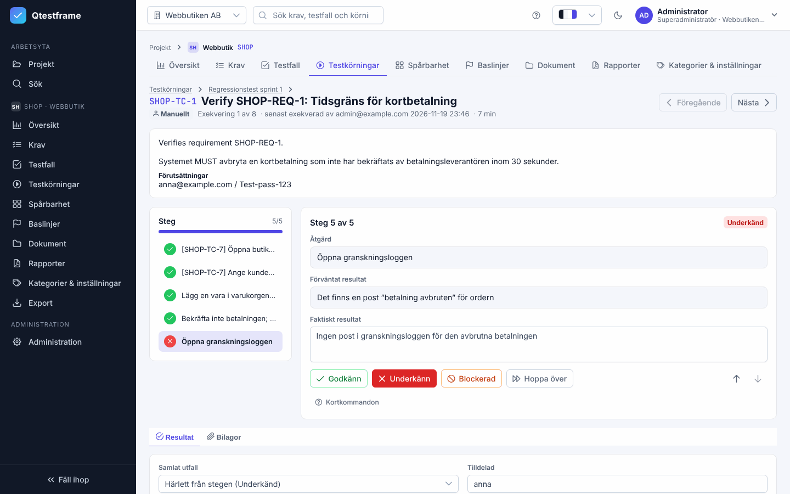

# Testkörningar och exekvering

En **körning** (testkörning, kampanj) är en uppsättning testfall som du exekverar tillsammans, till exempel *Regressionstest sprint 12* i miljön *staging* med bygget *1.4.2*. Varje testfall i en körning är en **exekvering** med ett eget utfall. Körningarna finns under **Testkörningar** i projektets sidopanel.

| Åtgärd | Roll som krävs |
|---|---|
| Visa körningar och utfall | Läsare |
| Skapa, redigera och ta bort körningar, lägga till testfall | Testare |
| Registrera utfall, importera utfall från CI | Testare |
| Köra automatiserade skript på servern | Testledare |
| Ändra [inställningarna för testexekvering](administration.md#inställningar-för-testexekvering) | Testledare |

## Listan över körningar

**Testkörningar** listar projektets körningar med status, miljö, bygge, förloppsstapel och andel godkända. Filtrera med frågespråket, till exempel `status:in_progress env:staging`. Välj en körning för att öppna den.


## Ändra många körningar på en gång

Kryssa i körningarna i listan (eller rubrikens kryssruta för hela sidan). Verktygsfältet som visas ändrar alla på en gång (behörighet att ändra körningar):

- **Ange status**: till exempel avbryta gamla körningar, eller avsluta körningar som i praktiken är klara.
- **Ange release**: lägg körningarna i en [release](releases-and-risks.md), eller ta bort dem ur en.
- **Miljö / bygge**: ange miljö, bygge eller båda (ett tomt fält rensar).
- **Ta bort**: ta bort körningarna med alla resultat, efter bekräftelse.

Ändringar av status, release, miljö och bygge kan ångras med ångra-knappen i övre fältet; borttagning kan inte ångras.

## Skapa en körning

Välj **Ny körning** och fyll i:

- **Namn**, till exempel *Regressionstest sprint 12* (ett namn med datum föreslås);
- **Beskrivning**, **Miljö** (t.ex. *staging*) och **Bygge** (t.ex. *1.4.2+sha*): fri text som visas med utfallen och skickas till automatiserade skript;
- **Konfigurationer** (när projektet har [testkonfigurationer](administration.md#testkonfigurationer)): de konfigurationer som körningen gäller, till exempel *Chrome / Windows* och *Firefox / Linux*. Varje testfall exekveras då en gång per konfiguration; se [Konfigurationer i en körning](#konfigurationer-i-en-körning). Utan konfigurationer exekveras varje testfall en gång;
- **Testfall som ska ingå**: unionen av tre flikar:
  - **Testfall**: **Välj testfall …** för att välja enskilda testfall;
  - **Mappar**: testfallen i de valda mapparna, inklusive undermappar;
  - **Fråga**: alla testfall som matchar ett filter som `status:ready category:Negative`; **Förhandsgranska** räknar träffarna.

Välj **Skapa körning**. Ett testfall finns bara en gång i en körning även om flera flikar väljer det. Utan testfall startar körningen tom och du lägger till testfall senare.

När ett testfall läggs till kopieras dess aktuella steg (med delade steg utvecklade) in i exekveringen. Senare ändringar av testfallet påverkar inte den här körningen.

## Körningens sida


- **Körningens status**: **Planerad**, **Pågår**, **Slutförd** eller **Avbruten**. Starttiden sätts när körningen första gången får status *Pågår* (även automatiskt när det första utfallet registreras), sluttiden när den blir *Slutförd* eller *Avbruten*. En körning blir **Slutförd av sig själv** när varje testfall i den har ett slutligt utfall (godkänt, underkänt, blockerat eller överhoppat), även en körning med ett enda testfall. Den går tillbaka till *Pågår* när ett utfall återställs till *Ej kört* eller *Pågår*, eller när testfall läggs till. Du kan fortfarande ändra statusen för hand; en *Avbruten* körning ändras aldrig automatiskt.
- **Förlopp** och **Andel godkända** sammanfattar exekveringarna.
- **Exekvera** öppnar exekveringsvyn vid den första exekveringen som ännu inte har körts.
- **Lägg till testfall** lägger till fler testfall; **CI-import** visar hur en pipeline rapporterar utfall; **Redigera körning** ändrar namn, beskrivning, miljö och bygge; **Ta bort** tar bort körningen med alla dess utfall.
- Tabellen listar varje exekvering med testfall, utfall, **Tilldelad**, **Exekverad av**, **Defekter**, tidpunkten **Avslutad** och tidsåtgången. Filtrera den, till exempel `status:failed` eller `assignee:anna`.
- Per rad: **Markera som godkänd** och **Markera som underkänd** registrerar ett utfall direkt; uppspelningsknappen öppnar exekveringen i exekveringsvyn.

## Konfigurationer i en körning

En körning kan gälla en eller flera [testkonfigurationer](administration.md#testkonfigurationer). När ett testfall läggs till skapas då **en exekvering per testfall och konfiguration**: en körning med 10 testfall och 3 konfigurationer har 30 exekveringar.

- Listan över körningar visar varje körnings konfigurationer i kolumnen **Konfigurationer**; filtret `configuration:Chrome` (eller `config:`) hittar körningar som gäller en konfiguration.
- På körningens sida visar **Utfall per konfiguration** framsteg och andel godkända för varje konfiguration; välj en konfigurations namn för att bara se dess exekveringar, eller använd **Visa konfiguration** ovanför tabellen. Kolumnen **Konfiguration** anger varje exekverings konfiguration, och filtret `configuration:"Chrome / Windows"` fungerar även i exekveringstabellen.
- **Redigera körning → Konfigurationer** ändrar konfigurationerna i efterhand. En tillagd konfiguration får en exekvering för varje testfall i körningen. En borttagen konfigurations exekveringar tas bort, vilket nekas så länge någon av dem har ett utfall (sätt dem först tillbaka till *Ej körd*). Den första konfigurationen som läggs till i en körning utan konfigurationer tar över de befintliga exekveringarna; tas den sista bort blir dess exekveringar kvar som exekveringar utan konfiguration.
- Förutsättningar ([beroenden](tests.md#beroenden)) räknas per konfiguration: i en körning räknas en förutsättning som godkänd när den har godkänts i **samma konfiguration**.
- Exekveringsvyn visar konfigurationen i sidhuvudet, och ett testfalls [exekveringshistorik](tests.md#exekveringshistorik) visar varje exekverings konfiguration.

Körningar utan konfigurationer fungerar precis som tidigare. Hur utfall i flera konfigurationer räknas för krav beskrivs under [Så beräknas täckningen](traceability-and-coverage.md#så-beräknas-täckningen).

## Spara många utfall på en gång

På körningens sida kryssar du i tester i exekveringstabellen (rubrikens kryssruta markerar hela sidan). Verktygsfältet erbjuder då:

- **Ange resultat**: *Godkänd*, *Underkänd*, *Blockerad*, *Överhoppad* eller *Ej körd* för alla markerade tester.
- **Resultat, ansvarig, anteckning…**: en dialog för att i ett steg ange resultat, tilldela testerna till någon (tomt tar bort tilldelningen) och lägga till en anteckning under de anteckningar de redan har. **Bara tester som inte har körts än** lämnar tester som redan har ett utfall orörda, till exempel för att markera resten *Överhoppad* i slutet av en körning.
- **Ta bort ur körningen** (behörighet att ändra körningar): tar ut testerna ur körningen, med utfall, stegresultat och bevis, efter bekräftelse.

Samma [exekveringsinställningar](administration.md) gäller som för ett test i taget: *Godkänd* och *Underkänd* sparas bara för tester som får köras. Tester som inte får det listas med orsaken, och resten sparas. Förutsättningar i samma urval hanteras: när du markerar ett test och dess förutsättning *Godkänd* samtidigt sparas förutsättningen först. *Blockerad*, *Överhoppad*, *Ej körd*, tilldelningar och anteckningar går alltid.

Stegresultaten ändras inte: ett massresultat är varje tests samlade utfall. Körningen avslutas av sig själv när alla tester har ett slutligt utfall, och krav vars status följer bevisen uppdateras. Resultat, tilldelningar och anteckningar kan ångras med ångra-knappen; att ta bort tester kan inte ångras.

## Exekveringsvyn

Exekveringsvyn visar en exekvering i taget. Rubriken anger vilken exekvering i körningen det är (*Exekvering 3 av 12*) och vem som exekverade den senast.



### Manuella testfall

1. Läs **Förutsättningar** högst upp.
2. Den vänstra kolumnen listar stegen med deras status; välj ett steg för att hoppa dit.
3. Utför stegets **Åtgärd** med **Testdata** och jämför med **Förväntat resultat**.
4. Registrera utfallet med **Godkänn**, **Underkänn**, **Blockerad** eller **Hoppa över**. Skriv vad som hände i **Faktiskt resultat** för allt annat än godkänt. Vyn går vidare till nästa steg.
5. Under stegen:
   - **Samlat utfall** härleds från stegen (*Sparas som …*): något underkänt steg → **Underkänd**; annars något blockerat steg → **Blockerad**; alla godkända eller överhoppade med minst ett godkänt → **Godkänd**; alla överhoppade → **Överhoppad**; delvis utfört → **Pågår**. Du kan också ange det uttryckligen.
   - **Tilldelad**: vem som ska exekvera testfallet. Skriv `@` för att välja en person ([omnämnanden](requirements.md#nämn-personer)).
   - **Defekter**: defekt-id:n eller URL:er, var och en följd av <kbd>Enter</kbd>.
   - **Anteckningar**: iakttagelser, länkar, allt som är värt att spara.
6. Välj **Spara**, eller **Spara och nästa** för att spara och öppna nästa exekvering. På den sista exekveringen heter knappen **Spara och avsluta**: den sparar och går tillbaka till körningens sida, där körningen blir slutförd när alla testfall har ett utfall; saknar några fortfarande utfall säger den hur många och öppnar det första av dem. **Föregående** och **Nästa** växlar mellan exekveringar. *Osparade ändringar* påminner dig om att spara.

Ett testfall utan steg visar bara samlat utfall, anteckningar och defekter.

### Datadrivna testfall: iterationer

Ett [datadrivet testfall](tests.md#datadrivna-testfall) har en **iteration** per rad i sin testdata. Exekveringsvyn listar iterationerna ovanför stegen, var och en med sitt utfall; välj en för att arbeta med den. Vyn visar värdena i iterationens rad, och stegen, förutsättningarna och de förväntade resultaten med platshållarna ersatta av dessa värden.

- Med steg har varje iteration egna stegutfall, bevis och faktiska resultat. Dess utfall härleds från stegen precis som utfallet för ett testfall. När du markerar det sista steget i en iteration går vyn vidare till första steget i nästa.
- Utan steg markerar du varje iteration **Godkänn**, **Underkänn**, **Blockerad** eller **Hoppa över** med knapparna under värdena (eller tangenterna P, F, B och S).
- Varje iteration har egna anteckningar.

Exekveringens **samlade utfall** följer iterationerna, utvärderat uppifrån och ned: **Underkänd** om en iteration är underkänd; annars **Blockerad** om en är blockerad; **Godkänd** när alla iterationer är godkända eller överhoppade (minst en godkänd); **Överhoppad** när alla är överhoppade; **Ej körd** när ingen har något utfall; annars **Pågår**. Precis som för steg kan du välja ett annat samlat utfall för hand. Ett utfall som anges direkt på exekveringen (med **Markera som godkänd** i körningen, ett utfall för många på en gång eller en CI-import) sparas som det samlade utfallet; iterationerna behåller sina utfall, och nästa ändring av en iteration härleder det samlade utfallet på nytt.

Körningens sida visar antalet iterationer bredvid utfallet för en datadriven exekvering.

### Kortkommandon

Kortkommandona fungerar när fokus inte står i ett textfält. Tryck <kbd>?</kbd> i exekveringsvyn för att visa dem.

| Tangent | Åtgärd |
|---|---|
| <kbd>P</kbd> | Markera steget som godkänt |
| <kbd>F</kbd> | Markera steget som underkänt |
| <kbd>B</kbd> | Markera steget som blockerat |
| <kbd>S</kbd> | Hoppa över steget |
| <kbd>J</kbd> eller <kbd>↓</kbd> | Nästa steg |
| <kbd>K</kbd> eller <kbd>↑</kbd> | Föregående steg |
| <kbd>?</kbd> | Visa eller dölj hjälpen för kortkommandon |

Tangenterna är desamma på svenska och engelska (P som i *pass*, F som i *fail*).


### Automatiserade testfall

För ett automatiserat testfall visar exekveringsvyn **Skript** och **Utdata**. Välj **Kör skript** för att köra det på servern: exekveringen får status *Pågår*, skriptet körs och utfallet blir **Godkänd** vid slutkod 0 och annars **Underkänd** (även när tidsgränsen överskrids). Utdata och tidsåtgång sparas.

Knappen kräver rollen **Testledare** eller **Ansvarig** (behörigheten *script.execute*). Om administratören inte har aktiverat skriptexekveringen svarar servern att den är avstängd; utfallen kommer då från CI.

### Webbtester och deras bevis

Ett [webbtest](tests.md#webbtester-playwright) tar sekunder till minuter, så **Kör skript** lägger det i en kö och svarar direkt: exekveringen visar *I kö* eller *Körs* (med **Avbryt**), du kan fortsätta med andra testfall och sidan uppdaterar sig själv när utfallet finns. Servern kör några webbtester samtidigt (administratören bestämmer hur många); de andra väntar i kön.

När testet är klart visar exekveringsvyn utfallet, Playwrights **Utdata** (stegen och felmeddelandet; värden för hemliga variabler visas som `***`) och **Bevis från webbtestet**:

- **Skärmbilder** — som standard bara när testet underkänns, och de visar sidan i felögonblicket. Välj en skärmbild för att förstora den.
- **Spår** (`trace.zip`, som standard när testet underkänns) — en inspelning av varje åtgärd med sidan före och efter, nätverksanropen och konsolen. Ladda ned det och öppna det med `npx playwright show-trace trace.zip`, eller släpp filen på [trace.playwright.dev](https://trace.playwright.dev) (filen öppnas i din webbläsare och laddas inte upp).
- **Video** — när administratören har slagit på videor.

Filerna finns också under **Bilagor** för exekveringen. När webbtestet körs igen ersätts de (andra bilagor finns kvar).

### Kör alla automatiserade tester

På körningens sida lägger **Kör automatiserade tester** alla automatiserade testfall i körningen som inte är godkända ännu i kön, vart och ett i sina konfigurationer; markera exekveringar och använd **Kör automatiserat** i verktygsraden för att köra bara dem (även godkända). Testfall som inte får exekveras ännu (se [När kan ett testfall exekveras?](#när-kan-ett-testfall-exekveras)) hoppas över och listas. En förutsättning som också finns i körningen körs först, och testfallen som beror på den väntar — underkänns den exekveras de inte.

Medan testfall står i kö eller körs visar en panel förloppet (*i kö*, *körs*, *klara*, godkända och underkända) och testfallen i kön; **Avbryt köade** tar bort testfallen som inte har startat (deras exekveringar behåller sitt tidigare utfall). Exekveringarna och utfallen uppdateras när jobben blir klara. Skript i de andra språken körs också på det här sättet.

Jobben överlever inte en omstart av servern: testfall som fortfarande står i kö eller körs får då tillbaka sitt tidigare utfall, med en anteckning i utdata.

### Bevis

Varje steg i ett manuellt testfall har ett avsnitt **Bevis** under *Faktiskt resultat*: öppna det för att registrera vad som visar utfallet. Skriv iakttagelser, värden eller länkar i textfältet (till exempel *svarstid 120 ms, order 4711*), och lägg till filer som skärmbilder eller loggutdrag *(Testare)*. Filer kan släppas på ytan eller väljas ur arkivet, som andra [bilagor](#bilagor-till-körningar-och-exekveringar). Stegets rubrik visar hur mycket bevis det har.

Bevisen sparas med exekveringen (välj **Spara**), stannar kvar i körningen även om testfallet ändras senare, och visas i dokumentarkivet som *Bevis för ett teststeg*, länkade till steget. När körningen tas bort tas även bevisfilerna bort.

### När kan ett testfall exekveras?

Innan ett testfall exekveras kontrollerar Qtestframe att det är klart: testfallet har status **Klar**, kraven det verifierar är godkända (eller implementerade eller verifierade), och testfallen det [beror på](tests.md#beroenden) har godkänts. Vad som händer när en kontroll inte går igenom ställs in under [inställningar för testexekvering](administration.md#inställningar-för-testexekvering):

- **blockerat** (standard): exekveringsvyn visar en röd ruta med orsaker och länkar; **Godkänd**, **Underkänd** och **Kör skript** är avstängda, och servern avvisar sådana utfall. Du kan fortfarande markera testfallet som **Blockerat** eller **Överhoppat**;
- **tillåtet**: orsakerna visas som en gul varning, och du kan exekvera testfallet.

Varje orsak säger exakt vad som är fel, vad du kan göra åt det och vilken inställning som avgör, till exempel:

- *SHOP-TC-4 har status Utkast; bara testfall med status Klart kan exekveras.* — **Gör så här:** gör klart testfallet och låt det granskas och markeras som Klart (kräver *test.review*). *Blockeras av exekveringsinställningen ”Tillåt exekvering av testfall som inte är Klara”, som är avslagen.*
- *Det verifierar SHOP-REQ-2, som har status Godkänt; inställningarna för exekvering kräver att länkade krav är Implementerat eller Verifierat.* — **Gör så här:** flytta kravet vidare när det har implementerats, eller be en administratör lägga till dess status bland de klara statusarna.
- *Det beror på SHOP-TC-1, som är Underkänt i den här körningen; ett förutsättande test måste ha godkänts först.* — **Gör så här:** exekvera SHOP-TC-1 först så att det godkänns, eller lägg till det i körningen.

Så ser du om det är testfallet självt, ett krav, ett förutsättande test eller en inställning i organisationen som stoppar det. Körningens sida visar samma sak i kolumnen **Redo** (välj posten för att se hela förklaringen), med en sammanfattning ovanför tabellen; knappbeskrivningarna för de avstängda knapparna Godkänd och Underkänd och ett avvisat utfall anger också orsakerna, och dialogen **Ny körning** markerar valda testfall som inte är klara.

## Defekter

Registrera en defekt när ett testfall underkänns: i exekveringsvyn under **Defekter** (ett id som `JIRA-123` eller en fullständig URL). Defekterna visas på körningens sida, på fliken **Exekveringar** för testfallet och i rapporter.

För att göra id:n klickbara anger du en **URL-mall för felhanteringssystem** under **Kategorier & inställningar**, till exempel `https://jira.example.com/browse/{id}`. `{id}` ersätts med defektens id; utan `{id}` läggs id:t till sist. Värden som redan är URL:er länkas direkt.

Hitta defekter med frågor: `defect:JIRA-*` i körningens filter hittar exekveringar med en JIRA-defekt; i testfallslistan hittar frågan testfall med en sådan defekt i de senaste exekveringarna.

## Importera utfall från CI

Automatiserade pipelines (GitLab CI, GitHub Actions, Jenkins …) kan rapportera utfall till en körning per testnyckel.

1. Skapa en API-nyckel: **Administration → API-nycklar → Ny API-nyckel**, roll **Testare** eller högre (se [API-nycklar](administration.md#api-nycklar)). Kopiera nyckeln; den visas bara en gång och börjar med `qtf_`.
2. Öppna körningen och välj **CI-import**. Dialogen visar slutpunkten med körningens id och ett färdigt kommando.


3. Skicka utfallen från din pipeline:

```bash
curl -X POST "https://qtf.example.com/api/v1/runs/$RUN_ID/results" \
  -H "Authorization: Bearer $QTF_TOKEN" \
  -H "Content-Type: application/json" \
  -d '{"results":[
        {"test_key":"SHOP-TC-7","status":"passed","duration_ms":1234,"output":"ok"},
        {"test_key":"SHOP-TC-9","status":"failed","duration_ms":877,"output":"expected 35, got 34"}
      ]}'
```

- `status` är något av `passed`, `failed`, `blocked`, `skipped`, `in_progress` eller `not_run`.
- Testnycklarna matchas utan hänsyn till versaler och gemener inom körningens projekt. Testfall som ännu inte ingår i körningen läggs till.
- Svaret anger hur många exekveringar som uppdaterades (`updated`) och listar okända nycklar (`unknown`), som hoppades över.
- En ogiltig status stoppar importen med ett fel; utfall före den förblir sparade.
- **Konfigurationer:** när körningen gäller [konfigurationer](#konfigurationer-i-en-körning) anger du utfallens konfiguration med `?configuration=NAMN` i adressen (`.../results?configuration=Chrome%20%2F%20Windows`) eller per utfall med fältet `"configuration": "Chrome / Windows"` (namn eller ID). En konfiguration som körningen inte gäller än läggs till i den. Utan konfiguration används den enda konfigurationen i en körning som har exakt en, och en körning utan konfigurationer sparar utfallen utan konfiguration, som tidigare; en körning med flera konfigurationer svarar med ett fel.

Förvara nyckeln i CI-systemets hemlighetslager, aldrig i kodförrådet. En API-nyckel är knuten till en organisation och har aldrig fler rättigheter än sin ägare.

Utöver det här JSON-formatet finns tre enklare vägar för testverktyg som redan skriver rapporter: JUnit XML, kommandot `qtestframe report` och Playwright-rapportören.

### Koppla automatiserade tester till testnycklar

Varje automatiserat test måste ange vilket testfall i Qtestframe det exekverar. Skriv testnyckeln (till exempel `SHOP-TC-12`) på något av följande ställen:

- **i testets namn**, till exempel `test_login[SHOP-TC-12]`, `TestCart/SHOP-TC-12_add` eller `SHOP-TC-12 betalar med kort`. Där ett namn inte får innehålla bindestreck fungerar även `SHOP_TC_12`. Nyckeln kan också stå i klassnamnet.
- **som egenskap på testfallet** i JUnit-rapporten, med namnet `qtestframe.key` eller `test_key`. Med pytest: `record_property("test_key", "SHOP-TC-12")`.
- **med Playwright** som taggen `@SHOP-TC-12` eller annoteringen `{ type: 'qtestframe', description: 'SHOP-TC-12' }`.

Flera testfall med samma nyckel (till exempel samma test i två webbläsare) ger ett gemensamt utfall: *underkänt* går före *godkänt*, och tiderna summeras.

### JUnit XML

Nästan alla testverktyg skriver JUnit XML: Playwright (rapportören `junit`), pytest (`--junitxml`), Go (med go-junit-report), Maven Surefire och Gradle, Jest (jest-junit) och Vitest (`--reporter=junit`). Skicka filen till körningen:

```bash
curl -X POST "https://qtf.example.com/api/v1/runs/$RUN_ID/junit" \
  -H "Authorization: Bearer $QTF_TOKEN" \
  -H "Content-Type: application/xml" \
  --data-binary @results/junit.xml
```

- Ett testfall med `<failure>` eller `<error>` registreras som *underkänt*, ett med `<skipped>` som *överhoppat* och alla andra som *godkända*. Tiden hämtas från `time`; utdata innehåller felmeddelandet och `system-out`/`system-err`.
- Svaret listar, förutom `updated`, `unknown` och `rejected`, namnen på testfall utan nyckel under `unmapped`.
- Lägg till `?create_missing=true` för att skapa ett automatiserat testfall i utkastläge för varje testfall utan nyckel (med testfallets namn som titel) och registrera dess utfall. Vid nästa import hittas testfallet igen via titeln. Det kräver behörighet att skriva testfall.
- Flera filer kan skickas samtidigt som en multipart-uppladdning (`-F file=@a.xml -F file=@b.xml`); tillsammans får de vara högst 20 MB.
- `?configuration=NAMN` sparar utfallen i den konfigurationen, som för JSON-formatet.

### Kommandot qtestframe report

Programmet `qtestframe` kan själv ladda upp rapporter. Det hittar körningen via namnet i projektet, eller skapar den:

```bash
export QTF_URL=https://qtf.example.com QTF_TOKEN=qtf_…
qtestframe report --project SHOP --run "Nattlig $BUILD_NUMBER" --create-run \
  --build "$BUILD_NUMBER" --environment staging \
  --junit 'results/*.xml'
```

- `--run-id ID` rapporterar till en känd körning i stället för `--project`/`--run`.
- `--junit` och `--json` (JSON-formatet ovan) tar filer eller mönster och kan anges flera gånger.
- `--create-missing` skapar testfall för testfall utan nyckel, som ovan.
- `--configuration NAMN` (eller `QTF_CONFIGURATION`) sparar utfallen i den konfigurationen; körningen får konfigurationen om den inte redan gäller den. Kör kommandot en gång per konfiguration, till exempel en gång per webbläsare.
- Kommandot skriver ut hur många utfall som registrerades och listar okända nycklar, testfall utan nyckel och avvisade utfall med orsaken. Det avslutas med en felkod när uppladdningen misslyckas, och med `--fail-on-unknown` även när utfall inte matchade något testfall.

### Playwright-rapportören

För Playwright finns en rapportör (`@qtestframe/playwright-reporter`, i `integrations/playwright-reporter` i Qtestframes källkod) som rapporterar medan testerna körs, utan någon JUnit-fil:

```ts
// playwright.config.ts
reporter: [
  ['list'],
  ['@qtestframe/playwright-reporter', { project: 'SHOP', run: 'Nattlig', createRun: true }],
],
```

Den läser serverns adress och API-nyckeln från `QTF_URL` och `QTF_TOKEN`; inställningen `configuration` (eller `QTF_CONFIGURATION`) anger utfallens [konfiguration](#konfigurationer-i-en-körning). Den hämtar nyckeln från annoteringen, taggen eller titeln, skriver felet och rubrikerna från `test.step()` med deras utfall i utdata och laddar upp skärmbilder, spår (traces) och andra bilagor från underkända tester som bilagor till exekveringen. Om rapporteringen misslyckas loggas bara ett meddelande; testkörningen påverkas inte.

## Länkar för en körning

Fliken **Länkar** på körningens sida länkar körningen till krav, testfall, andra körningar, arkivfiler, rapporter och webbadresser, till exempel CI-bygget eller versionsinformationen, se [Länkar](requirements.md#länkar).

## Bilagor till körningar och exekveringar

Även körningar och exekveringar har **Bilagor**: loggfiler, skärmbilder av ett fel, testrapporter från andra verktyg. I exekveringsvyn öppnar du fliken **Bilagor** bredvid **Resultat** och drar filer dit eller väljer **Välj filer**; på körningens sida hör bilagorna till körningen som helhet. Du kan också bifoga en fil från projektets [dokumentarkiv](documents.md). Att ladda upp och ta bort bilagor för körningar och exekveringar kräver **Testare** (rätten att registrera utfall).
