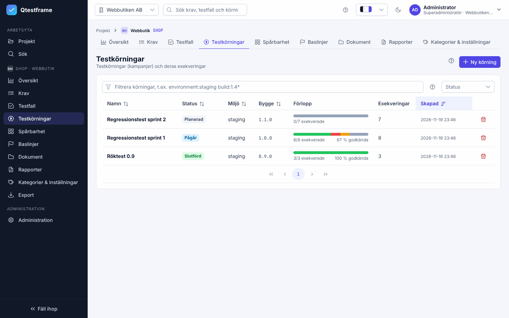
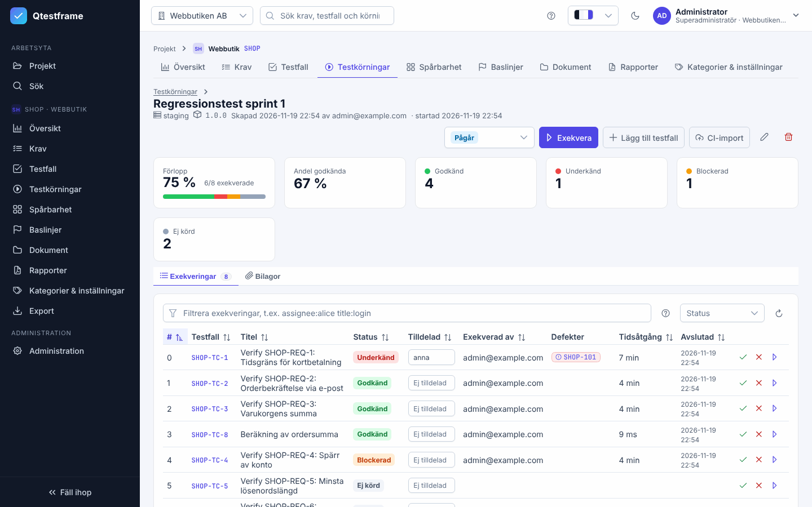
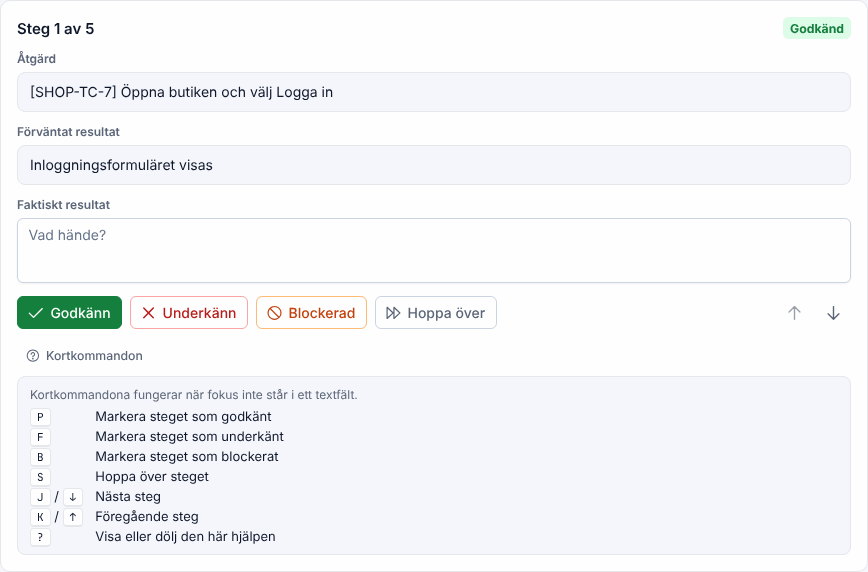
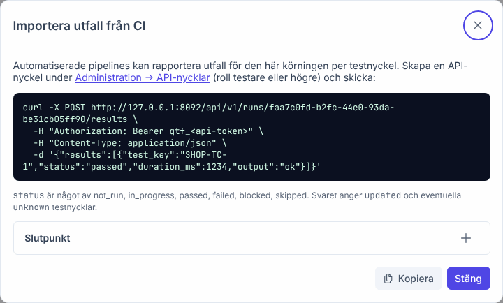

# Testkörningar och exekvering

En **körning** (testkörning, kampanj) är en uppsättning testfall som du exekverar tillsammans, till exempel *Regressionstest sprint 12* i miljön *staging* med bygget *1.4.2*. Varje testfall i en körning är en **exekvering** med ett eget utfall. Körningarna finns under **Testkörningar** i projektets sidopanel.

| Åtgärd | Roll som krävs |
|---|---|
| Visa körningar och utfall | Läsare |
| Skapa, redigera och ta bort körningar, lägga till testfall | Testare |
| Registrera utfall, importera utfall från CI | Testare |
| Köra automatiserade skript på servern | Testledare |
| Ändra [inställningarna för testexekvering](administration.md#inställningar-för-testexekvering) | Testledare |

## Listan över körningar

**Testkörningar** listar projektets körningar med status, miljö, bygge, förloppsstapel och andel godkända. Filtrera med frågespråket, till exempel `status:in_progress env:staging`. Välj en körning för att öppna den.



## Skapa en körning

Välj **Ny körning** och fyll i:

- **Namn**, till exempel *Regressionstest sprint 12* (ett namn med datum föreslås);
- **Beskrivning**, **Miljö** (t.ex. *staging*) och **Bygge** (t.ex. *1.4.2+sha*): fri text som visas med utfallen och skickas till automatiserade skript;
- **Testfall som ska ingå**: unionen av tre flikar:
  - **Testfall**: **Välj testfall …** för att välja enskilda testfall;
  - **Mappar**: testfallen i de valda mapparna, inklusive undermappar;
  - **Fråga**: alla testfall som matchar ett filter som `status:ready category:Negative`; **Förhandsgranska** räknar träffarna.

Välj **Skapa körning**. Ett testfall finns bara en gång i en körning även om flera flikar väljer det. Utan testfall startar körningen tom och du lägger till testfall senare.

När ett testfall läggs till kopieras dess aktuella steg (med delade steg utvecklade) in i exekveringen. Senare ändringar av testfallet påverkar inte den här körningen.

## Körningens sida



- **Körningens status**: **Planerad**, **Pågår**, **Slutförd** eller **Avbruten**. Starttiden sätts när körningen första gången får status *Pågår* (även automatiskt när det första utfallet registreras), sluttiden när den blir *Slutförd* eller *Avbruten*. En körning blir **Slutförd av sig själv** när varje testfall i den har ett slutligt utfall (godkänt, underkänt, blockerat eller överhoppat), även en körning med ett enda testfall. Den går tillbaka till *Pågår* när ett utfall återställs till *Ej kört* eller *Pågår*, eller när testfall läggs till. Du kan fortfarande ändra statusen för hand; en *Avbruten* körning ändras aldrig automatiskt.
- **Förlopp** och **Andel godkända** sammanfattar exekveringarna.
- **Exekvera** öppnar exekveringsvyn vid den första exekveringen som ännu inte har körts.
- **Lägg till testfall** lägger till fler testfall; **CI-import** visar hur en pipeline rapporterar utfall; **Redigera körning** ändrar namn, beskrivning, miljö och bygge; **Ta bort** tar bort körningen med alla dess utfall.
- Tabellen listar varje exekvering med testfall, utfall, **Tilldelad**, **Exekverad av**, **Defekter**, tidpunkten **Avslutad** och tidsåtgången. Filtrera den, till exempel `status:failed` eller `assignee:anna`.
- Per rad: **Markera som godkänd** och **Markera som underkänd** registrerar ett utfall direkt; uppspelningsknappen öppnar exekveringen i exekveringsvyn.

## Exekveringsvyn

Exekveringsvyn visar en exekvering i taget. Rubriken anger vilken exekvering i körningen det är (*Exekvering 3 av 12*) och vem som exekverade den senast.


### Manuella testfall

1. Läs **Förutsättningar** högst upp.
2. Den vänstra kolumnen listar stegen med deras status; välj ett steg för att hoppa dit.
3. Utför stegets **Åtgärd** med **Testdata** och jämför med **Förväntat resultat**.
4. Registrera utfallet med **Godkänn**, **Underkänn**, **Blockerad** eller **Hoppa över**. Skriv vad som hände i **Faktiskt resultat** för allt annat än godkänt. Vyn går vidare till nästa steg.
5. Under stegen:
   - **Samlat utfall** härleds från stegen (*Sparas som …*): något underkänt steg → **Underkänd**; annars något blockerat steg → **Blockerad**; alla godkända eller överhoppade med minst ett godkänt → **Godkänd**; alla överhoppade → **Överhoppad**; delvis utfört → **Pågår**. Du kan också ange det uttryckligen.
   - **Tilldelad**: vem som ska exekvera testfallet. Skriv `@` för att välja en person ([omnämnanden](requirements.md#nämn-personer)).
   - **Defekter**: defekt-id:n eller URL:er, var och en följd av <kbd>Enter</kbd>.
   - **Anteckningar**: iakttagelser, länkar, allt som är värt att spara.
6. Välj **Spara**, eller **Spara och nästa** för att spara och öppna nästa exekvering. På den sista exekveringen heter knappen **Spara och avsluta**: den sparar och går tillbaka till körningens sida, där körningen blir slutförd när alla testfall har ett utfall; saknar några fortfarande utfall säger den hur många och öppnar det första av dem. **Föregående** och **Nästa** växlar mellan exekveringar. *Osparade ändringar* påminner dig om att spara.

Ett testfall utan steg visar bara samlat utfall, anteckningar och defekter.

### Kortkommandon

Kortkommandona fungerar när fokus inte står i ett textfält. Tryck <kbd>?</kbd> i exekveringsvyn för att visa dem.

| Tangent | Åtgärd |
|---|---|
| <kbd>P</kbd> | Markera steget som godkänt |
| <kbd>F</kbd> | Markera steget som underkänt |
| <kbd>B</kbd> | Markera steget som blockerat |
| <kbd>S</kbd> | Hoppa över steget |
| <kbd>J</kbd> eller <kbd>↓</kbd> | Nästa steg |
| <kbd>K</kbd> eller <kbd>↑</kbd> | Föregående steg |
| <kbd>?</kbd> | Visa eller dölj hjälpen för kortkommandon |

Tangenterna är desamma på svenska och engelska (P som i *pass*, F som i *fail*).



### Automatiserade testfall

För ett automatiserat testfall visar exekveringsvyn **Skript** och **Utdata**. Välj **Kör skript** för att köra det på servern: exekveringen får status *Pågår*, skriptet körs och utfallet blir **Godkänd** vid slutkod 0 och annars **Underkänd** (även när tidsgränsen överskrids). Utdata och tidsåtgång sparas.

Knappen kräver rollen **Testledare** eller **Ansvarig** (behörigheten *script.execute*). Om administratören inte har aktiverat skriptexekveringen svarar servern att den är avstängd; utfallen kommer då från CI.

### Bevis

Varje steg i ett manuellt testfall har ett avsnitt **Bevis** under *Faktiskt resultat*: öppna det för att registrera vad som visar utfallet. Skriv iakttagelser, värden eller länkar i textfältet (till exempel *svarstid 120 ms, order 4711*), och lägg till filer som skärmbilder eller loggutdrag *(Testare)*. Filer kan släppas på ytan eller väljas ur arkivet, som andra [bilagor](#bilagor-till-körningar-och-exekveringar). Stegets rubrik visar hur mycket bevis det har.

Bevisen sparas med exekveringen (välj **Spara**), stannar kvar i körningen även om testfallet ändras senare, och visas i dokumentarkivet som *Bevis för ett teststeg*, länkade till steget. När körningen tas bort tas även bevisfilerna bort.

### När kan ett testfall exekveras?

Innan ett testfall exekveras kontrollerar Qtestframe att det är klart: testfallet har status **Klar**, kraven det verifierar är godkända (eller implementerade eller verifierade), och testfallen det [beror på](tests.md#beroenden) har godkänts. Vad som händer när en kontroll inte går igenom ställs in under [inställningar för testexekvering](administration.md#inställningar-för-testexekvering):

- **blockerat** (standard): exekveringsvyn visar en röd ruta med orsaker och länkar; **Godkänd**, **Underkänd** och **Kör skript** är avstängda, och servern avvisar sådana utfall. Du kan fortfarande markera testfallet som **Blockerat** eller **Överhoppat**;
- **tillåtet**: orsakerna visas som en gul varning, och du kan exekvera testfallet.

Varje orsak säger exakt vad som är fel, vad du kan göra åt det och vilken inställning som avgör, till exempel:

- *SHOP-TC-4 har status Utkast; bara testfall med status Klart kan exekveras.* — **Gör så här:** gör klart testfallet och låt det granskas och markeras som Klart (kräver *test.review*). *Blockeras av exekveringsinställningen ”Tillåt exekvering av testfall som inte är Klara”, som är avslagen.*
- *Det verifierar SHOP-REQ-2, som har status Godkänt; inställningarna för exekvering kräver att länkade krav är Implementerat eller Verifierat.* — **Gör så här:** flytta kravet vidare när det har implementerats, eller be en administratör lägga till dess status bland de klara statusarna.
- *Det beror på SHOP-TC-1, som är Underkänt i den här körningen; ett förutsättande test måste ha godkänts först.* — **Gör så här:** exekvera SHOP-TC-1 först så att det godkänns, eller lägg till det i körningen.

Så ser du om det är testfallet självt, ett krav, ett förutsättande test eller en inställning i organisationen som stoppar det. Körningens sida visar samma sak i kolumnen **Redo** (välj posten för att se hela förklaringen), med en sammanfattning ovanför tabellen; knappbeskrivningarna för de avstängda knapparna Godkänd och Underkänd och ett avvisat utfall anger också orsakerna, och dialogen **Ny körning** markerar valda testfall som inte är klara.

## Defekter

Registrera en defekt när ett testfall underkänns: i exekveringsvyn under **Defekter** (ett id som `JIRA-123` eller en fullständig URL). Defekterna visas på körningens sida, på fliken **Exekveringar** för testfallet och i rapporter.

För att göra id:n klickbara anger du en **URL-mall för felhanteringssystem** under **Kategorier & inställningar**, till exempel `https://jira.example.com/browse/{id}`. `{id}` ersätts med defektens id; utan `{id}` läggs id:t till sist. Värden som redan är URL:er länkas direkt.

Hitta defekter med frågor: `defect:JIRA-*` i körningens filter hittar exekveringar med en JIRA-defekt; i testfallslistan hittar frågan testfall med en sådan defekt i de senaste exekveringarna.

## Importera utfall från CI

Automatiserade pipelines (GitLab CI, GitHub Actions, Jenkins …) kan rapportera utfall till en körning per testnyckel.

1. Skapa en API-nyckel: **Administration → API-nycklar → Ny API-nyckel**, roll **Testare** eller högre (se [API-nycklar](administration.md#api-nycklar)). Kopiera nyckeln; den visas bara en gång och börjar med `qtf_`.
2. Öppna körningen och välj **CI-import**. Dialogen visar slutpunkten med körningens id och ett färdigt kommando.



3. Skicka utfallen från din pipeline:

```bash
curl -X POST "https://qtf.example.com/api/v1/runs/$RUN_ID/results" \
  -H "Authorization: Bearer $QTF_TOKEN" \
  -H "Content-Type: application/json" \
  -d '{"results":[
        {"test_key":"SHOP-TC-7","status":"passed","duration_ms":1234,"output":"ok"},
        {"test_key":"SHOP-TC-9","status":"failed","duration_ms":877,"output":"expected 35, got 34"}
      ]}'
```

- `status` är något av `passed`, `failed`, `blocked`, `skipped`, `in_progress` eller `not_run`.
- Testnycklarna matchas utan hänsyn till versaler och gemener inom körningens projekt. Testfall som ännu inte ingår i körningen läggs till.
- Svaret anger hur många exekveringar som uppdaterades (`updated`) och listar okända nycklar (`unknown`), som hoppades över.
- En ogiltig status stoppar importen med ett fel; utfall före den förblir sparade.

Förvara nyckeln i CI-systemets hemlighetslager, aldrig i kodförrådet. En API-nyckel är knuten till en organisation och har aldrig fler rättigheter än sin ägare.

## Länkar för en körning

Fliken **Länkar** på körningens sida länkar körningen till krav, testfall, andra körningar, arkivfiler, rapporter och webbadresser, till exempel CI-bygget eller versionsinformationen, se [Länkar](requirements.md#länkar).

## Bilagor till körningar och exekveringar

Även körningar och exekveringar har **Bilagor**: loggfiler, skärmbilder av ett fel, testrapporter från andra verktyg. I exekveringsvyn öppnar du fliken **Bilagor** bredvid **Resultat** och drar filer dit eller väljer **Välj filer**; på körningens sida hör bilagorna till körningen som helhet. Du kan också bifoga en fil från projektets [dokumentarkiv](documents.md). Att ladda upp och ta bort bilagor för körningar och exekveringar kräver **Testare** (rätten att registrera utfall).
