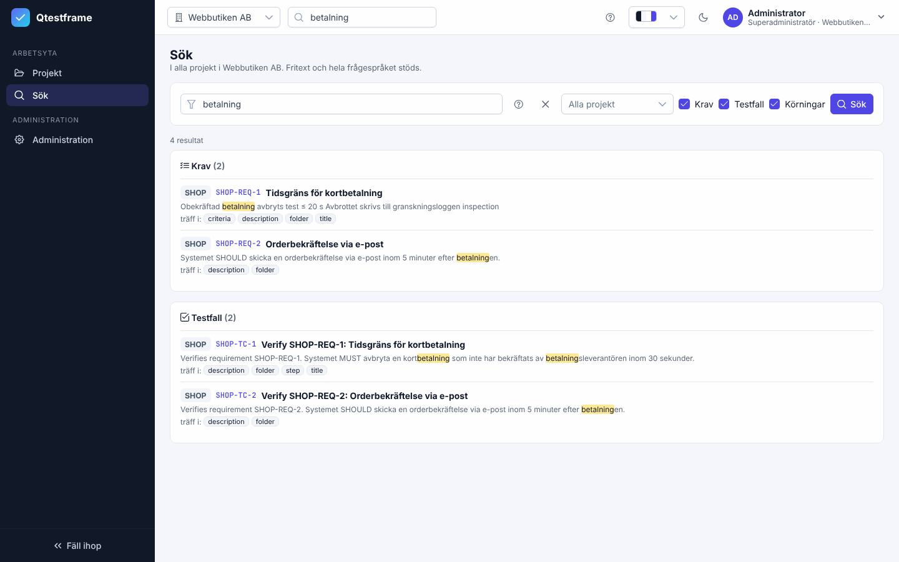
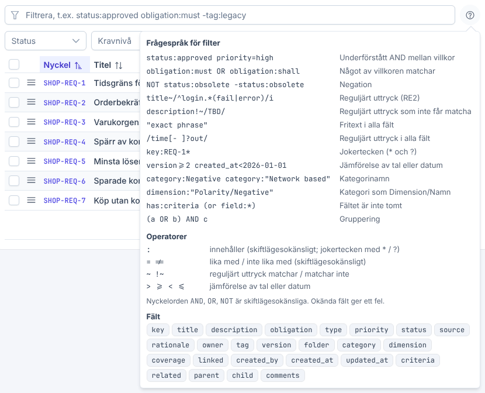

# Sökning och filter

Alla listor i Qtestframe kan filtreras med samma **frågespråk**: krav, testfall, körningar, exekveringar, spårbarhetsmatrisen, händelseloggen och dokumentarkivet. Samma språk används av den **globala sökningen** i övre fältet, fliken Fråga när du skapar en körning, filter för baslinjer, exportfilter och rapporter.

Fältnamn, nyckelord och värden som status och kravnivå skrivs på engelska, även i det svenska gränssnittet: `status:approved`, inte `status:godkänt`.

## Global sökning

Skriv i sökfältet i övre fältet och tryck <kbd>Enter</kbd> (på mobiler väljer du först förstoringsglaset). Sidan **Sök** listar matchande krav, testfall och körningar i **alla projekt i den aktuella organisationen**, med den matchande texten markerad och de fält som matchade.



- **Sök i** begränsar resultatet till krav, testfall eller körningar.
- **Projekt** begränsar det till ett projekt.
- Utöver objektens fält kan du använda `project:` (nyckel eller namn) och `kind:` (`requirement`, `test`, `run`), till exempel `kind=requirement project:SHOP coverage:none`.

## Filter i listor

Filterfältet ovanför en tabell tar emot en fråga. Tryck <kbd>Enter</kbd> för att tillämpa den. Om frågan innehåller ett fel markeras fältet och meddelandet anger var problemet finns. Knappen **?** (**Hjälp för frågespråket**) bredvid fältet listar operatorerna och alla fält i listan.



Snabbfiltren (status, prioritet och så vidare) görs om till en fråga åt dig och visas under filterfältet som `q = …`. Kopiera den om du vill återanvända eller bygga ut den.

## Taggmoln

**Taggar** i projektets sidopanel visar alla taggar på projektets krav, testfall och dokument; ju oftare en tagg används, desto större är den. Håll muspekaren över en tagg för att se hur många objekt av varje slag som har den. Filtrera molnet på namn och sortera det **Efter användning** eller **A–Ö**.

Välj en eller flera taggar för att lista objekten som har dem, grupperade i krav, testfall och dokument. Med flera taggar väljer du om objekten ska ha **Alla taggar** eller **Någon tagg**. **Öppna som filtrerad lista** öppnar kravsidan eller testfallssidan med samma fråga (till exempel `tag=gdpr AND tag=login`), och sidans adress behåller urvalet, så att du kan bokmärka det.

Med behörighet att redigera både krav och testfall kan de valda taggarna också ändras i hela projektet: **Byt namn** (en tagg), **Slå ihop** (flera taggar till en, som kan vara en av dem eller ett nytt namn, till exempel för att städa upp *gdpr*, *GDPR* och *privacy*) eller **Ta bort från alla poster**. Dokument ändras också om du får ändra projektet. Varje ändring sparas i versionshistoriken för de krav och testfall den berör.

## Syntaxen på fem minuter

| Du skriver | Det hittar |
|---|---|
| `login` | *login* var som helst i något fält (versaler och gemener spelar ingen roll) |
| `"session timeout"` | exakt den frasen var som helst |
| `status:approved` | objekt vars status innehåller *approved* |
| `priority=high` | prioritet exakt *high* |
| `status:approved priority=high` | båda: villkor bredvid varandra kombineras med AND |
| `obligation=must OR obligation=shall` | något av dem |
| `NOT status:obsolete` eller `-status:obsolete` | allt utom inaktuella objekt |
| `(tag:smoke OR tag:regression) -status:deprecated` | gruppering med parenteser |
| `title~/^login.*(fail\|error)/i` | ett reguljärt uttryck; `/i` ignorerar versaler och gemener |
| `description!~/TBD/` | beskrivningen matchar inte |
| `key:*-REQ-1?` | jokertecken: `*` valfria tecken, `?` ett tecken, matchas mot hela värdet |
| `version>=2` | jämförelse av tal |
| `updated_at>=2026-01-01` | jämförelse av datum |
| `has:criteria` eller `criteria:*` | fältet är inte tomt |
| `has:!script` eller `-has:script` | fältet är tomt |

### Operatorer

| Operator | Betydelse |
|---|---|
| `fält:värde` | innehåller (skiftlägesokänsligt); med `*` eller `?` ett jokerteckenmönster mot hela värdet |
| `fält=värde` | lika med (skiftlägesokänsligt); `fält=""` matchar tomma fält |
| `fält!=värde` | lika med inget av värdena |
| `fält~/regex/` | det reguljära uttrycket matchar (RE2-syntax, skiftlägeskänsligt utom med `/i`) |
| `fält!~/regex/` | det reguljära uttrycket matchar inget värde |
| `fält>v`, `>=`, `<`, `<=` | jämför tal numeriskt, allt annat (till exempel datum) som text |
| `/regex/` | reguljärt uttryck i alla fält |
| `AND`, `OR`, `NOT` (även `&&`, `\|\|`, `!`, `-`) | logik; NOT binder starkare än AND, AND starkare än OR |

Nyckelord och fältnamn är skiftlägesokänsliga. Värden med blanksteg behöver citattecken: `category:"Network based"`. Inom citattecken skriver du `\"` för ett citattecken. En tom fråga matchar allt.

**Fält med flera värden** (taggar, kategorier, kriterier, steg, länkade objekt): ett positivt villkor gäller om **något** värde matchar; ett negativt (`!=`, `!~`) bara om **inget** värde matchar.

## Fält

### Krav

`id`, `key`, `title`, `description` (`desc`), `obligation`, `type`, `priority`, `status`, `source`, `rationale`, `owner`, `tag` (`tags`), `version`, `folder` (mappens sökväg, t.ex. `Kassa / Betalning`), `category` (`categories`, värdenas namn), `dimension` (`Dimension/Namn`), `coverage`, `linked` (nycklar för länkade testfall), `related`, `parent`, `child` (nycklar för relaterade, överordnade och underordnade krav), `comments`, `open_discussions` (`open-discussion`: olösta trådar, `has:open-discussion`), `mention` (`mentions`: [@-namn](requirements.md#nämn-personer) i ägare, titel, beskrivning, motivering och källa, och personerna som nämns i diskussionen; `mentions:me` för dig själv), `created_by`, `created_at`, `updated_at`, `criteria` (`criterion`: beskrivning, metod och tröskelvärde), `risk` (högsta nivån bland de öppna [risker](releases-and-risks.md#risknivåer) som kravet hanterar: `risk:high`), `defects` (antal öppna defekter på kravet eller dess testfall: `defects>0`), `catalog` ([katalogposten](catalogue.md) kravet kopierades från: `catalog:AUTH-01`, `has:catalog`), `verification` (`verified`: [verifieringsläget](traceability-and-coverage.md#verifiering), `verification:failed`), `element` (`elements`: ett [systemelement](traceability-and-coverage.md#systemelement) som kravet är allokerat till, eller ett över det: `element:"Kraftenhet"`), `variant` (`variants`: [varianterna](variants-and-code.md) kravet gäller: `variant:"EU-modell"`), `applicability` (`all` eller `selected`).

### Testfall

`id`, `key`, `title`, `description` (`desc`), `preconditions`, `execution_type` (`type`), `script_language` (`language`), `script`, `expected`, `step` (`steps`: åtgärd, förväntat resultat och data för alla steg), `priority`, `status`, `estimate`, `owner`, `tag` (`tags`), `folder`, `category`, `dimension`, `linked` (nycklar för länkade krav), `last_result` (`result`), `defect` (`defects`), `calls` (nycklar för anropade testfall), `depends_on` (`depends`: nycklar för förutsättningar), `comments`, `open_discussions` (`open-discussion`: olösta trådar, `has:open-discussion`), `mention` (@-namn i texterna och stegen, och personerna som nämns i diskussionen; `mentions:me` för dig själv), `version`, `created_by`, `created_at`, `updated_at`, `flaky` (`true` för [instabila testfall](tests.md#instabila-testfall): `flaky:true`), `flakiness` (`flips`: antalet växlingar mellan godkänt och underkänt bland de senaste utfallen: `flakiness>=3`), `catalog` (katalogposten testfallet kopierades från), `variant` (`variants`: varianterna testfallet gäller), `applicability` (`all` eller `selected`).

### Ägare och tilldelade

`owner:me` hittar kraven, testfallen och riskerna som du äger, `assignee:me` defekterna och exekveringarna som är tilldelade dig, `review_owner:me` riskerna vars genomgång du äger — hur du än anges i fältet, och bara dig (inte alla namn som innehåller *me*). `owner:anna@example.com` hittar en medlems poster; `-owner:me` eller `owner!=me` de övriga.

### Körningar och exekveringar

Körningar: `id`, `name`, `description`, `status`, `environment` (`env`), `build`, `created_by`, `created_at`.
Exekveringar (filtret på en körnings sida): `id`, `key`, `title`, `status`, `assignee`, `executed_by`, `notes`, `output`, `defect`, `mention` (@-namn i tilldelad och anteckningar).


### Egna fält och sortering

Varje [eget fält](requirements.md#egna-fält) i projektet är ett fält `cf.<nyckel>` i sin lista (krav, testfall, körningar, defekter och risker): `cf.supplier:"Acme"`, `cf.mass>2` (tal jämförs som tal), `cf.due<2026-07-01`, `cf.coating=zinc` (ett av de valda alternativen), `cf.reviewed=true` (en kryssruta) och `has:cf.supplier`. En nyckel som projektet inte har matchar inget.

`sort:<fält>` sorterar resultatet, `sort:-<fält>` (eller `sort:<fält>:desc`) i fallande ordning, till exempel `status:draft sort:-cf.mass sort:title`. Objekt utan värde hamnar sist. En sorteringsterm kan inte negeras eller användas inuti `OR`.

### Andra listor

- **Händelselogg:** `action`, `entity`, `entity_id`, `user`, `details`, `created_at`.
- **Dokumentarkiv:** `name`, `description`, `tag`, `kind`, `type` (innehållstyp), `uploaded_by`, `created_at`, `size`, `linked` (nycklar för länkade objekt).

Ett fält som inte finns i en lista ger ett fel, så `coverage:none` fungerar för krav men inte för testfall.

## Exempel

**Krav**

```text
obligation=must status!=approved               MUST-krav som ännu inte är godkända
coverage:none category:Security                säkerhetskrav utan testfall
coverage:failed priority=critical              kritiska krav vars testfall underkänns
has:criteria coverage:none                     kriterier finns, men inget testfall är länkat
-has:criteria status:approved                  godkända, men utan utvärderingskriterier
description~/\b(fast|easy|TBD)\b/i             svaga formuleringar, som språkanalysen ser dem
folder:"Kassa / Betalning"                     en mapp och dess undermappar (sökvägen innehåller)
child:*                                        krav som har brutits ned
parent:SHOP-REQ-4                              underordnade krav till SHOP-REQ-4
linked:SHOP-TC-3                               krav som verifieras av SHOP-TC-3
version>=3 updated_at>=2026-06-01              ofta och nyligen ändrade
owner:anna OR owner:ben                        ägs av Anna eller Ben
dimension:Area/UI                              krav i kategorin Area / UI
tag:gdpr -status:obsolete                      gällande GDPR-krav
```

**Testfall**

```text
type=automated last_result:failed              underkända automatiserade testfall
status:ready category:Negative                 klara negativa testfall
dimension:Level/System execution_type=manual   manuella systemtester
-linked:*                                      testfall som inte är länkade till något krav
step~/lösenord/i                               testfall med ett steg om lösenord
defect:JIRA-*                                  testfall med en JIRA-defekt i de senaste exekveringarna
estimate>30                                    testfall som beräknas ta mer än 30 minuter
language=python                                Python-skript
```

**Körningar och exekveringar**

```text
status:in_progress env:staging                 pågående körningar i staging
build:1.4.*                                    alla 1.4-byggen
created_at>=2026-09-01                         körningar sedan september
status:failed                                  (på en körnings sida) underkända exekveringar
assignee:anna -status:passed                   Annas exekveringar som inte är godkända
output~/timeout/i                              automatiserade exekveringar vars utdata nämner timeout
```

**Global sökning**

```text
"orderbekräftelse"                             frasen i alla projekt
kind=test project:SHOP betalning               testfall i projektet SHOP om betalning
kind=requirement coverage:none                 krav utan täckning i alla projekt
```

## Varför är min fråga ogiltig?

De vanligaste orsakerna:

- **Okänt fält**: fältet finns inte i den här listan (till exempel `coverage` för testfall). Öppna **Hjälp för frågespråket** för att se fälten.
- **Ett citattecken, en parentes eller ett reguljärt uttryck som inte avslutas**: `title:"login`, `(a OR b`, `title~/abc`.
- **Ett blanksteg efter operatorn**: skriv `status:approved`, inte `status: approved`.
- **Ett ogiltigt reguljärt uttryck**: uttrycken använder RE2-syntax, som saknar framåtblick (`(?=…)`) och bakåtreferenser.
- **Gränser**: högst 4096 tecken, 64 reguljära uttryck eller jokerteckenmönster och 128 nästlingsnivåer.

Ett `-` negerar bara när det står direkt före villkoret: `-status:obsolete`, inte `- status:obsolete`.
