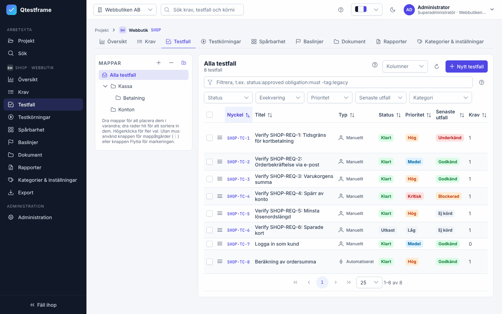

# Testfall

Delen **Testfall** innehåller projektets testfall. Ett testfall är antingen **manuellt** och utförs steg för steg av en person, eller **automatiserat**, ett skript som servern kör. Testfall ordnas i mappar, klassificeras med kategorier, länkas till de krav de verifierar och återanvänds i många körningar.

Att läsa testfall kräver **Läsare**; att skapa, redigera, länka och kopiera testfall kräver **Testare**.

Sidan fungerar som [kravsidan](requirements.md#kravsidan): mappträd, filterfält med snabbfilter (**Status**, **Exekvering**, **Prioritet**, **Senaste utfall**, **Kategori**), valbara kolumner (bland annat exekveringstyp, senaste utfall, länkade krav, språk, steg, taggar, **relationer** — *verifierar*, *anropar* och *anropas av* — defekter, skapad av och datum) och en tabell. Massändring, flytt och borttagning fungerar på samma sätt; verktygsfältet för massändring har **Ange exekvering** i stället för *Ange kravnivå*.

## Fält

| Fält | Användning |
|---|---|
| **Titel** | Ett kort namn (obligatoriskt). |
| **Exekveringstyp** | **Manuellt** eller **Automatiserat**. |
| **Beskrivning** | Vad testfallet handlar om. |
| **Förutsättningar** | Vad som måste gälla innan testet börjar, till exempel *ett kundkonto finns*. Visas för testaren i exekveringsvyn. |
| **Status** | Utkast, Klart, Granskning eller Utfasat. |
| **Prioritet** | Kritisk, Hög, Medel eller Låg. |
| **Uppskattning (minuter)** | Förväntad tidsåtgång. |
| **Mapp**, **Kategorier**, **Taggar** | Placering och klassificering. **Föreslagna taggar** under taggfältet kommer från titeln, beskrivningen, förutsättningarna och stegen, som för [krav](requirements.md#fält). |
| **Förväntat slutresultat** | Det förväntade utfallet av testfallet som helhet. |

## Manuella testfall: steg

Varje steg har en **Åtgärd** (vad som ska göras), ett **Förväntat resultat** (vad som ska hända) och valfri **Data** (indata, konton, filer).

- **Lägg till steg** lägger till ett steg sist; **+** på en rad infogar ett steg nedanför.
- Pilarna flyttar ett steg uppåt eller nedåt; papperskorgen tar bort det.
- När du sparar ersätter steglistan den gamla. Att spara samma steg igen räknas inte som en ändring.

När ett testfall läggs till i en körning kopieras stegen in i körningen. Senare ändringar av testfallet påverkar inte befintliga körningar, bara nya.

## Automatiserade testfall: skript

Växla **Exekveringstyp** till **Automatiserat** för att visa fältet **Skript**. Välj **Skriptspråk**: **sh**, **Bash**, **Python** eller **JavaScript** (Node.js).

- Skriptet körs på servern i en sandlåda när någon väljer **Kör skript** i exekveringsvyn.
- Slutkod **0** betyder **Godkänd**; alla andra slutkoder, eller en överskriden tidsgräns, betyder **Underkänd**.
- Standardutdata och fel sparas som exekveringens **Utdata**, tillsammans med tidsåtgången.
- Skriptet kan läsa miljövariablerna `QTF_TEST_KEY`, `QTF_RUN_ID`, `QTF_RUN_NAME`, `QTF_ENVIRONMENT` och `QTF_BUILD`, så att ett skript kan testa den miljö och det bygge som körningen anger.

Att köra skript kräver rollen **Ansvarig** och måste ha aktiverats av administratören (`runner.enabled`). Om dina skript körs någon annanstans, till exempel i en CI-pipeline, lämna skriptet tomt och [importera utfallen](runs.md#importera-utfall-från-ci) i stället. Steg är valfria för automatiserade testfall.

## Delade steg

Ett steg kan **anropa** ett annat testfall i samma projekt i stället för att ha en egen åtgärd. Använd det för sekvenser som många testfall har gemensamt, till exempel inloggning.

1. Välj **Infoga anrop till testfall …** bland stegen i ett testfall.
2. Välj testfallet som ska anropas och välj **Infoga anrop**. Steget visar **Anropar** med det anropade testfallets nyckel.
3. Flytta anropssteget till rätt plats och spara.

När en körning skapas ersätts anropet med det anropade testfallets steg (markerade `[NYCKEL]`). Anrop kan nästlas i upp till fem nivåer. Ett testfall kan inte anropa sig självt, och anrop får inte bilda en cykel. Det anropade testfallet visar **Används av:** med alla testfall som anropar det. Om du tar bort ett anropat testfall blir anropet ett tomt steg.

## Kategorier

Kategorier klassificerar testfall och krav längs **dimensioner**. Nya projekt får dessa standardvärden:

| Gäller | Dimension | Värden |
|---|---|---|
| Testfall | Polarity | Positive, Negative |
| Testfall | Interface | External, Internal |
| Testfall | Medium | File based, Network based |
| Testfall | Execution | Manual, Automated |
| Testfall | Level | Unit, Integration, System, Acceptance |
| Krav | Area | Core, UI, Security, Operations |

Ett objekt kan ha hur många kategorivärden som helst, även flera i samma dimension. Hantera dem under **Kategorier & inställningar**:

- **Ny dimension** skapar en dimension med dess första värde; **Lägg till värde** lägger till fler.
- Välj en färgruta för att ändra ett värdes färg; värdet visas i den färgen överallt.
- **Byt namn på dimension** flyttar alla värden till ett nytt dimensionsnamn. Om måldimensionen redan har ett värde med samma namn slås de ihop.
- När du tar bort ett värde tas det bort från alla objekt.
- Kryssa i värden (i alla dimensioner på en flik) för att ändra flera på en gång: **Flytta till dimension** (en befintlig eller ett nytt namn; ett värde med samma namn där tar över det flyttade), **Färg**, **Slå ihop** (välj värdet som ska behållas; poster med de andra får det och de andra tas bort, till exempel för att städa bort dubbletter som *UI* och *User interface*), **Kopiera till testfall** / **Kopiera till krav** (värden som redan finns där hoppas över) och **Ta bort**. Varje ändring görs helt eller inte alls; färgändringar kan ångras.

I frågor matchar `category:Negative` värdets namn och `dimension:Polarity/Negative` den fullständiga formen.

På samma sida finns projektets **Namn**, **Beskrivning**, **URL-mall för felhanteringssystem** (se [Defekter](runs.md#defekter)) och, för administratörer, **Ta bort projekt**. Att redigera kategorier kräver **Ansvarig** (eller skrivbehörighet för deras område, Testare för testfallskategorier).

## Markera många tester som klara på en gång

Den som har `test.review` kan markera många tester som *Klart* i ett steg: kryssa i testerna och välj **Markera som klara…**, eller välj **Massgranskning** ovanför listan när inget är markerat. Precis som för krav (se [Godkänn många krav på en gång](requirements.md#godkänn-många-krav-på-en-gång)) väljer du tester (markerade, de som visas i listan eller alla), vilka statusar de får komma från (som standard *Granskning*; lägg till *Utkast* för att ta med utkast) och en valfri kommentar, och en förhandsgranskning visar vad som ändras.

Utöver kontrollerna för krav (den senaste granskningen begärde ändringar, öppna granskningsförfrågningar, misstänkta länkar) hoppas ett test över när det inte kan köras som det är skrivet: ett **manuellt test utan steg** eller ett **automatiserat test utan skript**. Välj kontrollen under **Ta med ändå, trots** för att markera dem som klara ändå.

## Kopiera ett testfall

**Kopiera** i redigeraren skapar en kopia med titeln *Copy of …* och en ny nyckel i samma mapp, med steg, kategorier och taggar. Kopian börjar som **Utkast** och granskas alltså på nytt. Länkar till krav kopieras inte.

Ett testfall blir **Klart** genom en granskning: att sätta den statusen kräver behörigheten *test.review* (Granskare, Testledare eller Ansvarig); granskare ser knappen **Markera som klart** överst i redigeraren.

## Länkade krav

Avsnittet **Länkade krav** visar vilka krav testfallet verifierar. **Länka krav** lägger till länkar; **×** tar bort en. Testfall utan länkar bidrar inte till täckningen.

## Beroenden

Ett testfall kan **bero på** andra testfall: de är dess förutsättningar och måste ha godkänts innan det får startas. Till exempel beror *Ändra leveransadress* på *Logga in*.

I testfallsredigeraren listar avsnittet **Beror på** förutsättningarna med deras senaste utfall. Välj **Lägg till förutsättning** för att välja testfall i samma projekt, och **×** för att ta bort en *(Testare)*. **Krävs av** listar de testfall som väntar på det här. Ett testfall kan inte bero på sig självt, och beroenden får inte bilda en cykel.

När testfallet exekveras räknas en förutsättning som godkänd när dess exekvering i samma körning har godkänts; när förutsättningen inte ingår i körningen räknas dess senaste utfall. Fram till dess visar exekveringsvyn varför testfallet inte kan startas, om inte [inställningarna för testexekvering](administration.md#inställningar-för-testexekvering) tillåter det. Kolumnen **Relationer** i testfallslistan visar *beror på* och *krävs av*, [beroendegrafen](traceability-and-coverage.md#beroendegrafer) ritar dem, och filtret `depends_on:SHOP-TC-1` (eller `depends:`) hittar testfallen som beror på SHOP-TC-1.

## Testflöde

**Testflöde** i projektets navigering (eller **Flödesschema** längst ned i testfallsredigeraren) ritar ett testfall som ett flödesschema:

- **Start**, sedan kontrollen **Förutsättande test godkända?** när testfallet har [beroenden](#beroenden) (nej → *Blockerat*), sedan **Förutsättningarna**;
- varje steg som en ruta med nummer, åtgärd och testdata; ett steg med förväntat resultat följs av beslutet **Som förväntat?** vars *nej*-gren slutar i **Underkänt**;
- ett [delat steg](#delade-steg) som en ruta med dubbla sidokanter (*Kör stegen i TC-…*). Välj det, eller dess knapp under **Delade steg**, för att visa det anropade testfallets steg på plats, numrerade 3.1, 3.2 …, inom en streckad ram; **Fäll ut alla** och **Fäll ihop alla** gör det för alla anrop. Ett testfall som anropar sig självt markeras och fälls inte ut;
- ett automatiserat testfall som **Kör skriptet** följt av **Slutkod 0?**;
- det övergripande **förväntade resultatet** som en sista kontroll, och **Godkänt** i slutet.

**Lista** visar samma flöde som en numrerad textlista, med utfallet *annars* för varje kontroll. Använd zoomknapparna för stora testfall.

**Körordning** visar en testkörning i **etapper**: ett testfall placeras efter alla testfall i körningen som det beror på, så etapp 1 innehåller testfallen utan förutsättande test i körningen. Testfallen i en etapp kan exekveras i valfri ordning eller parallellt. Varje kort visar det senaste utfallet i körningen, vilka testfall det väntar på och länkar till exekveringsvyn och till dess flödesschema. Förutsättande test som inte ingår i körningen visas som varningar.

## Exekveringshistorik

Fliken **Exekveringar** listar alla exekveringar av testfallet i alla körningar, nyast först, med körning, miljö och bygge, utfall, vem som exekverade, när, tidsåtgång och eventuella defekter. Använd den för att se om ett testfall är instabilt eller när det började underkännas.

Kolumnen **Senaste utfall** visar det senaste utfallet. I frågor hittar `last_result:failed` testfall vars senaste utfall är underkänt och `defect:SHOP-*` testfall med en sådan defekt.

Ett utfall markerat med **Växling** skiljer sig från testfallets föregående godkända eller underkända utfall: där började testfallet underkännas, eller blev godkänt igen.

## Instabila testfall

Ett testfall är *instabilt* när utfallet växlar fram och tillbaka mellan godkänt och underkänt utan att testfallet eller produkten har ändrats däremellan. Qtestframe tittar på de 10 senaste godkända eller underkända utfallen för varje testfall, från alla körningar – manuella utfall och automatiserade utfall från JUnit-importer, uppladdaren `qtestframe report` och Playwright-rapportören. Blockerade, överhoppade och ej körda utfall räknas inte, eftersom de inte säger något om själva testfallet.

Testfallets *instabilitet* är antalet växlingar bland de utfallen: ett godkänt utfall efter ett underkänt, eller tvärtom. Ett testfall med **2 eller fler växlingar** räknas som instabilt. Ett testfall som gick sönder en gång och lagades har högst två växlingar utspridda över lång tid; ett testfall som växlar hela tiden når gränsen snabbt.

- I listan över testfall har instabila testfall märket **Instabilt** bredvid det senaste utfallet (håll pekaren över det för att se antalet växlingar).
- Frågan `flaky:true` listar de instabila testfallen; `flakiness>=3` (eller `flips>=3`) dem med minst tre växlingar.
- Fliken **Kvalitet** på [översikten](traceability-and-coverage.md#översikten) visar de tio mest instabila testfallen med deras senaste utfall.
- Fliken **Exekveringar** för ett testfall markerar varje växling.

Ett instabilt testfall döljer verkliga fel och kostar tid i omkörningar: hitta orsaken (tidsberoenden, testdata, ordningen, miljön) eller lägg testfallet åt sidan tills det är åtgärdat.

## Kommentarer och versionshistorik

**Kommentarer** och **Versionshistorik** fungerar precis som för [krav](requirements.md#kommentarer). När du återställer en version av ett testfall återställs fälten och stegen som en ny version; stegen får nya id:n och anrop till borttagna testfall tas bort. Om någon annan sparar ett testfall medan du redigerar det kan du jämföra och välja i stället för att skriva över den andras ändringar, se [När någon annan har sparat först](requirements.md#när-någon-annan-har-sparat-först).

## Länkar

Fliken **Länkar** för ett testfall länkar det till andra testfall, krav, körningar, dokument och sparade rapporter i arkivet, rapportdefinitioner och webbadresser, se [Länkar](requirements.md#länkar).

## Bilagor

Fliken **Bilagor** innehåller filer för testfallet: testdata, förväntade skärmbilder, konfigurationsfiler. Ladda upp genom att dra och släppa eller välja filer, eller använd **Bifoga från arkivet**. Att ladda upp och ta bort kräver **Testare**. Se [Krav → Bilagor](requirements.md#bilagor) för detaljer.
