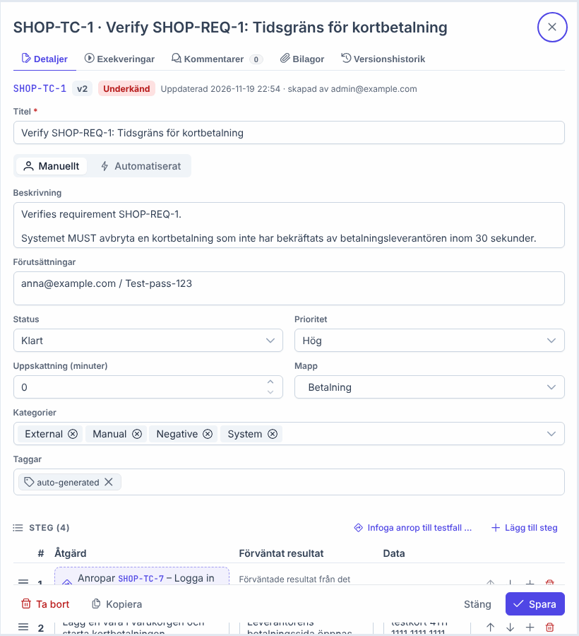
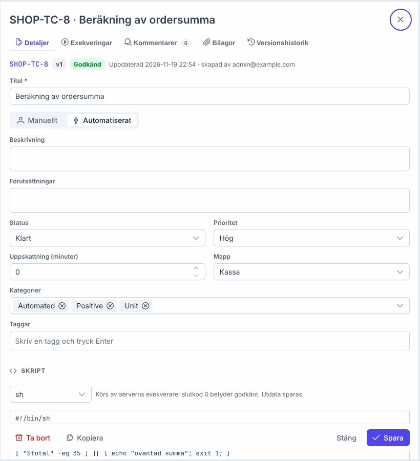
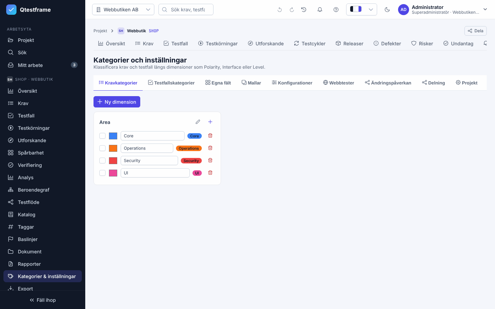
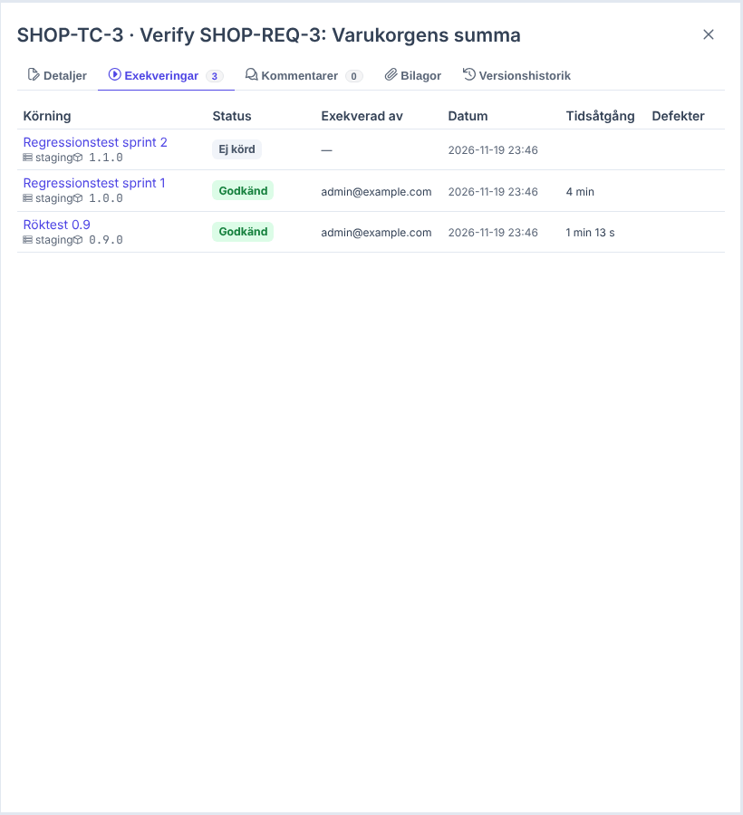

# Testfall

Delen **Testfall** innehåller projektets testfall. Ett testfall är antingen **manuellt** och utförs steg för steg av en person, eller **automatiserat**, ett skript som servern kör. Testfall ordnas i mappar, klassificeras med kategorier, länkas till de krav de verifierar och återanvänds i många körningar.

Att läsa testfall kräver **Läsare**; att skapa, redigera, länka och kopiera testfall kräver **Testare**.

Sidan fungerar som [kravsidan](requirements.md#kravsidan): mappträd, filterfält med snabbfilter (**Status**, **Exekvering**, **Prioritet**, **Senaste utfall**, **Kategori**), valbara kolumner (bland annat exekveringstyp, senaste utfall, länkade krav, språk, steg, taggar, **relationer** — *verifierar*, *anropar* och *anropas av* — defekter, skapad av och datum) och en tabell. Massändring, flytt och borttagning fungerar på samma sätt; verktygsfältet för massändring har **Ange exekvering** i stället för *Ange kravnivå*.

## Fält

| Fält | Användning |
|---|---|
| **Titel** | Ett kort namn (obligatoriskt). |
| **Exekveringstyp** | **Manuellt** eller **Automatiserat**. |
| **Beskrivning** | Vad testfallet handlar om. |
| **Förutsättningar** | Vad som måste gälla innan testet börjar, till exempel *ett kundkonto finns*. Visas för testaren i exekveringsvyn. |
| **Status** | Utkast, Klart, Granskning eller Utfasat. |
| **Prioritet** | Kritisk, Hög, Medel eller Låg. |
| **Uppskattning (minuter)** | Förväntad tidsåtgång. |
| **Mapp**, **Kategorier**, **Taggar** | Placering och klassificering. **Föreslagna taggar** under taggfältet kommer från titeln, beskrivningen, förutsättningarna och stegen, som för [krav](requirements.md#fält). |
| **Förväntat slutresultat** | Det förväntade utfallet av testfallet som helhet. |

## Manuella testfall: steg

Varje steg har en **Åtgärd** (vad som ska göras), ett **Förväntat resultat** (vad som ska hända) och valfri **Data** (indata, konton, filer).

- **Lägg till steg** lägger till ett steg sist; **+** på en rad infogar ett steg nedanför.
- Pilarna flyttar ett steg uppåt eller nedåt; papperskorgen tar bort det.
- När du sparar ersätter steglistan den gamla. Att spara samma steg igen räknas inte som en ändring.

När ett testfall läggs till i en körning kopieras stegen in i körningen. Senare ändringar av testfallet påverkar inte befintliga körningar, bara nya.

## Automatiserade testfall: skript

Växla **Exekveringstyp** till **Automatiserat** för att visa fältet **Skript**. Välj **Skriptspråk**: **sh**, **Bash**, **Python** eller **JavaScript** (Node.js).

- Skriptet körs på servern i en sandlåda när någon väljer **Kör skript** i exekveringsvyn.
- Slutkod **0** betyder **Godkänd**; alla andra slutkoder, eller en överskriden tidsgräns, betyder **Underkänd**.
- Standardutdata och fel sparas som exekveringens **Utdata**, tillsammans med tidsåtgången.
- Skriptet kan läsa miljövariablerna `QTF_TEST_KEY`, `QTF_RUN_ID`, `QTF_RUN_NAME`, `QTF_ENVIRONMENT` och `QTF_BUILD`, så att ett skript kan testa den miljö och det bygge som körningen anger.

Att köra skript kräver rollen **Ansvarig** och måste ha aktiverats av administratören (`runner.enabled`). Om dina skript körs någon annanstans, till exempel i en CI-pipeline, lämna skriptet tomt och [importera utfallen](runs.md#importera-utfall-från-ci) i stället. Steg är valfria för automatiserade testfall.

## Delade steg

Ett steg kan **anropa** ett annat testfall i samma projekt i stället för att ha en egen åtgärd. Använd det för sekvenser som många testfall har gemensamt, till exempel inloggning.

1. Välj **Infoga anrop till testfall …** bland stegen i ett testfall.
2. Välj testfallet som ska anropas och välj **Infoga anrop**. Steget visar **Anropar** med det anropade testfallets nyckel.
3. Flytta anropssteget till rätt plats och spara.

När en körning skapas ersätts anropet med det anropade testfallets steg (markerade `[NYCKEL]`). Anrop kan nästlas i upp till fem nivåer. Ett testfall kan inte anropa sig självt, och anrop får inte bilda en cykel. Det anropade testfallet visar **Används av:** med alla testfall som anropar det. Om du tar bort ett anropat testfall blir anropet ett tomt steg.

## Kategorier

Kategorier klassificerar testfall och krav längs **dimensioner**. Nya projekt får dessa standardvärden:

| Gäller | Dimension | Värden |
|---|---|---|
| Testfall | Polarity | Positive, Negative |
| Testfall | Interface | External, Internal |
| Testfall | Medium | File based, Network based |
| Testfall | Execution | Manual, Automated |
| Testfall | Level | Unit, Integration, System, Acceptance |
| Krav | Area | Core, UI, Security, Operations |

Ett objekt kan ha hur många kategorivärden som helst, även flera i samma dimension. Hantera dem under **Kategorier & inställningar**:

- **Ny dimension** skapar en dimension med dess första värde; **Lägg till värde** lägger till fler.
- Välj en färgruta för att ändra ett värdes färg; värdet visas i den färgen överallt.
- **Byt namn på dimension** flyttar alla värden till ett nytt dimensionsnamn. Om måldimensionen redan har ett värde med samma namn slås de ihop.
- När du tar bort ett värde tas det bort från alla objekt.

I frågor matchar `category:Negative` värdets namn och `dimension:Polarity/Negative` den fullständiga formen.

På samma sida finns projektets **Namn**, **Beskrivning**, **URL-mall för felhanteringssystem** (se [Defekter](runs.md#defekter)) och, för administratörer, **Ta bort projekt**. Att redigera kategorier kräver **Ansvarig** (eller skrivbehörighet för deras område, Testare för testfallskategorier).

## Kopiera ett testfall

**Kopiera** i redigeraren skapar en kopia med titeln *Copy of …* och en ny nyckel i samma mapp, med steg, kategorier och taggar. Länkar till krav kopieras inte.

## Länkade krav

Avsnittet **Länkade krav** visar vilka krav testfallet verifierar. **Länka krav** lägger till länkar; **×** tar bort en. Testfall utan länkar bidrar inte till täckningen.

## Exekveringshistorik

Fliken **Exekveringar** listar alla exekveringar av testfallet i alla körningar, nyast först, med körning, miljö och bygge, utfall, vem som exekverade, när, tidsåtgång och eventuella defekter. Använd den för att se om ett testfall är instabilt eller när det började underkännas.

Kolumnen **Senaste utfall** visar det senaste utfallet. I frågor hittar `last_result:failed` testfall vars senaste utfall är underkänt och `defect:SHOP-*` testfall med en sådan defekt.

## Kommentarer och versionshistorik

**Kommentarer** och **Versionshistorik** fungerar precis som för [krav](requirements.md#kommentarer). När du återställer en version av ett testfall återställs fälten och stegen som en ny version; stegen får nya id:n och anrop till borttagna testfall tas bort.

## Bilagor

Fliken **Bilagor** innehåller filer för testfallet: testdata, förväntade skärmbilder, konfigurationsfiler. Ladda upp genom att dra och släppa eller välja filer, eller använd **Bifoga från arkivet**. Att ladda upp och ta bort kräver **Testare**. Se [Krav → Bilagor](requirements.md#bilagor) för detaljer.
