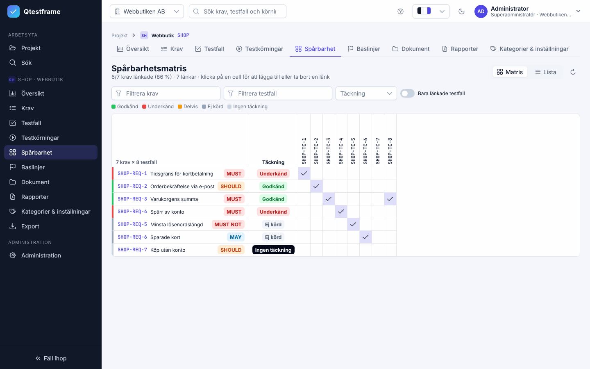
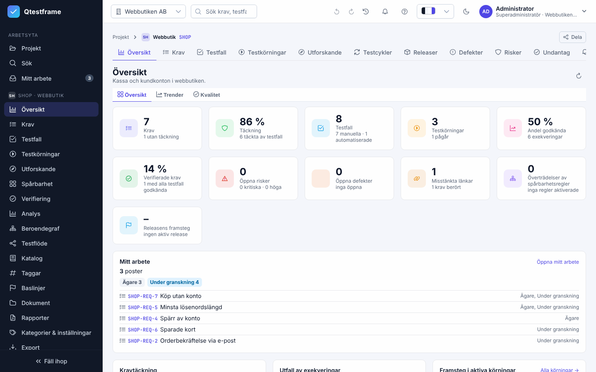

# Spårbarhet och täckning

Spårbarheten besvarar två frågor: *vilka testfall verifierar det här kravet?* och *har det verifierats med godkänt resultat?* Qtestframe besvarar dem med **länkar** mellan krav och testfall och med **täckningen** som härleds från testutfallen.

## Spårbarhetsmatrisen

Välj **Spårbarhet** i projektets sidopanel.

- Kraven är **rader** och testfallen **kolumner**. En markerad (nedtryckt) cell betyder *länkad*.
- Det färgade fältet först på varje rad visar kravets täckning; **Förklaring av täckning** förklarar färgerna. Peka på ett testfalls kolumnrubrik för att se nyckel, titel och senaste utfall.
- Sammanfattningen anger hur många krav som är länkade, till exempel *14/20 krav länkade (70 %)*.
- **Filtrera krav** och **Filtrera testfall** tar emot [frågor](search-and-filters.md), till exempel `folder:Kassa` och `type=automated`.
- **Bara länkade testfall** döljer testfall som inte är länkade till något av de visade kraven.
- **Vy** växlar mellan **Matris** och **Lista**. Listan visar varje krav med dess länkade testfall och är lättare att läsa på en mobil.

**Länka och ta bort länkar:** klicka på (eller flytta fokus till och tryck <kbd>Enter</kbd> eller <kbd>Blanksteg</kbd> på) en tom cell för att länka kravet och testfallet; klicka på en markerad cell för att ta bort länken. Det kräver rollen **Testare**. Länkar kan också hanteras i kravredigeraren (**Länka testfall**) och testfallsredigeraren (**Länka krav**).

Matrisen rullar i båda riktningarna; kravkolumnen förblir synlig.

### Länka flera på en gång

Med rollen **Testare** finns ett verktygsfält ovanför matrisen (och listan) som arbetar med många länkar på en gång:

1. Kryssa i krav med kryssrutan först på raden, eller **Markera alla visade krav** (använd filtren först för att avgränsa).
2. Välj eventuellt testfall i **Testfall för de markerade kraven**; utan valda testfall gäller åtgärderna alla testfall.
3. Välj en åtgärd; talet på varje knapp anger hur många länkar den påverkar:
   - **Länka** länkar varje markerat krav till varje valt testfall; befintliga länkar behålls.
   - **Ta bort länkar** tar bort länkarna mellan de markerade kraven och de valda testfallen (efter en bekräftelse).
   - **Bekräfta misstänkta** bekräftar de misstänkta länkarna bland dem (celler med en varningssymbol: kravet eller testfallet har ändrats sedan länken bekräftades).

Väljer du bara testfall (inga krav) gäller **Ta bort länkar** och **Bekräfta misstänkta** alla länkar för de testfallen. Att länka och ta bort länkar kan ångras med **Ångra**; statusen som följer bevisen uppdateras en gång för alla berörda krav.

## Så beräknas täckningen

Täckningen härleds från det **senaste utfallet** för varje länkat testfall. Den beräknas varje gång du tittar på den och sparas aldrig, så den är alltid aktuell.

**Senaste utfall för ett testfall:** bland testfallets exekveringar i körningar i det här projektet som inte är *Ej körd*, den med den senaste tidpunkten (avslutad, annars startad, annars körningens skapandetid). Ett testfall utan någon sådan exekvering har senaste utfall **Ej körd**.

**Täckning för ett krav**, utvärderat uppifrån och ned:

| Täckning | När |
|---|---|
| **Ingen täckning** | inget testfall är länkat |
| **Underkänd** | minst ett länkat testfall är *Underkänd* eller *Blockerad* |
| **Godkänd** | alla länkade testfall är *Godkänd* |
| **Delvis** | minst ett länkat testfall är *Godkänd*, de övriga är *Ej körd*, *Överhoppad* eller *Pågår* |
| **Ej körd** | annars: testfall är länkade, men inget har godkänts eller underkänts än |

Exempel:

- REQ-1 är länkat till TC-1 (godkänd) och TC-2 (godkänd) → **Godkänd**.
- REQ-2 är länkat till TC-1 (godkänd) och TC-3 (ej körd) → **Delvis**.
- REQ-3 är länkat till TC-1 (godkänd) och TC-4 (blockerad) → **Underkänd**.
- REQ-4 har ett länkat testfall som aldrig har exekverats → **Ej körd**.
- REQ-5 har inga länkar → **Ingen täckning**.

Tänk på följande:

- Täckningen beräknas per krav, inte per utvärderingskriterium. En länk kan ange vilket kriterium ett testfall verifierar, men alla länkar räknas lika.
- Bara körningar i samma projekt räknas. Ett testfall som har flyttats från ett annat projekt behåller sina gamla exekveringar, men de räknas inte längre.
- Ett nyare utfall *Godkänd* ersätter ett äldre *Underkänd*; du behöver inte ta bort gamla körningar.

Täckningen visas som kolumn och snabbfilter i kravlistan, som frågefältet `coverage` (till exempel `coverage:failed` eller `coverage:none category:Security`), i matrisen, i exporter, i rapporter och på översikten.

## Översikten

**Översikt** är den första sidan i varje projekt. Den har tre flikar: **Översikt** med läget i dag, **Trender** med hur det har förändrats och **Kvalitet** med det som behöver åtgärdas. Fliken ingår i adressen, så en länk kan öppna översikten på en viss flik. På en mobil visas diagrammen under varandra.

**Översikt**

- **Nyckeltal**: antal krav (och hur många som saknar täckning), täckning (hur många som täcks av testfall), antal testfall (manuella och automatiserade), testkörningar (som pågår) och andelen godkända av alla exekveringar.
- **Kravtäckning**: hur många krav som är *Godkänd*, *Underkänd*, *Delvis*, *Ej körd* och *Ingen täckning*.
- **Utfall av exekveringar**: alla utfall i alla körningar.
- **Framsteg i aktiva körningar**: en stapel per planerad eller pågående körning (de åtta nyaste), uppdelad i godkända, underkända, blockerade, överhoppade och ej körda.
- **Senaste körningar**: de fem nyaste körningarna med förlopp; **Alla körningar →** öppnar listan över körningar.
- **Krav per status** och **Krav per kravnivå** (krav utan kravord räknas som *ospecificerade*).
- **Testfall per status**.

På översikten räknas ett krav som *täckt* så snart minst ett testfall är länkat, oavsett utfall.

**Trender**

- **Täckning och andel godkända över tid**: täckningen (andelen krav med länkade testfall) och andelen godkända (andelen exekverade testfall vars senaste utfall är godkänt) per dag. Välj period ovanför diagrammet: 30, 90 eller 365 dagar.
- **Öppnade och stängda defekter per vecka**: nya defekter och defekter som har lösts, stängts eller avvisats, per vecka (måndag till söndag).
- **Burn-up för release**: för den release som är vald i listan visas kraven i omfattningen, hur många av dem som har länkade testfall och hur många vars testfall alla är godkända i releasens körningar, dag för dag från det att releasen skapades. Releasens måldatum står ovanför diagrammet. Se [Releaser](releases-and-risks.md).

Trenderna bygger på en ögonblicksbild av siffrorna som Qtestframe sparar en gång om dagen för varje projekt (och när översikten öppnas och dagens bild saknas). Ett nytt projekt, eller ett projekt från tiden före funktionen, börjar inte tomt: vid den första ögonblicksbilden återskapas de tidigare dagarna utifrån det som har datum – när krav, testfall och länkar skapades, utfallen i körningarna och när defekter rapporterades och löstes (upp till ett år bakåt). Dagar utan ögonblicksbild överbryggas av linjen.

**Kvalitet**

- **Instabila testfall**: de tio testfall vars utfall oftast växlar mellan godkänt och underkänt, med de senaste utfallen (äldst först; en ring markerar varje växling) och när utfallet senast växlade. Klicka på ett testfall för att öppna det. Se [Instabila testfall](tests.md#instabila-testfall).
- **Öppna defekter per allvarlighetsgrad**: öppna och påbörjade defekter per allvarlighetsgrad.
- **Kravtäckning per grupp**: täckningen per mapp på översta nivån (krav i undermappar räknas till den översta mappen) eller, med **Kategori**, per kravkategori; de tolv största grupperna.

Varje diagram har ett textalternativ med siffrorna för skärmläsare, och förklaringen namnger varje färg.

## Beroendegrafer

**Beroendegraf** i projektets sidopanel ritar hur objekten bygger på varandra. Välj **Krav** eller **Testfall** överst:

- **Krav**: relationerna mellan krav, som *beror på*, *tillhandahåller*, *förfinar*, *härlett från*, *står i konflikt med*, *duplicerar* och *relaterar till* (se [Relationer](requirements.md#relationer));
- **Testfall**: [beroendena](tests.md#beroenden) mellan testfall (*beror på*) och de delade stegen (*anropar*).

Grafen läses från vänster till höger: förutsättningar, överordnade krav och källor står till vänster, det som bygger på dem till höger. Varje ruta visar nyckel, titel och täckning (krav) eller senaste utfall (testfall), med en färgad list i samma färger som i resten av appen. Varje relationstyp har en egen färg och linjestil, förklarad vid dess kryssruta.

- Kryssa ur en relationstyp för att dölja de linjerna; objekt som då saknar relationer försvinner om inte **Visa objekt utan relationer** är på.
- Skriv i **Markera objekt…** för att markera matchande objekt.
- Högerklicka på ett objekt (eller ge det fokus och tryck <kbd>Blanksteg</kbd>) för att markera dess grannar; **Visa alla** avslutar det.
- Välj ett objekt (eller tryck <kbd>Enter</kbd>) för att öppna det. Zooma med förstoringsknapparna; rulla för att flytta dig.
- **Lista** visar samma relationer som en tabell, ett objekt per rad, vilket är lättare att läsa med skärmläsare eller att skriva ut.

Cykler (till exempel två krav som beror på varandra) ritas, men en av linjerna visas utan pil.

## Kravanalys

**Analys** i projektets navigering analyserar alla krav i projektet på en gång (öppna den igen eller välj **Analysera igen** efter ändringar). Överst: **hälsan** (andelen krav utan problem eller varningar), antalet krav och testfall, andelen **täckta av testfall** (avvisade och inaktuella krav räknas inte) och den genomsnittliga **språkpoängen**.

- **Kravnivåer** visar hur många krav som har varje nivå, inklusive de som **saknar kravnivå**.
- **Nyckelord per betydelse** grupperar nyckelord som betyder samma sak (MUST, SHALL och REQUIRED; MAY och OPTIONAL …) och visar hur de används, så att du direkt ser projektets konvention.

**Anmärkningar** listar vad analysen har lagt märke till, problem först, var och en med en förklaring, **vad du kan göra** och de krav (eller testfall) det gäller; välj en nyckel för att öppna objektet. Filtrera på allvarlighet eller kategori:

| Kategori | Anmärkningar |
|---|---|
| Kravnivåer | nyckelord som inte skrivs med versaler som RFC 2119 och RFC 8174 kräver ("must", "Should"), och krav vars nyckelord *bara* står med gemener och därför saknar normativt nyckelord; WILL använt som kravnivå (det är inget nyckelord i RFC 2119); krav utan kravnivå; nivå i fältet men inget nyckelord i texten; fältet och texten säger olika; flera nivåer i ett krav; fördelningen: nästan allt obligatoriskt, inga obligatoriska krav, många valfria (MAY) eller många BÖR- eller beskrivande krav |
| Konsekvens | krav på mer än ett språk (till exempel mest engelska med några svenska), ett krav vars titel och meningar är på olika språk, och engelska nyckelord i ett krav skrivet på ett annat språk (MUST i en svensk mening); ett nyckelord som används i några få krav medan ett annat med samma betydelse dominerar, till exempel *SHALL används i 1 krav, medan MUST används i 95 %*; nyckelord med samma betydelse som används ungefär lika mycket |
| Täckning | obligatoriska och andra krav utan testfall; underkända eller ännu inte körda testfall; krav utan acceptanskriterier |
| Testfall | testfall som inte verifierar något krav; godkända krav utan testfall som är Klart |
| Kvalitet | tomma beskrivningar, dubblerade titlar, krav i konflikt, låg språkpoäng, många utkast, krav utan ägare |
| Språk | [språkanalysens](requirements.md#språkanalysen) anmärkningar summerade per regel: vaga ord, TBD, undanflykter … |

**Kravens språk** visar hur många krav som är skrivna på varje språk. Bara texter som är tillräckligt långa för att avgöra språket räknas; en titel på ett eller två ord räcker inte.

**Språk** väljer analysens språk (identifieras per krav som standard). Anmärkningar om testfall visas när du får läsa testfall.
