# Handledning: din första testkampanj

I den här handledningen bygger du ett litet projekt från början och tar det hela vägen till en rapport. Du skriver krav, låter Qtestframe skapa länkade testfall, förfinar dem, kör dem manuellt och automatiskt, registrerar en defekt, kontrollerar täckningen, fryser en baslinje och exporterar resultatet.

**Exempel:** kassan i en webbutik, projektnyckel `SHOP`.

**Du behöver:** rollen **Ansvarig** eller **Administratör** i din organisation (krav och projekt kräver rollen Ansvarig, se [roller](administration.md#roller-och-behörigheter)). För att köra skript på servern måste dessutom administratören ha slagit på skriptexekveringen (steg 9). Räkna med ungefär 30 minuter.

> **Vill du bara titta runt?** Din administratör kan läsa in ett färdigt demoprojekt (*Demo – Online Banking*) med `qtestframe seed-demo`. Stegen nedan fungerar även där, men du lär dig mer om du börjar med ett tomt projekt.

## Steg 1: Skapa ett projekt

1. Välj **Projekt** i sidopanelen.
2. Välj **Nytt projekt**.
3. Ange **Namn** `Webbutik`. Qtestframe föreslår en nyckel utifrån namnet när du lämnar fältet.
4. Ändra **Nyckel** till `SHOP`. Nyckeln inleder varje objekts id, till exempel `SHOP-REQ-1` och `SHOP-TC-1`. Den består av 2–16 versaler eller siffror, börjar med en bokstav och **kan inte ändras senare**. Lägg gärna till en **Beskrivning**.
5. Låt **Skapa standardkategorier (Polarity, Interface, Medium, Execution, Level, Area)** vara ikryssad. Kategoridimensionerna används senare för att klassificera testfall och krav.
6. Välj **Skapa**.

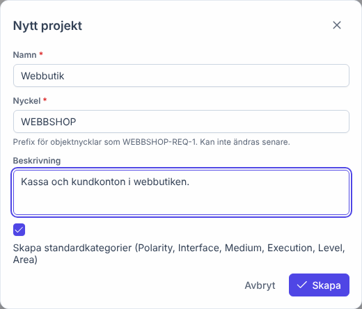

Öppna projektet genom att välja dess kort. Du hamnar på projektets **Översikt**, som ännu är tom. Projektets delar visas nu i sidopanelen.

## Steg 2: Skapa mappar

Mappar grupperar krav (och, separat, testfall) i ett träd, som kapitlen i en specifikation.

1. Välj **Krav** i sidopanelen. Mappträdet finns till vänster och kravtabellen till höger.
2. Välj knappen **+** (**Ny mapp**) ovanför trädet, skriv `Kassa` och välj **Spara**.
3. Skapa en undermapp: högerklicka på **Kassa** (eller använd dess åtgärdsknapp **⋮**) och välj **Ny undermapp**. Ge den namnet `Betalning`.
4. Skapa på samma sätt en andra mapp på översta nivån, `Konton`.

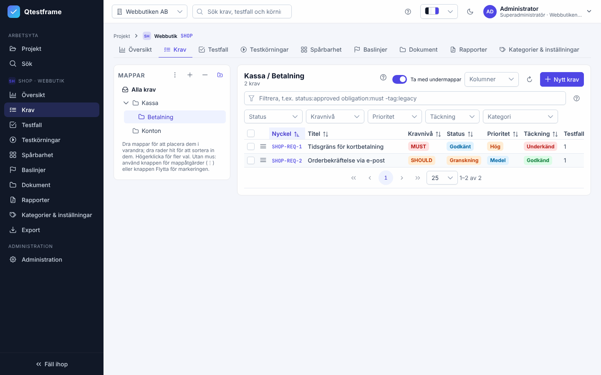

Du kan dra mappar för att placera dem i varandra eller ändra ordningen. Välj en mapp för att bara visa dess krav; **Ta med undermappar** avgör om krav i undermappar också visas.

## Steg 3: Skriv krav med MUST och SHOULD

1. Välj mappen **Betalning** och sedan **Nytt krav**. Redigeraren öppnas till höger med mappen redan ifylld.
2. Ange **Titel** `Tidsgräns för kortbetalning`.
3. Skriv först in ett medvetet svagt påstående i **Beskrivning**:

   `The system should respond fast and/or retry TBD.`

   Rutan **Språkanalys av kravet** visas under texten och uppdateras medan du skriver. Den hittar:

   - kravordet *should* med gemener (enligt RFC 8174 har bara `SHOULD` med versaler normativ betydelse),
   - det tvetydiga uttrycket *fast*, som inte går att verifiera,
   - *and/or*, som lämnar öppet om båda eller ett av alternativen krävs,
   - platshållaren *TBD*, som visar att kravet är ofullständigt.

   **Poängen** sjunker till 53 av 100.

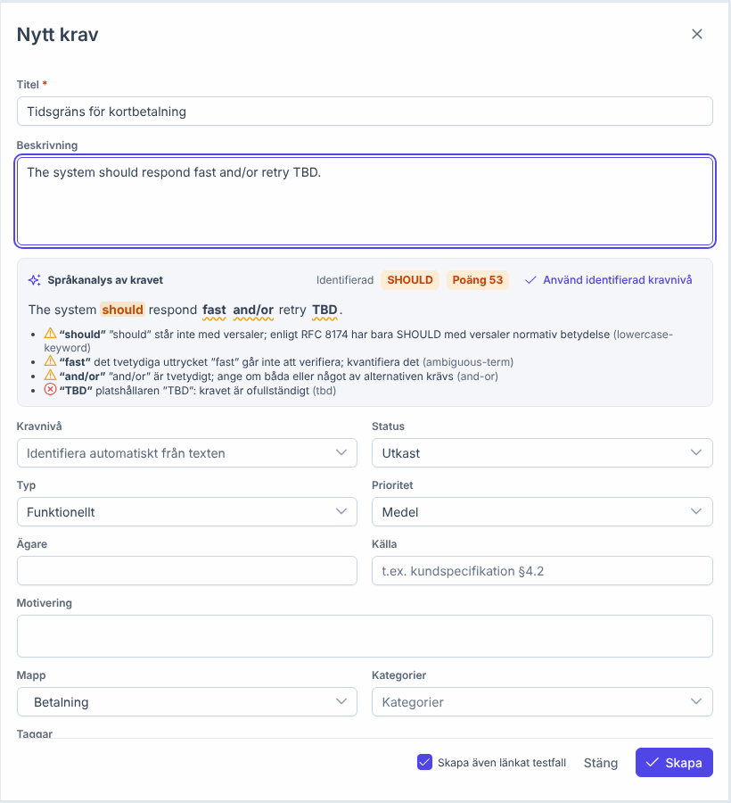

4. Ersätt nu texten med en exakt formulering:

   `The system MUST cancel a card payment that is not confirmed by the payment provider within 30 seconds.`

   Analysen visar **Identifierad: MUST (SKA)** och poängen 100.

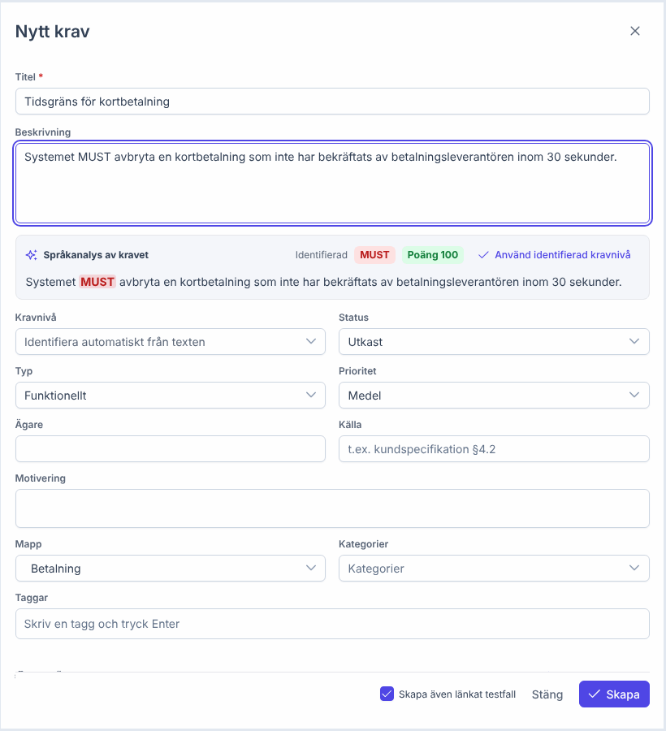

5. Låt **Kravnivå** stå på **Identifiera automatiskt från texten**: den identifierade nivån sparas när du skapar kravet. Du kan också välja en nivå själv; **Använd identifierad kravnivå** fyller i fältet med det analysen hittade.
6. Sätt **Prioritet** till **Hög** och välj **Area / Core** under **Kategorier**.

> **Om språket:** analysen känner igen de engelska kravorden enligt RFC 2119. Skriv därför kravorden på engelska och med versaler, även i en svensk text: *Systemet MUST avbryta en kortbetalning …*. I det svenska gränssnittet förklaras nivåerna på svenska, till exempel *MUST (SKA)*.

Vilket kravord ska du använda?

| Kravord | Betydelse | Exempel |
|---|---|---|
| `MUST` / `SHALL` | Absolut krav (SKA) | Systemet MUST logga varje misslyckad inloggning. |
| `MUST NOT` / `SHALL NOT` | Absolut förbud (SKA INTE) | Systemet MUST NOT lagra kortnummer. |
| `SHOULD` | Rekommendation (BÖR); avvikelser kräver skäl | Systemet SHOULD skicka en orderbekräftelse inom 5 minuter. |
| `SHOULD NOT` | Avrådan (BÖR INTE) | Kassan SHOULD NOT kräva mer än tre sidor. |
| `MAY` / `OPTIONAL` | Verkligt valfritt (FÅR) | Kunden MAY spara kortet till senare köp. |
| `WILL` | Avsikt eller faktum (KOMMER ATT) | Betalningsleverantören WILL skicka ett återanrop. |

Skriv en skyldighet per mening. Om analysen rapporterar *flera kravord* i meningen, dela upp den i två krav. Fler regler förklaras under [Krav](requirements.md#språkanalysen).

## Steg 4: Lägg till utvärderingskriterier

Utvärderingskriterierna anger **hur** du bedömer att kravet är uppfyllt. De blir också stegen i det länkade testfallet.

1. Välj **Lägg till kriterium** under **Utvärderingskriterier** i redigeraren.
2. Skriv `Obekräftad betalning avbryts`, behåll metoden **Test** och ange tröskelvärdet `≤ 30 s`.
3. Lägg till ett andra kriterium, `Avbrottet skrivs till granskningsloggen`, med metoden **Inspektion**.
4. Kontrollera att **Skapa även länkat testfall** längst ned är ikryssad.
5. Välj **Skapa**.

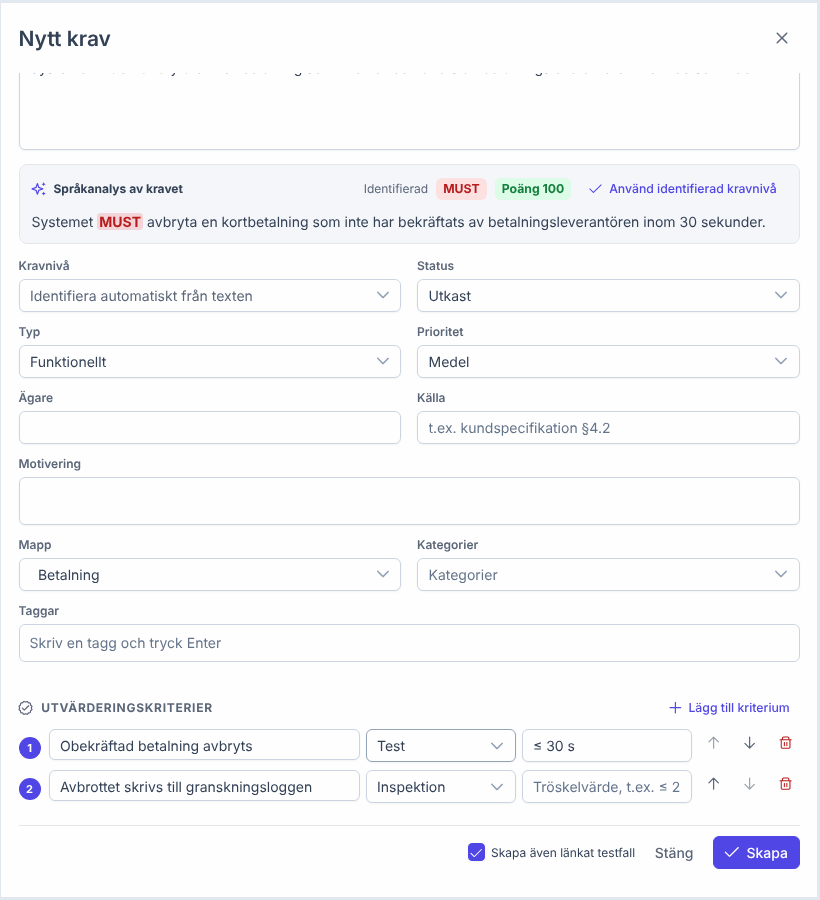

Ett meddelande bekräftar *SHOP-REQ-1 med länkat testfall SHOP-TC-1*. I tabellen är kravets **Täckning** **Ej körd**: det har ett testfall, men testfallet har inte exekverats än.

Lägg gärna till ytterligare ett krav i samma mapp för att öva:

`The system SHOULD send an order confirmation by e-mail within 5 minutes after payment.`

## Steg 5: Förfina det automatiskt länkade testfallet

1. Välj **Testfall** i sidopanelen. Testmappsträdet speglar dina kravmappar: där finns mappen **Kassa / Betalning** som Qtestframe har skapat åt dig.
2. Öppna **SHOP-TC-1 Verify SHOP-REQ-1: Tidsgräns för kortbetalning**. Det är ett manuellt testfall med status **Utkast** och taggen `auto-generated`, med ett steg per kriterium, till exempel *Verify (test): Obekräftad betalning avbryts* med det förväntade resultatet *≤ 30 s*.
3. Gör stegen konkreta. Klicka i ett steg för att redigera **Åtgärd**, **Förväntat resultat** och **Data**:

   | Nr | Åtgärd | Förväntat resultat | Data |
   |---|---|---|---|
   | 1 | Lägg en vara i varukorgen och starta kortbetalningen | Leverantörens betalningssida öppnas | testkort 4111 1111 1111 1111 |
   | 2 | Bekräfta inte betalningen; vänta 30 sekunder | Ordern visar *Betalningen avbruten* | |
   | 3 | Öppna granskningsloggen | Det finns en post *betalning avbruten* för ordern | |

4. Använd **Lägg till steg** för att lägga till ett steg sist, **+** på en rad för att infoga ett steg nedanför och pilarna för att ändra ordningen.
5. Sätt **Status** till **Klart** och lägg till kategorierna **Polarity / Negative** och **Interface / External**.
6. Välj **Spara**.

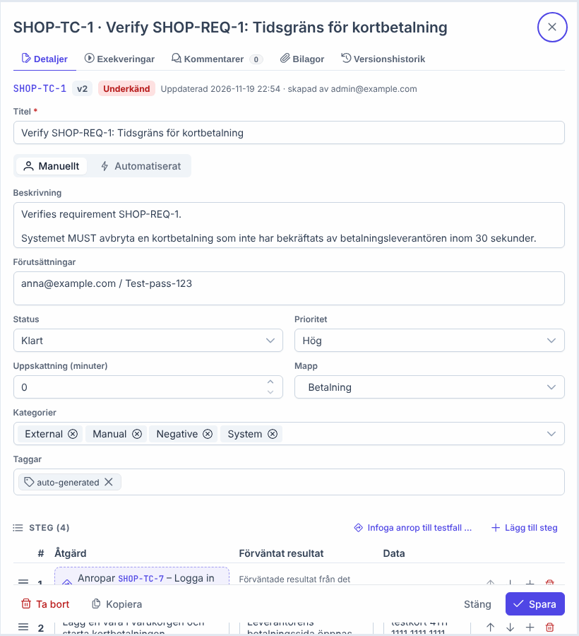

Under **Länkade krav** längst ned ser du SHOP-REQ-1. Med **Länka krav** länkar du fler krav till samma testfall.

## Steg 6: Lägg till ett delat steg

Många testfall börjar på samma sätt, till exempel med en inloggning. Skriv sådana steg en gång och anropa dem från andra testfall.

1. Välj **Nytt testfall** och skapa testfallet `Logga in som kund` med två steg: *Öppna butiken och välj Logga in* → *Inloggningsformuläret visas* och *Ange kundens e-post och lösenord* → *Kontosidan visas*. Sätt status till **Klart** och välj **Skapa**.
2. Öppna SHOP-TC-1 igen och välj **Infoga anrop till testfall …** ovanför stegen.
3. Välj **Logga in som kund** och sedan **Infoga anrop**. Det nya steget visar **Anropar SHOP-TC-…**.
4. Flytta anropssteget överst med uppåtpilen och välj **Spara**.


När en körning skapas infogas det anropade testfallets steg i stället för anropet, markerade med det anropade testfallets nyckel. Om du förbättrar det delade testfallet senare får nya körningar förbättringen. Det delade testfallet visar var det används under **Används av:**.

## Steg 7: Skapa en körning

1. Välj **Testkörningar** i sidopanelen och sedan **Ny körning**.
2. Ange **Namn** `Regressionstest sprint 1`, **Miljö** `staging` och **Bygge** `1.0.0`.
3. Välj vilka testfall som ska ingå. Körningen får unionen av alla tre flikarna:
   - **Testfall**: **Välj testfall …** och välj enskilda testfall;
   - **Mappar**: kryssa i **Kassa**; testfall i undermappar tas med;
   - **Fråga**: ett filter som `status:ready`; **Förhandsgranska** visar hur många testfall som matchar.
4. Välj **Skapa körning**.

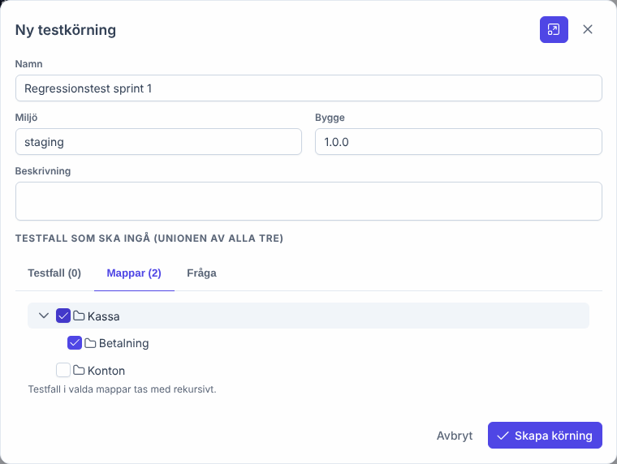

Körningen öppnas med en **exekvering** per testfall, alla **Ej körd**. Stegen i varje testfall, inklusive de infogade delade stegen, kopieras nu in i körningen, så senare ändringar av testfallen påverkar inte den här körningen.

## Steg 8: Exekvera manuellt och registrera en defekt

1. Välj **Exekvera** i körningen (eller uppspelningsknappen för en exekvering). Exekveringsvyn öppnas.
2. Den vänstra kolumnen listar stegen; till höger visas det aktuella steget med **Åtgärd**, **Förväntat resultat** och **Testdata**.
3. Gör det steget beskriver och jämför resultatet:
   - om det stämmer, välj **Godkänn** eller tryck <kbd>P</kbd>;
   - om inte, skriv vad som hände i **Faktiskt resultat** och välj **Underkänn** eller tryck <kbd>F</kbd>.

   **Blockerad** (<kbd>B</kbd>) och **Hoppa över** (<kbd>S</kbd>) finns också. Vyn går automatiskt vidare till nästa steg. Tryck <kbd>?</kbd> för att se alla kortkommandon.
4. Låt steg 3 underkännas: posten i granskningsloggen saknas. Skriv `SHOP-101` (id:t i ditt ärendehanteringssystem) under **Defekter** och tryck <kbd>Enter</kbd>. Skriv en kommentar under **Anteckningar**.
5. **Samlat utfall** härleds från stegen: ett underkänt steg gör exekveringen **Underkänd**. Välj **Spara och nästa** för att spara och gå till nästa exekvering.

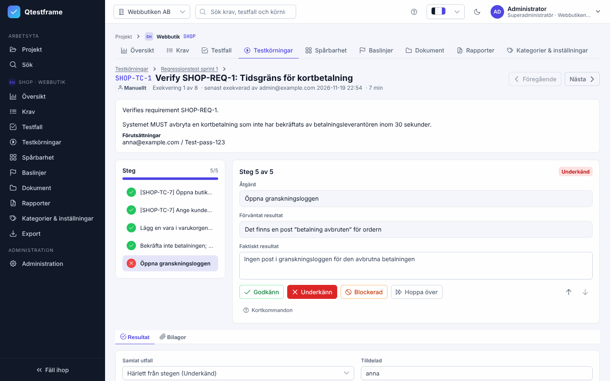

**Gör defekt-id:n till länkar:** ange en **URL-mall för felhanteringssystem** under **Kategorier & inställningar**, till exempel `https://jira.example.com/browse/{id}`. Därefter länkar `SHOP-101` till ditt system.

## Steg 9: Kör ett automatiserat skript

Automatiserade testfall är skript som körs på servern. Slutkod 0 betyder *godkänt*, allt annat *underkänt*.

1. Välj **Nytt testfall** under **Testfall**, skriv `Beräkning av ordersumma` och växla exekveringstypen till **Automatiserat**.
2. Välj skriptspråket **sh** under **Skript** och skriv:

   ```sh
   #!/bin/sh
   # slutkod 0 = godkänt, annat = underkänt
   total=$((2 * 15 + 5))
   echo "ordersumma: $total"
   [ "$total" -eq 35 ] || { echo "oväntad summa"; exit 1; }
   ```

3. Välj **Skapa**.
4. Öppna körningen *Regressionstest sprint 1*, välj **Lägg till testfall**, välj det nya testfallet och bekräfta.
5. Öppna dess exekvering och välj **Kör skript**. Efter en stund visar **Utdata** skriptets utskrifter och exekveringen är **Godkänd**, med tidsåtgången.

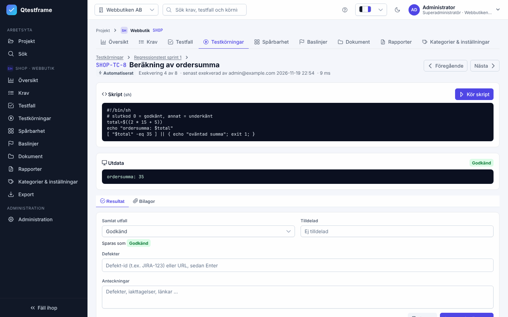

**Kör skript** kräver rollen **Ansvarig** (behörigheten `script.execute`) och serverinställningen `runner.enabled: true`. Om knappen saknas eller meddelar att exekveraren är avstängd, kontakta din administratör. CI-pipelines kan i stället rapportera utfall via API:et; se [CI-import](runs.md#importera-utfall-från-ci).

## Steg 10: Kontrollera spårbarheten och översikten

1. Välj **Spårbarhet**. Kraven är rader, testfallen kolumner och en markerad cell betyder *länkad*. Det färgade fältet först på varje rad visar täckningen (se förklaringen): SHOP-REQ-1 är nu **Underkänd** eftersom dess testfall underkändes. Kravlistan visar samma sak i kolumnen **Täckning**.
2. Klicka på en tom cell för att länka ett krav till ett testfall, eller på en markerad cell för att ta bort länken. **Bara länkade testfall** döljer testfall utan länkar.
3. Välj **Översikt**. Den sammanfattar kravtäckning, utfall av exekveringar, krav per status och kravnivå, testfall per status och de senaste körningarna.

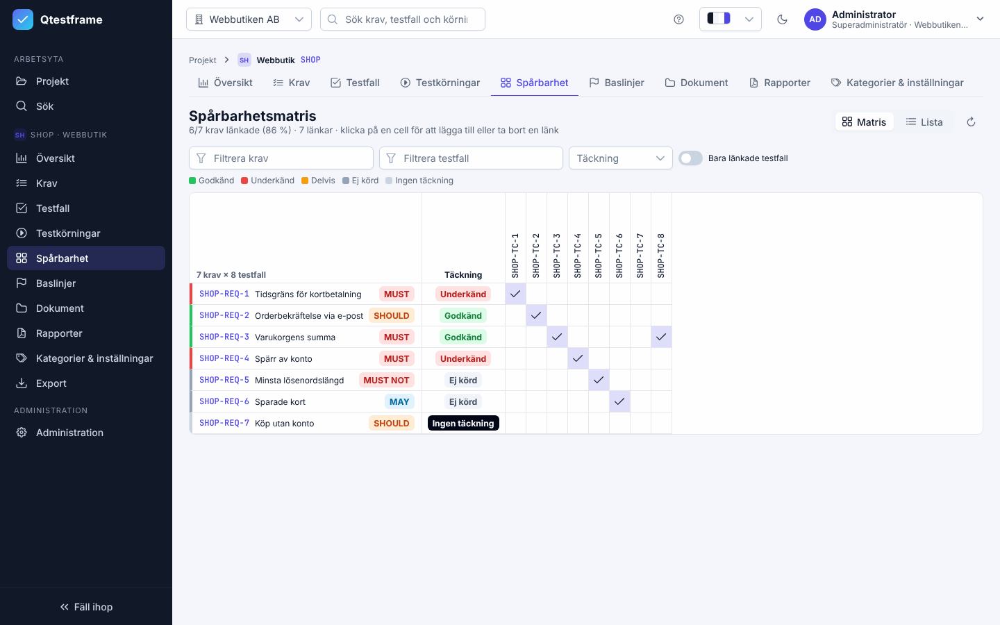

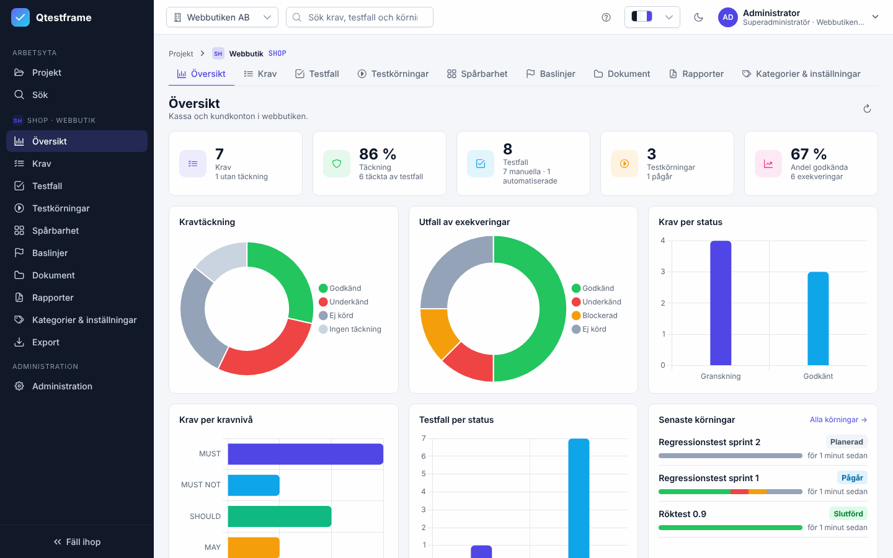

Hur täckningen beräknas förklaras under [Spårbarhet och täckning](traceability-and-coverage.md#så-beräknas-täckningen).

## Steg 11: Skapa en baslinje

Frys de aktuella versionerna av alla krav och testfall inför en release.

1. Välj **Baslinjer** och sedan **Ny baslinje**.
2. Ange **Namn** `Release 1.0`. Lämna **Filter (valfritt)** tomt för att ta med allt.
3. Välj **Skapa baslinje**.

Ändra nu något, till exempel tröskelvärdet för ett kriterium i SHOP-REQ-1. Gå tillbaka till **Baslinjer**, välj **Jämför** för *Release 1.0* och jämför med **Nuläget**: SHOP-REQ-1 visas under **Ändrade**, med de ändrade fälten och båda versionsnumren.

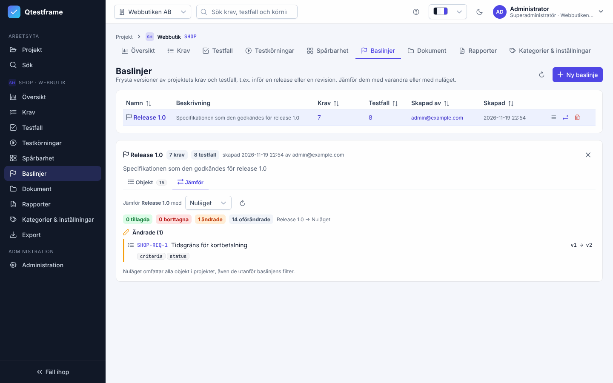

## Steg 12: Exportera eller ta fram en rapport

**Exportera data:**

1. Välj **Export**.
2. Välj **Format**: **XLSX** (ett blad per del), **CSV** (ett ZIP-arkiv när du väljer flera delar), **PDF** (utskriftsvänlig) eller **DOCX** (redigerbart dokument).
3. Kryssa i det **Innehåll** du behöver: krav, utvärderingskriterier, testfall med steg, spårbarhetsmatris, körningar och exekveringar.
4. Ange eventuellt ett filter som `folder:Kassa` och välj **Ladda ned**.

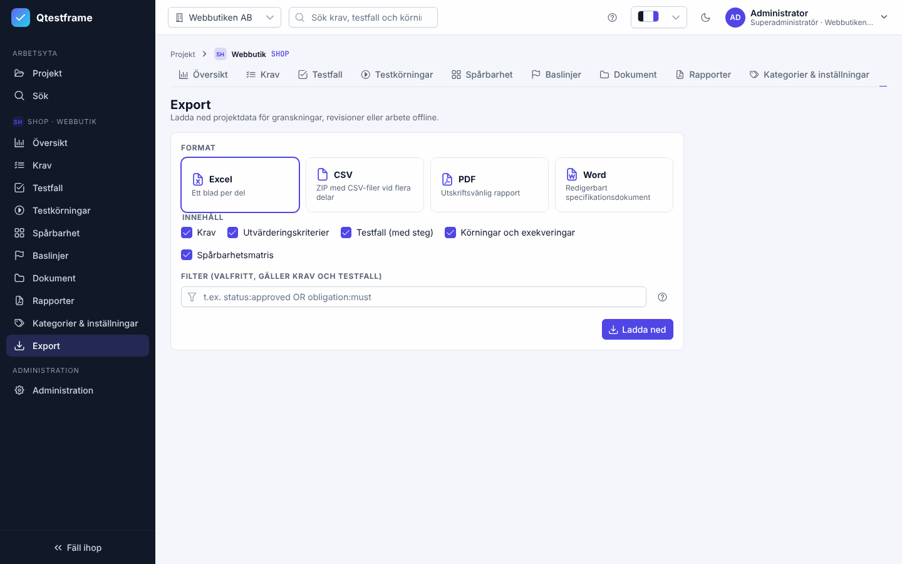

**Ta fram en rapport:** välj en standardrapport under **Rapporter**, till exempel **Kravtäckning** eller **Sammanfattning av körning** (för *Regressionstest sprint 1*), välj PDF, Word, Excel eller CSV och ladda ner den, eller spara den i projektets dokumentarkiv så att hela teamet hittar den under **Dokument**. Under **Anpassad rapport** väljer du själv objekttyp, filter, kolumner, gruppering och sortering. Se [Rapporter och export](reports-and-export.md).

## Det här har du lärt dig

Du har skapat ett projekt med mappar, skrivit verifierbara krav med hjälp av språkanalysen, lagt till utvärderingskriterier, förfinat det automatiskt skapade testfallet, återanvänt steg, genomfört en körning manuellt och automatiskt, registrerat en defekt, kontrollerat täckningen, fryst en baslinje och exporterat resultatet.

Läs sedan mer om [krav](requirements.md) och [testfall](tests.md), eller lär dig [frågespråket](search-and-filters.md) för att snabbt hitta vad som helst.
